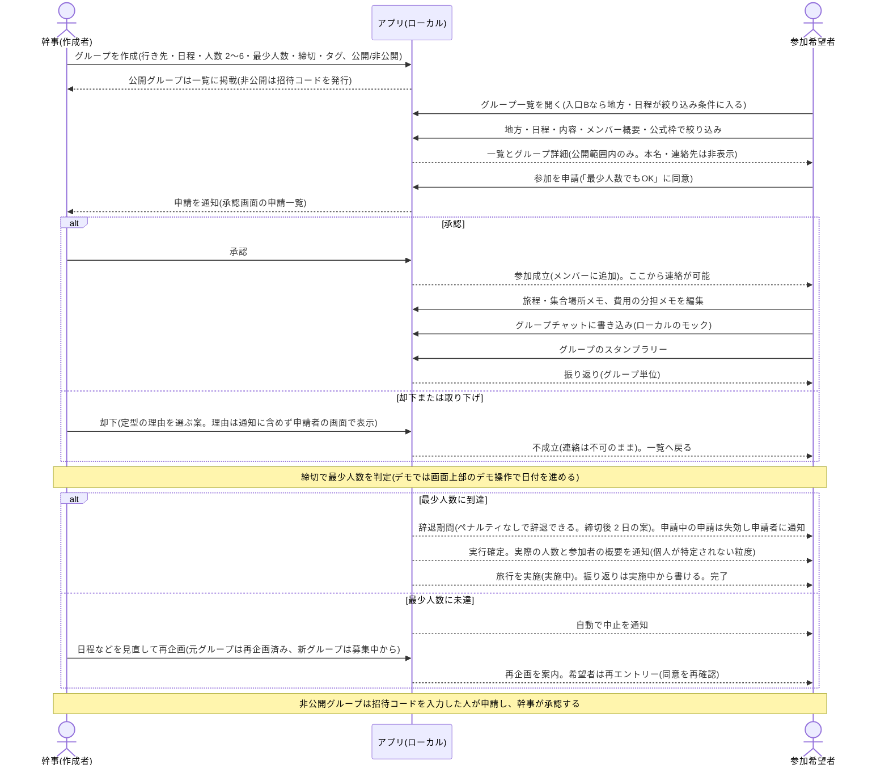

# 01 システム概要・目的

## 目的
何のために作るか、誰の何の課題を解決するか、どこまで作るかを定める。

## 含める内容
- システム概要・目的
- 位置づけ、前提
- 利用者のロール
- スコープ(対象・対象外)と段階案
- 用語集

## 現時点で分かっていること

### 目的・位置づけ
- 既存の観光キャンペーン・ラリーのサービスを、利用者にも自治体にも価値のあるサービスへ発展させる。 [決定]
- 位置づけは「旅の同行者探し」。恋愛・異性交際を目的とする表現は使わない。 [決定]
- 主顧客は自治体。地元事業者の協賛・手数料は副の収益。 [決定(顧客)/案(副の収益)]
- 観光(ラリー)は、出会いと共通の話題のきっかけを作る手段。移住は前面に出さない。 [決定、旧 design.md 1.2]
- 既存サイトの調査は公開フロントエンドの静的解析のみ。バックエンドは見えていない。 [事実、scratch.md 0]

### 利用者のロール
利用者のロールは次の 4 つ。認証はモックで、デモバーでユーザーを切り替えて各ロールの画面を確認する(既存の仕組み)。 [決定、判断 31・34]

| ロール | 主な利用 | 詳細設計 |
|---|---|---|
| 旅行者 | グループの作成(幹事)、一覧からの参加申請、グループ内の旅程メモ・チャット・費用メモ・スタンプ・振り返り | 01〜10 |
| 自治体(担当者) | 公式枠の作成、自治体向け集計(柱11)の閲覧 | 11、12 |
| 観光事業オーナー | 需要見込みと提案の閲覧(下記) | 13(作成中) |
| 地元の担い手 | 地元の同行枠の作成(柱12) | 11 |

- 幹事・参加希望者・メンバーはロールではなく、グループごとの立場(旅行者がなる)。 [案、契約書 3.6]
- ロールの値: 詳細設計の契約書 3.6 は `UserRole = "traveler" | "municipal" | "host"` の 3 値。観光事業オーナー(`business_owner` 相当)の追加は、モジュール 13 の作成と契約書の更新で行う。 [決定(ロールを追加する)/未決(値の名前)]

### 観光事業オーナー向けの需要見込みと提案(追加機能)
- 目的: 観光事業オーナーに、いつごろ、どの年代の旅行者が、どれくらいの人数で来るかの見込みを示し、その時期に提供するとよいサービスを提案する。 [決定、判断 31・32]
- ロール: 観光事業オーナー(上表)。 [決定、判断 31]
- 機能の概要: [決定、判断 32・33]
  - 過去の来訪者・アンケートの集計(`sample-data` から、ビルド時に集計済みデータだけを生成する。`app/scripts/build-seed.mjs` の拡張)に、未来の旅行日程(グループの日程と、未来日の旅行日程のダミーデータ約 100 件)を重ねて示す。
  - 提案は集計値とルールベースで作る。外部 API・LLM は使わない。
  - 個人レコードはアプリと設計書に持ち込まない。
- 柱の番号は未定(02 章の柱 1〜18 とは別に扱う)。 [未決]
- 詳細は [../feature/13-tourism-owner-insight.md](../feature/13-tourism-owner-insight.md)(別作業で作成中)を参照する。

### 競技ルール上の前提
- localhost 完結。外部API・外部DB・クラウドへの実行時依存なし。 [決定、rule.md 3・6]
- ダミーデータを使用。実在個人の情報は使わない。 [決定、rule.md 7]
- ログイン不要。ユーザー識別はダミーユーザーID等。 [決定、rule.md 3]
- 既存本番サイトのAPI・実利用者データは開発に使わない。 [決定、output.md 4.2]

### 対象外(案)
- 利用者課金による出会い機能、恋愛・結婚を主目的とした機能、宿泊・交通の販売。 [案、旧 design.md 1.3]

### 段階案
- 旧 design.md 3.1 の案は 3 段階(第1段階: 規制リスクが低い形で価値検証、第2段階: 同行の仕組み、第3段階: 継続と都市横断)。 [案]
- ただし第1段階が集合型イベント中心で、output.md 4.3 のデモ優先順位 1〜4(同行成立中心)と衝突している。**未決**(下記)。

### 用語(統一案)
| 用語 | 意味 |
|---|---|
| キャンペーン | 自治体等が開催するラリー単位。既存サービスのテナント単位 |
| 旅程 | 行き先(キャンペーン/地方)、日程、人数 |
| 同行 | 旅程が合う人・グループと一緒に旅すること |
| 同行候補 | グループ一覧に載っている、同じ地方・日程などの公開グループ |
| 希望 / 承諾 | 参加を申し込む操作(参加申請)/ 幹事が受け入れる操作。承諾で「成立」 |
| 集合型イベント | 主催者が決めた日程の少人数イベント |

(「相乗り」「マッチング」は旧資料の語。設計書では「同行」「候補」に統一し、恋愛を連想させる語を避ける。)

## システム全体像(図)

読む順は「構成図 → 利用フロー図 → 注記」。図は Mermaid で書いており、GitHub 等のビューアで描画される。柱の番号は 02 章に合わせる(柱の採否は未確定のため、図は案の段階)。グループ旅行(柱13〜16)と、グループ一覧方式(柱3・13 の更新、柱17 の追加)、実行条件と状態管理(柱18)を同じ図に統合している。 [案]

### 構成図

```mermaid
flowchart TB
  subgraph users["利用者"]
    K["幹事(グループ作成者)"]
    T["旅行者(参加希望者)"]
    L["地元の同行者(地元の担い手)"]
    M["自治体担当者"]
    O["観光事業オーナー"]
  end

  subgraph entry["入口"]
    EA["入口A: グループ一覧を開いて探す"]
    EB["入口B: 外部リンク(地方・日程を絞り込み条件として引き継ぐ)"]
  end

  subgraph app["アプリ本体 (Next.js / TypeScript, localhost 完結)"]
    direction TB
    subgraph exist["既存機能の流用部分"]
      X1["スタンプ"]
      X2["スポット"]
      X4["通知(既存。グループの通知は別に持つ)"]
      X6["特典"]
    end
    subgraph pa["A 中核"]
      P1["1 キャンペーン・地方の選択(絞り込みの一部)"]
      P2["2 旅程入力(日程・人数 2〜6人、グループ作成時)"]
      P3["3 グループ一覧(探す。公開グループ・公式枠)"]
      P17["17 検索・絞り込み(地方・日程・空き、内容・タグ、メンバー概要、公式枠)"]
      P4["4 参加の希望と承諾(幹事が承認、承諾後のみ連絡)"]
    end
    subgraph pd["D グループ(幹事=作成者が参加を承認、2〜6人)"]
      P13["13 グループ作成・公開・参加申請・承認(公開/非公開)"]
      P14["14 旅程・集合場所メモ"]
      P15["15 グループチャット(ローカルのモック)"]
      P16["16 費用の分担メモ(金銭の授受なし)"]
      P18["18 実行条件と状態管理(最少人数・締切、辞退期間、実行確定・中止・再企画)"]
    end
    subgraph pb["B 安全"]
      P5["5 プロフィール公開範囲"]
      P6["6 通報・ブロック"]
      P7["7 本人確認・18歳確認(モック)"]
      P8["8 禁止表現の制御(性別絞り込み禁止)"]
    end
    subgraph pc["C 周辺"]
      P9["9 同行ラリー(グループ単位のスタンプ・振り返り)"]
      P10["10 外部リンク入口B"]
      P11["11 自治体向け集計(個人を特定しない)"]
      P12["12 地元の同行枠・集合型イベント(公式枠)"]
      X3["写真(ダミー投稿。9 で新規)"]
      X5["アンケート 5 項目(9 で新規)"]
    end
    subgraph pe["E 追加機能(柱番号は未定)"]
      BX["需要見込みと提案(観光事業オーナー向け)"]
    end
  end

  D1[("ダミーデータ seed.json (ローカルのみ)")]

  K --> P2
  P2 --> P13
  P13 -->|公開グループ| P3
  T --> EA
  T --> EB
  L --> EA
  M --> P11
  M --> P12
  EA --> P17
  EB --> P10
  P10 --> P17
  P1 --> P17
  P17 --> P3
  P12 -->|公式枠フラグ| P3
  L --> P12
  P3 --> P4
  P4 -->|参加申請| P13
  P13 -->|幹事が承認して成立| P14
  P13 --> P15
  P13 --> P16
  P13 -->|最少人数・締切を設定| P18
  P18 -.->|最少/定員/現在人数・状態を表示| P3
  P18 -->|通知| X4
  P18 -->|中止後に再企画| P13
  P13 --> P9
  P15 --> X4
  P6 -.-> P15
  P8 -.-> P15
  P5 -.-> P3
  P8 -.-> P3
  P8 -.-> P17
  P6 -.-> P4
  P7 -.-> P4
  P9 --> X1
  P9 --> X2
  P9 --> X3
  P4 --> X4
  P9 --> X5
  P9 --> X6
  O --> BX
  app --> D1

  classDef existing fill:#e8eef7,stroke:#4a6fa5,color:#1a2a44
  classDef added fill:#fff3d6,stroke:#c28a00,color:#3d2c00
  classDef store fill:#e6f4ea,stroke:#2e7d32,color:#12351a
  class X1,X2,X4,X6 existing
  class P1,P2,P3,P4,P5,P6,P7,P8,P9,P10,P11,P12,P13,P14,P15,P16,P17,P18,X3,X5,BX added
  class D1 store
```

凡例: 青系 = 既存機能の流用(スタンプ、スポット、通知、特典)。黄系 = 新規追加の柱(1〜18。13〜16 がグループ、17 が一覧の絞り込み、18 が実行条件と状態管理)と、柱 9 で新規に作る写真・アンケート、追加機能(需要見込みと提案)。緑 = ローカルのデータ。実線 = 利用の流れ・呼び出し、点線 = 安全機能による制御(一覧表示・参加申請の前提)。

### 主要な利用フロー

### 図の読み方と注記
- 構成図は上から「利用者 → 入口 → アプリ本体 → データ」の順。アプリ本体の中で、青系が既存の流用、黄系が新規の柱。入口A は一覧を開いて探すところから、入口B は外部リンクの地方・日程を絞り込み条件として引き継いで一覧に入る。以降は同じ流れ。 [案、04 章]
- 探し方・参加方式: 任意のユーザーがグループ(旅行プラン)を作成・公開し、他のユーザーが一覧から探して参加を申請、幹事(作成者)が承認して成立する。招待を受けてから参加する形が基本ではない。 [決定、オーナー]
- グループ: 1対1の同行は「2人のグループ」として扱い、グループを唯一の単位にする(2〜6人)。幹事は参加承認の役割で、それ以外のメンバーは対等。 [決定(2〜6人・幹事承認・4機能)/案(流れの細部)]
- 一覧公開が基本で、招待コードは補助。公開グループと、招待コードで参加する非公開グループの2種類。 [決定]
- 公式枠: 自治体のおすすめプランは、一覧に載る公式のグループとして表す(柱12)。 [案、02 章]
- 利用フロー図では、承認前は本名・連絡先を見せず、連絡もできない。連絡は参加成立後のみ。 [案、02 章の受け入れ条件の叩き台に準ずる]
- 実行条件: 幹事が最少人数と締切を設定し、締切までに最少人数に達したら実行確定する。確定前に辞退期間を設け、確定時に実際の人数と参加者の概要を通知する。未達なら自動で中止し、再企画して再エントリーする方向。状態遷移は 04 章。 [決定(方向)/案(細部)、02章 柱18]
- 再企画は独立した状態とし、状態は 8 つ(募集中、最少人数到達、辞退期間、実行確定、実施中、完了、中止、再企画済み)。幹事は実行確定の前まで中止でき、実行確定後の辞退で 2 人未満になったら中止する。 [決定、判断 5・9・10・29]
- 写真投稿とアンケートは、既存の `app/` に実装が無いため流用ではなく、柱 9(詳細設計 08)でグループ専用のダミー写真とアンケート(5 項目)として新規に作る。 [事実(app/ に実装なし、契約書 12 章)/決定(写真はダミー、アンケート 5 項目、判断 15・19・25)]
- 通知は既存の `/api/v2/notifications` と既存の画面を変更せず、グループの通知(詳細設計 10)を別に持つ。 [案、契約書 9.2]
- 特典: グループの達成でメンバー全員に個人特典を付与する。記録は新しいストアに置き、既存の特典機能(`/api/v2`)とは連動させない。 [決定、判断 13・21]
- 図中に外部サービス(地図 API、外部 DB、クラウド)は描いていない。実行時依存を持たないため。 [決定、rule.md 3・6]

| 区分 | 図の内容 | 根拠 |
|---|---|---|
| 事実 | localhost 完結、ダミーデータ(seed.json)、Next.js / TypeScript | AGENTS.md 1、rule.md |
| 推定 | 既存機能の流用範囲(スタンプ、スポット、通知、特典)。写真投稿・アンケートは app/ に実装が無いことを確認し、流用から外した | 02 章の既存からの差分、契約書 12 章 |
| 決定 | ロール 4 種(観光事業オーナーを含む)、需要見込みと提案の追加 | 判断 31〜34 |
| 案 | 柱 1〜18 の構成、入口A・B の合流、安全機能の位置づけ、利用フロー | 02・04 章 |
| 未決 | **デモの形**(同行成立中心か、集合型イベント中心か)。本図は一覧から申請・承認で成立する流れを描いたが、確定ではない。柱 12 の位置づけも連動して変わりうる | 本章の未決 |
| 要確認 | 既存システムとの接続方式、DB の有無(図は seed.json のみ)、入口B の外部リンクを競技でどう再現するか | 03 章 |

### グループ旅行・グループ一覧の位置づけ
- 任意のユーザーがグループ(旅行プラン)を作り、他のユーザーが一覧から探して参加を申請する。幹事(作成者)が承認して成立する。 [決定、オーナー]
- 幹事の権限は参加承認が中心で、それ以外のメンバーは対等。幹事の権限範囲(除名、プラン編集、設定変更)と、幹事が退会・不在になったときの引き継ぎは未決。 [決定(承認)/未決(範囲・引き継ぎ)、12章 #13・#14]
  - 2026-11-09 時点: 幹事は実行確定の前まで中止できる(理由の選択が必須)。 [決定、判断 9・29] 幹事は退会できず、抜ける場合は中止を使う。除名は設けない。設定変更は詳細設計の暫定案(定数で切替)。 [案、契約書 4.5、詳細設計 01]
- 人数は 2〜6人。1対1は 2人のグループとして扱い、データ構造を一本化する。 [決定、オーナー]
- 一覧で表示・絞り込みできる項目: 地方・日程・人数(空き)/プランの内容(行き先・テーマ・タグ)/メンバー情報の概要(人数、年代など)/自治体のおすすめプラン(公式枠)。性別での絞り込みは設けない。 [決定(4項目)/案(粒度、07 章)]
- 公開設定は公開と非公開の2種類。一覧公開が基本、招待コードは補助。 [決定]
- グループ内で共有・管理するのは、旅程・集合場所メモ、グループ単位のスタンプラリー、グループチャット、費用の分担メモの4つ。 [決定、オーナー]
- チャットや通知は外部サービスを使わず、ローカルのダミーデータ/モックで表現する。 [案、rule.md 3・6 に整合]
- 決済・送金は対象外。費用は「メモ」に限る。 [案]

| 用語 | 意味 |
|---|---|
| グループ | 旅を共にする 2〜6人の集まり。作成者が幹事。1対1も 2人のグループ |
| 幹事 | グループの作成者。参加申請を承認する。それ以外の権限は未決 |
| メンバー | グループの参加者。状態(参加中/退会)と役割(幹事/メンバー)を持つ |
| 参加申請 | グループ一覧から探した人が参加を希望する操作。状態は申請中/承認/却下/取り下げ/失効(受付が終わったときに申請中のものが失効する) |
| 公式枠 | 自治体のおすすめプラン。一覧で公式と分かる表示が付く |
| 最少人数 | 実行に必要な最少の人数。幹事が設定する(幹事を含む。範囲 2〜定員、初期値は定員と 3 の小さい方の案。1人は不可)。一覧に定員・現在人数とともに表示する |
| 締切 | 最少人数に達したかを判定する日。幹事が設定する(日付で持ち、その日を含む)。デモでは日付を進めて判定する |
| 辞退期間 | 実行確定の前に、ペナルティなしで辞退できる期間。締切の後に置き、長さは 2 日(案) |
| 実行確定 | 締切までに最少人数に達し、辞退期間を経て実行が確定すること。確定時に実際の人数と参加者の概要を通知する |
| 中止 | 実行を取りやめること。締切までに最少人数に達しない場合と辞退期間中の辞退で最少人数を割った場合は自動、実行確定後の辞退で 2 人未満になった場合も自動。幹事は実行確定の前まで中止できる [決定、判断 9・10・29] |
| 再企画 | 中止したグループの日程などを見直して、新しい募集を作ること。元グループは「再企画済み」(独立した状態)になり、新グループは募集中から始まる。希望者は再エントリーする [決定、判断 5] |
| 辞退/退会 | 実行確定の前に抜けることを辞退、実行確定の後に抜けることを退会と呼ぶ。記録は残し、抜けた人は「元メンバー」と表示する [決定(表示)、判断 18] |
| 自治体担当者 | 自治体ロールの利用者。担当する自治体が決まっている |
| 地元の担い手 | 地元の同行枠を作る利用者(ロール)。構成図の「地元の同行者」 |
| 観光事業オーナー | 需要見込みと提案を見る利用者(ロール)。判断 31 で追加 |

## 未決
- **デモの形**: 同行成立を中心にするか、集合型イベントを中心にするか。 [未決、オーナー判断]
- グループ旅行・一覧方式の未決(幹事の権限・引き継ぎ、却下理由、一覧の公開範囲、非公開グループ、公式枠、退会・除名、チャットの不適切対応など): 12 章(#7〜#18)。参加承認(#6)は幹事承認で決定済み。デモの形との関係: 同行成立中心なら「一覧から探して申請 → 承認 → 成立」、集合型イベント中心なら「公式枠(イベント)が一覧の中心で、参加者がグループ化」になり、どちらにもグループ一覧は関わる。決めない。 [未決]
- 実行条件(柱18)の未決(最少人数の初期値・範囲、辞退期間、辞退で最少を割ったとき、同意の文言、再企画の具体、定員到達時、幹事の退会・不在時、通知、日付の進め方): 12 章 #19〜#26。デモの形(#1)との関係は、同行成立中心なら「申請 → 最少人数到達 → 実行確定」が中心の流れ、集合型イベント中心なら公式枠の催行判定(最少催行人数)に相当する。どちらでも状態遷移は共通に使える。決めない。 [未決]
  - 2026-11-09 時点: 再企画の状態、幹事の中止、確定後の 2 人未満での中止、通知の種類はオーナー判断で確定した(判断 1・5・9・10・22・29)。残りは詳細設計の推奨案で実装する。状況は 12 章。
- 観光事業オーナー向け機能の柱の番号、ロールの値の名前。 [未決]
- 規制方針、本人確認の水準、既存システムとの関係は 12 章。
