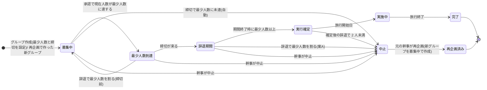

# 04 画面一覧・画面遷移

## 目的
画面一覧、各画面の設計、遷移(入口 A・B を含む)を定める。

## 含める内容
- 画面一覧(ID、名称、対応する柱)
- 画面設計(項目、操作、状態、スマホ幅での表示)
- 画面遷移図
- 入口 A(アプリ内で探索)と入口 B(外部リンク)

## 現時点で分かっていること

### 利用者の流れ(案、ideas.md 5.5 / output.md 3.2) 
グループ一覧(柱3、検索・絞り込み 柱17) → グループ詳細(参加前の公開情報) → 参加申請(柱4、13) → 幹事が承認 → 参加成立 → 連絡 → グループ詳細(旅程・集合場所メモ 14、チャット 15、費用メモ 16、スタンプ 9) → 振り返り。 [決定(方式)/案(画面構成)]
- 探し方・参加方式(オーナー決定): 任意のユーザーがグループ(旅行プラン)を作成・公開し、他のユーザーが一覧から探して参加を申請する。幹事(作成者)が承認して成立する。招待を受けてから参加する形が基本ではない。 [決定]
- 作る側の流れ: グループ作成(公開/非公開、行き先、日程、人数 2〜6、**最少人数、締切**、タグ) → 公開グループは一覧に載る → 参加申請が届く → 幹事が承認または却下。非公開グループは一覧に載らず、招待コードを知る人が申請する。 [決定(流れの骨格)/案(画面)]
- 実行条件の流れ(柱18): 参加申請で「最少人数でもOK」に同意 → 締切までに最少人数に達したら辞退期間を経て実行確定(確定時に実際の人数と参加者の概要を通知) → 実施中 → 完了。締切までに最少人数に達しなければ自動で中止し、日程などを見直して再企画し、再エントリーする。状態遷移は下の「グループの状態遷移」。 [決定(流れの方向)/案(状態名・細部)]
- 1対1の同行は 2人のグループ。2人のグループに申請して承認されれば、1対1の同行になる。 [決定、2人のグループ]
- 入口 A: 一覧を開き、絞り込みながら探す(行き先未定でもよい)。入口 B: 外部リンクの地方・日程を、一覧の絞り込み条件の初期値として引き継いで一覧に着地する(柱10)。以降は同じ流れ。キャンペーン・地方選択(柱1)は絞り込みの一部として使う。 [案]
- 自治体担当者向けに集計画面(柱11)。地元の人向けに同行枠の登録・申込(柱12)。

### 画面の候補(仮) 
| 区分 | 画面 | 柱 |
|---|---|---|
| 利用者 | キャンペーン一覧 / 地方選択(一覧の絞り込みの一部) | 1 |
| 利用者 | 旅程入力(グループ作成時の日程・人数) | 2 |
| 利用者 | **グループ一覧**(カード表示。公式枠の表示を含む。**最少人数・定員・現在人数と状態を表示**)、**検索・絞り込み**(地方、日程、人数・空き、タグ・テーマ、メンバー概要、公式枠のみ。状態での絞り込みは案) | 3、17、18 |
| 利用者 | **グループ詳細(参加前)**(公開範囲内の情報のみ: プラン内容、空き、**最少人数・定員・現在人数、締切、状態**、メンバー概要、幹事の表示名、公式枠の表示。本名・連絡先は非表示) | 3、5、13、18 |
| 利用者 | **参加申請**(ひとこと、**「最少人数でもOK」の同意の確認**、申請状況の確認、取り下げ) | 4、13、18 |
| 利用者 | 成立後の連絡、待ち合わせ相談 | 4 |
| 利用者 | プロフィール編集(公開範囲) | 5 |
| 利用者 | 通報・ブロック | 6 |
| 利用者 | 本人確認・18歳確認(モック) | 7 |
| 利用者 | 同行ラリー(グループ単位のスタンプ)、振り返り | 9 |
| 利用者 | **グループ作成**(名称、行き先、日程、人数上限 2〜6、**最少人数**、**締切**、タグ、**公開/非公開の設定**)。作成者が幹事になる。最少人数の範囲・初期値は案(02章) | 13、2、18 |
| 利用者 | **辞退の操作**(参加者が辞退期間中に辞退。ペナルティなしと明記。確認ダイアログ。確定後の辞退の扱いは未決 → 確定後も退会でき、2 人未満になったら中止 [決定、判断 10]) | 18 |
| 利用者 | **グループの状態表示と進行状況**(状態バッジ、最少人数までの残り人数、締切、辞退期間の終了日。スマホ幅ではグループ詳細の上部) | 18 |
| 利用者 | **中止の表示と再企画・再エントリー**(中止の理由「最少人数に達しなかった」、再企画グループへの導線、再エントリーの意思確認と同意の再確認) | 18 |
| 幹事 | **再企画の画面**(中止したグループの内容を複製、日程などの見直し、前回の参加者への案内)。幹事の条件変更(締切の延長など)の画面 | 18 |
| 利用者 | **通知の一覧**(ローカルのダミー通知。最少人数到達、辞退期間の開始・終了、実行確定、中止、再企画の案内、参加申請の受付・承認・却下・失効など。通知の種類は 05 章。必須 12 種 [決定、判断 1・22]) | 18 |
| デモ | **日付を進める操作**(締切・辞退期間の判定をダミー日付で進めるボタン。モックと分かる表示を付ける) | 18 |
| 幹事 | **参加申請の承認画面(申請一覧)**(申請者の公開プロフィール、承認・却下。却下理由の要否は未決) | 13、4 |
| 利用者 | 招待コード(非公開グループ向け。幹事がコードを表示、参加希望者が入力して申請) | 13 |
| 利用者 | グループ詳細(旅程、集合場所メモ、スタンプ、チャット、費用メモへのタブ。スマホ幅は下部タブ) | 13〜16、9 |
| 利用者 | 旅程・集合場所メモ(全員が編集可) | 14 |
| 利用者 | グループチャット(ローカルのモック。定型文のみの案あり、07章) | 15 |
| 利用者 | 費用の分担メモ(「メモであり送金はできない」と画面に明記) | 16 |
| 利用者 | メンバー一覧(状態、幹事の表示、退会、通報・ブロックへの導線。除名の有無は未決) | 13、6 |
| 幹事 | 申請者の通報・ブロックの導線(承認画面から) | 6、13 |
| 利用者 | 外部リンクからの着地 | 10 |
| 自治体 | 集計画面 | 11 |
| 地元の人/利用者 | 同行枠の登録、集合型イベントの申込 | 12 |

### 詳細設計で追加・確定した画面(2026-11-09)
上の候補のうち、詳細設計とオーナー判断で追加・確定した画面とパス。パスは契約書 2.2。 [案(パス・構成)/決定(判断番号を付けたもの)]

| 区分 | 画面 | パス | 柱 | 根拠 |
|---|---|---|---|---|
| 利用者 | グループ一覧・検索 | `/[campaign]/groups` | 3、17 | 契約書 2.2 |
| 利用者 | グループ詳細(参加前・参加後。タブは `?tab=` で切替。子画面は `edit`、`members`、`review`、`replan` など) | `/[campaign]/groups/[groupId]` | 3、13〜16、9、18 | 契約書 2.2 |
| 利用者 | グループ作成 | `/[campaign]/new-group` | 2、13、18 | 判断 26 |
| 利用者 | 招待コード入力(コードを入力し、照合・プレビュー・参加申請を同じ画面で行う。コードを URL に残さない) | `/[campaign]/invite` | 13 | 判断 26・27 |
| 利用者 | 通知の一覧(別画面。グループ系のページのヘッダーにベルを置き、未読数を表示) | `/[campaign]/notifications` | 18 | 判断 1・22、契約書 9.2 |
| 利用者 | 入口B の着地ページ(受け取れなかった条件があるときだけ表示し、受け取れた条件と受け取れなかった項目名を示す。それ以外は一覧へそのまま遷移) | `/[campaign]/entry` | 10 | 判断 7 |
| デモ | ダミー外部リンク集(自治体の観光サイト等に置かれたリンクをローカルで再現する。モックと明示) | `/[campaign]/external-links` | 10 | 詳細設計 11 |
| 利用者 | プロフィール編集(公開範囲)、ブロック一覧、本人確認・18歳確認(モック) | `/[campaign]/mypage/profile`、`/mypage/blocks`、`/mypage/verification` | 5、6、7 | 詳細設計 09 |
| 自治体 | 自治体向け集計 | `/[campaign]/admin/stats` | 11 | 契約書 2.2 |
| デモ | デモ操作(ユーザー切替、日付を進める操作。画面上部の DemoBar) | (各画面の上部) | 18 | 詳細設計 00 |
| 観光事業オーナー | 需要見込みと提案 | 詳細設計 13 で定める | (未定) | 判断 31〜34 |

- 同行枠の登録画面と集合型イベントの申込画面は作らない。公式枠・同行枠・イベントは一覧に並べ、申込は参加申請を使う。 [案、詳細設計 11]
- 申請者の通報・ブロックの導線は、通報の対象をメッセージ・グループ・ユーザーに限るため、申請者は「ユーザー」として通報する。旅程の項目、費用メモ、振り返りのメモ・写真には通報の導線を置かない。 [決定、判断 28]

### グループの状態遷移(案、柱18)
状態名と遷移の細部は案(オーナー決定は「状態遷移を明示し、画面と通知に反映する」こと)。2026-11-09 のオーナー判断で、再企画を独立した状態とすること(状態は 8 つ)、幹事の中止(実行確定の前まで)、実行確定後の辞退で 2 人未満になったときの中止が確定した。 [決定、判断 5・9・10・29] 辞退期間の位置づけ(締切後に置く案A)と、辞退期間中の辞退で最少人数を割ったときの中止は、詳細設計の推奨案。 [案、12章 #20・#21]

| 状態 | 意味 | 画面・通知への反映 |
|---|---|---|
| 募集中 | 締切前で、現在人数が最少人数に満たない | 一覧とグループ詳細に「あと◯人で実行」を表示。申請を受け付ける |
| 最少人数到達(成立見込み) | 現在人数が最少人数以上で、締切前。定員までは申請を受け付ける | 「最少人数に達しました」を幹事と参加者へ通知。まだ確定ではないと表示する。最少人数を割って募集中に戻るときは通知せず、状態表示で知らせる [案] |
| 辞退期間 | 締切後、実行確定の前に辞退できる期間(案A。長さ 2 日の案) | 開始・終了を通知。辞退の操作を目立たせる。ペナルティなしと明記。申請中の申請は失効し、申請者へ失効を通知する [決定、判断 22] |
| 実行確定 | 辞退期間を終えて最少人数以上が残り、実行が確定 | 「実際の人数と参加者の概要」を参加者へ通知。チャット等を使えるまま維持。費用の分担メモはこの状態から使える [決定、判断 3] |
| 実施中 | 旅行の期間中 | スタンプラリー(柱9)を使う。振り返りも書ける [決定、判断 16]。状態バッジを表示 |
| 完了 | 旅行が終わった | 振り返り(柱9)へ。費用メモは編集できる [決定、判断 23]。一覧では終了扱い |
| 中止 | 自動の中止(締切で未達、辞退期間中の辞退で最少割れ、確定後の辞退で 2 人未満)または幹事の中止 | 中止と理由を参加者と申請中の申請者へ通知。確定後の 2 人未満による中止は、本文で再企画できることを案内する。再企画の導線を示す。一覧では通常は非表示 |
| 再企画済み | 中止したグループを元の幹事が再企画した後の元グループ。新グループは「募集中」から始まり、元グループを参照する | 前回の参加者と、中止で失効した申請者へ案内を通知(辞退者と幹事を除く)。元グループに「再企画済み」と再企画先を表示 |

- 状態の値とラベル: `recruiting` 募集中、`min_reached` 最少人数到達、`withdrawal_period` 辞退期間、`confirmed` 実行確定、`in_progress` 実施中、`completed` 完了、`cancelled` 中止、`replanned` 再企画済み。 [決定(8 状態、判断 5)/案(値、契約書 4.1・10.1)]
- 中止の理由は 5 種(締切までに最少人数に達しなかった、辞退期間中の辞退で最少人数を下回った、実行確定後の辞退で 2 人未満になった、幹事が中止した、幹事が不在になった)。幹事の中止は理由の選択を必須とする。幹事は退会できないため「幹事が不在になった」はデモでは発生しない。 [決定(幹事の中止、判断 9)/案(理由の区分、契約書 4.3・10.2)]
- 状態ごとにできる操作(申請の受付、旅程・チャットの編集、費用メモ、スタンプ、振り返り、辞退、幹事の中止、条件変更、再企画)は契約書 4.4。 [決定(判断 3・16・23・29)/案(その他)]
- 定員到達は状態ではなく表示(「満員」)として扱う案。満員で締め切るか、締切まで待つかは未決。 [案、12章 #24] 詳細設計の推奨は締切まで待つ案(案B)。
- 実行確定後に幹事が不在になる場合は上の図に含めていない。幹事は退会できないため、デモでは発生しない。 [案、契約書 4.3・4.5]
- 辞退期間中の辞退で最少人数を割ったときに募集中に戻す案(案B)は、詳細設計で切替用の分岐として残すが、既定では使わない。 [案、詳細設計 04]
- 締切・辞退期間の判定は、デモでは「日付を進める」操作(`/api/demo/clock`)で進める。実時間の経過に依存しない。 [案、12章 #26、契約書 7.5]

### UI 方針
- スマホ・タブレット幅を前提。画面の文言と名称は「旅の同行者探し」に統一。恋愛を連想させる文言、性別での絞り込みは設けない(柱8)。 [決定]
- モックの部分は画面上で分かるように表示する。 [案、output.md 4.5]

### グループ関連の画面遷移(案)
- 参加する側: グループ一覧(絞り込み。入口B は条件を引き継ぐ) → グループ詳細(参加前) → 参加申請 → 申請中 → 承認で参加成立 → グループ詳細(参加後)。却下または取り下げなら一覧へ戻る。 [案]
- 作る側(幹事): グループ作成(公開/非公開) → グループ詳細 → 参加申請の承認画面(申請一覧) → 承認でメンバーに追加、却下で申請者へ通知。 [案]
- 非公開グループ: 招待コード入力 → グループ詳細(最小限の公開情報) → 参加申請 → 幹事の承認(コードのみで承認不要にするかは未決、12章 #17)。 [未決]
  - 2026-11-09 時点: 招待コード入力画面 `/[campaign]/invite` でコードを入力し、同じ画面でプレビュー(最小限の公開情報)を見て参加申請する。コードは URL・ブラウザの保存領域・ログに残さない。申請は幹事の承認を要する。承認後は通常のグループ詳細を表示する。 [決定(コード入力方式、判断 27)/案(承認を要する、契約書 7.2)]
- 実行条件(柱18): グループ詳細(状態を表示) → 締切到来 → 最少人数到達なら辞退期間(辞退の操作を表示) → 実行確定の通知(実際の人数と参加者の概要) → 実施中 → 完了。未達なら中止の通知 → 再企画(幹事が日程などを見直し) → 前回の参加者へ案内 → 各自が再エントリー(最少人数でもOK の同意を再度確認)。通知は通知一覧で見られる。 [案]
- 参加後: グループ詳細 → { 旅程・メモ / チャット / 費用メモ / スタンプ / メンバー一覧 } → 旅行後に振り返り。メンバー一覧から退会、通報・ブロックへ移れる。 [案]

## 未決
- 画面の確定(柱の採否に依存)。画面モックは `docs/design/mockup/`(別作業で作成中)。
- 観光事業オーナー向けの画面(詳細設計 13 で定める)。 [未決]
- 実行条件に関する画面(最少人数・締切の入力範囲、辞退の操作、中止・再企画の導線、通知の画面、日付を進める操作)の細部は 12章 #19〜#26 の決定後に確定する。 [未決]
- デモのシナリオ: 旧 output.md 4.4 は同行成立中心。集合型イベント中心にする場合は作り直し。 [未決、01 章のデモの形]
- 候補が少ないとき(コールドスタート)の見せ方(人数表示の扱い)。 [未決、旧 ideas.md 5.6]
- 連絡機能の実装範囲(簡易モックか)。チャットは外部サービスを使わずローカルのモックで表す。 [案]
- 幹事の承認画面に載せる項目(申請者の公開プロフィールの範囲、却下理由)、グループ一覧の表示項目の粒度は 12章 #15・#16。退会・除名、チャット制御の画面は #7〜#9、幹事の権限・引き継ぎ(#13・#14)の決定後に確定する。 [未決]
- デモの形との関係: 同行成立中心なら「成立→2人グループ→招待」、集合型イベント中心なら「イベント(公式枠)を一覧に載せ、参加者がグループ化」で、どちらでも一覧・詳細画面は共通に使える。決めない。 [未決、01章]
