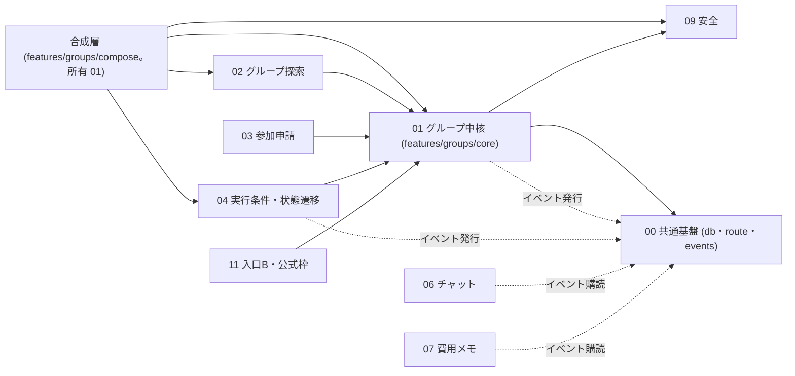
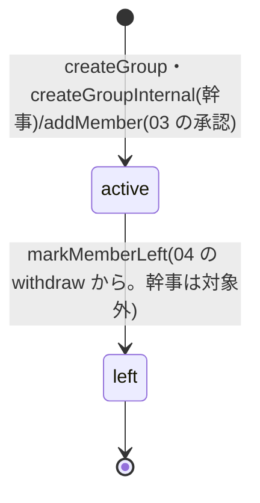
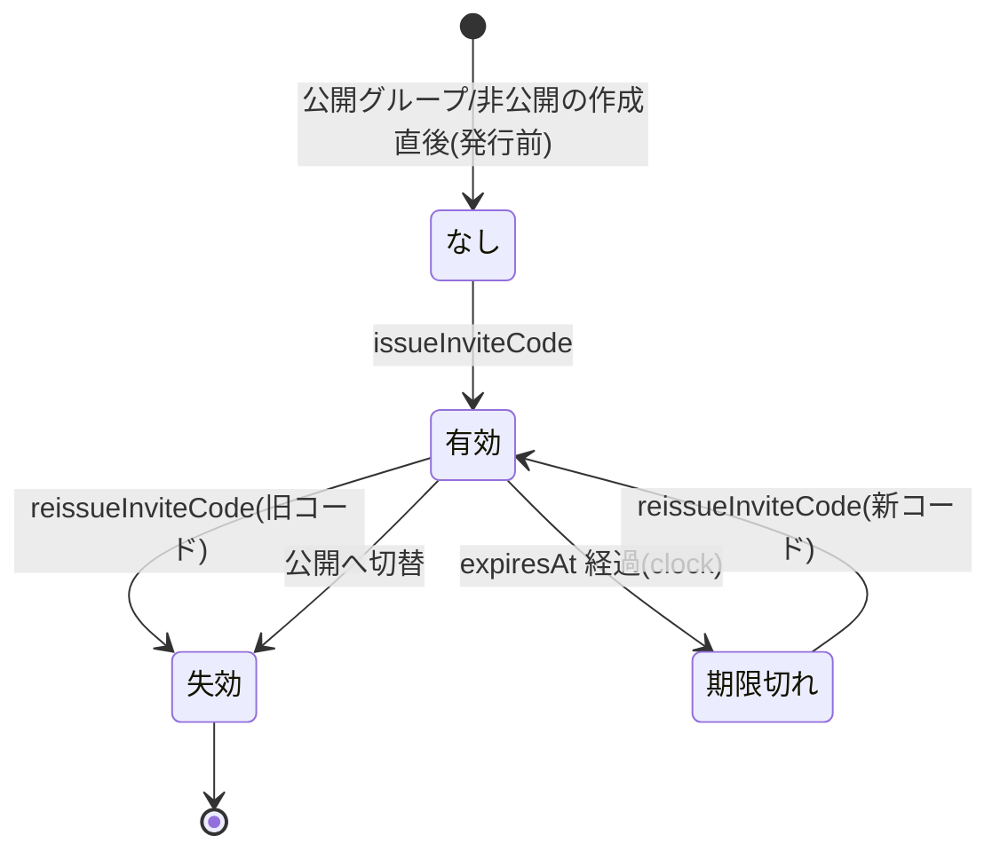

# 01 グループ中核

状態の凡例: [事実]/[推定]/[決定]/[統一]/[案]/[未決]/[要確認]。[統一] は詳細設計 統一仕様([_unified-contracts.md](_unified-contracts.md)。以下「契約書」)で確定した事項。docs/design と矛盾する場合は docs/design を正とし、モジュール間の名前・署名・パス・値は契約書を正とする。本書の ID 接頭辞は `GRP`(GRP-API 〜 API、GRP-FN 〜 関数、GRP-VAL 〜 検証規則、GRP-ERR 〜 エラー、GRP-UI 〜 画面部品、GRP-T 〜 試験、GRP-TASK 〜 実装タスク、GRP-Q 〜 設計上の確認事項)。「第N章」「第N.M節」は本書の章節、「NN 章」は docs/design の章、「契約書 N.M」は契約書の節を指す。「見送り(契約書 16.2)」は、主ルートを優先するために作り込みを後回しにする試験・タスク・記述の印で、削除せずに残す。

## 1. 概要と責務 / 対応する柱

- グループ(旅行プラン)の作成・設定・公開/非公開・招待コード、メンバーと役割(幹事/メンバー)、メンバーの退会記録の受け口、旅程入力(行き先・日程・人数上限 2〜6)を扱う。柱2、13。 [案]
- 幹事の権限は「参加承認」のみを確定事項とし、設定変更は [未決 #13] の暫定案で実装する(第7.2節)。除名は設けない。 [決定(承認)/未決(範囲)]
- 利用者がグループから抜ける操作(辞退・退会)は 04 の `POST /api/groups/[groupId]/withdraw` だけが受け付ける。01 は記録の受け口 `markMemberLeft` だけを持ち、状態の判定はしない。 [統一(契約書 4.5)]
- **項目の所有モジュール(責務境界)**: Group は 1 つのレコードだが、項目を書き込めるモジュールは項目ごとに 01 と 04 に分かれる。 [統一(契約書 8)]

| 区分 | 項目 | 書き込むモジュール | 備考 |
|---|---|---|---|
| 設定項目(01 が持つ) | 名称、キャンペーン、地方、旅程(行き先・日程)、人数上限、公開設定、タグ、説明、公式枠、幹事、招待コード、作成・更新日時 | 01 のみ | 本書の `updateGroup` が書く |
| 実行条件・状態(04 が持つ。`lifecycle`) | 最少人数、締切日、状態、辞退期間、実行確定・開始・完了・中止の日時、中止理由、再企画元/先の ID、`revision` | 04 のみ。作成時は 04 の `buildInitialLifecycle` が作った値を 01 がそのまま保存する | 04 は `applyLifecyclePatch`(GRP-FN-13)経由でだけ書く |
| メンバー | GroupMember 全項目 | 01 のみ(`addMember` は 03 の承認時、`markMemberLeft` は 04 の `withdraw` から呼ばれる) | |

- **呼び出し方向(循環回避)**: 01 が実行時に import するのは 00 と 09 だけ。04・03・06・07・10 は import しない(04 の `GroupLifecycle`・`GroupStatus` は `import type` だけ)。作成と詳細の合成(04 の初期値生成、09 の本人確認・頻度制限・禁止表現・公開判定、02 の参加前詳細への振り分け)は合成層 `features/groups/compose/handlers.ts`(所有 01。どのモジュールからも import されない)が行い、`app/api/.../route.ts` は合成層のハンドラも再エクスポートだけで書く。グループ作成と承認によるメンバー追加は、01 が 00 の `lib/events.ts` のドメインイベント(`group_created`、`member_joined`)として発行する。メンバーの離脱(`member_left`)は 04 の `withdraw` が発行し、01 は発行しない。06・07 がこれらを購読する。 [統一(契約書 2.1、4.5、4.6、5.1、5.5)]



(実線は import の向き。点線は 00 の `lib/events.ts` を介したドメインイベントの発行・購読(01 は `group_created`・`member_joined`、04 は `member_left` を発行する)。01 の中核(`features/groups/core`)から 02・03・04・06・07・10 への実行時の import は無い。01 → 09 は `assertGroupAccess`・`assertTextAllowed`・`visibleProfile` の呼び出し。合成層は 01 が所有するが、01 の中核からは import しない。合成層 → 09 は `requireVerified`・`checkRate`・`assertTextAllowed`・`isGroupVisibleTo` の呼び出し。)

## 2. 既存機能との関係

- 新規(グループ、メンバー、招待コード)。キャンペーンは既存 `seed.json` の campaign を読み取りのみで参照する(流用。変更しない)。地方は 02 の `Region`(`r-<slug>`)を 00 の Store の `regions` から読む。 [統一(契約書 3.1、7.3)]
- `server-store.ts` / `/api/v2` は変更しない。ストアは 00 の `db()`/`Repo<T>`/`tx()` を使う(`db().groups`、`db().members`)。 [統一(契約書 3.1)]
- Next.js のバージョンは 16.4.5。[事実] Route Handler の第 2 引数の `params` は Promise(`next/dist/docs/01-app/03-api-reference/03-file-conventions/route.md`)。Route Handler は既定でキャッシュされないが、`cacheComponents` 有効時の GET は実行時データを読まなければ事前生成されうる(`next/dist/docs/01-app/01-getting-started/15-route-handlers.md`「With Cache Components」)。本モジュールは 00 の `route()`(最初に `req.headers` を読む)を使うことで動的応答にする。`cacheComponents` 下の挙動は、実装着手時に確認する事項(判断は不要。契約書 14.2)とする。

### 2.1 利用ライブラリ・モジュール

本モジュールは新しい依存を追加しない(テスト基盤の Vitest は 00 が追加する)。バージョンとライセンスは `app/package.json`・`app/package-lock.json` の記載による。 [事実(バージョン・ライセンス)/案(用途)]

| 名前 | 種別 | 用途(本モジュール) | ライセンス | バージョン方針 |
|---|---|---|---|---|
| `next` | フレームワーク | App Router のページ(第3章)、Route Handler(第5.2節) | MIT | 既存の 16.4.5 を維持 |
| `react` / `react-dom` | ライブラリ | 画面部品(GRP-UI-01〜10) | MIT | 既存の 19.3.0 を維持 |
| `@mantine/core` | UI ライブラリ | `TextInput`、`Select`、`SegmentedControl`、`NumberInput`、`Textarea`、`Modal`、`Button`、`Alert` 等 | MIT | 既存の ^9.7.5 を維持 |
| `@mantine/dates` | UI ライブラリ | 日程・締切日の `DatePickerInput` | MIT | 既存の ^9.7.5 を維持 |
| `@mantine/hooks` | UI ライブラリ | 招待コードのコピー(`useClipboard`)、確認ダイアログの開閉(`useDisclosure`) | MIT | 既存の ^9.7.5 を維持 |
| `@tabler/icons-react` | アイコン | 画面のアイコン | MIT | 既存の ^3.51.0 を維持 |
| `dayjs` | 日付 | 画面の日付表示、締切日の既定値(開始日の 7 日前)の計算 | MIT | 既存の ^1.11.23 を維持 |
| `typescript` | 開発ツール | 型検査 | Apache-2.0 | 既存の ^5 を維持 |
| `vitest` | 開発ツール(devDependency) | 単体・API 試験(第9章)。追加は 00(CMN-TASK-12) | MIT | 00 が追加する。最新の安定版を使う |
| `node:crypto`(Node.js 標準) | 標準モジュール | 招待コード生成の `randomInt`(第7.3節) | Node.js に同梱(MIT) | Next.js 16.4.5 が要求する Node.js 20.9 以上に同梱のものを使う |
| 00 共通基盤 | 自前モジュール | ストア(`db`・`Repo`・`tx`)、現在ユーザー、時計、エラー(`AppError`)、検証(`v`・`sanitizeText`・`isId`・`isSlugId`)、ID 採番(`newId`)、上限値(`LIMITS`)、API 共通部(`route()`)、ドメインイベント(`emit`)、権限ヘルパー(`isMember`・`isOrganizer`・`activeMembers`)、クライアント(`gpost`・`gpatch`・`useGroupsApi`) | - | 同一リポジトリ |
| 09 安全 | 自前モジュール | `assertGroupAccess`(取得と権限)、`assertTextAllowed`/`checkText`(禁止表現)、`visibleProfile`(公開範囲)、`requireVerified`・`checkRate`・`isGroupVisibleTo`(作成と詳細の合成で合成層が呼ぶ) | - | 同一リポジトリ |

自前で実装するもの・使わないもの:

| 対象 | 方針 | 理由 |
|---|---|---|
| フォームの状態管理・検証 | 自前(`@mantine/form` は使わない) | 項目が 11 個で、サーバーと同じ検証関数 `validateCreateGroupInput` を呼べば足り、依存を増やさずに済むため |
| 招待コードの生成・正規化 | 自前(`node:crypto` の `randomInt` を使う) | 文字集合と長さを本書で固定しており(第7.3節)、`nanoid` 等を追加する必要がないため |
| `zustand` | 使わない | 画面の状態は各コンポーネントの `useState` で足りるため |

- Route Handler は Node.js ランタイム(既定)で動かす。`node:crypto` を使うため、Edge ランタイム(`export const runtime = "edge"`)は指定しない。 [案]

## 3. 画面・UI(04 章)

画面のパスは契約書 2.2 の画面のパスと、契約書 2.1 の規則 R-2(本機能で新設するフォルダでは、同じ階層に静的セグメントと動的セグメントを並べない。既存の `api`・`[campaign]` と `[campaign]` 直下の既存画面は対象外)に従う。新設のフォルダを既存の動的セグメント `[campaign]` の下に置くことは R-2 に反しない。 [統一]

| 画面 | 04 章の項目 | パス | 主コンポーネント |
|---|---|---|---|
| グループ作成(旅程入力) | グループ作成 | `/[campaign]/new-group` | `GroupForm mode="create"` |
| グループ編集(幹事) | 幹事の条件変更(設定部分) | `/[campaign]/groups/[groupId]/edit` | `GroupForm mode="edit"` |
| グループ詳細(参加後。タブの親) | グループ詳細(タブ) | `/[campaign]/groups/[groupId]` | `GroupDetailShell`(02 の参加前表示と同じパスで、API の応答の `kind` で出し分け) |
| メンバー一覧 | メンバー一覧 | `/[campaign]/groups/[groupId]/members` | `MemberList`(辞退・退会の操作は 04 の部品を置く) |
| 招待コード表示・再発行(幹事) | 招待コード | 詳細内(幹事のみのパネル) | `InviteCodePanel` |

- 再企画の画面は 04 の `ReplanPage`(`/[campaign]/groups/[groupId]/replan`)が `GroupForm mode="replan"` を再利用する(04 LCY-REQ-09)。初期値は 04 の `GET /api/groups/[groupId]/replan-draft` から得る。 [統一(契約書 5.4)]
- 辞退・退会の確認ダイアログは 04 の画面部品で、本モジュールには置かない(契約書 4.5)。

### 3.1 コンポーネント構成(`app/src/features/groups/core/components/`)

| ID | コンポーネント | props | state(主なもの) | データ取得 |
|---|---|---|---|---|
| GRP-UI-01 | `GroupForm` | `mode: "create"\|"edit"\|"replan"`, `campaign: string`, `initial?: GroupFormValues`, `onSubmit?: (values: GroupFormValues) => Promise<{ groupId: Id }>`(replan のとき 04 が送信処理を渡す), `onDone(groupId: Id)` | `values: GroupFormValues`, `errors: FieldErrors`, `submitting: boolean`, `serverError?: ApiErrorView` | 地方の選択肢: `useGroupsApi<Region[]>("/api/regions?campaign=…")`(02)。編集: `useGroupsApi<GroupDetailView>("/api/groups/" + groupId)` |
| GRP-UI-02 | `BasicFields` | `values, errors, onChange` | なし(制御コンポーネント) | なし |
| GRP-UI-03 | `TripFields`(行き先・日程・日程の幅メモ) | 同上 + `minDate: DateStr` | なし | なし |
| GRP-UI-04 | `CapacityFields`(人数上限・最少人数) | 同上 + `memberCount?: number`(編集時の下限) | `pairMode: boolean`(上限=2) | なし |
| GRP-UI-05 | `DeadlineField`(締切日) | 同上 + `startDate` | なし | なし |
| GRP-UI-06 | `VisibilityField` | `value: Visibility, onChange` | なし | なし |
| GRP-UI-07 | `TagInput` | `value: string[], onChange, max: number`(`LIMITS.TAG.maxItems` を渡す) | `draft: string` | なし(候補チップは定数 `SUGGESTED_TAGS`) |
| GRP-UI-08 | `InviteCodePanel` | `groupId: Id` | `code?: InviteCodeView`, `confirmReissue: boolean`, `copied: boolean` | `GET/POST …/invite-code`、`POST …/invite-code/reissue` |
| GRP-UI-09 | `MemberList` | `groupId: Id` | なし | `useGroupsApi<MemberView[]>(…/members)` |
| GRP-UI-10 | `GroupDetailShell` | `groupId: Id` | `tab: string`(05〜08 のタブ。タブ本体は各モジュールが提供) | `useGroupsApi<GroupDetailView \| PublicGroupDetail>("/api/groups/" + groupId)`。応答の `kind` で出し分ける(`"member"` はタブ表示、`"public"` は 02 の `PublicGroupDetailScreen`) |

- 入力用の型と変換関数は `core/components/formValues.ts` に置く。送信時に作成は `CreateGroupRequest`、編集は `UpdateGroupPatch`(変更した項目のみ)へ変換する。 [案]

```ts
export interface GroupFormValues {
  name: string;
  region: Id;                    // Region.id(r-<slug>)
  destination: string;
  startDate: DateStr | null;     // 未入力は null
  endDate: DateStr | null;
  dateNote: string;
  capacity: number;              // 2〜6
  minMembers: number;            // 編集時は表示のみ
  deadlineDate: DateStr | null;  // 編集時は表示のみ
  visibility: Visibility;
  tags: string[];
  description: string;
}
export type FieldErrors = Record<string, string>;   // キーは API の fields と同じパス("name"、"trip.startDate"、"tags.2")
export interface ApiErrorView { code: string; reason?: string; message: string; fields?: FieldErrors; }

export function toCreateGroupRequest(values: GroupFormValues, campaign: string): CreateGroupRequest; // 未入力の日付は "" にしてサーバーの検証に任せる
export function toUpdateGroupPatch(initial: GroupFormValues, values: GroupFormValues): UpdateGroupPatch; // 値が変わった項目だけを入れる。minMembers・deadlineDate は入れない
export function groupToFormValues(group: GroupDetailView["group"]): GroupFormValues;                  // 編集の初期値
```

- 日付入力は `@mantine/dates` の `DatePickerInput`(導入済み)、他は `@mantine/core` の標準部品を使う。`@mantine/form` は使わない(第2.1節)。検証は第7.1節の共有検証関数を呼ぶ(サーバーと同じ関数 `validateCreateGroupInput` をクライアントでも呼び、補助表示にする。最終判定はサーバー)。禁止表現の入力中の警告は 09 の `checkText(text, context)` を使う(context は第7.1節)。 [案]
- 禁止表現の確定判定はサーバーが行う。違反(deny)は `invalid_input` + `reason: "text_denied"` + `fields[field]` で返り、`GroupForm` は該当項目の下に表示して修正を求める。要確認(review)は `invalid_input` + `reason: "text_review_required"` + `fields[field]` + `detail.reviewRequired: true` で返り、`GroupForm` は該当の語を示して確認を求め、利用者が確認したら同じ入力に本文の最上位のキー `ackReview: true` を付けて再送する(作成の `POST /api/groups`、編集の `PATCH /api/groups/[groupId]`)。 [統一(契約書 6.2)]
- API の呼び出しは 00 の `gpost`/`gpatch`/`useGroupsApi` を使い、01 独自のクライアントは作らない(契約書 3.5)。
- モックの明示: 画面上部に「デモ用のモックです」の帯(00 の AppShell)。氏名・連絡先の入力欄は設けない。README 第1章の用語方針で使わないと定めた語を文言に含めない(文言は `messages.ts` に集約)。

### 3.2 作成・編集画面のフィールドと検証(クライアント表示)

| フィールド | 部品 | 初期値 | 即時検証 | 備考 |
|---|---|---|---|---|
| 名称 | TextInput | 空 | 1〜30 文字、禁止表現(入力中は `checkText` の警告、確定はサーバー) | |
| 地方 | Select | URL の campaign の既定地方 | 必須、候補内 | 候補は 02 の `GET /api/regions?campaign=` |
| 行き先 | TextInput | 空 | 1〜40 文字 | |
| 開始日・終了日 | DatePickerInput(範囲) | 空 | 開始<=終了、開始は締切より後、期間 14 日以内 | |
| 日程の幅メモ | TextInput | 空 | 0〜40 文字 | 例「前後 2 日は調整可」(05 の「日程の幅」) |
| 人数上限 | SegmentedControl 2〜6 | 4 | 整数 2〜6 | 「2(1対1)」を選ぶと `pairMode`: 最少人数を 2 に固定し無効化(第10章) |
| 最少人数 | NumberInput | 3(ただし上限 2 なら 2) | 整数、2〜上限 | 幹事を含む人数 [案、#19]。検証と運用は 04(`validateLifecycleInput`) |
| 締切日 | DatePickerInput | 開始日の 7 日前(今日より後に補正) | 今日より後、開始日より前 | 値は `lifecycle.deadlineDate`。検証と締切後の扱いは 04 |
| 公開設定 | SegmentedControl | 公開 | 列挙 | 非公開を選ぶと「一覧に載りません。招待コードを知る人だけが申請できます」を表示 |
| タグ | TagInput | 空 | 最大 5 個、各 1〜16 文字、重複不可 | |
| 説明 | Textarea | 空 | 0〜200 文字 | プラン内容(02 一覧用) |

- 表の文字数・人数・個数の値は 00 の `LIMITS`(`GROUP_NAME`、`DESTINATION`、`DATE_NOTE`、`CAPACITY`、`MIN_MEMBERS`、`TAG`、`DESCRIPTION`)の値で、画面は数値を直書きせずこのキーを参照する(契約書 10.3)。
- 送信ボタンは二重送信を防ぐ(`submitting` 中は無効)。サーバー応答の `fields` を各項目の下に表示し、先頭のエラー項目へフォーカスする(06 章)。 [案]
- 編集画面で変更できない項目は無効化して理由を表示する(第7.2節の `editableFields(status)`)。最少人数・締切の変更は 04 の画面(条件変更 `PATCH /api/groups/[groupId]/conditions`)から行い、本画面では表示のみ [案]。

## 4. データ(05 章)

### 4.1 Trip と Group の統合方針 [統一(契約書 4.2)]

契約書 4.2 で、Trip を Group に埋め込む案C に統一した。以下は比較の記録。

| 案 | 内容 | メリット | デメリット |
|---|---|---|---|
| A: Group に平坦に統合 | `destination`, `startDate`, `endDate` を Group の直下に持つ | 最も単純。取得・一覧が 1 レコード | 「行き先・日程」のまとまりに名前が付かず、再企画の日程差し替え・05 の日程メモとの対応が曖昧 |
| B: Trip を別エンティティ | `Trip{id, groupId,…}` を Store.trips に持つ | 05 章の記載どおり。将来「1 グループ複数 Trip」にできる | 常に 1:1 で JOIN が増え、整合(作成・更新の二重書き込み、再企画複製)の実装コストが上がる。デモ範囲では分離の利点がない |
| **C: 値オブジェクトとして埋め込み(採用)** | `Group.trip: Trip`(ID なし。型 `Trip` は独立して定義) | 05 の Trip の項目をそのまま保てる。保存は 1 レコード。後から B へ分離しやすい(型を切り出し済み) | 型と保存単位が 1:1 でないため、05 章の「Trip を参照」との表現差を設計書側で合わせる必要がある |

- 影響: 05 章の `Trip` 表記は「Group の `trip` 項目」と読み替える。他モジュール(02、05、09、11、12)は `group.trip.destination` 等で参照する(02 が要望した Group 直下の `startDate`・`destination` は設けない)。

### 4.2 型定義(`app/src/features/groups/types.ts`。所有 01。`lifecycle` の型は 04 の `features/groups/lifecycle/types.ts`)

基本型 `Id`、`DateStr`(`"YYYY-MM-DD"`。日本時間の暦日)、`IsoDateTime`(`+09:00` 付き ISO 8601)と `DemoUser` は 00 の `lib/groups-types.ts` から import する。`MemberRole`・`MemberStatus`・`GroupMember` の形は 00 の現行定義と同じで、定義の所在を本ファイルに移す(00 は再エクスポート。契約書 3.1)。 [統一]

```ts
import type { Id, DateStr, IsoDateTime } from "@/lib/groups-types";
import type { GroupLifecycle, GroupStatus } from "@/features/groups/lifecycle/types"; // 所有 04。型のみ

export type Visibility = "public" | "private";
export type MemberRole = "organizer" | "member";
export type MemberStatus = "active" | "left";      // left = 辞退・退会(区別は 04 の Withdrawal が持つ)

export interface Trip {
  destination: string;        // 1〜40 文字
  startDate: DateStr;
  endDate: DateStr;           // startDate 以上、期間は最大 14 日(両端含む)
  dateNote: string;           // 日程の幅メモ。0〜40 文字。空文字可
}

export interface InviteCode {
  code: string;               // 正規化済み(大文字、ハイフンなし)10 文字
  issuedAt: IsoDateTime;
  expiresAt: IsoDateTime;     // issuedAt + 7 日 [案]
  revokedAt: IsoDateTime | null;
}

export interface Group {
  id: Id;                        // g-NNN(newId("g"))
  name: string;                  // 1〜30 文字
  campaign: string;              // seed の campaign。[要確認] 値の形式
  region: Id;                    // Region.id(r-<slug>。02 の地方マスタ)
  trip: Trip;
  capacity: number;              // 人数上限。整数 2〜6(1対1 は 2)
  visibility: Visibility;
  tags: string[];                // 0〜5 個、各 1〜16 文字、重複なし
  description: string;           // プラン概要。0〜200 文字(改行可)
  official: boolean;             // 公式枠(自治体主催)。一般ユーザーの作成では常に false
  organizerId: Id;               // 幹事(作成者)。1 グループ 1 人
  inviteCode: InviteCode | null; // 非公開のとき有効。公開では null。DTO に出さない
  lifecycle: GroupLifecycle;     // 04 が書く(契約書 4.2)
  createdAt: IsoDateTime;
  updatedAt: IsoDateTime;
}

export interface GroupMember {
  id: Id;                        // m-NNN(newId("m"))
  groupId: Id;
  userId: Id;
  role: MemberRole;
  status: MemberStatus;
  joinedAt: IsoDateTime;
  leftAt: IsoDateTime | null;
}
```

- 状態 `GroupStatus` は 04 の 8 値(`recruiting`、`min_reached`、`withdrawal_period`、`confirmed`、`in_progress`、`completed`、`cancelled`、`replanned`)。01 は値を読むだけで、表示名は 04 の `statusLabel(status)` を使う。 [統一(契約書 4.1)]
- `GroupLifecycle` の項目(`status`、`minMembers`、`deadlineDate`、`deadlineAt`、`revision`、`replanOfGroupId`、`replannedToGroupId` ほか)は 04 の定義を正とする(契約書 4.2)。01 は `lifecycle.minMembers`(人数上限の変更時の整合)、`lifecycle.deadlineDate`(日程変更時の整合)、`lifecycle.status`(編集可否と終了状態の判定)、`lifecycle.revision`(楽観ロック)だけを読む。
- 主催者名(公式枠)は Group に持たず、11 の `Listing` から表示する(契約書 4.2)。
- 制約(ストア不変条件。単体試験で検証する): [案]
  - (INV-1) `groupId` ごとに `status="active"` かつ `role="organizer"` の GroupMember がちょうど 1 件あり、その `userId` は `group.organizerId` と一致する。幹事は辞退・退会できない(04 の `withdraw` が拒否する。契約書 4.5)ため、例外はない。
  - (INV-2) 同一 `(groupId, userId)` で `status="active"` は高々 1 件。退会後の再参加は新しい GroupMember 行を追加する(履歴を残す。ペナルティなし)。
  - (INV-3) active 数 <= `capacity`。`2 <= lifecycle.minMembers <= capacity`。`capacity === 2` なら `lifecycle.minMembers === 2`。
  - (INV-4) `lifecycle.deadlineDate < trip.startDate`、`trip.startDate <= trip.endDate`。
  - (INV-5) `visibility === "public"` なら `inviteCode === null`、`"private"` なら有効な(未失効の)コードがちょうど 1 つ、または発行前で null。
  - (INV-6) `official === true` の Group は一般ユーザーの API では作成・変更できない(`createGroupInternal` のみ)。
- 「人数」の定義: 現在人数 = active な GroupMember の件数(幹事を含む)。 [案、#19]

### 4.3 保存先 [統一(契約書 3.1、3.2)]

| エンティティ | 保存先 | ID |
|---|---|---|
| Group(`trip`、`lifecycle`、`inviteCode` を内包) | `db().groups: Repo<Group>` | `g-NNN` |
| GroupMember | `db().members: Repo<GroupMember>` | `m-NNN` |

- 書き込みは 00 の `tx()` の中で、`await` を挟まずに行う。
- 招待コードの索引・試行回数は Store に置かない(契約書 3.1。旧案の `inviteIndex`・`inviteAttempts` は廃止)。コードの検索と衝突確認は `db().groups` を走査する(件数が少数のため)。

### 4.4 05 章との差分(第14章に集約)

- 辞退・退会の記録は 04 の `withdrawals`(型 `Withdrawal`)が持つ。GroupMember は状態 `active`/`left` と `leftAt` だけを持ち、辞退と退会の区別は持たない。 [統一(契約書 4.5)]
- 05 章の更新(GroupMember の状態、辞退記録、締切の日付+派生の日時)は契約書第 12 章で扱う。

## 5. インターフェース

`user` は 00 の `route()` が渡す `c.user`(`DemoUser`)。例外は 00 の `AppError(code, message, opts?)`(`opts.reason`、`opts.fields`、`opts.detail`)。HTTP ステータスはコードから決まる。 [統一(契約書 3.3)]

### 5.1 サービス関数(`features/groups/core/service.ts`、`repository.ts`、`inviteCode.ts`、`policy.ts`)

| ID | シグネチャ | 説明 | 例外 | 呼び出し元 |
|---|---|---|---|---|
| GRP-FN-01 | `createGroup(user: DemoUser, input: CreateGroupInput, lifecycle: GroupLifecycle): Group` | 01 の項目の検証(`validateCreateGroupInput`)→ 作成上限の確認 → `tx` 内で Group 生成(幹事=user、`official=false`、受け取った `lifecycle` をそのまま保存、非公開なら招待コード発行)→ 幹事の GroupMember 追加 → `emit({ type: "group_created" })`。発行するのは `group_created` だけで、幹事の登録について `member_joined` は発行せず、作成(T1)は状態の変化ではないため `status_changed` も発行しない(契約書 4.6、5.1)。04・09 は呼ばない(本人確認・頻度制限・禁止表現・lifecycle の検証は合成層が先に行う) | `invalid_input`(fields)、`conflict`(`organizer_group_limit`) | 合成層 `createGroupHandler`(`POST /api/groups`) |
| GRP-FN-02 | `createGroupInternal(input: CreateGroupInput & { official?: boolean; organizerId: Id; lifecycle: GroupLifecycle }): Group` | 権限判定・本人確認・作成上限の検査をしない作成。`validateCreateGroupInput` は通す。以降は GRP-FN-01 と同じ(`group_created` を発行) | `invalid_input` | 00(seed 投入)、04 `replan`、11 公式枠の作成 |
| GRP-FN-03 | `getGroup(user: DemoUser, id: Id): GroupDetailView` | 01 の API と合成層専用のメンバー/幹事向け詳細(招待コード値は含めない)。09 `assertGroupAccess(user.id, id, "member")` を通す。他モジュールは呼ばない(契約書 6.1) | `not_found`(存在しない・非公開で非メンバー・ブロック関係)、`forbidden`(公開で非メンバー) | 合成層 `getGroupDetailHandler`(`GET /api/groups/[groupId]`。閲覧者が関係者のとき) |
| GRP-FN-04 | `updateGroup(user: DemoUser, id: Id, patch: UpdateGroupPatch, opts?: { ackReview?: boolean }): Group` | 09 `assertGroupAccess(user.id, id, "organizer")` → `editableFields(status)` 外の項目は `unavailable_state` → 09 `assertTextAllowed(text, context, field, { ackReview })`(変更した文字列項目。`ackReview` は本文の最上位の値)→ 変更後の Group 全体で INV-3/4/5 を再検証 → 保存。`lifecycle` は変更しない | `forbidden`、`not_found`、`invalid_input`、`unavailable_state`、`conflict`(`capacity_below_members`) | `PATCH /api/groups/[groupId]` |
| GRP-FN-05 | `listMembers(user: DemoUser, id: Id): MemberView[]` | 09 `assertGroupAccess(user.id, id, "member")`。active のメンバーだけを返す。表示名等は 09 `visibleProfile({ id: user.id }, m.userId, { kind: "member", groupId: id })` を通す | `forbidden`/`not_found` | `GET /api/groups/[groupId]/members` |
| GRP-FN-06 | `addMember(groupId: Id, userId: Id, role?: MemberRole): Readonly<GroupMember>` | 03 の承認時に呼ぶ。`role` の既定は `"member"`。同期関数(`await` を挟まず原子的に判定・追加)。成功時に `emit({ type: "member_joined" })` | `conflict`(満席 `reason:"group_full"`、既に active `reason:"already_member"`)、`not_found` | 03 `approve`(権限判定は 03 が行う) |
| GRP-FN-07 | `markMemberLeft(groupId: Id, userId: Id, at: IsoDateTime): Readonly<GroupMember>` | 退会記録の受け口。active な行を `status="left"`、`leftAt=at` にする。イベントは発行しない(`member_left` は 04 の `withdraw` が `Withdrawal` の作成後に発行する。契約書 4.5、4.6)。権限・状態の判定はしない(04 が行う)。幹事の行も拒否しない(04 が先に拒否する) | `not_found`(active な行が無い) | 04 `withdraw` |
| GRP-FN-08 | `issueInviteCode(user: DemoUser, id: Id): InviteCodeView` | 幹事のみ(`assertGroupAccess(…, "organizer")`)。非公開で有効コードが無ければ発行、有効なら現行を返す(冪等)。判定は権限 → 終了状態 → 公開設定の順に行う(終了状態の公開グループは `unavailable_state`)[案] | `forbidden`、`not_found`、`conflict`(公開グループ。`reason: "group_is_public"`)、`unavailable_state`(`completed`/`cancelled`/`replanned`。[決定 8]) | `POST …/invite-code` |
| GRP-FN-09 | `reissueInviteCode(user: DemoUser, id: Id): InviteCodeView` | 幹事のみ。旧コードを即時失効し新コードを発行 | 同上 | `POST …/invite-code/reissue` |
| GRP-FN-10 | `getInviteCode(user: DemoUser, id: Id): InviteCodeView \| null` | 幹事のみ(コード値を返す唯一の読み取り) | `forbidden`、`not_found` | `GET …/invite-code` |
| GRP-FN-11 | `findGroupByInviteCode(rawCode: string): Readonly<Group> \| undefined` | 入力を正規化し、現行・未失効・期限内のコードを持つグループを返す。形式不正・不一致・失効・期限切れはすべて `undefined`(区別しない)。試行回数は数えない [決定 8]。権限判定はしない(呼び出し側が行う) | なし | 02 `POST /api/invites/lookup`、03 |
| GRP-FN-12 | `assertInviteCode(groupId: Id, rawCode: string): void` | 03 が非公開グループへの申請時に呼ぶ。コードが当該グループの現行・有効なものか判定 | `not_found` | 03 `requestJoin` |
| GRP-FN-13 | `applyLifecyclePatch(groupId: Id, expectedRevision: number, patch: Partial<GroupLifecycle>): GroupLifecycle` | 04 だけが呼ぶ lifecycle の唯一の書き込み口。`lifecycle.revision !== expectedRevision` なら拒否。`patch` を合成し、`revision` を +1 して保存し、新しい lifecycle を返す。`patch.revision` は無視する。合成後に INV-3/4 を再検証 | `not_found`、`conflict`(`reason:"version_mismatch"`、`detail.current` に最新の lifecycle)、`invalid_input` | 04 |
| GRP-FN-14 | `getGroupById(id: Id): Readonly<Group> \| undefined` / `listAllGroups(): readonly Readonly<Group>[]` / `countActiveMembers(groupId: Id): number` | 読み取り専用の素の関数(権限判定なし)。返り値は `Repo` の読み取り専用の値で、呼び出し側は書き換えない。例外を投げる取得は 00 の `requireGroup(id)` を使う | なし | 02、03、04、11、12 |
| GRP-FN-15 | `isMember`、`isOrganizer`、`activeMembers` | 00 の `lib/authz.ts` の再エクスポート(独自実装しない) | なし | 全モジュール |
| GRP-FN-16 | `editableFields(status: GroupStatus): ReadonlySet<EditableField>` | `policy.ts` の表(第7.2節)。`updateGroup` と編集画面が使う | なし | 01 内部、画面 |

- 05〜08 のグループ取得と権限判定は 09 の `assertGroupAccess` を使い、01 の `getGroup` は呼ばない(契約書 6.1)。旧案の `requireMember`、`requireOrganizer`、`getRole`、`listActiveMembers`、`leaveGroup`、`verifyInviteCode`、`canLeave` は廃止した(第14章 GRP-Q-14)。

#### 補助型

```ts
export interface CreateGroupInput {     // 01 が検証する項目
  name: string;
  campaign: string;
  region: Id;
  trip: Trip;                 // dateNote は空文字可
  capacity: number;           // 2〜6
  visibility: Visibility;
  tags: string[];
  description: string;
}

/** POST /api/groups の本文。LifecycleInput(minMembers?、deadlineDate)は 04 の型で、04 の validateLifecycleInput が検証する */
export type CreateGroupRequest = CreateGroupInput & LifecycleInput & { ackReview?: boolean }; // ackReview は禁止表現の要確認を利用者が確認した後の再送で付ける(契約書 6.2)

export type EditableField =
  | "name" | "region" | "trip" | "capacity" | "visibility" | "tags" | "description";

export type UpdateGroupPatch = Partial<Pick<CreateGroupInput, EditableField>>;

/** PATCH /api/groups/[groupId] の本文。ackReview は CreateGroupRequest と同じ扱い */
export type UpdateGroupRequest = UpdateGroupPatch & { ackReview?: boolean };

export interface GroupDetailView {       // メンバー/幹事向け
  kind: "member";                        // 02 の参加前詳細(kind: "public")と区別する
  group: Omit<Group, "inviteCode">;      // lifecycle は deadlineDate と deadlineAt の両方を含む
  role: MemberRole;
  activeCount: number;
  canEdit: boolean;                      // 幹事かつ編集可能項目が 1 つ以上
  hasActiveInviteCode: boolean;          // 値は含めない
}

export interface MemberView {
  userId: Id;
  displayName: string;                   // 09 visibleProfile の結果
  ageBand: AgeBand | null;               // 09 の AgeBand。公開範囲内のみ
  role: MemberRole;
  joinedAt: IsoDateTime;
  isSelf: boolean;
}

export interface InviteCodeView {
  code: string;                          // 表示用 "ABCDE-FGHJK"
  issuedAt: IsoDateTime;
  expiresAt: IsoDateTime;
  expired: boolean;
}
```

- 辞退・退会の可否(`canWithdraw`)は 04 の関数で、`GroupDetailView` には含めない。詳細画面の辞退の操作は 04 の部品が 04 の `GET …/lifecycle` を使って出す。 [統一(契約書 4.4)]
- 招待コードからの参加前プレビューは 02 の `PrivateGroupPreview`(`POST /api/invites/lookup`)。01 は照合だけを行う(契約書 7.2)。

#### ドメインイベントの発行 [統一(契約書 4.6)]

| イベント | 発行する関数 | 項目 | 購読(参考) |
|---|---|---|---|
| `group_created` | GRP-FN-01、02 | `groupId`、`organizerId`、`at` | 06(システムメッセージ) |
| `member_joined` | GRP-FN-06(03 の承認によるメンバー追加のみ。作成時の幹事の登録では発行しない) | `groupId`、`userId`、`at` | 06 |
| `member_left`(参考。04 が発行) | 04 の `withdraw`(`markMemberLeft` と `Withdrawal` の作成の後。契約書 4.5 の手順 5)。01 の GRP-FN-07 は発行しない | `groupId`、`userId`、`phase`、`withdrawalId`、`at` | 06、07 |

- `emit` は呼び出し元の `tx` の中で同期に呼ぶ。01 は 06・07 を import しない。
- `member_left` の発行元は 04 の `withdraw` に確定した(契約書 4.5、4.6)。04 は `markMemberLeft` → `Withdrawal` の追加 → 10 `notify(withdrawal_received)` → `emit(member_left)` の順に処理するため、`withdrawalId` は 04 が持つ。01 は `withdrawalId` を扱わない(GRP-Q-15 は解消)。

### 5.2 API(リソースごとの `route.ts`。ハンドラは `features/groups/core/handlers.ts` と合成層 `features/groups/compose/handlers.ts`)

ルーティングは契約書 2.1 の方式による。01 のハンドラは `features/groups/core/handlers.ts` に 00 の `route()` で包んで置き、`app/api/.../route.ts` は再エクスポートだけを書く。01 と他モジュールの合成が要る 2 本(GRP-API-01、02)は、合成層 `features/groups/compose/handlers.ts`(所有 01)の `createGroupHandler`・`getGroupDetailHandler` に置き、`route.ts` はこれも再エクスポートだけで書く(契約書 2.1、5.1、5.5。第14章 GRP-Q-16)。 [統一]

共通: JSON。成功は `200/201` + 本体。失敗は 00 の `ErrorBody`(`{ error, reason?, message, fields?, detail? }`)。現在ユーザーは 00 の `route()` が Cookie `demoUser` から解決する。パスの ID は `c.id("groupId", "g")` で検証し、形式不正は `not_found`。本文の上限は 00 の `route()` の既定(64KB)で、01 は個別の上限を設けない。本文の未知のキーは 00 の `v.object` が捨てる。性別・細かい年齢のキーも未知キーとして捨て、保存しない(01 と合成層は `rejectProhibitedParams` を呼ばない。契約書 3.4)。変更系(POST・PATCH)は本文の有無にかかわらず `Content-Type: application/json` を必須とし、違反は 00 の `route()` が 415 `unsupported_media_type` を返す(本文なしの GRP-API-06・07 も同じ。契約書 2.3)。

| ID | メソッド・パス | リクエスト | 成功レスポンス | エラーコード | 処理 |
|---|---|---|---|---|---|
| GRP-API-01 | `POST /api/groups` | `CreateGroupRequest`(JSON) | 201 `GroupDetailView` | 400 `invalid_input`(fields。禁止表現は `reason`: `text_denied`/`text_review_required`)、403 `forbidden`(`reason`: `not_verified`/`underage`)、409 `conflict`(`organizer_group_limit`)、413 `payload_too_large`、415 `unsupported_media_type`、429 `rate_limited` | 合成層 `createGroupHandler`(第6.3節 S1) |
| GRP-API-02 | `GET /api/groups/[groupId]` | なし | 200 `GroupDetailView`(関係者。`kind:"member"`)。関係者以外で 09 `isGroupVisibleTo` が真(公開かつブロック関係なし。申請中・退会済みを含む)の利用者には 02 の `PublicGroupDetail`(`kind:"public"`) | 404 `not_found`(存在しない・非公開グループの非メンバー・ブロック関係) | 合成層 `getGroupDetailHandler` の振り分け(第6.3節 S5) |
| GRP-API-03 | `PATCH /api/groups/[groupId]` | `UpdateGroupRequest`(変更項目のみ。任意で `ackReview`) | 200 `GroupDetailView` | 400 `invalid_input`、403 `forbidden`、404、409 `conflict`(`capacity_below_members`)、409 `unavailable_state`(その状態では変更不可) | GRP-FN-04 → GRP-FN-03 |
| GRP-API-04 | `GET /api/groups/[groupId]/members` | なし | 200 `MemberView[]` | 403、404 | GRP-FN-05 |
| GRP-API-05 | `GET /api/groups/[groupId]/invite-code` | なし | 200 `InviteCodeView \| null` | 403、404 | GRP-FN-10 |
| GRP-API-06 | `POST /api/groups/[groupId]/invite-code` | 本文なし(`Content-Type: application/json` は必須。契約書 2.3) | 200 `InviteCodeView`(発行または現行) | 403、404、409 `conflict`(`group_is_public`)、409 `unavailable_state`(終了状態) | GRP-FN-08 |
| GRP-API-07 | `POST /api/groups/[groupId]/invite-code/reissue` | 本文なし(`Content-Type: application/json` は必須。契約書 2.3) | 200 `InviteCodeView`(新コード) | 同上 | GRP-FN-09 |

- ファイル: `app/api/groups/route.ts`(GET は 02 の再エクスポート、POST は合成層 `createGroupHandler` の再エクスポート)、`app/api/groups/[groupId]/route.ts`(GET は合成層 `getGroupDetailHandler` の再エクスポート、PATCH は 01 の再エクスポート)、`app/api/groups/[groupId]/members/route.ts`、`…/invite-code/route.ts`、`…/invite-code/reissue/route.ts`。
- 廃止した旧パス: `POST …/leave`(04 の `POST …/withdraw` に統合)、`POST /api/groups/_invite/verify`(02 の `POST /api/invites/lookup` に統合。照合は GRP-FN-11)、`GET /api/groups/_meta`(地方は 02 の `GET /api/regions?campaign=`、上限値は 00 の `LIMITS`、タグ候補は定数 `SUGGESTED_TAGS` をクライアントで import)。`_` で始まるフォルダはルーティングの対象外のため使わない(契約書 2.1 R-1)。
- `GET /api/groups`(一覧)は 02、`…/join-requests` は 03、`…/withdraw`・`…/conditions`・`…/replan` は 04、`…/plan`・`…/messages` 等は各モジュールの担当。

### 5.3 権限表(可否)

「非メンバー」は参加前(申請中を含む)と退会済みのユーザー(契約書 5.5 の「関係者」以外)。判定は 09 の `assertGroupAccess` の表(09 SAF-RULE-40)に従い、公開グループでは存在を隠さない(`forbidden`)、非公開グループとブロック関係では存在を隠す(`not_found`)。本モジュールはブロック関係でメンバーを自動で外さない [未決 #8]。

| 操作 | 幹事 | メンバー | 非メンバー(公開グループ) | 非メンバー(非公開グループ) |
|---|---|---|---|---|
| 詳細・メンバー向け(GRP-API-02) | 可 | 可 | 02 の参加前詳細(合成層が振り分け。ブロック関係は `not_found`) | `not_found` |
| 設定変更(GRP-API-03) | 可(状態で項目制限) | `forbidden` | `forbidden` | `not_found` |
| メンバー一覧(GRP-API-04) | 可 | 可 | `forbidden` | `not_found` |
| 招待コード閲覧/発行/再発行(GRP-API-05〜07) | 可(非公開のみ) | `forbidden` | `forbidden` | `not_found` |
| `addMember`(GRP-FN-06) | 03 が幹事権限を確認後に内部呼び出し。API としては公開しない | | | |
| `markMemberLeft`(GRP-FN-07) | 04 の `withdraw` が権限・状態を確認後に内部呼び出し。API としては公開しない | | | |

- 作成(GRP-API-01)は既存のグループに依存しない操作で、本人確認済みのユーザーが行える(作成者が幹事になる)。本人確認は必須で、09 `requireVerified(user.id, "create_group")` が未確認・18 歳未満を `forbidden` にする。 [統一(契約書 7.1)]

## 6. 状態遷移・主要シーケンス

### 6.1 メンバーの状態



- 退会後の再参加は新しい GroupMember 行を作る(INV-2)。`left` から `active` への戻りはない。 [案]
- グループの状態(8 値)の遷移は 04 が管理する。本モジュールは `lifecycle` を読み取り専用で扱い、書き込みは 04 が `applyLifecyclePatch` 経由で行う(契約書 8)。

### 6.2 招待コードの状態



(「失効」は旧コードの終端。再発行は新コードが「有効」で始まる。期限切れも照合上は失効と同じ扱いで、`findGroupByInviteCode` は `undefined`、`assertInviteCode` は `not_found` を返す。グループが終了状態(`completed`、`cancelled`、`replanned`)のときは発行・再発行しない [決定 8]。)

### 6.3 主要シーケンス

**S1 作成**(合成層 `createGroupHandler`。`app/api/groups/route.ts` の POST は再エクスポート。契約書 5.1): クライアント検証 → `POST /api/groups` → 00 `route()`(Origin・Content-Type・本文 64KB の検査、`c.user` の解決)→ 09 `requireVerified(user.id, "create_group")`、`checkRate("group_create", user.id)` → `c.body(CreateGroupBody)`(01 のスキーマ。性別・細かい年齢のキーを含む未知キーは捨てる。`ackReview` は宣言済み)→ 09 `assertTextAllowed(text, context, field, { ackReview })` を項目ごと(第7.1節)→ 04 `validateLifecycleInput({ minMembers, deadlineDate }, { capacity, tripStartDate, now })` → 04 `buildInitialLifecycle(input, now)` → 01 `createGroup(user, input, lifecycle)`(`group_created` を発行)→ 04 `recordCreated(groupId)` → 01 `getGroup(user, groupId)` → 201。04 `validateLifecycleInput` から `recordCreated` までは 00 の `tx` の中で行う。

**S2 辞退・退会**(04 が所有。契約書 4.5): `POST …/withdraw` → 04 `withdraw` が権限・状態を判定(幹事は拒否)→ 01 `markMemberLeft(groupId, userId, at)`(メンバー行を `left` にするだけで、イベントは発行しない)→ 04 が `Withdrawal` を記録 → 10 `notify(withdrawal_received)` → 04 が `emit(member_left)`(06 がシステムメッセージ、07 が `onGroupMemberLeft`)→ 人数による遷移(T3/T7/T8)があれば `status_changed`。01 は後処理を持たない。

**S3 承認時のメンバー追加**(契約書 5.2): 03 `approve` が幹事権限を確認 → 01 `addMember`(満席なら `conflict`。成功で `member_joined` を発行)→ 04 `onMembershipChanged(groupId)` → 10 `notify(join_approved)`。01 は後処理を持たない。

**S4 再企画**(04 が所有。契約書 5.4): 04 `replan` が 09 の `requireVerified`・`assertTextAllowed` を先に通す → 01 `createGroupInternal({ …引き継ぐ項目, organizerId: user.id, lifecycle })`(`lifecycle.replanOfGroupId` は 04 が設定済み。`group_created` を発行)→ 04 が元グループを `applyLifecyclePatch` で `replanned` にする。

**S5 詳細の振り分け**(合成層 `getGroupDetailHandler`。`app/api/groups/[groupId]/route.ts` の GET は再エクスポート。契約書 5.5): `c.id("groupId","g")`(形式不正は `not_found`)の後、次の 4 段で判定する。(1) グループが無い(01 `getGroupById` が `undefined`)→ `not_found`。(2) 閲覧者が関係者(`members` に `status: "active"` の行がある。幹事を含む。00 `isMember(user, groupId)`)→ 01 `getGroup`(`kind:"member"`)。(3) 09 `isGroupVisibleTo(user.id, group)` が真(公開かつブロック関係なし)→ 02 `getPublicGroup(user, groupId)`(`kind:"public"`。申請中・退会済みの利用者もこの経路)。(4) それ以外(非公開の非メンバー、ブロック関係)→ `not_found`(存在を隠す)。09 `assertGroupAccess(…, "view")` による振り分けは使わない。
- 招待はコード入力方式とする [決定 27]。照合・プレビュー・申請は 02 の招待コード入力画面 `/[campaign]/invite` で行い(第7.3節)、`GET /api/groups/[groupId]` は `code` クエリを受けない。非公開グループの詳細は、承認されて関係者になった後に S5 の (2) で表示する(GRP-Q-17 は解消)。

## 7. 入力検証・セキュリティ

### 7.1 検証規則(`features/groups/core/validation.ts`。サーバー・クライアント共通の純粋関数)

共通: 文字列は 00 の `sanitizeText` で正規化してから長さを数える(NFC 正規化、制御文字・不可視文字の除去、前後空白の除去。`multiline:false` の項目に改行があれば `invalid_input`)。改行を許すのは `description` のみ。長さはコードポイント数。型が違うもの(数値が文字列等)は `invalid_input`。未知のプロパティは 00 の `v.object` が捨てる(反映しない)。上限値は 00 の `LIMITS`(値は契約書 10.3)を参照し、01 は独自の定数を持たない。保存する文字列は 09 `assertTextAllowed(text, context, field, { ackReview })` を通す(作成は合成層 `createGroupHandler`、更新は `updateGroup`)。スキーマ `CreateGroupBody`・`UpdateGroupBody` には本文の最上位のキー `ackReview: v.boolean({ optional: true })` を宣言する(宣言しないと未知キーとして捨てられ、確認後の再送が通らない)。 [統一(契約書 3.4、6.2)]

| ID | 項目 | 型 | 規則 | エラー文言(案) |
|---|---|---|---|---|
| GRP-VAL-01 | `name` | string | 必須、`LIMITS.GROUP_NAME`(1〜30 文字)。禁止表現は `assertTextAllowed(…, "group_name", "name")` | 「名称は 1〜30 文字で入力してください」 |
| GRP-VAL-02 | `campaign` | string | 必須、`^[a-z0-9-]{1,40}$`(キャンペーンの識別子。採番 ID ではない)、seed の campaign に存在 | 「キャンペーンを選び直してください」 |
| GRP-VAL-03 | `region` | string | 必須、00 `isSlugId("r", v)`、`db().regions` に存在し、その `campaign` が入力の `campaign` と一致 | 「地方を選んでください」 |
| GRP-VAL-04 | `trip.destination` | string | 必須、`LIMITS.DESTINATION`(1〜40 文字)。禁止表現は `assertTextAllowed(…, "group_destination", "trip.destination")` | 「行き先は 1〜40 文字」 |
| GRP-VAL-05 | `trip.startDate` / `endDate` | `YYYY-MM-DD` | 実在する暦日、`start <= end`、期間(両端含む)最大 14 日、`start` は今日から 365 日以内 [案]。締切日との前後関係は、作成時は 04 の `validateLifecycleInput`、更新時は 01 が `lifecycle.deadlineDate < start` を検査 | 「開始日は締切日より後、期間は 14 日以内」 |
| GRP-VAL-06 | `trip.dateNote` | string | `LIMITS.DATE_NOTE`(0〜40 文字)。禁止表現は `assertTextAllowed(…, "group_date_note", "trip.dateNote")` | 「日程メモは 40 文字以内」 |
| GRP-VAL-07 | `capacity` | integer | `LIMITS.CAPACITY`(2〜6)の整数。小数・文字列は拒否 | 「人数上限は 2〜6 人」 |
| GRP-VAL-08 | `visibility` | enum | `"public"`/`"private"` | 「公開設定を選んでください」 |
| GRP-VAL-09 | `tags` | string[] | `LIMITS.TAG`(0〜5 個、各 1〜16 文字)、空白のみ不可、前後空白除去後の重複不可(大小無視)。禁止表現は各タグに `assertTextAllowed(…, "group_tag", "tags.N")` | 「タグは 5 個まで、各 16 文字以内」 |
| GRP-VAL-10 | `description` | string | `LIMITS.DESCRIPTION`(0〜200 文字)、改行可。禁止表現は `assertTextAllowed(…, "group_description", "description")` | 「説明は 200 文字以内」 |
| GRP-VAL-11 | リクエスト本文 | JSON | オブジェクトのみ、JSON 不正は 400。上限 64KB(`LIMITS.BODY_BYTES`)は 00 の `route()`(413)。性別・細かい年齢のキーは未知キーとして捨て、保存しない(契約書 3.4)。`ackReview` は任意の boolean | 「入力を確認してください」 |
| GRP-VAL-12 | パスの `groupId` | string | `c.id("groupId", "g")`(00 の `isId`)。形式不正・不在は `not_found`。ファイルパス・クエリに直結しない | `not_found` |
| GRP-VAL-13 | 招待コード入力 | string | 前後空白・ハイフン・空白を除去し大文字化後に `^[2-9A-HJ-NP-Z]{10}$`(`I`,`L`,`O`,`0`,`1` は含めない)。正規化は `normalizeInviteCode(raw): string \| null`(形式不正は `null`。02 はこれを使って `invalid_input` を返す) | 「招待コードの形式が違います」(02 の画面) |

- `minMembers` と `deadlineDate`(締切日)の検証は 04 の `validateLifecycleInput` が行う(範囲 2〜`capacity`、`capacity===2` なら 2、締切は今日より後で開始日より前)。01 のスキーマ `CreateGroupBody` はこの 2 項目を型(整数・日付文字列)としてだけ受け取る。 [統一(契約書 5.1)]
- 禁止表現の違反(deny)は `invalid_input` + `reason: "text_denied"` + `fields[field]`。要確認(review)で未確認のときは `invalid_input` + `reason: "text_review_required"` + `fields[field]` + `detail.reviewRequired: true`(09 の規則。契約書 6.2)。画面は欄・語・言い換え例を表示し、要確認は利用者が確認した後に本文の最上位に `ackReview: true` を付けて再送する(第3.1節)。
- 編集(`patch`)は変更項目だけ検証するが、変更後の Group 全体で INV-3/4 を再検証する(例: 上限を下げて最少人数を割る、日程を前倒しして締切を超える、現在人数 > 新上限)。違反時のコードは、人数・上限に関するもの(INV-3)が `conflict`(`capacity_below_members`)、日程と締切日の前後関係(INV-4)が `invalid_input`(`fields["trip.startDate"]`)。 [案]
- 変更が既存値と同一の項目は「変更なし」として扱う(`updatedAt` を更新しない)。

### 7.2 状態別の編集可否(`features/groups/core/policy.ts`)

01 の設定項目について、状態ごとに編集できる項目を定める。辞退・退会の可否は 04 の `canWithdraw` で、本表には持たない(契約書 4.4)。 [案]

| 状態 | 編集できる項目(幹事) |
|---|---|
| recruiting 募集中 | name, region, trip, capacity, visibility, tags, description |
| min_reached 最少人数到達 | name, region, visibility, tags, description(trip・capacity は変更不可 [案]。申請済みの人の前提を変えないため) |
| withdrawal_period 辞退期間 | name, tags, description |
| confirmed 実行確定 | tags, description |
| in_progress 実施中 | description |
| completed 完了 | なし |
| cancelled 中止 | なし |
| replanned 再企画済み | なし |

- 設定変更の権限: 幹事の権限範囲は未決(#13)。暫定 [案] は「承認+設定変更(上表の項目)、除名なし」(07 論点7の案B 相当)。デモで案A(承認のみ)に絞る場合は `ORGANIZER_CAN_EDIT = false` で `updateGroup` を `forbidden` にし、画面の編集導線を隠す(定数 1 つで切替可能にする)。グループの中止は 04 の `POST …/cancel`(幹事の中止 [決定 9])で行う。
- 公開設定の切替: `public → private` は招待コードを自動発行、`private → public` は有効コードを失効(INV-5)。承認待ちの申請(03)は影響を受けない(03 の判定は申請作成時点のみ [案])。

### 7.3 招待コード [決定 8/統一(契約書 7.2)]

| 項目 | 決め方 |
|---|---|
| 形式 | 10 文字。文字集合は 32 種 `23456789ABCDEFGHJKLMNPQRSTUVWXYZ`(紛らわしい `0 O 1 I L` を除く)。表示は `ABCDE-FGHJK`(ハイフンは表示のみ。入力時は除去)[統一] |
| 生成 | Node 標準 `node:crypto` の `randomInt` を文字ごとに使い一様に生成(`Math.random` 不可)。32^10 ≒ 2^50 通り [案] |
| 衝突回避 | `db().groups` の現行コードと一致したら再生成する。再生成は最大 8 回(初回と合わせて 9 回)で、すべて衝突したら `internal`(32^10 通りのため通常は発生しない。デモ範囲外・見送り(契約書 16.2))。失効済みのコードは保存しないため、衝突確認の対象外 [案] |
| 有効期限 | 発行から 7 日(`clock.now()` 基準)。期限切れは不一致と同じ扱い。幹事は再発行で更新 [案] |
| 再発行(流出時) | 旧コードを即時失効し、新コードを発行する。既に承認済みのメンバーは影響を受けない。コード経由で申請中の人の扱い(申請を取り消すか)は 03 の扱いに従う [案] |
| 終了状態 | `completed`、`cancelled`、`replanned` では発行・再発行しない(`unavailable_state`)[決定 8] |
| 試行回数 | 照合(`findGroupByInviteCode`、`assertInviteCode`)は試行回数に数えない [決定 8]。総当たり耐性が無いことは既知の制約(第7.4節) |
| 照合の入口 | 画面からの照合は 02 の `POST /api/invites/lookup` の 1 本(02 が `PrivateGroupPreview` を返す。照合は GRP-FN-11)。方式はコード入力方式 [決定 27]。利用者は 02 の招待コード入力画面 `/[campaign]/invite` でコードを入力し、同じ画面でプレビューと 03 の申請パネルを表示する。申請は `POST /api/groups/[groupId]/join-requests` の本文に `inviteCode` を入れて送り、03 が GRP-FN-12 で確認する。コードは画面のコンポーネントの状態にだけ保持し、URL(クエリ・パス)・`sessionStorage`・ログに残さない。`?code=` の形の画面と `GET /api/groups/[groupId]` の `code` クエリは作らない [統一(契約書 7.2)] |
| 表示 | コード値は幹事のみ。一覧(02)・詳細(`GroupDetailView`)・ログ・通知文に載せない |
| コードのみで参加できるか | 参加できない。コードは申請の資格で、承認は幹事が行う(07 論点13 案A) |
| 非公開グループが 02 の一覧に載らない | 02 が `visibility==="public"` のみを返す。01 の `listAllGroups` は全件を返すため 02 側でフィルタ必須(試験 GRP-T-41) |

### 7.4 その他のセキュリティ(OWASP Top 10 のうち本モジュールに関係するもの)

| 観点 | 本モジュールの対処 |
|---|---|
| アクセス制御・IDOR | 権限は全 API でサーバーが `c.user` から判定する(第5.3節)。グループの取得と権限は 09 `assertGroupAccess` を通す。クライアントが送る役割・幹事 ID は使わない(本文の `organizerId`・`official`・`lifecycle` は `v.object` が捨て、幹事は `c.user`、`official` は常に false、`lifecycle` は 04 の初期値になる)。パスの `groupId` を書き換えても、非メンバーには参加後の情報(メンバー一覧、招待コード、メモ等)を返さない。非公開グループとブロック関係は ID を直接指定されても `not_found` を返し、存在を示さない |
| 入力検証・インジェクション | 第7.1節の検証をサーバーで必ず行う(クライアント検証は補助)。SQL を使わないため SQL インジェクションは該当しない。名称・タグ等をファイルパス・URL・正規表現に連結しない。パスの ID は `isId` の検査の後に `Repo` のキーとしてだけ使う |
| XSS | 出力は React の既定エスケープに任せ、`dangerouslySetInnerHTML` を使わない。入力時に HTML の除去・エスケープはしない(00 の方針)。CSP は設けない(09 の既知の制約。契約書 11.2) |
| CSRF | 00 の `route()` の検査に従う(Cookie `SameSite=Lax`、変更系は `Content-Type: application/json` 必須、`Origin` と `Host` が異なれば拒否)。本モジュールの変更系 API(GRP-API-01、03、06、07)は POST/PATCH のみで、GET では状態を変えない |
| 認証・セッション(デモ) | ログイン不要のため、現在ユーザーは Cookie `demoUser` で表すモックで、値を書き換えれば他のユーザーの視点になる。画面に「デモ用のモック」と表示する。招待コードは推測困難な乱数(32^10 通り)とし、7 日で期限切れにする |
| セキュリティ設定 | 応答ヘッダ(`Cache-Control: no-store`、`X-Content-Type-Options: nosniff`)は 00 の `route()` が付ける。`X-Frame-Options`・`Referrer-Policy` は 00 が `next.config.ts` の `headers()` で全体に付ける(契約書 11.2)。CORS ヘッダは付けない。Route Handler は Node.js ランタイムで動かす(第2.1節) |
| 機密データの扱い | 招待コードの値は幹事にだけ返す(GRP-FN-08〜10)。一覧(02)・`GroupDetailView`・`PrivateGroupPreview`・通知文・ログに含めない。実在個人の情報は置かない(ダミーユーザー ID・表示名のみ)。メンバーの表示名・年代帯は 09 `visibleProfile` を通す |
| ログ | 招待コードの値とリクエスト本文を `console.log`/`console.error` に出さない。想定外のエラーは 00 の `requestId` と例外だけを記録する |
| 同時実行 | 判定と書き込みを 00 の `tx` の中で `await` を含まない同期関数で行い、満席・重複の判定と追加の間に他のリクエストが入らないようにする(Node.js はシングルスレッド)。lifecycle の書き込みは `revision` で検査する(GRP-FN-13)。 [案] |
| スパム対策 | 作成の頻度は 09 `checkRate("group_create")`(09 の `RATE_LIMITS`)で制限する。1 ユーザーが幹事を務める非終了状態(`completed`・`cancelled`・`replanned` 以外)のグループは最大 5 件(契約書 7.1)。 |

- 既知の制約(デモでは対処しない。契約書 16.2 の「差分・推測への対策」として見送り): 招待コードの照合は試行回数を数えないため、総当たりへの耐性は乱数の空間(32^10 通り)と有効期限(7 日)だけに依る [決定 8]。照合は配列の検索で比較時間が一定でない(タイミング攻撃)。大量のリクエストによる負荷への対策は持たない(再起動・リセットで復旧する)。

## 8. エラー処理

エラーの形は 00 の `ErrorBody`(`error`、`reason`、`message`、`fields`、`detail`)。`reason` は最上位に置く(契約書 3.3)。

| ID | コード(HTTP) | `reason`(任意) | 発生条件 | 画面での表示・挙動(原因と次の行動) |
|---|---|---|---|---|
| GRP-ERR-01 | `invalid_input`(400) | `text_denied`、`text_review_required`(禁止表現。契約書 6.2)、その他は - | 検証失敗(第7.1節)、禁止表現(違反は `text_denied`、要確認で未確認は `text_review_required` と `detail.reviewRequired: true`。どちらも `fields[field]`)、JSON 不正、lifecycle の合成後の不変条件違反 | フォームの各項目の下に `fields` のメッセージを表示し、先頭のエラー項目へフォーカスする。禁止表現は欄・語・言い換え例を表示する。`text_review_required` は利用者の確認後に本文の最上位に `ackReview: true` を付けて再送する |
| GRP-ERR-02 | `forbidden`(403) | `not_verified`、`underage`(作成時。09 の値)、その他は - | 幹事以外による設定変更・招待コード操作、公開グループの非メンバーによるメンバー一覧、`ORGANIZER_CAN_EDIT=false` のときの設定変更、本人確認が済んでいない・18 歳未満のユーザーによる作成 | 権限がない理由と、グループ詳細へ戻るリンクを表示する。本人確認の理由のときは本人確認画面(09)へのリンクを表示する |
| GRP-ERR-03 | `not_found`(404) | - | グループが存在しない、非公開グループの非メンバー、ブロック関係、パスの ID 形式不正、招待コードの不一致・失効・期限切れ(`assertInviteCode`)、`markMemberLeft` の対象に active な行が無い | 「見つかりません」と一覧へ戻るリンクを表示する |
| GRP-ERR-04 | `conflict`(409) | `capacity_below_members` | 人数上限を現在人数または最少人数より小さくする変更 | 「現在 N 人、最少 M 人のため、上限は X 人以上にしてください」を人数上限の欄の下に表示する |
| GRP-ERR-05 | `conflict`(409) | `group_is_public` | 公開グループへの招待コード操作 | 「公開グループには招待コードはありません。非公開に切り替えると発行できます」 |
| GRP-ERR-06 | `conflict`(409) | `organizer_group_limit` | 幹事を務める非終了状態のグループが 5 件ある状態で作成 | 「進行中のグループが上限に達しています。終了または中止の後に作成できます」 |
| GRP-ERR-07 | `conflict`(409) | `group_full` | `addMember` の時点で満席(03 の承認経由) | 03 の画面が表示する |
| GRP-ERR-08 | `conflict`(409) | `already_member` | `addMember` の対象が既に active なメンバー | 03 の画面が表示する |
| GRP-ERR-09 | `conflict`(409) | `version_mismatch` | `applyLifecyclePatch` の `expectedRevision` が現在の `lifecycle.revision` と異なる(`detail.current` に最新の lifecycle) | 04 が扱う。同期実行のため通常は発生しない |
| GRP-ERR-10 | `unavailable_state`(409) | - | 現在の状態では変更できない項目の変更(第7.2節)、終了状態での招待コード発行・再発行。`detail.state` に現在の状態 | 現在の状態と、取れる操作(再企画など)を表示する |
| GRP-ERR-11 | `rate_limited`(429) | - | 作成の頻度が 09 の `RATE_LIMITS.group_create` を超えた(`detail.retryAfterSec`) | 「しばらく待ってからもう一度作成してください」を表示する。待ち時間(`detail.retryAfterSec`)の表示は見送り(契約書 16.2) |
| GRP-ERR-12 | `payload_too_large`(413) | - | 本文が 64KB を超える(00 の `route()`) | 通常の画面操作では発生しない。「入力を短くしてください」 |
| GRP-ERR-13 | `internal`(500) | - | 想定外の例外(招待コード生成の衝突上限など。デモ範囲外・見送り(契約書 16.2)) | 「問題が発生しました」と、再読み込み・デモ初期化の案内を表示する |

- 00 の `route()` が返す共通エラー(415 `unsupported_media_type`、`Origin` 不一致の 403、405)と通信失敗(`network`)の表示は 00 第8章に従う。
- 画面: API のエラーは 00 の `ApiError`(`reason` を含む)を `ApiErrorView`(第3.1節)に変換して表示する。フォームのエラーはトーストだけで終わらせず、フォーム内に表示したままにする。

## 9. 試験観点(10 章)

「方式」は U=単体(サービス関数)、A=API(00 の `callRoute`、デモユーザー切替)、S=画面シナリオ。基盤は Vitest、前提データは 00 の `resetForTest` と `fixtures.ts`。現在日付は `resetForTest({ now })` または `clock.set` で固定(例: 2026-11-09)。ユーザーは 00 の seed(契約書 11.4。`u-004` は本人確認済み、`UNVERIFIED_USER`(u-010)は未確認の成人、`UNDERAGE_USER`(u-008)は 18 歳未満)を使う。状態ごとのグループは `GROUP_BY_STATUS`、非公開は `PRIVATE_GROUP`(g-008)、ブロック関係は `BLOCK_SAMPLE`(u-001 が u-006 をブロック)、元メンバーは `LEFT_MEMBER_SAMPLE` を使う。試験の中で作るデータは 00 の `insertGroup`・`insertMember`・`insertBlock` で入れ、ID は 900 番台(`g-901`、`u-901` など)とする。変更系の `callRoute` は `Content-Type: application/json` を付ける。「見送り」の試験・値は主ルートの実装後に扱う。 [統一(契約書 3.2、11.3、11.4、16.2)]

| ID | 方式 | 入力・手順 | 期待結果 |
|---|---|---|---|
| GRP-T-01 | A | 有効な入力で作成(capacity 4、minMembers 3、deadlineDate 2026-11-20、trip 2026-12-01〜12-03、public) | 201。`group.id` は `g-NNN`、幹事=自分、`lifecycle.status`=`recruiting`、`lifecycle.revision`=1、active メンバー 1 人(幹事、`m-NNN`)、inviteCode なし |
| GRP-T-02 | U | capacity=7(代表)。見送り(契約書 16.2): capacity=1 / 2.5 / "4" / null | `invalid_input`、`fields.capacity`(見送りの値も同じ) |
| GRP-T-03 | A | capacity=2 かつ minMembers=2(1対1)/ minMembers=3 | 前者は 201。後者は 400 `invalid_input`(`fields.minMembers`。04 の検証が合成されていることの確認) |
| GRP-T-04 | A | capacity=6、minMembers=6 / 7 / 1 | 6 は 201、7・1 は 400 `invalid_input` |
| GRP-T-05 | A | deadlineDate=今日(2026-11-09)/ 明日 / 開始日と同日 / 開始日の前日 | 今日・開始日と同日は 400 `invalid_input`、明日と前日は 201(開始日が十分後のとき) |
| GRP-T-06 | U | start > end(代表)。見送り(契約書 16.2): 存在しない日付(2026-02-30)/ 期間 15 日 / 期間 14 日・単日 | 代表は `invalid_input`。見送りの値は、存在しない日付・15 日が `invalid_input`、14 日・単日が可 |
| GRP-T-07 | U | name を 31 文字(代表)。見送り(契約書 16.2): 0 文字 / 30 文字 / 空白のみ | 31 文字は `invalid_input`(`LIMITS.GROUP_NAME.max` を超える)。見送りの値は、0 文字・空白のみが不可、30 文字が可 |
| GRP-T-08 | U | tags を 6 個(代表)。見送り(契約書 16.2): 同名重複(大小違い)/ 17 文字 / 空文字 / 5 個・16 文字 | 6 個は `invalid_input`(`LIMITS.TAG.maxItems` を超える)。見送りの値は、重複・17 文字・空文字が `invalid_input`、5 個・16 文字が可 |
| GRP-T-09 | A | name・trip.destination・trip.dateNote・tags.0・description に禁止表現(09 の辞書語)/ 連絡先交換の誘導 | 400 `invalid_input`、`fields` のキーは各 field(`name`、`trip.destination`、`trip.dateNote`、`tags.0`、`description`)。グループは作成されない |
| GRP-T-10 | A | 本文に `organizerId`(他人)/`official:true`/`lifecycle` を含める。別に `gender` キーを含める | 前者は 201 で、幹事=自分、`official`=false、`lifecycle` は 04 の初期値(未知のキーは捨てる)。`gender` を含む場合も 201 で、`gender` は保存されない(未知キーとして捨てる。契約書 3.4) |
| GRP-T-11 | A | `UNVERIFIED_USER`(u-010。未確認)/ `UNDERAGE_USER`(u-008。18 歳未満)が作成 | 403 `forbidden`、`reason` はそれぞれ `not_verified`、`underage` |
| GRP-T-12 | A | 見送り(契約書 16.2)。同一ユーザーが `RATE_LIMITS.group_create` の件数を超えて作成 | 超えた回は 429 `rate_limited`、`detail.retryAfterSec` あり |
| GRP-T-13 | A | 本文 64KB 超で POST /api/groups | 413 `payload_too_large`(00 の `route()`)。グループは作成されない |
| GRP-T-14 | U | `createGroup` で 1 ユーザーが非終了状態のグループを 5 件作成後に 6 件目 | `conflict`(`organizer_group_limit`)。5 件のうち 1 件を `cancelled`(または `completed`、`replanned`)にすると作成可 |
| GRP-T-15 | A | 人数 1 のグループ(作成直後) | 作成できる。状態 `recruiting`、現在人数 1。minMembers≥2 のため 1 人では確定しない(04 の試験と対) |
| GRP-T-16 | U | `createGroup`・`createGroupInternal` の成功 / 検証失敗 | 成功時は `group_created` が 1 回発行され、`member_joined`・`status_changed` は発行されない。失敗時は発行されず、Group・GroupMember も残らない |
| GRP-T-17 | A | 非公開で作成 | 招待コードが発行される(10 文字、文字集合内)。`GroupDetailView` にコード値は含まれず `hasActiveInviteCode:true` |
| GRP-T-18 | A | 幹事が GET …/invite-code | コード値(`XXXXX-XXXXX`)と期限(発行 +7 日) |
| GRP-T-19 | A | `PRIVATE_GROUP`(g-008)で、メンバー/非メンバーが GET・POST …/invite-code | メンバーは `forbidden`、非公開の非メンバーは `not_found` |
| GRP-T-20 | A | 公開グループで POST …/invite-code | 409 `conflict`(`group_is_public`) |
| GRP-T-21 | A | `GROUP_BY_STATUS` の `completed`(g-010)/`cancelled`(g-013)/`replanned`(g-006)のグループで、各グループの幹事が POST …/invite-code、…/invite-code/reissue | いずれも 409 `unavailable_state`(公開グループでも終了状態の判定が先。GRP-FN-08) |
| GRP-T-22 | U | 再発行 → 旧コードで `findGroupByInviteCode`・`assertInviteCode` | 旧コードは `undefined`・`not_found`、新コードは成功。承認済みメンバーに影響なし |
| GRP-T-23 | U | `clock.set` で発行 +7 日と 1 秒後に `findGroupByInviteCode` | `undefined`(失効と区別できない)。+6 日 23 時間は成功 |
| GRP-T-24 | U | コード生成を 10,000 回 | 全て形式適合、重複なし、禁止文字(`0O1IL`)なし。(デモ範囲外・見送り(契約書 16.2))`randomInt` を固定値に差し替えて衝突させると再生成し、9 回連続で衝突すると `internal` |
| GRP-T-25 | U | `findGroupByInviteCode` に小文字・ハイフン・空白混じり / `ABC`(短い)・記号 | 前者は正規化して成功。後者は `undefined`、`normalizeInviteCode` は `null` |
| GRP-T-26 | U | 同一ユーザーが無効コードで 20 回照合した後に正しいコードで照合 | 正しいコードは成功する(照合を試行回数に数えない。[決定 8]) |
| GRP-T-27 | A | メンバーが GET /api/groups/[groupId] | 200 `GroupDetailView`(`kind:"member"`)。招待コード値を含まない。`group.lifecycle` に `deadlineDate` と `deadlineAt` がある |
| GRP-T-28 | A | 非メンバーが GET /api/groups/[groupId](公開グループ / `PRIVATE_GROUP`(g-008)/ `BLOCK_SAMPLE` のブロック関係にある公開グループ) | 公開: 200 で 02 の参加前詳細(`kind:"public"`。メンバー一覧・招待コードを含まない)。非公開・ブロック関係: 404 `not_found`。GRP-FN-03 の単体では公開グループは `forbidden` |
| GRP-T-29 | A | 非メンバーが GET …/members | 公開は `forbidden`、非公開は `not_found` |
| GRP-T-30 | A | メンバー(幹事以外)が PATCH | `forbidden` |
| GRP-T-31 | A | 幹事が name を変更 | 200、`updatedAt` 更新。同値送信は `updatedAt` 不変。`lifecycle.revision` は変わらない |
| GRP-T-32 | U | 現在人数 4(上限 6)で capacity=3 / 4 | 3 は `conflict`(`capacity_below_members`)、4 は可(最少人数 ≤4 のとき) |
| GRP-T-33 | U | lifecycle.minMembers=3 で capacity=2 に変更 | `conflict`。capacity=2 へ変更時は minMembers も 2 でなければ不可 |
| GRP-T-34 | U | `GROUP_BY_STATUS` の `withdrawal_period`(g-004)で trip を PATCH / `confirmed`(g-005)で tags を PATCH / `replanned`(g-006)で description を PATCH(いずれも各グループの幹事) | 1 番目と 3 番目は `unavailable_state`、2 番目は可 |
| GRP-T-35 | U | `public → private` に変更 / 戻す | 前者はコード自動発行、後者はコード失効(旧コードは `findGroupByInviteCode` で `undefined`) |
| GRP-T-36 | U | `addMember` を満席グループ / 既に active のユーザーに / 空きのあるグループに | 前の 2 つは `conflict`(`group_full`/`already_member`)で `member_joined` は発行されない。最後は成功し `member_joined` が 1 回発行される |
| GRP-T-37 | U | 退会者を `addMember`(再参加) | 新しい行(新しい `m-NNN`)が追加され旧行は `left` のまま(INV-2) |
| GRP-T-38 | U | `markMemberLeft` を active なメンバー / 既に `left` のユーザー / 非メンバーに | 前者は `status="left"`、`leftAt`=引数の `at`。イベントは発行されない(`member_left` は 04 が発行する)。lifecycle は変わらない。後の 2 つは `not_found` |
| GRP-T-39 | A | 04 の `POST …/withdraw` で辞退した後に、本人が GET …/members と GET /api/groups/[groupId] | members は `forbidden`(公開グループ)。詳細は 02 の参加前詳細になり、人数が 1 減る。GroupMember の履歴行は残る(04 との結合) |
| GRP-T-40 | U | `applyLifecyclePatch` を正しい `expectedRevision` / 古い `expectedRevision` / `minMembers > capacity` の patch / `revision` を含む patch で呼ぶ | 1 番目は `revision`+1 の lifecycle を返し、lifecycle 以外の項目は不変。2 番目は `conflict`(`version_mismatch`、`detail.current`)。3 番目は `invalid_input`。4 番目は patch の `revision` を無視して +1 |
| GRP-T-41 | U | 非公開グループを 02 の一覧関数に通す | 一覧に出ない(02 側の試験と対。01 の `listAllGroups` は全件返すことを確認) |
| GRP-T-42 | U | (デモ範囲外・見送り(契約書 16.2))不変条件 INV-1〜6 を、ランダムな操作列(作成・追加・退会記録・PATCH)の後に検査 | 常に成立 |
| GRP-T-43 | S | 作成画面で上限を 2 に切替 | 最少人数が 2 に固定・無効化、「1対1」表示。上限 4 に戻すと既定 3 |
| GRP-T-44 | S | 作成画面で空送信 | 各必須項目の下にエラー、先頭にフォーカス。二重クリックで 1 件のみ作成 |
| GRP-T-45 | S | デモユーザーを切替(幹事/メンバー/非メンバー)して詳細・編集・招待コード | 表示と操作が権限表(第5.3節)どおり。編集導線は幹事のみ |
| GRP-T-46 | U | 静的検査: 本モジュールの文言・API に、README 第1章の用語方針で使わないと定めた語と性別の項目がない | 検出 0 件(09 の静的検査に含める) |

## 10. 人数 1・2 人グループ・幹事不在の扱い

### 10.1 人数 1 のグループ(#12 [未決])

| 案 | 内容 | メリット | デメリット |
|---|---|---|---|
| **A(推奨)** | 作成直後の「幹事 1 人」を許す。人数は幹事を含み、`minMembers` は 2 以上のため 1 人では確定しない | 作成してから申請を待つ手順と一致する。データが単純 | 一覧に「1/4 人」のグループが表示される(公開初期に人数の少ないグループが多い場合の一覧の表示は 04 章の論点) |
| B | 作成時に参加者 2 人以上を要求 | 人数 1 のグループが作られない | 作る前に同行者が必要で「一覧から探して申請」の方式と矛盾 |
| C | 人数 1 の間は下書き扱いで一覧に出さない | 一覧に人数 1 のグループが表示されない | 状態が増え、04 の遷移・画面に影響 |

- 推奨 A で記述。1対1 との整合: 1対1 は 2 人のグループ(上限 2、最少 2)で、幹事 1 人の時点は人数 1(募集中)。 [案]

### 10.2 2 人グループ(1対1)の特例 [案]
- `capacity === 2` を「1対1」とみなす(`isPair(group)`)。型を分けない(データ構造の一本化は決定済み)。
- 作成画面の最少人数は 2 に固定・無効化(04 の `validateLifecycleInput` も 2 以外を拒否する)。メンバー一覧・詳細に「1対1」の表示。申請が承認されると満員(2/2)。
- 上限の変更: `isPair` のグループで上限を増やす変更、および上限 3 以上のグループを 2 に減らす変更は、募集中のみ許可する(第7.2節)。最少人数は本モジュールの編集画面では変更できないため、上限を 2 に下げるには先に 04 の条件変更で最少人数を 2 にする。そうでなければ `conflict`(`capacity_below_members`。GRP-T-33)。
- 一方(幹事以外)が辞退・退会すると人数 1 に戻る。以降の扱いは 04 の遷移に従う(確定前は募集中に戻るか辞退期間中の中止、確定後は 2 人未満で中止 `below_floor` [決定 10])。

### 10.3 幹事の退会・不在 [統一(契約書 4.5)/決定 9]

- 幹事は辞退・退会できない(04 の `withdraw` が拒否する)。グループを終える場合は、幹事が 04 の中止(T11、理由の選択が必須)を使う [決定 9]。
- 引き継ぎ(`transferOrganizer`)は設けない。旧案の「単独の幹事の退会で中止」(`groupEmpty`)は廃止した。
- 中止理由 `organizer_left` は 04 の `CancelReasonCode` に残るが、デモでは発生しない(04 T12)。

## 11. 依存するモジュール・未決事項

### 11.1 依存 [統一(契約書 4.6)]
- 00(`db`・`Repo`・`tx`、`route()`、`AppError`、`v`・`parse`・`sanitizeText`・`isId`・`isSlugId`、`clock`、`newId`、`LIMITS`、`lib/events.ts` の `emit`、`lib/authz.ts` の `isMember`・`isOrganizer`・`activeMembers`・`requireGroup`、クライアントの `gpost`・`gpatch`・`useGroupsApi`、seed の campaign・地方の読み取り)。
- 09(`assertGroupAccess`、`assertTextAllowed`、`checkText`、`visibleProfile`、`AgeBand` の型)。
- 04 は型だけ(`import type` の `GroupLifecycle`、`GroupStatus`、`LifecycleInput`)。実行時の import はしない。
- 合成層 `features/groups/compose/handlers.ts`(所有 01。どのモジュールからも import されない)が 00、01、02(`getPublicGroup`)、04(`validateLifecycleInput`、`buildInitialLifecycle`、`recordCreated`)、09(`requireVerified`、`checkRate`、`assertTextAllowed`、`isGroupVisibleTo`)を合成する。`app/api/groups/route.ts`・`app/api/groups/[groupId]/route.ts` は合成層のハンドラを再エクスポートするだけ(契約書 2.1、4.6)。
- 呼ばれる側: 02、03、04、11、12(第11.3節)。

### 11.2 未決事項(12 章の番号)
- #12 人数 1(推奨 A)、#13 幹事の権限範囲(暫定: 設定変更までを定数で切替)、#7 退会・除名・履歴(除名なし、履歴行を残す [案])、#19 最少人数の範囲(暫定: 2〜上限、初期値 3、幹事を含む。検証は 04)、タグを自由入力にするか選択式にするか(暫定: 自由入力+候補チップ)。
- 決定済みとして本書に反映したもの: #14・#25 幹事の退会(退会不可、中止を使う。[決定 9]・契約書 4.5)、#17 招待コード(形式・終了状態での発行不可・照合を数えない。[決定 8]・契約書 7.2)、#21 確定後の退会(04 の `withdraw`、2 人未満で中止。[決定 10])、#10 作成時の本人確認(必須。契約書 7.1)、Trip の分離(埋め込み。契約書 4.2)。

### 11.3 他モジュールとの契約

| 相手 | 01 が提供 | 01 が呼ぶ・期待 |
|---|---|---|
| 02 | `listAllGroups`、`getGroupById`、`countActiveMembers`、`findGroupByInviteCode`、`normalizeInviteCode`、`isMember`/`isOrganizer`(00 の再エクスポート) | 02 が非公開の除外と参加前詳細(`getPublicGroup`、`kind:"public"`)、`POST /api/invites/lookup`(`PrivateGroupPreview`)、地方マスタ(`GET /api/regions`)を担当。`GET /api/groups/[groupId]` は合成層 `getGroupDetailHandler` が契約書 5.5 の 4 段(不在は `not_found` → 関係者は 01 → `isGroupVisibleTo` が真なら 02 → それ以外は `not_found`)で振り分け |
| 03 | `addMember`、`assertInviteCode`、`findGroupByInviteCode`、`getGroupById`、`countActiveMembers` | 03 が `canAcceptRequests`・`notAcceptingReason`(04)を判定。承認後の 04 `onMembershipChanged` と 10 `notify` は 03 が呼ぶ |
| 04 | `applyLifecyclePatch`、`markMemberLeft`、`createGroupInternal`、`getGroupById`、`countActiveMembers` | 04 は lifecycle を `applyLifecyclePatch` だけで書く。再企画は `createGroupInternal` に `lifecycle`(`replanOfGroupId` 設定済み)を渡す。`GroupForm mode="replan"` を 04 の `ReplanPage` が使う。`member_left` は 04 が `withdraw` の中で発行する |
| 05〜08 | なし(グループの取得と権限は 09 `assertGroupAccess`) | 状態に基づく操作可否は 04 の `canEdit` 等。メンバーの増減は `member_joined`(01 が発行)・`member_left`(04 が発行)を購読(06・07) |
| 09 | なし(09 は `db().groups`・`db().members` を直接読む。`GroupRecord` は契約書 4.2 の `Group` の項目名) | `assertGroupAccess`、`assertTextAllowed`(第7.1節の context と field)、`checkText`、`visibleProfile`(`{ kind: "member", groupId }`) |
| 10 | なし | 01 は通知を送らない(辞退の受付 `withdrawal_received` は 04 が送る) |
| 11 | `createGroupInternal({ official: true, organizerId, lifecycle })` | 11 は `Listing` の追加と合わせて 00 の `tx` で一括して行う。一般 API では `official` を設定できない |
| 12 | `listAllGroups`、`countActiveMembers`(集計用) | 個人を特定しない集計は 12 の責務。12 は `group.official`、`lifecycle.*` を契約書の名前で読む |

## 12. 実装メモ・実装タスク

### 12.1 ファイル一覧(新規のみ。既存ファイルは変更しない)

| パス | 責務 |
|---|---|
| `app/src/features/groups/types.ts` | 01 の型(第4.2節、補助型) |
| `app/src/features/groups/core/constants.ts` | 期限・文字集合・`SUGGESTED_TAGS`・`ORGANIZER_CAN_EDIT`・`ORGANIZER_GROUP_LIMIT`(文字数・人数の上限は 00 の `LIMITS` を参照) |
| `app/src/features/groups/core/validation.ts` | スキーマ `CreateGroupBody`・`UpdateGroupBody`(00 の `v`)、`validateCreateGroupInput`、`validateUpdateGroupPatch`、`normalizeInviteCode`(クライアント共有。スキーマは `ackReview: v.boolean({ optional: true })` を宣言する。サーバー専用の `assertTextAllowed` 呼び出しは `service.ts` と合成層) |
| `app/src/features/groups/core/policy.ts` | 状態別の編集可否表、`editableFields` |
| `app/src/features/groups/core/inviteCode.ts` | `generateInviteCode`、`formatInviteCode`、有効期限判定、`findGroupByInviteCode`、`assertInviteCode` |
| `app/src/features/groups/core/repository.ts` | `db().groups`・`db().members` の読み書き(`getGroupById`、`listAllGroups`、`countActiveMembers`、`applyLifecyclePatch`、メンバー操作) |
| `app/src/features/groups/core/permissions.ts` | 00 の `isMember`、`isOrganizer`、`activeMembers` の再エクスポート |
| `app/src/features/groups/core/service.ts` | `createGroup`、`createGroupInternal`、`getGroup`、`updateGroup`、`listMembers`、`addMember`、`markMemberLeft`、招待コード関数群、イベントの発行 |
| `app/src/features/groups/core/handlers.ts` | 01 単独の API ハンドラ(PATCH 詳細、メンバー一覧、招待コード 3 本)。00 の `route()` で包む |
| `app/src/features/groups/compose/handlers.ts` | 合成層(所有 01。どのモジュールからも import されない)。`createGroupHandler`(作成。第6.3節 S1)、`getGroupDetailHandler`(詳細の振り分け。S5)。00 の `route()` で包む |
| `app/src/features/groups/core/messages.ts` | 画面・エラー文言(日本語) |
| `app/src/features/groups/core/components/*.tsx` | GRP-UI-01〜10 |
| `app/src/features/groups/core/components/formValues.ts` | `GroupFormValues`、`toCreateGroupRequest`、`toUpdateGroupPatch`、`groupToFormValues`(第3.1節) |
| `app/src/app/api/groups/route.ts` | GET は 02 の再エクスポート。POST は合成層 `createGroupHandler` の再エクスポート |
| `app/src/app/api/groups/[groupId]/route.ts` | GET は合成層 `getGroupDetailHandler` の再エクスポート。PATCH は 01 の再エクスポート |
| `app/src/app/api/groups/[groupId]/members/route.ts` | GET の再エクスポート |
| `app/src/app/api/groups/[groupId]/invite-code/route.ts` | GET・POST の再エクスポート |
| `app/src/app/api/groups/[groupId]/invite-code/reissue/route.ts` | POST の再エクスポート |
| `app/src/app/[campaign]/new-group/page.tsx` | 作成ページ |
| `app/src/app/[campaign]/groups/[groupId]/edit/page.tsx` | 編集ページ |
| `app/src/app/[campaign]/groups/[groupId]/members/page.tsx` | メンバー一覧ページ |
| `app/src/app/[campaign]/groups/[groupId]/page.tsx` | 詳細(02 と共有。応答の `kind` で出し分け。01 が `GroupDetailShell` を置く) |
| `app/src/features/groups/core/*.test.ts` | GRP-T の U/A 試験(Vitest。00 の `vitest.config.ts` の `include` に合わせる) |

- seed のグループ・メンバーは 00 の `group-seed.json` に置き、00 が `parseSeed` で読み込む(契約書 11.4)。01 は seed の Group が本書の型(`campaign`、`region`、`description`、`official`、`lifecycle` は 04 の形、メンバー ID は `m-NNN`)を満たすことを GRP-TASK-07 の試験で確認する。

### 12.2 実装タスク(順序つき)

規模: S=半日以内、M=1 日程度、L=数日。前提に挙げた GRP-TASK が完了してから着手。「外部」は他モジュール。

- [ ] **GRP-TASK-01** 型・定数の作成(`types.ts`、`constants.ts`)(S / 前提: なし。外部: 00 の `lib/groups-types.ts`、04 の `lifecycle/types.ts`)
- [ ] **GRP-TASK-02** 検証関数・スキーマ(`ackReview` の宣言を含む)と単体試験 GRP-T-02、06〜08 の代表の値(見送りの値は除く)(M / 01、外部: 00 の `v`・`sanitizeText`・`LIMITS`・`isSlugId`)
- [ ] **GRP-TASK-03** `policy.ts`(状態別表)(S / 01)
- [ ] **GRP-TASK-04** リポジトリ(`repository.ts`)と不変条件、`applyLifecyclePatch`、単体試験 GRP-T-40(M / 01、外部: 00 の `db`・`tx`)
- [ ] **GRP-TASK-05** `permissions.ts`(00 の権限ヘルパーの再エクスポート)(S / 前提: なし。外部: 00 の `authz.ts`)
- [ ] **GRP-TASK-06** 招待コード(`inviteCode.ts`。生成・照合・`findGroupByInviteCode`・`assertInviteCode`)と単体試験 GRP-T-22〜26(M / 01、04)
- [ ] **GRP-TASK-07** `createGroup`/`createGroupInternal`(作成上限、`group_created` の発行)、seed の Group の形の確認、単体試験 GRP-T-14、16(M / 02〜06、外部: 00 の `lib/events.ts`・`group-seed.json`)
- [ ] **GRP-TASK-08** `getGroup`、`listMembers`(M / 05、07、外部: 09 `assertGroupAccess`・`visibleProfile`)
- [ ] **GRP-TASK-09** `updateGroup`(項目別の状態制限、禁止表現、INV 再検証、公開設定切替の招待コード連動)、単体試験 GRP-T-32〜35(M / 03、04、06、外部: 09 `assertGroupAccess`・`assertTextAllowed`)
- [ ] **GRP-TASK-10** `addMember`(`member_joined` の発行)、`markMemberLeft`(イベントは発行しない)、単体試験 GRP-T-36〜38(M / 04、外部: 00 の `lib/events.ts`)
- [ ] **GRP-TASK-11** 01 単独の API ハンドラ(GRP-API-03〜07)と `route.ts` の再エクスポート(M / 08〜10、外部: 00 の `route()`)
- [ ] **GRP-TASK-12** 合成層 `features/groups/compose/handlers.ts`: 作成 `createGroupHandler`(GRP-API-01、第6.3節 S1)と詳細の振り分け `getGroupDetailHandler`(GRP-API-02、S5)、`app/api/groups/route.ts`・`app/api/groups/[groupId]/route.ts` の再エクスポート(M / 07、08、11、外部: 04 `validateLifecycleInput`・`buildInitialLifecycle`・`recordCreated`、09 `requireVerified`・`checkRate`・`assertTextAllowed`・`isGroupVisibleTo`、02 `getPublicGroup`)
- [ ] **GRP-TASK-13** API 試験(GRP-T-01、03〜05、09〜11、13、15、17〜21、27〜31。GRP-T-12 は見送り)と、結合試験 GRP-T-39(04 の `withdraw`)・GRP-T-41(02 の一覧関数)(M / 11、12、外部: 00 の `callRoute`・`resetForTest`・seed、02、04)
- [ ] **GRP-TASK-14** 共通部品(BasicFields、TripFields、CapacityFields、DeadlineField、VisibilityField、TagInput)(M / 02)
- [ ] **GRP-TASK-15** `GroupForm`(作成・編集・再企画の初期値と送信処理の差し替え)、`formValues.ts` と作成/編集ページ(L / 12、14、外部: 00 の `groups-api.ts`、02 の `GET /api/regions`)
- [ ] **GRP-TASK-16** `InviteCodePanel`(表示、コピー、再発行の確認ダイアログ)(M / 11、14)
- [ ] **GRP-TASK-17** `MemberList`、メンバー一覧ページ、`GroupDetailShell` と詳細ページ(M / 12、外部: 02 の `PublicGroupDetailScreen`、04 の辞退の部品)
- [ ] **GRP-TASK-18** 画面試験 GRP-T-43〜45、静的文言検査 GRP-T-46、スマホ幅の確認(S / 15〜17)
- [ ] **GRP-TASK-19**(デモ範囲外・見送り(契約書 16.2))不変条件のランダム操作試験 GRP-T-42(S / 10)

- 実装順の目安: 01〜06 → 07〜10 → 11〜13(API 完成で他モジュールが結合可能) → 14〜17(画面) → 18〜19。デモ必須(優先度 S)は TASK-01〜18。TASK-19 と、各試験の「見送り」の部分(GRP-T-02・06〜08 の代表以外の値、GRP-T-12、GRP-T-24 の衝突の部分)は主ルートの実装後に扱う(契約書 16.2)。
- デモ範囲の最小実装: 作成(公開+非公開は招待コード表示)、メンバー追加、退会記録の受け口。除名・引き継ぎは実装しない。編集は名称・タグ・説明・公開設定程度まで縮めてもよい(`editableFields` で絞る)。 [案]
- テスト基盤は 00 の方針(Vitest を devDependency に追加。CMN-TASK-12)に従う。01 は依存を追加しない(第2.1節)。OSS 一覧(08 章)への追記は 00 が行う。

## 13. 他モジュールへの要望

契約書で確定した事項(`reason`・`rate_limited` の追加、Store のコレクション、ルーティング方式、`applyLifecyclePatch` の署名、`markMemberLeft`、イベント、`assertTextAllowed` の context(`group_destination`・`group_date_note` を含む)、`visibleProfile` の署名、作成時の本人確認、`member_left` の発行元(04)と `withdrawalId`、`validateLifecycleInput` の `fields` のキー)は要望から外した。残る要望は次のとおり。

- **00**: ①`MemberRole`・`MemberStatus`・`GroupMember` の定義の所在を 01 の `features/groups/types.ts` に移し、`lib/groups-types.ts` は再エクスポートにする(契約書 3.1)。②seed の Group を本書の型(第4.2節)で置き、`parseSeed` は 01 の `validateCreateGroupInput` 相当の検査を通す。③日本時間の暦日 `clock.today(): DateStr` を締切・日程の検証に使えるよう公開する(00 の CMN-T-25 の `today()`)。
- **02**: ①`GET /api/groups/[groupId]` の非メンバー(公開)向けに `getPublicGroup(viewer, id)` を提供し、応答に `kind: "public"` を付ける(GRP-UI-10 の出し分け)。②`POST /api/invites/lookup` は 01 の `normalizeInviteCode`・`findGroupByInviteCode` を使い、重複実装しない。③一覧では `listAllGroups` の結果から非公開・ブロック関係を除外する。
- **03**: 非公開グループへの申請時に `assertInviteCode(groupId, code)` を呼ぶ。`addMember` の `conflict`(`group_full`/`already_member`)をそのまま返す。
- **04**: `GroupForm mode="replan"` の送信処理(`onSubmit`)を 04 の `ReplanPage` が渡す。
- **09**: `GroupRecord` を契約書 4.2 の `Group` の項目名(`trip`、`region`、`description`、`lifecycle.status`、`inviteCode` は `InviteCode | null` の形)で読む。context の上限値を契約書 10.3(`group_name` 30、`group_tag` 16、`group_description` 200)に合わせる。
- **11**: 公式枠は `createGroupInternal({ official: true, organizerId, lifecycle })` で作る(本人確認・作成上限を通らないことを 11 の設計に明記する)。

## 14. 設計上の確認事項(docs/design・他モジュールとの不一致・不足)

| ID | 内容 | 本書の扱い |
|---|---|---|
| GRP-Q-01 | 05 章は Trip と Group を別エンティティで書くが、Trip の ID・参照関係は未定義。 | 解決: 契約書 4.2 で埋め込み(案C)に統一。05 章の「Trip を参照」の読み替えが要る |
| GRP-Q-02 | 05 章は締切を「日付」、04 は「締切日時」。 | 解決: 契約書 4.2 で `deadlineDate`(正)と派生値 `deadlineAt` の両方を保存 |
| GRP-Q-03 | 05 章の `GroupWithdrawal`(辞退の記録)と GroupMember の関係。 | 解決: 契約書 4.5 で 04 の `withdrawals` に記録し、GroupMember は `active`/`left` のみ |
| GRP-Q-04 | 状態の粒度(04 の骨子と 05 章・04 章の差)。 | 解決: 契約書 4.1 で 8 値(`replanned` を含む)。型は 04 が所有 |
| GRP-Q-05 | `GET /api/groups/[groupId]` を 01 と 02 の両方が担当として書いていた。 | 解消(契約書 2.1、2.2、5.5): 01 の所有とし、合成層 `features/groups/compose/handlers.ts` の `getGroupDetailHandler` が 4 段の判定で 02 へ振り分ける(第6.3節 S5) |
| GRP-Q-06 | 骨子では「幹事は承認のみ・設定変更は決まるまで設けない」としていたが、更新 API は幹事のみの設定変更を要求している。 | #13 の暫定案(設定変更まで可、定数で切替)で記述。#13 の決定で確定 |
| GRP-Q-07 | 06 章・エラーコードの体系に `rate_limited` と `reason` が無い。 | 解決: 契約書 3.3 で追加。06 章(docs/design)への反映は契約書第 12 章の対象外のため [要確認] |
| GRP-Q-08 | 招待コードで申請中の人がコード再発行でどうなるか。 | 再発行は申請中に影響しない案。03 の扱いに従う |
| GRP-Q-09 | 作成時の 18 歳確認(モック)の要否。 | 解決: 契約書 7.1 で必須(09 `requireVerified`)。`REQUIRE_VERIFIED_TO_CREATE` 定数は廃止 |
| GRP-Q-10 | 最少人数に幹事を含める [案、#19]、初期値 3 は 04・画面で一致させる必要がある。 | 幹事を含む、初期値 3、上限 2 なら 2 で記述。検証は 04 |
| GRP-Q-11 | 02 の一覧で「メンバー概要(年代帯分布)」を出すが、少人数では個人を特定しうる。 | 09 の `memberSummary`(4 人未満は年代を出さない)が担当(契約書 6.3)。01 は件数と active メンバーのみ提供 |
| GRP-Q-12 | Next.js 16 の Route Handler・キャッシュ仕様。 | `params` が Promise であることと、`_` 始まりのフォルダがルーティング対象外であることは確認済み(第2章、契約書 2.1)。`cacheComponents` 下の GET の挙動は、実装着手時に確認する事項(判断は不要。契約書 14.2) |
| GRP-Q-13 | 00 との差(`detail`/`reason`、未知キーの扱い、本文上限、共有型の所在、`useApi`/`useGroupsApi`)。 | 解決: 契約書 3.1・3.3・3.4・3.5 に合わせた。招待コードは 00 の `newToken` ではなく 01 独自の 32 文字集合を使う(契約書 7.2) |
| GRP-Q-14 | 他モジュールとの名称の差(02 `resolveInviteCode`、03 `activeMemberCount`・`maxMembers`、04 `patchGroupLifecycle`・`getGroupRaw`・`listActiveMemberIds`、退会の入口)。 | 解決: 契約書 7.1 の署名(`findGroupByInviteCode`、`countActiveMembers`、`capacity`、`applyLifecyclePatch`、`getGroupById`、00 `activeMembers`、04 `POST …/withdraw`)に統一 |
| GRP-Q-15 | 契約書 4.6 の `member_left` は `withdrawalId` を持つが、契約書 7.1 の `markMemberLeft(groupId, userId, at)` は受け取らない。04 の現行の処理順は `markMemberLeft` → `Withdrawal` の追記。 | 解消(契約書 4.5、4.6): 案 (b) で確定。`member_left` は 04 の `withdraw` が `Withdrawal` の作成後に発行し、01 の `markMemberLeft` はイベントを発行しない。GRP-TASK-10 の保留を解除した |
| GRP-Q-16 | 契約書 2.1 は「`route.ts` は再エクスポートだけ」とし、契約書 5.1 は「`app/api/groups/route.ts` の POST が合成する」とする。01 は 04・02 を import できないため、合成は Route Handler 層に置く必要がある。 | 解消(契約書 2.1、5.1、5.5): 合成は合成層 `features/groups/compose/handlers.ts`(所有 01)に置き、`route.ts` は再エクスポートだけ(第5.2節、GRP-TASK-12) |
| GRP-Q-17 | 契約書 7.2 は照合後に `/[campaign]/groups/[groupId]?code=` へ遷移するとするが、`GET /api/groups/[groupId]` は非公開の非メンバーに `not_found` を返す(09 SAF-RULE-40)。コード付きの参加前詳細の取得経路が無い。 | 解消(契約書 7.2 [決定 27]): コード入力方式。`/[campaign]/invite` で照合・プレビュー(`PrivateGroupPreview`)・申請を行い、`?code=` の画面と `GET` の `code` クエリは作らない(第6.3節、第7.3節) |
