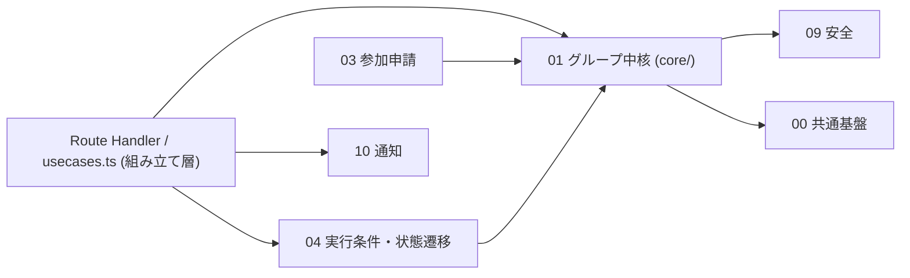
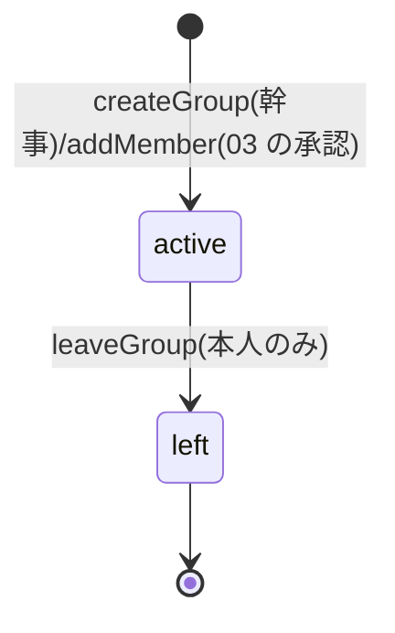
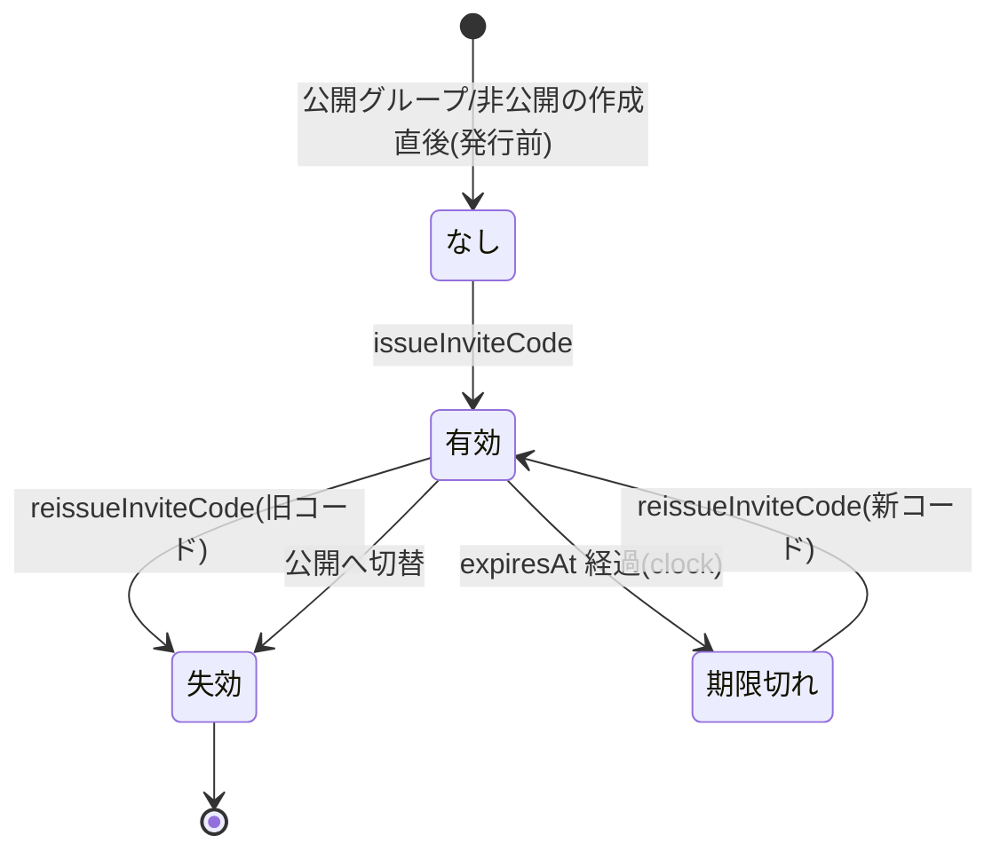

# 01 グループ中核

状態の凡例: [事実]/[推定]/[決定]/[案]/[未決]/[要確認]。docs/design と矛盾する場合は docs/design を正とする。本書の ID 接頭辞は `GRP`(GRP-API 〜 API、GRP-FN 〜 関数、GRP-VAL 〜 検証規則、GRP-ERR 〜 エラー、GRP-UI 〜 画面部品、GRP-T 〜 試験、GRP-TASK 〜 実装タスク、GRP-Q 〜 設計上の確認事項)。「第N章」「第N.M節」は本書の章節、「NN 章」は docs/design の章を指す。00 共通基盤は並行して詳細化中のため、`00-common-foundation.md` の骨子(第5章)を契約とみなし、不一致は第14章に書く。

## 1. 概要と責務 / 対応する柱

- グループ(旅行プラン)の作成・設定・公開/非公開・招待コード、メンバーと役割(幹事/メンバー)、退会、旅程入力(行き先・日程・人数上限 2〜6)を扱う。柱2、13。 [案]
- 幹事の権限は「参加承認」のみを確定事項とし、設定変更は [未決 #13] の暫定案で実装する(第7.2節)。除名は設けない。 [決定(承認)/未決(範囲)]
- **項目の所有モジュール(責務境界)**: Group は 1 つのレコードだが、項目を書き込めるモジュールは項目ごとに 01 と 04 に分かれる。 [案]

| 区分 | 項目 | 書き込むモジュール | 備考 |
|---|---|---|---|
| 設定項目(01 が持つ) | 名称、地方、旅程(行き先・日程)、人数上限、公開設定、タグ、概要、公式枠、幹事、招待コード、作成・更新日時 | 01 のみ | 本書の `updateGroup` が書く |
| 実行条件・状態(04 が持つ。`lifecycle`) | 最少人数、締切日、状態、辞退期間の終了日、実行確定日時、中止日時・理由、再企画元/先ID | 初期値のみ 01(作成時)、以後は 04 のみ | 04 は `applyLifecyclePatch`(01 提供、第5章 GRP-FN-17)経由で書く |
| メンバー | GroupMember 全項目 | 01 のみ(`addMember` は 03 の承認時に呼ばれる) | |

- **呼び出し方向(循環回避)**: 01 は 04・03・10 を import しない。01 が 04 の状態を参照する判定(編集可否、退会可否)は、01 の表 `policy.ts`(第7.2節)に状態名で書き、04 の `canEdit` 等はその表を import して使う(04 → 01 の一方向)。状態の変更を伴う後処理(退会で人数が減った後の再判定、通知)は、組み立て層 `usecases.ts`(Route Handler から呼ぶ)が 01 の関数を呼んだ後に 04 `evaluate`・10 `notify` を呼ぶ。 [案]



(矢印は import の向き。01 から 03/04/10 への矢印は無い。01 → 09 は `checkText`・`visibleProfile` の呼び出し。)

## 2. 既存機能との関係

- 新規(グループ、メンバー、招待コード)。キャンペーン・地方は既存 `seed.json` の campaign を読み取りのみで参照する(流用。変更しない)。 [案]
- `server-store.ts` / `/api/v2` は変更しない。ストアは 00 の `groups-store.ts`(`store()`)を使う。 [案]
- [要確認] `app/node_modules` が無く Next.js 16 のドキュメント(`app/node_modules/next/dist/docs/`)は未確認。Route Handler のキャッシュ設定(動的応答にすること)と `params` が Promise である点は既存 `api/v2/[...path]/route.ts` に合わせ、実装前に該当ガイドを読む。

### 2.1 利用ライブラリ・モジュール

本モジュールは新しい依存を追加しない(テスト基盤の Vitest は 00 が追加する)。バージョンとライセンスは `app/package.json`・`app/package-lock.json` の記載による。 [事実(バージョン・ライセンス)/案(用途)]

| 名前 | 種別 | 用途(本モジュール) | ライセンス | バージョン方針 |
|---|---|---|---|---|
| `next` | フレームワーク | App Router のページ(第3章)、Route Handler(第5.2節) | MIT | 既存の 16.4.5 を維持 |
| `react` / `react-dom` | ライブラリ | 画面部品(GRP-UI-01〜11) | MIT | 既存の 19.3.0 を維持 |
| `@mantine/core` | UI ライブラリ | `TextInput`、`Select`、`SegmentedControl`、`NumberInput`、`Textarea`、`Modal`、`Button`、`Alert` 等 | MIT | 既存の ^9.7.5 を維持 |
| `@mantine/dates` | UI ライブラリ | 日程・締切日の `DatePickerInput` | MIT | 既存の ^9.7.5 を維持 |
| `@mantine/hooks` | UI ライブラリ | 招待コードのコピー(`useClipboard`)、確認ダイアログの開閉(`useDisclosure`) | MIT | 既存の ^9.7.5 を維持 |
| `@tabler/icons-react` | アイコン | 画面のアイコン | MIT | 既存の ^3.51.0 を維持 |
| `dayjs` | 日付 | 画面の日付表示、締切日の既定値(開始日の 7 日前)の計算 | MIT | 既存の ^1.11.23 を維持 |
| `typescript` | 開発ツール | 型検査 | Apache-2.0 | 既存の ^5 を維持 |
| `vitest` | 開発ツール(devDependency) | 単体・API 試験(第9章)。追加は 00(CMN-TASK-12) | MIT | 00 が追加する。最新の安定版を使う |
| `node:crypto`(Node.js 標準) | 標準モジュール | 招待コード生成の `randomInt`(第7.3節) | Node.js に同梱(MIT) | Next.js 16.4.5 が要求する Node.js 20.9 以上に同梱のものを使う |
| 00 共通基盤 | 自前モジュール | ストア、現在ユーザー、時計、エラー、検証、ID 採番、API 共通部、クライアントの取得フック | - | 同一リポジトリ |
| 09 安全 | 自前モジュール | `checkText`(禁止表現)、`visibleProfile`(公開範囲)、`requireVerified`(作成時の本人確認。定数で切替) | - | 同一リポジトリ |

自前で実装するもの・使わないもの:

| 対象 | 方針 | 理由 |
|---|---|---|
| フォームの状態管理・検証 | 自前(`@mantine/form` は使わない) | 項目が 11 個で、サーバーと同じ検証関数 `validateCreateGroupInput` を呼べば足り、依存を増やさずに済むため |
| 招待コードの生成・正規化 | 自前(`node:crypto` の `randomInt` を使う) | 文字集合と長さを本書で固定しており(第7.3節)、`nanoid` 等を追加する必要がないため |
| 招待コードの試行回数制限 | 自前(インメモリの `Map`) | localhost で完結するデモで、外部のレート制限ライブラリ・ストアを使わないため |
| `zustand` | 使わない | 画面の状態は各コンポーネントの `useState` で足りるため |

- Route Handler は Node.js ランタイム(既定)で動かす。`node:crypto` を使うため、Edge ランタイム(`export const runtime = "edge"`)は指定しない。 [案]

## 3. 画面・UI(04 章)

| 画面 | 04 章の項目 | パス案 | 主コンポーネント |
|---|---|---|---|
| グループ作成(旅程入力) | グループ作成 | `/[campaign]/groups/new` | `GroupForm mode="create"` |
| グループ編集(幹事) | 幹事の条件変更(設定部分) | `/[campaign]/groups/[groupId]/edit` | `GroupForm mode="edit"` |
| グループ詳細(参加後。タブの親) | グループ詳細(タブ) | `/[campaign]/groups/[groupId]` | `GroupDetailShell`(02 の参加前表示と同じパスで、閲覧者の役割で出し分け) |
| メンバー一覧・退会 | メンバー一覧 | `/[campaign]/groups/[groupId]/members` | `MemberList`、`LeaveDialog` |
| 招待コード表示・再発行(幹事) | 招待コード | 詳細内(幹事のみのパネル) | `InviteCodePanel` |

### 3.1 コンポーネント構成(`app/src/features/groups/core/components/`)

| ID | コンポーネント | props | state(主なもの) | データ取得 |
|---|---|---|---|---|
| GRP-UI-01 | `GroupForm` | `mode: "create"\|"edit"`, `campaign: string`, `initial?: GroupFormValues`(再企画の初期値は 04 が `/groups/new?from=<groupId>` で渡す。`from` はサーバーで検証し、本人が幹事のグループのみ受理 [案]), `onDone(group: Group)` | `values: GroupFormValues`, `errors: FieldErrors`, `submitting: boolean`, `serverError?: ApiErrorView` | 作成: なし(地方の選択肢は `GET /api/groups/_meta?campaign=` [案、00 の seed 読み取り])。編集: `useApi<GroupDetailView>(/api/groups/:id)` |
| GRP-UI-02 | `BasicFields` | `values, errors, onChange` | なし(制御コンポーネント) | なし |
| GRP-UI-03 | `TripFields`(行き先・日程・日程の幅メモ) | 同上 + `minDate: string` | なし | なし |
| GRP-UI-04 | `CapacityFields`(人数上限・最少人数) | 同上 + `memberCount?: number`(編集時の下限) | `pairMode: boolean`(上限=2) | なし |
| GRP-UI-05 | `DeadlineField`(締切日) | 同上 + `startDate` | なし | なし |
| GRP-UI-06 | `VisibilityField` | `value: Visibility, onChange` | なし | なし |
| GRP-UI-07 | `TagInput` | `value: string[], onChange, max: 5` | `draft: string` | なし(候補チップは定数 `SUGGESTED_TAGS`) |
| GRP-UI-08 | `InviteCodePanel` | `groupId: string` | `code?: InviteCodeView`, `confirmReissue: boolean`, `copied: boolean` | `GET/POST …/invite-code` |
| GRP-UI-09 | `MemberList` | `groupId: string` | `confirmLeave: boolean` | `useApi<MemberView[]>(…/members)` |
| GRP-UI-10 | `LeaveDialog` | `group: Pick<Group,"id"\|"name">, role: GroupRole, status: GroupStatus, onLeft()` | `submitting` | `POST …/leave` |
| GRP-UI-11 | `GroupDetailShell` | `groupId: string` | `tab: string`(05〜08 のタブ。タブ本体は各モジュールが提供) | `useApi<GroupDetailView>`(`GET /api/groups/:id`)。応答の `kind` で出し分ける(`"member"` はタブ表示、`"public"` は 02 の参加前表示) |

- 入力用の型と変換関数は `core/components/formValues.ts` に置く。送信時に作成は `CreateGroupInput`、編集は `UpdateGroupPatch`(変更した項目のみ)へ変換する。 [案]

```ts
export interface GroupFormValues {
  name: string;
  regionId: string;
  destination: string;
  startDate: IsoDate | null;     // 未入力は null
  endDate: IsoDate | null;
  dateNote: string;
  capacity: number;              // 2〜6
  minMembers: number;            // 編集時は表示のみ
  deadline: IsoDate | null;      // 編集時は表示のみ
  visibility: Visibility;
  tags: string[];
  summary: string;
}
export type FieldErrors = Record<string, string>;   // キーは API の fields と同じパス("name"、"trip.startDate"、"tags.2")
export interface ApiErrorView { code: string; message: string; fields?: FieldErrors; reason?: string; }

export function toCreateGroupInput(values: GroupFormValues, campaignId: string): CreateGroupInput; // 未入力の日付は "" にしてサーバーの検証に任せる
export function toUpdateGroupPatch(initial: GroupFormValues, values: GroupFormValues): UpdateGroupPatch; // 値が変わった項目だけを入れる。minMembers・deadline は入れない
export function groupToFormValues(group: Omit<Group, "inviteCode">): GroupFormValues;               // 編集・再企画の初期値
```

- 日付入力は `@mantine/dates` の `DatePickerInput`(導入済み)、他は `@mantine/core` の標準部品を使う。`@mantine/form` は使わない(第2.1節)。検証は第7.1節の共有検証関数を呼ぶ(サーバーと同じ関数 `validateCreateGroupInput` をクライアントでも呼び、補助表示にする。最終判定はサーバー)。 [案]
- モックの明示: 画面上部に「デモ用のモックです」の帯(00 の AppShell)。氏名・連絡先の入力欄は設けない。README 第1章の用語方針で使わないと定めた語を文言に含めない(文言は `messages.ts` に集約)。

### 3.2 作成・編集画面のフィールドと検証(クライアント表示)

| フィールド | 部品 | 初期値 | 即時検証 | 備考 |
|---|---|---|---|---|
| 名称 | TextInput | 空 | 1〜30 文字、禁止表現(送信時にサーバーが判定) | |
| 地方 | Select | URL の campaign の既定地方 | 必須、候補内 | |
| 行き先 | TextInput | 空 | 1〜40 文字 | |
| 開始日・終了日 | DatePickerInput(範囲) | 空 | 開始<=終了、開始は締切より後、期間 14 日以内 | |
| 日程の幅メモ | TextInput | 空 | 0〜40 文字 | 例「前後 2 日は調整可」(05 の「日程の幅」) |
| 人数上限 | SegmentedControl 2〜6 | 4 | 整数 2〜6 | 「2(1対1)」を選ぶと `pairMode`: 最少人数を 2 に固定し無効化(第10章) |
| 最少人数 | NumberInput | 3(ただし上限 2 なら 2) | 整数、2〜上限 | 幹事を含む人数 [案、#19]。値の意味と運用は 04 |
| 締切日 | DatePickerInput | 開始日の 7 日前(今日より後に補正) | 今日より後、開始日より前 | 締切後の扱いは 04 |
| 公開設定 | SegmentedControl | 公開 | 列挙 | 非公開を選ぶと「一覧に載りません。招待コードを知る人だけが申請できます」を表示 |
| タグ | TagInput | 空 | 最大 5 個、各 1〜16 文字、重複不可 | |
| 概要 | Textarea | 空 | 0〜200 文字 | プラン内容(02 一覧用) |

- 送信ボタンは二重送信を防ぐ(`submitting` 中は無効)。サーバー応答の `fields` を各項目の下に表示し、先頭のエラー項目へフォーカスする(06 章)。 [案]
- 編集画面で変更できない項目は無効化して理由を表示する(第7.2節の `editableFields(status)`)。最少人数・締切の変更は 04 の画面(条件変更)から行い、本画面では表示のみ [案]。

## 4. データ(05 章)

### 4.1 Trip と Group の統合方針(オーナー未決 [未決]、推奨案で記述)

| 案 | 内容 | メリット | デメリット |
|---|---|---|---|
| A: Group に平坦に統合 | `destination`, `startDate`, `endDate` を Group の直下に持つ | 最も単純。取得・一覧が 1 レコード | 「行き先・日程」のまとまりに名前が付かず、再企画の日程差し替え・05 の日程メモとの対応が曖昧 |
| B: Trip を別エンティティ | `Trip{id, groupId,…}` を Store.trips に持つ | 05 章の記載どおり。将来「1 グループ複数 Trip」にできる | 常に 1:1 で JOIN が増え、整合(作成・更新の二重書き込み、再企画複製)の実装コストが上がる。デモ範囲では分離の利点がない |
| **C: 値オブジェクトとして埋め込み(推奨)** | `Group.trip: Trip`(ID なし。型 `Trip` は独立して定義) | 05 の Trip の項目をそのまま保てる。保存は 1 レコード。後から B へ分離しやすい(型を切り出し済み) | 型と保存単位が 1:1 でないため、05 章の「Trip を参照」との表現差を設計書側で合わせる必要がある |

- **推奨: 案C。** 理由: デモ範囲で 1 グループ 1 旅程であり、05 章の「単独利用者も 2 人以上のグループとして扱う」前提と矛盾せず、API/ストアは案A並みに単純。 [案、オーナー未決]
- 影響: 05 章の `Trip` 表記は「Group の `trip` 項目」と読み替える。他モジュール(02、05、11、12)は `group.trip.destination` 等で参照する。

### 4.2 型定義(`app/src/features/groups/types.ts`。共有型。01 が置き、04 が `lifecycle` の意味を定める)

```ts
export type UserId = string;       // DemoUser.id(00)
export type GroupId = string;      // newId("g") 形式。^[a-z0-9-]{1,40}$
export type IsoDate = string;      // "YYYY-MM-DD"(日本時間の暦日)
export type IsoDateTime = string;  // ISO 8601(タイムゾーン付き)

export type Visibility = "public" | "private";
export type GroupRole = "organizer" | "member";
export type MemberStatus = "active" | "left";

/** 状態名は 04 が確定する([案])。01 は値を読むだけで、遷移は行わない。 */
export type GroupStatus =
  | "recruiting"          // 募集中
  | "min_reached"         // 最少人数到達
  | "withdrawal_period"   // 辞退期間
  | "confirmed"           // 実行確定
  | "in_progress"         // 実施中
  | "completed"           // 完了
  | "cancelled";          // 中止(再企画済みは lifecycle.replannedToId の有無で表す)

export interface Trip {
  destination: string;        // 1〜40 文字
  startDate: IsoDate;
  endDate: IsoDate;           // startDate 以上、期間は最大 14 日(両端含む)
  dateNote: string;           // 日程の幅メモ。0〜40 文字。空文字可
}

/** 04 が意味を持つ。作成時の初期値のみ 01 が設定する。 */
export interface GroupLifecycle {
  status: GroupStatus;               // 作成時 "recruiting"
  minMembers: number;                // 幹事を含む。2〜capacity [案 #19]
  deadline: IsoDate;                 // 締切日(当日末まで受付、日本時間)[案。05 章は「日付」]
  withdrawalEndsAt: IsoDateTime | null;
  confirmedAt: IsoDateTime | null;
  cancelledAt: IsoDateTime | null;
  cancelReason: "min_not_reached" | "organizer" | "organizer_left" | "below_min_after_withdrawal" | null; // 値は 04 が確定
  replannedFromId: GroupId | null;
  replannedToId: GroupId | null;
}

export interface InviteCode {
  code: string;               // 正規化済み(大文字、ハイフンなし)10 文字
  issuedAt: IsoDateTime;
  expiresAt: IsoDateTime;     // issuedAt + 7 日 [案]
  revokedAt: IsoDateTime | null;
}

export interface Group {
  id: GroupId;
  name: string;               // 1〜30 文字
  campaignId: string;         // seed の campaign(例 "nttw-demo")。[要確認] 値の形式
  regionId: string;           // 地方。campaign が持つ地方の ID。[要確認] seed の持ち方
  trip: Trip;
  capacity: number;           // 人数上限。整数 2〜6(1対1 は 2)
  visibility: Visibility;
  tags: string[];             // 0〜5 個、各 1〜16 文字、重複なし
  summary: string;            // プラン概要。0〜200 文字
  official: boolean;          // 公式枠。一般ユーザーの作成では常に false
  officialHost: string | null; // 主催自治体名(official=true のときのみ。11)
  organizerId: UserId;        // 幹事(作成者)。1 グループ 1 人
  inviteCode: InviteCode | null; // 非公開のとき有効。公開では null(切替時に失効)
  lifecycle: GroupLifecycle;  // 04 が書く
  createdAt: IsoDateTime;
  updatedAt: IsoDateTime;
}

export interface GroupMember {
  id: string;                 // newId("gm")
  groupId: GroupId;
  userId: UserId;
  role: GroupRole;
  status: MemberStatus;
  joinedAt: IsoDateTime;
  leftAt: IsoDateTime | null;
  leftAtGroupStatus: GroupStatus | null; // 退会した時点の状態(04/辞退集計用)
  activeCountAfterLeave: number | null;  // 退会直後の現在人数
}
```

- 制約(ストア不変条件。単体試験で検証する): [案]
  - (INV-1) `groupId` ごとに `status="active"` かつ `role="organizer"` の GroupMember がちょうど 1 件あり、その `userId` は `group.organizerId` と一致する。例外: 状態が `cancelled` のグループ、および幹事が単独で退会したグループ(active な幹事行が 0 件になりうる)。
  - (INV-2) 同一 `(groupId, userId)` で `status="active"` は高々 1 件。退会後の再参加は新しい GroupMember 行を追加する(履歴を残す。ペナルティなし)。
  - (INV-3) active 数 <= `capacity`。`2 <= minMembers <= capacity`。`capacity === 2` なら `minMembers === 2`。
  - (INV-4) `deadline < trip.startDate`、`trip.startDate <= trip.endDate`。
  - (INV-5) `visibility === "public"` なら `inviteCode === null`、`"private"` なら有効な(未失効の)コードがちょうど 1 つ、または発行前で null。
  - (INV-6) `official === true` の Group は一般ユーザーの API では作成・変更できない(11 の seed/内部関数のみ)。
- 「人数」の定義: 現在人数 = active な GroupMember の件数(幹事を含む)。 [案、#19]

### 4.3 保存先

| エンティティ | 保存先 | 備考 |
|---|---|---|
| Group(`trip`、`lifecycle`、`inviteCode` を内包) | `Store.groups: Map<GroupId, Group>` | 00 の `store()` に 01 用フィールドを追加する要望(第13章) |
| GroupMember | `Store.members: GroupMember[]` | `groupId`・`userId` の索引は組み立て時に作る(件数が少数) |
| 招待コード索引 | `Store.inviteIndex: Map<string, GroupId>`(正規化コード → groupId) | 衝突検出と O(1) 検証用。再発行・失効で更新 |
| 招待コード試行回数 | `Store.inviteAttempts: Map<UserId, { count: number; windowStart: number }>` | 総当たり対策(第7.3節) |

### 4.4 05 章との差分(第14章に集約)
- 05 の `GroupWithdrawal`(辞退の記録)は新設せず、GroupMember の `leftAt`/`leftAtGroupStatus`/`activeCountAfterLeave` で代替する [案]。辞退と退会の区別は `leftAtGroupStatus` で導く(`withdrawal_period` で抜けたら辞退)。
- 05 の `GroupMember.状態` は `参加中/退会` のみ。05 の「辞退」状態を別に持つか [未決] は未反映(上記で導出可能)。

## 5. インターフェース

名前は README・各骨子に合わせる。`user` は 00 の `currentUser(req)` が返す `DemoUser`。例外は 00 の `AppError(code, message, status, opts?)`(`opts.fields`、`opts.reason`。`reason` の追加は第13章の要望)。

### 5.1 サービス関数(`features/groups/core/service.ts`、`permissions.ts`、`repository.ts`)

| ID | シグネチャ | 説明 | 例外 | 呼び出し元 |
|---|---|---|---|---|
| GRP-FN-01 | `createGroup(user: DemoUser, input: CreateGroupInput): Group` | 検証 → 禁止表現 → Group 生成(幹事=user、status=`recruiting`、公開なら inviteCode=null、非公開なら発行)→ 幹事の GroupMember を追加。公式枠の指定は無視せず `invalid_input` | `invalid_input`(fields)、`forbidden`(未確認 [案]、`REQUIRE_VERIFIED_TO_CREATE`)、`conflict`(進行中の幹事グループが上限 5 件 [案]) | POST /api/groups、11(seed 以外は不可) |
| GRP-FN-02 | `getGroup(user: DemoUser, id: GroupId): GroupDetailView` | メンバー/幹事向けの詳細(招待コード値は含めない) | `not_found`(存在しない・非公開で非メンバー)、`forbidden`(公開で非メンバー → 呼び出し側が 02 の公開ビューへ切替) | GET /api/groups/:id、各タブ |
| GRP-FN-03 | `updateGroup(user: DemoUser, id: GroupId, patch: UpdateGroupPatch): Group` | 幹事のみ。`editableFields(status)` 外の項目は `unavailable_state` | `forbidden`、`not_found`、`invalid_input`、`unavailable_state`、`conflict`(人数上限が現在人数・最少人数を下回る) | PATCH /api/groups/:id |
| GRP-FN-04 | `listMembers(user: DemoUser, id: GroupId): MemberView[]` | メンバー/幹事のみ。表示名等は 09 `visibleProfile(viewer, target, "member")` を通す | `forbidden`/`not_found` | GET …/members |
| GRP-FN-05 | `addMember(groupId: GroupId, userId: UserId, role?: GroupRole): GroupMember` | 03 の承認時のみ呼ぶ。`role` の既定は `"member"`。同期関数(await を挟まず原子的に判定・追加) | `conflict`(満席 `reason:"group_full"`、既に active `reason:"already_member"`)、`not_found` | 03 `approve`(権限判定は 03 が行う) |
| GRP-FN-06 | `leaveGroup(user: DemoUser, id: GroupId): LeaveResult` | 本人のみ。status を `left` にし、`leftAtGroupStatus`・`activeCountAfterLeave` を記録 | `not_found`/`forbidden`(非メンバー)、`unavailable_state`(退会不可の状態)、`conflict`(幹事は他メンバーがいる間は退会不可。`reason: "organizer_cannot_leave"`) | POST …/leave |
| GRP-FN-07 | `issueInviteCode(user: DemoUser, id: GroupId): InviteCodeView` | 幹事のみ。非公開で有効コードが無ければ発行、有効なら現行を返す(冪等) | `forbidden`、`not_found`、`conflict`(公開グループ。`reason: "group_is_public"`)、`unavailable_state`(`completed`/`cancelled` のグループ [案]) | POST …/invite-code |
| GRP-FN-08 | `reissueInviteCode(user: DemoUser, id: GroupId): InviteCodeView` | 幹事のみ。旧コードを即時失効し新コードを発行 | 同上 | POST …/invite-code/reissue |
| GRP-FN-09 | `getInviteCode(user: DemoUser, id: GroupId): InviteCodeView \| null` | 幹事のみ(コード値を返す唯一の読み取り) | `forbidden`、`not_found` | GET …/invite-code |
| GRP-FN-10 | `verifyInviteCode(user: DemoUser, rawCode: string): InvitePreview` | 形式・存在・有効期限・試行回数を判定し、最小限の公開情報(`groupId,name,destination,startDate,endDate,capacity,activeCount,status,organizerDisplayName`)を返す。存在しない・失効・期限切れのコードは区別せず同じ `not_found` を返す(応答の違いからコードの有無を判別できないようにする)。失敗は試行回数に数える(第7.3節) | `invalid_input`(形式)、`not_found`、`conflict`(`reason:"too_many_attempts"`。要望: 00 に `rate_limited`) | POST /api/groups/_invite/verify。02 `findByInviteCode` が内部で利用 |
| GRP-FN-11 | `assertInviteCode(groupId: GroupId, rawCode: string): void` | 03 が非公開グループへの申請時に呼ぶ。コードが現行・有効・当該グループのものか判定 | `not_found` | 03 `requestJoin` |
| GRP-FN-12 | `isMember(user: { id: UserId }, group: Group): boolean` | active な GroupMember か | なし | 全モジュール |
| GRP-FN-13 | `isOrganizer(user: { id: UserId }, group: Group): boolean` | `group.organizerId === user.id` かつ active な幹事行がある | なし | 全モジュール |
| GRP-FN-14 | `getRole(user: { id: UserId }, group: Group): GroupRole \| null` | 役割(非メンバーは null) | なし | 内部、05〜08 |
| GRP-FN-15 | `requireMember(user: { id: UserId }, group: Group): void` / `requireOrganizer(user: { id: UserId }, group: Group): void` | 非メンバー/非幹事なら AppError。公開グループの非メンバーは `forbidden`、非公開の非メンバーは `not_found` | `forbidden`/`not_found` | 05〜08 の API |
| GRP-FN-16 | `getGroupById(id: GroupId): Group \| undefined` / `listGroups(): Group[]` / `listActiveMembers(id: GroupId): GroupMember[]` / `countActiveMembers(id: GroupId): number` | 読み取り専用の素のリポジトリ関数(権限判定なし。サービス内部・02・04・08・12 の集計用)。返り値は**呼び出し側が書き換えない**(凍結した複製を返す [案]) | なし | 02、04、08、12 |
| GRP-FN-17 | `applyLifecyclePatch(id: GroupId, patch: Partial<GroupLifecycle>): Group` | 04 のみが呼ぶ。`lifecycle` 以外は書けない。INV-3/4 を再検証 | `not_found`、`invalid_input` | 04 |
| GRP-FN-18 | `createGroupInternal(input: CreateGroupInput & { official?: boolean; officialHost?: string; organizerId: UserId }): Group` | seed 初期化・11 の公式枠用。権限判定なし・`official` 指定可。API からは呼べない | `invalid_input` | 00(seed)、11 |
| GRP-FN-19 | `editableFields(status: GroupStatus): ReadonlySet<EditableField>` / `canLeave(status: GroupStatus, role: GroupRole): boolean` | `policy.ts` の表。04 の `canEdit` が利用(04 → 01) | なし | 04、画面 |

#### 補助型

```ts
export interface CreateGroupInput {
  name: string;
  campaignId: string;
  regionId: string;
  trip: Trip;                 // dateNote は空文字可
  capacity: number;           // 2〜6
  minMembers: number;         // 2〜capacity(幹事を含む)
  deadline: IsoDate;          // 今日より後、trip.startDate より前
  visibility: Visibility;
  tags: string[];
  summary: string;
}

export type EditableField =
  | "name" | "regionId" | "trip" | "capacity" | "visibility" | "tags" | "summary";

export type UpdateGroupPatch = Partial<Pick<CreateGroupInput,
  "name" | "regionId" | "trip" | "capacity" | "visibility" | "tags" | "summary">>;

export interface GroupDetailView {       // メンバー/幹事向け
  kind: "member";                        // 02 の公開ビュー(kind: "public" を要望。第13章)と区別する
  group: Omit<Group, "inviteCode">;
  role: GroupRole;
  activeCount: number;
  canEdit: boolean;                      // 幹事かつ編集可能項目が 1 つ以上
  canLeave: boolean;
  hasActiveInviteCode: boolean;          // 値は含めない
}

export interface MemberView {
  userId: UserId;
  displayName: string;                   // 09 visibleProfile の結果。非公開なら "メンバー" 等の既定表示 [案]
  ageBand: string | null;                // 公開範囲内のみ
  role: GroupRole;
  joinedAt: IsoDateTime;
  isSelf: boolean;
}

export interface InviteCodeView {
  code: string;                          // 表示用 "ABCDE-FGHJK"
  issuedAt: IsoDateTime;
  expiresAt: IsoDateTime;
  expired: boolean;
}

export interface InvitePreview {
  groupId: GroupId; name: string; destination: string;
  startDate: IsoDate; endDate: IsoDate; capacity: number;
  activeCount: number; status: GroupStatus; organizerDisplayName: string;
}

export interface LeaveResult {
  groupId: GroupId;
  leftAtStatus: GroupStatus;
  activeCountAfter: number;
  wasOrganizer: boolean;
  groupEmpty: boolean;                   // 幹事の単独退会で 0 人になった(呼び出し側が 04 の中止を呼ぶ)
}
```

### 5.2 API(`features/groups/core/handlers.ts` を `app/api/groups/[...path]/route.ts` から呼ぶ。薄く、検証 → サービス呼び出しのみ)

共通: JSON。成功は `200/201` + 本体。失敗は `{ error, message?, fields?, reason? }`。現在ユーザーは Cookie `demoUser`(`currentUser(req)`)。ID はパスの `^[a-z0-9-]{1,40}$` を検証してから使う。本文の上限は 8KB(00 の `route()` の `maxBodyBytes` で指定)。GRP-FN-01・03 の戻り値 `Group` は、ハンドラが `getGroup(user, id)` で `GroupDetailView` に変換して返す。

| ID | メソッド・パス | リクエスト | 成功レスポンス | エラーコード | 呼ぶ関数 |
|---|---|---|---|---|---|
| GRP-API-01 | `POST /api/groups` | `CreateGroupInput`(JSON、最大 8KB) | 201 `GroupDetailView` | 400 `invalid_input`(fields)、403 `forbidden`、409 `conflict`(`organizer_group_limit`)、413 `payload_too_large`(本文 8KB 超) | GRP-FN-01 |
| GRP-API-02 | `GET /api/groups/:id` | なし | 200 `GroupDetailView`(メンバー/幹事。`kind:"member"`)。公開グループの非メンバーには、組み立て層が 02 の公開ビューを 200 で返す(第11.3節) | 404 `not_found`(存在しない・非公開グループの非メンバー) | GRP-FN-02 |
| GRP-API-03 | `PATCH /api/groups/:id` | `UpdateGroupPatch`(変更項目のみ) | 200 `GroupDetailView` | 400 `invalid_input`、403 `forbidden`、404、409 `conflict`(上限が人数/最少人数を下回る)、409 `unavailable_state`(その状態では変更不可) | GRP-FN-03 |
| GRP-API-04 | `GET /api/groups/:id/members` | なし | 200 `MemberView[]` | 403、404 | GRP-FN-04 |
| GRP-API-05 | `POST /api/groups/:id/leave` | なし(本文なし) | 200 `LeaveResult` | 403、404、409 `conflict`(`reason:"organizer_cannot_leave"`)、409 `unavailable_state` | usecase `leaveGroupUsecase`(GRP-FN-06 → 04 `evaluate` → 10 `notify`) |
| GRP-API-06 | `POST /api/groups/:id/invite-code` | なし | 200 `InviteCodeView`(発行または現行) | 403、404、409 `conflict`(`group_is_public`)、409 `unavailable_state`(終了状態) | GRP-FN-07 |
| GRP-API-07 | `POST /api/groups/:id/invite-code/reissue` | なし | 200 `InviteCodeView`(新コード) | 同上 | GRP-FN-08 |
| GRP-API-08 | `GET /api/groups/:id/invite-code` | なし | 200 `InviteCodeView \| null` | 403、404 | GRP-FN-09 |
| GRP-API-09 | `POST /api/groups/_invite/verify` | `{ code: string }` | 200 `InvitePreview` | 400 `invalid_input`(形式)、404 `not_found`、409 `conflict`(`reason:"too_many_attempts"`。00 が `rate_limited` を追加したら 429 に切り替える) | GRP-FN-10 |
| GRP-API-10 | `GET /api/groups/_meta?campaign=<id>` | クエリ | 200 `{ regions: {id,name}[], suggestedTags: string[], limits: GroupLimits }`(`GroupLimits` は `constants.ts` の上限値。文字数・人数・タグ数・期間) | 400 `invalid_input`(campaign の形式不正)、404 `not_found`(campaign が存在しない) | seed 読み取り(00 のヘルパ) [案] |

- `_invite`・`_meta` のように先頭 `_` のセグメントは `:id` と衝突しない(ID は先頭が英小文字の `g-…`)。ルーティング順は先に予約語セグメントを判定する。 [案]
- `GET /api/groups`(一覧)は 02、`…/join-requests` は 03、`…/plan`・`…/messages` 等は各モジュールの担当。

### 5.3 権限表(可否)

「非メンバー」は参加前(申請中を含む)のユーザー。公開グループでは存在を隠さない(`forbidden`)、非公開グループでは存在を隠す(`not_found`)。ブロック関係(09)は 02/03 側で制御し、本モジュールではメンバーを自動で外さない [未決 #8]。

| 操作 | 幹事 | メンバー | 非メンバー(公開グループ) | 非メンバー(非公開グループ) |
|---|---|---|---|---|
| 詳細・メンバー向け(GRP-API-02) | 可 | 可 | 02 の公開ビュー(GRP-FN-02 は `forbidden` を返し、組み立て層が 02 に渡す) | `not_found` |
| 設定変更(GRP-API-03) | 可(状態で項目制限) | `forbidden` | `forbidden` | `not_found` |
| メンバー一覧(GRP-API-04) | 可 | 可 | `forbidden` | `not_found` |
| 退会(GRP-API-05) | 条件付き(他メンバーがいる間は不可) | 可(状態で制限) | `forbidden` | `not_found` |
| 招待コード発行/再発行/閲覧(GRP-API-06〜08) | 可(非公開のみ) | `forbidden` | `forbidden` | `not_found` |
| 招待コード検証(GRP-API-09) | 可 | 可 | 可 | 可(コードを知る人) |
| `addMember`(GRP-FN-05) | 03 が幹事権限を確認後に内部呼び出し。API としては公開しない | | | |

- 作成(GRP-API-01)は既存のグループに依存しない操作で、全ユーザーが行える(作成者が幹事になる)。`REQUIRE_VERIFIED_TO_CREATE=true` のときは本人確認(モック)が済んでいないユーザーを `forbidden` にする。

## 6. 状態遷移・主要シーケンス

### 6.1 メンバーの状態



- 退会後の再参加は新しい GroupMember 行を作る(INV-2)。`left` から `active` への戻りはない。 [案]
- グループの状態(募集中〜中止)の遷移は 04 が管理する。本モジュールは `lifecycle.status` を読み取り専用で扱う(書くのは作成時の `recruiting` と `applyLifecyclePatch` 経由の 04 のみ)。

### 6.2 招待コードの状態



(「失効」は旧コードの終端。再発行は新コードが「有効」で始まる。期限切れも判定上は失効と同じ扱いで、同じ `not_found` を返す。)

### 6.3 主要シーケンス

**S1 作成**: クライアント検証 → `POST /api/groups` → `currentUser` → `validateCreateGroupInput` → 09 `checkText`(名称・行き先・日程メモ・タグ・概要)→ 幹事グループ数の上限確認 → Group 作成(`lifecycle` 初期値)→ 幹事の GroupMember 追加 →(非公開なら)招待コード発行 → 201。04 の呼び出しなし。

**S2 退会(usecase)**: `POST …/leave` → `leaveGroupUsecase(user, id)`: ①GRP-FN-06(失敗なら中断)→ ②04 `evaluate(group, clock.now())`(辞退で最少人数を割ったときの遷移は 04 が決める [未決 #21])→ ③幹事の単独退会(`groupEmpty`)なら 04 `cancel(system, id, "organizer_left")` → ④10 `notify(organizerId, <辞退の受付>, id, { activeCount })`(幹事向け。他メンバーには誰が辞退したかを出さず人数の変化のみ [案、07 論点16])。②〜④の呼び出し先は後続モジュールの確定名に合わせる。

**S3 承認時のメンバー追加**: 03 `approve` が幹事権限を確認 → GRP-FN-05(満席なら `conflict`)→ 04 `evaluate`(最少人数到達の遷移)→ 10 `notify`。01 は後処理を持たない。

## 7. 入力検証・セキュリティ

### 7.1 検証規則(`features/groups/core/validation.ts`。サーバー・クライアント共通の純粋関数)

共通: 文字列は Unicode NFC 正規化し、前後空白を除去し、制御文字(タブを含む)を除去してから長さを数える。改行は `summary` のみ許可し、他の項目に改行があれば `invalid_input` にする。長さは UTF-16 コードユニットではなく `Array.from(s).length`(コードポイント)。型が違うもの(数値が文字列等)は `invalid_input`。未知のプロパティは無視せず `invalid_input` にする(mass assignment 対策)。00 の `v.object` は未知キーを捨てる仕様のため、01 のハンドラは `parse` の前に許可キー以外が無いかを検査する(GRP-Q-13)。 [案]

| ID | 項目 | 型 | 規則 | エラー文言(案) |
|---|---|---|---|---|
| GRP-VAL-01 | `name` | string | 必須、1〜30 文字、禁止表現(09 `checkText(text,"group.name")`) | 「名称は 1〜30 文字で入力してください」 |
| GRP-VAL-02 | `campaignId` | string | 必須、`^[a-z0-9-]{1,40}$`、seed の campaign に存在 | 「キャンペーンを選び直してください」 |
| GRP-VAL-03 | `regionId` | string | 必須、campaign が持つ地方に存在 | 「地方を選んでください」 |
| GRP-VAL-04 | `trip.destination` | string | 必須、1〜40 文字、禁止表現 | 「行き先は 1〜40 文字」 |
| GRP-VAL-05 | `trip.startDate` / `endDate` | `YYYY-MM-DD` | 実在する暦日、`start <= end`、期間(両端含む)最大 14 日、`start` は締切日より後、`start` は今日から 365 日以内 [案] | 「開始日は締切日より後、期間は 14 日以内」 |
| GRP-VAL-06 | `trip.dateNote` | string | 0〜40 文字、禁止表現 | 「日程メモは 40 文字以内」 |
| GRP-VAL-07 | `capacity` | integer | 2〜6(整数。小数・文字列は拒否) | 「人数上限は 2〜6 人」 |
| GRP-VAL-08 | `minMembers` | integer | 2〜`capacity`。`capacity===2` なら 2。幹事を含む [案 #19] | 「最少人数は 2 人以上、人数上限以下」 |
| GRP-VAL-09 | `deadline` | `YYYY-MM-DD` | 実在する日、`clock.now()` の日本時間の今日より後、`trip.startDate` より前 | 「締切日は明日以降、開始日より前」 |
| GRP-VAL-10 | `visibility` | enum | `"public"`/`"private"` | 「公開設定を選んでください」 |
| GRP-VAL-11 | `tags` | string[] | 0〜5 個、各 1〜16 文字、空白のみ不可、前後空白除去後の重複不可(大小無視)、各タグ禁止表現 | 「タグは 5 個まで、各 16 文字以内」 |
| GRP-VAL-12 | `summary` | string | 0〜200 文字、禁止表現 | 「概要は 200 文字以内」 |
| GRP-VAL-13 | リクエスト本文 | JSON | 最大 8KB、オブジェクトのみ、JSON 不正は 400 | 「入力を確認してください」 |
| GRP-VAL-14 | パスの `:id` | string | `^[a-z0-9-]{1,40}$` かつ Store に存在。ファイルパス・クエリに直結しない | `not_found` |
| GRP-VAL-15 | 招待コード入力 | string | 前後空白・ハイフン・空白を除去し大文字化後に `^[2-9A-HJ-NP-Z]{10}$`(`I`,`L`,`O`,`0`,`1` は含めない) | 「招待コードの形式が違います」 |
| GRP-VAL-16 | 禁止表現の判定 | - | 09 `checkText` は戻り値が OK/理由のため、`{ok,reason,term?}` を前提とする [要確認。09 確定待ち] | 「「○○」は使えません。言い換え例: …」(欄ごと) |

- 編集(`patch`)は変更項目だけ検証するが、変更後の Group 全体で INV-3/4 を再検証する(例: 上限を下げて最少人数を割る、日程を前倒しして締切を超える、現在人数 > 新上限)。違反時のコードは、人数・上限に関するもの(INV-3)が `conflict`(`capacity_below_members`)、日程と締切日の前後関係(INV-4)が `invalid_input`(`fields["trip.startDate"]`)。 [案]
- 変更が既存値と同一の項目は「変更なし」として扱う(`updatedAt` を更新しない)。

### 7.2 状態別の編集・退会可否(`features/groups/core/policy.ts`)

状態ごとの可否はこの表を唯一の定義とし、04 の `canEdit` 等が import して使う。確定後の扱いは [未決 #21・#25] のため暫定。 [案]

| 状態 | 編集できる項目(幹事) | 退会 |
|---|---|---|
| recruiting 募集中 | name, regionId, trip, capacity, visibility, tags, summary | 可 |
| min_reached 最少人数到達 | 同上(ただし trip・capacity は変更不可 [案]。申請済みの人の前提を変えないため) | 可 |
| withdrawal_period 辞退期間 | name, tags, summary | 可(辞退。ペナルティなし) |
| confirmed 実行確定 | tags, summary | 可否は [未決 #21]。暫定は可 |
| in_progress 実施中 | summary | 不可(`unavailable_state`) [案] |
| completed 完了 | なし | 不可 |
| cancelled 中止 | なし | 不可(`unavailable_state`) |

- 設定変更の権限: 幹事の権限範囲は未決(#13)。暫定 [案] は「承認+設定変更(上表の項目)、除名・解散なし」(07 論点7の案B 相当)。デモで案A(承認のみ)に絞る場合は `ORGANIZER_CAN_EDIT = false` で `updateGroup` を `forbidden` にし、画面の編集導線を隠す(定数 1 つで切替可能にする)。
- 公開設定の切替: `public → private` は招待コードを自動発行、`private → public` は有効コードを失効(INV-5)。承認待ちの申請(03)は影響を受けない(03 の判定は申請作成時点のみ [案])。

### 7.3 招待コード(#17 の暫定案)

| 項目 | 決め方 [案。#17 は未決] |
|---|---|
| 形式 | 10 文字。文字集合は 32 種 `23456789ABCDEFGHJKLMNPQRSTUVWXYZ`(紛らわしい `0 O 1 I L` を除く)。表示は `ABCDE-FGHJK`(ハイフンは表示のみ。入力時は除去) |
| 生成 | Node 標準 `node:crypto` の `randomInt` を文字ごとに使い一様に生成(`Math.random` 不可)。32^10 ≒ 2^50 通り |
| 衝突回避 | `Store.inviteIndex` に存在するコード(失効済みも含む)は再生成する。再生成は最大 8 回(初回と合わせて 9 回)で、すべて衝突したら `internal`(32^10 通りのため通常は発生しない。デモ範囲外) |
| 有効期限 | 発行から 7 日(`clock.now()` 基準)。期限切れは同じ `not_found`。幹事は再発行で更新 |
| 再発行(流出時) | 旧コードを即時失効し、新コードを発行する。既に承認済みのメンバーは影響を受けない。コード経由で申請中の人の扱い(申請を取り消すか)は 03・#17 に依存するため本書では扱わない |
| 総当たり対策 | GRP-FN-10 の検証失敗をユーザーごとに数え、10 分間に 10 回失敗したら以降 10 分間は `too_many_attempts` を返す。成功で 0 に戻す(インメモリ。clock 基準)。`assertInviteCode`(03 の申請時)は数えず、03 の申請側の制限に任せる [案] |
| 表示 | コード値は幹事のみ。一覧(02)・詳細(`GroupDetailView`)・ログ・通知文に載せない |
| コードのみで参加できるか | 参加できない。コードは申請の資格で、承認は幹事が行う(07 論点13 案A。#17 は未決のため 03 と合わせて確認) |
| 非公開グループが 02 の一覧に載らない | 02 が `visibility==="public"` のみを返す。01 の `listGroups` は全件を返すため 02 側でフィルタ必須(試験 GRP-T-33) |

### 7.4 その他のセキュリティ(OWASP Top 10 のうち本モジュールに関係するもの)

| 観点 | 本モジュールの対処 |
|---|---|
| アクセス制御・IDOR | 権限は全 API でサーバーが `currentUser(req)` から判定する(第5.3節)。クライアントが送る役割・幹事 ID は受け付けない(本文の `organizerId`・`official`・`lifecycle` は未知プロパティとして `invalid_input`)。パスの `:id` を書き換えても、非メンバーには参加後の情報(メンバー一覧、招待コード、メモ等)を返さない。非公開グループは ID を直接指定されても `not_found` を返し、存在を示さない |
| 入力検証・インジェクション | 第7.1節の検証をサーバーで必ず行う(クライアント検証は補助)。SQL を使わないため SQL インジェクションは該当しない。名称・タグ等をファイルパス・URL・正規表現に連結しない。パスの ID は形式検査の後に `Map` のキーとしてだけ使う |
| XSS | 出力は React の既定エスケープに任せ、`dangerouslySetInnerHTML` を使わない。入力時に HTML の除去・エスケープはしない(00 の方針) |
| CSRF | 00 の `route()` の検査に従う(Cookie `SameSite=Lax`、変更系は `Content-Type: application/json` 必須、`Origin` と `Host` が異なれば拒否)。本モジュールの変更系 API(GRP-API-01、03、05〜07、09)は POST/PATCH のみで、GET では状態を変えない |
| 認証・セッション(デモ) | ログイン不要のため、現在ユーザーは Cookie `demoUser` で表すモックで、値を書き換えれば他のユーザーの視点になる。画面に「デモ用のモック」と表示する。招待コードは推測困難な乱数とし、検証の失敗回数を制限する(第7.3節) |
| セキュリティ設定 | 応答ヘッダ(`Cache-Control: no-store`、`X-Content-Type-Options: nosniff`)は 00 の `route()` が付ける。CORS ヘッダは付けない。Route Handler は Node.js ランタイムで動かす(第2.1節) |
| 機密データの扱い | 招待コードの値は幹事にだけ返す(GRP-FN-07〜09)。一覧(02)・`GroupDetailView`・`InvitePreview`・通知文・ログに含めない。実在個人の情報は置かない(ダミーユーザー ID・表示名のみ)。メンバーの表示名・年代帯は 09 `visibleProfile` を通す |
| ログ | 招待コードの値とリクエスト本文を `console.log`/`console.error` に出さない。想定外のエラーは 00 の `requestId` と例外だけを記録する |
| 同時実行 | 判定と書き込みを `await` を含まない同期関数で行い、満席・重複の判定と追加の間に他のリクエストが入らないようにする(Node.js はシングルスレッド)。 [案] |
| スパム対策 | 1 ユーザーが幹事を務める非終了状態(completed/cancelled 以外)のグループは最大 5 件。 [案] |

- 既知の制約(デモでは対処しない): 招待コードの照合は `Map` の検索で比較時間が一定でない(タイミング攻撃)。試行回数はユーザー単位のため、デモユーザーを切り替えると制限を回避できる。大量のリクエストによる負荷への対策は持たない(再起動・リセットで復旧する)。

## 8. エラー処理

| ID | コード(HTTP) | `reason`(任意) | 発生条件 | 画面での表示・挙動(原因と次の行動) |
|---|---|---|---|---|
| GRP-ERR-01 | `invalid_input`(400) | - | 検証失敗(第7.1節)、禁止表現、JSON 不正、未知プロパティ、招待コードの形式不正 | フォームの各項目の下に `fields` のメッセージを表示し、先頭のエラー項目へフォーカスする。禁止表現は欄・語・言い換え例を表示する |
| GRP-ERR-02 | `forbidden`(403) | - | 幹事以外による設定変更・招待コード操作、公開グループの非メンバーによるメンバー一覧・退会、`ORGANIZER_CAN_EDIT=false` のときの設定変更、`REQUIRE_VERIFIED_TO_CREATE=true` のときの未確認ユーザーによる作成 | 権限がない理由と、グループ詳細へ戻るリンクを表示する |
| GRP-ERR-03 | `not_found`(404) | - | グループが存在しない、非公開グループの非メンバー、パスの ID 形式不正、招待コードが存在しない・失効・期限切れ | 「見つかりません」と一覧へ戻るリンクを表示する。招待コードの入力画面では入力欄を残し、コードの確認を促す |
| GRP-ERR-04 | `conflict`(409) | `capacity_below_members` | 人数上限を現在人数または最少人数より小さくする変更 | 「現在 N 人、最少 M 人のため、上限は X 人以上にしてください」を人数上限の欄の下に表示する |
| GRP-ERR-05 | `conflict`(409) | `organizer_cannot_leave` | 他のメンバーがいる状態で幹事が退会 | 「幹事は他のメンバーがいる間は退会できません」を表示する。04 が中止を許可する状態なら中止の操作への導線を出す。引き継ぎは未実装 [案。#14 未決] |
| GRP-ERR-06 | `conflict`(409) | `group_is_public` | 公開グループへの招待コード操作 | 「公開グループには招待コードはありません。非公開に切り替えると発行できます」 |
| GRP-ERR-07 | `conflict`(409) | `organizer_group_limit` | 幹事を務める非終了状態のグループが 5 件ある状態で作成 | 「進行中のグループが上限に達しています。終了または中止の後に作成できます」 |
| GRP-ERR-08 | `conflict`(409) | `too_many_attempts` | 招待コードの検証失敗が 10 分間に 10 回 | 「しばらく待ってからもう一度入力してください」。00 が `rate_limited`(429)を追加したら切り替える |
| GRP-ERR-09 | `conflict`(409) | `group_full` | `addMember` の時点で満席(03 の承認経由) | 03 の画面が表示する |
| GRP-ERR-10 | `conflict`(409) | `already_member` | `addMember` の対象が既に active なメンバー | 03 の画面が表示する |
| GRP-ERR-11 | `unavailable_state`(409) | - | 現在の状態では変更できない項目の変更(第7.2節)、退会できない状態での退会、終了状態での招待コード発行・再発行 | 現在の状態と、取れる操作(再企画など)を表示する |
| GRP-ERR-12 | `payload_too_large`(413) | - | 本文が 8KB を超える | 通常の画面操作では発生しない。「入力を短くしてください」 |
| GRP-ERR-13 | `internal`(500) | - | 想定外の例外(招待コード生成の衝突上限など。デモ範囲外) | 「問題が発生しました」と、再読み込み・デモ初期化の案内を表示する |

- 00 の `route()` が返す共通エラー(415 `unsupported_media_type`、`Origin` 不一致の 403、405)と通信失敗(`network`)の表示は 00 第8章に従う。
- 画面: API のエラーは `ApiErrorView`(第3.1節)に変換して表示する。フォームのエラーはトーストだけで終わらせず、フォーム内に表示したままにする。

## 9. 試験観点(10 章)

「方式」は U=単体(サービス関数)、A=API(HTTP 経由、デモユーザー切替)、S=画面シナリオ。現在日付は `clock.set` で固定(例: 2026-11-09)。

| ID | 方式 | 入力・手順 | 期待結果 |
|---|---|---|---|
| GRP-T-01 | A | 有効な入力で作成(capacity 4、minMembers 3、deadline 2026-11-20、trip 2026-12-01〜12-03、public) | 201。幹事=自分、status=`recruiting`、active メンバー 1 人(幹事)、inviteCode なし |
| GRP-T-02 | U | capacity=1 / 7 / 2.5 / "4" / null | いずれも `invalid_input`、`fields.capacity` |
| GRP-T-03 | U | capacity=2 かつ minMembers=2(1対1) | 作成可。minMembers=3 は `invalid_input` |
| GRP-T-04 | U | capacity=6、minMembers=6 / 7 / 1 | 6 は可、7・1 は `invalid_input` |
| GRP-T-05 | U | 締切=今日(2026-11-09)/ 明日 / 開始日と同日 / 開始日の前日 | 今日・開始日と同日は `invalid_input`、明日と前日は可(開始日が十分後のとき) |
| GRP-T-06 | U | start > end / 存在しない日付(2026-02-30)/ 期間 15 日 | `invalid_input`(14 日・単日は可) |
| GRP-T-07 | U | name を 0 文字 / 31 文字 / 30 文字 / 空白のみ | 0・31・空白のみ不可、30 可 |
| GRP-T-08 | U | tags を 6 個 / 同名重複(大小違い)/ 17 文字 / 空文字 | いずれも `invalid_input`。5 個・16 文字は可 |
| GRP-T-09 | U | name に禁止表現(09 の辞書語)/ 連絡先交換の誘導 | `invalid_input`、欄名つき。禁止表現は画面・データに残らない |
| GRP-T-10 | A | body に `organizerId`/`official:true`/`lifecycle` を含める | `invalid_input`(未知プロパティ)。official は常に false |
| GRP-T-11 | A | 非公開で作成 | 招待コードが発行される(10 文字、文字集合内)。`GroupDetailView` にコード値は含まれず `hasActiveInviteCode:true` |
| GRP-T-12 | A | 幹事が GET …/invite-code | コード値(`XXXXX-XXXXX`)と期限(発行 +7 日) |
| GRP-T-13 | A | メンバー/非メンバーが GET・POST …/invite-code | メンバーは `forbidden`、非公開の非メンバーは `not_found` |
| GRP-T-14 | A | 公開グループで POST …/invite-code | 409 `group_is_public` |
| GRP-T-15 | A | 再発行 → 旧コードで verify | 旧コードは `not_found`、新コードは成功。承認済みメンバーに影響なし |
| GRP-T-16 | A | `clock.set` で発行 +7 日と 1 秒後に verify | `not_found`(失効と区別できない)。+6 日 23 時間は成功 |
| GRP-T-17 | U | コード生成を 10,000 回 | 全て形式適合、重複なし、禁止文字(`0O1IL`)なし。(デモ範囲外)`randomInt` を固定値に差し替えて衝突させると再生成し、9 回連続で衝突すると `internal` |
| GRP-T-18 | A | verify に小文字・ハイフン・空白混じり | 正規化して成功。`ABC`(短い)・記号は `invalid_input` |
| GRP-T-19 | A | 同一ユーザーが無効コードで 10 回失敗 → 11 回目に正しいコード | 11 回目は `too_many_attempts`。10 分後(clock)は成功 |
| GRP-T-20 | A | verify の応答 | `InvitePreview` の項目のみ(メンバー一覧・本名・コード値を含まない) |
| GRP-T-21 | A | 非メンバーが GET /api/groups/:id | 公開: 200 で 02 の公開ビュー(メンバー一覧・招待コードを含まない)。非公開: 404 `not_found`。GRP-FN-02 の単体では公開グループは `forbidden` |
| GRP-T-22 | A | 非メンバーが GET …/members | 公開は `forbidden`、非公開は `not_found` |
| GRP-T-23 | A | メンバー(幹事以外)が PATCH | `forbidden` |
| GRP-T-24 | A | 幹事が name を変更 | 200、`updatedAt` 更新。同値送信は `updatedAt` 不変 |
| GRP-T-25 | U | 現在人数 4(上限 6)で capacity=3 / 4 | 3 は `conflict`(`capacity_below_members`)、4 は可(最少人数 ≤4 のとき) |
| GRP-T-26 | U | minMembers=3 で capacity=2 に変更 | `conflict`。capacity=2 へ変更時は minMembers も 2 でなければ不可 |
| GRP-T-27 | U | 状態 `withdrawal_period` で trip を PATCH / `confirmed` で tags を PATCH | 前者 `unavailable_state`、後者は可 |
| GRP-T-28 | U | `public → private` に変更 / 戻す | 前者はコード自動発行、後者はコード失効(旧コードは `not_found`) |
| GRP-T-29 | A | メンバー(非幹事)が leave | 200。`left`、`activeCountAfter` が 1 減、`leftAtStatus` が退会時の状態。再度 leave は `forbidden`/`not_found` |
| GRP-T-30 | A | 退会後に GET …/members と GET /api/groups/:id | members は `forbidden`(公開グループ)。詳細は 02 の公開ビューになり、人数が 1 減る。GroupMember の履歴行は残る |
| GRP-T-31 | A | 幹事が他メンバーのいる間に leave | 409 `organizer_cannot_leave`。幹事のまま |
| GRP-T-32 | A | 幹事が単独(人数 1)で leave | 200、`groupEmpty:true`。usecase が 04 の中止を呼ぶ(結果 `cancelled`) |
| GRP-T-33 | U | 非公開グループを 02 の一覧関数に通す | 一覧に出ない(02 側の試験と対。01 の `listGroups` は全件返すことを確認) |
| GRP-T-34 | U | `addMember` を満席グループ / 既に active のユーザーに | `conflict` |
| GRP-T-35 | U | 退会者を `addMember`(再参加) | 新しい行が追加され旧行は `left` のまま(INV-2) |
| GRP-T-36 | U | (デモ範囲外)不変条件 INV-1〜6 を、ランダムな操作列(作成・追加・退会・PATCH)の後に検査 | 常に成立 |
| GRP-T-37 | U | `applyLifecyclePatch` で `name` 等 lifecycle 外を渡す | 無視せず拒否。lifecycle の minMembers > capacity は `invalid_input` |
| GRP-T-38 | U | 1 ユーザーが進行中グループを 5 件作成後に 6 件目 | `conflict`(`organizer_group_limit`)。1 件を cancelled にすると作成可 |
| GRP-T-39 | A | 人数 1 のグループ(作成直後) | 作成できる。状態 `recruiting`、現在人数 1。minMembers≥2 のため 1 人では確定しない(04 の試験と対) |
| GRP-T-40 | S | 作成画面で上限を 2 に切替 | 最少人数が 2 に固定・無効化、「1対1」表示。上限 4 に戻すと既定 3 |
| GRP-T-41 | S | 作成画面で空送信 | 各必須項目の下にエラー、先頭にフォーカス。二重クリックで 1 件のみ作成 |
| GRP-T-42 | S | デモユーザーを切替(幹事/メンバー/非メンバー)して詳細・編集・招待コード | 表示と操作が権限表(第5.3節)どおり。編集導線は幹事のみ |
| GRP-T-43 | U | 静的検査: 本モジュールの文言・API に、README 第1章の用語方針で使わないと定めた語と性別の項目がない | 検出 0 件(09 の静的検査に含める) |
| GRP-T-44 | A | 状態 `in_progress`/`cancelled` のグループでメンバーが leave、`cancelled` のグループで幹事が POST …/invite-code | いずれも 409 `unavailable_state` |
| GRP-T-45 | A | 本文 8KB 超で POST /api/groups | 413 `payload_too_large`。グループは作成されない |

## 10. 人数 1・2 人グループ・幹事不在の扱い

### 10.1 人数 1 のグループ(#12 [未決])

| 案 | 内容 | メリット | デメリット |
|---|---|---|---|
| **A(推奨)** | 作成直後の「幹事 1 人」を許す。人数は幹事を含み、`minMembers` は 2 以上のため 1 人では確定しない | 作成してから申請を待つ手順と一致する。データが単純 | 一覧に「1/4 人」のグループが表示される(公開初期に人数の少ないグループが多い場合の一覧の表示は 04 章の論点) |
| B | 作成時に参加者 2 人以上を要求 | 人数 1 のグループが作られない | 作る前に同行者が必要で「一覧から探して申請」の方式と矛盾 |
| C | 人数 1 の間は下書き扱いで一覧に出さない | 一覧に人数 1 のグループが表示されない | 状態が増え、04 の遷移・画面に影響 |

- 推奨 A で記述。1対1 との整合: 1対1 は 2 人のグループ(上限 2、最少 2)で、幹事 1 人の時点は人数 1(募集中)。 [案]

### 10.2 2 人グループ(1対1)の特例 [案]
- `capacity === 2` を「1対1」とみなす(`isPair(group)`)。型を分けない(データ構造の一本化は決定済み)。
- 作成画面の最少人数は 2 に固定・無効化(GRP-VAL-08)。メンバー一覧・詳細に「1対1」の表示。申請が承認されると満員(2/2)。
- 上限の変更: `isPair` のグループで上限を増やす変更、および上限 3 以上のグループを 2 に減らす変更は、募集中のみ許可する(第7.2節)。最少人数は本モジュールの編集画面では変更できないため、上限を 2 に下げるには先に 04 の条件変更で最少人数を 2 にする。そうでなければ `conflict`(`capacity_below_members`。GRP-T-26)。
- 一方が退会すると人数 1 に戻る。以降の扱い(募集中に戻るか中止か)は 04 [未決 #21]。

### 10.3 幹事の退会・不在時(#14・#25 [未決]。選択肢)

| 案 | 内容 | メリット | デメリット |
|---|---|---|---|
| A | 参加が最も早いメンバーに自動で引き継ぐ | 幹事が不在の期間が生じない | 本人の同意がない |
| B | 退会時に現幹事が次の幹事を指名 | 意思が反映される | 指名せず退会する場合の既定が要る |
| C | メンバーの合意で決める | メンバーの意思を反映できる | 手間と判定ルールが要る |
| D | 幹事不在で解散(中止) | 単純 | 他の参加者が残っていてもグループが終了する |
| **E(デモ暫定)** | 他メンバーがいる間は幹事は退会できない。単独(人数 1)の退会は解散(04 の中止) | 最小実装。除名・引き継ぎ・合意の仕様が不要 | 他メンバーがいる間、幹事が退会する手段がない(中止できるかは #25 次第) |

- 暫定は E(第12.2節のデモ範囲)。A・B を採るときは `transferOrganizer(groupId, newOrganizerId)`(内部関数、INV-1 を保つ)を追加し、`leaveGroup` の幹事条件を差し替える([案、タスク GRP-TASK-18、オプション])。確定後に幹事が不在になる扱いは 04 と #25 で決める。

## 11. 依存するモジュール・未決事項

### 11.1 依存
- 00(`store()`、`currentUser`、`validate`/`AppError`、`clock`、`newId`、seed の campaign/地方の読み取り)。
- 09(`checkText`、`visibleProfile`、`requireVerified` [案、作成時])。呼ばれる側: 02、03、04、05〜08、11、12。
- 組み立て層(`usecases.ts`)が 04(`evaluate`、`cancel`)と 10(`notify`)を呼ぶ。01 本体は import しない。

### 11.2 未決事項(12 章の番号)
- #12 人数 1(推奨 A)、#13 幹事の権限範囲(暫定: 設定変更までを定数で切替)、#14・#25 幹事の退会・引き継ぎ(暫定 E)、#7 退会・除名・履歴(除名なし、履歴行を残す [案])、#17 招待コード(暫定: 形式・期限 7 日・コード+承認)、#19 最少人数の範囲(暫定: 2〜上限、初期値 3、幹事を含む)、#21 確定後の退会、#10 作成時の本人確認要否、Trip の分離(推奨 C)、タグを自由入力にするか選択式にするか(暫定: 自由入力+候補チップ)。

### 11.3 他モジュールとの契約

| 相手 | 01 が提供 | 01 が呼ぶ・期待 |
|---|---|---|
| 02 | `listGroups`、`getGroupById`、`countActiveMembers`、`listActiveMembers`、`verifyInviteCode`(`findByInviteCode` の内部で利用) | 02 が非公開の除外と公開ビュー(`getPublicGroup`)を担当。`GET /api/groups/:id` は組み立て層が「メンバー/幹事 → 01、非メンバー(公開)→ 02、非公開の非メンバー → `not_found`」でディスパッチ |
| 03 | `addMember`、`isOrganizer`、`isMember`、`assertInviteCode`、`getGroupById` | 03 が `canAcceptRequests`(04)を判定。承認後の 04 `evaluate` と 10 `notify` は 03/組み立て層 |
| 04 | `applyLifecyclePatch`、`editableFields`/`canLeave`(policy)、`getGroupById`、`countActiveMembers` | 04 は状態変更を `applyLifecyclePatch` のみで行う。再企画は `/groups/new?from=<id>` で初期値を渡し、新グループ作成後に `replannedFromId` を 04 が設定 |
| 05〜08 | `requireMember`、`isMember`、`isOrganizer`、`getRole` | 状態に基づく操作可否は 04 の `canChat` 等 |
| 09 | - | `checkText`(第7.1節の各欄、フィールド名キーは `group.name` 等)、`visibleProfile`、`requireVerified` |
| 10 | - | 組み立て層が呼ぶ(01 は呼ばない)。通知種別: 辞退の受付(幹事向け)。招待コード再発行・設定変更の通知は不要 [案] |
| 11 | `createGroupInternal`(公式枠) | 11 は `official`/`officialHost` を内部関数経由でのみ設定 |
| 12 | `listGroups`、`listActiveMembers`(集計用) | 個人を特定しない集計は 12 の責務 |

## 12. 実装メモ・実装タスク

### 12.1 ファイル一覧(新規のみ。既存ファイルは変更しない)

| パス | 責務 |
|---|---|
| `app/src/features/groups/types.ts` | 共有型(4.2 の型、補助型) |
| `app/src/features/groups/core/constants.ts` | 上限・長さ・期限・文字集合・`SUGGESTED_TAGS`・`ORGANIZER_CAN_EDIT`・`REQUIRE_VERIFIED_TO_CREATE` |
| `app/src/features/groups/core/validation.ts` | 検証関数 `validateCreateGroupInput`、`validateUpdateGroupPatch`、`normalizeText`、`normalizeInviteCode`(クライアント共有。サーバー専用の `checkText` 呼び出しは `service.ts` 側) |
| `app/src/features/groups/core/policy.ts` | 状態別の編集・退会可否表、`editableFields`、`canLeave` |
| `app/src/features/groups/core/inviteCode.ts` | `generateInviteCode`、`formatInviteCode`、有効期限判定、試行回数管理 |
| `app/src/features/groups/core/repository.ts` | ストア読み書き(`getGroupById`、`listGroups`、`insertGroup`、`applyLifecyclePatch`、メンバー操作、索引) |
| `app/src/features/groups/core/permissions.ts` | `isMember`、`isOrganizer`、`getRole`、`requireMember`、`requireOrganizer` |
| `app/src/features/groups/core/service.ts` | `createGroup`、`getGroup`、`updateGroup`、`listMembers`、`addMember`、`leaveGroup`、招待コード関数群、`createGroupInternal` |
| `app/src/features/groups/core/handlers.ts` | API ハンドラ(パス解釈、検証、service 呼び出し、`toResponse`) |
| `app/src/features/groups/core/messages.ts` | 画面・エラー文言(日本語) |
| `app/src/features/groups/usecases.ts` | 組み立て層(退会の後処理など。04・10 を呼ぶ。他モジュールと共有) |
| `app/src/features/groups/core/components/*.tsx` | GRP-UI-01〜11 |
| `app/src/features/groups/core/components/formValues.ts` | `GroupFormValues`、`toCreateGroupInput`、`toUpdateGroupPatch`、`groupToFormValues`(第3.1節) |
| `app/src/app/[campaign]/groups/new/page.tsx` | 作成ページ |
| `app/src/app/[campaign]/groups/[groupId]/edit/page.tsx` | 編集ページ |
| `app/src/app/[campaign]/groups/[groupId]/members/page.tsx` | メンバー一覧ページ |
| `app/src/app/[campaign]/groups/[groupId]/page.tsx` | 詳細(02 と共有。役割で出し分け。01 は `GroupDetailShell` を提供) |
| `app/src/app/api/groups/[...path]/route.ts` | キャッチオール Route Handler(00 の共通部が各モジュールの handler へ振り分ける。01 は `handleGroupsCore`) |
| `app/src/features/groups/core/*.test.ts` | GRP-T の U/A 試験(Vitest。00 の `vitest.config.ts` の `include: src/**/*.test.ts` に合わせる) |

### 12.2 実装タスク(順序つき)

規模: S=半日以内、M=1 日程度、L=数日。前提に挙げた GRP-TASK が完了してから着手。「外部」は他モジュール。

- [ ] **GRP-TASK-01** 型・定数の作成(`types.ts`、`constants.ts`)(S / 前提: なし)
- [ ] **GRP-TASK-02** 検証関数と単体試験 GRP-T-02〜08(M / 01、外部: 00 の `AppError`)
- [ ] **GRP-TASK-03** `policy.ts`(状態別表)(S / 01)
- [ ] **GRP-TASK-04** リポジトリ(`repository.ts`)と不変条件、`applyLifecyclePatch`、単体試験 GRP-T-37(M / 01、外部: 00 の `store()`)
- [ ] **GRP-TASK-05** 権限関数(`permissions.ts`)(S / 04)
- [ ] **GRP-TASK-06** 招待コード生成・検証・試行回数(`inviteCode.ts`)と単体試験 GRP-T-17(API 経由の GRP-T-11〜16、18〜20 は GRP-TASK-13)(M / 02、04)
- [ ] **GRP-TASK-07** `createGroup`/`createGroupInternal`、seed 用の初期データ投入(`group-seed.json` 連携)、単体試験 GRP-T-09、38(M / 02〜06、外部: 09 `checkText`、00 の seed)
- [ ] **GRP-TASK-08** `getGroup`、`listMembers`(M / 05、07、外部: 09 `visibleProfile`)
- [ ] **GRP-TASK-09** `updateGroup`(項目別の状態制限、INV 再検証、公開設定切替の招待コード連動)、単体試験 GRP-T-25〜28(M / 03、04、06)
- [ ] **GRP-TASK-10** `addMember`、`leaveGroup`、`LeaveResult`、単体試験 GRP-T-34、35(M / 04、05)
- [ ] **GRP-TASK-11** 組み立て層 `usecases.ts`(退会の後処理)(S / 10、外部: 04 `evaluate`/`cancel`、10 `notify` の確定名)
- [ ] **GRP-TASK-12** API ハンドラ(GRP-API-01〜10)とエラー変換(M / 07〜11、外部: 00 の route 振り分け)
- [ ] **GRP-TASK-13** API 試験(GRP-T-01、10〜16、18〜24、29〜32、39、44、45)と、02 との結合試験 GRP-T-33(M / 12、外部: 02 の一覧関数)
- [ ] **GRP-TASK-14** 共通部品(BasicFields、TripFields、CapacityFields、DeadlineField、VisibilityField、TagInput)(M / 02、12)
- [ ] **GRP-TASK-15** `GroupForm`(作成・編集・再企画の初期値)、`formValues.ts` と作成/編集ページ(L / 14、外部: 00 の `api.ts`)
- [ ] **GRP-TASK-16** `InviteCodePanel`(表示、コピー、再発行の確認ダイアログ)(M / 12、14)
- [ ] **GRP-TASK-17** `MemberList`、`LeaveDialog`、メンバー一覧ページ、`GroupDetailShell`(02 と出し分けの合意が前提)(M / 12、外部: 02 の公開ビュー)
- [ ] **GRP-TASK-18**(オプション)`transferOrganizer` と引き継ぎ画面(#14 の A/B 採用時)(M / 10)
- [ ] **GRP-TASK-19** 画面試験 GRP-T-40〜42、静的文言検査 GRP-T-43、スマホ幅の確認(S / 15〜17)
- [ ] **GRP-TASK-20**(デモ範囲外)不変条件のランダム操作試験 GRP-T-36(S / 10)

- 実装順の目安: 01〜06 → 07〜11 → 12〜13(API 完成で他モジュールが結合可能) → 14〜17(画面) → 19〜20。デモ必須(優先度 S)は TASK-01〜17 と 19。
- デモ範囲の最小実装: 作成(公開+非公開は招待コード表示)、メンバー追加、退会(幹事は条件付き)。除名・引き継ぎは実装しない。編集は名称・タグ・概要・公開設定程度まで縮めてもよい(`editableFields` で絞る)。 [案]
- テスト基盤は 00 の方針(Vitest を devDependency に追加。CMN-TASK-12)に従う。01 は依存を追加しない(第2.1節)。OSS 一覧(08 章)への追記は 00 が行う。

## 13. 他モジュールへの要望

- **00**: ①`AppError` に任意の `reason: string`(下位コード)を持たせ `toResponse` で返す。②`rate_limited`(HTTP 429)の追加(招待コードの総当たり対策)。③`Store` に `groups: Map<GroupId, Group>`、`members: GroupMember[]`、`inviteIndex`、`inviteAttempts` を追加し、`resetStore()` で seed に戻す。④seed(campaign・地方)を読む `getCampaign(campaignId)` / `listRegions(campaignId)`。⑤`group-seed.json` の Group は `createGroupInternal` で投入できる形式(`lifecycle` を含む)にする。⑥`clock.now()` は `Date` を返し、日本時間の暦日を得る `todayJst(): IsoDate` を提供(締切判定)。⑦Route Handler の予約語セグメント(`_reset`、`_invite`、`_meta`)の振り分け順の規約。
- **02**: `GET /api/groups/:id` の非メンバー(公開)分岐を 02 の `getPublicGroup` に委ねる。公開ビューの応答に `kind: "public"` を付け、01 の `GroupDetailView`(`kind: "member"`)と画面側で区別できるようにする(GRP-UI-11)。`listGroups` は全件を返す素の関数で、非公開の除外・ブロックの除外は 02 の責務。`findByInviteCode` は 01 の `verifyInviteCode` を内部利用する(重複実装しない)。
- **03**: 非公開グループへの申請時に `assertInviteCode(groupId, code)` を呼ぶ。承認後は `addMember` の `conflict`(満席)を 03 の `conflict` として返し、続けて 04 `evaluate` と 10 `notify` を呼ぶ。
- **04**: ①状態変更は `applyLifecyclePatch` のみ。②`canEdit` は `policy.ts` の `editableFields(status)` を使う、または表を 04 側で再定義するなら 01 に通知。③`evaluate(group, now)` を退会・承認の後に呼べる(副作用で状態更新まで行う)。④`cancel(system, id, reason)` が幹事不在(`organizer_left`)の理由値を持つ。⑤状態名(第4.2節の `GroupStatus`)と `lifecycle` の項目名(`deadline` を日付か日時か)の確定。⑥再企画の初期値の渡し方は `/groups/new?from=<id>`(01 が `from` を検証して 04 の複製関数を呼ぶ)で足りるか。
- **05〜08**: 認可は `requireMember(user, group)` を使う。非公開の存在隠しのため、非メンバーに `forbidden` を返す前に 01 の関数を通す。
- **09**: `checkText(text, field)` の戻り値形式(`{ok, reason, term?}`)と `field` キーの一覧(`group.name`、`group.destination`、`group.tag`、`group.summary`、`group.dateNote`)。`visibleProfile` の context に `"member"` を含める。作成時に `requireVerified` を要求するかの確定。
- **10**: 辞退の受付(幹事向け)の通知種別名と `vars`(`activeCount`)の確定。
- **11**: 公式枠は `createGroupInternal`(権限判定なし)で作る。一般 API では `official` を設定できない。

## 14. 設計上の確認事項(docs/design・他骨子との不一致・不足。本書では直していない)

| ID | 内容 | 本書の扱い |
|---|---|---|
| GRP-Q-01 | 05 章は Trip と Group を別エンティティで書くが、Trip の ID・参照関係は未定義。 | 案C(埋め込み)で記述。05 章の「Trip を参照」の読み替えが要る |
| GRP-Q-02 | 05 章は締切を「日付」、04 の骨子は「締切日時」。 | 日付(`IsoDate`、当日末まで受付、日本時間)で契約。04 の確定待ち |
| GRP-Q-03 | 05 章の `GroupWithdrawal`(辞退の記録)を、GroupMember の `leftAtGroupStatus`・`activeCountAfterLeave` に統合する案。辞退と退会の区別を GroupMember の状態として持つか(05 章の未決)。 | 統合案で記述 |
| GRP-Q-04 | 04 の骨子の状態(募集中/実行確定/中止の 3〜4 種)と 05 章・04 章(画面)の 7 状態(最少人数到達、辞退期間、実施中、完了を含む)で粒度が異なる。 | 7 状態で型を定義し、01 は値を読むだけ |
| GRP-Q-05 | `GET /api/groups/:id` を 01(`getGroup`)と 02(`getPublicGroup`)の両骨子が担当として書いている。 | 組み立て層でディスパッチ(第11.3節) |
| GRP-Q-06 | 骨子では「幹事は承認のみ・設定変更は決まるまで設けない」(第1章)としていたが、本タスクの更新 API は幹事のみの設定変更を要求している。 | #13 の暫定案(設定変更まで可、定数で切替)で記述。#13 の決定で確定 |
| GRP-Q-07 | 06 章・各エラーコードの体系に `rate_limited` と `reason` が無い。 | 00 への要望 |
| GRP-Q-08 | 招待コードで申請中の人がコード再発行でどうなるか、コード経由の申請に承認が必要か(#17)。 | 承認必須(07 論点13 案A)を暫定とし、再発行は申請中に影響しない案 |
| GRP-Q-09 | 作成時の 18 歳確認(モック)の要否は 09 骨子では 03 の申請時のみ。 | #10 の確定待ち。`REQUIRE_VERIFIED_TO_CREATE` 定数で切替 |
| GRP-Q-10 | 最少人数に幹事を含める [案、#19]、初期値 3 は 04・画面で一致させる必要がある。 | 幹事を含む、初期値 3、上限 2 なら 2 で記述 |
| GRP-Q-11 | 02 の骨子で一覧に「メンバー概要(年代帯分布)」を出すが、人数 1〜2 の丸め(#16)は 09 `memberSummary` の担当。1 人・2 人グループでは分布が個人を特定しうる。 | 01 は件数と active メンバー一覧のみ提供 |
| GRP-Q-12 | `app/node_modules` が無く Next.js 16 の Route Handler・キャッシュ仕様を未確認。 | [要確認]。実装前に該当ガイドを読む |
| GRP-Q-13 | 00 の改訂版(第5章)との差: エラー本文の補足は `detail`(01 は `reason`)、`v.object` は未知キーを捨てる(01 は拒否)、本文上限 64KB(01 は 8KB を指定)、`newToken` は Crockford Base32(01 の招待コードは独自の 32 文字集合)、共有型は `lib/groups-types.ts`(01 は `features/groups/types.ts`)、`isMember`/`isOrganizer` は 00 の `authz.ts` が実装し 01 は再エクスポート、取得フックは `useGroupsApi`(01 の表は `useApi`)。 | 本書は従来の記述のまま。00 の確定後に合わせる |
| GRP-Q-14 | 他モジュールでの名称・形式の差: 02 は `resolveInviteCode(code): Group \| null`、03 は `findGroupByInviteCode`・`activeMemberCount`・`maxMembers`・招待コード形式 `^[A-Z0-9]{6,16}$`、04 は `patchGroupLifecycle`・`markMemberLeft`・退会の入口を 04 の `POST …/withdraw` とする案。 | 本書は GRP-FN-10・11・16・17、GRP-API-05 のまま。各モジュールの確定後に合わせる |
