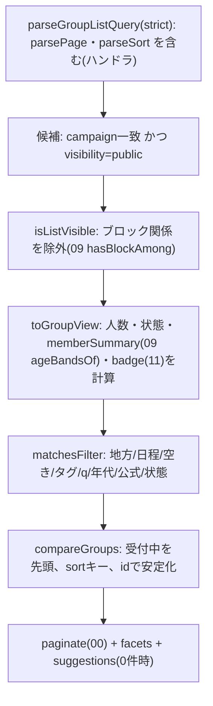

# 02 グループ探索

> 本書の ID 接頭辞は `DSC`(API=DSC-API、関数=DSC-FN、型=DSC-TY、画面部品=DSC-UI、試験=DSC-T、タスク=DSC-TASK、規則=DSC-RULE)。状態の凡例は [README](README.md) 1 章に従う。
> モジュール間で共有する名前・署名・パス・値・状態値は [統一仕様](_unified-contracts.md)(以下「契約書」)を正とする。本書と食い違う場合は契約書に従う。docs/design との関係は契約書の冒頭に従う。
> 章番号の表記: 「本書 N 章」、節番号(5.1 等)、「14 章」「15 章」「16 章」は本書の章を指す。「契約書 N.N」は契約書の節を指す。それ以外の「NN 章」「12章 #NN」は docs/design の章を指す。

## 1. 概要と責務 / 対応する柱
- 公開グループの一覧、検索・絞り込み(地方・日程・空き・行き先/テーマ/タグ・メンバーの年代・公式枠・状態)、参加前のグループ詳細、キャンペーン・地方の選択(絞り込みの一部)、非公開グループの招待コード入力(コード入力 → プレビュー。申請は同じ画面に置く 03 の申請パネルで行う。契約書 7.2)。柱1、3、17。 [案]
- 読み取り専用のモジュールで、グループ・メンバー・申請・状態を書き換えない。状態遷移は 04、参加申請は 03、公開範囲の丸めは 09 に委ねる。
- 一覧に載るのは公開グループのみ。非公開は招待コード経由のみ(DSC-RULE-01)。 [決定]
- 性別での絞り込みは設けない。年齢に関する条件はメンバーの年代のまとまり(09 の `AgeBucket`)のみとする(クエリ・型・画面・文言のいずれにも性別の項目を置かない。DSC-T-60 で静的に検査)。 [決定]
- 責務の外: グループの作成(01)、参加申請の送信・判定(03)、状態の計算(04)、禁止表現・ブロック・公開範囲の規則そのもの(09)、公式枠の付与と表示情報(11)。

### 1.1 規則の一覧(実装・試験が参照する)
| ID | 規則 | 状態 |
|---|---|---|
| DSC-RULE-01 | 一覧・検索の対象は `visibility = "public"` のグループのみ。非公開は一覧・検索・facets・件数・提案のいずれにも含めない | [決定] |
| DSC-RULE-02 | ブロック関係にあるユーザー(幹事、または参加中メンバー)がいるグループは、一覧・詳細・件数から除外。詳細は `not_found`(存在を隠す)。ブロックの判定は双方向(契約書 6.3) | [統一(契約書 6.3)] |
| DSC-RULE-03 | 既定の状態フィルタは「募集中」「最少人数到達」のみ。中止・再企画済みは既定で非表示で、`status` に指定したときだけ表示する(「受付が終わったグループも表示」にも含めない)。完了・辞退期間・実行確定・実施中は `status` 指定時のみ表示(閲覧のみ、申請不可) | [案(04 章の「一覧では通常は非表示/終了扱い」に基づく)/統一(`replanned` の扱いは契約書 7.3)] |
| DSC-RULE-04 | 満員は状態ではなく表示。満員でも募集中/最少人数到達なら一覧に残し「満員」バッジを付け、申請は不可 | [案(12章 #24 未決)] |
| DSC-RULE-05 | メンバー概要は 09 の `memberSummary` の結果(`MemberSummary`)をそのまま返す。参加中が 4 人未満のときは年代を出さない(`buckets = null`)。4 人以上は 20 年幅のまとまり(`AgeBucket`)を存在の有無だけで返し、まとまりごとの人数は出さない | [統一(契約書 6.3、09 SAF-RULE-07・08)] |
| DSC-RULE-06 | 年代での絞り込みは `memberSummary.buckets` に対してのみ評価する(`buckets` が `null` のグループは年代条件に一致しない)。絞り込み結果から非表示の構成が推測できないようにする | [統一(契約書 6.3)] |
| DSC-RULE-07 | 参加前に返さない項目: メンバーの一覧・userId、本名、連絡先、招待コード、申請者・申請数、チャット・旅程メモ・費用メモ、通報・ブロック情報(DSC-TY-12 のホワイトリスト以外は返さない) | [決定(本名・連絡先)/案(他)] |
| DSC-RULE-08 | 非公開グループ(関係者以外)・ブロック関係・存在しない ID に対し、`GET /api/groups/[groupId]` は互いに区別できない同一の応答を返す(404 `not_found`、同一メッセージ・同一形状)。非公開グループは、関係者(`status: "active"` のメンバー)以外なら申請中の本人にも `not_found` を返す。申請中の本人の申請状態は 03 の `GET /api/groups/[groupId]/my-join-request` で確認する | [案/統一(契約書 5.5、7.2)] |
| DSC-RULE-09 | 検索語は部分一致のみ。正規表現・ワイルドカードとして解釈しない | [決定(骨子)] |

## 2. 既存機能との関係
- 流用: `seed.json` の `campaign`(`slug`、`name`。現在 1 件 `nttw-demo`)、`spots[].area`(スポットの地区名 7 種)、`user.region`(ユーザーの地方名 `水琴地方`)。これらは読み取りのみで変更しない。 [事実]
- 既存データの制約 [事実]: seed.json に「地方」のマスタは無い。`user.region` が文字列として 1 つあるのみで、`spots[].area` と地方の対応も無い。よって地方マスタ `Region` を本モジュールが所有し、00 の `group-seed.json` の `regions` からストアのコレクション `regions` に読み込む(契約書 3.1、7.3)。スポットの地区名は検索語の補助(地方に属する地区名)としてのみ使う。
- 新規: 一覧・検索・参加前詳細・招待コード入口・地方マスタの参照関数。
- 既存の `src/lib/api.ts` の `api` / `useApi` は `/api/v2` 固定のため、グループ系 API には使えない。クライアントは 00 の `lib/groups-api.ts`(`gapi`、`ApiError`)を使い、本モジュール専用のクライアントは作らない(契約書 3.5)。
- 入口B(11)の初期値は 5.6 の `parseGroupListQuery`(lenient)で受ける(契約書 7.11、14 章)。

## 3. 画面・UI(04 章)

### 3.1 画面一覧
| ID | 画面 | 04 章の項目 | パス | 備考 |
|---|---|---|---|---|
| DSC-SCR-01 | グループ一覧 | グループ一覧(柱3、17) | `/[campaign]/groups` | カード、公式枠表示、状態バッジ、ページネーション(UI は見送り(契約書 16.2)) |
| DSC-SCR-02 | 検索・絞り込みパネル | 検索・絞り込み | DSC-SCR-01 内 | 幅 768px 以上は左サイドバー、未満は Drawer。条件は URL クエリに反映 |
| DSC-SCR-03 | グループ詳細(参加前) | グループ詳細(参加前) | `/[campaign]/groups/[groupId]` | ページは 01 が所有。関係者(幹事・参加中メンバー)以外が公開グループを開いたときに 02 の表示を使う |
| DSC-SCR-04 | 招待コード入力 | 招待コード | `/[campaign]/invite` | コード入力 → 最小プレビュー → 同じ画面の 03 の `JoinRequestPanel` で申請(契約書 7.2) |
| DSC-SCR-05 | キャンペーン・地方の選択 | キャンペーン一覧/地方選択 | DSC-SCR-02 内の「地方」選択。キャンペーンが 2 件以上のときのみヘッダにキャンペーン切替 | キャンペーンは現状 1 件のため切替は非表示 [案] |

画面のパスは契約書 2.2 に従う。`/[campaign]/groups` の下には動的セグメント `[groupId]` だけを置き、静的セグメントを並べない(契約書 2.1 R-2)。そのため招待コード入力は `/[campaign]/invite`、グループ作成は 01 の `/[campaign]/new-group` とする。`[groupId]` の形式は 00 の `isId("g", …)` で検査する(契約書 3.2)。

### 3.2 グループ一覧(DSC-SCR-01)
- 構成: ページ見出し「グループを探す」+ モック表示(00 の共通表示)→ 検索ボックス+「絞り込み」ボタン(狭幅)→ 有効条件のチップ列 → 件数と並び順 → カードのリスト → ページネーション(見送り(契約書 16.2)。デモの件数では 1 ページに収まる。16 章 #5)。
- カードに出す項目(DSC-TY-08 `GroupSummary`):
  1. 公式枠・地元の枠のバッジ(11 の `OfficialBadgeView` の `badgeLabel` と `sponsorName`。`badge` があるときのみ)
  2. 名称、行き先、地方名
  3. 日程(`12/5(土)〜12/7(月)`。dayjs、日本語ロケール)
  4. 人数行: `最少2人 / 定員4人 / 現在1人 / 空き3人`。募集中は `あと1人で実行` を併記(shortfall > 0 のとき)、最少人数到達は `最少人数に達しました(確定前)`
  5. 状態バッジ(04 の `GroupStatusBadge`。テキスト必須。再企画済みも状態として表示)+ 満員バッジ(該当時。`GroupStatusBadge` の `full`)。バッジは色だけに頼らず文言とアイコンを併用
  6. 締切(`締切 11/25`。`deadlineDate` を表示する)
  7. タグ(最大 4 件、超過は `+N`)
  8. 幹事の表示名
  9. メンバー概要(09 の `formatMemberSummary` の文字列。4 人未満は年代を出さない)
  10. 自分との関係(`参加中`/`幹事`/`申請中`。ある場合のみ)
- カード全体が 1 つのリンク(`<a>` を見出しに持たせ、カード全域をクリック可能にする)。詳細へ遷移。入口は `/[campaign]/groups/[groupId]`。
- 既定の並び: 受付中(募集中・最少人数到達)を先頭、`締切の近い順`。

### 3.3 絞り込みパネル(DSC-SCR-02)
| 項目 | UI | 対応クエリ |
|---|---|---|
| キーワード | テキスト(300ms デバウンス。Enter で即時) | `q` |
| 地方 | セレクト(`すべての地方`+地方マスタ) | `region` |
| 日程 | 開始日・終了日の日付入力 2 つ(`@mantine/dates` の `DateInput`、`valueFormat="YYYY-MM-DD"`、手入力可。12.1)。「この期間と重なる旅行」と注記 | `dateFrom`、`dateTo` |
| 空き | チェック「空きのあるグループのみ」(=1 人以上)。詳細: 人数セレクト(1〜5) | `vacancy` |
| タグ・テーマ | 複数選択チップ。候補は応答の `facets.tags` | `tags` |
| 年代 | 複数選択(09 の `AgeBucket` の表示名「20代以下」「30〜40代」「50〜60代」「70代以上」)。見出しは「メンバーに含まれる年代」で、「4 人以上のグループが対象」と注記する。「同年代のみ」等の語は使わない | `ageBuckets` |
| 公式枠 | スイッチ「自治体のおすすめプランのみ」 | `official`(値は `1`) |
| 状態 | 既定は非表示。「受付が終わったグループも表示」スイッチをオンにすると `status` を `cancelled`・`replanned` 以外の全状態にする | `status` |
| 並び順 | セレクト(`SORT_OPTIONS` の 4 値) | `sort`(`<キー>:<asc\|desc>`) |
- 「条件をクリア」ボタン: `campaign` 以外の条件(並び順を含む)を既定値に戻す。
- 適用は即時(変更ごとに URL を `router.replace`、画面のクエリ `page` は 1 に戻す)。狭幅の Drawer は「結果を見る(N件)」ボタンで閉じる。
- 性別の項目は存在しない。

### 3.4 グループ詳細・参加前(DSC-SCR-03)
- 表示(DSC-TY-12 `PublicGroupDetail`): 公式枠のバッジ、名称、状態バッジ・満員バッジ、進行状況(`最少2人まであと1人`、`締切 11/25`)、行き先、地方、日程、タグ、説明(空文字のときは見出しごと省く)、人数(最少・定員・現在・空き)、メンバー概要、幹事の表示名(09 の公開範囲内)、再企画の関係(元グループ・再企画先へのリンク。見える場合のみ)。
- 表示しない: DSC-RULE-07 のとおり。画面上に「参加が成立するまで、メンバーの詳細や連絡先は表示されません」と明記する。
- 操作: 「参加を申請する」ボタン(`applyState.canApply` が true のときのみ有効。クリックで 03 の申請フォーム)。無効時は理由を表示(`満員です`、`受付は終了しました`、`中止されました`、`申請済みです` 等。DSC-TY-11)。補助導線: `一覧へ戻る`(直前の一覧 URL を `sessionStorage` に保存して戻す。保存値が無い場合と、保存値が `/[campaign]/groups` で始まる相対パスでない場合は `/[campaign]/groups` に戻る。7.2)、`通報`(09 の導線を差し込む枠のみ)。
- 中止・再企画済みのグループ: 状態バッジと、再企画先がある場合は「新しいグループへ」のリンク(`replannedToGroupId`)。申請ボタンなし。
- 関係者(幹事・参加中メンバー)が開いた場合: 01 の参加後表示(タブ)になる。振り分けは合成層 `features/groups/compose/handlers.ts`(所有 01)の `getGroupDetailHandler` が行う(契約書 2.1、5.5)。
- 非公開グループを関係者以外が開いた場合は、申請中の本人を含めて `not_found`(3.6)。非公開グループへの参加前の表示と申請は、招待コード入力画面(3.5)だけで行う。

### 3.5 招待コード入力(DSC-SCR-04)
- 入力欄 1 つ(`inputmode="text"`)。コードは 01 の形式(32 文字集合の 10 文字。表示は `ABCDE-FGHJK`。小文字・ハイフン・空白は入力してよく、照合時に大文字化してハイフン・空白を除く。契約書 7.2)。送信前にクライアントでも同じ正規化と形式の検査を行い、形式に合わない場合は送信せずに下記の失敗文言を出す。
- 方式はコード入力方式(契約書 7.2 [決定 27])。照合・プレビュー・申請をこの画面だけで行い、別の画面へ遷移しない。
- 送信で DSC-API-03(コードは本文で送る)。成功時、同じ画面に最小プレビュー(`InvitePreviewPanel`。名称、行き先、地方、日程、人数、状態、幹事の表示名)と、03 の申請パネル `JoinRequestPanel` を出す。
- 申請前の `JoinRequestPanel` は `GET /api/groups/[groupId]/my-join-request` を呼ばない(自分の申請が無いと `not_found` のため)。`PrivateGroupPreview` の `headcount.min`・`applyState` を props で渡し、同意文言は 03 の `consentText(minMembers)` で作る。申請は 03 が `POST /api/groups/[groupId]/join-requests` の本文に `inviteCode` を入れて送り、03 が 01 の `assertInviteCode` で確認する。props の形は 03 の定義に従う。
- 申請後の状態は 03 の `GET /api/me/join-requests` と `GET /api/groups/[groupId]/my-join-request` で確認する。承認されて関係者になった後は、通常の詳細(`/[campaign]/groups/[groupId]`)で参加後の表示になる(契約書 7.2)。
- 照合済みのコードは `InviteCodeScreen` のコンポーネントの state にだけ保持する(3.8)。画面の URL(クエリ・パス)、`sessionStorage`、API の URL、サーバーのログに残さない。画面を離れると破棄され、再度入力が必要になる。
- 失敗(形式不正の `invalid_input` を含む)は DSC-API-03 の `not_found` と同じ文言「コードが見つかりません。入力を確認してください」に統一する。

### 3.6 空状態・エラー状態・読み込み
| 状況 | 表示 |
|---|---|
| 読み込み中 | カード形状のスケルトン 3 つ。`aria-busy="true"`。結果領域に `role="status"` の「検索中」 |
| 候補ゼロ(条件あり) | 「条件に合うグループが見つかりませんでした」+ 提案ボタン(`suggestions`: 日程を外す/地方を外す/タグを外す/年代を外す/受付が終わったグループも表示。件数つき)+「自分でグループを作る」(01 へ) |
| 候補ゼロ(条件なし=コールドスタート) | 「公開中のグループはまだありません」+「グループを作る」。デモの見せ方は [未決](04 章) |
| `invalid_input`(URL の手入力など) | 一覧は lenient 解釈で無効条件を除外して表示し、上部に「一部の条件が無効なため無視しました: …」(`role="status"`) |
| `not_found`(詳細) | 「このグループは見つからないか、公開されていません」+ 一覧へ戻る(非公開・ブロック・不存在を区別しない) |
| `internal` / 通信失敗 | 「読み込めませんでした」+「もう一度試す」+ デモリセット案内(06 章の未決)。再試行は同条件で再取得 |

### 3.7 アクセシビリティ
- ランドマーク: 一覧は `<main>`、絞り込みは `<form role="search" aria-label="グループの絞り込み">`、結果は `<section aria-labelledby>`。見出し階層は h1(画面)→ h2(結果)→ h3(カード名)。
- キーボード: 全操作を Tab / Shift+Tab / Enter / Space / Esc で可能に。Drawer は開くとフォーカスをパネル先頭へ、Esc で閉じて「絞り込み」ボタンへ戻す(フォーカストラップ)。チップの削除は `button`(`aria-label="地方: 水琴地方を解除"`)。
- スクリーンリーダー: 結果件数の変化を `aria-live="polite"` の `role="status"` で通知(「5件のグループが見つかりました」。デバウンス後のみ)。ページ送り後は結果見出しにフォーカス。状態・満員・公式はバッジを `<span>` のテキストで読み上げ(色のみで伝えない)。人数行はまとめて読める文言(`最少2人、定員4人、現在1人、空き3人`)を `aria-label` ではなく可視テキストで提供。
- 配色: コントラスト 4.5:1 以上(WCAG AA)。フォーカスリングを消さない。タップ領域 44px 以上。スマホ幅(360px)で横スクロールなし。
- 日付は手入力(`YYYY-MM-DD`)とカレンダーのどちらでも入力できるようにする(`DateInput` を使う。3.3)。
- [要確認] Mantine 9 の各コンポーネントの a11y 既定(Drawer のフォーカス管理、DateInput のラベル)。`app/node_modules` が無く確認できていない。実装着手時に確認する事項(判断は不要。契約書 14.2)。

### 3.8 コンポーネント構成(props / state / データ取得)
```
app/src/app/[campaign]/groups/page.tsx                    サーバーコンポーネント。<Suspense><GroupListScreen campaign/></Suspense>
app/src/app/[campaign]/invite/page.tsx                    サーバーコンポーネント。<InviteCodeScreen campaign/>
app/src/features/groups/discovery/ui/
  GroupListScreen.tsx     "use client" 一覧の親。URL ⇔ フィルタ状態、データ取得
  FilterPanel.tsx         絞り込みフォーム(サイドバー/Drawer 共用)
  ActiveFilterChips.tsx   有効条件のチップ列
  GroupCard.tsx           カード
  HeadcountLine.tsx       人数行(最少・定員・現在・空き・あと◯人)
  MemberSummaryLabel.tsx  メンバー概要の表示(09 の formatMemberSummary を使う)
  GroupBadges.tsx         状態・満員・公式・自分との関係(状態・満員のバッジ本体は 04 の GroupStatusBadge を使用)
  ListEmptyState.tsx      空状態と提案
  ListErrorState.tsx      エラーと再試行
  PublicGroupDetailScreen.tsx  参加前詳細(型 PublicGroupDetail と名前を分ける。01 の詳細ページから使う)
  InviteCodeScreen.tsx    "use client" 招待コード入力、プレビュー、03 の JoinRequestPanel の配置。照合済みのコードを state に持つ
  InvitePreviewPanel.tsx  PrivateGroupPreview の表示(DSC-SCR-04 専用)
  hooks/useGroupList.ts   取得フック(AbortController で古い応答を破棄)
  hooks/useFilterUrlState.ts  URL クエリ ⇔ GroupListFilter と画面のページ番号
```
```ts
// props / state(要点)
interface GroupListScreenProps { campaign: string }
// state: filter(URL が唯一の正)、page(URL の page。1 始まり)、qDraft(入力中のテキスト、300ms 後に filter.q へ)、drawerOpen
// データ: useGroupList(filter, page) -> { data: GroupListResponse | null; loading: boolean; error: ApiError | null; reload(): void }
// ApiError: 00 の lib/groups-api.ts。{ code, status, message, reason?, fields?, detail? }。通信失敗・JSON でない応答は code: "network"
interface FilterPanelProps {
  filter: GroupListFilter; regions: Region[]; facets: GroupListResponse["facets"] | null;
  resultCount: number | null; onChange(next: Partial<GroupListFilter>): void; onClear(): void;
}
interface GroupCardProps { group: GroupSummary; campaign: string }
interface PublicGroupDetailScreenProps { campaign: string; group: PublicGroupDetail; onApply(): void }
interface InviteCodeScreenProps { campaign: string }
// state: codeInput(入力中の文字列)、verifiedCode(照合に成功した正規化済みのコード。string | null)、
//        preview(PrivateGroupPreview | null)、error(ApiError | null)、submitting。
//        verifiedCode は 03 の JoinRequestPanel に inviteCode として渡すだけで、URL・sessionStorage には書かない(3.5)
interface InvitePreviewPanelProps { campaign: string; preview: PrivateGroupPreview }
interface ListEmptyStateProps { filter: GroupListFilter; suggestions: RelaxSuggestion[]; onApplySuggestion(s: RelaxSuggestion): void; campaign: string }
```
- データ取得は `gapi<GroupListResponse>("/api/groups?" + クエリ, { signal })`。クエリは `serializeFilter(filter)` に、画面のページ番号から換算した `limit = LIST_PAGE_SIZE`、`offset = (page - 1) * LIST_PAGE_SIZE` を加えたもの(API は 00 の `Page<T>` の `limit`/`offset` で受ける。契約書 2.3)。`useGroupList` は直列化したクエリ文字列を `useEffect` の依存配列に使い、条件が変わるたびに `AbortController` で前のリクエストを中止する。中止したリクエストの応答と、後から届いた古い応答は state に反映しない(`useGroupsApi` は中止の仕組みを持たないため使わない)。
- 総ページ数は画面で `Math.max(1, Math.ceil(total / limit))` として計算する(ページネーションの UI は見送り(契約書 16.2))。
- 初回は `useFilterUrlState` が `parseGroupListQuery(searchParams, "lenient", ctx)` で URL から初期状態を作る(入口B はこの経路)。`ignored` があれば DSC-SCR-01 上部に通知。`ctx`(`QueryContext`。DSC-TY-14)はサーバーコンポーネントが `listRegions`・`getCampaign`・`clock.today()` から作って props で渡す。
- Next.js 16 のクライアントでの `useSearchParams` と `Suspense` の要件は [要確認](`app/node_modules/next/dist/docs/` 未確認。既存 `[campaign]/layout.tsx` は Suspense で包んでいる)。実装着手時に確認する事項(判断は不要。契約書 14.2)。

## 4. データ(05 章)

### 4.1 保存するデータ
- 本モジュールが所有するコレクションは `regions`(`Repo<Region>`、ID は `r-<slug>`、seed のみで採番しない。契約書 3.1、3.2)。一覧用のビューは都度生成する(派生。保存しない)。
- 読み取るデータ(書き込まない。アクセスは 00 の `db()`/`Repo` と各モジュールの公開関数のみ。契約書 3.1):

| データ | 取得方法 |
|---|---|
| グループ(`groups`) | 01 の `listAllGroups()`、`getGroupById(id)` |
| 参加中メンバー(`members`) | 00 の `activeMembers(group)`、`isMember`、`isOrganizer` |
| 状態・締切(`group.lifecycle`) | 01 の Group に含まれる 04 の `GroupLifecycle`。受付可否は 04 の `canAcceptRequests(g)` |
| ブロック(`blocks`) | 09 の `hasBlockAmong(viewerId, userIds)` |
| 自分の申請(`joinRequests`) | 03 の `hasPendingRequest(userId, groupId)` |
| 公式枠の表示(`listings`) | 11 の `getOfficialBadges(groupIds)` |
| メンバーの年代帯(`profiles`) | 09 の `ageBandsOf(userIds)`(参加中メンバーの userId を渡す)の結果を 09 の `memberSummary` に渡す。`db().profiles` は直接読まない(契約書 6.3) |
| 地方(`regions`) | `db().regions` |

### 4.2 型定義(`features/groups/discovery/types.ts`)
```ts
import type { Id, DateStr, IsoDateTime, Page } from "@/lib/groups-types";
import type { Group, Trip } from "../types";                      // 01
import type { GroupStatus } from "../lifecycle/types";            // 04
import type { AgeBand, AgeBucket, MemberSummary } from "@/features/safety/types";   // 09
import type { OfficialBadgeView } from "@/features/official/types";               // 11

// DSC-TY-01 年代(09 の AgeBucket を使う。02 は年代の列挙を定義しない。DSC-RULE-05・06)
// 絞り込みの選択肢は 09 が公開する AgeBucket の値と表示名を使う(15 章 #3)

// DSC-TY-02 並び順(00 の parseSort の形式 `<キー>:<asc|desc>`。契約書 2.3、7.3)
export const SORT_KEYS = ["deadline", "start", "created", "vacancy"] as const;   // parseSort の allowed
export type SortKey = (typeof SORT_KEYS)[number];
export const SORT_OPTIONS = ["deadline:asc", "start:asc", "created:desc", "vacancy:desc"] as const; // 受け付ける組み合わせ
export type SortOption = (typeof SORT_OPTIONS)[number];
export const DEFAULT_SORT: SortOption = "deadline:asc";

// DSC-TY-03 地方・キャンペーン(コレクション regions。seed は 00 の group-seed.json。本書 2 章、4.3)
export interface Region { id: Id; name: string; campaign: string; spotAreas: string[] } // id は r-<slug>(00 の isSlugId("r", …))
export interface CampaignInfo { slug: string; name: string }

// DSC-TY-04 状態(04 の GroupStatus。8 値。契約書 4.1)
export const DEFAULT_LIST_STATUSES: GroupStatus[] = ["recruiting", "min_reached"];
export const LISTABLE_STATUSES: GroupStatus[] =
  ["recruiting", "min_reached", "withdrawal_period", "confirmed", "in_progress", "completed", "cancelled", "replanned"];
// 「受付が終わったグループも表示」と提案 include_closed で使う状態(中止・再企画済みを含めない。DSC-RULE-03)
export const CLOSED_INCLUDED_STATUSES: GroupStatus[] =
  ["recruiting", "min_reached", "withdrawal_period", "confirmed", "in_progress", "completed"];

// DSC-TY-05 一覧の絞り込み条件(検証済み・正規化済み)。性別に相当する項目は存在しない。ページの指定は含めない(DSC-TY-14)
export interface GroupListFilter {
  campaign: string;
  region?: Id;              // Region.id
  dateFrom?: DateStr;       // "YYYY-MM-DD"
  dateTo?: DateStr;         // "YYYY-MM-DD"、dateFrom 以上
  vacancy?: number;         // 1..5 空きが N 人以上
  tags: string[];           // 0..LIMITS.TAG.maxItems。入力値(前後空白除去・正規化後の重複除去済み)。照合時に normalizeSearchText を通す(OR 一致)
  q?: string;               // 入力値(前後空白除去・連続空白を 1 つに圧縮)。照合時に正規化する。長さは正規化後に 1..60 文字
  ageBuckets: AgeBucket[];  // 0..4(いずれかを含む)
  official: boolean;        // true=公式枠(Group.official)のみ。クエリでは official=1
  statuses: GroupStatus[];  // 既定 DEFAULT_LIST_STATUSES
  sort: SortOption;         // 既定 DEFAULT_SORT("deadline:asc")
}

// DSC-TY-06 人数(最少・定員・現在・空き)
export interface HeadcountView {
  min: number; capacity: number; current: number;   // min は lifecycle.minMembers、capacity は Group.capacity
  vacancy: number;      // max(0, capacity - current)
  shortfall: number;    // max(0, min - current)  「あと◯人で実行」
  isFull: boolean;      // current >= capacity
  reachedMin: boolean;  // current >= min
}

// DSC-TY-07 メンバー概要は 09 の MemberSummary をそのまま使う(02 は型を定義しない。契約書 6.3)
// { count: number; buckets: AgeBucket[] | null; hiddenReason: "few_members" | null }

export type ViewerRelation = "organizer" | "member" | "requested" | "none";   // 応答の viewerRelation が "requested" になるのは公開グループだけ(DSC-RULE-08)。招待コードのプレビューでは applyState の判定にだけ使う

// DSC-TY-08 一覧カード
export interface GroupSummary {
  id: Id;
  name: string;
  campaign: string;
  region: { id: Id; name: string };
  trip: Trip;                                // 01 の Trip(destination、startDate、endDate、dateNote)
  deadlineDate: DateStr;                     // lifecycle.deadlineDate(表示に使う)
  deadlineAt: IsoDateTime;                   // lifecycle.deadlineAt(並び順に使う)
  tags: string[];
  badge: OfficialBadgeView | null;           // 11 の getOfficialBadges の結果。Listing が無ければ null
  organizerName: string;                     // 表示名のみ
  headcount: HeadcountView;
  status: GroupStatus;
  statusLabel: string;                       // 04 の statusLabel(status)
  flags: { full: boolean; acceptingRequests: boolean };
  memberSummary: MemberSummary;              // 09
  viewerRelation: ViewerRelation;
}

// DSC-TY-09 一覧応答(00 の Page<T> に付加情報を加える。契約書 2.3)
export interface RelaxSuggestion {
  kind: "clear_dates" | "clear_region" | "clear_tags" | "clear_age" | "clear_query" | "clear_vacancy" | "clear_official" | "include_closed";
  label: string;        // 例: "日程の指定を外す"
  resultCount: number;  // 外した場合の件数(1 以上のものだけ返す)
}
export type GroupListResponse = Page<GroupSummary> & {                // { items, total, limit, offset, hasMore }
  filter: Omit<GroupListFilter, "campaign">;                           // 正規化後のエコー
  facets: { tags: { tag: string; count: number }[] };                  // 他条件適用後、出現数降順、最大 20
  suggestions: RelaxSuggestion[];                                      // total=0 のときのみ
  asOf: IsoDateTime;                                                   // clock.nowIso()
};
export const LIST_PAGE_SIZE = 12;                                      // 画面の 1 ページの件数。API の limit の既定値(parsePage(q, { defaultLimit: 12 })。契約書 2.3、7.3)

// DSC-TY-10 参加できない理由
export type ApplyBlockReason = "full" | "closed" | "cancelled" | "finished" | "already_member" | "already_requested";
// DSC-TY-11
export interface ApplyState { canApply: boolean; reason?: ApplyBlockReason }

// DSC-TY-12 参加前詳細(ホワイトリスト。ここに無い項目は返さない = DSC-RULE-07)
export interface PublicGroupDetail extends GroupSummary {
  kind: "public";                            // 01 の詳細(kind: "member")と画面で出し分ける(契約書 5.5)
  description: string;                       // LIMITS.DESCRIPTION の範囲(Group.description。空文字あり)
  organizer: { displayName: string; ageBand?: AgeBand };  // ageBand は 09 visibleProfile が許可した場合のみ
  applyState: ApplyState;
  replanOfGroupId: Id | null;                // 元グループ。閲覧者に見える場合のみ値を入れる
  replannedToGroupId: Id | null;             // 再企画先。閲覧者に見える場合のみ値を入れる
  cancelKind: "auto" | "organizer" | null;   // cancelled・replanned のとき。04 の CancelReasonCode から導出(5.3)。理由の文章は返さない
}

// DSC-TY-13 招待コード入口(最小限)
export interface PrivateGroupPreview {
  id: Id; name: string; region: { id: Id; name: string }; trip: Trip; headcount: HeadcountView;
  status: GroupStatus; statusLabel: string; organizerName: string; applyState: ApplyState;
}

export interface PageRequest { limit: number; offset: number }                     // 00 の parsePage の戻り値と同じ形
```
```ts
// DSC-TY-14 パース結果と文脈(features/groups/discovery/query.ts で定義して公開する。11 が import するため。契約書 7.3)
export type IgnoredReason = "unknown_key" | "invalid_value";                       // 11 は同名の型を作らない
export interface QueryContext {
  campaigns: string[];          // seed のキャンペーン slug
  defaultCampaign: string;
  regions: Region[];            // 地方の存在確認に使う(listRegions の結果)
  today: DateStr;               // clock.today()。過去の日付の判定に使う
}
export interface ParsedListQuery {
  filter: GroupListFilter;
  page: PageRequest;                                                               // strict は limit/offset、lenient は画面の page から換算
  ignored: { key: string; reason: IgnoredReason }[];                               // lenient のみ。未知キーは unknown_key、不正値・存在しない地方・過去の日付は invalid_value
}
```
- 一覧に出さない: 非公開グループ、メンバー一覧、userId、招待コード、申請数、本名、連絡先。

### 4.3 地方マスタの形(`group-seed.json` の `regions`。00 が seed を統合し、ストアの `regions` に読み込む)
```json
{ "regions": [ { "id": "r-mizukoto", "name": "水琴地方", "campaign": "nttw-demo", "spotAreas": ["鈴風高原", "雫森谷"] } ] }
```
- `user.region = "水琴地方"` と名称を一致させる。他の地方名・地区名との対応(`spotAreas`)はダミーで [案]。どの地区がどの地方かは [未決]。
- 自治体の担当地方は 11 の `Municipality.regionIds` がこの `Region.id` を参照する(契約書 7.11)。

## 5. インターフェース(関数・API)

### 5.1 API 一覧
| ID | メソッド・パス | 目的 | 呼び出し元 | Route Handler のファイル |
|---|---|---|---|---|
| DSC-API-01 | `GET /api/groups` | 一覧・検索 | DSC-SCR-01(入口B からの遷移を含む) | `app/api/groups/route.ts`(GET は 02 の `listGroupsHandler`、POST は合成層 `features/groups/compose/handlers.ts`(所有 01)の `createGroupHandler`。どちらも再エクスポートのみ) |
| DSC-API-02 | `GET /api/groups/[groupId]` | 参加前の詳細 | DSC-SCR-03 | `app/api/groups/[groupId]/route.ts`(所有 01。合成層の `getGroupDetailHandler` を再エクスポート。契約書 5.5 の判定で、公開グループを関係者以外が開いたときに 02 の `getPublicGroup` の結果を返す) |
| DSC-API-03 | `POST /api/invites/lookup` | 招待コードでプレビュー | DSC-SCR-04 | `app/api/invites/lookup/route.ts`(02) |
| DSC-API-04 | `GET /api/regions?campaign=` | 地方マスタ | DSC-SCR-02、11 | `app/api/regions/route.ts`(02) |

共通: ハンドラは 00 の `route()` で包んで `features/groups/discovery/handlers.ts` に置き、`route.ts` は再エクスポートだけを書く(契約書 2.1)。現在ユーザーは `c.user`(Cookie `demoUser`。00)。`Cache-Control: no-store` と `X-Content-Type-Options: nosniff` は `route()` が付ける。エラー形式は 00 の `{ error, reason?, message, fields?, detail? }`(契約書 3.3)。パスの ID は `c.id("groupId", "g")` で検査し、形式不正は `not_found`。状態の評価(締切の判定)は `route()` の `beforeRequest` フックで 04 の `evaluateAll` が済んでおり、02 は `evaluateAll` を呼ばない(契約書 3.5)。

```ts
// app/src/app/api/groups/route.ts(01 と共有。各行は再エクスポートのみ。契約書 2.1)
export { listGroupsHandler as GET } from "@/features/groups/discovery/handlers";
export { createGroupHandler as POST } from "@/features/groups/compose/handlers";   // 合成層(所有 01)
// app/src/app/api/invites/lookup/route.ts
export { lookupInviteHandler as POST } from "@/features/groups/discovery/handlers";
// app/src/app/api/regions/route.ts
export { listRegionsHandler as GET } from "@/features/groups/discovery/handlers";
```

#### DSC-API-01 `GET /api/groups`
処理順: 09 の `rejectProhibitedParams(c.url.searchParams)`(ハンドラの先頭。性別・細かい年齢のキーを `invalid_input` にする。契約書 3.4)→ `parseGroupListQuery(c.url.searchParams, "strict", ctx)` → `listGroups(c.user, filter, page)`。`ctx` はハンドラが `listRegions`・`getCampaign`・`clock.today()` から作る。
クエリパラメータ(全て任意。下表と `limit`・`offset` 以外のキーは `invalid_input`)。複数値はカンマ区切り。同一キーを繰り返した場合は `invalid_input`(lenient では最初の値を使う)。

| キー | 型 | 検証 | 既定 | 備考 |
|---|---|---|---|---|
| `campaign` | string | seed のキャンペーン slug のいずれかと完全一致 | seed の campaign(`nttw-demo`) | 未知は `invalid_input` |
| `region` | string | 00 の `isSlugId("r", v)`、かつ地方マスタに存在 | なし | 未知は `invalid_input`(lenient では無視) |
| `dateFrom` / `dateTo` | string | `YYYY-MM-DD` の実在日付(00 の `isDateStr`)。片方のみ可。両方なら `dateFrom <= dateTo`、幅 366 日以内。範囲 `ctx.today`〜2100-12-31(過去の日付は `invalid_input`。lenient では無視して `ignored` に `invalid_value` で積む。契約書 7.3) | なし | 旅行の `[trip.startDate, trip.endDate]` が指定期間と重なるグループに一致(`startDate <= dateTo かつ endDate >= dateFrom`)。片方のみのとき他方は無限 |
| `vacancy` | int | 1〜5 | なし | 空き人数が N 以上 |
| `tags` | string(カンマ区切り) | 00 の `LIMITS.TAG`(各要素の文字数は `min`〜`max`、件数は `maxItems` まで。正規化後)。制御文字・`,` 不可。重複は除去 | なし | 正規化(5.4)後にいずれか一致(OR)[案] |
| `q` | string | 正規化後 1〜60 文字。制御文字を含む場合 `invalid_input`。空白のみは未指定扱い。空白区切りで最大 5 語、各 30 文字以内 | なし | 全語を含む(AND)。対象は名称・行き先・タグ・地方名・その地方の `spotAreas`(DSC-RULE-09) |
| `ageBuckets` | string(カンマ区切り) | 09 の `AgeBucket` の値のみ。最大 4 | なし | いずれかを含む(DSC-RULE-06)。性別・細かい年齢は受け付けない |
| `official` | string | `1` のみ(それ以外は `invalid_input`) | 指定なし(公式枠に限定しない) | `official=1` で `Group.official` が真のグループのみ(契約書 7.3)。`serializeFilter` は `official=1` を出す |
| `status` | string(カンマ区切り) | `LISTABLE_STATUSES` の値のみ。最大 8 | `recruiting,min_reached` | 指定した状態のみに置き換える(追加ではない)。`cancelled`・`replanned` は指定時のみ表示 |
| `sort` | string(`<キー>:<asc\|desc>`) | 00 の `parseSort(q, { allowed: SORT_KEYS, default: { key: "deadline", dir: "asc" } })` で読み、組み合わせが `SORT_OPTIONS` の 4 値(`deadline:asc`、`start:asc`、`created:desc`、`vacancy:desc`)のいずれかであること。旧形式 `deadline_asc` などは `invalid_input`(`fields.sort`) | `deadline:asc` | 5.5 参照(契約書 2.3) |
| `limit` | int | 00 の `parsePage(q, { defaultLimit: 12 })`(1〜`LIMITS.PAGE.maxLimit`) | 12(`LIST_PAGE_SIZE`) | 00 の `Page<T>`(契約書 2.3、7.3) |
| `offset` | int | 00 の `parsePage`(0 以上) | 0 | 範囲外は空の `items` と `total`、`hasMore: false`(エラーにしない) |

- 成功: `200` + `GroupListResponse`。`total` は、非公開・ブロック関係で除外した後の件数(除外した件数は応答に含めない)。
- 失敗: `400 invalid_input` + `fields`(`{ "dateTo": "開始日以降の日付を指定してください" }` 形式。キーは問題のあるクエリ名、未知のキーは `{ "foo": "不明な条件です" }`)。`500 internal`。
- 入口B の別名(`from`→`dateFrom`、`to`→`dateTo`)と画面のページ番号 `page` は API では受けない。画面側の lenient パースのみで解釈する(11 と契約、14 章)。

#### DSC-API-02 `GET /api/groups/[groupId]`
- ハンドラは合成層 `features/groups/compose/handlers.ts`(所有 01)の `getGroupDetailHandler`。`route.ts` は再エクスポートだけ(契約書 2.1)。合成層が次の順に判定する(契約書 5.5): (1) グループが無い → `not_found`、(2) 閲覧者が関係者(`status: "active"` のメンバー。幹事を含む)→ 01 の `getGroup`、(3) 09 の `isGroupVisibleTo(viewerId, group)` が真(公開かつブロック関係なし)→ 02 の `getPublicGroup(c.user, groupId)`、(4) それ以外 → `not_found`。
- パスは `c.id("groupId", "g")` で検査する。形式不正は `404 not_found`(DSC-RULE-08 により存在しない ID と同じ応答)。
- 成功: `200` + `PublicGroupDetail`(参加後の情報は含めない)。
- 失敗: `404 not_found`(存在しない、非公開で関係者でない(申請中の本人を含む)、ブロック関係)。`500 internal`。
- 02 が返すのは公開グループだけ。申請中・退会済みの利用者もこの経路で、`viewerRelation = "requested"` は公開グループのときだけ付く。非公開グループの申請中の本人は、申請状態を 03 の `GET /api/groups/[groupId]/my-join-request` で確認する(契約書 7.2)。

#### DSC-API-03 `POST /api/invites/lookup`
- リクエスト: `{ "code": string }`(00 の `v.string`、最大 32 文字)。コードはボディでのみ受ける(API の URL・ログに残さない)。照合は 01 の `findGroupByInviteCode(rawCode)` が行い、大文字化とハイフン・空白の除去も 01 が行う(契約書 7.1、7.2)。02 は 01 の `normalizeInviteCode(raw)` が `null` を返す場合(32 文字集合の 10 文字に合わない)を `invalid_input` にする。
- 照合で見つかったグループは、09 の `isGroupVisibleTo(viewer.id, group, { inviteVerified: true })` を通す。偽(ブロック関係)なら `not_found`。グループが終了状態(`completed`・`cancelled`・`replanned`)の場合も `not_found`(契約書 6.1、7.2)。
- 成功: `200` + `PrivateGroupPreview`。
- 失敗: `400 invalid_input`(型・形式不正、本文なし、JSON 不正)、`404 not_found`(コードに該当なし・ブロック関係・グループが `completed`・`cancelled`・`replanned` のときも含め、理由を区別しない)。
- 試行回数は数えない(契約書 7.2 [決定 8])。総当たり耐性が無いことは 7.4 の既知の制約。

#### DSC-API-04 `GET /api/regions`
- クエリ `campaign`(DSC-API-01 と同じ検証、既定 `nttw-demo`)。成功: `200` + `{ campaign: CampaignInfo; regions: Region[] }`(`spotAreas` は返さない)。失敗: `400 invalid_input`。

### 5.2 サービス関数(`features/groups/discovery/`、UI/HTTP に非依存)
| ID | シグネチャ | 説明 | 例外 |
|---|---|---|---|
| DSC-FN-01 | `parseGroupListQuery(params: URLSearchParams, mode: "strict" \| "lenient", ctx: QueryContext): ParsedListQuery` | `query.ts`。ストアに触れない純粋関数(地方・キャンペーン・当日は `ctx` で受ける。契約書 7.3)。strict は不正で `new AppError("invalid_input", message, { fields })` を throw し、`limit`/`offset` を 00 の `parsePage(q, { defaultLimit: 12 })`、`sort` を 00 の `parseSort` で読む(API 用)。lenient は未知キーを `unknown_key`、不正値・存在しない地方・過去の日付を `invalid_value` として `ignored` に積んで無視し、`page` を `limit`/`offset` に換算する(画面・入口B 用)。`from`/`to` の別名は lenient のみ | strict のみ throw |
| DSC-FN-02 | `listGroups(viewer: DemoUser, filter: GroupListFilter, page: PageRequest): GroupListResponse` | 5.3 のパイプライン。読み取り専用 | なし(検証済み前提) |
| DSC-FN-03 | `getPublicGroup(viewer: DemoUser, groupId: Id): PublicGroupDetail` | 公開グループの参加前の詳細。合成層の `getGroupDetailHandler` が契約書 5.5 の (3) で呼ぶ。念のため関数内でも非公開・ブロック関係(09 の `isGroupVisibleTo(viewer.id, group)` が偽)を `not_found` にする | `AppError("not_found", …)` |
| DSC-FN-04 | `findByInviteCode(viewer: DemoUser, rawCode: string): PrivateGroupPreview` | 01 の `normalizeInviteCode`・`findGroupByInviteCode` で解決し、09 の `isGroupVisibleTo(viewer.id, group, { inviteVerified: true })` を通す(偽なら `not_found`)。終了状態(`completed`・`cancelled`・`replanned`)も `not_found`(契約書 6.1、7.2) | `invalid_input`、`not_found` |
| DSC-FN-05 | `listRegions(campaign: string): Region[]` / `getCampaign(slug: string): CampaignInfo \| null` | `regions.ts`。`db().regions` と seed の campaign を読む(00 だけに依存。11 も使う) | なし |
| DSC-FN-06 | `normalizeSearchText(s: string): string` | 5.4 | なし |
| DSC-FN-07 | `matchesFilter(view: GroupView, f: GroupListFilter, region: Region \| undefined): boolean` | 純粋関数。単体試験の主対象 | なし |
| DSC-FN-08 | `toGroupSummary(viewer: DemoUser, g: Group, ctx: ViewContext): GroupSummary` | ビュー生成。`memberSummary` は 09、`badge` は 11、`statusLabel` は 04 を使う | なし |
| DSC-FN-09 | `compareGroups(sort: SortOption): (a: GroupSummary, b: GroupSummary) => number` | 5.5 | なし |
| DSC-FN-10 | `computeSuggestions(viewer: DemoUser, filter: GroupListFilter, all: GroupView[]): RelaxSuggestion[]` | total=0 のとき、指定されている条件を 1 つずつ外した件数を計算し、1 件以上のものを件数降順(同数は `RelaxSuggestion.kind` の定義順)で最大 4 件返す。`include_closed` は `statuses` が既定のときのみ計算し、状態を `CLOSED_INCLUDED_STATUSES` に広げた場合の件数とする | なし |
| DSC-FN-11 | `buildApplyState(g: Group, h: HeadcountView, rel: ViewerRelation): ApplyState` | 5.7 | なし |
| DSC-FN-12 | `serializeFilter(f: GroupListFilter): URLSearchParams` | `query.ts`。純粋関数。既定値と一致する項目は出力しない(URL を短く)。公式枠は `official=1`、並び順は `sort=<キー>:<asc\|desc>` で出す。ページの指定は含めない。UI・11・試験が共用 | なし |
| DSC-FN-13 | `isListVisible(viewer: DemoUser, g: Group, members: readonly GroupMember[]): boolean` | `visibility === "public"` かつ `!hasBlockAmong(viewer.id, [g.organizerId, ...参加中メンバーの userId])`(09) | なし |
| DSC-FN-14 | `toHeadcount(g: Group, activeCount: number): HeadcountView` | 5.3 | なし |
| DSC-FN-15 | `listGroupsHandler`、`lookupInviteHandler`、`listRegionsHandler`(いずれも 00 の `route()` の戻り値) | `handlers.ts`。検証とサービス呼び出しのみ。例外の変換は `route()` が行う | - |

内部型(非公開、`internal.ts`):
```ts
interface GroupView { group: Group; summary: GroupSummary; activeMembers: readonly GroupMember[]; searchText: string; searchTextTags: string[] }
interface ViewContext {
  now: Date; regions: Map<Id, Region>;
  badges: Record<Id, OfficialBadgeView>;            // 11 の getOfficialBadges(候補の groupId)を 1 回だけ呼んだ結果
  relation(groupId: Id): ViewerRelation;            // 00 の isOrganizer/isMember、03 の hasPendingRequest
}
```
- メンバー概要は `memberSummary(ageBandsOf(参加中メンバーの userId))`(09)で作る。02 は年代帯を個別に引く関数を持たず、`db().profiles` を読まない(契約書 6.3)。

### 5.3 一覧パイプライン(DSC-FN-02)

- 状態の評価: ハンドラの実行前に、00 の `route()` の `beforeRequest` フックで 04 の `evaluateAll` が 1 回実行される(契約書 3.5)。02 は `evaluateAll` を呼ばず、`group.lifecycle.status` をそのまま読む。
- 候補の取得: 01 の `listAllGroups()`。
- 現在人数は 00 の `activeMembers(group).length`(幹事を含む)。`toHeadcount`: `vacancy = max(0, capacity - current)`、`shortfall = max(0, lifecycle.minMembers - current)`、`isFull = current >= capacity`、`reachedMin = current >= lifecycle.minMembers`。
- `flags.acceptingRequests = canAcceptRequests(g) && !isFull`(04)。
- `badge`: 候補の groupId をまとめて 11 の `getOfficialBadges` に渡し、該当なしは `null`。
- `cancelKind`(詳細のみ): `lifecycle.cancelReason` が `min_not_reached`・`below_min_in_withdrawal`・`below_floor` なら `"auto"`、`organizer_cancelled`・`organizer_left` なら `"organizer"`、`null` なら `null`(契約書 4.3)。
- `facets.tags` は、タグ以外の条件を適用した結果から集計する(タグを 1 つ選んだ後も他のタグの候補が表示されるようにするため)。
- `suggestions` は `total === 0` のときのみ計算する。
- 年代の一致(DSC-RULE-06): `memberSummary.buckets` が `null` でなく、指定した `ageBuckets` のいずれかを含むとき一致とする。`null` のグループは一致しない。
- ページの切り出しは 00 の `paginate(items, page)`。

### 5.4 検索の実装方式と正規化
- 方式: サーバー側のインメモリで全件を走査する。全文検索エンジン・転置索引は使わない。理由: ダミーデータは公開グループ 10〜50 件規模で、上限を 500 件と仮定しても全件走査で足りる。性能の目安は DSC-T-73(200 件で 1 リクエスト 100ms 以内。試験は見送り(契約書 16.2))とする。永続 DB・外部の検索サービスは使わない(競技ルール)。
- `normalizeSearchText(s)`: ① `NFKC` 正規化(全角英数→半角、半角カナ→全角カナ)② `toLowerCase()` ③ カタカナをひらがなに折り畳み(`U+30A1–30F6` から `0x60` を引く)④ 連続する空白(全角含む)を 1 つの半角空白にし trim ⑤ 制御文字を除去(検証では拒否)。タグも保存値ではなく比較時に同じ関数を通す(保存値は変更しない)。
- 一致: `searchText = normalize([name, trip.destination, regionName, ...spotAreas, ...tags].join(" "))` を作り、`normalize(q)` を空白で分割した各語がすべて `searchText` に含まれるとき一致とする(AND)。`String.prototype.includes` のみ使用し、正規表現・`*`・`?` は特別扱いしない(DSC-RULE-09)。語数・語長の上限(5.1)により 1 リクエストの計算量を抑える。
- タグ絞り込みは `normalize(tag)` の完全一致(OR)。部分一致は `q` で扱う。
- 日本語の分かち書き・同義語・読み仮名検索は行わない [案]。タグ候補(`facets`)で補う。

### 5.5 並び順(DSC-FN-09)
- 第1キー(固定): 受付中(状態が `recruiting`/`min_reached`)を先頭、その他を後。第2キー: `sort` に従う。最後に `id` 昇順で安定化(同条件でページ間の重複・欠落を防ぐ)。

| sort | 第2キー |
|---|---|
| `deadline:asc`(既定) | `deadlineAt` 昇順 |
| `start:asc` | `trip.startDate` 昇順、次いで `deadlineAt` 昇順 |
| `created:desc` | `createdAt` の降順 |
| `vacancy:desc` | `vacancy` 降順、次いで `deadlineAt` 昇順 |

- 形式は 00 の `?sort=<キー>:<asc|desc>`(`parseSort`)。受け付けるのは上表の 4 値だけ(`SORT_OPTIONS`。契約書 2.3)。
- 公式枠を上に固定表示することはしない(公平性。公式枠のみは `official=1` で絞る)。 [案、#18]

### 5.6 入口B の受け口(11 と契約)
- 入口B は `/[campaign]/groups?<serializeFilter の結果>` に遷移する(契約書 7.11)。引き継ぐキーは `GroupListFilter` の `official`、`dateFrom`、`dateTo`、`vacancy`、`region`。ページは `parseGroupListQuery(searchParams, "lenient", ctx)` で初期条件を作る。lenient の規則:
  - 許可キー: 5.1 のキー(`limit`・`offset` を除く)+ 画面のページ番号 `page`(1〜1000)+ 別名 `from`(=`dateFrom`)、`to`(=`dateTo`)。`from` と `dateFrom` が両方ある場合は `dateFrom` を優先。
  - 不正値・未知キー・既知でない地方 ID・過去の日付は無視して `ignored` に積む(通常の一覧を出す)。`reason` は未知キーが `unknown_key`、それ以外が `invalid_value`(`IgnoredReason`。契約書 7.3)。11 はこの値を入口B の無視理由の表示に対応させる。外部リンクから渡された値も他の入力と同じ規則で検証する。条件を HTML として解釈しない(React の既定エスケープ)。
  - 初期値は URL に残る(`router.replace` で正規化形に置換)ので、以降はユーザー操作で変更できる。
- 11 の `parseEntryParams` は本関数を呼び出すだけの関数にし、遷移先は `serializeFilter` で作る(重複した検証を持たない。契約書 7.11、14 章)。11 が import するのは `discovery/query.ts` の純粋関数と `listRegions` だけ(契約書 4.6)。
- `utm_*` 等の計測用キーは条件として扱わない(lenient では `ignored` に `unknown_key` で積んで無視し、strict では未知キーとして `invalid_input`)。

### 5.7 申請可否の判定(DSC-FN-11)
優先順に評価する。UI の表示用で、最終判定は 03 の `requestJoin` が行う(03 は 02 の判定結果を使わず再判定する)。
1. `rel` が `organizer`/`member` → `already_member`
2. `rel` が `requested` → `already_requested`
3. 状態 `cancelled`/`replanned` → `cancelled`
4. 状態 `completed`/`in_progress` → `finished`
5. `!canAcceptRequests(g)`(辞退期間・実行確定・締切後など。04) → `closed`
6. `h.isFull` → `full`
7. それ以外 → `canApply: true`
本人確認・18歳確認(09 `requireVerified`)は 02 では判定せず、申請操作時に 03 が扱う。

## 6. 状態遷移・シーケンス
- 本モジュールに状態遷移はない(読み取りのみ)。絞り込み条件は URL クエリが唯一の正で、ブラウザの戻る/進むで復元できる。
- 状態バッジの意味・文言は 04 の `statusLabel` と `GroupStatusBadge({ status, full?, size? })` に従う(契約書 4.1、10.1)。表示のマッピング:

| 状態(04) | 表示ラベル | 一覧(既定) | 申請 |
|---|---|---|---|
| `recruiting` | 募集中(あと◯人で実行) | 表示 | 可(満員でなければ) |
| `min_reached` | 最少人数到達(確定前) | 表示 | 可(満員でなければ) |
| `withdrawal_period` | 辞退期間(受付終了) | `status` 指定時のみ | 不可(`closed`) |
| `confirmed` | 実行確定 | `status` 指定時のみ | 不可(`closed`) |
| `in_progress` | 実施中 | `status` 指定時のみ | 不可(`finished`) |
| `completed` | 完了(終了) | `status` 指定時のみ | 不可(`finished`) |
| `cancelled` | 中止 | `status=cancelled` 指定時のみ | 不可(`cancelled`) |
| `replanned` | 再企画済み | `status=replanned` 指定時のみ | 不可(`cancelled`) |

- 表示ラベルの括弧内は 02 が状態ラベルの後ろに付ける補足。状態ラベル本体は 04 の `statusLabel` の値を使う。
- 満員 = `isFull` かつ受付中の状態。バッジ「満員」を併記。満員で締め切るか締切まで待つかは [未決 #24]。本書は「締切まで一覧に残し申請のみ不可」とする。 [案]
- 締切済みは状態(辞退期間以降)で表す。02 が時刻を直接比較して表示を変えることはしない(状態の評価は 04 の `evaluateAll` に一元化。`route()` の `beforeRequest` で実行される)。
- ブロック関係: 関係が成立した時点で次回リクエストから非表示。解除で再び表示される(02 は状態を持たない)。

## 7. 入力検証・セキュリティ・公開範囲

### 7.1 入力検証
- クエリ・ボディはサーバーで検証する(00 の `v`、`parsePage`、`isId`・`isSlugId`)。型・長さ・列挙値・範囲は 5.1 の表に従う。クライアント側の検証は補助とする。
- `q` の自由文は `includes` による部分一致のみに使い、正規表現として解釈しない(DSC-RULE-09)。長さ・語数・制御文字を制限し(5.1)、1 リクエストの計算量を上限内に収める。
- グループ ID・地方 ID は 00 の `isId("g", …)`・`isSlugId("r", …)` で検査してから `Repo` を引く(個別の正規表現は持たない。契約書 3.2)。タグ・招待コードは許可文字のみ受け付ける。ユーザー入力をファイルパスに使わない。`__proto__` 等の値は ID の形式検査で拒否される。
- 性別・年齢の絞り込み項目を API・型・画面・文言に設けない。一覧のクエリは検証の前に 09 の `rejectProhibitedParams` を通し、`gender`、`sex`、`age`、`ageMin`、`ageMax` 等を `invalid_input` にする。それ以外の未知のクエリも strict では `invalid_input` とする。

### 7.2 セキュリティ対策(OWASP Top 10 のうち本モジュールに関係するもの)
| 観点 | 対策 |
|---|---|
| アクセス制御・IDOR | 公開範囲(DSC-RULE-01・02・05・07・08)をサービス層で適用し、UI でのマスクに頼らない。閲覧者は Cookie から決め(00 の `route()` の `c.user`)、クエリ・本文の `userId` を使わない。`viewerRelation` は閲覧者本人の分のみ返し、他人の申請の有無は返さない。非公開グループの ID を指定して詳細を要求しても、DSC-RULE-08 により不存在と区別できない |
| インジェクション | SQL・シェル・ファイルパスを使わない。検索語は文字列の部分一致のみに使う(7.1) |
| XSS | 出力は React の既定のエスケープを使い、`dangerouslySetInnerHTML` を使わない。`q`・エラーメッセージ・入口B の条件を HTML として挿入しない。CSP は設けない(契約書 11.2 [決定 2]。既知の制約は 09) |
| CSRF | GET は読み取りのみで状態を変えない。POST(DSC-API-03)は 00 の `route()` で `Origin` の検査と `Content-Type: application/json` の必須化を行う。Cookie は `SameSite=Lax`(00) |
| 認証・セッション(デモ) | ログインはない。現在ユーザーは Cookie `demoUser` で表すモックで、利用者が値を書き換えられる。実運用では認証が必要(00 の前提) |
| セキュリティ設定 | API の全応答に `Cache-Control: no-store` と `X-Content-Type-Options: nosniff` を付ける(00 の `route()`)。画面を含む全応答に `X-Frame-Options: DENY`、`X-Content-Type-Options: nosniff`、`Referrer-Policy: no-referrer` を付ける(00 の `next.config.ts`。契約書 11.2)。CORS のヘッダは付けない |
| 機密データ | 応答は 4.2 のホワイトリストの型から組み立て、ストアのエンティティをそのまま返さない(スプレッド構文での複写を禁止。DSC-T-41 でキー集合を固定)。招待コード・userId・申請数・本名・連絡先を返さない(DSC-RULE-07)。招待コードは API では本文でのみ受け、画面・API の URL、ログ、`sessionStorage` に残さない。画面では `InviteCodeScreen` の state にだけ持つ(3.5。契約書 7.2) |
| オープンリダイレクト | 「一覧へ戻る」は `sessionStorage` の値が `/<campaign>/groups` で始まる相対パスのときだけ使い、それ以外は `/<campaign>/groups` に遷移する(3.4、DSC-T-74) |
| ログ | 検索語・招待コード・リクエスト本文をログに出さない。想定外の例外は 00 の `route()` が `requestId` とともに `console.error` に出す |

### 7.3 公開範囲(09 の呼び出し)
- `hasBlockAmong(viewer.id, userIds)`(DSC-FN-13。双方向)、`isGroupVisibleTo(viewer.id, group, opts?)`(DSC-FN-03・04。招待コードの照合後だけ `{ inviteVerified: true }`。契約書 6.1)、`ageBandsOf(userIds)` と `memberSummary(members)`(DSC-FN-08。02 は結果を加工しない。契約書 6.3)、`formatMemberSummary(summary)`(画面の表示文字列)、`visibleProfile(viewer, organizerId, { kind: "list" })`(幹事の表示名・年代帯。参加前の詳細も `{ kind: "list" }` を使う。契約書 6.3)。

### 7.4 既知の制約(デモでは対策しない)
- 年代の差分推測: メンバーの増減前後の比較で個人の年代が推測されうる。09 の規則(4 人未満は出さない、20 年幅のまとまり)で軽減するが、完全には防げない(09 SAF-CHK-10)。対策は見送り(契約書 16.2)。
- 招待コードの総当たり: 照合を試行回数に数えない(契約書 7.2 [決定 8])。総当たり耐性は無い。対策は見送り(契約書 16.2)。
- 応答時間の差: 404 の応答時間の差から存在を推測される可能性は考慮しない。対策は見送り(契約書 16.2)。
- 大量データ・高頻度のリクエスト: 公開グループ 500 件以下を想定し、一覧のレート制限は行わない(5.4)。

## 8. エラー処理
API のエラー応答は 00 の形式(`{ error, reason?, message, fields?, detail? }`。契約書 3.3)に従い、`message` には下表「画面での表示・挙動」の文言を入れる。文言は `messages.ts` に置く。本モジュールは `reason` を使わない(09 の `rejectProhibitedParams` が付ける値はそのまま返す)。

| コード | HTTP | 発生条件 | 対象 | 画面での表示・挙動 |
|---|---|---|---|---|
| `invalid_input` | 400 | クエリの型・範囲・列挙値の不正、未知キー、性別・細かい年齢のキー(09)、同一キーの繰り返し、`dateFrom > dateTo`、過去の日付、未知のキャンペーン、`limit`/`offset` の不正(00 の `parsePage`)、`sort` の不正(00 の `parseSort`、`SORT_OPTIONS` 以外の組み合わせ) | DSC-API-01、04 | API は `fields` に項目別のメッセージを返す。一覧画面は lenient で解釈した条件だけを送るため通常は発生しない。発生した場合は `internal` と同じエラー表示に「条件をクリア」を加える |
| `invalid_input` | 400 | 招待コードの型・形式不正、本文なし、JSON 不正 | DSC-API-03 | 入力欄の下に「コードが見つかりません。入力を確認してください」(`not_found` と同じ文言。3.5)。送信前にクライアントでも形式を検査する |
| `not_found` | 404 | 詳細: 存在しない、非公開で関係者でない(申請中の本人を含む)、ブロック関係、ID 形式不正(判定は合成層。契約書 5.5) | DSC-API-02 | 「このグループは見つからないか、公開されていません」+「一覧へ戻る」。理由を区別しない(DSC-RULE-08) |
| `not_found` | 404 | 招待コード: 該当なし、ブロック関係、グループが完了・中止・再企画済み | DSC-API-03 | 「コードが見つかりません。入力を確認してください」 |
| `forbidden` / `unsupported_media_type` / `payload_too_large` | 403 / 415 / 413 | POST で `Origin` が `Host` と異なる、`Content-Type` が `application/json` でない、本文が 64KB を超える(00 の `route()` が判定) | DSC-API-03 | 画面の通常操作では発生しない。発生した場合は「画面を再読み込みしてやり直してください」 |
| `internal` | 500 | 想定外の例外 | 全 API | 「読み込めませんでした」+「もう一度試す」+ デモ初期化の案内(3.6)。再試行は同じ条件で再取得する |
| `network`(クライアント側) | - | 通信失敗、JSON でない応答(00 の `ApiError` の `code: "network"`) | 画面 | `internal` と同じ表示 |
| (空結果) | 200 | 条件に合うグループがない | DSC-API-01 | `suggestions` つきの空状態(3.6) |

基本的な異常系の扱い:
- 入力不正: 上表の `invalid_input`。
- 権限なし: 02 の業務判定では `forbidden`・`blocked` を返さず、`not_found` に統一する(非公開グループ・ブロック関係の存在を明かさないため)。上表の `forbidden` は 00 の `route()` による `Origin` の検査のみで返る。
- 対象なし: `not_found`。
- 状態不正: 02 は読み取りのみのため、状態を理由とするエラーは返さない。申請できない状態は `applyState`(200 の応答)で表し、画面は申請ボタンを無効にして理由を表示する(3.4、5.7)。
- 競合: 02 は書き込みを行わないため `conflict` を返さない。表示後に人数・状態が変わった場合は、申請時に 03 が `conflict`/`unavailable_state` を返す(表示は 03)。一覧の取得が重なった場合は `useGroupList` が古い応答を破棄する(3.8)。
- エラー本文と `fields` のメッセージに、内部 ID・スタック・他ユーザーの情報・入力値をそのまま含めない。

## 9. 試験観点(10 章)

### 9.1 試験フィクスチャ(テスト専用。`features/groups/discovery/__fixtures__/groups.ts`。seed の ID・内容に依存しない)
00 の `resetForTest({ now: "2026-11-09T09:00:00+09:00" })` の後に、00 の試験用の挿入関数(`insertGroup`、`insertMember`、`insertBlock`)で下表を投入する。ID は 00 の形式(`<接頭辞>-<連番>`)とし、seed と重ならない 900 番台を引数で渡す(挿入しても `counters` は変わらない。契約書 3.2、3.7、11.3)。閲覧者 `u-900`(年代帯 `30s`、どのグループにも未所属)。地方 `r-mizukoto`(水琴地方)、`r-suzukaze`(鈴風地方)。
- 地方の `spotAreas` は空配列とする(検索語の試験に影響させないため)。
- 各グループの幹事は `u-9NN`(g-901 なら `u-901`)。「年代」は幹事を含む参加中メンバー全員の年代帯(09 の `AgeBand`。メンバーの Profile に設定する)。
- 名称は `テストグループ<番号>`、行き先は `行き先<番号>` とし、試験で使う検索語(温泉、photo、はいきんぐ、水琴、存在しない語)を名称・行き先に含めない。
- 締切は `lifecycle.deadlineDate`(表の日付)と `deadlineAt`(その翌日 00:00+09:00)を設定する。辞退期間の長さは 04 の `withdrawalDays`(案: 2 日)を前提にする。各グループの状態・締切は、基準時刻で 04 の `evaluateAll` を実行しても状態が変わらない組み合わせにする。
- 公式枠の g-902 は `Group.official = true` とし、11 の `Listing`(`kind: "official_plan"`、主催は自治体「星凪町」)を投入する。

| ID | 公開 | 地方 | 日程 | 定員/最少/現在 | 状態 | 締切 | 備考 |
|---|---|---|---|---|---|---|---|
| g-901 | 公開 | mizukoto | 12/05–12/07 | 4/2/1 | recruiting | 11/25 | タグ 温泉, 食べ歩き。メンバー年代: 40s |
| g-902 | 公開 | mizukoto | 12/10–12/12 | 4/3/3 | min_reached | 11/20 | 公式枠(星凪町)、タグ Photo。年代 20s,30s,60s |
| g-903 | 公開 | suzukaze | 12/05–12/06 | 2/2/2 | min_reached | 11/22 | 満員。年代 30s,40s |
| g-904 | 公開 | suzukaze | 12/20–12/21 | 4/2/1 | cancelled | 11/01 | 中止(`cancelReason: "min_not_reached"`) |
| g-905 | 非公開 | mizukoto | 12/05–12/06 | 4/2/1 | recruiting | 11/25 | 招待コード `TESTC-DE2X5`。申請中(pending)の `u-950` がいる |
| g-906 | 公開 | suzukaze | 12/01–12/02 | 4/2/3 | withdrawal_period | 11/08 | |
| g-907 | 公開 | mizukoto | 12/05–12/06 | 4/2/1 | recruiting | 11/25 | 幹事 `u-907` を `u-900` がブロック |
| g-908 | 公開 | mizukoto | 12/20–12/22 | 6/3/5 | min_reached | 11/28 | タグ ハイキング。年代 20s,30s,40s,50s,50s |
| g-909 | 公開 | mizukoto | 12/15–12/16 | 4/3/2 | recruiting | 11/30 | 年代 20s,60s。`replanOfGroupId: "g-913"` |
| g-910 | 公開 | suzukaze | 10/01–10/03 | 4/2/3 | completed | 09/20 | |
| g-911 | 公開 | mizukoto | 12/25–12/26 | 4/3/2 | recruiting | 11/29 | 幹事以外の参加中メンバー `u-951` を `u-900` がブロック |
| g-912 | 非公開 | suzukaze | 12/12–12/13 | 4/2/1 | recruiting | 11/25 | 招待コード `TESTC-DE2X2`。幹事 `u-912` を `u-900` がブロック |
| g-913 | 公開 | suzukaze | 12/20–12/21 | 4/2/1 | replanned | 11/01 | 幹事が中止(`cancelReason: "organizer_cancelled"`)した後に再企画。`replannedToGroupId: "g-909"` |

既定一覧(受付中・公開・ブロック除外): g-902, g-903, g-901, g-908, g-909(この順、total=5)。

- 9.2〜9.4 の期待結果は、候補が上表のグループだけである前提の値。`resetForTest` は seed(g-001〜g-013。同じキャンペーン `nttw-demo`)も読み込むため、このままでは seed の公開グループが結果に混ざる。seed のグループを候補から外す手段(例: 00 の `resetForTest` に seed のグループを読み込まない指定を設ける)を 00 に求める(15 章 #1(d)、16 章 #12)。[要確認]
- seed の見本で確かめる試験(状態ごとの表示など)を追加する場合は、00 の `GROUP_BY_STATUS` と状態以外の見本(`PRIVATE_GROUP`、`BLOCK_SAMPLE` など)を使う(契約書 11.3)。

### 9.2 API・関数の試験(Vitest で実行。関数は直接呼び出し、API は 00 の試験ヘルパー `callRoute` で Route Handler を呼ぶ。12.1)
| ID | 入力(クエリ/操作) | 期待結果 |
|---|---|---|
| DSC-T-01 | `GET /api/groups` | 200。items の id 順 `[g-902, g-903, g-901, g-908, g-909]`、total=5、limit=12、offset=0、hasMore=false |
| DSC-T-02 | `?region=r-suzukaze` | `[g-903]`(g-904 中止、g-906 辞退期間、g-910 完了、g-913 再企画済みは既定で除外) |
| DSC-T-03 | `?region=r-zzz` | 400 `invalid_input`、`fields.region` あり |
| DSC-T-04 | `?dateFrom=2026-12-06&dateTo=2026-12-06` | `[g-903, g-901]`(重なり判定。g-902 12/10–12 は不一致) |
| DSC-T-05 | `?dateFrom=2026-12-10` のみ | `[g-902, g-908, g-909]` を締切順(g-902 11/20、g-908 11/28、g-909 11/30)。g-901/g-903 は 12/07・12/06 終了で除外 |
| DSC-T-06 | `?dateFrom=2026-12-10&dateTo=2026-12-01` | 400、`fields.dateTo` |
| DSC-T-07 | `?dateFrom=2026-02-30` | 400(実在しない日付)。見送り(契約書 16.2)。境界値の代表は DSC-T-03・06 |
| DSC-T-08 | `?vacancy=1` | `[g-902, g-901, g-908, g-909]`(g-903 空き 0 を除外) |
| DSC-T-09 | `?vacancy=0` / `?vacancy=6` / `?vacancy=a` | いずれも 400。見送り(契約書 16.2)。 |
| DSC-T-10 | `?tags=温泉` | `[g-901]` |
| DSC-T-11 | `?tags=温泉,Photo` | `[g-902, g-901]`(OR) |
| DSC-T-12 | `?tags=a,b,c,d,e,f`(`LIMITS.TAG.maxItems` を超える 6 件)/ `LIMITS.TAG.max` を超える 17 文字のタグ | いずれも 400。見送り(契約書 16.2)。 |
| DSC-T-13 | `?q=はいきんぐ`(ひらがな) | `[g-908]`(カタカナ折り畳み) |
| DSC-T-14 | `?q=ｐｈｏｔｏ`(全角)と `?q=PHOTO` | どちらも `[g-902]` |
| DSC-T-15 | `?q=.*` と `?q=(` | 200、items=[]、total=0(正規表現として評価されない。例外なし) |
| DSC-T-16 | `?q=` + 61 文字 / 制御文字(`%00`)を含む値 | 400。見送り(契約書 16.2)。 |
| DSC-T-17 | `?q=%20%E3%80%80`(空白のみ) | 未指定扱い。DSC-T-01 と同一結果 |
| DSC-T-18 | `?q=水琴 温泉`(2 語 AND) | `[g-901]`(地方名「水琴地方」+タグ) |
| DSC-T-19 | `?ageBuckets=30-40s` | `[g-908]`(g-902 は 3 人で年代非表示のため不一致。1〜2 人の g-901/g-903/g-909 も不一致) |
| DSC-T-20 | `?ageBuckets=70s%2B`(`70s+`) | 200、items=[]、total=0。suggestions は `clear_age`(resultCount=5)の 1 件のみ |
| DSC-T-21 | `?ageBuckets=50-60s` | `[g-908]`(g-902 は 60s を含むが 4 人未満で年代非表示のため不一致) |
| DSC-T-22 | `?ageBuckets=thirties` / `?ageBuckets=30s`(AgeBand の値) | いずれも 400。見送り(契約書 16.2)。 |
| DSC-T-23 | `?official=1` | `[g-902]`。`?official=true` は 400(値は `1` のみ。契約書 7.3) |
| DSC-T-24 | `?status=withdrawal_period,confirmed,in_progress,completed` | 集合 `{g-906, g-910}`(順序は受付中でない同士で締切昇順 `[g-910, g-906]`) |
| DSC-T-25 | `?status=cancelled` / `?status=replanned` | それぞれ `[g-904]` / `[g-913]` |
| DSC-T-26 | `?status=foo` | 400 |
| DSC-T-27 | `?sort=vacancy:desc` | `[g-901, g-909, g-902, g-908, g-903]` |
| DSC-T-28 | `?sort=start:asc` | `[g-903, g-901, g-902, g-909, g-908]`(開始日昇順。12/05 開始の g-903 と g-901 は締切昇順) |
| DSC-T-29 | `?sort=random`、`?sort=deadline_asc`(旧形式)、`?sort=deadline:desc`(`SORT_OPTIONS` 以外の組み合わせ) | いずれも 400、`fields.sort` あり(契約書 2.3) |
| DSC-T-30 | `?limit=2&offset=2` | `[g-901, g-908]`、total=5、hasMore=true |
| DSC-T-31 | `?limit=2&offset=8` | 200、items=[]、total=5、hasMore=false |
| DSC-T-32 | `?limit=0` / `?limit=51` / `?offset=-1` / `?limit=1.5` / `?page=2`(画面用のキー) | いずれも 400。見送り(契約書 16.2)。 |
| DSC-T-33 | `?gender=female` / `?sex=1` / `?age=25` / `?ageMin=20` | いずれも 400 `invalid_input`(09 の `rejectProhibitedParams`)。結果に影響しない |
| DSC-T-34 | `?region=r-mizukoto&q=存在しない語` | 200、total=0。suggestions は `clear_query`(resultCount=4: g-901、g-902、g-908、g-909)の 1 件のみ |
| DSC-T-35 | `?region=r-suzukaze&dateFrom=2026-12-20&dateTo=2026-12-21` | total=0。suggestions に `clear_dates`(count 1: g-903)と `clear_region`(count 1: g-908)。`include_closed` は g-904・g-913 を含めないため 0 件で出さない。resultCount=0 の提案は含まない |
| DSC-T-36 | 全 `GET /api/groups` 応答に対し | レスポンス JSON に `g-905`・`g-912`(非公開)、`g-907`、`g-911` を含まない。`total` に含まれない。`facets.tags` に非公開グループ固有のタグを含まない |
| DSC-T-37 | `?q=g-905`、`?q=TESTC` | items=[]、total=0 |
| DSC-T-38 | `u-900` が g-907 の幹事のブロックを解除後に再取得 | g-907 が一覧に出る(total=6)。再度ブロックすると一覧から除外される |
| DSC-T-39 | `clock.set("2026-11-26T09:00:00+09:00")` の後に `GET /api/groups` | `route()` の `beforeRequest` で 04 の評価が行われ、g-902・g-903(最少人数到達のまま締切を過ぎた)は受付中でない状態(`withdrawalDays` により `withdrawal_period` または `confirmed`)、g-901(最少人数未達のまま締切を過ぎた)は `cancelled` になる。既定一覧は `[g-908, g-909]` |
| DSC-T-40 | `listGroups` を直接呼び、前後で `db()` の内容を深い比較 | 変更がない(02 は書き込まない) |

### 9.3 詳細・公開範囲の試験
| ID | 入力 | 期待結果 |
|---|---|---|
| DSC-T-41 | `GET /api/groups/g-902`(非メンバー) | 200。キー集合が `PublicGroupDetail` のホワイトリストと完全一致。`userId`、`inviteCode`、`members`、`contact`、`realName`、`requests` を含まない。JSON 文字列に `u-` で始まるユーザー ID を含まない |
| DSC-T-42 | g-902 の詳細 | headcount `{min:3, capacity:4, current:3, vacancy:1, shortfall:0, isFull:false, reachedMin:true}`、`organizerName` は表示名、`badge.sponsorName="星凪町"`、`badge.official=true` |
| DSC-T-43 | g-901 の詳細 | headcount `{min:2, capacity:4, current:1, vacancy:3, shortfall:1, isFull:false, reachedMin:false}`。`applyState.canApply=true`。`badge=null`。`deadlineDate="2026-11-25"`、`deadlineAt="2026-11-26T00:00:00+09:00"` |
| DSC-T-44 | g-903 の詳細 | `isFull=true`、`applyState={canApply:false, reason:"full"}`、満員の表示用 `flags.full=true` |
| DSC-T-45 | g-904 と g-913 の詳細 | g-904: `status="cancelled"`、`applyState.reason="cancelled"`、`cancelKind="auto"`。g-913: `status="replanned"`、`statusLabel="再企画済み"`、`applyState.reason="cancelled"`、`cancelKind="organizer"`、`replannedToGroupId="g-909"`。どちらも中止理由の自由文を含まない |
| DSC-T-46 | g-906 の詳細 | `applyState.reason="closed"` |
| DSC-T-47 | g-910 の詳細 | `applyState.reason="finished"` |
| DSC-T-48 | `GET /api/groups/g-905`(非公開、非メンバー)と `GET /api/groups/g-999`(不存在) | どちらも 404 `not_found`。ステータス・本文・ヘッダのキー集合・メッセージが同一(DSC-RULE-08) |
| DSC-T-49 | `GET /api/groups/g-907`(幹事をブロック) | 404。不存在と同一応答 |
| DSC-T-50 | `GET /api/groups/g-911`(メンバーをブロック) | 404 |
| DSC-T-51 | `getPublicGroup(u-901, "g-901")` を直接呼ぶ(公開グループの幹事) | `viewerRelation="organizer"`、`applyState.reason="already_member"`。参加後の項目は含まない(API では合成層が 01 の詳細を返すため、関数で確認する。契約書 5.5) |
| DSC-T-52 | 申請中の `u-950` として `GET /api/groups/g-905`(非公開) | 404 `not_found`。DSC-T-48 の不存在と同一応答(DSC-RULE-08)。申請状態の取得(`GET /api/groups/[groupId]/my-join-request`)は 03 の試験で確かめる(契約書 5.5、7.2) |
| DSC-T-53 | メンバー概要(5 人: g-908) | `{count:5, buckets:["20s-","30-40s","50-60s"], hiddenReason:null}`。まとまりごとの人数・userId を含まない |
| DSC-T-54 | メンバー概要(3 人: g-902) | `{count:3, buckets:null, hiddenReason:"few_members"}`(4 人未満は年代を出さない) |
| DSC-T-55 | メンバー概要(1〜2 人: g-901、g-903) | `{count:N, buckets:null, hiddenReason:"few_members"}` |
| DSC-T-56 | `GET /api/groups/G-901`(大文字)、`/api/groups/g-1`、`/api/groups/..%2F`、`/api/groups/__proto__` | いずれも 404(例外・500 にならない)。見送り(契約書 16.2)。 |
| DSC-T-57 | 招待コード: `POST /api/invites/lookup {code:"TESTC-DE2X5"}` と `{code:"testc de2x5"}` | どちらも 200、`PrivateGroupPreview`。`tags`、`memberSummary`、userId を含まない |
| DSC-T-58 | `{code:"ZZZZZ-ZZZZZ"}`(形式は正しいが該当なし)、`{code:"TESTC-DE2X2"}`(幹事をブロックしている g-912) | どちらも 404 `not_found`(同一応答) |
| DSC-T-59 | `{code:"ab"}`、`{code:"TESTC-DE2X0"}`(`0` は文字集合外)、`{code:123}`、ボディなし、不正 JSON | 400 `invalid_input`。見送り(契約書 16.2)。 |
| DSC-T-60 | 静的検査: `features/groups/discovery/`、`app/[campaign]/groups/`、`app/[campaign]/invite/` のソース・`messages.ts`(テストファイルと検査スクリプト自身を除く)に対する検索 | `gender`、`sex`、`性別`、`男性`、`女性`、`同年代`、`age=`、`ageMin`、`ageMax`、`マッチング`、`相乗り` が 0 件(09 の検査にも組み込む) |
| DSC-T-61 | `GET /api/regions?campaign=nttw-demo` | 200、`regions` に `r-mizukoto`(水琴地方)を含む。`spotAreas` を返さない |
| DSC-T-62 | `GET /api/regions?campaign=unknown` | 400 |

### 9.4 入口B・パース・UI の試験
| ID | 入力 | 期待結果 |
|---|---|---|
| DSC-T-63 | `parseGroupListQuery("region=r-mizukoto&from=2026-12-05&to=2026-12-07", "lenient", ctx)` | `filter.region="r-mizukoto"`、`dateFrom="2026-12-05"`、`dateTo="2026-12-07"`、`page={limit:12, offset:0}`、`ignored=[]` |
| DSC-T-64 | `"region=bad&from=x&utm_source=a&page=0&q=<script>alert(1)</script>"`(lenient) | `region`/`dateFrom` なし。`ignored` は `[{key:"region", reason:"invalid_value"}, {key:"from", reason:"invalid_value"}, {key:"utm_source", reason:"unknown_key"}, {key:"page", reason:"invalid_value"}]`(順序は問わない。契約書 7.3)。`q` は文字列として保持(HTML としては解釈されない) |
| DSC-T-65 | 同入力(strict) | `AppError("invalid_input")` を throw |
| DSC-T-66 | `serializeFilter(parse(x).filter)` の往復 | 既定値は出力されず、再パースで同一フィルタ。`parseGroupListQuery` と `serializeFilter` がストア(`db()`)を参照しない |
| DSC-T-67 | UI: `/nttw-demo/groups?region=r-mizukoto&from=2026-12-05&to=2026-12-07` を開く | 絞り込みパネルの地方・日程にその値が入り、チップが表示され、結果が g-901 のみ(非公開の g-905、ブロック関係の g-907 は出ず、g-902 は日程が重ならず不一致)。「条件をクリア」で全解除、URL が `?` なしに戻る |
| DSC-T-68 | UI: カード | 状態バッジに文言がある。満員(g-903)に「満員」。公式(g-902)に `badgeLabel`+自治体名。人数行に `最少`、`定員`、`現在`、`空き` がある。g-901 に `あと1人で実行` |
| DSC-T-69 | UI: 空状態 | DSC-T-35 の条件で提案ボタンが表示され、押すと該当条件が外れ件数が更新される。`role="status"` に件数が通知される |
| DSC-T-70 | UI: エラー状態 | API を 500 にしたとき(開発用の失敗注入)、再試行ボタンが出て、押すと再取得する |
| DSC-T-71 | UI: キーボード/読み上げ(手動チェックリスト) | Tab のみで条件変更→カードを開く→一覧へ戻るまで可能。Drawer は Esc で閉じフォーカスが「絞り込み」に戻る。VoiceOver/NVDA(または axe)で状態・満員・公式がテキストとして読まれる。360px 幅で横スクロールなし |
| DSC-T-72 | UI: 詳細(非メンバー)と招待コード | 「参加が成立するまで…表示されません」の注記。申請ボタンは `canApply` に従い、無効時は理由文。本名・連絡先の語が画面にない。`/nttw-demo/invite` でコード `TESTC-DE2X5` を入れると、同じ画面に g-905 のプレビューと 03 の申請パネルが表示され、画面の URL は `/nttw-demo/invite` のまま(コードがクエリ・パスに入らない)、`sessionStorage` にコードが無い。申請すると 03 の申請状態の表示になる(契約書 7.2) |
| DSC-T-73 | 性能の目安: 公開グループ 200 件を投入して `GET /api/groups?q=温泉&sort=start:asc` を 20 回 | 各回 100ms 以内(開発機。目安であり合否の厳密基準ではない [案])。見送り(契約書 16.2)。 |
| DSC-T-74 | UI: `sessionStorage` の戻り先に `https://example.com/` と `//example.com` を入れて詳細を開き、「一覧へ戻る」を押す | どちらも `/nttw-demo/groups` へ遷移する(外部の URL に遷移しない) |
| DSC-T-75 | `ctx.today = "2026-11-09"` で `parseGroupListQuery("dateFrom=2026-11-01", mode, ctx)` を strict と lenient で呼ぶ | strict は `AppError("invalid_input")` を throw し `fields.dateFrom` あり。lenient は `filter.dateFrom` なし、`ignored=[{key:"dateFrom", reason:"invalid_value"}]`(契約書 7.3) |

## 10. 依存するモジュール
- 呼ぶ側(実行時の import。契約書 4.6): 00(`route()`、`db()`、`clock`、`AppError`、`v`・`isId`・`isSlugId`、`parsePage`・`parseSort`・`paginate`、`activeMembers`・`isMember`・`isOrganizer`、`LIMITS`、`gapi`、地方マスタの seed)、01(`Group`・`Trip`・`GroupMember`、`listAllGroups`、`getGroupById`、`normalizeInviteCode`、`findGroupByInviteCode`)、03(`hasPendingRequest`。画面は `JoinRequestPanel`・`consentText`)、04(`GroupStatus`、`CancelReasonCode`、`canAcceptRequests`、`statusLabel`、`GroupStatusBadge`)、09(`hasBlockAmong`、`isGroupVisibleTo`、`ageBandsOf`、`memberSummary`、`formatMemberSummary`、`visibleProfile`、`rejectProhibitedParams`、`AgeBand`・`AgeBucket`・`MemberSummary`)、11(`getOfficialBadges`、`OfficialBadgeView`。任意で `recordFunnelEvent`)。
- 呼ばれる側: 11(`discovery/query.ts` の `parseGroupListQuery`・`serializeFilter`・`IgnoredReason`、`regions.ts` の `listRegions`)、合成層 `features/groups/compose/handlers.ts`(所有 01。`getPublicGroup`)、01(詳細ページの画面部品として `PublicGroupDetailScreen`)。
- 循環の回避: 02 は 03 の申請関数を呼ばない(読み取りのみの `hasPendingRequest` と、画面部品 `JoinRequestPanel`・純粋関数 `consentText` を除く)。03 は 02 を import しない。01 は 02 を実行時に import せず、02 を呼ぶのは合成層だけ(契約書 4.6)。11 が 02 から import するのは、ストアと 11 に依存しない `query.ts`・`regions.ts` だけにする(02 → 11 の `getOfficialBadges` との循環を避ける)。

## 11. 未決事項
- #18(公式枠の一覧での優先表示。本書は上位に固定しない案)、#24(満員時の締切の扱い)。
- コールドスタート時の見せ方(04 章)、地図表示の有無(12 章。本書は地図を使わない [案])。
- 地方マスタの内容(地方名の一覧、`spotAreas` との対応)。キャンペーンが複数になる場合の切替 UI。
- 状態フィルタに「中止」「再企画済み」を含めるか(本書は `status` 指定時のみ表示する案)。

## 12. 実装メモ(デモ範囲・ファイル構成)
- デモ範囲: 地方・日程・空き・公式枠の 4 条件+タグ・キーワード・状態・並び順、招待コード入力(コード入力 → プレビュー → 申請。契約書 16.1 の主ルート)。年代、`suggestions`、`facets` は S 規模の追加で足りる(下のタスクで段階分け)。ページネーションの UI と地図表示は見送り(契約書 16.2)。 [案]
- 実装時に作るファイル(すべて `app/src/` 配下。既存ファイルは変更しない):

| パス | 責務 |
|---|---|
| `features/groups/discovery/types.ts` | 4.2 の型・定数 |
| `features/groups/discovery/messages.ts` | 画面文言(状態以外のラベル、提案文言、空状態、エラー文言) |
| `features/groups/discovery/query.ts` | `parseGroupListQuery`、`serializeFilter`(DSC-FN-01、12)と型 `IgnoredReason`・`QueryContext`・`ParsedListQuery`(DSC-TY-14)。純粋関数で、`db()` と 01・03・04・09・11 を import しない |
| `features/groups/discovery/text.ts` | `normalizeSearchText`(DSC-FN-06) |
| `features/groups/discovery/regions.ts` | `listRegions`、`getCampaign`(DSC-FN-05)。00 だけに依存 |
| `features/groups/discovery/filter.ts` | `matchesFilter`、`compareGroups`、`computeSuggestions`(DSC-FN-07、09、10) |
| `features/groups/discovery/view.ts` | `toHeadcount`、`toGroupSummary`、`buildApplyState`、`isListVisible`(DSC-FN-08、11、13、14) |
| `features/groups/discovery/service.ts` | `listGroups`、`getPublicGroup`、`findByInviteCode`(DSC-FN-02〜04) |
| `features/groups/discovery/handlers.ts` | `listGroupsHandler`、`lookupInviteHandler`、`listRegionsHandler`(DSC-FN-15) |
| `features/groups/discovery/ui/*`、`ui/hooks/*` | 3.8 のコンポーネントとフック |
| `app/[campaign]/groups/page.tsx` | DSC-SCR-01 |
| `app/[campaign]/invite/page.tsx` | DSC-SCR-04 |
| `app/api/regions/route.ts`、`app/api/invites/lookup/route.ts` | DSC-API-04、03(再エクスポートのみ) |
| `features/groups/discovery/__fixtures__/groups.ts`、`*.test.ts` | 9.1 のフィクスチャと試験 |
| `features/groups/discovery/no-gender-terms.test.ts` | 静的検査 DSC-T-60(`node:fs` でソースを走査) |

- `app/api/groups/route.ts` は 01 と共有し、02 の `GET`(`listGroupsHandler`)と合成層 `features/groups/compose/handlers.ts`(所有 01)の `POST`(`createGroupHandler`)を再エクスポートする。02 が書くのは `GET` の 1 行だけ。DSC-SCR-03 のページ `app/[campaign]/groups/[groupId]/page.tsx` と `app/api/groups/[groupId]/route.ts`(合成層の `getGroupDetailHandler` の再エクスポート)は 01 が所有する(5.1。契約書 2.1、5.5)。
- 試験は 00 のテスト基盤(Vitest、`npm test`)で実行する。`@/` エイリアスは 00 の `vitest.config.ts` で解決する。前提データは 00 の `resetForTest` と `fixtures.ts`(契約書 11.3)。
- 検証は 00 の `v`(自前実装)を使う。DSC-FN-01 は `v` のスキーマと後処理(別名の解決、`ignored` の記録)で実装する。

### 12.1 利用ライブラリ・モジュール
| 区分 | 名前 | 用途(本モジュール) | ライセンス | バージョン方針 |
|---|---|---|---|---|
| フレームワーク | `next` | App Router のページ、Route Handler、`next/navigation`(`useRouter`、`useSearchParams`、`usePathname`)、`next/link` | MIT | app/package.json の 16.4.5 を維持 |
| フレームワーク | `react`、`react-dom` | UI、フック(`useState`、`useEffect`)、`Suspense` | MIT | 19.3.0 を維持 |
| UI | `@mantine/core` | `Card`、`Badge`、`TextInput`、`Select`、`MultiSelect`、`Chip`、`Switch`、`Checkbox`、`Drawer`、`Pagination`(ページネーションの UI は見送り(契約書 16.2))、`Skeleton`、`Button` | MIT | ^9.7.5 を維持 |
| UI | `@mantine/dates` | 日程の入力 `DateInput`(3.3) | MIT | ^9.7.5 を維持 |
| UI | `@mantine/hooks` | `useDebouncedValue`(キーワードの 300ms 遅延)、`useMediaQuery`(768px でサイドバーと Drawer を切り替え)、`useDisclosure`(Drawer の開閉) | MIT | ^9.7.5 を維持 |
| UI | `@tabler/icons-react` | 状態・満員・公式のバッジとボタンのアイコン | MIT | ^3.51.0 を維持 |
| 日付 | `dayjs`(`dayjs/locale/ja`) | 日程・締切の表示整形(`12/5(土)`)。サーバー側の日付の検証には使わず、00 の `v.date`・`isDateStr` を使う | MIT | ^1.11.23 を維持 |
| 試験 | `vitest`(devDependency) | 単体試験・API 試験(9 章)。導入は 00 が行い、02 は追加しない(契約書 11.3) | MIT | 新規。最新の安定版を使う |
| 開発 | `typescript`、`eslint`、`eslint-config-next` | 型検査、lint | Apache-2.0 / MIT / MIT | app/package.json の指定を維持 |
| 組み込み API | `URL`、`URLSearchParams` | クエリの解析・直列化(DSC-FN-01、12) | Node.js・ブラウザの組み込み | - |
| 組み込み API | `String.prototype.normalize("NFKC")`、`String.prototype.includes` | 検索語の正規化・部分一致(5.4) | ECMAScript の組み込み | - |
| 組み込み API | `fetch`、`AbortController` | 一覧の取得と古いリクエストの中止(`useGroupList`。00 の `gapi` に `signal` を渡す) | ブラウザの組み込み | - |
| 組み込み API | `sessionStorage` | 「一覧へ戻る」の戻り先の保存(3.4) | ブラウザの組み込み | - |
| Node 標準 | `node:fs`、`node:path` | 静的検査 DSC-T-60 でソースを読む(試験のみ) | Node.js の組み込み | Node.js のバージョンは 00・docs/design 09 に従う |
| Node 標準 | `performance.now()` | 性能の目安 DSC-T-73 の計測(試験のみ。DSC-T-73 は見送り(契約書 16.2)) | Node.js の組み込み | - |
| 自前(00) | `lib/groups-store`(`db`、`Repo`)、`lib/validation`(`v`)、`lib/ids`(`isId`、`isSlugId`)、`lib/errors`(`AppError`)、`lib/api-route`(`route`)、`lib/query`(`parsePage`、`parseSort`、`paginate`)、`lib/authz`、`lib/clock`、`lib/groups-api`(`gapi`、`ApiError`)、`lib/limits` | ストア、検証、ID、エラー、Route Handler の共通処理、ページ・並び順、権限、時刻、クライアント、上限値 | 自前 | - |
| 自前(01・03・04・09・11) | 14.1 の関数・型・コンポーネント | グループ、申請状態、状態と受付可否、公開範囲とブロック、公式枠の表示 | 自前 | - |

追加しないもの(自前実装または既存で足りるもの):
- `zustand`: 使わない。フィルタの状態は URL を唯一の正とし、グローバルな状態を持たないため。
- 検証ライブラリ(zod 等): 追加しない。00 の自前の `v` で足りるため(契約書 11.1)。
- 全文検索ライブラリ(Fuse.js、FlexSearch 等): 追加しない。500 件以下の部分一致は全件走査で足りるため(5.4)。
- かな変換ライブラリ(wanakana 等): 追加しない。カタカナからひらがなへの変換は文字コードの差(0x60)で行えるため。
- データ取得ライブラリ(SWR、TanStack Query): 追加しない。取得するのは一覧・詳細・地方・招待コードの 4 種で、中止処理は `AbortController` で足りるため(契約書 11.1)。
- クエリ文字列ライブラリ(qs 等): 追加しない。`URLSearchParams` で足りるため。

設定上の注意:
- `DateInput` のロケールは props(`locale="ja"`)で指定し、`dayjs/locale/ja` と `@mantine/dates/styles.css` は 02 のページ(`app/[campaign]/groups/page.tsx`)で import する。既存の `layout.tsx`・`Providers.tsx` は変更しない。 [要確認] Mantine 9 の `DateInput` のロケール指定方法と、App Router でページからグローバル CSS を import できるか(`app/node_modules/next/dist/docs/` と Mantine のドキュメントで確認)。実装着手時に確認する事項(判断は不要。契約書 14.2)。

## 13. 実装タスク(順序つき)
規模: S=半日以内、M=約 1 日、L=2 日以上。前提のタスクが完了してから着手する。他モジュールの前提は括弧内。

- [ ] **DSC-TASK-01 (S)** 型・定数・文言: `types.ts`、`messages.ts`(前提: 00 の基本型、01 の `Group`・`Trip`、04 の `GroupStatus`、09 の `AgeBucket`・`MemberSummary`、11 の `OfficialBadgeView`。未確定なら仮の型を `types.ts` に置き後で差し替え)
- [ ] **DSC-TASK-02 (S)** テスト用フィクスチャ 9.1 の投入関数(前提: 00 の `resetForTest`・`insertGroup`・`insertMember`・`insertBlock`・`fixtures.ts`、01・09・11 の型。seed のグループを候補から外す手段は 9.1 の [要確認])
- [ ] **DSC-TASK-03 (S)** `normalizeSearchText` と単体試験 DSC-T-13/14/15/17(前提: なし)
- [ ] **DSC-TASK-04 (M)** `parseGroupListQuery`(strict/lenient、別名、`page` の換算、ignored)と `serializeFilter` を `query.ts` に純粋関数として実装(並び順は `parseSort`、`limit` の既定は 12、`IgnoredReason`、過去の日付)、試験 DSC-T-03、06、26、29、33、63〜66、75。境界値の網羅 DSC-T-07、09、12、16、22、32 は見送り(契約書 16.2)(前提: TASK-01、03、00 の `AppError`・`parsePage`・`parseSort`・`isSlugId`・`LIMITS`、09 の `rejectProhibitedParams`)
- [ ] **DSC-TASK-05 (S)** 地方マスタの参照 `listRegions`/`getCampaign`(`regions.ts`)と API-04、試験 DSC-T-61/62(前提: 00 の `group-seed.json` の `regions` とコレクション `regions`)
- [ ] **DSC-TASK-06 (M)** ビュー生成 `toHeadcount`/`toGroupSummary`/`buildApplyState`/`isListVisible`、試験 DSC-T-42〜47、53〜55(前提: TASK-01、02、01 の `listAllGroups`・`getGroupById`、00 の `activeMembers`、09 の `hasBlockAmong`/`ageBandsOf`/`memberSummary`/`visibleProfile`、04 の `canAcceptRequests`・`statusLabel`、11 の `getOfficialBadges`)
- [ ] **DSC-TASK-07 (M)** `matchesFilter`/`compareGroups`/`listGroups`(00 の `paginate`、facets)、試験 DSC-T-01、02、04、05、08、10、11、13〜14、18、19、21、23〜25、27、28、30、31、36〜40。性能の目安 DSC-T-73 は見送り(契約書 16.2)(前提: TASK-03、04、06、00 の `route()` の `beforeRequest` と 04 の登録(DSC-T-39))
- [ ] **DSC-TASK-08 (S)** `computeSuggestions`(空状態の提案)、試験 DSC-T-20、34、35(前提: TASK-07)
- [ ] **DSC-TASK-09 (M)** `getPublicGroup`(`kind: "public"`)、非公開・ブロックの同一応答、試験 DSC-T-41〜52。ID 形式の網羅 DSC-T-56 は見送り(契約書 16.2)(前提: TASK-06、03 の `hasPendingRequest`、09 の `isGroupVisibleTo`、01 の合成層 `getGroupDetailHandler`(GRP-TASK-12。API 経由の試験 DSC-T-48〜50、52 に必要))
- [ ] **DSC-TASK-10 (S)** `findByInviteCode` と API-03(照合後に `isGroupVisibleTo(…, { inviteVerified: true })`)、試験 DSC-T-57、58。形式不正の網羅 DSC-T-59 は見送り(契約書 16.2)(前提: TASK-06、01 の `normalizeInviteCode`・`findGroupByInviteCode`、09 の `isGroupVisibleTo`)
- [ ] **DSC-TASK-11 (S)** Route Handler の配線: `handlers.ts`、`app/api/regions/route.ts`・`app/api/invites/lookup/route.ts`、`app/api/groups/route.ts` への `GET` の再エクスポート 1 行(前提: TASK-07、09、10、00 の `route()`、01 の合成層 `features/groups/compose/handlers.ts` と `app/api/groups/route.ts`(`POST` の再エクスポート))
- [ ] **DSC-TASK-12 (S)** 静的検査 DSC-T-60 の試験 `no-gender-terms.test.ts`(前提: TASK-01 以降のソースが存在)
- [ ] **DSC-TASK-13 (M)** 一覧画面の骨組み: `GroupListScreen`、`useFilterUrlState`、`useGroupList`、`GroupCard`、`HeadcountLine`、`GroupBadges`、`MemberSummaryLabel`(前提: TASK-04、07、04 の `GroupStatusBadge`、09 の `formatMemberSummary`、00 の `gapi`、Next.js docs の確認)
- [ ] **DSC-TASK-14 (M)** 絞り込みパネル(サイドバー/Drawer)、`ActiveFilterChips`、地方・日程・空き・タグ・年代・公式・状態・並び順の入力(前提: TASK-13、05)
- [ ] **DSC-TASK-15 (S)** 空状態・エラー状態・スケルトン・lenient の無視通知。ページネーションの UI は見送り(契約書 16.2)(前提: TASK-08、13)
- [ ] **DSC-TASK-16 (M)** 参加前詳細画面 `PublicGroupDetailScreen`、「一覧へ戻る」の戻り先の検査(DSC-T-74)、01 のページからの利用(前提: TASK-09、13、01 のページ構成)
- [ ] **DSC-TASK-17 (S)** 招待コード画面 `InviteCodeScreen`(`/[campaign]/invite`。コード入力 → `InvitePreviewPanel` → 同じ画面の 03 の `JoinRequestPanel` で申請。照合済みのコードは state にだけ持つ。3.5)、試験 DSC-T-72 の招待コードの部分(前提: TASK-10、03 の `JoinRequestPanel`・`consentText`)
- [ ] **DSC-TASK-18 (S)** アクセシビリティ確認(DSC-T-71)と文言の最終確認(恋愛を連想させる語・性別語の不使用)(前提: TASK-13〜17)
- [ ] **DSC-TASK-19 (S)** UI 通し確認 DSC-T-67〜72、74(前提: TASK-13〜17、01・03・04 の画面)

段階リリースの目安: デモ必須(S 優先度)は TASK-01〜07、09〜11、13、14(地方・日程・空き・公式・タグ・q)、16、17(招待コードは契約書 16.1 の主ルート)。年代の入力、提案(TASK-08)は余力で後続。ページネーションの UI と、各タスクで見送りと記した試験は見送り(契約書 16.2)。

## 14. 他モジュールとの契約
### 14.1 02 が呼ぶもの(署名は契約書を正とする)
| 相手 | 関数・値 | 用途 |
|---|---|---|
| 00 | `route(handler, opts)`・`c.user`・`c.id(name, prefix)`、`db()`(`regions`)、`clock.now()`・`clock.nowIso()`、`new AppError(code, message, { fields })`、`v`、`isId(prefix, v)`・`isSlugId(prefix, v)`、`parsePage(q, { defaultLimit: 12 })`・`parseSort(q, { allowed, default })`・`paginate(items, page)`・`Page<T>`、`activeMembers(group)`・`isMember`・`isOrganizer`、`LIMITS`、`gapi(path, init)`・`ApiError`、`resetForTest`・`callRoute`・`insertGroup`・`insertMember`・`insertBlock`・`fixtures.ts` | 全般 |
| 00 | 地方マスタ `regions`(`group-seed.json`)、`seed.campaign`(読み取り) | 地方選択 |
| 01 | `Group`・`Trip`・`GroupMember` の型、`listAllGroups()`、`getGroupById(id): Readonly<Group> \| undefined`、`normalizeInviteCode(raw): string \| null`、`findGroupByInviteCode(rawCode): Readonly<Group> \| undefined` | 候補の取得・詳細・招待コード |
| 03 | `hasPendingRequest(userId, groupId): boolean` | `viewerRelation = "requested"`(公開グループのみ) |
| 03(画面) | `JoinRequestPanel`、`consentText(minMembers): string` | 招待コード入力画面での申請(3.5。契約書 7.2) |
| 04 | `GroupStatus`、`CancelReasonCode`、`canAcceptRequests(g): boolean`、`statusLabel(status): string`、`GroupStatusBadge({ status, full?, size? })` | 状態表示・申請可否 |
| 09 | `hasBlockAmong(viewerId, userIds)`、`isGroupVisibleTo(viewerId, group, opts?: { inviteVerified?: boolean }): boolean`、`ageBandsOf(userIds): { ageBand: AgeBand }[]`、`memberSummary(members): MemberSummary`、`formatMemberSummary(s): string`、`visibleProfile(viewer, targetId, { kind: "list" }): PublicProfile`、`rejectProhibitedParams(params)`、`AgeBand`・`AgeBucket`・`MemberSummary` の型 | 公開範囲・入力の拒否 |
| 11 | `getOfficialBadges(groupIds): Record<Id, OfficialBadgeView>`、`OfficialBadgeView` の型 | 公式枠・地元の枠の表示 |
| 11(任意) | `recordFunnelEvent({ type: "list_viewed" \| "official_viewed", … })` | 流入の計測(デモ範囲では任意。契約書 7.11) |

### 14.2 02 が提供するもの
| 名前 | 呼び出し元 | 用途 |
|---|---|---|
| `parseGroupListQuery(params, mode, ctx)`、`QueryContext`、`IgnoredReason`(`discovery/query.ts`) | 11(`parseEntryParams` が委譲) | 入口B の初期条件と無視理由 |
| `GroupListFilter`、`serializeFilter`(`discovery/query.ts`) | 11(遷移先 URL の生成)、12(必要なら) | 条件 URL の生成 |
| `listRegions(campaign)`、`Region`(`discovery/regions.ts`) | 11(地方の選択肢・検証) | 地方マスタ |
| `PrivateGroupPreview`、`ApplyState`(型) | 03(必要なら申請パネルの props の型) | 招待コード入力画面での申請(02 が `headcount.min`・`applyState` を props で渡す) |
| `getPublicGroup(viewer, groupId)`、`PublicGroupDetail`(型) | 合成層 `features/groups/compose/handlers.ts`(所有 01)の `getGroupDetailHandler`(契約書 5.5) | 非メンバー表示 |
| `PublicGroupDetailScreen`(コンポーネント) | 01(詳細ページ) | 非メンバー表示 |
| `GET /api/groups`、`POST /api/invites/lookup`、`GET /api/regions` | 画面、試験 | 5.1 |

## 15. 他モジュールへの要望(他ファイルは編集していない)
1. **00**: (a) `group-seed.json` に `regions`(4.3 の形)と、公開グループ 6〜10 件・ダミーユーザーの年代帯(09 の Profile)を持たせる(契約書 11.4)。(b) `isSlugId` の追加(契約書 3.2)。(c) `app/api/groups/route.ts` に 02 の `GET` を再エクスポートする(01 と共有)。解消(契約書 2.1): `route.ts` は 02 の `GET` と合成層の `POST` を再エクスポートだけで書く(5.1)。(d) 試験で seed のグループを候補から外す手段(例: `resetForTest` に seed のグループを読み込まない指定)を設ける(9.1、16 章 #12)。
2. **01**: (a) `GET /api/groups/[groupId]` で、幹事・参加中メンバー以外の閲覧者には 02 の `getPublicGroup` の結果を返す(振り分けの実装位置は 16 章 #7)。解消(契約書 5.5): 合成層 `features/groups/compose/handlers.ts`(所有 01)の `getGroupDetailHandler` が 4 段の判定で振り分ける。(b) `app/[campaign]/groups/[groupId]/page.tsx` で、非メンバーには 02 の `PublicGroupDetailScreen` を、`?code=` 付きのときは 02 の `InvitePreviewPanel` を出す。解消(契約書 7.2): コード入力方式のため `?code=` 付きの詳細は作らない。詳細ページは公開グループの非メンバーに `PublicGroupDetailScreen` を出すだけで、`InvitePreviewPanel` は 02 の招待コード入力画面だけで使う。(c) `findGroupByInviteCode` が入力の大文字化とハイフン・空白の除去を行う(契約書 7.2)。解消(契約書 7.1): 01 の `normalizeInviteCode`(形式不正は `null`)と `findGroupByInviteCode` で行う。
3. **09**: (a) `AgeBucket` の値の一覧と表示名(SAF-RULE-09 の「20代以下」等)を定数で export する。(b) `memberSummary` に渡す年代帯を、参加中メンバーの userId から得る関数(例 `ageBandsOf(userIds)`)を公開する。無い場合は 02 が `db().profiles` を読む。解消(契約書 6.3): 09 の `ageBandsOf(userIds)` を使い、02 は `db().profiles` を読まない。(c) 静的検査(性別・年齢条件の不在)の対象に `app/[campaign]/invite/` を含める。
4. **11**: `parseEntryParams` は `parseGroupListQuery(…, "lenient", ctx)` に委譲し、独自の検証を持たない。遷移先 URL は `serializeFilter` で生成する。`from`/`to` の別名は lenient でのみ受理される。解消(契約書 7.11): 入口B の解釈は 02 の `parseGroupListQuery(params, "lenient", ctx)` に委譲し、`ignored.reason`(`IgnoredReason`)を 11 の無視理由の表示に対応させる。
5. **04**: `StatusBadge` が `replanned` を 1 つの状態として表示できること(8 状態。契約書 4.1)。解消(契約書 4.1): 02 は 04 の `GroupStatusBadge({ status, full?, size? })` を使う。`GroupStatusBadge` は 00 の `StatusBadge kind="group"` に `statusLabel(status)` を渡す薄い部品で、8 状態を表示する。

## 16. 設計上の確認事項(docs/design・他骨子との矛盾・不足。直していない)
1. **一覧の状態の扱い**: docs/design 04 は「中止: 一覧では通常は非表示」「完了: 終了扱い」、「状態での絞り込みは案」。辞退期間・実行確定・実施中の一覧上の扱いは明記がない。本書は DSC-RULE-03 のとおり案とした。 [案]
2. **ブロックの扱い**: 幹事または参加中メンバーとのブロック関係でグループごと非表示にする(DSC-RULE-02、09 SAF-RULE-20)。ブロック関係が 1 件でもあればグループごと除外するため、閲覧者によっては一覧の件数が大きく減る。 [案]
3. **非公開グループの詳細表示**: 契約書 7.2 は、照合後に `/[campaign]/groups/[groupId]?code=` へ遷移するとしているが、非公開グループを非メンバーが開いたときに詳細ページが何を取得して表示するかは書かれていない。本書は、詳細ページが `code` を本文にして DSC-API-03 を再度呼び、`PrivateGroupPreview` を表示する案とした(3.5)。 [案] 解消(契約書 7.2): コード入力方式 [決定 27]。照合・プレビュー・申請は `/[campaign]/invite` の同じ画面で行い、`?code=` 付きの詳細は作らない。非公開グループの詳細は、関係者になった後に通常の `GET /api/groups/[groupId]` で表示する。
4. **柱17 の項目「人数」**: 本書は「空き(N 人以上)」のみ。定員・最少人数での絞り込みは設けない(要望が出れば `capacity`、`minMembers` を追加)。 [案]
5. **ページネーション**: 骨子は「不要」としたが、API は 00 の `Page<T>`(`limit`/`offset`)に対応し、UI は総ページ数が 2 以上のときのみ表示する。デモの seed 規模では表示されない。ページネーションの UI は見送り(契約書 16.2)。API の `limit`/`offset` は残す。
6. **Mantine 9 / Next.js 16 の API**: `app/node_modules` が無く、`next/dist/docs/` と Mantine の各コンポーネント(DateInput、Drawer)の仕様を確認できていない。 [要確認] 実装着手時に確認する事項(判断は不要。契約書 14.2)。
7. **`GET /api/groups/[groupId]` の振り分けの位置**: 契約書 2.1 は `route.ts` を再エクスポートだけとし、契約書 4.6 の依存表には 01 → 02 がない。一方、契約書 2.2 は 01 の GET が 02 の参加前詳細へ振り分けるとし、5.1 は作成の合成を route 層で行うとしている。振り分けを 01 の `handlers.ts` に置くか、route 層で合成するかは 01 の設計で決める。 [要確認] 解消(契約書 2.1、5.5): 作成と詳細の合成は合成層 `features/groups/compose/handlers.ts`(所有 01)に置く。01 は 02 を import せず、`route.ts` は再エクスポートだけ。
8. **並び順の指定形式**: 00 の共通規約は `?sort=<キー>:<asc|desc>`(`parseSort`)、本書は `sort=deadline_asc` 等の列挙値。契約書に定めがないため本書の形式のままとした。 [要確認] 解消(契約書 2.3): `?sort=<キー>:<asc|desc>`(`parseSort`)に改めた。値は `deadline:asc`(既定)、`start:asc`、`created:desc`、`vacancy:desc`(DSC-TY-02、5.5)。
9. **クエリの未知キー**: 契約書 3.4 の「未知のキーは捨てる」は本文(`v.object`)の規則で、改める対象に 02 は含まれていない。本書は一覧のクエリの未知キーを strict で `invalid_input` のままとした。 [案] 解消(契約書 3.4): クエリの未知キーは strict で `invalid_input`、02 の lenient だけは `ignored` に積んで無視する。
10. **日程の幅**: 01 の `Trip` は `startDate`/`endDate` と `dateNote`(日程メモ)を持つ。日程の重なり判定は `startDate`/`endDate` だけで行い、`dateNote` は表示のみとする。 [案]
11. **年代の絞り込み**: 年代の条件は 09 の `AgeBucket` に対して行う(契約書 6.3)。そのため 4 人未満のグループは年代条件で絞り込むと必ず除外される。docs/design 07 論点 11 との整合は 09 の確認事項(review I-27)に従う。 [要確認] 解消(契約書 6.3): クエリキーは `ageBuckets`(値は 09 の `AgeBucket` の 4 値)、`buckets` が `null` のグループは一致しない。09 の `rejectProhibitedParams` は `ageBuckets` を拒否しない。
12. **試験の候補から seed を外す手段**: 9.2〜9.4 の期待結果は 9.1 のグループだけを候補とする前提だが、00 の `resetForTest` は seed のグループ(同じキャンペーン)も読み込む。契約書 3.7・11.3 に seed のグループを除く手段の定めがない。00 に手段を求めるか、期待結果を seed を含む値に改めるかを決める必要がある(15 章 #1(d))。 [要確認]
