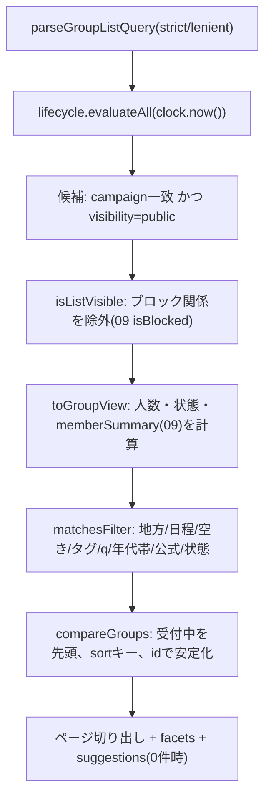

# 02 グループ探索

> 本書の ID 接頭辞は `DSC`(API=DSC-API、関数=DSC-FN、型=DSC-TY、画面部品=DSC-UI、試験=DSC-T、タスク=DSC-TASK、規則=DSC-RULE)。状態の凡例は [README](README.md) 1 章に従う。
> 状態名・フィールド名のうち他モジュールが持つものは、確定するまで各骨子の記述を契約とし、不一致は 16 章に書く。矛盾した場合は docs/design を正とする。
> 章番号の表記: 「本書 N 章」、節番号(5.1 等)、「14 章」「15 章」「16 章」は本書の章を指す。それ以外の「NN 章」「12章 #NN」は docs/design の章を指す。

## 1. 概要と責務 / 対応する柱
- 公開グループの一覧、検索・絞り込み(地方・日程・空き・行き先/テーマ/タグ・年代帯・公式枠・状態)、参加前のグループ詳細、キャンペーン・地方の選択(絞り込みの一部)、非公開グループの招待コード入口(プレビューまで)。柱1、3、17。 [案]
- 読み取り専用のモジュールで、グループ・メンバー・申請・状態を書き換えない。状態遷移は 04、参加申請は 03、公開範囲の丸めは 09 に委ねる。
- 一覧に載るのは公開グループのみ。非公開は招待コード経由のみ(DSC-RULE-01)。 [決定]
- 性別での絞り込みは設けない。年齢の条件は年代帯のみとする(クエリ・型・画面・文言のいずれにも性別の項目を置かない。DSC-T-60 で静的に検査)。 [決定]
- 責務の外: グループの作成(01)、参加申請の送信・判定(03)、状態の計算(04)、禁止表現・ブロック・公開範囲の規則そのもの(09)、公式枠の付与(11)。

### 1.1 規則の一覧(実装・試験が参照する)
| ID | 規則 | 状態 |
|---|---|---|
| DSC-RULE-01 | 一覧・検索の対象は `visibility = "public"` のグループのみ。非公開は一覧・検索・facets・件数・提案のいずれにも含めない | [決定] |
| DSC-RULE-02 | ブロック関係にあるユーザー(幹事、または参加中メンバー)がいるグループは、一覧・詳細・件数から除外。詳細は `not_found`(存在を隠す) | [案] |
| DSC-RULE-03 | 既定の状態フィルタは「募集中」「最少人数到達」のみ。中止は既定で非表示。完了・辞退期間・実行確定・実施中は `status` 指定時のみ表示(閲覧のみ、申請不可) | [案(04 章の「一覧では通常は非表示/終了扱い」に基づく)] |
| DSC-RULE-04 | 満員は状態ではなく表示。満員でも募集中/最少人数到達なら一覧に残し「満員」バッジを付け、申請は不可 | [案(12章 #24 未決)] |
| DSC-RULE-05 | メンバー概要は 09 の `memberSummary` 結果のみを返す。人数 1〜2 は年代帯を出さず、3〜4 は粗い区分、5〜6 は 10 年区分(存在のみ、人数は出さない) | [案(12章 #16)] |
| DSC-RULE-06 | 年代帯での絞り込みは「表示してよい概要」に対してのみ評価する(概要を出さないグループは年代帯条件に一致しない)。絞り込み結果から非表示の構成が推測できないようにする | [案] |
| DSC-RULE-07 | 参加前に返さない項目: メンバーの一覧・userId、本名、連絡先、招待コード、申請者・申請数、チャット・旅程メモ・費用メモ、通報・ブロック情報(DSC-TY-12 のホワイトリスト以外は返さない) | [決定(本名・連絡先)/案(他)] |
| DSC-RULE-08 | 非公開グループ・ブロック関係・存在しない ID に対し、`GET /api/groups/:id` は互いに区別できない同一の応答を返す(404 `not_found`、同一メッセージ・同一形状) | [案] |
| DSC-RULE-09 | 検索語は部分一致のみ。正規表現・ワイルドカードとして解釈しない | [決定(骨子)] |

## 2. 既存機能との関係
- 流用: `seed.json` の `campaign`(`slug`、`name`。現在 1 件 `nttw-demo`)、`spots[].area`(スポットの地区名 7 種)、`user.region`(ユーザーの地方名 `水琴地方`)。これらは読み取りのみで変更しない。 [事実]
- 既存データの制約 [事実]: seed.json に「地方」のマスタは無い。`user.region` が文字列として 1 つあるのみで、`spots[].area` と地方の対応も無い。よって地方マスタ `regions` を `group-seed.json` に新設する(00 に要望、15 章)。スポットの地区名は検索語の補助(地方に属する地区名)としてのみ使う。
- 新規: 一覧・検索・参加前詳細・招待コード入口・地方マスタの参照関数。
- 既存の `src/lib/api.ts` の `api` / `useApi` は `/api/v2` 固定のため、グループ系 API には使えない(16 章 #1)。00 が `groupsApi`(`/api` 基点)を提供する前提で `useGroupsApi` と書く。
- 入口B(11)の初期値は 5.6 の `parseGroupListQuery`(lenient)で受ける(11 と契約、14 章)。

## 3. 画面・UI(04 章)

### 3.1 画面一覧
| ID | 画面 | 04 章の項目 | パス | 備考 |
|---|---|---|---|---|
| DSC-SCR-01 | グループ一覧 | グループ一覧(柱3、17) | `/[campaign]/groups` | カード、公式枠表示、状態バッジ、ページネーション |
| DSC-SCR-02 | 検索・絞り込みパネル | 検索・絞り込み | DSC-SCR-01 内 | 幅 768px 以上は左サイドバー、未満は Drawer。条件は URL クエリに反映 |
| DSC-SCR-03 | グループ詳細(参加前) | グループ詳細(参加前) | `/[campaign]/groups/[groupId]` | 非メンバー表示。メンバー/幹事は 01 の参加後表示に切り替わる |
| DSC-SCR-04 | 招待コード入力 | 招待コード | `/[campaign]/groups/invite` | コード→最小プレビュー→03 の申請へ |
| DSC-SCR-05 | キャンペーン・地方の選択 | キャンペーン一覧/地方選択 | DSC-SCR-02 内の「地方」選択。キャンペーンが 2 件以上のときのみヘッダにキャンペーン切替 | キャンペーンは現状 1 件のため切替は非表示 [案] |

静的セグメント `new`(01)、`invite`(02)と動的 `[groupId]` が競合しないよう、グループ ID の許可形式は `^g-[a-z0-9]{1,36}$` とし、`new`、`invite`、`regions` を予約語にする(00・01 に要望)。

### 3.2 グループ一覧(DSC-SCR-01)
- 構成: ページ見出し「グループを探す」+ モック表示(00 の共通表示)→ 検索ボックス+「絞り込み」ボタン(狭幅)→ 有効条件のチップ列 → 件数と並び順 → カードのリスト → ページネーション。
- カードに出す項目(DSC-TY-08 `GroupSummary`):
  1. 公式枠バッジ(主催自治体名つき。公式のみ)
  2. 名称、行き先、地方名
  3. 日程(`12/5(土)〜12/7(月)`。dayjs、日本語ロケール)
  4. 人数行: `最少2人 / 定員4人 / 現在1人 / 空き3人`。募集中は `あと1人で実行` を併記(shortfall > 0 のとき)、最少人数到達は `最少人数に達しました(確定前)`
  5. 状態バッジ(テキスト必須)+ 満員バッジ(該当時)+ 再企画済み(該当時)。バッジは色だけに頼らず文言とアイコンを併用
  6. 締切(`締切 11/25 23:59`)
  7. タグ(最大 4 件、超過は `+N`)
  8. 幹事の表示名
  9. メンバー概要(`年代: 〜30代、60代以上`、少人数は `人数が少ないため非表示`)
  10. 自分との関係(`参加中`/`幹事`/`申請中`。ある場合のみ)
- カード全体が 1 つのリンク(`<a>` を見出しに持たせ、カード全域をクリック可能にする)。詳細へ遷移。入口は `/[campaign]/groups/[id]`。
- 既定の並び: 受付中(募集中・最少人数到達)を先頭、`締切の近い順`。

### 3.3 絞り込みパネル(DSC-SCR-02)
| 項目 | UI | 対応クエリ |
|---|---|---|
| キーワード | テキスト(300ms デバウンス。Enter で即時) | `q` |
| 地方 | セレクト(`すべての地方`+地方マスタ) | `region` |
| 日程 | 開始日・終了日の日付入力 2 つ(`@mantine/dates` の `DateInput`、`valueFormat="YYYY-MM-DD"`、手入力可。12.1)。「この期間と重なる旅行」と注記 | `dateFrom`、`dateTo` |
| 空き | チェック「空きのあるグループのみ」(=1 人以上)。詳細: 人数セレクト(1〜5) | `vacancy` |
| タグ・テーマ | 複数選択チップ。候補は応答の `facets.tags` | `tags` |
| 年代 | 複数選択(`〜10代`、`20代`…)。見出しは「メンバーに含まれる年代」。「同年代のみ」等の語は使わない | `ageBands` |
| 公式枠 | スイッチ「自治体のおすすめプランのみ」 | `official` |
| 状態 | 既定は非表示。「受付が終わったグループも表示」スイッチをオンにすると `status` を `cancelled` 以外の全状態にする | `status` |
| 並び順 | セレクト | `sort` |
- 「条件をクリア」ボタン: `campaign` 以外の条件(並び順を含む)を既定値に戻す。
- 適用は即時(変更ごとに URL を `router.replace`、`page` は 1 に戻す)。狭幅の Drawer は「結果を見る(N件)」ボタンで閉じる。
- 性別の項目は存在しない。

### 3.4 グループ詳細・参加前(DSC-SCR-03)
- 表示(DSC-TY-12 `PublicGroupDetail`): 公式バッジ、名称、状態バッジ・満員バッジ、進行状況(`最少2人まであと1人`、`締切 11/25`)、行き先、地方、日程、タグ、説明(任意)、人数(最少・定員・現在・空き)、メンバー概要、幹事の表示名(09 の公開範囲内)、再企画の関係(元グループ・再企画先へのリンク。見える場合のみ)。
- 表示しない: DSC-RULE-07 のとおり。画面上に「参加が成立するまで、メンバーの詳細や連絡先は表示されません」と明記する。
- 操作: 「参加を申請する」ボタン(`applyState.canApply` が true のときのみ有効。クリックで 03 の申請フォーム)。無効時は理由を表示(`満員です`、`受付は終了しました`、`中止されました`、`申請済みです` 等。DSC-TY-11)。補助導線: `一覧へ戻る`(直前の一覧 URL を `sessionStorage` に保存して戻す。保存値が無い場合と、保存値が `/[campaign]/groups` で始まる相対パスでない場合は `/[campaign]/groups` に戻る。7.2)、`通報`(09 の導線を差し込む枠のみ)。
- 中止グループ: 中止バッジと「再企画が作られている場合は新しいグループへ」のリンク。申請ボタンなし。
- メンバー/幹事が開いた場合: 01 の参加後表示(タブ)に切り替える(15 章の要望)。

### 3.5 招待コード入力(DSC-SCR-04)
- 入力欄 1 つ(`inputmode="text"`、英数字・ハイフン 4〜32 文字)。送信で DSC-API-03。成功時、同画面に最小プレビュー(名称、行き先、地方、日程、人数、状態、幹事の表示名)と「参加を申請する」(03 へ。`inviteCode` を 03 の申請画面へ引き渡す)。失敗(形式不正の `invalid_input` を含む)は DSC-API-03 の `not_found` と同じ文言「コードが見つかりません。入力を確認してください」に統一する。コードは URL・ログ・`sessionStorage` に残さない。 [案、12章 #17]

### 3.6 空状態・エラー状態・読み込み
| 状況 | 表示 |
|---|---|
| 読み込み中 | カード形状のスケルトン 3 つ。`aria-busy="true"`。結果領域に `role="status"` の「検索中」 |
| 候補ゼロ(条件あり) | 「条件に合うグループが見つかりませんでした」+ 提案ボタン(`suggestions`: 日程を外す/地方を外す/タグを外す/年代を外す/受付が終わったグループも表示。件数つき)+「自分でグループを作る」(01 へ) |
| 候補ゼロ(条件なし=コールドスタート) | 「公開中のグループはまだありません」+「グループを作る」。デモの見せ方は [未決](04 章) |
| `invalid_input`(URL の手入力など) | 一覧は lenient 解釈で無効条件を除外して表示し、上部に「一部の条件が無効なため無視しました: …」(`role="status"`) |
| `not_found`(詳細) | 「このグループは見つからないか、公開されていません」+ 一覧へ戻る(非公開・ブロック・不存在を区別しない) |
| `internal` / 通信失敗 | 「読み込めませんでした」+「もう一度試す」+ デモリセット案内(06 章の未決)。再試行は同条件で再取得 |

### 3.7 アクセシビリティ
- ランドマーク: 一覧は `<main>`、絞り込みは `<form role="search" aria-label="グループの絞り込み">`、結果は `<section aria-labelledby>`。見出し階層は h1(画面)→ h2(結果)→ h3(カード名)。
- キーボード: 全操作を Tab / Shift+Tab / Enter / Space / Esc で可能に。Drawer は開くとフォーカスをパネル先頭へ、Esc で閉じて「絞り込み」ボタンへ戻す(フォーカストラップ)。チップの削除は `button`(`aria-label="地方: 水琴地方を解除"`)。
- スクリーンリーダー: 結果件数の変化を `aria-live="polite"` の `role="status"` で通知(「5件のグループが見つかりました」。デバウンス後のみ)。ページ送り後は結果見出しにフォーカス。状態・満員・公式はバッジを `<span>` のテキストで読み上げ(色のみで伝えない)。人数行はまとめて読める文言(`最少2人、定員4人、現在1人、空き3人`)を `aria-label` ではなく可視テキストで提供。
- 配色: コントラスト 4.5:1 以上(WCAG AA)。フォーカスリングを消さない。タップ領域 44px 以上。スマホ幅(360px)で横スクロールなし。
- 日付は手入力(`YYYY-MM-DD`)とカレンダーのどちらでも入力できるようにする(`DateInput` を使う。3.3)。
- [要確認] Mantine 9 の各コンポーネントの a11y 既定(Drawer のフォーカス管理、DateInput のラベル)。`app/node_modules` が無く確認できていない。

### 3.8 コンポーネント構成(props / state / データ取得)
```
app/src/app/[campaign]/groups/page.tsx                    サーバーコンポーネント。<Suspense><GroupListScreen campaign/></Suspense>
app/src/features/groups/discovery/ui/
  GroupListScreen.tsx     "use client" 一覧の親。URL ⇔ フィルタ状態、データ取得
  FilterPanel.tsx         絞り込みフォーム(サイドバー/Drawer 共用)
  ActiveFilterChips.tsx   有効条件のチップ列
  GroupCard.tsx           カード
  HeadcountLine.tsx       人数行(最少・定員・現在・空き・あと◯人)
  MemberSummaryLabel.tsx  メンバー概要の表示(型 MemberSummaryView と名前を分ける)
  GroupBadges.tsx         状態・満員・公式・再企画済み・自分との関係(状態バッジ本体は 04 の GroupStatusBadge を使用)
  ListEmptyState.tsx      空状態と提案
  ListErrorState.tsx      エラーと再試行
  PublicGroupDetailScreen.tsx  参加前詳細(型 PublicGroupDetail と名前を分ける)
  InviteCodeScreen.tsx    招待コード入力とプレビュー
  hooks/useGroupList.ts   取得フック(AbortController で古い応答を破棄)
  hooks/useFilterUrlState.ts  URL クエリ ⇔ GroupListFilter
```
```ts
// props / state(要点)
interface GroupListScreenProps { campaign: string }
// state: filter(URL が唯一の正)、qDraft(入力中のテキスト、300ms 後に filter.q へ)、drawerOpen
// データ: useGroupList(filter) -> { data: GroupListResponse | null; loading: boolean; error: AppErrorBody | null; reload(): void }
// AppErrorBody: 00 のエラー応答 { error, message, fields? }。通信失敗・JSON でない応答は error: "network"
interface FilterPanelProps {
  filter: GroupListFilter; regions: Region[]; facets: GroupListResponse["facets"] | null;
  resultCount: number | null; onChange(next: Partial<GroupListFilter>): void; onClear(): void;
}
interface GroupCardProps { group: GroupSummary; campaign: string }
interface PublicGroupDetailScreenProps { campaign: string; group: PublicGroupDetail; onApply(): void }
interface ListEmptyStateProps { filter: GroupListFilter; suggestions: RelaxSuggestion[]; onApplySuggestion(s: RelaxSuggestion): void; campaign: string }
```
- データ取得は `GET /api/groups?<serializeFilter(filter)>`。`useGroupList` は直列化したクエリ文字列を `useEffect` の依存配列に使い、条件が変わるたびに `AbortController` で前のリクエストを中止する。中止したリクエストの応答と、後から届いた古い応答は state に反映しない(`useApi` は中止の仕組みを持たないため使わない)。
- 初回は `useFilterUrlState` が `parseGroupListQuery(searchParams, "lenient")` で URL から初期状態を作る(入口B はこの経路)。`ignored` があれば DSC-SCR-01 上部に通知。
- Next.js 16 のクライアントでの `useSearchParams` と `Suspense` の要件は [要確認](`app/node_modules/next/dist/docs/` 未確認。既存 `[campaign]/layout.tsx` は Suspense で包んでいる)。

## 4. データ(05 章)

### 4.1 保存するデータ
- 新規エンティティはない。Group、GroupMember(01)、Region(00 の seed。本書 DSC-TY-03 で形を提案)から一覧用ビューを都度生成する(派生。保存しない)。
- 読み取るストア項目(01・04 の骨子の記述を契約とする。名称の不一致は 16 章): `store().groups`、`store().members`、`store().blocks`(09 経由)、`store().joinRequests`(03 経由で自分の申請状態のみ)。

### 4.2 型定義(`features/groups/discovery/types.ts`)
```ts
// DSC-TY-01 年代帯。プロフィール(09)の年代帯と同一の列挙を使う [案]。細かい年齢は持たない。
export const AGE_BANDS = ["u20", "20s", "30s", "40s", "50s", "60p"] as const;
export type AgeBand = (typeof AGE_BANDS)[number];
export const AGE_BAND_LABEL: Record<AgeBand, string> = {
  u20: "〜10代", "20s": "20代", "30s": "30代", "40s": "40代", "50s": "50代", "60p": "60代以上",
};
// 3〜4 人のグループで使う粗い区分(DSC-RULE-05)
export const COARSE_BANDS = ["young", "middle", "senior"] as const;
export type CoarseBand = (typeof COARSE_BANDS)[number];
export const COARSE_BAND_LABEL: Record<CoarseBand, string> = { young: "〜30代", middle: "40〜50代", senior: "60代以上" };
export const AGE_TO_COARSE: Record<AgeBand, CoarseBand> = { u20: "young", "20s": "young", "30s": "young", "40s": "middle", "50s": "middle", "60p": "senior" };

// DSC-TY-02 並び順
export const SORT_KEYS = ["deadline_asc", "start_asc", "created_desc", "vacancy_desc"] as const;
export type SortKey = (typeof SORT_KEYS)[number];

// DSC-TY-03 地方・キャンペーン(group-seed.json の regions。00 が保持。本書 2 章)
export interface Region { id: string; name: string; campaign: string; spotAreas: string[] } // id: ^r-[a-z0-9]{1,30}$
export interface CampaignInfo { slug: string; name: string }

// DSC-TY-04 状態は 04 の定義を import(名称は案、16 章 #3)
import type { GroupStatus } from "../lifecycle/types";
// "recruiting"|"min_reached"|"withdrawal_period"|"confirmed"|"in_progress"|"completed"|"cancelled"
export const DEFAULT_LIST_STATUSES: GroupStatus[] = ["recruiting", "min_reached"];
export const LISTABLE_STATUSES: GroupStatus[] =
  ["recruiting", "min_reached", "withdrawal_period", "confirmed", "in_progress", "completed", "cancelled"];

// DSC-TY-05 一覧の絞り込み条件(検証済み・正規化済み)。性別に相当する項目は存在しない。
export interface GroupListFilter {
  campaign: string;
  region?: string;          // Region.id
  dateFrom?: string;        // "YYYY-MM-DD"
  dateTo?: string;          // "YYYY-MM-DD"、dateFrom 以上
  vacancy?: number;         // 1..5 空きが N 人以上
  tags: string[];           // 0..5。入力値(前後空白除去・正規化後の重複除去済み)。照合時に normalizeSearchText を通す(OR 一致)
  q?: string;               // 入力値(前後空白除去・連続空白を 1 つに圧縮)。照合時に正規化する。長さは正規化後に 1..60 文字
  ageBands: AgeBand[];      // 0..6(いずれかを含む)
  official: boolean;        // true=公式枠のみ
  statuses: GroupStatus[];  // 既定 DEFAULT_LIST_STATUSES
  sort: SortKey;            // 既定 "deadline_asc"
  page: number;             // 1 始まり、既定 1
  pageSize: number;         // 1..50、既定 12
}

// DSC-TY-06 人数(最少・定員・現在・空き)
export interface HeadcountView {
  min: number; capacity: number; current: number;
  vacancy: number;      // max(0, capacity - current)
  shortfall: number;    // max(0, min - current)  「あと◯人で実行」
  isFull: boolean;      // current >= capacity
  reachedMin: boolean;  // current >= min
}

// DSC-TY-07 メンバー概要(09 の memberSummary が返す形を契約とする。15 章)
export type MemberSummaryView =
  | { level: "hidden"; total: number }                                   // 1〜2 人。年代帯なし。total は HeadcountView.current と同値
  | { level: "coarse"; total: number; bands: CoarseBand[] }              // 3〜4 人
  | { level: "fine"; total: number; bands: AgeBand[] };                  // 5〜6 人。存在する年代のみ。AGE_BANDS の順・重複なし(人数は出さない)

export type ViewerRelation = "organizer" | "member" | "requested" | "none";

// DSC-TY-08 一覧カード
export interface GroupSummary {
  id: string;
  name: string;
  campaign: string;
  region: { id: string; name: string };
  destination: string;
  startDate: string; endDate: string;       // "YYYY-MM-DD"
  deadline: string;                          // ISO 8601(タイムゾーン付き)
  tags: string[];
  official: { orgName: string } | null;
  organizerName: string;                     // 表示名のみ
  headcount: HeadcountView;
  status: GroupStatus;
  statusLabel: string;                       // 画面表示用の日本語(04 のラベル表を使用)
  flags: { full: boolean; replanned: boolean; acceptingRequests: boolean };
  memberSummary: MemberSummaryView;
  viewerRelation: ViewerRelation;
}

// DSC-TY-09 一覧応答
export interface RelaxSuggestion {
  kind: "clear_dates" | "clear_region" | "clear_tags" | "clear_age" | "clear_query" | "clear_vacancy" | "clear_official" | "include_closed";
  label: string;        // 例: "日程の指定を外す"
  resultCount: number;  // 外した場合の件数(1 以上のものだけ返す)
}
export interface GroupListResponse {
  items: GroupSummary[];
  total: number; page: number; pageSize: number; totalPages: number;  // totalPages >= 1
  filter: Omit<GroupListFilter, "page" | "pageSize" | "campaign">;    // 正規化後のエコー
  facets: { tags: { tag: string; count: number }[] };                  // 他条件適用後、出現数降順、最大 20
  suggestions: RelaxSuggestion[];                                      // total=0 のときのみ
  asOf: string;                                                        // clock.now() の ISO
}

// DSC-TY-10 参加できない理由
export type ApplyBlockReason = "full" | "closed" | "cancelled" | "finished" | "already_member" | "already_requested";
// DSC-TY-11
export interface ApplyState { canApply: boolean; reason?: ApplyBlockReason }

// DSC-TY-12 参加前詳細(ホワイトリスト。ここに無い項目は返さない = DSC-RULE-07)
export interface PublicGroupDetail extends GroupSummary {
  description?: string;                      // 0..200 文字(01 が持つ場合のみ。16 章 #5)
  organizer: { displayName: string; ageBand?: AgeBand };  // ageBand は 09 visibleProfile が許可した場合のみ
  applyState: ApplyState;
  replannedFromId?: string;                  // 元グループが見える場合のみ
  replannedToId?: string;                    // 再企画先が見える場合のみ
  cancelKind?: "auto" | "organizer";         // 中止時のみ。04 の中止理由から導出(自動中止=auto、幹事による中止=organizer)。理由の文章は返さない
}

// DSC-TY-13 招待コード入口(最小限)
export interface PrivateGroupPreview {
  id: string; name: string; region: { id: string; name: string }; destination: string;
  startDate: string; endDate: string; headcount: HeadcountView;
  status: GroupStatus; statusLabel: string; organizerName: string; applyState: ApplyState;
}

// DSC-TY-14 パース結果
export interface ParsedListQuery { filter: GroupListFilter; ignored: { key: string; reason: string }[] }
```
- 一覧に出さない: 非公開グループ、メンバー一覧、userId、招待コード、申請数、本名、連絡先。

### 4.3 地方マスタの形(`group-seed.json`、00 が保持)
```json
{ "regions": [ { "id": "r-mizukoto", "name": "水琴地方", "campaign": "nttw-demo", "spotAreas": ["鈴風高原", "雫森谷"] } ] }
```
- `user.region = "水琴地方"` と名称を一致させる。他の地方名・地区名との対応(`spotAreas`)はダミーで [案]。どの地区がどの地方かは [未決]。

## 5. インターフェース(関数・API)

### 5.1 API 一覧
| ID | メソッド・パス | 目的 | 呼び出し元 |
|---|---|---|---|
| DSC-API-01 | `GET /api/groups` | 一覧・検索 | DSC-SCR-01(入口B からの遷移を含む) |
| DSC-API-02 | `GET /api/groups/:id` | 参加前の詳細(メンバーが呼び出した場合も公開範囲の項目のみ返す) | DSC-SCR-03 |
| DSC-API-03 | `POST /api/groups/invite-lookup` | 招待コードでプレビュー | DSC-SCR-04 |
| DSC-API-04 | `GET /api/groups/regions?campaign=` | 地方マスタ | DSC-SCR-02 |

共通: 現在ユーザーは Cookie `demoUser`(`currentUser(req)`、00)。`Cache-Control: no-store`。エラー形式は 00 の `{ error, message?, fields? }`。ルート配線: DSC-API-04 と DSC-API-03 は 02 が静的ルートで持つ(`app/api/groups/regions/route.ts`、`app/api/groups/invite-lookup/route.ts`)。DSC-API-01(`app/api/groups/route.ts` の `GET`)と DSC-API-02(`app/api/groups/[id]/route.ts` の `GET`)は同一ファイルに 01 の `POST`/`PATCH` が入るため、ファイルは 00/01 が所有し、本モジュールの `handleListGroups` / `handleGetPublicGroup` を export するだけにする(15 章)。Next.js 16 の Route Handler の `params` は Promise(既存 `api/v2/[...path]/route.ts` で確認済み [事実])。

#### DSC-API-01 `GET /api/groups`
クエリパラメータ(全て任意。未知のキーは `invalid_input`)。複数値はカンマ区切り。同一キーを繰り返した場合は `invalid_input`(lenient では最初の値を使う)。

| キー | 型 | 検証 | 既定 | 備考 |
|---|---|---|---|---|
| `campaign` | string | 必須ではない。`^[a-z0-9-]{1,40}$` かつ既知の slug | `nttw-demo`(seed の campaign) | 未知は `invalid_input` |
| `region` | string | `^r-[a-z0-9]{1,30}$`、かつ地方マスタに存在 | なし | 未知は `invalid_input`(lenient では無視) |
| `dateFrom` / `dateTo` | string | `YYYY-MM-DD` の実在日付。片方のみ可。両方なら `dateFrom <= dateTo`、幅 366 日以内。範囲 2000-01-01〜2100-12-31 | なし | 旅行の `[startDate, endDate]` が指定期間と重なるグループに一致(`startDate <= dateTo かつ endDate >= dateFrom`)。片方のみのとき他方は無限 |
| `vacancy` | int | 1〜5 | なし | 空き人数が N 以上 |
| `tags` | string(カンマ区切り) | 最大 5 件。各 1〜20 文字(正規化後)。制御文字・`,` 不可。重複は除去 | なし | 正規化(5.4)後にいずれか一致(OR)[案] |
| `q` | string | 正規化後 1〜60 文字。制御文字を含む場合 `invalid_input`。空白のみは未指定扱い。空白区切りで最大 5 語、各 30 文字以内 | なし | 全語を含む(AND)。対象は名称・行き先・タグ・地方名・その地方の `spotAreas`(DSC-RULE-09) |
| `ageBands` | string(カンマ区切り) | `AGE_BANDS` の値のみ。最大 6 | なし | いずれかを含む(DSC-RULE-06)。性別・細かい年齢は受け付けない |
| `official` | boolean | `1`/`true`/`0`/`false` | `false` | `true` で公式枠のみ |
| `status` | string(カンマ区切り) | `LISTABLE_STATUSES` の値のみ。最大 7 | `recruiting,min_reached` | 指定した状態のみに置き換える(追加ではない)。`cancelled` は指定時のみ表示 |
| `sort` | enum | `SORT_KEYS` | `deadline_asc` | 5.5 参照 |
| `page` | int | 1〜1000 | 1 | 範囲外のページは空の `items` と `total`(エラーにしない) |
| `pageSize` | int | 1〜50 | 12 | |

- 成功: `200` + `GroupListResponse`。`total` は、非公開・ブロック関係で除外した後の件数(除外した件数は応答に含めない)。
- 失敗: `400 invalid_input` + `fields`(`{ "dateTo": "開始日以降の日付を指定してください" }` 形式。キーは問題のあるクエリ名、未知のキーは `{ "gender": "不明な条件です" }`)。`500 internal`。
- 入口B の別名(`from`→`dateFrom`、`to`→`dateTo`)は API では受けない。ページ側 lenient パースのみで解釈する(11 と契約、14 章)。

#### DSC-API-02 `GET /api/groups/:id`
- パス `:id` は `^g-[a-z0-9]{1,36}$`。形式不正は `404 not_found`(DSC-RULE-08 により存在しない ID と同じ応答)。
- 成功: `200` + `PublicGroupDetail`(`viewerRelation` が `member`/`organizer` でも公開範囲の項目のみ。参加後の情報は 01 の `GET /api/groups/:id/...` 系が返す)。
- 失敗: `404 not_found`(存在しない、非公開で非メンバー・非申請者、ブロック関係)。`500 internal`。
- 非公開グループは、幹事、参加中メンバー、申請中の本人(`viewerRelation = "requested"`)にのみ返す。

#### DSC-API-03 `POST /api/groups/invite-lookup`
- リクエスト: `{ "code": string }`(`^[A-Za-z0-9-]{4,32}$`。形式は 12章 #17 により変更されうる)。コードはボディでのみ受ける(URL・ログに残さない)。
- 成功: `200` + `PrivateGroupPreview`。
- 失敗: `400 invalid_input`(型・形式不正)、`404 not_found`(コードに該当なし・ブロック関係・グループが中止/完了で受付終了のときも含め、理由を区別しない)。
- 試行回数制限: デモでは実装しない [案、12章 #17 とあわせて未決]。

#### DSC-API-04 `GET /api/groups/regions`
- クエリ `campaign`(DSC-API-01 と同じ検証、既定 `nttw-demo`)。成功: `200` + `{ campaign: CampaignInfo; regions: Region[] }`(`spotAreas` は返さない)。失敗: `400 invalid_input`。

### 5.2 サービス関数(`features/groups/discovery/`、UI/HTTP に非依存)
| ID | シグネチャ | 説明 | 例外 |
|---|---|---|---|
| DSC-FN-01 | `parseGroupListQuery(params: URLSearchParams, mode: "strict" \| "lenient"): ParsedListQuery` | strict は不正で `AppError("invalid_input", fields)` を throw(API 用)。lenient は不正・未知キーを `ignored` に積み無視(ページ・入口B 用)。`from`/`to` の別名は lenient のみ | strict のみ throw |
| DSC-FN-02 | `listGroups(viewer: DemoUser, filter: GroupListFilter): GroupListResponse` | 5.3 のパイプライン。読み取り専用 | なし(検証済み前提) |
| DSC-FN-03 | `getPublicGroup(viewer: DemoUser, id: string): PublicGroupDetail` | 公開範囲内の詳細 | `AppError("not_found", …, 404)` |
| DSC-FN-04 | `findByInviteCode(viewer: DemoUser, code: string): PrivateGroupPreview` | 01 の `resolveInviteCode` で解決 | `invalid_input`、`not_found` |
| DSC-FN-05 | `listRegions(campaign: string): Region[]` / `getCampaign(slug: string): CampaignInfo \| null` | seed から読む | なし |
| DSC-FN-06 | `normalizeSearchText(s: string): string` | 5.4 | なし |
| DSC-FN-07 | `matchesFilter(view: GroupView, f: GroupListFilter, region: Region \| undefined): boolean` | 純粋関数。単体試験の主対象 | なし |
| DSC-FN-08 | `toGroupSummary(viewer: DemoUser, g: Group, ctx: ViewContext): GroupSummary` | ビュー生成。`memberSummary` は 09 を呼ぶ | なし |
| DSC-FN-09 | `compareGroups(sort: SortKey): (a: GroupSummary, b: GroupSummary) => number` | 5.5 | なし |
| DSC-FN-10 | `computeSuggestions(viewer: DemoUser, filter: GroupListFilter, all: GroupView[]): RelaxSuggestion[]` | total=0 のとき、指定されている条件を 1 つずつ外した件数を計算し、1 件以上のものを件数降順(同数は `RelaxSuggestion.kind` の定義順)で最大 4 件返す。`include_closed` は `statuses` が既定のときのみ計算し、状態を `cancelled` 以外の全状態に広げた場合の件数とする | なし |
| DSC-FN-11 | `buildApplyState(g: Group, h: HeadcountView, rel: ViewerRelation): ApplyState` | 5.7 | なし |
| DSC-FN-12 | `serializeFilter(f: GroupListFilter): URLSearchParams` | 既定値と一致する項目は出力しない(URL を短く)。UI と試験が共用 | なし |
| DSC-FN-13 | `isListVisible(viewer: DemoUser, g: Group, members: GroupMember[]): boolean` | `public` かつ(幹事・参加中メンバーのいずれとも)`!isBlocked(viewer, x)` | なし |
| DSC-FN-14 | `toHeadcount(g: Group, activeCount: number): HeadcountView` | 5.3 | なし |
| DSC-FN-15 | `handleListGroups(req: Request): Promise<Response>` / `handleGetPublicGroup(req: Request, ctx: { params: Promise<{ id: string }> }): Promise<Response>` / `handleInviteLookup(req: Request): Promise<Response>` / `handleListRegions(req: Request): Promise<Response>` | 検証とサービス呼び出しのみを行うハンドラ。`currentUser` → 検証 → service → `toResponse`。例外は `toResponse(e)` | - |

内部型(非公開、`internal.ts`):
```ts
interface GroupView { group: Group; summary: GroupSummary; activeMembers: GroupMember[]; searchText: string; searchTextTags: string[] }
interface ViewContext { now: Date; regions: Map<string, Region>; ageBandOf(userId: string): AgeBand; relation(userId: string, groupId: string): ViewerRelation }
```

### 5.3 一覧パイプライン(DSC-FN-02)

- 手順 B: 04 の遅延評価(04 の設計書 6 章)。02 は `lifecycle.evaluateAll(now)` を先頭で 1 回呼ぶ(冪等。状態更新は 04 が行い、02 は書かない)。関数名は要望(15 章)。
- 現在人数は `members.filter(m => m.groupId === g.id && m.status === "active")` の件数(幹事を含む)。`toHeadcount`: `vacancy = max(0, capacity - current)`、`shortfall = max(0, minMembers - current)`、`isFull = current >= capacity`、`reachedMin = current >= minMembers`。
- `flags.acceptingRequests = lifecycle.canAcceptRequests(g) && !isFull`。`flags.replanned` は 04 の「再企画済み」印(`replannedToId` 等。16 章 #4)。
- `facets.tags` は、タグ以外の条件を適用した結果から集計する(タグを 1 つ選んだ後も他のタグの候補が表示されるようにするため)。
- `suggestions` は `total === 0` のときのみ計算する。
- 年代帯の一致(DSC-RULE-06): `memberSummary.level` が `fine` なら、指定した年代帯のいずれかが `bands` に含まれるとき一致とする。`coarse` なら、指定した年代帯を `AGE_TO_COARSE` で変換した値のいずれかが `bands` に含まれるとき一致とする。`hidden` は一致しない。

### 5.4 検索の実装方式と正規化
- 方式: サーバー側のインメモリで全件を走査する。全文検索エンジン・転置索引は使わない。理由: ダミーデータは公開グループ 10〜50 件規模で、上限を 500 件と仮定しても全件走査で足りる。性能の目安は DSC-T-73(200 件で 1 リクエスト 100ms 以内)とする。永続 DB・外部の検索サービスは使わない(競技ルール)。
- `normalizeSearchText(s)`: ① `NFKC` 正規化(全角英数→半角、半角カナ→全角カナ)② `toLowerCase()` ③ カタカナをひらがなに折り畳み(`U+30A1–30F6` から `0x60` を引く)④ 連続する空白(全角含む)を 1 つの半角空白にし trim ⑤ 制御文字を除去(検証では拒否)。タグも保存値ではなく比較時に同じ関数を通す(保存値は変更しない)。
- 一致: `searchText = normalize([name, destination, regionName, ...spotAreas, ...tags].join(" "))` を作り、`normalize(q)` を空白で分割した各語がすべて `searchText` に含まれるとき一致とする(AND)。`String.prototype.includes` のみ使用し、正規表現・`*`・`?` は特別扱いしない(DSC-RULE-09)。語数・語長の上限(5.1)により 1 リクエストの計算量を抑える。
- タグ絞り込みは `normalize(tag)` の完全一致(OR)。部分一致は `q` で扱う。
- 日本語の分かち書き・同義語・読み仮名検索は行わない [案]。タグ候補(`facets`)で補う。

### 5.5 並び順(DSC-FN-09)
- 第1キー(固定): 受付中(状態が `recruiting`/`min_reached`)を先頭、その他を後。第2キー: `sort` に従う。最後に `id` 昇順で安定化(同条件でページ間の重複・欠落を防ぐ)。

| sort | 第2キー |
|---|---|
| `deadline_asc`(既定) | `deadline` 昇順 |
| `start_asc` | `startDate` 昇順、次いで `deadline` 昇順 |
| `created_desc` | 作成日時の降順 |
| `vacancy_desc` | `vacancy` 降順、次いで `deadline` 昇順 |

- 公式枠を上に固定表示することはしない(公平性。公式枠のみは `official=true` で絞る)。 [案、#18]

### 5.6 入口B の受け口(11 と契約)
- 入口B は `/[campaign]/groups?region=…&from=…&to=…` に遷移する(11 の設計書 3 章)。ページは `parseGroupListQuery(searchParams, "lenient")` で初期条件を作る。lenient の規則:
  - 許可キー: 5.1 のキー + 別名 `from`(=`dateFrom`)、`to`(=`dateTo`)。`from` と `dateFrom` が両方ある場合は `dateFrom` を優先。
  - 不正値・未知キー・既知でない地方 ID は無視して `ignored` に積む(通常の一覧を出す)。外部リンクから渡された値も他の入力と同じ規則で検証する。条件を HTML として解釈しない(React の既定エスケープ)。
  - 初期値は URL に残る(`router.replace` で正規化形に置換)ので、以降はユーザー操作で変更できる。
- 11 の `parseEntryParams(query)` は本関数を呼び出すだけの関数にする(重複した検証を持たない。14 章・15 章)。
- `utm_*` 等の計測用キーは条件として扱わない(lenient では `ignored` に積んで無視し、strict では未知キーとして `invalid_input`)。

### 5.7 申請可否の判定(DSC-FN-11)
優先順に評価する。UI の表示用で、最終判定は 03 の `requestJoin` が行う(03 は 02 の判定結果を使わず再判定する)。
1. `rel` が `organizer`/`member` → `already_member`
2. `rel` が `requested` → `already_requested`
3. 状態 `cancelled` → `cancelled`
4. 状態 `completed`/`in_progress` → `finished`
5. `!lifecycle.canAcceptRequests(g)`(辞退期間・実行確定など) → `closed`
6. `h.isFull` → `full`
7. それ以外 → `canApply: true`
本人確認・18歳確認(09 `requireVerified`)は 02 では判定せず、申請操作時に 03 が扱う。

## 6. 状態遷移・シーケンス
- 本モジュールに状態遷移はない(読み取りのみ)。絞り込み条件は URL クエリが唯一の正で、ブラウザの戻る/進むで復元できる。
- 状態バッジの意味・文言は 04 の状態表(docs/design/04 のグループの状態遷移)に従う。表示のマッピング:

| 状態(04) | 表示ラベル | 一覧(既定) | 申請 |
|---|---|---|---|
| `recruiting` | 募集中(あと◯人で実行) | 表示 | 可(満員でなければ) |
| `min_reached` | 最少人数到達(確定前) | 表示 | 可(満員でなければ) |
| `withdrawal_period` | 辞退期間(受付終了) | `status` 指定時のみ | 不可(`closed`) |
| `confirmed` | 実行確定 | `status` 指定時のみ | 不可(`closed`) |
| `in_progress` | 実施中 | `status` 指定時のみ | 不可(`finished`) |
| `completed` | 完了(終了) | `status` 指定時のみ | 不可(`finished`) |
| `cancelled` | 中止 | `status=cancelled` 時のみ | 不可(`cancelled`) |

- 満員 = `isFull` かつ受付中の状態。バッジ「満員」を併記。満員で締め切るか締切まで待つかは [未決 #24]。本書は「締切まで一覧に残し申請のみ不可」とする。 [案]
- 締切済みは状態(辞退期間以降)で表す。02 が時刻を直接比較して表示を変えることはしない(状態は 04 の `evaluateAll` に一元化)。
- ブロック関係: 関係が成立した時点で次回リクエストから非表示。解除で再び表示される(02 は状態を持たない)。

## 7. 入力検証・セキュリティ・公開範囲

### 7.1 入力検証
- クエリ・ボディはサーバーで検証する(00 の `validate`)。型・長さ・列挙値・範囲は 5.1 の表に従う。クライアント側の検証は補助とする。
- `q` の自由文は `includes` による部分一致のみに使い、正規表現として解釈しない(DSC-RULE-09)。長さ・語数・制御文字を制限し(5.1)、1 リクエストの計算量を上限内に収める。
- ID・地方 ID・タグ・招待コードは許可文字のみ受け付ける。ユーザー入力をファイルパスやストアのキーに直接使わない(ストアは `Map` を使うか `Object.hasOwn` で検査し、`__proto__` を拒否する)。
- 性別・年齢の絞り込み項目を API・型・画面・文言に設けない(09 の検査対象)。未知のクエリ(`gender` 等)は 400 とする。細かい年齢(`age=` 等)も未知キーとして拒否する。

### 7.2 セキュリティ対策(OWASP Top 10 のうち本モジュールに関係するもの)
| 観点 | 対策 |
|---|---|
| アクセス制御・IDOR | 公開範囲(DSC-RULE-01・02・05・07・08)をサービス層で適用し、UI でのマスクに頼らない。閲覧者は Cookie から決め(00 の `currentUser`)、クエリ・本文の `userId` を使わない。`viewerRelation` は閲覧者本人の分のみ返し、他人の申請の有無は返さない。非公開グループの ID を指定して詳細を要求しても、DSC-RULE-08 により不存在と区別できない |
| インジェクション | SQL・シェル・ファイルパスを使わない。検索語は文字列の部分一致のみに使う(7.1) |
| XSS | 出力は React の既定のエスケープを使い、`dangerouslySetInnerHTML` を使わない。`q`・エラーメッセージ・入口B の条件を HTML として挿入しない |
| CSRF | GET は読み取りのみで状態を変えない。POST(DSC-API-03)は 00 の共通処理で `Origin` の検査と `Content-Type: application/json` の必須化を行う。Cookie は `SameSite=Lax`(00) |
| 認証・セッション(デモ) | ログインはない。現在ユーザーは Cookie `demoUser` で表すモックで、利用者が値を書き換えられる。実運用では認証が必要(00 の前提) |
| セキュリティ設定 | 全応答に `Cache-Control: no-store` と `X-Content-Type-Options: nosniff` を付ける(00 の共通処理)。CORS のヘッダは付けない |
| 機密データ | 応答は 4.2 のホワイトリストの型から組み立て、ストアのエンティティをそのまま返さない(スプレッド構文での複写を禁止。DSC-T-41 でキー集合を固定)。招待コード・userId・申請数・本名・連絡先を返さない(DSC-RULE-07)。招待コードは本文でのみ受け、URL・ログ・`sessionStorage` に残さない |
| オープンリダイレクト | 「一覧へ戻る」は `sessionStorage` の値が `/<campaign>/groups` で始まる相対パスのときだけ使い、それ以外は `/<campaign>/groups` に遷移する(3.4、DSC-T-74) |
| ログ | 検索語・招待コード・リクエスト本文をログに出さない。想定外の例外は 00 の共通処理が `requestId` とともに `console.error` に出す |

### 7.3 公開範囲(09 の呼び出し)
- `isBlocked(viewer, x)`(DSC-FN-13)、`memberSummary(members)`(DSC-FN-08。02 は結果を加工しない)、`visibleProfile(viewer, organizer, "list")`(幹事の表示名・年代帯。context の値は 16 章 #6)。

### 7.4 既知の制約(デモでは対策しない)
- 年代帯の差分推測: メンバーの増減前後の比較で個人の年代帯が推測されうる。人数による区分(DSC-RULE-05)で軽減するが、完全には防げない [案、12章 #16]。
- 招待コードの総当たり: 試行回数の制限を実装しない [未決 #17]。
- 応答時間の差: 404 の応答時間の差から存在を推測される可能性は考慮しない。
- 大量データ・高頻度のリクエスト: 公開グループ 500 件以下を想定し、レート制限は行わない(5.4)。

## 8. エラー処理
API のエラー応答は 00 の形式(`{ error, message, fields? }`)に従い、`message` には下表「画面での表示・挙動」の文言を入れる。文言は `messages.ts` に置く。

| コード | HTTP | 発生条件 | 対象 | 画面での表示・挙動 |
|---|---|---|---|---|
| `invalid_input` | 400 | クエリの型・範囲・列挙値の不正、未知キー、同一キーの繰り返し、`dateFrom > dateTo`、未知のキャンペーン | DSC-API-01、04 | API は `fields` に項目別のメッセージを返す。一覧画面は lenient で解釈した条件だけを送るため通常は発生しない。発生した場合は `internal` と同じエラー表示に「条件をクリア」を加える |
| `invalid_input` | 400 | 招待コードの型・形式不正、本文なし、JSON 不正 | DSC-API-03 | 入力欄の下に「コードが見つかりません。入力を確認してください」(`not_found` と同じ文言。3.5)。送信前にクライアントでも形式を検査する |
| `not_found` | 404 | 詳細: 存在しない、非公開で幹事・参加中メンバー・申請中の本人のいずれでもない、ブロック関係、ID 形式不正 | DSC-API-02 | 「このグループは見つからないか、公開されていません」+「一覧へ戻る」。理由を区別しない(DSC-RULE-08) |
| `not_found` | 404 | 招待コード: 該当なし、ブロック関係、グループが中止・完了 | DSC-API-03 | 「コードが見つかりません。入力を確認してください」 |
| `forbidden` / `unsupported_media_type` / `payload_too_large` | 403 / 415 / 413 | POST で `Origin` が `Host` と異なる、`Content-Type` が `application/json` でない、本文が 64KB を超える(00 の共通処理が判定) | DSC-API-03 | 画面の通常操作では発生しない。発生した場合は「画面を再読み込みしてやり直してください」 |
| `internal` | 500 | 想定外の例外 | 全 API | 「読み込めませんでした」+「もう一度試す」+ デモ初期化の案内(3.6)。再試行は同じ条件で再取得する |
| `network`(クライアント側) | - | 通信失敗、JSON でない応答 | 画面 | `internal` と同じ表示 |
| (空結果) | 200 | 条件に合うグループがない | DSC-API-01 | `suggestions` つきの空状態(3.6) |

基本的な異常系の扱い:
- 入力不正: 上表の `invalid_input`。
- 権限なし: 02 の業務判定では `forbidden`・`blocked` を返さず、`not_found` に統一する(非公開グループ・ブロック関係の存在を明かさないため)。上表の `forbidden` は 00 の共通処理による `Origin` の検査のみで返る。
- 対象なし: `not_found`。
- 状態不正: 02 は読み取りのみのため、状態を理由とするエラーは返さない。申請できない状態は `applyState`(200 の応答)で表し、画面は申請ボタンを無効にして理由を表示する(3.4、5.7)。
- 競合: 02 は書き込みを行わないため `conflict` を返さない。表示後に人数・状態が変わった場合は、申請時に 03 が `conflict`/`unavailable_state` を返す(表示は 03)。一覧の取得が重なった場合は `useGroupList` が古い応答を破棄する(3.8)。
- エラー本文と `fields` のメッセージに、内部 ID・スタック・他ユーザーの情報・入力値をそのまま含めない。

## 9. 試験観点(10 章)

### 9.1 試験フィクスチャ(テスト専用。`features/groups/discovery/__fixtures__/groups.ts`。実 seed に依存しない)
基準時刻 `clock.set("2026-11-09T09:00:00+09:00")`。閲覧者 `u-viewer`(30代、どのグループにも未所属)。地方 `r-mizukoto`(水琴地方)、`r-suzukaze`(鈴風地方)。
- 地方の `spotAreas` は空配列とする(検索語の試験に影響させないため)。
- 各グループの幹事は `u-o<番号>`(g-t01 なら `u-o01`)。「年代」は幹事を含む参加中メンバー全員の年代帯。
- 名称は `テストグループ<番号>`、行き先は `行き先<番号>` とし、試験で使う検索語(温泉、photo、はいきんぐ、水琴、存在しない語)を名称・行き先に含めない。
- 辞退期間の長さは 04 の `withdrawalDays`(案: 2 日)を前提にする。各グループの状態・締切は、基準時刻で 04 の `evaluateAll` を実行しても状態が変わらない組み合わせにする。

| ID | 公開 | 地方 | 日程 | 定員/最少/現在 | 状態 | 締切 | 備考 |
|---|---|---|---|---|---|---|---|
| g-t01 | 公開 | mizukoto | 12/05–12/07 | 4/2/1 | recruiting | 11/25 | タグ 温泉, 食べ歩き。メンバー年代: 40s |
| g-t02 | 公開 | mizukoto | 12/10–12/12 | 4/3/3 | min_reached | 11/20 | 公式枠(星凪町)、タグ Photo。年代 20s,30s,60p |
| g-t03 | 公開 | suzukaze | 12/05–12/06 | 2/2/2 | min_reached | 11/22 | 満員。年代 30s,40s |
| g-t04 | 公開 | suzukaze | 12/20–12/21 | 4/2/1 | cancelled | 11/01 | 中止(自動) |
| g-t05 | 非公開 | mizukoto | 12/05–12/06 | 4/2/1 | recruiting | 11/25 | 招待コード `TESTCODE-05`。申請中(pending)の `u-req05` がいる |
| g-t06 | 公開 | suzukaze | 12/01–12/02 | 4/2/3 | withdrawal_period | 11/08 | |
| g-t07 | 公開 | mizukoto | 12/05–12/06 | 4/2/1 | recruiting | 11/25 | 幹事 `u-o07` を `u-viewer` がブロック |
| g-t08 | 公開 | mizukoto | 12/20–12/22 | 6/3/5 | min_reached | 11/28 | タグ ハイキング。年代 20s,30s,40s,50s,50s |
| g-t09 | 公開 | mizukoto | 12/15–12/16 | 4/3/2 | recruiting | 11/30 | 年代 20s,60p |
| g-t10 | 公開 | suzukaze | 10/01–10/03 | 4/2/3 | completed | 09/20 | |
| g-t11 | 公開 | mizukoto | 12/25–12/26 | 4/3/2 | recruiting | 11/29 | 幹事以外の参加中メンバー `u-m11` を `u-viewer` がブロック |
| g-t12 | 非公開 | suzukaze | 12/12–12/13 | 4/2/1 | recruiting | 11/25 | 招待コード `TESTCODE-12`。幹事 `u-o12` を `u-viewer` がブロック |

既定一覧(受付中・公開・ブロック除外): g-t02, g-t03, g-t01, g-t08, g-t09(この順、total=5)。

### 9.2 API・関数の試験(Vitest で実行。関数は直接呼び出し、API は 00 の試験ヘルパー `callRoute` で Route Handler を呼ぶ。12.1)
| ID | 入力(クエリ/操作) | 期待結果 |
|---|---|---|
| DSC-T-01 | `GET /api/groups` | 200。items の id 順 `[g-t02, g-t03, g-t01, g-t08, g-t09]`、total=5、page=1、pageSize=12、totalPages=1 |
| DSC-T-02 | `?region=r-suzukaze` | `[g-t03]`(g-t04 中止、g-t06 辞退期間、g-t10 完了は既定で除外) |
| DSC-T-03 | `?region=r-zzz` | 400 `invalid_input`、`fields.region` あり |
| DSC-T-04 | `?dateFrom=2026-12-06&dateTo=2026-12-06` | `[g-t03, g-t01]`(重なり判定。g-t02 12/10–12 は不一致) |
| DSC-T-05 | `?dateFrom=2026-12-10` のみ | `[g-t02, g-t08, g-t09]` を締切順(g-t02 11/20、g-t08 11/28、g-t09 11/30)。g-t01/g-t03 は 12/07・12/06 終了で除外 |
| DSC-T-06 | `?dateFrom=2026-12-10&dateTo=2026-12-01` | 400、`fields.dateTo` |
| DSC-T-07 | `?dateFrom=2026-02-30` | 400(実在しない日付) |
| DSC-T-08 | `?vacancy=1` | `[g-t02, g-t01, g-t08, g-t09]`(g-t03 空き 0 を除外) |
| DSC-T-09 | `?vacancy=0` / `?vacancy=6` / `?vacancy=a` | いずれも 400 |
| DSC-T-10 | `?tags=温泉` | `[g-t01]` |
| DSC-T-11 | `?tags=温泉,Photo` | `[g-t02, g-t01]`(OR) |
| DSC-T-12 | `?tags=a,b,c,d,e,f`(6 件) | 400 |
| DSC-T-13 | `?q=はいきんぐ`(ひらがな) | `[g-t08]`(カタカナ折り畳み) |
| DSC-T-14 | `?q=ｐｈｏｔｏ`(全角)と `?q=PHOTO` | どちらも `[g-t02]` |
| DSC-T-15 | `?q=.*` と `?q=(` | 200、items=[]、total=0(正規表現として評価されない。例外なし) |
| DSC-T-16 | `?q=` + 61 文字 / 制御文字(`%00`)を含む値 | 400 |
| DSC-T-17 | `?q=%20%E3%80%80`(空白のみ) | 未指定扱い。DSC-T-01 と同一結果 |
| DSC-T-18 | `?q=水琴 温泉`(2 語 AND) | `[g-t01]`(地方名「水琴地方」+タグ) |
| DSC-T-19 | `?ageBands=30s` | `[g-t02, g-t08]`(g-t02 は粗い区分「〜30代」で一致、現在 1〜2 人の g-t01/g-t03/g-t09 は概要非表示で不一致) |
| DSC-T-20 | `?ageBands=60p` | `[g-t02]` |
| DSC-T-21 | `?ageBands=40s` | `[g-t08]`(g-t02 の粗い区分 young/senior に middle は無い。g-t03 は 2 人で非表示) |
| DSC-T-22 | `?ageBands=thirties` | 400 |
| DSC-T-23 | `?official=true` | `[g-t02]` |
| DSC-T-24 | `?status=withdrawal_period,confirmed,in_progress,completed` | 集合 `{g-t06, g-t10}`(順序は受付中でない同士で締切昇順 `[g-t10, g-t06]`) |
| DSC-T-25 | `?status=cancelled` | `[g-t04]` |
| DSC-T-26 | `?status=foo` | 400 |
| DSC-T-27 | `?sort=vacancy_desc` | `[g-t01, g-t09, g-t02, g-t08, g-t03]` |
| DSC-T-28 | `?sort=start_asc` | `[g-t03, g-t01, g-t02, g-t09, g-t08]`(開始日昇順。12/05 開始の g-t03 と g-t01 は締切昇順) |
| DSC-T-29 | `?sort=random` | 400 |
| DSC-T-30 | `?pageSize=2&page=2` | `[g-t01, g-t08]`、total=5、totalPages=3 |
| DSC-T-31 | `?pageSize=2&page=4` | 200、items=[]、total=5 |
| DSC-T-32 | `?page=0` / `?pageSize=51` / `?page=1.5` | いずれも 400 |
| DSC-T-33 | `?gender=female` / `?sex=1` / `?age=25` / `?ageMin=20` | いずれも 400(`fields` に未知の条件)。結果に影響しない |
| DSC-T-34 | `?region=r-mizukoto&q=存在しない語` | 200、total=0。suggestions は `clear_query`(resultCount=4: g-t01、g-t02、g-t08、g-t09)の 1 件のみ |
| DSC-T-35 | `?region=r-suzukaze&dateFrom=2026-12-20&dateTo=2026-12-21` | total=0。suggestions に `clear_dates`(count 1: g-t03)と `clear_region`(count 1: g-t08)。resultCount=0 の提案は含まない |
| DSC-T-36 | 全 `GET /api/groups` 応答に対し | レスポンス JSON に `g-t05`・`g-t12`(非公開)、`g-t07`、`g-t11` を含まない。`total` に含まれない。`facets.tags` に非公開グループ固有のタグを含まない |
| DSC-T-37 | `?q=g-t05`、`?q=TESTCODE` | items=[]、total=0 |
| DSC-T-38 | `u-viewer` が g-t07 の幹事のブロックを解除後に再取得 | g-t07 が一覧に出る(total=6)。再度ブロックすると一覧から除外される |
| DSC-T-39 | `clock.set("2026-11-26T09:00:00+09:00")` の後に `GET /api/groups` | 04 の評価後、g-t02・g-t03(最少人数到達のまま締切を過ぎた)は受付中でない状態(`withdrawalDays` により `withdrawal_period` または `confirmed`)、g-t01(最少人数未達のまま締切を過ぎた)は `cancelled` になる。既定一覧は `[g-t08, g-t09]` |
| DSC-T-40 | 一覧の前後で `store()` を深い比較 | 02 の呼び出しによる変更は 04 の `evaluateAll` に起因するもののみ(02 自身の書き込みなし) |

### 9.3 詳細・公開範囲の試験
| ID | 入力 | 期待結果 |
|---|---|---|
| DSC-T-41 | `GET /api/groups/g-t02`(非メンバー) | 200。キー集合が `PublicGroupDetail` のホワイトリストと完全一致。`userId`、`inviteCode`、`members`、`contact`、`realName`、`requests` を含まない。JSON 文字列に `u-` で始まるユーザー ID を含まない |
| DSC-T-42 | g-t02 の詳細 | headcount `{min:3, capacity:4, current:3, vacancy:1, shortfall:0, isFull:false, reachedMin:true}`、`organizerName` は表示名、`official.orgName="星凪町"` |
| DSC-T-43 | g-t01 の詳細 | headcount `{min:2, capacity:4, current:1, vacancy:3, shortfall:1, isFull:false, reachedMin:false}`。`applyState.canApply=true` |
| DSC-T-44 | g-t03 の詳細 | `isFull=true`、`applyState={canApply:false, reason:"full"}`、満員の表示用 `flags.full=true` |
| DSC-T-45 | g-t04 の詳細 | `status="cancelled"`、`applyState.reason="cancelled"`、`cancelKind="auto"`。中止理由の自由文を含まない |
| DSC-T-46 | g-t06 の詳細 | `applyState.reason="closed"` |
| DSC-T-47 | g-t10 の詳細 | `applyState.reason="finished"` |
| DSC-T-48 | `GET /api/groups/g-t05`(非公開、非メンバー)と `GET /api/groups/g-zzzz`(不存在) | どちらも 404 `not_found`。ステータス・本文・ヘッダのキー集合・メッセージが同一(DSC-RULE-08) |
| DSC-T-49 | `GET /api/groups/g-t07`(幹事をブロック) | 404。不存在と同一応答 |
| DSC-T-50 | `GET /api/groups/g-t11`(メンバーをブロック) | 404 |
| DSC-T-51 | g-t05 の幹事 `u-o05` として `GET /api/groups/g-t05` | 200(`viewerRelation="organizer"`、`applyState.reason="already_member"`)。参加後の項目は含まない |
| DSC-T-52 | 申請中の `u-req05` として `GET /api/groups/g-t05` | 200(`viewerRelation="requested"`、`applyState.reason="already_requested"`) |
| DSC-T-53 | メンバー概要(5 人: g-t08) | `{level:"fine", total:5, bands:["20s","30s","40s","50s"]}`。人数・userId を含まない |
| DSC-T-54 | メンバー概要(3 人: g-t02) | `{level:"coarse", total:3, bands:["young","senior"]}` |
| DSC-T-55 | メンバー概要(1〜2 人: g-t01、g-t03) | `{level:"hidden", total:N}`、`bands` キーなし |
| DSC-T-56 | `GET /api/groups/G-T01`(大文字)、`/api/groups/..%2F`、`/api/groups/__proto__` | いずれも 404(例外・500 にならない) |
| DSC-T-57 | 招待コード: `POST /api/groups/invite-lookup {code:"TESTCODE-05"}` | 200、`PrivateGroupPreview`。`tags`、`memberSummary`、userId を含まない |
| DSC-T-58 | `{code:"NOSUCHCODE"}`、`{code:"TESTCODE-12"}`(幹事をブロックしている g-t12) | どちらも 404 `not_found`(同一応答) |
| DSC-T-59 | `{code:"ab"}`、`{code:123}`、ボディなし、不正 JSON | 400 `invalid_input` |
| DSC-T-60 | 静的検査: `features/groups/discovery/` と `app/[campaign]/groups/` のソース・`messages.ts`(テストファイルと検査スクリプト自身を除く)に対する検索 | `gender`、`sex`、`性別`、`男性`、`女性`、`同年代`、`age=`、`ageMin`、`ageMax`、`マッチング`、`相乗り` が 0 件(09 の検査にも組み込む) |
| DSC-T-61 | `GET /api/groups/regions?campaign=nttw-demo` | 200、`regions` に `r-mizukoto`(水琴地方)を含む。`spotAreas` を返さない |
| DSC-T-62 | `?campaign=unknown` | 400 |

### 9.4 入口B・パース・UI の試験
| ID | 入力 | 期待結果 |
|---|---|---|
| DSC-T-63 | `parseGroupListQuery("region=r-mizukoto&from=2026-12-05&to=2026-12-07", "lenient")` | `filter.region="r-mizukoto"`、`dateFrom="2026-12-05"`、`dateTo="2026-12-07"`、`ignored=[]` |
| DSC-T-64 | `"region=bad&from=x&utm_source=a&q=<script>alert(1)</script>"`(lenient) | `region`/`dateFrom` なし、`ignored` に `region`・`from`・`utm_source`。`q` は文字列として保持(HTML としては解釈されない) |
| DSC-T-65 | 同入力(strict) | `AppError("invalid_input")` を throw |
| DSC-T-66 | `serializeFilter(parse(x))` の往復 | 既定値は出力されず、再パースで同一フィルタ |
| DSC-T-67 | UI: `/nttw-demo/groups?region=r-mizukoto&from=2026-12-05&to=2026-12-07` を開く | 絞り込みパネルの地方・日程にその値が入り、チップが表示され、結果が g-t01 のみ(非公開の g-t05、ブロック関係の g-t07 は出ず、g-t02 は日程が重ならず不一致)。「条件をクリア」で全解除、URL が `?` なしに戻る |
| DSC-T-68 | UI: カード | 状態バッジに文言がある。満員(g-t03)に「満員」。公式(g-t02)に公式バッジ+自治体名。人数行に `最少`、`定員`、`現在`、`空き` がある。g-t01 に `あと1人で実行` |
| DSC-T-69 | UI: 空状態 | DSC-T-35 の条件で提案ボタンが表示され、押すと該当条件が外れ件数が更新される。`role="status"` に件数が通知される |
| DSC-T-70 | UI: エラー状態 | API を 500 にしたとき(開発用の失敗注入)、再試行ボタンが出て、押すと再取得する |
| DSC-T-71 | UI: キーボード/読み上げ(手動チェックリスト) | Tab のみで条件変更→カードを開く→一覧へ戻るまで可能。Drawer は Esc で閉じフォーカスが「絞り込み」に戻る。VoiceOver/NVDA(または axe)で状態・満員・公式がテキストとして読まれる。360px 幅で横スクロールなし |
| DSC-T-72 | UI: 詳細(非メンバー) | 「参加が成立するまで…表示されません」の注記。申請ボタンは `canApply` に従い、無効時は理由文。本名・連絡先の語が画面にない |
| DSC-T-73 | 性能の目安: 公開グループ 200 件を投入して `GET /api/groups?q=温泉&sort=start_asc` を 20 回 | 各回 100ms 以内(開発機。目安であり合否の厳密基準ではない [案]) |
| DSC-T-74 | UI: `sessionStorage` の戻り先に `https://example.com/` と `//example.com` を入れて詳細を開き、「一覧へ戻る」を押す | どちらも `/nttw-demo/groups` へ遷移する(外部の URL に遷移しない) |

## 10. 依存するモジュール
- 00(`store`、`currentUser`、`validate`、`AppError`/`toResponse`、`clock`、`groupsApi`、地方マスタ)、01(Group/GroupMember、`resolveInviteCode`、`isMember`/`isOrganizer`)、04(`GroupStatus`、`evaluateAll`、`canAcceptRequests`、状態ラベル・`GroupStatusBadge`)、09(`isBlocked`、`memberSummary`、`visibleProfile`)。
- 03(自分の申請状態 `getMyRequestStatus`)。呼ばれる側: 11(`parseGroupListQuery`)、03(`PrivateGroupPreview` を使った申請導線)。
- 循環の回避: 02 は 03 の申請関数を呼ばない(読み取りのみの `getMyRequestStatus` を除く)。

## 11. 未決事項
- #16(公開範囲の粒度。本書の人数区切り 1〜2 / 3〜4 / 5〜6 と粗い区分は案)、#18(公式枠の持ち方と一覧での優先表示)、#17(招待コードの形式・有効期限・試行制限・コード後の承認)、#24(満員時の締切の扱い)、#8(ブロックの対称性。本書は `isBlocked` の結果に従う)。
- コールドスタート時の見せ方(04 章)、地図表示の有無(12 章。本書は地図を使わない [案])。
- 地方マスタの内容(地方名の一覧、`spotAreas` との対応)。キャンペーンが複数になる場合の切替 UI。
- 状態フィルタに「中止」を含めるか(本書は `status=cancelled` 指定時のみ表示する案)。
- 年代帯の列挙値(`u20` を含めるか。18 歳未満の扱いは #10 未決)。

## 12. 実装メモ(デモ範囲・ファイル構成)
- デモ範囲: 地方・日程・空き・公式枠の 4 条件+タグ・キーワード・状態・並び順。年代帯、ページネーション、`suggestions`、`facets` は S 規模の追加で足りる(下のタスクで段階分け)。地図は使わない。 [案]
- 実装時に作るファイル(すべて `app/src/` 配下。既存ファイルは変更しない):

| パス | 責務 |
|---|---|
| `features/groups/discovery/types.ts` | 4.2 の型・定数 |
| `features/groups/discovery/messages.ts` | 画面文言(状態以外のラベル、提案文言、空状態、エラー文言) |
| `features/groups/discovery/query.ts` | `parseGroupListQuery`、`serializeFilter`(DSC-FN-01、12) |
| `features/groups/discovery/text.ts` | `normalizeSearchText`(DSC-FN-06) |
| `features/groups/discovery/filter.ts` | `matchesFilter`、`compareGroups`、`computeSuggestions`(DSC-FN-07、09、10) |
| `features/groups/discovery/view.ts` | `toHeadcount`、`toGroupSummary`、`buildApplyState`、`isListVisible`(DSC-FN-08、11、13、14) |
| `features/groups/discovery/service.ts` | `listGroups`、`getPublicGroup`、`findByInviteCode`、`listRegions`、`getCampaign` |
| `features/groups/discovery/handlers.ts` | `handle*`(DSC-FN-15) |
| `features/groups/discovery/ui/*`、`ui/hooks/*` | 3.8 のコンポーネントとフック |
| `app/[campaign]/groups/page.tsx` | DSC-SCR-01 |
| `app/[campaign]/groups/invite/page.tsx` | DSC-SCR-04 |
| `app/api/groups/regions/route.ts`、`app/api/groups/invite-lookup/route.ts` | DSC-API-04、03 |
| `features/groups/discovery/__fixtures__/groups.ts`、`*.test.ts` | 9.1 のフィクスチャと試験 |
| `features/groups/discovery/no-gender-terms.test.ts` | 静的検査 DSC-T-60(`node:fs` でソースを走査) |

- DSC-SCR-03 のページ `app/[campaign]/groups/[groupId]/page.tsx` は 01、`app/api/groups/route.ts`・`app/api/groups/[id]/route.ts` は 00/01 が所有する(5.1、15 章)。
- 試験は 00 のテスト基盤(Vitest、`npm test`)で実行する。`@/` エイリアスは 00 の `vitest.config.ts` で解決する。
- 検証は 00 の `v`(自前実装)を使う。DSC-FN-01 は `v` のスキーマと後処理(別名の解決、`ignored` の記録)で実装する。

### 12.1 利用ライブラリ・モジュール
| 区分 | 名前 | 用途(本モジュール) | ライセンス | バージョン方針 |
|---|---|---|---|---|
| フレームワーク | `next` | App Router のページ、Route Handler、`next/navigation`(`useRouter`、`useSearchParams`、`usePathname`)、`next/link` | MIT | app/package.json の 16.4.5 を維持 |
| フレームワーク | `react`、`react-dom` | UI、フック(`useState`、`useEffect`)、`Suspense` | MIT | 19.3.0 を維持 |
| UI | `@mantine/core` | `Card`、`Badge`、`TextInput`、`Select`、`MultiSelect`、`Chip`、`Switch`、`Checkbox`、`Drawer`、`Pagination`、`Skeleton`、`Button` | MIT | ^9.7.5 を維持 |
| UI | `@mantine/dates` | 日程の入力 `DateInput`(3.3) | MIT | ^9.7.5 を維持 |
| UI | `@mantine/hooks` | `useDebouncedValue`(キーワードの 300ms 遅延)、`useMediaQuery`(768px でサイドバーと Drawer を切り替え)、`useDisclosure`(Drawer の開閉) | MIT | ^9.7.5 を維持 |
| UI | `@tabler/icons-react` | 状態・満員・公式のバッジとボタンのアイコン | MIT | ^3.51.0 を維持 |
| 日付 | `dayjs`(`dayjs/locale/ja`) | 日程・締切の表示整形(`12/5(土)`)。サーバー側の日付の検証には使わず、00 の `v.date` を使う | MIT | ^1.11.23 を維持 |
| 試験 | `vitest`(devDependency) | 単体試験・API 試験(9 章)。導入は 00(CMN-TASK-16)が行い、02 は追加しない | MIT | 新規。最新の安定版を使う |
| 開発 | `typescript`、`eslint`、`eslint-config-next` | 型検査、lint | Apache-2.0 / MIT / MIT | app/package.json の指定を維持 |
| 組み込み API | `URL`、`URLSearchParams` | クエリの解析・直列化(DSC-FN-01、12) | Node.js・ブラウザの組み込み | - |
| 組み込み API | `String.prototype.normalize("NFKC")`、`String.prototype.includes` | 検索語の正規化・部分一致(5.4) | ECMAScript の組み込み | - |
| 組み込み API | `fetch`、`AbortController` | 一覧の取得と古いリクエストの中止(`useGroupList`) | ブラウザの組み込み | - |
| 組み込み API | `sessionStorage` | 「一覧へ戻る」の戻り先の保存(3.4) | ブラウザの組み込み | - |
| Node 標準 | `node:fs`、`node:path` | 静的検査 DSC-T-60 でソースを読む(試験のみ) | Node.js の組み込み | Node.js のバージョンは 00・docs/design 09 に従う |
| Node 標準 | `performance.now()` | 性能の目安 DSC-T-73 の計測(試験のみ) | Node.js の組み込み | - |
| 自前(00) | `lib/groups-store`、`lib/validation`(`v`)、`lib/errors`(`AppError`)、`lib/api-route`、`lib/clock`、`lib/current-user`、`lib/groups-api` | ストア、検証、エラー、Route Handler の共通処理、時刻、現在ユーザー、クライアント | 自前 | - |
| 自前(01・03・04・09) | 14.1 の関数・型・コンポーネント | 参加関係、申請状態、状態と受付可否、公開範囲とブロック | 自前 | - |

追加しないもの(自前実装または既存で足りるもの):
- `zustand`: 使わない。フィルタの状態は URL を唯一の正とし、グローバルな状態を持たないため。
- 検証ライブラリ(zod 等): 追加しない。00 の自前の `v` で足りるため(00 の方針に従う)。
- 全文検索ライブラリ(Fuse.js、FlexSearch 等): 追加しない。500 件以下の部分一致は全件走査で足りるため(5.4)。
- かな変換ライブラリ(wanakana 等): 追加しない。カタカナからひらがなへの変換は文字コードの差(0x60)で行えるため。
- データ取得ライブラリ(SWR、TanStack Query): 追加しない。取得するのは一覧・詳細・地方・招待コードの 4 種で、中止処理は `AbortController` で足りるため。
- クエリ文字列ライブラリ(qs 等): 追加しない。`URLSearchParams` で足りるため。

設定上の注意:
- `DateInput` のロケールは props(`locale="ja"`)で指定し、`dayjs/locale/ja` と `@mantine/dates/styles.css` は 02 のページ(`app/[campaign]/groups/page.tsx`)で import する。既存の `layout.tsx`・`Providers.tsx` は変更しない。 [要確認] Mantine 9 の `DateInput` のロケール指定方法と、App Router でページからグローバル CSS を import できるか(`app/node_modules/next/dist/docs/` と Mantine のドキュメントで確認)。

## 13. 実装タスク(順序つき)
規模: S=半日以内、M=約 1 日、L=2 日以上。前提のタスクが完了してから着手する。他モジュールの前提は括弧内。

- [ ] **DSC-TASK-01 (S)** 型・定数・文言: `types.ts`、`messages.ts`(前提: 00 の型、04 の `GroupStatus`。未確定なら仮の型を `types.ts` に置き後で差し替え)
- [ ] **DSC-TASK-02 (S)** テスト用フィクスチャ 9.1 と `store` への注入ヘルパ(前提: 00 のストアと試験ヘルパー、01)
- [ ] **DSC-TASK-03 (S)** `normalizeSearchText` と単体試験 DSC-T-13/14/15/17(前提: なし)
- [ ] **DSC-TASK-04 (M)** `parseGroupListQuery`(strict/lenient、別名、ignored)と `serializeFilter`、試験 DSC-T-03、06〜09、12、16、22、26、29、32、33、63〜66(前提: TASK-01、03、00 の `AppError`)
- [ ] **DSC-TASK-05 (S)** 地方マスタの参照 `listRegions`/`getCampaign` と API-04、試験 DSC-T-61/62(前提: 00 の `group-seed.json` に `regions`)
- [ ] **DSC-TASK-06 (M)** ビュー生成 `toHeadcount`/`toGroupSummary`/`buildApplyState`/`isListVisible`、試験 DSC-T-42〜47、53〜55(前提: TASK-01、02、01 のストア、09 の `isBlocked`/`memberSummary`/`visibleProfile`、04 の `canAcceptRequests`)
- [ ] **DSC-TASK-07 (M)** `matchesFilter`/`compareGroups`/`listGroups`(ページネーション、facets)、試験 DSC-T-01、02、04、05、08、10、11、13〜14、18〜21、23〜25、27、28、30、31、36〜40、73(目安)(前提: TASK-03、04、06、04 の `evaluateAll`)
- [ ] **DSC-TASK-08 (S)** `computeSuggestions`(空状態の提案)、試験 DSC-T-34/35(前提: TASK-07)
- [ ] **DSC-TASK-09 (M)** `getPublicGroup` と API-02、非公開・ブロックの同一応答、試験 DSC-T-41〜52、56(前提: TASK-06、03 の `getMyRequestStatus`)
- [ ] **DSC-TASK-10 (S)** `findByInviteCode` と API-03、試験 DSC-T-57〜59(前提: TASK-06、01 の `resolveInviteCode`)
- [ ] **DSC-TASK-11 (S)** Route Handler の配線: `handlers.ts`、`regions`/`invite-lookup` のルート、`GET /api/groups`・`GET /api/groups/[id]` の export 追加依頼(前提: TASK-07、09、10、00/01 のルートファイル)
- [ ] **DSC-TASK-12 (S)** 静的検査 DSC-T-60 の試験 `no-gender-terms.test.ts`(前提: TASK-01 以降のソースが存在)
- [ ] **DSC-TASK-13 (M)** 一覧画面の骨組み: `GroupListScreen`、`useFilterUrlState`、`useGroupList`、`GroupCard`、`HeadcountLine`、`GroupBadges`、`MemberSummaryLabel`(前提: TASK-04、07、04 の `GroupStatusBadge`、00 の `groupsApi`、Next.js docs の確認)
- [ ] **DSC-TASK-14 (M)** 絞り込みパネル(サイドバー/Drawer)、`ActiveFilterChips`、地方・日程・空き・タグ・年代・公式・状態・並び順の入力(前提: TASK-13、05)
- [ ] **DSC-TASK-15 (S)** 空状態・エラー状態・スケルトン・ページネーション・lenient の無視通知(前提: TASK-08、13)
- [ ] **DSC-TASK-16 (M)** 参加前詳細画面 `PublicGroupDetailScreen`、「一覧へ戻る」の戻り先の検査(DSC-T-74)、01 のページとの切替(前提: TASK-09、13、01 のページ構成)
- [ ] **DSC-TASK-17 (S)** 招待コード画面 `InviteCodeScreen`(前提: TASK-10、03 の申請導線)
- [ ] **DSC-TASK-18 (S)** アクセシビリティ確認(DSC-T-71)と文言の最終確認(恋愛を連想させる語・性別語の不使用)(前提: TASK-13〜17)
- [ ] **DSC-TASK-19 (S)** UI 通し確認 DSC-T-67〜72、74(前提: TASK-13〜17、01・03・04 の画面)

段階リリースの目安: デモ必須(S 優先度)は TASK-01〜07、09〜11、13、14(地方・日程・空き・公式・タグ・q)、16。年代帯の入力、提案(TASK-08)、招待コード画面(TASK-17)は余力で後続。

## 14. 他モジュールとの契約
### 14.1 02 が呼ぶもの(名前は README・各骨子に合わせる。署名は案)
| 相手 | 関数・値 | 用途 |
|---|---|---|
| 00 | `store()`、`currentUser(req)`、`validate(schema, input)`、`AppError(code, message, status)`、`toResponse(e)`、`clock.now()`、`groupsApi`(GET/POST の fetch、`/api` 基点) | 全般 |
| 00 | 地方マスタ `regions`(`group-seed.json`)、`seed.campaign`(読み取り) | 地方選択 |
| 01 | `Group`/`GroupMember` の型、`isMember`/`isOrganizer(user, group)`、`resolveInviteCode(code): Group \| null`(要望) | 参加関係・招待コード |
| 03 | `getMyRequestStatus(user, groupId): "none" \| "pending"`(要望) | `viewerRelation = "requested"` |
| 04 | `GroupStatus`、`evaluateAll(now)`(要望)、`canAcceptRequests(g)`、状態ラベル、`GroupStatusBadge` | 状態表示・申請可否 |
| 09 | `isBlocked(a, b)`、`memberSummary(members)`、`visibleProfile(viewer, target, "list" \| "detail")` | 公開範囲 |
### 14.2 02 が提供するもの
| 名前 | 呼び出し元 | 用途 |
|---|---|---|
| `parseGroupListQuery(params, mode)` | 11(`parseEntryParams` が委譲) | 入口B の初期条件 |
| `GroupListFilter`、`serializeFilter` | 11(リダイレクト URL 生成)、12(必要なら) | 条件 URL の生成 |
| `PrivateGroupPreview`、`ApplyState` | 03 | 申請導線の表示 |
| `PublicGroupDetail`(型)、`PublicGroupDetailScreen`(コンポーネント) | 01 のページ(切替) | 非メンバー表示 |
| `GET /api/groups`、`GET /api/groups/:id`、`POST /api/groups/invite-lookup`、`GET /api/groups/regions` | 画面、試験 | 5.1 |

## 15. 他モジュールへの要望(他ファイルは編集していない)
1. **00**: (a) `group-seed.json` に `regions`(4.3 の形)と、公開グループ 6〜10 件・ダミーユーザーに年代帯(`AgeBand`)を持たせる。(b) グループ API 用クライアント `groupsApi`(`/api` 基点、`api.ts` と同じエラー規約)を提供。`api.ts` は `/api/v2` 固定のため流用できない。(c) ID 形式 `^g-[a-z0-9]{1,36}$`、地方 ID `^r-…$` と予約語(`new`、`invite`、`regions`、`_reset`)。(d) `app/api/groups/route.ts`・`[id]/route.ts` のファイルを共有所有し、02 の `handleListGroups` / `handleGetPublicGroup` を `GET` として export する配線。
2. **01**: (a) `resolveInviteCode(code: string): Group | null`(非公開グループの解決。招待コードの形式は #17)。(b) 非メンバー・メンバーでの詳細ページの切替(`app/[campaign]/groups/[groupId]/page.tsx` は 01 所有。メンバーなら参加後のタブ、そうでなければ 02 の `PublicGroupDetailScreen`)。(c) Group に `startDate`/`endDate`(`YYYY-MM-DD`)、`regionId`、`destination`、`description?`(0〜200 文字)、`createdAt` を持たせる。(d) `store().members` の `status === "active"` 判定の規約の明文化。
3. **03**: `getMyRequestStatus(user, groupId)`(読み取り専用)。`requestJoin` が非公開グループで `inviteCode` を受け、02 のプレビューから渡せること。
4. **04**: (a) `evaluateAll(now: Date): void`(全グループの状態を冪等に更新。02 が一覧・詳細の先頭で呼ぶ)。(b) 状態の列挙値(本書は `recruiting`/`min_reached`/`withdrawal_period`/`confirmed`/`in_progress`/`completed`/`cancelled`)とラベル表の export。(c) `GroupStatusBadge` コンポーネント(`status`、`full?`)。(d) 再企画の参照 `replannedFromId`/`replannedToId` の持ち方。
5. **09**: (a) `memberSummary(members): MemberSummaryView`(4.2 の形。1〜2 人=hidden、3〜4 人=coarse、5〜6 人=fine を実装。区切りは 09 の定数)。(b) `visibleProfile` の `context` に一覧用・詳細用の値。(c) `isBlocked(a, b)` の対称性の決定(#8)。(d) 静的検査(性別・年齢条件の不在)に 02 のパスを含める。
6. **11**: `parseEntryParams` は `parseGroupListQuery(…, "lenient")` に委譲し、独自の検証を持たない。リダイレクト先 URL は `serializeFilter` で生成。`from`/`to` の別名は lenient でのみ受理される。

## 16. 設計上の確認事項(docs/design・他骨子との矛盾・不足。直していない)
1. **既存 `api.ts` の接頭辞**: README 4.1 は `api`/`post`/`useApi` を流用とするが、実装は `/api/v2` 固定。グループ系 API(`/api/groups`)には使えない。00 で扱いを決める。 [要確認]
2. **一覧の状態の扱い**: docs/design 04 は「中止: 一覧では通常は非表示」「完了: 終了扱い」、「状態での絞り込みは案」。辞退期間・実行確定・実施中の一覧上の扱いは明記がない。本書は DSC-RULE-03 のとおり案とした。 [案]
3. **状態名**: 04 の英語識別子は本書の仮定。docs/design 04 の日本語状態名(募集中/最少人数到達/辞退期間/実行確定/実施中/完了/中止)は一致。
4. **「再企画」の持ち方**: docs/design 05 は「元グループ側の『再企画済み』の印または状態」。`replannedToId` 等のフィールド名は未定。 [未決]
5. **Group の説明文**: docs/design 05 に説明(プランの概要文)の項目がない。一覧の検索対象・詳細表示に `description?` を使う前提。無くても動作する(省略)。 [要確認]
6. **`visibleProfile` の context 値**: 09 骨子は「一覧/申請/メンバー」。詳細(参加前)の幹事の表示は「一覧」で足りるか、別の値が要るか。 [要確認]
7. **日程の項目**: docs/design 05 は Trip と Group を分け「日程の幅」を持つ。01 骨子は Group に統合案。本書は `startDate`/`endDate` の 2 項目(幅なし)を前提とした。幅(例: 「12月上旬」)を許すと日程の重なり判定が変わる。 [未決]
8. **年代帯の列挙**: docs/design 05 の「年代」と seed の `ageGroup`(例 `60代以上`)の区分が一致するか未確認。本書は `u20/20s/30s/40s/50s/60p` を案とした(18 歳未満は #10 未決)。 [要確認]
9. **ブロックの扱い**: 本書は幹事または参加中メンバーとのブロック関係でグループごと非表示にする(DSC-RULE-02)。docs/design 07 の論点 3(ブロックしたグループの扱い)・12章 #8 は未決のため案。ブロック関係が 1 件でもあればグループごと除外するため、閲覧者によっては一覧の件数が大きく減る。 [案]
10. **非公開グループの詳細表示**: 招待コード経由の詳細を ID 直打ちで返さない設計にしたため、コード入力後の画面は一覧とは別の `invite` 画面でプレビューを出す。docs/design 04 の「招待コード入力 → グループ詳細(最小限の公開情報)」と画面 ID が異なる(同じ「詳細」の最小版として扱う)。 [案]
11. **柱17 の項目「人数」**: 本書は「空き(N 人以上)」のみ。定員・最少人数での絞り込みは設けない(要望が出れば `capacity`、`minMembers` を追加)。 [案]
12. **ページネーション**: 骨子は「不要」としたが、依頼仕様に合わせて API は対応し、UI は `totalPages > 1` のときのみ表示。デモの seed 規模では表示されない。
13. **Mantine 9 / Next.js 16 の API**: `app/node_modules` が無く、`next/dist/docs/` と Mantine の各コンポーネント(DatePickerInput、Drawer)の仕様を確認できていない。 [要確認]
14. **他モジュールの詳細設計との名称・形式の差異**(各設計書の現時点の記述と照合。本書は直していない。各モジュールの確定後に本書を合わせる): 状態の識別子(本書 `min_reached` 等、00 は `minReached` 等、04 は `reached`・`withdrawal` 等)、年代帯の値(本書 `u20`・`60p`、00 は `under18`・`60plus`)、地方(本書は `Region` エンティティと `r-` の ID、00 は地方名の文字列の列挙)、グループ ID の形式(本書 `^g-[a-z0-9]{1,36}$`、00 は `^g-\d{3,8}$`。9.1 の `u-viewer` 等の試験用 ID も 00 の形式に合わない)、ページネーション(本書 `page`・`pageSize`、00 は `limit`・`offset`)、並び順の指定(本書 `sort=deadline_asc`、00 は `sort=deadline:asc`)、締切の型(本書は ISO 日時、00 は日付)、説明文の長さ(本書・01 は 200 字、00 は 500 字)、公式枠(本書 `official.orgName`、00 は `isOfficial`、11 は `OfficialBadgeView` と絞り込みキー `officialOnly`)、招待コードの解決(本書は 01 の `resolveInviteCode`、01 は `verifyInviteCode`、03 も `resolveInviteCode` を持つ)、申請状態の取得(本書は 03 の `getMyRequestStatus`、03 の提供一覧は `getMyRequest`・`hasPendingRequest`)、クライアント(本書 `groupsApi`、00 は `gapi`・`useGroupsApi`)、状態バッジ(本書 `GroupStatusBadge`、04 は `StatusBadge`・`HeadcountMeter`)、`evaluateAll` の呼び出し元(本書は 02 が呼ぶ、04 は 00 の共通処理が全ハンドラの先頭で呼ぶ)。 [要確認]
