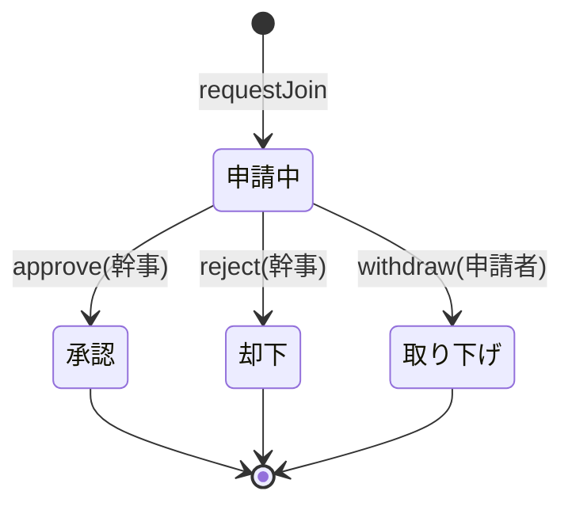

# 03 参加申請・承認

## 1. 概要と責務 / 対応する柱
- 参加申請(ひとこと付き)、幹事による承認/却下、申請者の取り下げ、承認時のメンバー追加、非公開グループの招待コード申請。柱4、13。 [案]
- 承認・却下は幹事だけ。承認後のみ連絡(チャット等)が可能。 [決定]
- 実行条件との関係(締切後の申請可否、確定後の申請、満席)は docs/design の該当章を正とし、判定は 04 の `canAcceptRequests` を呼ぶ。

## 2. 既存機能との関係
- 新規。通知(10)を拡張して申請・承認結果を通知する。旧案の希望/成立(CompanionRequest/Match)は JoinRequest に統合する方向 [未決(05 章)]。

## 3. 画面・UI(04 章)
| 画面 | 04 章の項目 | パス案 |
|---|---|---|
| 参加申請(ひとこと、状況、取り下げ) | 参加申請 | グループ詳細(参加前)内 |
| 申請一覧(承認画面。幹事) | 参加申請の承認画面 | `/[campaign]/groups/[id]/requests` |
| 招待コード入力 | 招待コード | `/[campaign]/groups/join` |

## 4. データ(05 章)
| エンティティ | 項目 | 保存先 |
|---|---|---|
| JoinRequest | id、groupId、applicantId、ひとこと、状態(申請中/承認/却下/取り下げ)、申請日時、判断日時、判断者、却下理由(要否は未決) | Store.joinRequests |

## 5. インターフェース(案)
| 名称 | 入力 | 出力 | 呼び出し元 |
|---|---|---|---|
| `requestJoin(user, groupId, note)` | ひとこと | JoinRequest | POST …/join-requests |
| `approve(user, groupId, rid)` | - | メンバー追加 | 幹事のみ |
| `reject(user, groupId, rid, reasonId?)` | 理由は定型ID案 | JoinRequest | 幹事のみ |
| `withdraw(user, groupId, rid)` | - | JoinRequest | 申請者のみ |
| `listRequests(user, groupId)` | - | 申請者の公開プロフィール付き | 幹事のみ |

## 6. 状態遷移(申請)

- グループが中止・確定したときの申請中の扱い(自動失効など)は docs/design の該当章を正とする。 [未決]

## 7. 入力検証・セキュリティ
- 申請条件: 本人確認・18歳確認(09 モック)済み、ブロック関係なし、満席でない、重複申請なし、グループが申請受付状態(04)。
- 承認画面には申請者の公開範囲内のプロフィールのみ(09)。ひとこと・理由は禁止表現を通す。
- 権限は毎回サーバー側で `isOrganizer` を判定。ID 改ざんで他人の申請を操作できない。
- 却下の選択肢に性別・年齢を理由とするものを置かない [案、#15]。

## 8. エラー処理
| コード | 条件 | 表示 |
|---|---|---|
| conflict | 重複申請、満席 | 状況と別グループの提案 |
| unavailable_state | 受付終了(締切・確定・中止) | 理由と再企画/一覧への導線 |
| forbidden | 幹事以外の承認、未確認ユーザー | 確認手順の案内 |
| blocked | ブロック関係 | 一般的な文言(相手に分かりにくく) |

## 9. 試験観点(10 章)
- 申請→承認→メンバー化、却下・取り下げ後に連絡不可、重複申請不可、満席で承認不可、幹事以外の承認不可、承認前は本名・連絡先非表示、18歳未満(モック)は進めない。

## 10. 依存するモジュール
- 00、01、04、09、10。

## 11. 未決事項
- #15(却下理由)、#17(招待コード後の承認要否)、#6 派生、旧希望/成立の統合(05 章)。

## 12. 実装メモ(デモ範囲)
- 申請・承認・却下・取り下げの4操作。理由は定型3種程度または省略。招待コードは入力で詳細に着地し、申請は同じ経路 [案]。
