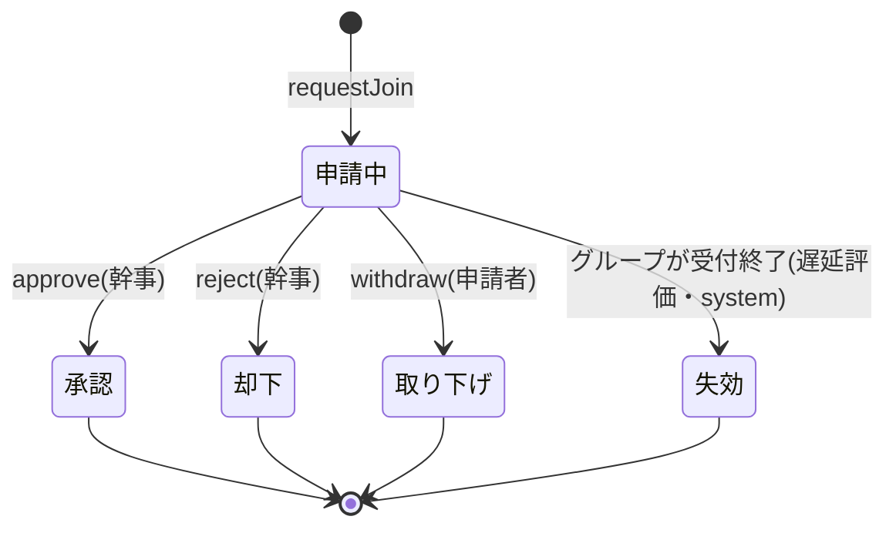
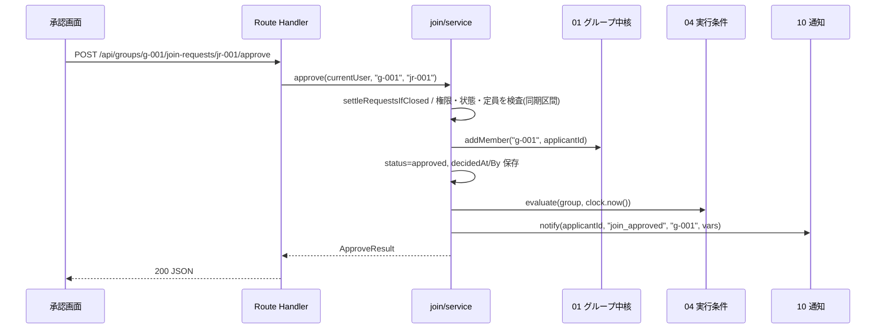

# 03 参加申請・承認

状態の凡例: [事実]/[推定]/[決定]/[案]/[未決]/[要確認]。docs/design と矛盾する場合は docs/design を正とする。本書の ID 接頭辞は `JOIN`(JOIN-FN=関数、JOIN-API=API、JOIN-T=試験、JOIN-TASK=実装タスク、JOIN-ERR=エラー、JOIN-UI=画面部品)。
共通基盤(00)は並行して詳細化中のため、**00 の骨子の名称(`store()`、`currentUser`、`AppError`、`clock`、`newId`、`validate`)を契約として使う**。他モジュールの名称も各骨子・README に合わせ、不足は第 15.3 節「他モジュールへの要望」、不一致は第 16 章「設計上の確認事項」に書く。

## 1. 概要と責務 / 対応する柱

- 参加申請(ひとこと・「最少人数でもOK」の同意つき)、幹事による承認/却下、申請者の取り下げ、承認時のメンバー追加、非公開グループの招待コードによる申請。柱4、13、18(同意)。 [案]
- 承認・却下は幹事だけ。承認後のみ連絡(チャット等)が可能。 [決定]
- 実行条件(締切後の申請可否、確定後・中止後・辞退期間中の申請)の判定は 04 の `canAcceptRequests` を呼ぶ。本モジュールは条件そのものを持たない。 [案]
- 責務の外: グループの作成・メンバー保持(01)、グループ状態の遷移(04)、通知の保存(10)、公開範囲・ブロック・禁止表現・本人確認(09)、グループ一覧・詳細(参加前)の表示(02)。
- 本モジュールは「申請」の状態だけを持ち、グループの状態やメンバー数は直接書き換えない(01 の `addMember`、04 の `evaluate` を経由)。 [案]

## 2. 既存機能との関係

- 新規。既存の `/api/v2` とそのストア(`server-store.ts`)・クライアント(`src/lib/api.ts`)は変更しない。`api.ts` は呼び出し先が `/api/v2` に固定されているため、本モジュールは `/api/groups` 用のクライアント(第 8.4 節)を別に持つ。
- 旧案の希望/成立(CompanionRequest/Match)は JoinRequest に統合する方向 [未決(05 章)]。本書は統合する前提で設計し、旧エンティティは作らない。
- 通知(10)を使って申請・承認結果を通知する(通知の種類は第 15.3 節の要望)。

## 3. 画面・UI(04 章との対応)

| ID | 画面 | 04 章の項目 | パス |
|---|---|---|---|
| JOIN-UI-01 | 参加申請パネル(状態に応じて「申請する/申請中/取り下げ/結果」を出し分け)。グループ詳細(参加前)内 | 参加申請 | `/[campaign]/groups/[groupId]`(02 の詳細に埋め込む) |
| JOIN-UI-02 | 参加申請ダイアログ(ひとこと、同意チェック) | 参加申請 | 同上(モーダル) |
| JOIN-UI-03 | 申請一覧(幹事の承認画面) | 参加申請の承認画面 | `/[campaign]/groups/[groupId]/requests` |
| JOIN-UI-04 | 招待コード入力 | 招待コード | `/[campaign]/groups/join` |
| JOIN-UI-05 | 却下ダイアログ(定型理由の選択) | 承認画面 | JOIN-UI-03 内(モーダル) |

画面文言はすべて `features/groups/join/messages.ts` に集約する(第 5 章)。恋愛を連想させる語、「相乗り」「マッチング」は使わない。承認画面・申請パネルにも「モック」表示は共通レイアウト(00)に従う。

## 4. データ

### 4.1 エンティティ(05 章の JoinRequest に対応)

保存先は `store().joinRequests`(`Record<string, JoinRequest>`、キーは申請 ID)。ファイル: `app/src/features/groups/join/types.ts`。

```ts
// app/src/features/groups/join/types.ts

/** 申請の状態。expired は 05 章の 4 状態への追加案(第 16 章 #1) */
export type JoinRequestStatus =
  | "pending"    // 申請中
  | "approved"   // 承認(メンバー化済み)
  | "rejected"   // 却下
  | "withdrawn"  // 取り下げ(申請者)
  | "expired";   // 受付終了により失効(グループが申請を受け付けなくなった)[案]

/** 却下の定型理由 [案、12章 #15 案A]。性別・年齢・容姿・出身などを理由とする項目は置かない */
export type RejectReasonId =
  | "plan_mismatch"      // プランの内容・進め方が合わないため
  | "schedule_mismatch"  // 日程・集合の都合が合わないため
  | "not_specified";     // 理由は伝えない

export interface JoinRequest {
  id: string;                          // newId("jr") 例 "jr-001"
  groupId: string;
  applicantId: string;                 // DemoUser.id
  note: string;                        // ひとこと。0〜200 文字(第 7.4 節)
  status: JoinRequestStatus;
  /** 「最少人数でもOK」への同意。案A(必須)では常に true。案B/C の余地を残すため項目として持つ [未決 #22] */
  consentMinMembers: boolean;
  consentAt: string | null;            // 同意日時(ISO 8601 +09:00)。同意なしは null
  consentedMinMembers: number | null;  // 同意時に画面へ表示した最少人数
  viaInviteCode: boolean;              // 招待コード経由か
  reentryOfRequestId: string | null;   // 再エントリー時の再企画元の申請 ID(05 章)[案]
  reasonId: RejectReasonId | null;     // 却下理由(status=rejected のときのみ)
  createdAt: string;                   // 申請日時
  decidedAt: string | null;            // 判断日時(承認/却下/取り下げ/失効の日時)
  decidedBy: string | null;            // 判断者の userId。失効は "system"、取り下げは申請者本人
}

export interface RequestJoinInput {
  note?: string;                       // 省略は ""
  consentMinMembers: boolean;          // 案A では true 必須
  consentedMinMembers: number;         // 画面に表示した最少人数(古い同意の検出用)
  inviteCode?: string;                 // 非公開グループでは必須
  reentryOfRequestId?: string;
}

/** 申請者本人向けの表示(他人の情報を含まない) */
export interface JoinRequestView {
  id: string;
  groupId: string;
  status: JoinRequestStatus;
  note: string;
  createdAt: string;
  decidedAt: string | null;
  rejectReasonLabel: string | null;    // reasonId のラベル。幹事名・幹事の自由記述は含めない
}

/** 幹事の承認画面向け。applicant は 09 の visibleProfile(viewer=幹事, context="request") の戻り値 */
export interface OrganizerRequestView {
  request: JoinRequestView & { consentedMinMembers: number | null; consentAt: string | null; viaInviteCode: boolean };
  applicant: ApplicantProfile;         // 本名・連絡先を含まない(第 11 章)
  canApprove: boolean;                 // 満員・受付終了なら false
  cannotApproveReason: JoinReason | null;
}

export interface OrganizerRequestList {
  items: OrganizerRequestView[];
  capacity: { current: number; max: number; min: number; status: string }; // status は 04 の状態名
  pendingCount: number;
}

export interface MyRequestState {
  request: JoinRequestView | null;     // 直近の申請(なければ null)
  canApply: { ok: true } | { ok: false; error: JoinErrorBody }; // 今申請できるか。画面の出し分け用
  consentText: string;                 // 同意文言(最少人数を埋め込み済み)
  consentedMinMembers: number;         // 文言に埋めた最少人数(申請時にそのまま送る)
}

export interface ApproveResult {
  request: JoinRequestView;            // 申請者の個人情報は含めない(第 8.2 節)
  memberAdded: boolean;                // 冪等の再実行では false
  currentMembers: number;
  groupStatus: string;                 // evaluate 後の 04 の状態名
}

/** エラーの細分理由(第 8.3 節の reason 列の和集合) */
export type JoinReason =
  | "group_not_found" | "request_not_found"
  | "verification_required" | "age_restricted" | "not_organizer" | "not_applicant" | "blocked"
  | "invalid_input" | "invalid_code"
  | "already_member" | "duplicate_request" | "already_rejected" | "request_limit"
  | "group_full" | "condition_changed" | "request_not_pending" | "rate_limited"
  | "closed_deadline" | "closed_confirmed" | "closed_cancelled" | "closed_withdrawal_period"
  | "internal";
// closed_full を加えるかは 04 の #24 の決定後に判断する(第 7.1 節)[要確認]

/** API の失敗時の本体(第 8.2 節) */
export interface JoinErrorBody {
  error: string;                       // 00 のエラーコード
  reason: JoinReason;
  message: string;                     // 画面にそのまま表示できる文言
  fields?: Record<string, string>;     // invalid_input の項目別メッセージ
  existingRequestId?: string;          // duplicate_request のときの既存の申請 ID
}

/** 01/09 の型を参照する(定義は各モジュール。第 15 章)。*/
export type ApplicantProfile = ReturnType<typeof import("@/features/safety/profile").visibleProfile>;
```

### 4.2 追加の保存領域(00 の `Store` への追加要望)

| 項目 | 型 | 用途 |
|---|---|---|
| `joinRequests` | `Record<string, JoinRequest>` | 申請本体 |
| `inviteAttempts` | `Record<string /*userId*/, { count: number; windowStart: string }>` | 招待コードの総当たり対策(第 11.3 節) |

### 4.3 制約(データ整合)

- 同一 `(groupId, applicantId)` に `pending` は高々 1 件(JOIN-FN-02 で保証)。
- `status=approved` の申請には、対応する有効な GroupMember(01)が存在する(承認の処理順で保証、第 7.2 節)。
- `reasonId` は `status=rejected` のときのみ非 null。`decidedAt/decidedBy` は `pending` 以外で非 null。
- 同一 `(groupId, applicantId)` の申請総数は 3 件以下(`MAX_REQUESTS_PER_GROUP=3`。取り下げの繰り返しによる幹事への連続通知の抑止)[案]。

## 5. ファイル構成と責務(実装時に作るもの)

### 5.1 ファイル構成

```
app/src/features/groups/join/
  types.ts            4.1 の型。JoinReason など列挙も置く
  constants.ts        NOTE_MAX=200、MAX_REQUESTS_PER_GROUP=3、REJECT_REASONS、CONSENT_POLICY、INVITE_POLICY、レート制限値
  messages.ts         画面・通知の文言(同意文言、エラー文、却下理由ラベル)
  repository.ts       store().joinRequests の読み書き(findById、listByGroup、findPendingBy、countBy)
  preconditions.ts    checkCanRequest(申請の前提条件。純粋関数寄り)
  service.ts          requestJoin / approve / reject / withdraw / listRequests / getMyRequest / listMyRequests / toJoinRequestView
  invite.ts           resolveInviteCode(招待コード解決。レート制限)
  settle.ts           settleRequestsIfClosed(遅延失効)
  stats.ts            joinRequestCounts / countPendingRequests(02・12 向け)
  routes.ts           JoinRoutes: RouteDef[](メソッド・パターン・ハンドラ。入力の形式検証と service の呼び出しのみを行う)
  client.ts           ブラウザ用 fetch ラッパー(/api/groups。api.ts は /api/v2 固定のため別)
  hooks.ts            useMyJoinRequest(groupId, inviteCode?) / useOrganizerRequests(groupId, status?)
  components/
    JoinRequestPanel.tsx   JoinRequestDialog.tsx   ConsentCheckbox.tsx   MyRequestStatus.tsx
    RequestList.tsx        RequestCard.tsx         RejectDialog.tsx      InviteCodeForm.tsx
app/src/app/[campaign]/groups/join/page.tsx                 招待コード入力ページ(InviteCodeForm を配置するだけ)
app/src/app/[campaign]/groups/[groupId]/requests/page.tsx   承認画面ページ(RequestList を配置するだけ)
app/src/features/groups/join/__tests__/                     単体・API 試験(第 12 章)
```

- Route Handler 本体 `app/src/app/api/groups/[...path]/route.ts` は 00(または 01)が所有する 1 本のディスパッチャで、`JoinRoutes` を登録して使う(第 15.3 節の要望)。本モジュールは route.ts を直接編集しない。 [案]
- サービス層は UI・HTTP に依存しない。`next/headers` を import しない。現在ユーザーは Route Handler で `currentUser(req)` を呼んで引数に渡す。

### 5.2 利用ライブラリ・モジュール

新規に追加するライブラリは Vitest のみ(00 が追加する)。それ以外は app/package.json の既存の依存を、記載のバージョン指定のまま使う。

| 区分 | 名前 | 用途(本モジュール) | ライセンス | バージョン方針 |
|---|---|---|---|---|
| フレームワーク | Next.js(`next`) | Route Handler(JOIN-API-01〜08)、App Router のページ(`requests/page.tsx`、`groups/join/page.tsx`)、`next/navigation` の `useRouter`・`useParams` | MIT | 16.4.5 を維持 |
| UI ライブラリ | React(`react`、`react-dom`) | 画面コンポーネント、`hooks.ts`(`useState`・`useEffect`) | MIT | 19.3.0 を維持 |
| UI 部品 | Mantine(`@mantine/core`) | 第 14 章のコンポーネント | MIT | ^9.7.5 を維持 |
| アイコン | `@tabler/icons-react` | 申請状態・警告の表示 | MIT | ^3.51.0 を維持 |
| 日時表示 | dayjs | 申請日時・経過日数の表示(クライアント)。サーバーの現在時刻は 00 の `clock` を使う | MIT | ^1.11.23 を維持 |
| 言語・型 | TypeScript | 型定義・型検査 | Apache-2.0 | ^5 を維持 |
| 静的検査 | ESLint(`eslint`、`eslint-config-next`) | `npm run lint` | MIT | 既存の指定を維持 |
| 試験 | Vitest | 単体・API 試験(第 12 章)。devDependency のみで成果物に含まれない | MIT | 新規。00 が追加する。最新の安定版を使う |
| Node 標準 | なし | 本モジュールは Node 標準モジュールを直接 import しない(ID・時刻は 00 経由で得る) | - | - |
| 自前(共通) | 00 共通基盤 | `store()`、`currentUser`、`AppError`/`toResponse`、`clock`、`newId`、`validate`、Route Handler のディスパッチャ | - | - |
| 自前(他モジュール) | 01・04・09・10 | 第 15.1 節 | - | - |

使わないもの(自前実装または既存の手段で代替する):

| ライブラリ | 代替 | 理由 |
|---|---|---|
| zod などの検証ライブラリ | 00 の `validate` | 検証する項目が少なく、00 の自前検証で足りるため |
| SWR・TanStack Query | `hooks.ts` の自前フック(`data`/`loading`/`error`/`reload` を返す) | 取得先が 2 種類でキャッシュが不要なため(409 のときは再取得する) |
| `@mantine/form`・react-hook-form | `useState` | 入力項目が 2〜3 個のため |
| zustand(既存の依存) | 使わない | 申請の状態はサーバーが持ち、画面間で共有するクライアント状態がないため |
| レート制限のライブラリ | `invite.ts` の自前カウンタ(`inviteAttempts`) | 1 プロセスのインメモリで足りるため |

## 6. 状態遷移と遷移ごとの副作用

### 6.1 状態機械



- 終端状態からの遷移はない(再申請は新しい JoinRequest を作る。第 7.1 節の可否規則に従う)。承認後の退会・辞退は 01/04 の責務で、JoinRequest の状態は `approved` のまま変えない(履歴)。
- 「失効」は 05 章の 4 状態に対する追加案。入れない場合は `pending` のまま「受付終了」と表示する(第 16 章 #1)。

### 6.2 遷移表

| 遷移 | 契機・実行者 | 条件(いずれも満たさなければ括弧のエラー) | 副作用 |
|---|---|---|---|
| (なし)→申請中 | `requestJoin`(申請者) | 第 7.1 節の前提条件すべて | JoinRequest 作成(同意日時を記録)/ 幹事へ通知 `join_requested` / 現在人数は変えない(申請中は席を確保しない) |
| 申請中→承認 | `approve`(幹事のみ) | 幹事である(`not_organizer`)/ 申請中(`request_not_pending`)/ 04 が受付可(`unavailable_state`)/ 定員未満(`group_full`)/ ブロック関係なし(`blocked`)/ 申請者が未メンバー(`already_member`) | 01 `addMember` でメンバー化 / 現在人数 +1 / 04 `evaluate` を呼び状態更新(最少人数到達など。通知は 04 経由)/ 申請者へ `join_approved` |
| 申請中→却下 | `reject`(幹事のみ) | 幹事である/ 申請中/ `reasonId` が定型値 | `reasonId` 保存 / 申請者へ `join_rejected`(理由ラベルのみ。通知本文に幹事の記述を入れない)/ 現在人数は変えない |
| 申請中→取り下げ | `withdraw`(申請者のみ) | 申請者本人/ 申請中 | 幹事へ `join_withdrawn`(任意、[案])/ 現在人数は変えない |
| 申請中→失効 | `settleRequestsIfClosed`(system。読み取り・操作の入口で遅延評価) | 04 `canAcceptRequests(group)=false` | `decidedBy="system"` / 申請者へ `join_expired`(理由: 締切・確定・中止)/ 現在人数は変えない |
| 承認/却下/取り下げ/失効→任意 | - | - | 不可(`request_not_pending`)。**同じ操作の再実行は冪等**(第 9 章) |

### 6.3 主要シーケンス(承認)



## 7. 申請の前提条件と権限

### 7.1 申請の前提条件(`checkCanRequest`)

検査は次の順で行い、最初に失敗したものを返す。グループの存在や相手との関係を推測させないよう、存在を隠す検査を先に行う。

| 順 | 検査 | 失敗時 | HTTP | reason |
|---|---|---|---|---|
| 1 | グループが存在し、申請者から見える(公開、または非公開で正しい招待コードつき)。見えなければ存在を隠す | `not_found` | 404 | `group_not_found` |
| 2 | 本人確認・18歳確認済み(09 `requireVerified(user)`) | `forbidden` | 403 | `verification_required` / `age_restricted` |
| 3 | ブロック関係なし(09 `isBlocked(user.id, group.organizerId)`、および既存メンバーとの関係は検査しない)。一般文言 | `blocked` | 403 | `blocked` |
| 4 | 入力の形式(第 7.4 節) | `invalid_input` | 400 | `invalid_input`(fields つき) |
| 5 | まだメンバーでない(01 `isMember`) | `conflict` | 409 | `already_member` |
| 6 | 同グループの `pending` がない | `conflict` | 409 | `duplicate_request`(既存申請 ID を返す) |
| 7 | 却下済みでない([案] 却下された同グループへの再申請は不可) | `conflict` | 409 | `already_rejected` |
| 8 | 申請総数が上限未満 | `conflict` | 409 | `request_limit` |
| 9 | 04 `canAcceptRequests(group)` が真 | `unavailable_state` | 409 | `closed_deadline` / `closed_confirmed` / `closed_cancelled` / `closed_withdrawal_period`(group.status から決定) |
| 10 | 定員未満(01 `activeMemberCount` < `group.maxMembers`) | `conflict` | 409 | `group_full` |
| 11 | 同意の整合(第 7.3 節。`consentedMinMembers === group.minMembers`) | `conflict` | 409 | `condition_changed` |

- 再申請の可否 [案]: 取り下げ・失効後は可(上限 3 件まで)。承認後に退会した人は、グループがまだ受付中なら再申請可(退会の扱いは #7 未決)。却下後は不可(幹事の判断を覆さない。可にする場合は #15 とあわせて決める)。
- 満員の判定は 04 の #24(満員で締め切るか)と独立に、常に検査 10 で拒否する。04 が満員を `canAcceptRequests=false` で表す場合は検査 9 が先に失敗する。その場合は reason に `closed_full` を加える [要確認]。
- 本人確認がモックの「未」のとき、画面は確認手順(09)への導線を出す。
- 幹事自身(`group.organizerId === user.id`)の申請は検査 5 で `already_member` になる。

### 7.2 承認・却下・取り下げの権限

| 操作 | 実行できる人 | 判定 | 失敗時 |
|---|---|---|---|
| `approve` / `reject` / `listRequests` | そのグループの幹事のみ | 01 `isOrganizer(user, group)`(毎回サーバーで判定。申請 ID の `groupId` が URL の groupId と一致すること) | 403 `forbidden`(`not_organizer`)。他グループの申請 ID は 404 |
| `withdraw` | 申請者本人のみ(幹事も不可) | `request.applicantId === user.id` | 403 `forbidden`(`not_applicant`) |
| `getMyRequest` | 本人のみ | 暗黙(自分の申請だけを返す) | - |

- 非メンバー・他のメンバーが幹事向けの一覧を見ようとした場合は 403(グループの存在自体は参加前の詳細で公開済みのため 404 にしない。非公開グループは 404)。 [案]
- `approve` の検査順: 404(グループ/申請)→ 403(幹事)→ 失効の遅延評価 → 申請の状態 → `unavailable_state` → ブロック → `already_member` → `group_full`。

### 7.3 同意(「最少人数でもOK」)の取得・記録 [決定(同意を得る)/案(未同意の扱い)]

- 文言 [案、02章 選択肢4の文言案]: `consentText(minMembers)` = 「このグループは、最少人数(${minMembers}人)でも実行されます。${minMembers}人になっても参加します。実行が確定する前なら、辞退できます(不利益はありません)。」
- 取得: 申請ダイアログに同意チェックを置き、チェックしないと送信ボタンを無効にする(補助)。サーバーが必ず検証する。
- 記録: 申請作成時に `consentMinMembers=true`、`consentAt=clock.now()`(ISO 8601 +09:00)、`consentedMinMembers=input.consentedMinMembers` を保存する。同意の撤回は「取り下げ」または確定前の辞退(04)で表す(同意だけを後から外す操作は設けない)。
- 古い同意の防止: 申請送信時に `input.consentedMinMembers !== group.minMembers` なら `condition_changed`(画面は最新の文言を再表示して再同意)。幹事による最少人数の変更(04。#25 案Aでは「下げる」のみ)の直後に起こりうる。
- `consentedMinMembers > 現在の group.minMembers` となる過去の同意(最少人数が下がった後)は有効のまま。**上げられた場合**(#25 案Bの自由変更を採ったとき)は同意の再確認が必要になる [要確認、04 と調整。デモ範囲外(#25 案A では起こらない)]。

**同意しない人の扱い(#22 の選択肢整理と 03 への影響)**

| 案 | 内容 | 03 の実装 | 04(到達判定)への影響 | 評価 |
|---|---|---|---|---|
| A(暫定採用) | 同意は必須。しないと申請不可 | `consentMinMembers !== true` → `invalid_input`(fields.consentMinMembers)。項目は true 固定 | 現在人数=承認済みメンバー数でよい | 条件が単純で、幹事は全員の同意を前提に判断できる。同意をためらう人は申請できない |
| B | 同意なしでも申請可。「最少人数到達」の算入から外す | 検証を緩め、`consentAt=null` で保存 | `countsTowardMinimum(member)` が要る(メンバーに同意の有無を伝える項目が必要)。到達判定・表示が複雑 | 機会は保てるが、幹事に分かりにくい |
| C | 同意なしでも申請可。定員超過時の優先を下げる | 同上 + 承認画面で並び替え/表示 | 優先を使う場面(キャンセル待ち)が現行仕様にない | 実質的な差別と受け取られうる。非推奨 |

- 暫定は A。切替用に `constants.ts` に `CONSENT_POLICY: "required" | "optional_excluded" | "optional_lower_priority"` を置き、`required` のみ実装する(他は未実装として分岐に TODO を残す)。 [案]
- データ項目(`consentMinMembers`、`consentAt`)は案によらず持つ(05 章どおり)。

### 7.4 入力検証(項目ごと)

| 項目 | 型 | 規則 | 違反時の fields |
|---|---|---|---|
| `groupId`(パス) | string | `^[a-z0-9-]{1,40}$` | 400 invalid_input |
| `rid`(パス) | string | `^jr-[a-z0-9]{1,36}$`(`newId("jr")` の形式に合わせる) | 404 not_found(形式不正も存在しない扱い) |
| `status`(クエリ、JOIN-API-02) | string | 省略可。カンマ区切りで `JoinRequestStatus` の値のみ、重複なし。省略時は `pending` | `fields.status` |
| `inviteCode`(クエリ、JOIN-API-03) | string | 省略可。形式は本文の `inviteCode` と同じ | 404 not_found(`group_not_found`。形式不正もコードの誤りと同じ扱い) |
| `note` | string | 省略可。`trim` 後 0〜200 文字(全角も 1 文字)。制御文字(改行を除く)は除去。改行は最大 3 行。09 `checkText(note, "note")` を通す | `fields.note` |
| `consentMinMembers` | boolean | 案Aでは `true` のみ | `fields.consentMinMembers` |
| `consentedMinMembers` | number | 整数 2〜6 | `fields.consentedMinMembers` |
| `inviteCode` | string | 非公開グループでは必須。公開グループでは無視。`trim`・大文字化後 `^[A-Z0-9]{6,16}$`(形式は 01 の定義に合わせる [未決 #17]) | `fields.inviteCode`(形式不正も `invalid_code` と同じ文言) |
| `reentryOfRequestId` | string | 省略可。存在し、`applicantId` が本人で、元申請のグループが 04 の `replanSourceId`(再企画元)と一致 | `fields.reentryOfRequestId` |
| `reasonId` | enum | 省略可(省略=`not_specified`)。`REJECT_REASONS` の値のみ。自由記述は受け付けない | `fields.reasonId` |
| リクエスト本文 | JSON | 不明なキーは無視、サイズ 4 KB 以下 | 400 |

## 8. インターフェース

### 8.1 サービス関数(`features/groups/join/service.ts` ほか)

`DemoUser` は 00、`Group` は 01 の型。例外はすべて 00 の `AppError`(第 8.3 節の reason つき)。サービスはすべて**同期関数**で、検査から書き込みまでの間に `await` を挟まない(第 9 章の排他の前提)。

| ID | 署名 | 責務・例外 |
|---|---|---|
| JOIN-FN-01 | `checkCanRequest(user: DemoUser, group: Group, input: { inviteCode?: string; consentedMinMembers?: number }): { ok: true } \| { ok: false; error: JoinErrorBody }` | 第 7.1 節の 1〜3, 5〜11 を検査(4 の形式検証は `validate`)。副作用なし。例外を投げず結果を返す(画面の出し分け用) |
| JOIN-FN-02 | `requestJoin(user: DemoUser, groupId: string, input: RequestJoinInput): JoinRequest` | 遅延失効 → 検証 → 前提条件 → 作成(`newId("jr")`、`consentAt=clock.now()`)→ 幹事へ通知。例外: not_found / forbidden / blocked / invalid_input / conflict / unavailable_state |
| JOIN-FN-03 | `approve(user: DemoUser, groupId: string, rid: string): ApproveResult` | 第 6.2 節。例外: not_found / forbidden / conflict(`request_not_pending`, `group_full`, `already_member`)/ unavailable_state / blocked |
| JOIN-FN-04 | `reject(user: DemoUser, groupId: string, rid: string, reasonId?: RejectReasonId): JoinRequest` | 例外: not_found / forbidden / invalid_input / conflict(`request_not_pending`) |
| JOIN-FN-05 | `withdraw(user: DemoUser, groupId: string, rid: string): JoinRequest` | 例外: not_found / forbidden(`not_applicant`)/ conflict(`request_not_pending`) |
| JOIN-FN-06 | `listRequests(user: DemoUser, groupId: string, opts?: { status?: JoinRequestStatus[] }): OrganizerRequestList` | 幹事のみ。既定は `["pending"]`。申請日時の昇順(属性で並べ替えない)。**申請者とのブロック関係がある申請は含めない**。申請者は `visibleProfile(user, applicant, "request")` で公開範囲に絞る |
| JOIN-FN-07 | `getMyRequest(user: DemoUser, groupId: string, opts?: { inviteCode?: string }): MyRequestState` | 本人の直近の申請と `canApply`。非公開グループで有効な招待コードがなければ not_found(`group_not_found`) |
| JOIN-FN-08 | `listMyRequests(user: DemoUser): JoinRequestView[]` | 本人の全申請(新しい順)。マイページ等 |
| JOIN-FN-09 | `resolveInviteCode(user: DemoUser, code: string): { groupId: string }` | 第 11.3 節。例外: invalid_input / not_found(`invalid_code`)/ conflict(`rate_limited`) |
| JOIN-FN-10 | `settleRequestsIfClosed(groupId: string): number` | `canAcceptRequests` が偽のグループの `pending` を `expired` にして件数を返す。各関数の入口で呼ぶ(冪等) |
| JOIN-FN-11 | `consentText(minMembers: number): string` | 第 7.3 節の文言。純粋関数 |
| JOIN-FN-12 | `countPendingRequests(groupId: string): number` / `hasPendingRequest(userId: string, groupId: string): boolean` | 02(詳細・一覧の表示)、幹事バッジ |
| JOIN-FN-13 | `joinRequestCounts(groupId: string): Record<JoinRequestStatus, number>` | 12(個人を特定しない集計)向け。件数のみ |
| JOIN-FN-14 | `toJoinRequestView(req: JoinRequest): JoinRequestView` | API 応答用の変換。`rejectReasonLabel` は `REJECT_REASONS` から引く。純粋関数。JOIN-API-01・05・06・08 と `ApproveResult` で使う |

内部ヘルパ(`repository.ts`): `findById(rid)`、`listByGroup(groupId)`、`findPendingBy(groupId, applicantId)`、`countBy(groupId, applicantId)`、`save(req)`。

### 8.2 HTTP API

共通: JSON、`Content-Type: application/json`。現在ユーザーは Cookie `demoUser` から `currentUser(req)` で解決(クライアントの申告を信用しない)。失敗時の本体は `{ "error": "<code>", "reason": "<reason>", "message": "...", "fields": { ... } }`(`reason` は 00 の `toResponse` への追加要望)。型は `JoinErrorBody`(第 4.1 節)。`rid`・`groupId` は第 7.4 節の形式。サービスは `JoinRequest` を返し、Route Handler が `toJoinRequestView`(JOIN-FN-14)で変換して応答する。

| ID | メソッド・パス | リクエスト | 成功 | 主なエラー(code / reason) |
|---|---|---|---|---|
| JOIN-API-01 | `POST /api/groups/:id/join-requests` | `{ note?, consentMinMembers, consentedMinMembers, inviteCode?, reentryOfRequestId? }` | 201 `JoinRequestView` | 404 not_found/group_not_found、403 forbidden/verification_required・age_restricted、403 blocked、400 invalid_input、409 conflict/already_member・duplicate_request・already_rejected・request_limit・group_full・condition_changed、409 unavailable_state/closed_* |
| JOIN-API-02 | `GET /api/groups/:id/join-requests?status=pending,approved` | クエリ `status?`(第 7.4 節) | 200 `OrganizerRequestList` | 403 forbidden/not_organizer、404、400 invalid_input(`fields.status`) |
| JOIN-API-03 | `GET /api/groups/:id/join-requests/mine?inviteCode=` | クエリ `inviteCode?`(非公開グループのみ) | 200 `MyRequestState` | 404 not_found/group_not_found(非公開で招待コードなし・誤り) |
| JOIN-API-04 | `POST /api/groups/:id/join-requests/:rid/approve` | `{}` | 200 `ApproveResult`(冪等。既に承認済みは `memberAdded:false`) | 403 forbidden/not_organizer、404、409 conflict/request_not_pending・group_full・already_member、409 unavailable_state/closed_*、403 blocked |
| JOIN-API-05 | `POST /api/groups/:id/join-requests/:rid/reject` | `{ reasonId? }` | 200 `JoinRequestView`(冪等) | 403、404、400 invalid_input、409 conflict/request_not_pending |
| JOIN-API-06 | `POST /api/groups/:id/join-requests/:rid/withdraw` | `{}` | 200 `JoinRequestView`(冪等) | 403 forbidden/not_applicant、404、409 conflict/request_not_pending |
| JOIN-API-07 | `POST /api/groups/_invite/resolve` | `{ code }` | 200 `{ groupId }` | 400 invalid_input、404 not_found/invalid_code、409 conflict/rate_limited |
| JOIN-API-08 | `GET /api/groups/_me/join-requests` | - | 200 `{ items: JoinRequestView[] }` | - |

- `_invite`・`_me` は先頭をアンダースコアにして groupId の形式(`^[a-z0-9-]{1,40}$`)に一致させず、グループ ID と衝突させない。キャッチオールのディスパッチャ(第 5.1 節)で受ける前提とする。パスごとにフォルダを作る構成では、アンダースコア始まりのフォルダがルーティング対象外になるため使えない(第 16 章 #11)。 [案、要確認]
- 申請者の ID は **リクエストに含めない**(常に `currentUser`)。`approve` のレスポンスに申請者の個人情報を含めない。
- 申請が他グループのものなら 404(`rid` が存在しても URL の groupId と不一致なら 404)。

### 8.3 エラーコード一覧

00 のコード体系(invalid_input / forbidden / not_found / conflict / unavailable_state / blocked / internal)に、`reason` を追加して細分する。HTTP 429 は 00 の体系に無いため、試行回数の超過も `conflict`(409)で返す。 [案]

| ID | code | reason | HTTP | 条件 | 画面の表示・次の行動 |
|---|---|---|---|---|---|
| JOIN-ERR-01 | not_found | group_not_found | 404 | グループが無い/非公開で招待コード無し | 一覧へ戻る導線(存在を示さない) |
| JOIN-ERR-02 | not_found | request_not_found | 404 | 申請が無い/他グループの申請 | 申請一覧を再読み込み |
| JOIN-ERR-03 | forbidden | verification_required | 403 | 本人確認(モック)が未 | 「本人確認の手順へ」ボタン(09) |
| JOIN-ERR-04 | forbidden | age_restricted | 403 | 18歳未満(モック) | 年齢要件の説明、一覧へ |
| JOIN-ERR-05 | forbidden | not_organizer | 403 | 幹事以外の承認・却下・一覧 | 権限の説明。グループ詳細へ |
| JOIN-ERR-06 | forbidden | not_applicant | 403 | 申請者以外の取り下げ | - |
| JOIN-ERR-07 | blocked | blocked | 403 | ブロック関係(いずれの向きでも) | 「このグループには申請できません」(理由・相手を示さない) |
| JOIN-ERR-08 | invalid_input | invalid_input | 400 | note 長さ超過・禁止表現、同意なし、理由 ID 不正、招待コード形式不正 | 項目ごとの修正案。禁止表現はどの語かを 09 の文言で示す |
| JOIN-ERR-09 | conflict | already_member | 409 | すでにメンバー/幹事 | 「参加済みです」+ グループ詳細(参加後)へ |
| JOIN-ERR-10 | conflict | duplicate_request | 409 | 申請中が既にある | 申請状況の表示へ(既存申請 ID を返す) |
| JOIN-ERR-11 | conflict | already_rejected | 409 | 却下済みへの再申請 | 他のグループ提案(一覧へ) |
| JOIN-ERR-12 | conflict | request_limit | 409 | 同グループへの申請が 3 件に到達 | 一覧へ |
| JOIN-ERR-13 | conflict | group_full | 409 | 定員到達 | 「満員です」+ 別グループの提案(一覧へ。03 から 02 へのリンク) |
| JOIN-ERR-14 | conflict | condition_changed | 409 | 同意時の最少人数が変わった | 最新の同意文言を再表示して再同意 |
| JOIN-ERR-15 | conflict | request_not_pending | 409 | 申請中でない申請への判断 | 現在の状態を表示(承認済み/却下済み等)。画面を更新 |
| JOIN-ERR-16 | unavailable_state | closed_deadline / closed_confirmed / closed_cancelled / closed_withdrawal_period(`closed_full` は第 7.1 節の [要確認]) | 409 | グループが申請を受け付けない | 理由の説明。中止なら再企画/一覧への導線 |
| JOIN-ERR-17 | not_found | invalid_code | 404 | 招待コードが違う | 「コードを確認してください」(存在の有無を区別しない) |
| JOIN-ERR-18 | conflict | rate_limited | 409 | コード試行の上限超過(第 11.3 節) | 「しばらくしてから再度入力してください」と、再試行できる時刻の目安を表示 |
| JOIN-ERR-19 | internal | internal | 500 | 想定外の例外(00 の共通処理が変換) | 「問題が発生しました。画面を再読み込みしてください」(00 の共通表示) |
| JOIN-ERR-20 | network(クライアントのみ) | - | - | サーバーに接続できない、応答が JSON でない | 「サーバーに接続できません」と再試行ボタン(00 の共通表示) |

`JoinErrorBody`・`JoinReason` の型は第 4.1 節(`types.ts`)。`duplicate_request` の応答は `existingRequestId` に既存の申請 ID を入れる。

### 8.4 クライアント(`client.ts`)

```ts
// app/src/features/groups/join/client.ts("use client")
export class JoinClientError extends Error {
  code: string;                        // body.error。通信失敗は "network"
  reason: JoinReason | null;           // 通信失敗は null
  status: number;                      // HTTP ステータス。通信失敗は 0
  fields?: Record<string, string>;
  existingRequestId?: string;
}

export const joinApi = {
  mine: (groupId: string, inviteCode?: string) => get<MyRequestState>(`/groups/${enc(groupId)}/join-requests/mine${qs({ inviteCode })}`),
  request: (groupId: string, body: RequestJoinInput) => post<JoinRequestView>(`/groups/${enc(groupId)}/join-requests`, body),
  withdraw: (groupId: string, rid: string) => post<JoinRequestView>(`/groups/${enc(groupId)}/join-requests/${enc(rid)}/withdraw`),
  list: (groupId: string, status?: JoinRequestStatus[]) => get<OrganizerRequestList>(`/groups/${enc(groupId)}/join-requests${qs({ status })}`),
  approve: (groupId: string, rid: string) => post<ApproveResult>(`/groups/${enc(groupId)}/join-requests/${enc(rid)}/approve`),
  reject: (groupId: string, rid: string, reasonId?: RejectReasonId) => post<JoinRequestView>(`/groups/${enc(groupId)}/join-requests/${enc(rid)}/reject`, { reasonId }),
  resolveCode: (code: string) => post<{ groupId: string }>(`/groups/_invite/resolve`, { code }),
  myRequests: () => get<{ items: JoinRequestView[] }>(`/groups/_me/join-requests`),
};
```

- `get<T>(path)` / `post<T>(path, body = {})` は `client.ts` 内の関数で、`/api` を前置して `fetch` を呼ぶ。`cache: "no-store"` を付け、POST は `Content-Type: application/json` と JSON 本文を送る。2xx 以外は本文の `{ error, reason, message, fields, existingRequestId }` から `JoinClientError` を作って throw する(`api.ts` と同様に `body.error` を `code` として読む)。
- `enc` は `encodeURIComponent`。`qs(obj)` は値のあるキーだけで `?k=v` を作る(配列はカンマ区切り。すべて未指定なら空文字)。
- 00 が `/api/groups` 用の共通クライアントを用意した場合は、`get`/`post` をそれに置き換える(第 16 章 #8)。

## 9. 同時操作・冪等性

前提: Next.js の Route Handler は Node.js の単一スレッドで動き、インメモリストア(globalThis)への読み書きは**同期処理なら途中で割り込まれない**。したがって次のルールで排他を満たす。 [案]

1. **検査と書き込みは同期区間で完結させる**(`await` を挟まない)。承認の「定員検査→メンバー追加→状態更新」は 1 つの同期区間とする。`await` が必要な実装(将来 SQLite 等に替える場合)は、グループ単位のロック `withGroupLock(groupId, fn)` を 00 のストア層に設ける [要望、第 15.3 節。デモ範囲外]。
2. **定員の二重検査**: 03 が `activeMemberCount < maxMembers` を検査し、さらに 01 の `addMember` が同じ検査を行って `conflict(group_full)` を投げる(防御の二重化)。`addMember` が失敗したら申請の状態を変えない(処理順: `addMember` → 申請状態の更新。逆にすると巻き戻しが要る)。
3. **冪等(状態ベース)**: 
   - `approve`: 既に `approved` なら、メンバー追加も通知もせず 200(`memberAdded:false`)を返す。`rejected/withdrawn/expired` には 409 `request_not_pending`。
   - `reject`: 既に `rejected`(同じ理由)なら 200。別の理由での再実行は変更せず現状を返す。
   - `withdraw`: 既に `withdrawn` なら 200。
   - `requestJoin`: 同一ユーザーの `pending` が既にあれば 409 `duplicate_request`(既存 ID を返し、画面は既存の申請状況へ誘導)。ダブルクリックによる 2 回目の送信はこの応答になる。
4. **同時の競合**の例: 空き 1 席に申請 2 件 → 先に処理された `approve` が成功し、後の `approve` は `group_full`。幹事が `approve`、申請者が同時に `withdraw` → 先に処理された操作が成功し、後の操作は `request_not_pending`(画面は再取得して現状を表示)。
5. クライアントは送信中ボタンを無効化し、レスポンスが 409 のときは必ず再取得する(楽観更新はしない)。
6. 通知の失敗(10 の例外)で申請の状態を戻さない。`notify` の例外は `try/catch` で捕捉し、`console.error` に申請 ID・通知の種類・エラーコードだけを記録して、応答は成功とする(ひとこと・招待コードはログに出さない)[案]。

## 10. 却下理由と恣意的な却下への対処

### 10.1 却下理由([未決 #15] の選択肢)

| 案 | 内容 | 03 の実装 | 評価 |
|---|---|---|---|
| A(暫定採用) | 定型文から選ぶ(性別・年齢・容姿等を理由とする選択肢は置かない)。省略時は「理由は伝えない」 | `RejectReasonId` 3 種(第 4.1 節)。自由記述は受け付けない | 恣意・差別的運用を抑えやすい。選択肢の設計が要る |
| B | 理由は任意、申請者には結果のみ通知 | `reasonId` を持たず通知を結果のみに | 幹事の操作が少ない。却下が妥当だったかを後から確認できない |
| C | 自由記述 | 禁止表現チェック+長さ制限 | 柔軟だが幹事から申請者への私的メッセージになり、安全面のリスクが高い。非推奨 |

- 申請者への通知は `join_rejected` のテンプレート(「今回は見送りになりました。理由: ${ラベル}」)で、理由ラベルは `REJECT_REASONS` から引く(ユーザー入力を本文に埋めない。10 の規約)。
- 理由の既定ラベル(文言は `messages.ts`): `plan_mismatch`=「プランの内容・進め方が合わなかったため」/ `schedule_mismatch`=「日程・集合の都合が合わなかったため」/ `not_specified`=「理由は伝えられていません」。

### 10.2 恣意的な却下への対処 [案、#15。運用はデモ範囲では画面のみ]

1. 理由は定型のみ。性別・年齢・容姿・出身などに触れる項目を置かない。静的試験で `REJECT_REASONS` と文言に禁止語がないことを確認する(JOIN-T-36)。
2. 申請者に「通報の窓口」(09 `report`)への導線を却下結果の画面に表示する。通報対象に「グループ/幹事」を選べる(09 の対象種別は第 15.3 節の要望)。
3. 判断の記録(`decidedBy/decidedAt/reasonId`)を残す。デモでは閲覧画面は設けないが、通報の確認に使える。
4. 幹事の承認画面では、申請者の並びを申請日時の昇順に固定し、プロフィールは 09 の公開範囲内に限る(属性での選別の材料を増やさない)。年代帯を幹事に見せるか [未決 #16]。
5. 「最少人数到達の直前だけ却下する」運用への注意: 現在人数が `minMembers - 1` のときに却下する場合は、確認ダイアログに「あと 1 人で最少人数(実行の条件)に達します。却下しますか」を表示する(警告のみ、操作は止めない)。 [案]
6. 放置の抑止: 未対応の申請に経過日数を表示し、締切到達で自動失効して申請者に通知する(判断されない申請が締切後も申請中のまま残らないようにする)。
7. 却下後の再申請は不可(第 7.1 節)とする代わりに、一覧から別グループへ申請できる導線を出す。

## 11. 公開プロフィールの範囲・招待コード・安全

### 11.1 申請者に見せる情報(承認前/後)

| 閲覧者 → 対象 | 承認前(申請中・却下・取り下げ) | 承認後 | 呼ぶ関数 |
|---|---|---|---|
| 幹事 → 申請者(承認画面) | 表示名、年代帯、一言、旅の目的、本人確認済みの印、ひとこと(申請の `note`)、同意の有無・日時、申請日時。**本名・連絡先・年齢の実数は返さない** | メンバーとして 09 の `member` 文脈(メンバー一覧は 01) | `visibleProfile(organizer, applicant, "request")` |
| 申請者 → 幹事 | 表示名と、参加前の詳細(02)に出る範囲のみ | メンバーの範囲 | `visibleProfile(applicant, organizer, "list")`(02 が呼ぶ) |
| 申請者 → 他メンバー | メンバー概要(人数・年代帯の分布。少人数は丸め。09 `memberSummary`)のみ。個人は見えない | メンバー一覧(`member` 文脈。連絡手段は承認後) | 09 |
| 申請者 → 自分の申請 | 自分のひとこと、状態、却下理由ラベル | - | - |

- 公開範囲の適用は**サーバー側**(`listRequests` が `visibleProfile` の戻り値だけを返す)。API 応答に非公開項目(本名、連絡先、メール、電話)を含めない。試験で応答 JSON のキー名を走査する(JOIN-T-26)。
- ブロック関係にある申請者は幹事の一覧に出さない(第 8.1 節 JOIN-FN-06)。
- 申請者の `note` は React の既定エスケープで表示し、`dangerouslySetInnerHTML` を使わない。

### 11.2 禁止表現・メッセージ

- `note` は 09 `checkText(note, "note")` を通す(恋愛・異性交際を連想させる語、連絡先交換の誘導など)。違反は 400 invalid_input でどの欄・どの語かを返す。
- 通知本文にひとこと・申請者の個人情報を載せない(10 の方針)。

### 11.3 招待コードによる参加(非公開グループ)[未決 #17]

| 案 | 内容 | 03 の実装 | 評価 |
|---|---|---|---|
| A(暫定採用) | コードで詳細に到達でき、申請は公開グループと同じ(幹事の承認が要る) | `requestJoin` に `inviteCode` を要求し、`viaInviteCode=true` で作成。以降は通常の承認 | コードが流出しても、幹事の承認で参加を止められる。招待した知人の参加にも承認の手間がかかる |
| B | コードのみで参加(承認なし) | `INVITE_POLICY="code_only"` のとき、有効コードの申請は即 `approved`(`decidedBy="system:invite"`)として `addMember` | 知人の参加が簡単。流出で見知らぬ人が入れる。幹事制の趣旨が弱まる |
| C | A に「招待経由は承認画面で印を付ける」を加える | `viaInviteCode` を承認画面に表示 | A の補強(採用する) |

- 暫定は A+C。`constants.ts` に `INVITE_POLICY: "code_plus_approval" | "code_only"` を置き、`code_plus_approval` のみ実装する。B に切り替える場合は `requestJoin` の末尾で `approve` 相当の処理を呼ぶ。JOIN-TASK-18(第 13 章)では切替点(未採用案の分岐で未実装エラーを投げる)だけを用意する。
- 流れ: 招待コード入力(JOIN-UI-04)→ `POST /api/groups/_invite/resolve` が `{ groupId }` を返す → `/[campaign]/groups/[groupId]?code=XXXX` に遷移 → 参加前の詳細に申請パネル → 申請(`inviteCode` を送る)。 [案]
- 非公開グループは、コード無しの `getMyRequest`/`requestJoin`/`listRequests`(幹事を除く)で 404(`group_not_found`)にして存在を隠す。
- コードの総当たり対策: `inviteAttempts` で 1 ユーザーあたり 10 分間に失敗 5 回まで。超過は `conflict`(409、reason `rate_limited`。第 8.3 節)。制限中は正しいコードでも `rate_limited` を返す。`windowStart` から 10 分が過ぎたら回数を 0 に戻し、成功時も 0 に戻す [案]。
- コードの形式・有効期限・流出時の再発行は 01(`issueInviteCode`)の責務 [未決 #17]。本モジュールはコードの解決に `findGroupByInviteCode(code)`(01 への要望)を使い、コードの照合処理は実装しない。
- 招待コードはログ・エラーメッセージ・通知に出力しない。

### 11.4 セキュリティ観点(まとめ)

OWASP Top 10 のうち本モジュールに関係する項目と対処を示す。共通の仕組み(応答ヘッダ、`Origin` 検査、本文サイズの上限)は 00 の Route Handler の共通処理に従い、本モジュールでは個別に実装しない。

| 観点 | 対処 | 参照 |
|---|---|---|
| アクセス制御・IDOR | 幹事判定・申請者判定は毎回サーバーで `currentUser(req)` を基に行う。申請の `groupId` が URL の groupId と一致しない場合は 404。申請者 ID・`status`・`decidedBy` は本文から受け取らない(未知のキーは無視する) | 第 7.2 節、第 8.2 節、JOIN-T-20〜22 |
| 入力検証・インジェクション | 第 7.4 節の検証をサーバーで必ず行う(画面の検証は補助)。SQL を使わないため SQL インジェクションは該当しない。ID・コードをファイルパスに使わない(パストラバーサル対策) | 第 7.4 節 |
| XSS | `note`・表示名は React の既定のエスケープで表示し、`dangerouslySetInnerHTML` を使わない。通知本文はテンプレートと定型ラベルで作り、ユーザー入力を埋め込まない | 第 10.1 節、第 11.1 節 |
| CSRF | 状態を変える操作は POST のみ(JOIN-API-01、04〜07)。`Content-Type: application/json` の必須化、`Origin` 検査、Cookie の `SameSite=Lax` は 00 の共通処理に従う。GET では利用者の入力による変更を行わない(遅延失効 JOIN-FN-10 はグループの状態だけから決まる) | 00 |
| 認証・セッション(デモ) | ログイン不要のため、Cookie `demoUser` で現在ユーザーを表す(00)。本人確認・18 歳確認はモック(09)。画面に「モック」と表示する | 第 3 章 |
| セキュリティ設定 | 応答ヘッダ(`Cache-Control: no-store`、`X-Content-Type-Options: nosniff`)と、CORS ヘッダを付けない設定は 00 の共通処理に従う | 00 |
| 機密データの扱い | 申請者の本名・連絡先・年齢の実数は API 応答に含めない。招待コードはログ・エラーメッセージ・通知に出さない。ブロック・非公開グループ・誤ったコードには、相手や存在を示さない応答(`blocked` / `group_not_found` / `invalid_code`)を返す | 第 11.1〜11.3 節、JOIN-T-17、JOIN-T-26 |
| ログ | `console.error` には申請 ID・groupId・エラーコードだけを出す。ひとこと・招待コード・プロフィールは出さない | 第 9 章 6 |
| 悪用の抑止 | 招待コードの試行回数の制限、同一グループへの申請総数の上限 | 第 4.3 節、第 11.3 節 |

- 競技ルール: 外部通信なし、ダミーデータのみ。
- 既知の制約(デモ範囲外): Cookie `demoUser` は書き換えられるため、他ユーザーへのなりすましと、ユーザー切替による試行回数制限の回避は防げない。応答時間の差による存在の推測(タイミング攻撃)と、大量のリクエストによる負荷には対処しない。

## 12. 試験項目(docs/design/10 との対応)

[事実] app/package.json に試験ランナーは無い。試験は Vitest(00 が devDependency に追加する。第 5.2 節)で書き、`npm test` で実行する。画面の試験(JOIN-T-37〜39)と通し試験(JOIN-T-40)は手動で確認する。単体試験はサービス関数を直接呼ぶ(`resetStore()`、`clock.set()` を使用)。API 試験は Route Handler を直接呼ぶか、起動中の localhost に fetch で要求する。前提データ: 幹事 `u-organizer`(グループ `g-test` の幹事、最少 3・定員 4、受付中)、申請者 `u-a`/`u-b`/`u-c`/`u-d`(本人確認済み)、`u-unverified`(未確認)、`u-minor`(18歳未満モック)、`u-blocked`(幹事とブロック関係)。

| ID | 区分 | 入力・操作 | 期待結果 |
|---|---|---|---|
| JOIN-T-01 | 正常 | `u-a` が note="京都の寺が好きです" 、consent=true、consentedMin=3 で申請 | 201。status=pending、consentAt が ISO 日時(+09:00)、consentedMinMembers=3。幹事に `join_requested` 通知 1 件 |
| JOIN-T-02 | 正常 | JOIN-T-01 の申請を幹事が approve | 200。status=approved、`isMember(u-a)`=true、現在人数 +1、`u-a` に `join_approved`。`evaluate` が呼ばれる |
| JOIN-T-03 | 正常 | 幹事が reject(reasonId="plan_mismatch") | 200。status=rejected、reasonId 保存、`u-a` に `join_rejected`(理由ラベルのみ)。`isMember(u-a)`=false |
| JOIN-T-04 | 正常 | `u-a` が申請後に withdraw | 200。status=withdrawn。幹事の一覧(pending)に出ない |
| JOIN-T-05 | 同意 | consentMinMembers=false で申請 | 400 invalid_input、fields.consentMinMembers。申請は作成されない(案A) |
| JOIN-T-06 | 同意 | consentedMinMembers=2(現在の最少 3 と不一致) | 409 conflict/condition_changed。申請は作成されない |
| JOIN-T-07 | 重複 | `u-a` が申請中のまま再度申請 | 409 conflict/duplicate_request、既存の申請 ID を返す。申請は増えない |
| JOIN-T-08 | 再申請 | 申請と取り下げを繰り返す | 2 回目・3 回目の申請は 201。3 件目を取り下げた後の 4 回目の申請は 409 request_limit |
| JOIN-T-09 | 再申請 | 却下後に同じグループへ再申請 | 409 already_rejected |
| JOIN-T-10 | 前提 | 既にメンバーの `u-a` が申請 | 409 already_member。幹事自身が申請しても同じ |
| JOIN-T-11 | 前提 | 満席(現在人数=定員 4)で申請 | 409 group_full |
| JOIN-T-12 | 前提 | 締切後(`clock.set` で締切の翌日)に申請 | 409 unavailable_state/closed_deadline。申請は作成されない |
| JOIN-T-13 | 前提 | 実行確定済み・中止済みグループに申請 | 409 unavailable_state/closed_confirmed、同 closed_cancelled |
| JOIN-T-14 | 前提 | 本人確認未の `u-unverified` が申請 | 403 forbidden/verification_required |
| JOIN-T-15 | 前提 | 18歳未満(モック)の `u-minor` が申請 | 403 forbidden/age_restricted。申請は作成されない |
| JOIN-T-16 | 前提 | ブロック関係の `u-blocked` が申請 | 403 blocked。メッセージに相手・理由を含まない |
| JOIN-T-17 | 前提 | 存在しない groupId / 非公開グループでコードなし | 404 group_not_found(同一の応答。区別できない) |
| JOIN-T-18 | 入力 | note=201 文字 / 200 文字 / 空 | 201 文字は 400(fields.note)。200 文字・空は 201 |
| JOIN-T-19 | 入力 | note に禁止表現(09 の辞書語) | 400 invalid_input、fields.note に語の指摘 |
| JOIN-T-20 | 権限 | 幹事以外のメンバー/非メンバーが approve・reject・list | 403 forbidden/not_organizer。状態は変わらない |
| JOIN-T-21 | 権限 | `u-b` が `u-a` の申請を withdraw | 403 forbidden/not_applicant。幹事の withdraw も 403 |
| JOIN-T-22 | 権限 | 別グループの `rid` を URL の groupId に付けて approve | 404 request_not_found |
| JOIN-T-23 | 状態 | rejected / withdrawn の申請を approve | 409 request_not_pending。メンバーは増えない |
| JOIN-T-24 | 状態 | approved の申請を reject | 409 request_not_pending |
| JOIN-T-25 | 連絡 | 却下・取り下げ後の申請者が、グループのチャット(06)にアクセス | 403/404(メンバーでないため。06 側の判定が `isMember` であることを確認) |
| JOIN-T-26 | 公開範囲 | 幹事の `listRequests` 応答を JSON 走査 | キー `realName`/`name`/`email`/`phone`/`contact`/`birthDate` が含まれない。表示名・年代帯・一言・旅の目的のみ |
| JOIN-T-27 | 公開範囲 | 承認前の申請者が見る、メンバー情報 | 個人のプロフィールが返らず、人数・年代帯の概要のみ(02/09 側の試験と連動) |
| JOIN-T-28 | 排他 | 空き 1 席で申請 2 件(`u-a`、`u-b`)。続けて 2 件を approve | 1 件目 200、2 件目 409 group_full。メンバー数は定員を超えない |
| JOIN-T-29 | 冪等 | 同じ approve を 2 回(ダブルクリック) | 2 回目は 200(`memberAdded:false`)。メンバー・通知は 1 回分のみ |
| JOIN-T-30 | 冪等 | 同じ reject / withdraw を 2 回 | 2 回目も 200。通知は 1 回分のみ |
| JOIN-T-31 | 失効 | 申請中にグループが締切超過(`clock.set`)→ 幹事が一覧を取得 | 申請が `expired`(decidedBy="system")、申請者に `join_expired`。approve は 409 request_not_pending |
| JOIN-T-32 | 状態遷移 | 承認でメンバーが最少 3 に到達 | `evaluate` 後にグループが「最少人数到達」(04)。承認画面の `capacity.status` に反映 |
| JOIN-T-33 | 招待 | 非公開グループ。正しいコードで `_invite/resolve` → 申請 | 200 groupId → 申請 201(`viaInviteCode=true`、承認が必要。自動メンバー化しない) |
| JOIN-T-34 | 招待 | 誤ったコードを 6 回送る | 5 回目まで 404 invalid_code、6 回目は 409 conflict/rate_limited。制限中は正しいコードでも 409 rate_limited。10 分後(`clock.set`)は再び試行できる |
| JOIN-T-35 | 招待 | 非公開グループにコード無しで申請 | 404 group_not_found(JOIN-T-17 と同じ応答) |
| JOIN-T-36 | 静的 | `REJECT_REASONS`・`messages.ts` の全文言を 09 の禁止語辞書と、「性別」「年齢」「女」「男」「若」等で走査 | 該当なし(性別・年齢を理由にする選択肢がない) |
| JOIN-T-37 | 画面 | 申請ダイアログ: 同意未チェックで送信ボタン | 無効。チェックで有効。最少人数が文言に表示 |
| JOIN-T-38 | 画面 | 申請状態の表示: 申請なし/申請中/承認/却下/取り下げ/失効/受付終了/満員/未確認 | それぞれ JOIN-UI-01 の表示規則(第 14.1 節)どおり。取り下げは申請中のみ |
| JOIN-T-39 | 画面 | 幹事の承認画面(375px 幅) | 横スクロールなし。承認・却下ボタンが押せる。満員で承認ボタンが無効+理由表示 |
| JOIN-T-40 | 通し | 申請者 `u-a`/`u-b`/`u-c` が申請 → 幹事が 3 件承認(最少 3 に到達)→ 締切後 | 状態が 04 に従い進む。デモユーザー切替(Cookie)で視点を変えて確認できる |

## 13. 実装タスク(順序つき)

規模: S=半日以内、M=1 日程度、L=2 日以上。「前提」の JOIN-TASK-nn は本書のタスク、「01 の…」などは他モジュールの関数を指す。他モジュール(00・01・04・09・10)の関数は契約(第 15 章)に従ってスタブ化して先に進める。

- [ ] **JOIN-TASK-01(S)** 型・定数・文言: `types.ts`、`constants.ts`、`messages.ts`(同意文言、却下理由ラベル、エラー文)。前提: なし(00 の型は仮定義)。
- [ ] **JOIN-TASK-02(S)** 00 への Store 項目追加(`joinRequests`、`inviteAttempts`)と seed の申請データ(デモ用: 申請中 2 件、承認 1 件、却下 1 件)。前提: JOIN-TASK-01、00 の `store()`、01 の Group・GroupMember の seed。
- [ ] **JOIN-TASK-03(S)** `repository.ts`(`findById/listByGroup/findPendingBy/countBy/save`)。前提: JOIN-TASK-02。
- [ ] **JOIN-TASK-04(M)** `preconditions.ts`(`checkCanRequest`、第 7.1 節の 11 検査と reason 対応表、`closed_*` の決定)+ 単体試験 JOIN-T-05〜T-19。前提: JOIN-TASK-03、04 の `canAcceptRequests`、09 の `requireVerified/isBlocked/checkText`(スタブ可)。
- [ ] **JOIN-TASK-05(M)** `service.requestJoin`(検証、作成、同意記録、幹事への通知)と `toJoinRequestView`。前提: JOIN-TASK-04。試験 JOIN-T-01、T-07〜T-10。
- [ ] **JOIN-TASK-06(M)** `service.approve`(同期区間、`addMember`、`evaluate`、冪等)。前提: JOIN-TASK-05、01 の `addMember/activeMemberCount`、04 の `evaluate`。試験 JOIN-T-02、T-23、T-28〜T-29、T-32。
- [ ] **JOIN-TASK-07(S)** `service.reject` / `service.withdraw`(冪等、通知)。前提: JOIN-TASK-05。試験 JOIN-T-03〜T-04、T-21、T-24、T-30。
- [ ] **JOIN-TASK-08(S)** `settle.ts`(遅延失効)を各関数の入口へ組み込む。前提: JOIN-TASK-05。試験 JOIN-T-12、T-31。
- [ ] **JOIN-TASK-09(M)** `service.listRequests` / `getMyRequest` / `listMyRequests`(公開範囲、ブロック除外、`canApprove`)。前提: JOIN-TASK-06、09 の `visibleProfile`。試験 JOIN-T-20、T-26、T-27。
- [ ] **JOIN-TASK-10(S)** `stats.ts`(`countPendingRequests`、`hasPendingRequest`、`joinRequestCounts`)。前提: JOIN-TASK-03。
- [ ] **JOIN-TASK-11(M)** `invite.ts`(`resolveInviteCode`、レート制限、非公開グループの存在隠蔽)。前提: JOIN-TASK-03、01 の `findGroupByInviteCode`。試験 JOIN-T-17、T-33〜T-35。
- [ ] **JOIN-TASK-12(M)** `routes.ts`(JOIN-API-01〜08。形式検証、`toResponse` で reason を返す)と 00 のディスパッチャへの登録、API 試験。前提: JOIN-TASK-05〜11、00 の `AppError/toResponse`。試験 JOIN-T-20〜T-22。
- [ ] **JOIN-TASK-13(S)** `client.ts`、`hooks.ts`(`useMyJoinRequest`、`useOrganizerRequests`)。前提: JOIN-TASK-12。
- [ ] **JOIN-TASK-14(M)** 申請ダイアログ・同意チェック・申請状況: `JoinRequestDialog`、`ConsentCheckbox`、`MyRequestStatus`、`JoinRequestPanel`、02 の詳細への埋め込み。前提: JOIN-TASK-13、02 の詳細ページ。試験 JOIN-T-37、T-38。
- [ ] **JOIN-TASK-15(M)** 幹事の承認画面: `requests/page.tsx`、`RequestList`、`RequestCard`、`RejectDialog`(警告ダイアログを含む)。前提: JOIN-TASK-13。試験 JOIN-T-39。
- [ ] **JOIN-TASK-16(S)** 招待コード入力ページ(`InviteCodeForm`、`groups/join/page.tsx`)。前提: JOIN-TASK-13、JOIN-TASK-11。
- [ ] **JOIN-TASK-17(S)** 静的検査(`REJECT_REASONS`・文言の禁止語走査、API 応答のキー走査の共通ヘルパ)。前提: 09 の禁止語辞書。試験 JOIN-T-36。
- [ ] **JOIN-TASK-18(S)** `CONSENT_POLICY`/`INVITE_POLICY` の切替点を確認する(未採用案の分岐に TODO と未実装エラー)。前提: JOIN-TASK-05、JOIN-TASK-11。
- [ ] **JOIN-TASK-19(M)** 通し試験とデモシナリオ(JOIN-T-40、デモユーザー切替で視点変更、モック表示、スマホ幅)と docs/design 10 章の項目への反映。前提: JOIN-TASK-14〜16、04・10 の実装。試験 JOIN-T-25、T-40。
- [ ] **JOIN-TASK-20(S)** 既存コード(`/api/v2`、`server-store.ts`、`api.ts`)に変更がないことの確認、`npm test` / `npm run lint` / `npm run build`。前提: 全タスク。

## 14. 画面コンポーネント構成

Mantine 9 のコンポーネント(`Modal`、`Checkbox`、`Textarea`、`Button`、`Badge`、`Alert`、`Card`、`Stack`、`Group`、`TextInput`、`Radio`、`Skeleton`)を使う前提。API の細部は `app/node_modules` が無く未確認のため [要確認]。実装前に Mantine 9 と Next.js 16 の該当ガイド(`app/node_modules/next/dist/docs/`)を読む。クライアントコンポーネントには `"use client"` を付ける。

### 14.1 JoinRequestPanel(JOIN-UI-01。グループ詳細(参加前)内)

| 項目 | 内容 |
|---|---|
| props | `{ groupId: string; groupName: string; minMembers: number; maxMembers: number; inviteCode?: string; onJoined?: () => void }` |
| データ取得 | `useMyJoinRequest(groupId, inviteCode)` → `MyRequestState` |
| state | `dialogOpen: boolean`。サーバー状態は hook の `data/loading/error/reload` |
| 責務 | 表示の出し分け(下表)と、ダイアログ・取り下げの起点 |

**表示規則(JOIN-UI-01 / JOIN-T-38)**

| 条件 | 表示 | 操作 |
|---|---|---|
| メンバー(`already_member`) | 「参加済み」+ 参加後の詳細へのリンク | - |
| 申請なし・`canApply.ok` | 「参加を申請する」 | ダイアログを開く |
| 申請なし・未確認/年齢 | 確認手順の案内(`Alert`) | 本人確認(09)へ |
| 申請なし・受付終了(`closed_*`) | 理由と、再企画/一覧への導線 | - |
| 申請なし・`group_full` | 「満員です」+ 別グループの提案 | 一覧へ |
| `pending` | 「申請中(○月○日に申請)」+ ひとこと。同意済みの表示 | 「取り下げる」(確認ダイアログ) |
| `approved` | 「承認されました。参加後の詳細へ」 | 遷移 |
| `rejected` | 「今回は見送りになりました」+ 理由ラベル + 通報の窓口への導線。再申請不可 | 一覧へ |
| `withdrawn` | 「取り下げました」 | 再申請(上限内)|
| `expired` | 「受付が終了しました」+ 理由 | 一覧へ |

### 14.2 JoinRequestDialog + ConsentCheckbox(JOIN-UI-02)

| 項目 | 内容 |
|---|---|
| props | `{ opened: boolean; onClose: () => void; groupId: string; consentText: string; consentedMinMembers: number; inviteCode?: string; onSubmitted: (r: JoinRequestView) => void }` |
| state | `note: string`、`consent: boolean`、`submitting: boolean`、`error: JoinClientError \| null` |
| 入力 | `Textarea`(最大 200 文字、残り文字数、改行 3 行まで)、`ConsentCheckbox`(`consentText` を表示。チェックで `consent`) |
| 送信 | `consent=false` または `submitting` の間は無効。`joinApi.request(groupId, { note, consentMinMembers: consent, consentedMinMembers, inviteCode })` |
| エラー | `invalid_input` は項目下に表示。`condition_changed` は最新文言を再取得して再同意(`consent` を false に戻す)。`duplicate_request` は閉じて申請状況を再取得。その他は `Alert` に原因と次の行動(第 8.3 節の表示列) |
| 注記 | 「最少人数でも実行されます。実行確定の前なら辞退できます(不利益はありません)」を文言に含める。「モック」表示は共通 |

### 14.3 申請一覧(JOIN-UI-03。幹事の承認画面)

- ページ `requests/page.tsx` は `<RequestList groupId={...} />` を配置するだけとする。幹事以外が開いた場合は 403 の表示(権限の説明+グループ詳細へのリンク)。

| コンポーネント | props | state | 責務 |
|---|---|---|---|
| `RequestList` | `{ groupId: string }` | `statusFilter: JoinRequestStatus[]`(既定 pending)、`rejectTarget: OrganizerRequestView \| null`、`busyId: string \| null` | `useOrganizerRequests(groupId, statusFilter)` で取得。見出しに「現在 n/最大 m 人・最少 k 人・状態」。0 件の空状態。承認・却下の実行と再取得 |
| `RequestCard` | `{ view: OrganizerRequestView; capacity: OrganizerRequestList["capacity"]; busy: boolean; onApprove: () => void; onReject: () => void }` | なし | 申請者の表示名・年代帯・一言・旅の目的・確認済みの印、ひとこと、同意の表示(○人でもOK、同意日時)、招待経由の印、申請日時と経過日数。承認ボタンは `canApprove=false` で無効+`cannotApproveReason` を表示。通報・ブロックの導線(09) |
| `RejectDialog` | `{ opened: boolean; onClose: () => void; onConfirm: (reasonId: RejectReasonId) => void; warnBeforeMin: boolean }` | `reasonId`(既定 `not_specified`) | `Radio` で定型理由(第 10.1 節)。性別・年齢の項目は無い。`warnBeforeMin`(`capacity.current === capacity.min - 1`)のとき警告文(第 10.2 節 5) |

- 取得: 申請の承認後は一覧と `capacity` を再取得(楽観更新しない)。取得中は `Skeleton`/ローディング、失敗は再読み込みの導線。
- スマホ幅(375px): カードを縦積み、操作ボタンは全幅。最少 44px のタップ領域。

### 14.4 招待コード入力(JOIN-UI-04)

| 項目 | 内容 |
|---|---|
| コンポーネント | `InviteCodeForm`(props なし)。ページ `groups/join/page.tsx` から呼ぶ |
| state | `code: string`、`submitting`、`error` |
| 動作 | `joinApi.resolveCode(code)` → 成功で `router.push(/${campaign}/groups/${groupId}?code=${code})`(コードは URL に残るため参照元ヘッダー・ログへの露出を最小にする。[案] 代替は sessionStorage で保持し URL に載せない) |
| エラー | `invalid_code` と `rate_limited` を第 8.3 節の文言で表示。コードが有効かどうかを示すヒントを出さない |

## 15. 他モジュールとの契約

### 15.1 本モジュールが呼ぶもの

| 相手 | 名称(README・各骨子の名称に合わせる) | 用途 |
|---|---|---|
| 00 | `store()`、`currentUser(req)`、`AppError(code, message, status)`、`toResponse(e)`、`clock.now()`、`newId("jr")`、`validate(schema, input)` | ストア、現在ユーザー、エラー、日時、ID、検証 |
| 01 | `getGroup(user, id)`、`isMember(user, group)`、`isOrganizer(user, group)`、`addMember(groupId, userId)`、`issueInviteCode(...)`(コード形式の参照のみ) | グループ取得、権限判定、メンバー追加 |
| 04 | `canAcceptRequests(g)`、`evaluate(group, now)` | 受付可否、承認後の状態更新 |
| 09 | `requireVerified(user)`、`isBlocked(a, b)`、`visibleProfile(viewer, target, context)`、`checkText(text, field)`、`memberSummary(members)` | 前提条件、公開範囲、禁止表現 |
| 10 | `notify(userId, type, groupId, vars)` | 通知(種類: `join_requested`、`join_approved`、`join_rejected`、`join_withdrawn`、`join_expired`。vars は `{ groupName, reasonLabel? }` のみ) |

### 15.2 本モジュールが提供するもの

| 呼び出し元 | 名称 | 用途 |
|---|---|---|
| 02 | `countPendingRequests`、`hasPendingRequest`、`JoinRequestPanel`、`getMyRequest` | 詳細(参加前)への埋込みと表示 |
| 04 | (なし。04 は 03 を呼ばない。循環回避のため 03 側が遅延失効で追従) | - |
| 06 ほか | (なし。「参加済み」は 01 の `isMember` で判定) | - |
| 12 | `joinRequestCounts` | 個人を特定しない件数集計 |
| 11 | `requestJoin` の `reentryOfRequestId` | 再エントリー(04 の再企画) |

### 15.3 他モジュールへの要望(他ファイルは編集していない)

| 宛先 | 要望 |
|---|---|
| 00 | (1) `Store` に `joinRequests`、`inviteAttempts` の追加(第 4.2 節)。(2) `AppError`/`toResponse` に任意の `reason` を追加。(3) `Route Handler` のディスパッチャ(`api/groups/[...path]/route.ts`)に、各モジュールの `RouteDef[]`(メソッド・パターン・ハンドラ)を登録する仕組みと、`_invite`・`_me` などアンダースコア始まりのパスを予約。(4) 将来の非同期ストア用に `withGroupLock(groupId, fn)`。(5) `/api/groups` 用の fetch クライアント(本書の `client.ts` と重複しない共通部) |
| 01 | (1) 非公開グループ向けに、サーバー内部用の `getGroupRaw(groupId)`(公開範囲による絞り込みなし)と `findGroupByInviteCode(code)`。(2) 現在人数 `activeMemberCount(groupId)`。(3) 非公開グループでも有効な招待コード付きなら参加前の詳細を返す `getGroup(user, id, { inviteCode })`。(4) `addMember` は定員超過で `conflict(group_full)`、すでにメンバーなら `conflict(already_member)` を投げる。(5) Group の項目名: `organizerId`、`maxMembers`、`minMembers`、`visibility`、`status`、`replanSourceId` を確定してほしい |
| 04 | (1) `canAcceptRequests(g)` を `{ ok: true } \| { ok: false; reason: "deadline" \| "confirmed" \| "cancelled" \| "withdrawal_period" \| "full" }` で返す版(あるいは理由を取る `explainNotAccepting(g)`)。boolean のみなら 03 は `group.status` から reason を導く。(2) `evaluate` が状態を永続化し、募集中→最少人数到達の遷移を承認直後に実行(通知は 04 経由で 10 を呼ぶ)。(3) 最少人数を上げる変更を許す場合の既存申請の同意の扱い(第 7.3 節)。(4) 満員時の扱い(#24)を `canAcceptRequests` に含めるか |
| 09 | (1) `visibleProfile` の context の値を `"list" \| "request" \| "member"` で確定。(2) `requireVerified` が `reason`(`verification_required` / `age_restricted`)を区別して投げること。(3) `isBlocked` の対称性(#8)。(4) `report` の対象種別に「グループ・幹事」を含めること。(5) 禁止語辞書を静的試験から読めること |
| 10 | 通知の種類 `join_requested`、`join_approved`、`join_rejected`、`join_withdrawn`、`join_expired` の追加と、本文テンプレート(第 10.1 節の理由ラベルの差し込み)。05 章への通知エンティティ追加の要否(10 の確認事項と共通) |
| 02 | 詳細(参加前)に `JoinRequestPanel` を埋め込む場所の確保。招待コード経由の遷移(`?code=`)の受け口 |

## 16. 設計上の確認事項(docs/design・他モジュールとの不一致・不足)

1. **「失効(expired)」状態**: docs/design 05 章は申請の状態を 4 種(申請中/承認/却下/取り下げ)としている。本書は「グループが受付終了になったときの申請中の扱い(自動失効)」のために 5 つ目を追加する案とした。入れない場合は `pending` のまま「受付終了」と表示する。docs/design の該当章(04・05)の確定に合わせて直す。 [要確認]
2. **満員の扱い**: 04 章は満員を状態でなく表示とする案、#24 は未決。本書は 03 側で常に `group_full` を返す。04 が満員で締め切る(案A)なら `canAcceptRequests` 側の reason と二重になる。 [未決 #24]
3. **JoinRequest の項目**: 05 章にない `consentedMinMembers`、`viaInviteCode`、`decidedBy="system"` の追加。05 章の「同意フラグ(同意した日時を含む)」に対する拡張。
4. **却下後の再申請不可**・**申請総数 3 件の上限**・**招待コードの試行制限**は本書の案で、docs/design に記載がない。
5. **00 の骨子の `Store` に `inviteAttempts`、`AppError` の `reason` がない**(要望済み)。`currentUser(req)` は Route Handler 側で呼ぶ前提。
6. **公開プロフィールの粒度**: 幹事に年代帯を見せるか(#16)。案どおり見せるが、年代帯は属性での選別の材料になりうる(#15 の懸念)。
7. **02 の骨子の優先度**: README では 03 は S だが、同意(柱18)の記録は 04 の「到達判定」に使う人数と一致する必要がある。04 の人数は承認済みメンバー数で数える前提(案A)。
8. **`api.ts` が `/api/v2` 固定**のため、本書で別クライアントを置く。00 が共通の groups クライアントを用意する場合は統合する。
9. **試験環境**: [事実] `app/package.json` に試験ランナーは無い。本書は 00 が Vitest を追加する前提とした(第 5.2 節、第 12 章)。`app/node_modules` が無く Next.js 16 / Mantine 9 のドキュメントは未確認。
10. **試行回数超過の HTTP ステータス**: HTTP 429 は 00 のエラー体系に無いため、`rate_limited` は `conflict`(409)で返す。00 が 429 用のコードを設ける場合はそれに合わせる。
11. **`_invite`・`_me` のパス**: キャッチオールのディスパッチャ(第 5.1 節)を前提にした。00 がパスごとの Route Handler 構成にする場合は、アンダースコア始まりのフォルダがルーティング対象外になるため名前を変える。 [要確認]

## 17. 未決事項(docs/design/12 の番号と対応)

| # | 論点 | 本書の暫定 |
|---|---|---|
| #15 | 却下理由と恣意的な却下への対処 | 定型 3 種(任意選択、自由記述なし)+ 通報導線 + 警告ダイアログ(第 10 章)。公開粒度の影響は #16 |
| #17 | 招待コード後の承認 | A+C(コード+承認、招待経由の印)。切替点 `INVITE_POLICY`。コードの形式・有効期限は 01 |
| #22 | 同意しない人の扱い | 案A(必須)。切替点 `CONSENT_POLICY`。文言は第 7.3 節 |
| #24 | 定員到達時 | 03 は満員で申請・承認を拒否(締め切りは 04) |
| #8 | ブロックの対称性 | 両方向で申請不可(暫定) |
| #12 | 1 人で募集中 | 幹事 1 人のグループは「現在人数 1」。03 は影響なし |
| #7 | 退会後の再申請 | 受付中なら可(暫定) |
| 05 章 | 旧希望/成立の統合 | 統合する前提で設計 |
| 未確認 | 通知の種類(10)、Mantine/Next.js のバージョン固有の API | 実装前に確認。試験ランナーは Vitest(第 5.2 節) |

## 18. 実装メモ(デモ範囲の最小実装案)

- 最小構成: JOIN-TASK-01〜07、09、12〜15(申請・承認・却下・取り下げの 4 操作と、申請ダイアログ・承認画面)。失効(JOIN-TASK-08)・招待コード(JOIN-TASK-11、16)・静的検査(JOIN-TASK-17)は余力があれば実装する。
- 却下理由は定型 3 種(または省略)。招待コードは入力で詳細に着地し、申請は同じ経路(案A)。
- デモでは seed に申請中 2 件のグループを用意し、デモユーザー切替で「申請者→幹事」を 1 画面で見せる。承認で最少人数に達する場面(04 の状態変化)を見せる順序にする。
- モックであることは共通レイアウトで明示する。通知は 10 のアプリ内一覧のみ(外部送信なし)。
