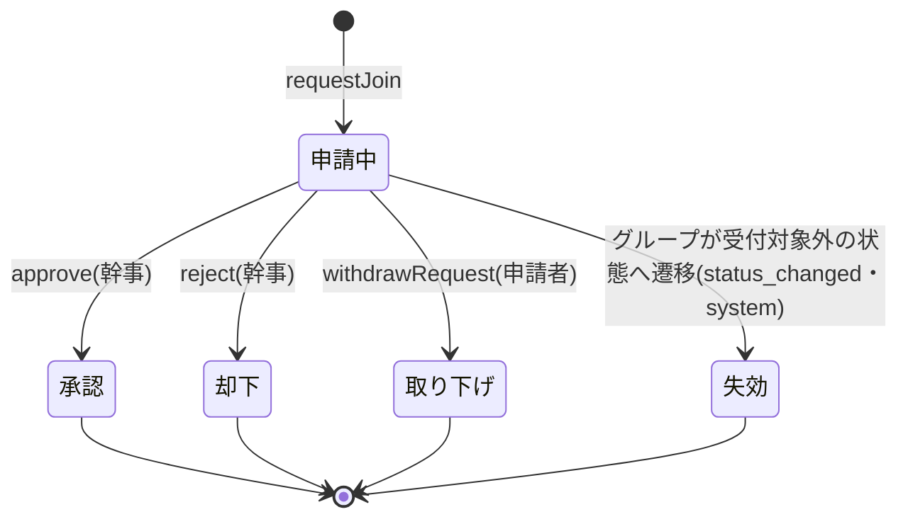
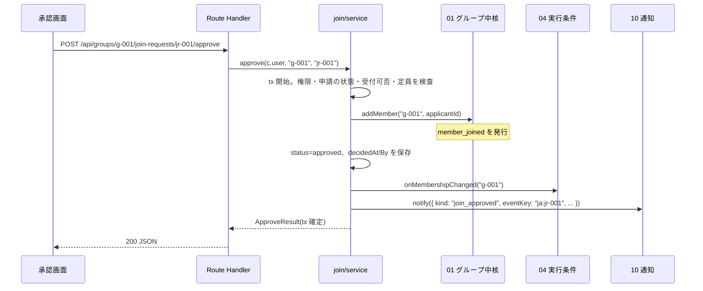
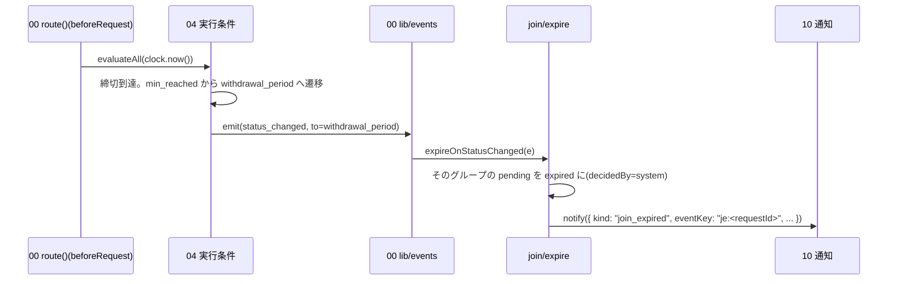

# 03 参加申請・承認

状態の凡例: [事実]/[推定]/[決定]/[案]/[未決]/[要確認]。docs/design と矛盾する場合は docs/design を正とする。本書の ID 接頭辞は `JOIN`(JOIN-FN=関数、JOIN-API=API、JOIN-T=試験、JOIN-TASK=実装タスク、JOIN-ERR=エラー、JOIN-UI=画面部品)。
モジュール間で共有する名前・署名・パス・値・状態値は統一仕様([_unified-contracts.md](_unified-contracts.md)。以下「統一仕様」)に従う。オーナー判断は統一仕様の [決定 n] の番号で示す(`join_expired` の追加は [決定 22])。統一仕様 17.4 の追補修正を反映した。他モジュールとの差は第 16 章に書く。
「見送り(統一仕様 16.2)」と付けた試験・タスク・記述は設計として残すが、主ルートの実装・試験の対象にしない(実装方針。統一仕様第 16 章)。

## 1. 概要と責務 / 対応する柱

- 参加申請(ひとこと・「最少人数でもOK」の同意つき)、幹事による承認/却下、申請者の取り下げ、承認時のメンバー追加、非公開グループの招待コードによる申請、受付終了時の申請の失効。柱4、13、18(同意)。 [案]
- 承認・却下は幹事だけ。承認後のみ連絡(チャット等)が可能。 [決定]
- 受付可否(締切後・辞退期間・確定後・中止後の申請)の判定は 04 の `canAcceptRequests` と `notAcceptingReason` を呼ぶ。本モジュールは条件そのものを持たない。 [統一]
- 責務の外: グループの作成・メンバー保持(01)、グループ状態の遷移(04)、通知の保存(10)、公開範囲・ブロック・禁止表現・本人確認・頻度制限(09)、グループ一覧・詳細(参加前)・招待コード入力画面(02)。
- 本モジュールは「申請」の状態だけを持ち、グループの状態やメンバー数は直接書き換えない(01 の `addMember`、04 の `onMembershipChanged` を経由)。 [統一]

## 2. 既存機能との関係

- 新規。既存の `/api/v2` とそのストア(`server-store.ts`)・クライアント(`src/lib/api.ts`)は変更しない。画面からの API 呼び出しは 00 の `lib/groups-api.ts`(`gapi`・`gpost`・`useGroupsApi`)を使い、モジュール固有のクライアントは作らない(統一仕様 3.5)。
- 旧案の希望/成立(CompanionRequest/Match)は JoinRequest に統合する方向 [未決(05 章)]。本書は統合する前提で設計し、旧エンティティは作らない。
- 通知(10)を使って申請の受付・承認・却下・失効を通知する(種類は第 6.2 節。統一仕様第 9 章、[決定 1・22])。

## 3. 画面・UI(04 章との対応)

| ID | 画面 | 04 章の項目 | パス |
|---|---|---|---|
| JOIN-UI-01 | 参加申請パネル(状態に応じて「申請する/申請中/取り下げ/結果」を出し分け)。グループ詳細(参加前)内と招待コード入力画面内 | 参加申請 | `/[campaign]/groups/[groupId]`(02 の参加前の詳細に埋め込む)、`/[campaign]/invite`(02 の招待コード入力画面に埋め込む) |
| JOIN-UI-02 | 参加申請ダイアログ(ひとこと、同意チェック) | 参加申請 | 同上(モーダル) |
| JOIN-UI-03 | 申請一覧(幹事の承認画面) | 参加申請の承認画面 | `/[campaign]/groups/[groupId]/requests` |
| JOIN-UI-04 | 却下ダイアログ(定型理由の選択) | 承認画面 | JOIN-UI-03 内(モーダル) |

- 招待コードの入力画面は 02 が所有する(`/[campaign]/invite`、統一仕様 2.2・7.2)。招待はコード入力方式 [決定 27] で、同じ画面に 02 のプレビューと JOIN-UI-01 を置く。JOIN-UI-01 はコードを props で受け取って申請に使う(第 11.3 節)。コードは URL・`sessionStorage`・ログに残さない。
- 画面文言はすべて `features/groups/join/messages.ts` に集約する(第 5 章)。恋愛を連想させる語、「相乗り」「マッチング」は使わない。承認画面・申請パネルの「モック」表示は共通レイアウト(00)に従う。

## 4. データ

### 4.1 エンティティ(05 章の JoinRequest に対応)

保存先は 00 の `db().joinRequests`(`Repo<JoinRequest>`、ID は `jr-NNN`。統一仕様 3.1)。書き込みは 00 の `tx()` の中で行う。ファイル: `app/src/features/groups/join/types.ts`。

```ts
// app/src/features/groups/join/types.ts
import type { Id, IsoDateTime, Page } from "@/lib/groups-types";
import type { ErrorBody } from "@/lib/errors";
import type { GroupStatus, NotAcceptingReason } from "@/features/groups/lifecycle/types";
import type { PublicProfile } from "@/features/safety";

/** 申請の状態。5 値(統一仕様 7.4。docs/design 05 を更新) */
export type JoinRequestStatus =
  | "pending"    // 申請中
  | "approved"   // 承認(メンバー化済み)
  | "rejected"   // 却下
  | "withdrawn"  // 取り下げ(申請者)
  | "expired";   // 失効(グループが申請を受け付けない状態になった)

/** 却下の定型理由 [案、12章 #15 案A]。性別・年齢・容姿・出身などを理由とする項目は置かない */
export type RejectReasonId =
  | "plan_mismatch"      // プランの内容・進め方が合わないため
  | "schedule_mismatch"  // 日程・集合の都合が合わないため
  | "not_specified";     // 理由は伝えない

export interface JoinRequest {
  id: Id;                              // newId("jr") 例 "jr-001"
  groupId: Id;
  applicantId: Id;                     // DemoUser.id
  note: string;                        // ひとこと。LIMITS.JOIN_NOTE の範囲(第 7.4 節)
  status: JoinRequestStatus;
  /** 「最少人数でもOK」への同意。案A(必須)では常に true。案B/C の余地を残すため項目として持つ [未決 #22] */
  consentMinMembers: boolean;
  consentAt: IsoDateTime | null;       // 同意日時(clock.nowIso())。同意なしは null
  consentedMinMembers: number | null;  // 同意時に画面へ表示した最少人数
  viaInviteCode: boolean;              // 招待コード経由か
  reentryOfGroupId: Id | null;         // 再エントリー時の再企画元グループ ID(統一仕様 5.4)
  reasonId: RejectReasonId | null;     // 却下理由(status=rejected のときのみ)
  createdAt: IsoDateTime;              // 申請日時
  decidedAt: IsoDateTime | null;       // 判断日時(承認/却下/取り下げ/失効の日時)
  decidedBy: Id | "system" | null;     // 判断者の userId。失効は "system"、取り下げは申請者本人
}

export interface RequestJoinInput {
  note: string;                        // 省略は ""
  consentMinMembers: boolean;          // 案A では true 必須
  consentedMinMembers: number;         // 画面に表示した最少人数(古い同意の検出用)
  inviteCode?: string;                 // 非公開グループでは必須
  reentryOfGroupId?: Id;               // 再エントリー時の再企画元グループ
  ackReview?: boolean;                 // 09 の review 判定を確認済みで再送するとき true(統一仕様 6.2)
}

/** 申請者本人向けの表示(他人の情報を含まない) */
export interface JoinRequestView {
  id: Id;
  groupId: Id;
  status: JoinRequestStatus;
  note: string;
  createdAt: IsoDateTime;
  decidedAt: IsoDateTime | null;
  rejectReasonLabel: string | null;    // reasonId のラベル。幹事名・幹事の自由記述は含めない
}

/** 幹事の承認画面向け。applicant は 09 の visibleProfile(幹事, 申請者, { kind: "request", groupId }) の戻り値 */
export interface OrganizerRequestView {
  request: JoinRequestView & { consentedMinMembers: number | null; consentAt: IsoDateTime | null; viaInviteCode: boolean };
  applicant: PublicProfile;            // 本名・連絡先を含まない(第 11 章)
  canApprove: boolean;                 // 満員・受付終了なら false
  cannotApproveReason: JoinReason | null;
}

/** 一覧は 00 の Page<T>(統一仕様 2.3)に、承認画面の見出し用の値を加える */
export type OrganizerRequestList = Page<OrganizerRequestView> & {
  capacity: { current: number; max: number; min: number; status: GroupStatus }; // max=group.capacity、min=lifecycle.minMembers
  pendingCount: number;
};

/** GET G/my-join-request の応答。自分の申請が無いときは API が 404 を返すため、request は常に値を持つ */
export interface MyRequestState {
  request: JoinRequestView;            // 直近の申請
  canApply: { ok: true } | { ok: false; error: ErrorBody }; // 今申請できるか。画面の出し分け用
  consentText: string;                 // 同意文言(最少人数を埋め込み済み)
  consentedMinMembers: number;         // 文言に埋めた最少人数(申請時にそのまま送る)
}

export interface ApproveResult {
  request: JoinRequestView;            // 申請者の個人情報は含めない(第 8.2 節)
  memberAdded: boolean;                // 冪等の再実行では false
  currentMembers: number;
  groupStatus: GroupStatus;            // onMembershipChanged 後の lifecycle.status
}

/** エラーの reason(第 8.3 節の reason 列の和集合)。値は ErrorBody.reason に入る */
export type JoinReason =
  | "group_not_found" | "request_not_found"
  | "not_verified" | "underage"        // 09 requireVerified が付ける
  | "not_organizer" | "not_applicant"
  | "already_member" | "duplicate_request" | "already_rejected" | "request_limit"
  | "group_full" | "condition_changed" | "request_not_pending"
  | "text_denied" | "text_review_required" // 09 assertTextAllowed が付ける(統一仕様 6.2)
  | NotAcceptingReason;                // 04: closed_deadline / closed_withdrawal_period / closed_confirmed / closed_cancelled
```

- エラーの本体は 00 の `ErrorBody`(`{ error, reason?, message, fields?, detail? }`。統一仕様 3.3)を使い、03 独自の本体型は作らない。`duplicate_request` の既存申請 ID は `detail.existingRequestId` に入れる。

### 4.2 保存領域

| 項目 | 型 | 用途 |
|---|---|---|
| `joinRequests` | `Repo<JoinRequest>`(00 の `Db` に定義済み。統一仕様 3.1) | 申請本体 |

- 招待コードの試行回数は数えない(統一仕様 7.2、決定 8)。そのための保存領域は持たない。申請の頻度制限の計数は 09 の `checkRate` が持つ(Store には置かない)。

### 4.3 制約(データ整合)

- 同一 `(groupId, applicantId)` に `pending` は高々 1 件(JOIN-FN-02 で保証)。
- `status=approved` の申請には、対応する参加中の GroupMember(01)が存在する(承認の処理順で保証、第 9 章)。
- `reasonId` は `status=rejected` のときのみ非 null。`decidedAt/decidedBy` は `pending` 以外で非 null。
- 同一 `(groupId, applicantId)` の申請総数は 3 件以下(`MAX_REQUESTS_PER_GROUP=3`。取り下げの繰り返しによる幹事への連続通知の抑止)[案]。
- `reentryOfGroupId` は、申請先グループの `lifecycle.replanOfGroupId` と一致する場合だけ非 null(第 7.4 節)。

## 5. ファイル構成と責務(実装時に作るもの)

### 5.1 ファイル構成

```
app/src/features/groups/join/
  types.ts            4.1 の型。JoinReason など列挙も置く
  constants.ts        MAX_REQUESTS_PER_GROUP=3、REJECT_REASONS、CONSENT_POLICY、INVITE_POLICY(別案の分岐は見送り)。ひとことの文字数・行数は 00 の LIMITS.JOIN_NOTE を参照する
  messages.ts         画面の文言(同意文言、エラー文、却下理由ラベル)
  repository.ts       db().joinRequests の読み取り補助(listByGroup、findPendingBy、countBy)。書き込みは service の tx 内で Repo を直接使う
  preconditions.ts    checkCanRequest(申請の前提条件。副作用なし)
  service.ts          requestJoin / approve / reject / withdrawRequest / listRequests / getMyRequest / listMyRequests / toJoinRequestView
  expire.ts           expireOnStatusChanged(status_changed の購読処理。失効と join_expired の通知)
  register.ts         on("status_changed", "join", expireOnStatusChanged) の登録(features/bootstrap.ts から import)
  stats.ts            countPendingRequests / hasPendingRequest
  handlers.ts         00 の route() で包んだハンドラ(JOIN-API-01〜07。入力の形式検証と service の呼び出しのみ)
  paths.ts            API パスの組み立て(画面用。00 の gapi/gpost に渡す)
  hooks.ts            useMyJoinRequest(groupId, { enabled }) / useOrganizerRequests(groupId, status?)
  components/
    JoinRequestPanel.tsx   JoinRequestDialog.tsx   ConsentCheckbox.tsx   MyRequestStatus.tsx
    RequestList.tsx        RequestCard.tsx         RejectDialog.tsx
  __tests__/                                      単体・API 試験(第 12 章)
app/src/app/api/groups/[groupId]/join-requests/route.ts                       GET・POST の再エクスポート
app/src/app/api/groups/[groupId]/my-join-request/route.ts                     GET の再エクスポート
app/src/app/api/groups/[groupId]/join-requests/[requestId]/approve/route.ts   POST の再エクスポート
app/src/app/api/groups/[groupId]/join-requests/[requestId]/reject/route.ts    同上
app/src/app/api/groups/[groupId]/join-requests/[requestId]/withdraw/route.ts  同上
app/src/app/api/me/join-requests/route.ts                                     GET の再エクスポート
app/src/app/[campaign]/groups/[groupId]/requests/page.tsx                     承認画面ページ(RequestList を配置するだけ)
```

- ルーティングはリソースごとの `route.ts` とし、`route.ts` には再エクスポートだけを書く(統一仕様 2.1)。キャッチオール `[...path]`・ハンドラ登録表は使わない。

```ts
// app/src/app/api/groups/[groupId]/join-requests/route.ts
export { listJoinRequestsHandler as GET, createJoinRequestHandler as POST } from "@/features/groups/join/handlers";
```

- 自分の申請の取得は `G/my-join-request` に置き、`G/join-requests` の子は `[requestId]` だけにする(統一仕様 2.1 の R-2、2.2)。
- サービス層は UI・HTTP に依存しない。`next/headers` を import しない。現在ユーザーは handler で `c.user`(00 の `route()` が解決)を受け取り、引数に渡す。

### 5.2 利用ライブラリ・モジュール

新規に追加するライブラリは Vitest のみ(00 が追加する。統一仕様 11.1)。それ以外は app/package.json の既存の依存を、記載のバージョン指定のまま使う。

| 区分 | 名前 | 用途(本モジュール) | ライセンス | バージョン方針 |
|---|---|---|---|---|
| フレームワーク | Next.js(`next`) | Route Handler(JOIN-API-01〜07)、App Router のページ(`requests/page.tsx`)、`next/navigation` の `useRouter`・`useParams` | MIT | 16.4.5 を維持 |
| UI ライブラリ | React(`react`、`react-dom`) | 画面コンポーネント、`hooks.ts`(`useState`・`useEffect`) | MIT | 19.3.0 を維持 |
| UI 部品 | Mantine(`@mantine/core`) | 第 14 章のコンポーネント | MIT | ^9.7.5 を維持 |
| アイコン | `@tabler/icons-react` | 申請状態・警告の表示 | MIT | ^3.51.0 を維持 |
| 日時表示 | dayjs | 申請日時・経過日数の表示(クライアント)。サーバーの現在時刻は 00 の `clock` を使う | MIT | ^1.11.23 を維持 |
| 言語・型 | TypeScript | 型定義・型検査 | Apache-2.0 | ^5 を維持 |
| 静的検査 | ESLint(`eslint`、`eslint-config-next`) | `npm run lint` | MIT | 既存の指定を維持 |
| 試験 | Vitest | 単体・API 試験(第 12 章)。devDependency のみで成果物に含まれない | MIT | 新規。00 が追加する。最新の安定版を使う |
| Node 標準 | なし | 本モジュールは Node 標準モジュールを直接 import しない(ID・時刻は 00 経由で得る) | - | - |
| 自前(共通) | 00 共通基盤 | `db()`・`tx()`・`Repo`、`route()`・`ok`・`created`、`v`、`AppError`、`clock`、`newId`、`isMember`・`isOrganizer`、`on()`(`lib/events.ts`)、`LIMITS`、`parsePage`・`paginate`、`gapi`・`gpost`・`useGroupsApi`・`ApiError` | - | - |
| 自前(他モジュール) | 01・04・09・10・11(任意) | 第 15.1 節 | - | - |

使わないもの(自前実装または既存の手段で代替する):

| ライブラリ | 代替 | 理由 |
|---|---|---|
| zod などの検証ライブラリ | 00 の `v` | 検証する項目が少なく、00 の自前検証で足りるため |
| SWR・TanStack Query | 00 の `useGroupsApi`(`data`/`loading`/`error`/`reload` を返す) | 取得先が 2 種類でキャッシュが不要なため(409 のときは再取得する) |
| `@mantine/form`・react-hook-form | `useState` | 入力項目が 2〜3 個のため |
| zustand(既存の依存) | 使わない | 申請の状態はサーバーが持ち、画面間で共有するクライアント状態がないため |
| レート制限のライブラリ | 09 の `checkRate` | 1 プロセスのインメモリで足りるため(計数は 09 が持つ) |

## 6. 状態遷移と遷移ごとの副作用

### 6.1 状態機械



- 終端状態からの遷移はない(再申請は新しい JoinRequest を作る。第 7.1 節の可否規則に従う)。承認後の退会・辞退は 04 の責務で、JoinRequest の状態は `approved` のまま変えない(履歴)。
- 「失効」は統一仕様 7.4 で 5 つ目の状態として確定した(docs/design 05 は 4 状態のため更新が必要。統一仕様第 12 章)。

### 6.2 遷移表

| 遷移 | 契機・実行者 | 条件(いずれも満たさなければ括弧のエラー) | 副作用 |
|---|---|---|---|
| (なし)→申請中 | `requestJoin`(申請者) | 第 7.1 節の前提条件すべて | JoinRequest 作成(同意日時を記録)/ 幹事へ通知 `join_requested` / 現在人数は変えない(申請中は席を確保しない) |
| 申請中→承認 | `approve`(幹事のみ) | 幹事である(`not_organizer`)/ 申請中(`request_not_pending`)/ 04 が受付可(`unavailable_state`)/ ブロック関係なし(`blocked`)/ 申請者が未メンバー(`already_member`)/ 定員未満(`group_full`) | 01 `addMember` でメンバー化(01 が `member_joined` を発行)/ 現在人数 +1 / 04 `onMembershipChanged(groupId)` で状態更新(最少人数到達など。通知は 04 から)/ 申請者へ `join_approved` |
| 申請中→却下 | `reject`(幹事のみ) | 幹事である/ 申請中/ `reasonId` が定型値 | `reasonId` 保存 / 申請者へ `join_rejected`(10 のテンプレート。理由は通知に入れず、申請パネルで表示する。第 10.1 節)/ 現在人数は変えない |
| 申請中→取り下げ | `withdrawRequest`(申請者のみ) | 申請者本人/ 申請中 | 通知しない(`join_withdrawn` は設けない。統一仕様第 9 章)/ 現在人数は変えない |
| 申請中→失効 | `expireOnStatusChanged`(system。04 の `status_changed` を購読) | イベントの `to` が `recruiting`・`min_reached` 以外 | `decidedBy="system"`、`decidedAt=e.at` / `to` が `withdrawal_period` のときだけ申請者へ `join_expired`([決定 22])。`cancelled` のときは 04 が先に `cancelled` を `pendingApplicants` に送っているため送らない(統一仕様 5.3)/ 現在人数は変えない |
| 承認/却下/取り下げ/失効→任意 | - | - | 不可(`request_not_pending`)。**同じ操作の再実行は冪等**(第 9 章) |

送る通知(すべて 10 の `notify(input: NotifyInput)`。統一仕様 9.1、[決定 1・22]):

| kind | 宛先(`recipients`) | `eventKey` | `params` |
|---|---|---|---|
| `join_requested` | `[{ type: "organizer" }]`(グループは `NotifyInput.groupId`) | `jr:<requestId>` | `{ groupTitle: group.name, pendingCount }` |
| `join_approved` | `[{ type: "users", userIds: [applicantId] }]` | `ja:<requestId>` | `{ groupTitle: group.name }` |
| `join_rejected` | 同上 | `jx:<requestId>` | `{ groupTitle: group.name }` |
| `join_expired` | 同上 | `je:<requestId>` [統一] | `{ groupTitle: group.name }`(本文は「申請が受け付けられなくなった」旨。個人を特定できる情報を含めない) |

- `join_expired` の種別・宛先・`params`・`eventKey` の形式(`je:<requestId>`)は統一仕様 5.3・9.1 で確定し、本文テンプレートは 10 が定義する [決定 22]。

### 6.3 主要シーケンス(承認)



### 6.4 主要シーケンス(失効)



- `expireOnStatusChanged` は発行元(04)の `tx` の中で同期に動く。例外は外へ出さず、`console.error` に申請 ID・グループ ID・エラーコードだけを残す(統一仕様 4.6)。
- 中止(`cancelled`)のときは、04 が `cancelled` を参加者と `pendingApplicants` に通知した後に `status_changed` を発行する(統一仕様 5.3)。03 は失効だけを行い、`join_expired` は送らない。
- `to` が `recruiting`・`min_reached` のとき(T3 で最少人数を割って募集中に戻る場合を含む)は何もしない。

## 7. 申請の前提条件と権限

### 7.1 申請の前提条件(`checkCanRequest` と `requestJoin`)

検査は次の順で行い、最初に失敗したものを返す。グループの存在や相手との関係を推測させないよう、存在を隠す検査(グループの有無、非公開グループのコード照合)を先頭に置く(統一仕様 5.2)。順 1〜5 は統一仕様 5.2 の順(本人確認 → ブロック → 頻度 → 禁止表現 → 受付可否)に合わせた。

| 順 | 検査 | 失敗時 | HTTP | reason |
|---|---|---|---|---|
| 1 | グループが存在し、申請者から見える(公開、または非公開で 01 `assertInviteCode(groupId, inviteCode)` が通る)。見えなければ存在を隠す | `not_found` | 404 | `group_not_found` |
| 2 | 09 `requireVerified(user.id, "request_join")` | `forbidden` | 403 | `not_verified` / `underage`(09 が付ける) |
| 3 | 09 `assertNotBlocked(user.id, group.organizerId)`(既存メンバーとの関係は検査しない)。一般文言 | `blocked` | 403 | なし |
| 4 | 09 `checkRate("join_request", user.id)`(`requestJoin` のみ。`checkCanRequest` では行わない) | `rate_limited` | 429 | なし(`detail.retryAfterSec`) |
| 5 | 入力の内容(第 7.4 節。ひとことの行数、09 `assertTextAllowed(note, "join_note", "note", { ackReview })`、`reentryOfGroupId` の照合) | `invalid_input` | 400 | 禁止表現は `text_denied`、要確認は `text_review_required`(`detail.reviewRequired: true`)。それ以外はなし。いずれも `fields` つき |
| 6 | まだメンバーでない(00 `isMember(user, group)`) | `conflict` | 409 | `already_member` |
| 7 | 同グループの `pending` がない | `conflict` | 409 | `duplicate_request`(`detail.existingRequestId`) |
| 8 | 却下済みでない([案] 却下された同グループへの再申請は不可) | `conflict` | 409 | `already_rejected` |
| 9 | 申請総数が上限未満 | `conflict` | 409 | `request_limit` |
| 10 | 04 `canAcceptRequests(group)` が真 | `unavailable_state` | 409 | 04 `notAcceptingReason(group)` の値(`closed_deadline` / `closed_withdrawal_period` / `closed_confirmed` / `closed_cancelled`)。`detail.state` に `lifecycle.status` |
| 11 | 定員未満(01 `countActiveMembers(groupId)` < `group.capacity`) | `conflict` | 409 | `group_full` |
| 12 | 同意の整合(第 7.3 節。`consentedMinMembers === group.lifecycle.minMembers`) | `conflict` | 409 | `condition_changed` |

- 形式の検証(`c.body` の parse)は handler で service より前に行われるため、形式不正は順 1〜4 より先に 400 になる。表の順 5 は service 内の内容の検査。
- 状態と `closed_*` の対応は 04 の `notAcceptingReason` が決める(統一仕様 4.3。第 16 章 #6 は解消)。
- 再申請の可否 [案]: 取り下げ・失効後は可(上限 3 件まで)。承認後に退会した人は、グループがまだ受付中なら再申請可(退会の扱いは #7 未決)。却下後は不可(幹事の判断を覆さない。可にする場合は #15 とあわせて決める)。
- 満員は 04 の状態にせず、03 が常に検査 11 で拒否する(04 の #24 推奨案 B。`canAcceptRequests` は人数を見ない)。
- 本人確認がモックの「未」のとき、画面は確認手順(09)への導線を出す。
- 幹事自身(`group.organizerId === user.id`)の申請は検査 6 で `already_member` になる。
- 締切の評価は 00 の `route()` の `beforeRequest` で 04 の `evaluateAll` が済ませている(統一仕様 3.5・4.6)。03 は評価を呼ばない。

### 7.2 承認・却下・取り下げの権限

| 操作 | 実行できる人 | 判定 | 失敗時 |
|---|---|---|---|
| `approve` / `reject` / `listRequests` | そのグループの幹事のみ | 00 `isOrganizer(user, group)`(毎回サーバーで判定)。申請が URL のグループのものであることを 09 `assertInGroup(request, groupId)` で確認 | 403 `forbidden`(`not_organizer`)。他グループの申請 ID は 404 |
| `withdrawRequest` | 申請者本人のみ(幹事も不可) | `request.applicantId === user.id` | 403 `forbidden`(`not_applicant`) |
| `getMyRequest` | 本人のみ | 暗黙(自分の申請だけを返す) | - |

- 非メンバー・他のメンバーが幹事向けの一覧を見ようとした場合は 403(グループの存在自体は参加前の詳細で公開済みのため 404 にしない。非公開グループは 404)。 [案]
- `approve` の検査順: 404(グループ/申請)→ 403(幹事)→ 申請の状態(承認済みなら冪等で 200)→ `unavailable_state` → ブロック(09 `assertNotBlocked(user.id, request.applicantId)`)→ `already_member` → `group_full`。

### 7.3 同意(「最少人数でもOK」)の取得・記録 [決定(同意を得る)/案(未同意の扱い)]

- 文言 [案、02章 選択肢4の文言案]: `consentText(minMembers)` = 「このグループは、最少人数(${minMembers}人)でも実行されます。${minMembers}人になっても参加します。実行が確定する前なら、辞退できます(不利益はありません)。」
- 取得: 申請ダイアログに同意チェックを置き、チェックしないと送信ボタンを無効にする(補助)。サーバーが必ず検証する。
- 記録: 申請作成時に `consentMinMembers=true`、`consentAt=clock.nowIso()`、`consentedMinMembers=input.consentedMinMembers` を保存する。同意の撤回は「取り下げ」または確定前の辞退(04)で表す(同意だけを後から外す操作は設けない)。
- 古い同意の防止: 申請送信時に `input.consentedMinMembers !== group.lifecycle.minMembers` なら `condition_changed`(画面は最新の文言を再表示して再同意)。幹事による最少人数の変更(04 の `changeConditions`。#25 案Aでは「下げる」のみ)の直後に起こりうる。
- `consentedMinMembers > 現在の lifecycle.minMembers` となる過去の同意(最少人数が下がった後)は有効のまま。**上げられた場合**(#25 案Bの自由変更を採ったとき)は同意の再確認が必要になる [要確認、04 と調整。デモ範囲外・見送り(統一仕様 16.2)。#25 案A では起こらない]。

**同意しない人の扱い(#22 の選択肢整理と 03 への影響)**

| 案 | 内容 | 03 の実装 | 04(到達判定)への影響 | 評価 |
|---|---|---|---|---|
| A(暫定採用) | 同意は必須。しないと申請不可 | `consentMinMembers !== true` → `invalid_input`(fields.consentMinMembers)。項目は true 固定 | 現在人数=承認済みメンバー数でよい | 条件が単純で、幹事は全員の同意を前提に判断できる。同意をためらう人は申請できない |
| B | 同意なしでも申請可。「最少人数到達」の算入から外す | 検証を緩め、`consentAt=null` で保存 | `countsTowardMinimum(member)` が要る(メンバーに同意の有無を伝える項目が必要)。到達判定・表示が複雑 | 機会は保てるが、幹事に分かりにくい |
| C | 同意なしでも申請可。定員超過時の優先を下げる | 同上 + 承認画面で並び替え/表示 | 優先を使う場面(キャンセル待ち)が現行仕様にない | 実質的な差別と受け取られうる。非推奨 |

- 暫定は A。切替用に `constants.ts` に `CONSENT_POLICY: "required" | "optional_excluded" | "optional_lower_priority"` を置き、`required` のみ実装する(他は未実装として分岐に TODO を残す)。 [案] 別案(`optional_excluded`・`optional_lower_priority`)の分岐は見送り(統一仕様 16.2)。
- データ項目(`consentMinMembers`、`consentAt`)は案によらず持つ(05 章どおり)。

### 7.4 入力検証(項目ごと)

検証は 00 の `v`・`c.id`・`c.query` で行う(統一仕様 3.2・3.4)。本文の上限は 00 の `route()` の `LIMITS.BODY_BYTES`(超過は 413 `payload_too_large`)で、本モジュール独自の上限は設けない。本文の未知のキーは `v.object` が捨てる。クエリは `c.query` が strict に検証し、未知のキーは 400 `invalid_input`。上限値は 00 の `LIMITS` を参照し、数値を直書きしない(統一仕様 10.3)。JOIN-API-01 の本文スキーマには `ackReview: v.boolean({ optional: true })` を宣言する(宣言しないと未知キーとして捨てられる。統一仕様 6.2)。

| 項目 | 型 | 規則 | 違反時 |
|---|---|---|---|
| `groupId`(パス) | string | `c.id("groupId", "g")` | 404 not_found(形式不正も存在しない扱い) |
| `requestId`(パス) | string | `c.id("requestId", "jr")` | 404 not_found(同上) |
| `status`(クエリ、JOIN-API-02) | string | 省略可。`v.csv(v.enum(JOIN_REQUEST_STATUSES))`、重複なし。省略時は `pending` | 400 `fields.status` |
| `limit`・`offset`(クエリ、JOIN-API-02・07) | number | 00 の `parsePage`(既定・最大は `LIMITS.PAGE`) | 400 `fields.limit`/`fields.offset` |
| `note` | string | 省略可。`v.string({ max: LIMITS.JOIN_NOTE.max, multiline: true, optional: true, default: "" })`。00 の `sanitizeText` が制御文字を除く。行数は `LIMITS.JOIN_NOTE.maxLines` 以下(03 が検査)。09 `assertTextAllowed(note, "join_note", "note", { ackReview })` を通す | 400 `fields.note`(禁止表現は `reason: "text_denied"`、要確認は `reason: "text_review_required"` と `detail.reviewRequired: true`) |
| `consentMinMembers` | boolean | `v.boolean()`。案Aでは `true` のみ | 400 `fields.consentMinMembers` |
| `consentedMinMembers` | number | `v.int({ min: LIMITS.MIN_MEMBERS.min, max: LIMITS.MIN_MEMBERS.max })` | 400 `fields.consentedMinMembers` |
| `inviteCode`(本文) | string | `v.string({ max: 32, optional: true })`。非公開グループでは必須で、01 `assertInviteCode(groupId, inviteCode)` で照合する。公開グループでは無視 | 404 not_found(`group_not_found`。無い・形式不正・不一致を区別しない) |
| `reentryOfGroupId` | string | `v.id("g", { optional: true })`。申請先グループの `lifecycle.replanOfGroupId` と一致し、本人がその元グループに申請(状態を問わない)を持つこと | 形式不正・不一致とも 400 `fields.reentryOfGroupId` |
| `ackReview` | boolean | `v.boolean({ optional: true })`。本文の最上位のキー。JOIN-API-01 のスキーマに必ず宣言する(統一仕様 6.2) | 400 `fields.ackReview` |
| `reasonId` | enum | `v.enum(REJECT_REASON_IDS, { optional: true, default: "not_specified" })`。自由記述は受け付けない | 400 `fields.reasonId` |

- 性別・細かい年齢を表すキー: 本文では未知キーとして捨てる(保存しない)。クエリを持つハンドラ(JOIN-API-02・07)は、先頭で `c.query(schema)` の前に 09 の `rejectProhibitedParams(c.url.searchParams)` を呼び、専用の文言で拒否する。本文には呼ばない(統一仕様 3.4。第 16 章 #8 は解消)。
- 招待コードはクエリで受け取らない。本文の `inviteCode` だけで受け取る(統一仕様 7.2・7.4)。

## 8. インターフェース

### 8.1 サービス関数(`features/groups/join/service.ts` ほか)

`DemoUser` は 00、`Group` は 01 の型(統一仕様 4.2)。例外はすべて 00 の `AppError(code, message, { reason, fields, detail })`。サービスはすべて**同期関数**で、変更は 00 の `tx()` の中で行い、検査から書き込みまでの間に `await` を挟まない(第 9 章の排他の前提)。

| ID | 署名 | 責務・例外 |
|---|---|---|
| JOIN-FN-01 | `checkCanRequest(user: DemoUser, group: Group, input: { inviteCode?: string; consentedMinMembers?: number }): { ok: true } \| { ok: false; error: ErrorBody }` | 第 7.1 節の 1〜3、6〜12 を検査(4 の頻度制限と 5 の内容検査は行わない)。副作用なし。例外を投げず結果を返す(画面の出し分け用) |
| JOIN-FN-02 | `requestJoin(user: DemoUser, groupId: Id, input: RequestJoinInput): JoinRequest` | 第 7.1 節の 1〜12 → 作成(`newId("jr")`、`consentAt=clock.nowIso()`)→ 幹事へ `join_requested`。11 の `Listing` があるグループでは、任意で 11 `recordFunnelEvent({ type: "official_requested", … })` を呼ぶ(統一仕様 4.6・7.11。計測の失敗で申請を止めない)。例外: not_found / forbidden / blocked / rate_limited / invalid_input / conflict / unavailable_state |
| JOIN-FN-03 | `approve(user: DemoUser, groupId: Id, requestId: Id): ApproveResult` | 第 6.2 節。01 `addMember` → 04 `onMembershipChanged(groupId)` → 10 `join_approved`。03 は 04 の `evaluate` を呼ばない。例外: not_found / forbidden / conflict(`request_not_pending`、`group_full`、`already_member`)/ unavailable_state / blocked |
| JOIN-FN-04 | `reject(user: DemoUser, groupId: Id, requestId: Id, reasonId?: RejectReasonId): JoinRequest` | 例外: not_found / forbidden / invalid_input / conflict(`request_not_pending`) |
| JOIN-FN-05 | `withdrawRequest(user: DemoUser, groupId: Id, requestId: Id): JoinRequest` | 申請者の取り下げ(04 の `withdraw` と区別するための名前。統一仕様 4.5)。例外: not_found / forbidden(`not_applicant`)/ conflict(`request_not_pending`) |
| JOIN-FN-06 | `listRequests(user: DemoUser, groupId: Id, opts?: { status?: JoinRequestStatus[]; limit?: number; offset?: number }): OrganizerRequestList` | 幹事のみ。既定は `["pending"]`。申請日時の昇順(属性で並べ替えない)。**申請者とのブロック関係がある申請は含めない**(09 `isBlocked`)。申請者は 09 `visibleProfile(user, applicantId, { kind: "request", groupId })` で公開範囲に絞る |
| JOIN-FN-07 | `getMyRequest(user: DemoUser, groupId: Id): MyRequestState` | 本人の直近の申請と `canApply`。自分の申請があれば非公開グループでも返す(招待コードは不要)。グループが無い、または自分の申請が無いときは not_found(`request_not_found`。両者を区別しない。統一仕様 7.2・7.4) |
| JOIN-FN-08 | `listMyRequests(user: DemoUser, page: { limit: number; offset: number }): Page<JoinRequestView>` | 本人の全申請(新しい順)。非公開グループの申請を含む(統一仕様 2.2・7.2)。マイページ等 |
| JOIN-FN-09 | `expireOnStatusChanged(e: Extract<DomainEvent, { type: "status_changed" }>): number` | 00 `on("status_changed", "join", …)` で登録する購読処理。`e.to` が `recruiting`・`min_reached` 以外なら、`e.groupId` の `pending` を `expired`(`decidedBy="system"`、`decidedAt=e.at`)にして件数を返す。`e.to === "withdrawal_period"` のときだけ各申請者へ `join_expired` を送る。冪等(`pending` が無ければ 0)。例外は外へ出さない |
| JOIN-FN-10 | `consentText(minMembers: number): string` | 第 7.3 節の文言。純粋関数。02 の画面も使う(統一仕様 4.6・7.2) |
| JOIN-FN-11 | `countPendingRequests(groupId: Id): number` / `hasPendingRequest(userId: Id, groupId: Id): boolean` | 前者は 03 内(`join_requested` の `pendingCount`、承認画面)で使う。後者は 02 向け(統一仕様 7.4) |
| JOIN-FN-12 | `toJoinRequestView(req: JoinRequest): JoinRequestView` | API 応答用の変換。`rejectReasonLabel` は `REJECT_REASONS` から引く。純粋関数。JOIN-API-01・05・06・07 と `ApproveResult` で使う |

内部ヘルパ(`repository.ts`): `listByGroup(groupId)`、`findPendingBy(groupId, applicantId)`、`countBy(groupId, applicantId)`。いずれも `db().joinRequests` の `filter`・`find`・`count` を使う。取得は `db().joinRequests.get(requestId)`、作成は `insert`、更新は `update`。

### 8.2 HTTP API

共通: JSON。変更系(JOIN-API-01、04〜06)は本文の有無にかかわらず `Content-Type: application/json` が必須(本文なしで送る approve・withdraw も付ける。00 の `route()` の入口検査で、違反は 415。統一仕様 2.3)。ハンドラは `handlers.ts` に 00 の `route()` で包んで置き、`route.ts` は再エクスポートだけ(第 5.1 節)。現在ユーザーは `c.user`(Cookie `demoUser` から 00 が解決。クライアントの申告を信用しない)。失敗時の本体は 00 の `ErrorBody` `{ "error": "<code>", "reason"?: "<reason>", "message": "...", "fields"?: { ... }, "detail"?: { ... } }`(統一仕様 3.3)。パスの ID は第 7.4 節の形式。サービスは `JoinRequest` を返し、handler が `toJoinRequestView`(JOIN-FN-12)で変換して応答する。`G` は `/api/groups/[groupId]`。

| ID | メソッド・パス | リクエスト | 成功 | 主なエラー(code / reason) |
|---|---|---|---|---|
| JOIN-API-01 | `POST G/join-requests` | `{ note?, consentMinMembers, consentedMinMembers, inviteCode?, reentryOfGroupId?, ackReview? }` | 201 `JoinRequestView` | 404 not_found/group_not_found、403 forbidden/not_verified・underage、403 blocked、429 rate_limited、400 invalid_input(禁止表現は text_denied・text_review_required)、409 conflict/already_member・duplicate_request・already_rejected・request_limit・group_full・condition_changed、409 unavailable_state/closed_* |
| JOIN-API-02 | `GET G/join-requests?status=pending,approved&limit=&offset=` | クエリ `status?`・`limit?`・`offset?`(第 7.4 節)。先頭で `rejectProhibitedParams` | 200 `OrganizerRequestList` | 403 forbidden/not_organizer、404、400 invalid_input(`fields.status` など) |
| JOIN-API-03 | `GET G/my-join-request` | クエリなし | 200 `MyRequestState`(自分の申請があれば非公開グループでも返す) | 404 not_found/request_not_found(グループが無い、または自分の申請が無い。区別しない) |
| JOIN-API-04 | `POST G/join-requests/[requestId]/approve` | `{}`(本文なしでも可。`Content-Type: application/json` は必須) | 200 `ApproveResult`(冪等。既に承認済みは `memberAdded:false`) | 403 forbidden/not_organizer、404、409 conflict/request_not_pending・group_full・already_member、409 unavailable_state/closed_*、403 blocked |
| JOIN-API-05 | `POST G/join-requests/[requestId]/reject` | `{ reasonId? }` | 200 `JoinRequestView`(冪等) | 403、404、400 invalid_input、409 conflict/request_not_pending |
| JOIN-API-06 | `POST G/join-requests/[requestId]/withdraw` | `{}`(本文なしでも可。`Content-Type: application/json` は必須) | 200 `JoinRequestView`(冪等) | 403 forbidden/not_applicant、404、409 conflict/request_not_pending |
| JOIN-API-07 | `GET /api/me/join-requests?limit=&offset=` | クエリ `limit?`・`offset?`。先頭で `rejectProhibitedParams` | 200 `Page<JoinRequestView>`(非公開グループの申請を含む) | 400 invalid_input(`fields.limit` など) |

- 招待コードの照合 API は 02 の `POST /api/invites/lookup`(照合は 01)で、本モジュールは持たない(統一仕様 2.2・7.2)。
- 検査順は第 7.1 節・第 7.2 節。存在を隠す検査(グループの有無、非公開グループのコード照合)を先頭に置き、`not_found` を他の業務エラーより先に返す(統一仕様 5.2)。
- 申請者の ID は **リクエストに含めない**(常に `c.user`)。`approve` のレスポンスに申請者の個人情報を含めない。
- 申請が他グループのものなら 404(`requestId` が存在しても URL の groupId と不一致なら 404。09 `assertInGroup`)。
- 成功すると 00 のクライアントが `ntf:refresh` を発火し、通知のベルが再取得される(統一仕様 3.5)。

### 8.3 エラーコード一覧

00 のコード体系(統一仕様 3.3)を使い、細分は最上位の `reason` で表す。モジュール固有のコードは作らない。

| ID | code | reason | HTTP | 条件 | 画面の表示・次の行動 |
|---|---|---|---|---|---|
| JOIN-ERR-01 | not_found | group_not_found | 404 | グループが無い/非公開で招待コードが無い・誤り | 一覧へ戻る導線(存在を示さない) |
| JOIN-ERR-02 | not_found | request_not_found | 404 | 申請が無い/他グループの申請/`G/my-join-request` で自分の申請が無い(グループが無い場合を含む) | 申請一覧を再読み込み。申請パネルは申請前に `G/my-join-request` を呼ばない(第 14.1 節) |
| JOIN-ERR-03 | forbidden | not_verified | 403 | 本人確認(モック)が未(09 が付ける) | 「本人確認の手順へ」ボタン(09) |
| JOIN-ERR-04 | forbidden | underage | 403 | 18歳未満(モック。09 が付ける) | 年齢要件の説明、一覧へ |
| JOIN-ERR-05 | forbidden | not_organizer | 403 | 幹事以外の承認・却下・一覧 | 権限の説明。グループ詳細へ |
| JOIN-ERR-06 | forbidden | not_applicant | 403 | 申請者以外の取り下げ | - |
| JOIN-ERR-07 | blocked | なし | 403 | ブロック関係(いずれの向きでも) | 「このグループには申請できません」(理由・相手を示さない) |
| JOIN-ERR-08 | invalid_input | なし / text_denied / text_review_required | 400 | note 長さ超過・行数超過・禁止表現、同意なし、理由 ID 不正、`reentryOfGroupId` 不正 | 項目ごとのメッセージ(`fields`。項目ごとの細かい修正案の文言は見送り。統一仕様 16.2)。禁止表現は 09 の文言で示す。`detail.reviewRequired` のときは確認ダイアログを出し、確認後に `ackReview: true` で再送 |
| JOIN-ERR-09 | conflict | already_member | 409 | すでにメンバー/幹事 | 「参加済みです」+ グループ詳細(参加後)へ |
| JOIN-ERR-10 | conflict | duplicate_request | 409 | 申請中が既にある | 申請状況の表示へ(`detail.existingRequestId`) |
| JOIN-ERR-11 | conflict | already_rejected | 409 | 却下済みへの再申請 | 他のグループ提案(一覧へ) |
| JOIN-ERR-12 | conflict | request_limit | 409 | 同グループへの申請が 3 件に到達 | 一覧へ |
| JOIN-ERR-13 | conflict | group_full | 409 | 定員到達 | 「満員です」+ 別グループの提案(一覧へ。03 から 02 へのリンク) |
| JOIN-ERR-14 | conflict | condition_changed | 409 | 同意時の最少人数が変わった | 最新の同意文言を再表示して再同意 |
| JOIN-ERR-15 | conflict | request_not_pending | 409 | 申請中でない申請への判断 | 現在の状態を表示(承認済み/却下済み等)。画面を更新 |
| JOIN-ERR-16 | unavailable_state | closed_deadline / closed_withdrawal_period / closed_confirmed / closed_cancelled(04 `notAcceptingReason`) | 409 | グループが申請を受け付けない(`detail.state`) | 理由の説明。中止なら再企画/一覧への導線 |
| JOIN-ERR-17 | rate_limited | なし | 429 | 申請の頻度制限の超過(09 `checkRate("join_request")`) | `ErrorNotice` で `message` を表示し、入力内容は保持する。再試行までの目安(`detail.retryAfterSec`)の表示は見送り(統一仕様 16.2) |
| JOIN-ERR-18 | internal | なし | 500 | 想定外の例外(00 の共通処理が変換) | 「問題が発生しました。画面を再読み込みしてください」(00 の共通表示) |
| JOIN-ERR-19 | network(クライアントのみ) | - | - | サーバーに接続できない、応答が JSON でない | 「サーバーに接続できません」と再試行ボタン(00 の共通表示) |

`JoinReason` の型は第 4.1 節(`types.ts`)。

### 8.4 クライアント(00 の `lib/groups-api.ts` を使う)

モジュール固有のクライアント(旧案の fetch ラッパーとエラークラス)は作らない(統一仕様 3.5)。`paths.ts` にパスの組み立てだけを置き、通信は 00 の関数を使う。

```ts
// app/src/features/groups/join/paths.ts
const G = (groupId: Id) => `/api/groups/${encodeURIComponent(groupId)}`;
export const joinPaths = {
  list: (groupId: Id, q?: { status?: JoinRequestStatus[]; limit?: number; offset?: number }) => `${G(groupId)}/join-requests${qs(q)}`,
  create: (groupId: Id) => `${G(groupId)}/join-requests`,
  myRequest: (groupId: Id) => `${G(groupId)}/my-join-request`,
  approve: (groupId: Id, requestId: Id) => `${G(groupId)}/join-requests/${encodeURIComponent(requestId)}/approve`,
  reject: (groupId: Id, requestId: Id) => `${G(groupId)}/join-requests/${encodeURIComponent(requestId)}/reject`,
  withdraw: (groupId: Id, requestId: Id) => `${G(groupId)}/join-requests/${encodeURIComponent(requestId)}/withdraw`,
  myRequestList: (q?: { limit?: number; offset?: number }) => `/api/me/join-requests${qs(q)}`,
};
```

- 使い方: 取得は `useGroupsApi<MyRequestState>(joinPaths.myRequest(groupId))`(申請前は呼ばない。第 14.1 節)、変更は `gpost<JoinRequestView>(joinPaths.create(groupId), body)` のように呼ぶ。
- `qs(obj)` は `URLSearchParams` で値のあるキーだけを並べる(配列はカンマ区切り。すべて未指定なら空文字)。
- エラーは 00 の `ApiError`(`code`・`status`・`reason`・`fields`・`detail`。通信失敗は `code: "network"`)。画面は `reason` で出し分ける。

## 9. 同時操作・冪等性

前提: Next.js の Route Handler は Node.js の単一スレッドで動き、インメモリストア(globalThis)への読み書きは**同期処理なら途中で割り込まれない**。00 の `tx()` は同期関数を原子的に実行し、例外時は巻き戻す。したがって次のルールで排他を満たす。 [案]

1. **検査と書き込みは 1 つの `tx` の中で完結させる**(`await` を挟まない)。承認の「定員検査→メンバー追加→状態更新→通知」は 1 つの `tx` とする。非同期のストアへの置き換えはデモ範囲外(見送り。統一仕様 16.2)。
2. **定員の二重検査**: 03 が `countActiveMembers(groupId) < group.capacity` を検査し、さらに 01 の `addMember` が同じ検査を行って `conflict(group_full)` を投げる(防御の二重化)。`addMember` が失敗したら `tx` が巻き戻り、申請の状態は変わらない(処理順: `addMember` → 申請状態の更新)。
3. **冪等(状態ベース)**:
   - `approve`: 既に `approved` なら、メンバー追加も通知もせず 200(`memberAdded:false`)を返す。`rejected/withdrawn/expired` には 409 `request_not_pending`。
   - `reject`: 既に `rejected`(同じ理由)なら 200。別の理由での再実行は変更せず現状を返す。
   - `withdrawRequest`: 既に `withdrawn` なら 200。
   - `requestJoin`: 同一ユーザーの `pending` が既にあれば 409 `duplicate_request`(`detail.existingRequestId` を返し、画面は既存の申請状況へ誘導)。ダブルクリックによる 2 回目の送信はこの応答になる。
   - 通知は 10 の `eventKey`(第 6.2 節)で重複作成が防がれる。
4. **同時の競合**の例: 空き 1 席に申請 2 件 → 先に処理された `approve` が成功し、後の `approve` は `group_full`。幹事が `approve`、申請者が同時に `withdrawRequest` → 先に処理された操作が成功し、後の操作は `request_not_pending`(画面は再取得して現状を表示)。同時リクエスト(`Promise.all` など)による試験は見送り(統一仕様 16.2)とし、逐次の呼び出しで確かめる(JOIN-T-28)。
5. クライアントは送信中ボタンを無効化し、レスポンスが 409 のときは必ず再取得する(楽観更新はしない)。
6. 通知の失敗(10 の例外)で申請の状態を戻さない。`notify` の例外は `try/catch` で捕捉し、`console.error` に申請 ID・通知の種類・エラーコードだけを記録して、応答は成功とする(ひとこと・招待コードはログに出さない)[案]。

## 10. 却下理由と恣意的な却下への対処

### 10.1 却下理由([未決 #15] の選択肢)

| 案 | 内容 | 03 の実装 | 評価 |
|---|---|---|---|
| A(暫定採用) | 定型文から選ぶ(性別・年齢・容姿等を理由とする選択肢は置かない)。省略時は「理由は伝えない」 | `RejectReasonId` 3 種(第 4.1 節)。自由記述は受け付けない | 恣意・差別的運用を抑えやすい。選択肢の設計が要る |
| B | 理由は任意、申請者には結果のみ通知 | `reasonId` を持たず通知を結果のみに | 幹事の操作が少ない。却下が妥当だったかを後から確認できない |
| C | 自由記述 | 禁止表現チェック+長さ制限 | 柔軟だが幹事から申請者への私的メッセージになり、安全面のリスクが高い。非推奨 |

- 申請者への通知は 10 の `join_rejected` のテンプレート(「今回は見送りとなりました」。`params` は `groupTitle` のみ)で、理由ラベルは通知に入れない(却下理由は通知に入れない。統一仕様 5.2・9.1)。理由ラベルは申請パネル(JOIN-UI-01)と自分の申請一覧で `JoinRequestView.rejectReasonLabel` として表示する。
- 理由の既定ラベル(文言は `messages.ts`): `plan_mismatch`=「プランの内容・進め方が合わなかったため」/ `schedule_mismatch`=「日程・集合の都合が合わなかったため」/ `not_specified`=「理由は伝えられていません」。

### 10.2 恣意的な却下への対処 [案、#15。運用はデモ範囲では画面のみ]

1. 理由は定型のみ。性別・年齢・容姿・出身などに触れる項目を置かない。静的試験で `REJECT_REASONS` と文言に禁止語がないことを確認する(JOIN-T-35)。
2. 申請者に「通報の窓口」(09 `createReport`)への導線を却下結果の画面に表示する。対象は 09 の `ReportTargetType` の `group` または `user`(幹事)。
3. 判断の記録(`decidedBy/decidedAt/reasonId`)を残す。デモでは閲覧画面は設けないが、通報の確認に使える。
4. 幹事の承認画面では、申請者の並びを申請日時の昇順に固定し、プロフィールは 09 の公開範囲内に限る(属性での選別の材料を増やさない)。年代帯を幹事に見せるか [未決 #16]。
5. 「最少人数到達の直前だけ却下する」運用への注意: 現在人数が `minMembers - 1` のときに却下する場合は、確認ダイアログに「あと 1 人で最少人数(実行の条件)に達します。却下しますか」を表示する(警告のみ、操作は止めない)。 [案]
6. 放置の抑止: 未対応の申請に経過日数を表示する。締切で受付が終わると申請は `expired` になり、辞退期間に移った場合は申請者に `join_expired` が届く([決定 22])。中止の場合は 04 の `cancelled` 通知が届く(統一仕様 5.3)。判断されない申請が締切後も申請中のまま残らない。
7. 却下後の再申請は不可(第 7.1 節)とする代わりに、一覧から別グループへ申請できる導線を出す。

## 11. 公開プロフィールの範囲・招待コード・安全

### 11.1 申請者に見せる情報(承認前/後)

| 閲覧者 → 対象 | 承認前(申請中・却下・取り下げ) | 承認後 | 呼ぶ関数 |
|---|---|---|---|
| 幹事 → 申請者(承認画面) | 表示名、年代帯、一言、旅の目的、本人確認済みの印、ひとこと(申請の `note`)、同意の有無・日時、申請日時。**本名・連絡先・年齢の実数は返さない** | メンバーとして 09 の `{ kind: "member", groupId }` の範囲(メンバー一覧は 01) | `visibleProfile(organizer, applicantId, { kind: "request", groupId })` |
| 申請者 → 幹事 | 表示名と、参加前の詳細(02)に出る範囲のみ | メンバーの範囲 | `visibleProfile(applicant, organizerId, { kind: "list" })`(02 が呼ぶ) |
| 申請者 → 他メンバー | メンバー概要(人数・年代帯の分布。4 人未満は年代を出さない。09 `memberSummary`)のみ。個人は見えない | メンバー一覧(`{ kind: "member", groupId }`。連絡手段は承認後) | 09 |
| 申請者 → 自分の申請 | 自分のひとこと、状態、却下理由ラベル | - | - |

- 公開範囲の適用は**サーバー側**(`listRequests` が `visibleProfile` の戻り値だけを返す)。API 応答に非公開項目(本名、連絡先、メール、電話)を含めない。試験で応答 JSON のキー名を走査する(JOIN-T-26)。
- ブロック関係にある申請者は幹事の一覧に出さない(第 8.1 節 JOIN-FN-06)。
- 申請者の `note` は React の既定エスケープで表示し、`dangerouslySetInnerHTML` を使わない。

### 11.2 禁止表現・メッセージ

- `note` は 09 `assertTextAllowed(note, "join_note", "note", { ackReview })` を通す(恋愛・異性交際を連想させる語、連絡先交換の誘導など)。違反は 400 invalid_input で `fields.note` に 09 の文言を入れる。review の判定は `detail.reviewRequired: true` で返し、画面は確認後に `ackReview: true` で再送する(統一仕様 6.2)。画面のライブ警告は 09 `checkText(note, "join_note")`。
- 通知本文にひとこと・申請者の個人情報を載せない(10 の方針)。

### 11.3 招待コードによる参加(非公開グループ)[未決 #17]

| 案 | 内容 | 03 の実装 | 評価 |
|---|---|---|---|
| A(暫定採用) | コードで詳細に到達でき、申請は公開グループと同じ(幹事の承認が要る) | `requestJoin` に `inviteCode` を要求し、`viaInviteCode=true` で作成。以降は通常の承認 | コードが流出しても、幹事の承認で参加を止められる。招待した知人の参加にも承認の手間がかかる |
| B | コードのみで参加(承認なし) | `INVITE_POLICY="code_only"` のとき、有効コードの申請は即 `approved`(`decidedBy="system"`)として `addMember` | 知人の参加が簡単。流出で見知らぬ人が入れる。幹事制の趣旨が弱まる |
| C | A に「招待経由は承認画面で印を付ける」を加える | `viaInviteCode` を承認画面に表示 | A の補強(採用する) |

- 暫定は A+C。`constants.ts` に `INVITE_POLICY: "code_plus_approval" | "code_only"` を置き、`code_plus_approval` のみ実装する。B に切り替える場合は `requestJoin` の末尾で `approve` 相当の処理を呼ぶ。JOIN-TASK-16(第 13 章)では切替点(未採用案の分岐で未実装エラーを投げる)だけを用意する。B の分岐と JOIN-TASK-16 は見送り(統一仕様 16.2)。
- 流れ(統一仕様 7.2。コード入力方式 [決定 27]):
  1. 招待コード入力画面(02、`/[campaign]/invite`)でコードを入力する。
  2. 画面が `POST /api/invites/lookup`(02。照合は 01 `findGroupByInviteCode`、公開判定は 09 `isGroupVisibleTo(…, { inviteVerified: true })`)を呼び、`PrivateGroupPreview` を得る。
  3. 同じ画面に、プレビューと JOIN-UI-01 を表示する。コードは 02 の `InviteCodeScreen` の state にだけ持ち、JOIN-UI-01 に props で渡す。申請前の JOIN-UI-01 は `G/my-join-request` を呼ばず、最少人数と申請可否は `PrivateGroupPreview` の `headcount.min`・`applyState` を props で受け、同意文言は `consentText(minMembers)` で作る。
  4. 申請は `POST G/join-requests` の本文に `inviteCode` を入れて送る。03 は非公開グループのとき 01 `assertInviteCode(groupId, inviteCode)` で確認する。
  5. 申請後の状態は `GET G/my-join-request` と `GET /api/me/join-requests` で確認する(どちらも非公開グループの申請を含み、コードは不要)。
  6. 承認されて関係者になった後は、通常の `GET G`(統一仕様 5.5)で詳細を表示する。
- コードの形式(10 文字、表示 `ABCDE-FGHJK`、入力は大文字化してハイフン・空白を除く)・発行・再発行は 01 の責務。本モジュールはコードの照合処理を実装しない。
- 非公開グループは、コード無し・誤りの `requestJoin` と幹事以外の `listRequests` で 404(`group_not_found`)、自分の申請が無い `getMyRequest` で 404(`request_not_found`)にして存在を隠す。
- 照合は試行回数に数えない(統一仕様 7.2、決定 8)。総当たりへの耐性が無いことは既知の制約(01・09 に記載。第 11.4 節)で、対策は見送り(統一仕様 16.2)。
- 招待コードは URL(クエリ・パス)、`sessionStorage`、ログ、エラーメッセージ、通知に残さない(統一仕様 7.2)。コードが現れるのは画面のコンポーネントの state と、申請の本文(POST)だけ。

### 11.4 セキュリティ観点(まとめ)

OWASP Top 10 のうち本モジュールに関係する項目と対処を示す。共通の仕組み(応答ヘッダ、`Origin` 検査、本文サイズの上限)は 00 の `route()` と `next.config.ts` に従い、本モジュールでは個別に実装しない。

| 観点 | 対処 | 参照 |
|---|---|---|
| アクセス制御・IDOR | 幹事判定・申請者判定は毎回サーバーで `c.user` を基に行う。申請が URL のグループのものでない場合は 404(09 `assertInGroup`)。申請者 ID・`status`・`decidedBy` は本文から受け取らない(未知のキーは `v.object` が捨てる) | 第 7.2 節、第 8.2 節、JOIN-T-20〜22 |
| 入力検証・インジェクション | 第 7.4 節の検証をサーバーで必ず行う(画面の検証は補助)。ID は 00 の `c.id`・`v.id` で形式を確認する。SQL を使わないため SQL インジェクションは該当しない。ID・コードをファイルパスに使わない(パストラバーサル対策) | 第 7.4 節 |
| XSS | `note`・表示名は React の既定のエスケープで表示し、`dangerouslySetInnerHTML` を使わない。通知本文は 10 のテンプレートで作り、ユーザー入力を埋め込まない | 第 10.1 節、第 11.1 節 |
| CSRF | 状態を変える操作は POST のみ(JOIN-API-01、04〜06)。`Content-Type: application/json` の必須化(本文なしの POST を含む)、`Origin` 検査は 00 の `route()`、Cookie の `SameSite=Lax` は 00 に従う。GET では状態を変えない(失効は 04 の遷移を契機とする購読処理で行う) | 00 |
| 認証・セッション(デモ) | ログイン不要のため、Cookie `demoUser` で現在ユーザーを表す(00)。本人確認・18 歳確認はモック(09)。画面に「モック」と表示する | 第 3 章 |
| セキュリティ設定 | API 応答の `Cache-Control: no-store`・`X-Content-Type-Options: nosniff` は 00 の `route()`。全体の `X-Frame-Options: DENY`・`X-Content-Type-Options: nosniff`・`Referrer-Policy: no-referrer` は `next.config.ts`(統一仕様 11.2)。CSP は設けない(09 の既知の制約) | 00、09 |
| 機密データの扱い | 申請者の本名・連絡先・年齢の実数は API 応答に含めない。招待コードは URL・`sessionStorage`・ログ・エラーメッセージ・通知に出さない(コード入力方式 [決定 27])。ブロック・非公開グループ・誤ったコードには、相手や存在を示さない応答(`blocked` / `group_not_found`)を返す | 第 11.1〜11.3 節、JOIN-T-17、JOIN-T-26 |
| ログ | `console.error` には申請 ID・groupId・エラーコードだけを出す。ひとこと・招待コード・プロフィールは出さない | 第 9 章 6 |
| 悪用の抑止 | 申請の頻度制限(09 `checkRate("join_request")`。値は 09 の `RATE_LIMITS`)、同一グループへの申請総数の上限。招待コードの照合は数えない(決定 8) | 第 4.3 節、第 7.1 節 |

- 競技ルール: 外部通信なし、ダミーデータのみ。
- 既知の制約(デモ範囲外・見送り。統一仕様 16.2): Cookie `demoUser` は書き換えられるため、他ユーザーへのなりすましと、ユーザー切替による頻度制限の回避は防げない。招待コードの総当たりには対処しない(決定 8)。応答時間の差による存在の推測(タイミング攻撃)と、大量のリクエストによる負荷には対処しない。

## 12. 試験項目(docs/design/10 との対応)

[事実] app/package.json に試験ランナーは無い。試験は Vitest(00 が devDependency に追加する。統一仕様 11.3)で書き、`npm test` で実行する。画面の試験(JOIN-T-36〜38)と通し試験(JOIN-T-39)は手動で確認する。単体試験はサービス関数を直接呼び、前提データは 00 の `resetForTest()` と `fixtures.ts`、時刻は `clock.set()` を使う。API 試験は 00 の `callRoute` で Route Handler を直接呼ぶ(変更系は `Content-Type: application/json` を付ける)。「見送り(統一仕様 16.2)」と付けた試験は、主ルートの実装では書かない。

前提データ(seed。統一仕様 11.3・11.4。ID は `fixtures.ts` の定数で参照する):
- 状態の見本 `GROUP_BY_STATUS`: `recruiting` = g-001(幹事 u-001、定員 4・最少 3、参加中 2 人、u-004 の申請中あり)、`min_reached` = g-003、`withdrawal_period` = g-004、`confirmed` = g-005、`cancelled` = g-013(未再企画)、`replanned` = g-006(再企画先は g-007。g-007 は `recruiting`)。
- 状態以外の見本: `PRIVATE_GROUP`(g-008。招待コードは fixtures の値)、`BLOCK_SAMPLE`(u-001 が u-006 をブロック)、`UNVERIFIED_USER`(u-010)、`UNDERAGE_USER`(u-008)。
- その他の seed: 申請者 u-003・u-005・u-007(本人確認済み)、u-002(g-001 のメンバー)、満員の g-012。
- 試験の中で作るデータ(g-006 への申請記録など)は 00 の `insertGroup` 等と `db().joinRequests` で入れ、ID は 900 番台(`g-901`、`u-901`、`jr-901`)とする(統一仕様 3.2・3.7)。

| ID | 区分 | 入力・操作 | 期待結果 |
|---|---|---|---|
| JOIN-T-01 | 正常 | `u-003` が g-001 に note="京都の寺が好きです"、consent=true、consentedMin=3 で申請 | 201。status=pending、consentAt が ISO 日時(+09:00)、consentedMinMembers=3。幹事 u-001 に `join_requested` 1 件(`eventKey` = `jr:<申請 ID>`) |
| JOIN-T-02 | 正常 | JOIN-T-01 の申請を幹事が approve | 200。status=approved、`isMember(u-003, g-001)`=true、現在人数 +1、`u-003` に `join_approved`。04 `onMembershipChanged` が呼ばれる |
| JOIN-T-03 | 正常 | 幹事が reject(reasonId="plan_mismatch") | 200。status=rejected、reasonId 保存、申請者に `join_rejected`(本文に理由を含まない)。`JoinRequestView.rejectReasonLabel` に理由ラベル。`isMember`=false |
| JOIN-T-04 | 正常 | `u-003` が申請後に withdrawRequest | 200。status=withdrawn。幹事の一覧(pending)に出ない。通知は作られない |
| JOIN-T-05 | 同意 | consentMinMembers=false で申請 | 400 invalid_input、fields.consentMinMembers。申請は作成されない(案A) |
| JOIN-T-06 | 同意 | consentedMinMembers=2(現在の最少 3 と不一致) | 409 conflict/condition_changed。申請は作成されない |
| JOIN-T-07 | 重複 | `u-004`(seed で申請中)が g-001 に再度申請 | 409 conflict/duplicate_request、`detail.existingRequestId` に既存の申請 ID。申請は増えない |
| JOIN-T-08 | 再申請 | 申請と取り下げを繰り返す | 2 回目・3 回目の申請は 201。3 件目を取り下げた後の 4 回目の申請は 409 request_limit |
| JOIN-T-09 | 再申請 | 却下後に同じグループへ再申請 | 409 already_rejected |
| JOIN-T-10 | 前提 | メンバーの `u-002` が g-001 に申請 | 409 already_member。幹事 u-001 が申請しても同じ |
| JOIN-T-11 | 前提 | 満員の g-012 に `u-003` が申請 | 409 group_full |
| JOIN-T-12 | 前提 | 単体試験で `clock.set` により g-001 の締切の翌日にし(`evaluateAll` は呼ばない)、申請 | 409 unavailable_state/closed_deadline。申請は作成されない |
| JOIN-T-13 | 前提 | `GROUP_BY_STATUS` の g-004(辞退期間)、g-005(実行確定)、g-013(中止)に申請 | 409 unavailable_state/closed_withdrawal_period、同 closed_confirmed、同 closed_cancelled。`detail.state` に状態 |
| JOIN-T-14 | 前提 | `UNVERIFIED_USER`(u-010)が申請 | 403 forbidden/not_verified |
| JOIN-T-15 | 前提 | `UNDERAGE_USER`(u-008。18 歳未満、モック)が申請 | 403 forbidden/underage。申請は作成されない |
| JOIN-T-16 | 前提 | `BLOCK_SAMPLE` の u-006 が g-001 に申請 | 403 blocked。メッセージに相手・理由を含まない |
| JOIN-T-17 | 前提 | 存在しない groupId(`g-999`)/ `PRIVATE_GROUP`(g-008)にコードなし・誤ったコード | 404 group_not_found(同一の応答。区別できない) |
| JOIN-T-18 | 入力 | note=`LIMITS.JOIN_NOTE.max`+1 字 / `max` 字 / 空 / `maxLines`+1 行 | 上限+1 字は 400(fields.note)。代表としてこの 1 件を残し、上限ちょうど・空・行数の境界は見送り(統一仕様 16.2。期待結果は上限ちょうど・空が 201、行数超過が 400) |
| JOIN-T-19 | 入力 | note に禁止表現(09 の辞書語)/ review 判定の語 | 前者は 400 invalid_input/text_denied、fields.note。後者は 400 invalid_input/text_review_required で `detail.reviewRequired: true`。本文の最上位に `ackReview: true` を付けて再送すると 201 |
| JOIN-T-20 | 権限 | 幹事以外のメンバー/非メンバーが approve・reject・list | 403 forbidden/not_organizer。状態は変わらない |
| JOIN-T-21 | 権限 | `u-005` が `u-003` の申請を withdrawRequest | 403 forbidden/not_applicant。幹事の withdrawRequest も 403 |
| JOIN-T-22 | 権限 | 別グループの `requestId` を URL の groupId に付けて approve / 形式不正の `requestId`(`../x`) | いずれも 404(前者は request_not_found) |
| JOIN-T-23 | 状態 | rejected / withdrawn の申請を approve | 409 request_not_pending。メンバーは増えない |
| JOIN-T-24 | 状態 | approved の申請を reject | 409 request_not_pending |
| JOIN-T-25 | 連絡 | 却下・取り下げ後の申請者が、グループのチャット(06)にアクセス | 403/404(メンバーでないため。06 側の判定が 09 `assertGroupAccess(…, "member")` であることを確認) |
| JOIN-T-26 | 公開範囲 | 幹事の `listRequests` 応答を JSON 走査 | キー `realName`/`name`/`email`/`phone`/`contact`/`birthDate` が含まれない。表示名・年代帯・一言・旅の目的のみ |
| JOIN-T-27 | 公開範囲 | 承認前の申請者が見る、メンバー情報 | 個人のプロフィールが返らず、人数・年代帯の概要のみ(02/09 側の試験と連動) |
| JOIN-T-28 | 排他 | g-001 で 1 件承認して 3/4 にした後、申請中の 2 件(`u-004`、`u-005`)を続けて approve | 1 件目 200、2 件目 409 group_full。メンバー数は定員を超えない |
| JOIN-T-29 | 冪等 | 同じ approve を 2 回(ダブルクリック) | 2 回目は 200(`memberAdded:false`)。メンバー・通知は 1 回分のみ |
| JOIN-T-30 | 冪等 | 同じ reject / withdrawRequest を 2 回 | 2 回目も 200。通知は 1 回分のみ |
| JOIN-T-31 | 失効 | g-001 で 1 件承認して最少 3 人に到達させ、`u-005` の申請を申請中のまま残して `clock.set` により締切の翌日にし、04 `evaluateAll`(API 試験では `beforeRequest` が実行)→ `withdrawal_period` へ遷移 | 申請が `expired`(decidedBy="system"、decidedAt=遷移時刻)。`u-005` に `join_expired` 1 件(`eventKey` = `je:<申請 ID>`。本文に個人情報なし)。approve は 409 request_not_pending。同じ `status_changed` を再度処理しても通知は増えない |
| JOIN-T-32 | 状態遷移 | 承認でメンバーが最少 3 に到達 | `onMembershipChanged` 後にグループが `min_reached`(04)。承認画面の `capacity.status` と `ApproveResult.groupStatus` に反映 |
| JOIN-T-33 | 招待 | `u-003` が `PRIVATE_GROUP`(g-008)について、`POST /api/invites/lookup`(02。正しいコード)→ `POST G/join-requests`(本文に `inviteCode`)→ `GET G/my-join-request`(クエリなし) | lookup 200 → 申請 201(`viaInviteCode=true`、承認が必要。自動メンバー化しない)→ `G/my-join-request` 200(`request.status=pending`)。誤ったコードで申請を何回送っても 404 group_not_found のままで、429 にならない(試行回数を数えない)。コードの入力形式(表示形式・小文字・ハイフンなし)の正規化は 01・02 の試験で確かめる |
| JOIN-T-34 | 招待 | 非公開グループにコード無しで申請 | 404 group_not_found(JOIN-T-17 と同じ応答) |
| JOIN-T-35 | 静的 | `REJECT_REASONS`・`messages.ts` の全文言を 09 の禁止語辞書と、「性別」「年齢」「女」「男」「若」等で走査 | 該当なし(性別・年齢を理由にする選択肢がない) |
| JOIN-T-36 | 画面 | 申請ダイアログ: 同意未チェックで送信ボタン | 無効。チェックで有効。最少人数が文言に表示 |
| JOIN-T-37 | 画面 | 申請状態の表示: 申請なし/申請中/承認/却下/取り下げ/失効/受付終了/満員/未確認 | それぞれ JOIN-UI-01 の表示規則(第 14.1 節)どおり。取り下げは申請中のみ |
| JOIN-T-38 | 画面 | 幹事の承認画面(375px 幅) | 横スクロールなし。承認・却下ボタンが押せる。満員で承認ボタンが無効+理由表示 |
| JOIN-T-39 | 通し | 申請者 `u-003`/`u-005`/`u-007` が申請 → 幹事が承認して最少 3 に到達 → 締切後 | 状態が 04 に従い進み、承認されなかった申請者に `join_expired` が届く。デモユーザー切替(Cookie)で視点を変えて確認できる |
| JOIN-T-40 | 頻度(見送り。統一仕様 16.2) | `u-003` が 10 分以内に `requestJoin` を 6 回呼ぶ(別グループへの申請と取り下げを組み合わせる) | 6 回目は 429 rate_limited、`detail.retryAfterSec` あり。`clock.set` で 10 分進めると再び申請できる(上限値は 09 の `RATE_LIMITS.join_request`) |
| JOIN-T-41 | 失効 | g-001 に `u-003` が申請中の状態で、幹事が 04 の中止(`organizerCancel`)を行う | `u-003` に 04 の `cancelled` 通知が 1 件届き、申請は `expired`。`join_expired` は作られない |
| JOIN-T-42 | 失効 | `GROUP_BY_STATUS` の g-003(`min_reached`)に申請中があり、辞退で最少人数を割って `recruiting` に戻る(T3)`status_changed` | 申請は `pending` のまま。通知は作られない |
| JOIN-T-43 | 再エントリー | 試験内で g-006(`replanned`)への申請記録(`jr-901`)を入れた利用者が g-007 に `reentryOfGroupId`=g-006 で申請 / 記録の無い利用者、または `reentryOfGroupId`=g-001 / 形式不正 `x` | 前者は 201 で `reentryOfGroupId` を保存。後者はいずれも 400 `fields.reentryOfGroupId` |
| JOIN-T-44 | 招待 | 自分の申請が無い `u-005` が `PRIVATE_GROUP`(g-008)の `GET G/my-join-request` / 存在しない `g-999` の `GET G/my-join-request` | いずれも 404 not_found/request_not_found(同一の応答。区別できない) |
| JOIN-T-45 | 招待 | JOIN-T-33 の申請後に `u-003` が `GET /api/me/join-requests` | 200。`PRIVATE_GROUP` への申請が含まれる(コードは不要) |
| JOIN-T-46 | 入力 | 幹事が `GET G/join-requests?gender=female` / 申請の本文に `gender: "female"` を加えて送る | 前者は 400 invalid_input(09 `rejectProhibitedParams` の文言)。後者は 201 で、`gender` は保存されない(未知キーとして捨てる) |

## 13. 実装タスク(順序つき)

規模: S=半日以内、M=1 日程度、L=2 日以上。「前提」の JOIN-TASK-nn は本書のタスク、「01 の…」などは他モジュールの関数を指す。他モジュール(00・01・04・09・10・11)の関数は統一仕様の署名(第 3〜9 章)に従ってスタブ化して先に進める。「見送り」と付けたタスク・試験は主ルートの実装の後に回す(統一仕様 16.2)。

- [ ] **JOIN-TASK-01(S)** 型・定数・文言: `types.ts`、`constants.ts`、`messages.ts`(同意文言、却下理由ラベル、エラー文)。前提: なし(00・04・09 の型は仮定義)。
- [ ] **JOIN-TASK-02(S)** seed の申請データの断片を作り、00 の `group-seed.json` への統合を依頼する(統一仕様 11.4。g-001 の `u-004` の申請中、g-007 の再エントリー申請(`reentryOfGroupId`=g-006)、承認・却下・取り下げの例)。前提: JOIN-TASK-01、00 の seed。
- [ ] **JOIN-TASK-03(S)** `repository.ts`(`listByGroup/findPendingBy/countBy`)。前提: JOIN-TASK-02、00 の `db()`。
- [ ] **JOIN-TASK-04(M)** `preconditions.ts`(`checkCanRequest`、第 7.1 節の検査と reason の対応、`notAcceptingReason` の利用)+ 単体試験 JOIN-T-05〜T-19。前提: JOIN-TASK-03、04 の `canAcceptRequests`・`notAcceptingReason`、01 の `countActiveMembers`・`assertInviteCode`、09 の `requireVerified`・`assertNotBlocked`・`assertTextAllowed`(スタブ可)。
- [ ] **JOIN-TASK-05(M)** `service.requestJoin`(`tx`、頻度制限、検証、作成、同意記録、`join_requested`)と `toJoinRequestView`。任意で 11 の `recordFunnelEvent`(`official_requested`)。前提: JOIN-TASK-04、09 の `checkRate`、10 の `notify`。試験 JOIN-T-01、T-07〜T-10、T-43(T-40 は見送り)。
- [ ] **JOIN-TASK-06(M)** `service.approve`(`tx`、`addMember`、`onMembershipChanged`、`join_approved`、冪等)。前提: JOIN-TASK-05、01 の `addMember`、04 の `onMembershipChanged`。試験 JOIN-T-02、T-23、T-28〜T-29、T-32。
- [ ] **JOIN-TASK-07(S)** `service.reject` / `service.withdrawRequest`(冪等、`join_rejected`)。前提: JOIN-TASK-05。試験 JOIN-T-03〜T-04、T-21、T-24、T-30。
- [ ] **JOIN-TASK-08(S)** `expire.ts`(`expireOnStatusChanged`、`join_expired`)と `register.ts`(00 `on("status_changed", "join", …)`、`features/bootstrap.ts` に 1 行追記)。前提: JOIN-TASK-05、00 の `lib/events.ts`、04 の `status_changed` の発行。試験 JOIN-T-31、T-41、T-42。
- [ ] **JOIN-TASK-09(M)** `service.listRequests` / `getMyRequest` / `listMyRequests`(公開範囲、ブロック除外、`canApprove`、非公開グループの存在隠蔽、自分の申請があれば非公開でも返す、`Page<T>`)。前提: JOIN-TASK-06、09 の `visibleProfile`・`isBlocked`。試験 JOIN-T-17、T-20、T-26、T-27、T-33、T-34、T-44、T-45。
- [ ] **JOIN-TASK-10(S)** `stats.ts`(`countPendingRequests`、`hasPendingRequest`)。前提: JOIN-TASK-03。
- [ ] **JOIN-TASK-11(M)** `handlers.ts`(JOIN-API-01〜07。00 の `route()`、`c.id`・`c.body`・`c.query`。JOIN-API-01 のスキーマに `ackReview`、JOIN-API-02・07 の先頭で `rejectProhibitedParams`)と `route.ts` の再エクスポート 6 ファイル(`my-join-request/route.ts` を含む)、API 試験(`callRoute`)。前提: JOIN-TASK-05〜10、00 の `route()`。試験 JOIN-T-20〜T-22、T-46。
- [ ] **JOIN-TASK-12(S)** `paths.ts`、`hooks.ts`(`useMyJoinRequest`、`useOrganizerRequests`。00 の `useGroupsApi`)。前提: JOIN-TASK-11、00 の `lib/groups-api.ts`。
- [ ] **JOIN-TASK-13(M)** 申請ダイアログ・同意チェック・申請状況: `JoinRequestDialog`、`ConsentCheckbox`、`MyRequestStatus`、`JoinRequestPanel`。02 の参加前の詳細と招待コード入力画面(`/[campaign]/invite`)への埋め込み(最少人数・`applyState`、招待コード入力画面ではコードも props で受ける)。前提: JOIN-TASK-12、02 の詳細画面と `InviteCodeScreen`。試験 JOIN-T-36、T-37。
- [ ] **JOIN-TASK-14(M)** 幹事の承認画面: `requests/page.tsx`、`RequestList`、`RequestCard`、`RejectDialog`(警告ダイアログを含む)。前提: JOIN-TASK-12。試験 JOIN-T-38。
- [ ] **JOIN-TASK-15(S)** 静的検査(`REJECT_REASONS`・文言の禁止語走査、API 応答のキー走査の共通ヘルパ)。前提: 09 の禁止語辞書。試験 JOIN-T-35。
- [ ] **JOIN-TASK-16(S。見送り。統一仕様 16.2)** `CONSENT_POLICY`/`INVITE_POLICY` の切替点を確認する(未採用案の分岐に TODO と未実装エラー)。前提: JOIN-TASK-05。
- [ ] **JOIN-TASK-17(M)** 通し試験とデモシナリオ(JOIN-T-39、デモユーザー切替で視点変更、モック表示、スマホ幅)と docs/design 10 章の項目への反映。前提: JOIN-TASK-13〜14、04・10 の実装。試験 JOIN-T-25、T-39。
- [ ] **JOIN-TASK-18(S)** 既存コード(`/api/v2`、`server-store.ts`、`api.ts`)に変更がないことの確認、`npm test` / `npm run lint` / `npm run build`。前提: 全タスク。

## 14. 画面コンポーネント構成

Mantine 9 のコンポーネント(`Modal`、`Checkbox`、`Textarea`、`Button`、`Badge`、`Alert`、`Card`、`Stack`、`Group`、`Radio`、`Skeleton`)を使う前提。API の細部は `app/node_modules` が無く未確認のため [要確認。実装着手時に確認する事項(判断は不要。統一仕様 14.2)]。実装前に Mantine 9 と Next.js 16 の該当ガイド(`app/node_modules/next/dist/docs/`)を読む。クライアントコンポーネントには `"use client"` を付ける。グループの状態の表示名は 04 の `statusLabel`、申請の状態の表示は 00 の `StatusBadge kind="joinRequest"` を使う(統一仕様 4.1)。

### 14.1 JoinRequestPanel(JOIN-UI-01。グループ詳細(参加前)内)

| 項目 | 内容 |
|---|---|
| props | `{ groupId: Id; groupName: string; minMembers: number; applyState: { canApply: boolean; reason?: string }; inviteCode?: string; onJoined?: () => void }`。`minMembers`・`applyState` は 02 が、参加前の詳細(`PublicGroupDetail`)または招待コード入力画面(`PrivateGroupPreview`)の `headcount.min`・`applyState` から渡す(`applyState` は 02 の `ApplyState` と同じ形。型は import しない)。`inviteCode` は招待コード入力画面だけが渡す(02 の `InviteCodeScreen` の state。URL には載せない。統一仕様 7.2) |
| データ取得 | `useMyJoinRequest(groupId, { enabled })` → `MyRequestState`。`enabled` は、自分の申請があると分かっているとき(`applyState.reason === "already_requested"`、または本パネルで申請した後)だけ真にする。申請前は `G/my-join-request` を呼ばない(自分の申請が無いと 404 のため。統一仕様 7.2)。同意文言は `consentText(minMembers)` で作る |
| state | `dialogOpen: boolean`。サーバー状態は hook の `data/loading/error/reload` |
| 責務 | 表示の出し分け(下表)と、ダイアログ・取り下げの起点 |

**表示規則(JOIN-UI-01 / JOIN-T-37)**

| 条件 | 表示 | 操作 |
|---|---|---|
| メンバー(`applyState.reason === "already_member"`) | 「参加済み」+ 参加後の詳細へのリンク | - |
| 申請なし・`applyState.canApply` | 「参加を申請する」 | ダイアログを開く |
| 申請なし・未確認/年齢(申請の送信が 403 `not_verified`/`underage`) | 確認手順の案内(`Alert`) | 本人確認(09)へ |
| 申請なし・受付終了(`applyState.reason` が `closed`・`cancelled`・`finished`、または送信が `closed_*`) | 理由と、再企画/一覧への導線 | - |
| 申請なし・満員(`applyState.reason === "full"`、または送信が `group_full`) | 「満員です」+ 別グループの提案 | 一覧へ |
| `pending` | `StatusBadge kind="joinRequest"` と「申請中(○月○日に申請)」+ ひとこと。同意済みの表示 | 「取り下げる」(確認ダイアログ) |
| `approved` | 「承認されました。参加後の詳細へ」 | 遷移 |
| `rejected` | 「今回は見送りになりました」+ 理由ラベル + 通報の窓口への導線。再申請不可 | 一覧へ |
| `withdrawn` | 「取り下げました」 | 再申請(上限内)|
| `expired` | 「受付が終了しました」+ 理由(`canApply.error.reason` の `closed_*`) | 一覧へ |

### 14.2 JoinRequestDialog + ConsentCheckbox(JOIN-UI-02)

| 項目 | 内容 |
|---|---|
| props | `{ opened: boolean; onClose: () => void; groupId: Id; consentText: string; consentedMinMembers: number; inviteCode?: string; onSubmitted: (r: JoinRequestView) => void }` |
| state | `note: string`、`consent: boolean`、`submitting: boolean`、`error: ApiError \| null`、`reviewPending: boolean` |
| 入力 | `Textarea`(最大 `LIMITS.JOIN_NOTE.max` 字、残り文字数、改行は `LIMITS.JOIN_NOTE.maxLines` 行まで。09 `checkText(note, "join_note")` のライブ警告)、`ConsentCheckbox`(`consentText` を表示。チェックで `consent`) |
| 送信 | `consent=false` または `submitting` の間は無効。`gpost<JoinRequestView>(joinPaths.create(groupId), { note, consentMinMembers: consent, consentedMinMembers, inviteCode })` |
| エラー | `invalid_input` は項目下に表示(`fields`)。`reason: "text_review_required"`(`detail.reviewRequired`)のときは確認文を出し、確認後に本文の最上位に `ackReview: true` を付けて再送。`condition_changed` は最新文言を再取得して再同意(`consent` を false に戻す)。`duplicate_request` は閉じて申請状況を再取得。`rate_limited` は `message` を表示し入力を保持(再試行までの目安 `retryAfterSec` の表示は見送り。統一仕様 16.2)。その他は `Alert` に原因と次の行動(第 8.3 節の表示列) |
| 注記 | 「最少人数でも実行されます。実行確定の前なら辞退できます(不利益はありません)」を文言に含める。「モック」表示は共通 |

### 14.3 申請一覧(JOIN-UI-03。幹事の承認画面)

- ページ `requests/page.tsx` は `<RequestList groupId={...} />` を配置するだけとする。幹事以外が開いた場合は 403 の表示(権限の説明+グループ詳細へのリンク)。

| コンポーネント | props | state | 責務 |
|---|---|---|---|
| `RequestList` | `{ groupId: Id }` | `statusFilter: JoinRequestStatus[]`(既定 pending)、`rejectTarget: OrganizerRequestView \| null`、`busyId: Id \| null` | `useOrganizerRequests(groupId, statusFilter)` で取得。見出しに「現在 n/最大 m 人・最少 k 人・状態(`statusLabel`)」。0 件の空状態。承認・却下の実行(`gpost(joinPaths.approve(...))` など)と再取得。件数が `limit` を超える場合の「さらに表示」は見送り(ページネーションの UI。統一仕様 16.2) |
| `RequestCard` | `{ view: OrganizerRequestView; capacity: OrganizerRequestList["capacity"]; busy: boolean; onApprove: () => void; onReject: () => void }` | なし | 申請の状態(`StatusBadge kind="joinRequest"`)、申請者の表示名・年代帯・一言・旅の目的・確認済みの印、ひとこと、同意の表示(○人でもOK、同意日時)、招待経由の印、申請日時と経過日数。承認ボタンは `canApprove=false` で無効+`cannotApproveReason` を表示。通報・ブロックの導線(09) |
| `RejectDialog`(JOIN-UI-04) | `{ opened: boolean; onClose: () => void; onConfirm: (reasonId: RejectReasonId) => void; warnBeforeMin: boolean }` | `reasonId`(既定 `not_specified`) | `Radio` で定型理由(第 10.1 節)。性別・年齢の項目は無い。`warnBeforeMin`(`capacity.current === capacity.min - 1`)のとき警告文(第 10.2 節 5) |

- 取得: 申請の承認後は一覧と `capacity` を再取得(楽観更新しない)。取得中は `Skeleton`/ローディング、失敗は再読み込みの導線。
- スマホ幅(375px): カードを縦積み、操作ボタンは全幅。最少 44px のタップ領域。

## 15. 他モジュールとの契約

### 15.1 本モジュールが呼ぶもの

依存の向きは統一仕様 4.6(03 → 00、01、04、09、10、11(任意))。

| 相手 | 名称(統一仕様の署名) | 用途 |
|---|---|---|
| 00 | `db()`・`tx()`・`Repo`、`route()`・`ok`・`created`、`c.user`・`c.id`・`c.body`・`c.query`、`v`、`AppError`、`clock.now()`・`clock.nowIso()`、`newId("jr")`、`isMember(user, group)`・`isOrganizer(user, group)`、`on("status_changed", key, handler)`、`LIMITS`(`JOIN_NOTE`・`MIN_MEMBERS`・`PAGE`・`BODY_BYTES`)、`parsePage`・`paginate`、`gapi`・`gpost`・`useGroupsApi`・`ApiError`、`StatusBadge`(画面) | ストア、API、検証、エラー、日時、ID、権限判定、イベント購読、画面の通信、申請の状態の表示 |
| 01 | `getGroupById(id)`、`countActiveMembers(groupId)`、`addMember(groupId, userId)`(`conflict`: `group_full`/`already_member`)、`assertInviteCode(groupId, rawCode)` | グループ取得、人数、メンバー追加、招待コードの照合 |
| 04 | `canAcceptRequests(g, now?)`、`notAcceptingReason(g, now?)`、`onMembershipChanged(groupId)`、`statusLabel(status)`(画面)、イベント `status_changed` の発行 | 受付可否と理由、承認後の状態更新、失効の契機 |
| 09 | `requireVerified(user.id, "request_join")`、`assertNotBlocked(a, b)`、`isBlocked(a, b)`、`checkRate("join_request", user.id)`、`assertTextAllowed(note, "join_note", "note", { ackReview })`、`checkText(note, "join_note")`(画面)、`visibleProfile(viewer, targetId, { kind: "request", groupId })`、`assertInGroup(item, groupId)`、`rejectProhibitedParams(c.url.searchParams)`(JOIN-API-02・07 のクエリだけ)、`createReport`(画面の通報導線。対象は `user`・`group`) | 前提条件、頻度制限、公開範囲、禁止表現、資源の所属確認 |
| 10 | `notify({ kind, groupId, eventKey, params, recipients })` | `join_requested`、`join_approved`、`join_rejected`、`join_expired`(第 6.2 節) |
| 11(任意) | `recordFunnelEvent({ type: "official_requested", … })` | `Listing` があるグループへの申請の計測。デモ範囲では任意(統一仕様 4.6・7.11)。11 は 03 を import しないため循環しない |

### 15.2 本モジュールが提供するもの

| 利用側 | 名称 | 用途 |
|---|---|---|
| 02 | `hasPendingRequest(userId, groupId)` | 参加前の詳細・一覧の「申請中」表示(統一仕様 7.4) |
| 02(画面) | `JoinRequestPanel`、`consentText` | 参加前の詳細と招待コード入力画面(`/[campaign]/invite`)への埋め込み。02 は `headcount.min`・`applyState` を、招待コード入力画面ではコードも props で渡す(統一仕様 7.2) |
| 04 | なし(04 は 03 を呼ばない。03 が `status_changed` を購読して失効させる) | - |
| 04(再企画) | `requestJoin` の `reentryOfGroupId` | 再エントリー(`replan_invited` の通知から新グループの申請へ) |
| 09・10・12 | `db().joinRequests` の `JoinRequest` の形(読み取りのみ) | 09 の `visibleProfile` の関係判定、10 の宛先 `pendingApplicants`、12 の申請数・承認率の集計 |
| 06 ほか | なし(「参加済み」は 00 の `isMember` で判定) | - |

### 15.3 他モジュールへの要望(他ファイルは編集していない)

| 宛先 | 要望 |
|---|---|
| 00 | (1) `LIMITS` に申請のひとこと(0〜200 字)のキーを置く → 解消(統一仕様 10.3。`LIMITS.JOIN_NOTE`)。(2) seed に 03 の申請データの断片を統合する(JOIN-TASK-02)。(3) 試験ヘルパ `insertGroup` で状態・`lifecycle.replanOfGroupId` を指定できること。(4) §5.5 の `route()` の使用例(`requestToJoin`、`message`、`minAccepted`)を本書の名前(`requestJoin`、`note`、`consentMinMembers`)に合わせる |
| 01 | `assertInviteCode` が表示形式(`ABCDE-FGHJK`)・小文字・空白入りの入力を正規化して照合すること(統一仕様 7.2) → 解消(統一仕様 7.1・7.2。`normalizeInviteCode`) |
| 04 | (1) `notAcceptingReason` の、`in_progress`・`completed`・`replanned` に対する値の確定(第 16 章 #6) → 解消(統一仕様 4.3)。(2) 遷移表の T5(締切で辞退期間へ)の副作用に「03 が申請中を失効し `join_expired` を送る」を加える([決定 22]) → 解消(統一仕様 5.3)。(3) 最少人数を上げる変更を許す場合の既存申請の同意の扱い(第 7.3 節) |
| 09 | (1) 招待コード経由の申請で `requireVerified` に渡す action(`request_join` か `join_by_invite_code` か)の確定(第 16 章 #7) → 解消(統一仕様 5.2・7.10。`request_join` だけ)。(2) 禁止語辞書を静的試験から読めること |
| 10 | `join_expired` の種類・本文テンプレート(「申請が受け付けられなくなった」旨)・`params`(`groupTitle` のみ)・`eventKey` 形式(`je:<requestId>`)の追加([決定 22]) → 解消(統一仕様 9.1) |
| 02 | 参加前の詳細と招待コード入力画面に `JoinRequestPanel` を埋め込む場所の確保と、`headcount.min`・`applyState`(招待コード入力画面ではコードも)を props で渡すこと。統一仕様 7.2 で確定(コード入力方式 [決定 27]) |

## 16. 設計上の確認事項(docs/design・他モジュールとの不一致・不足)

1. **「失効(expired)」状態**: 統一仕様 7.4 で 5 状態に確定した。docs/design 05 章(4 状態)の更新が必要(統一仕様第 12 章)。 [決定]
2. **満員の扱い**: 04 の #24 推奨案 B(満員は状態にしない)に合わせ、03 が常に `group_full` を返す。`closed_full` は設けない。 [案、04 #24]
3. **JoinRequest の項目**: 05 章にない `consentedMinMembers`、`viaInviteCode`、`decidedBy="system"` の追加。05 章の「同意フラグ(同意した日時を含む)」に対する拡張。再企画元は申請 ID ではなくグループ ID(`reentryOfGroupId`。統一仕様 5.4)で、05 章の「再企画元の参加申請ID」の更新が必要。
4. **却下後の再申請不可**・**申請総数 3 件の上限**は本書の案で、docs/design に記載がない。
5. **公開プロフィールの粒度**: 幹事に年代帯を見せるか(#16)。案どおり見せるが、年代帯は属性での選別の材料になりうる(#15 の懸念)。
6. **`notAcceptingReason` の値の対応**: 統一仕様 4.3 の 4 値(`closed_deadline`、`closed_withdrawal_period`、`closed_confirmed`、`closed_cancelled`)に対し、`in_progress`・`completed`・`replanned` をどの値にするかが書かれていない。本書は 04 の決定に従う(想定: `in_progress`・`completed` → `closed_confirmed`、`replanned` → `closed_cancelled`)。 [要確認、04] → 解消(統一仕様 4.3。想定どおり確定)
7. **本人確認の action**: 09 は招待コード経由の申請に `join_by_invite_code` を定義しているが、統一仕様 5.2 は `request_join` のみを書いている。本書は `request_join` に統一した。 [要確認、09] → 解消(統一仕様 5.2・7.10。`request_join` だけ)
8. **`rejectProhibitedParams` の呼び出し位置**: 09 は「parse の前に生の本文に対して呼ぶ」としているが、00 の `c.body(schema)` は生の本文を返さない。00 の `route()` 側で扱うか、`c.body` の前処理として呼べる形が必要。 [要確認、00・09] → 解消(統一仕様 3.4。クエリだけに、ハンドラの先頭で呼ぶ。本文は未知キーとして捨てる。第 7.4 節)
9. **パスの R-2**: 統一仕様 2.2 の `G/join-requests/mine`(静的)と `G/join-requests/[requestId]`(動的)は同じ階層に並び、統一仕様 2.1 の R-2 に反する。本書は 2.2 の表のパスで記載した。R-2 を守る場合は自分の申請の取得を `G/my-join-request` などの別のパスに移す。 [要確認、統一仕様] → 解消(統一仕様 2.2・7.4。`GET G/my-join-request` に移し、本書も改めた)
10. **`join_expired` の追加**: [決定 22] で必須の通知に追加された(必須 12 種)。統一仕様第 9 章・5.3(「通知しない」「必須 11 種」)と、10 の種類一覧、docs/design 05 章の更新が必要。宛先の重複を避けるため、03 は辞退期間への遷移のときだけ送り、中止のときは 04 の `cancelled` に任せる。 [決定 22] → 解消(統一仕様 5.3・9.1。必須 12 種、中止時は送らない)
11. **却下理由の通知**: 10 の `join_rejected` は `params` が `groupTitle` のみで理由を含まない。本書は通知に理由を入れず、理由ラベルは申請パネルで表示する。#15 の決定で通知に入れる場合は 10 の `params` の追加が必要。 → 解消(統一仕様 5.2・9.1。通知に理由を入れない)
12. **招待コードの URL**: 統一仕様 7.2 は照合後に `?code=` で遷移するとしているが、02 の現行設計は「コードを URL・`sessionStorage` に残さない」としている。本書は統一仕様に従う。 → 解消(統一仕様 7.2。コード入力方式 [決定 27]。`?code=` は廃止し、本書もコード入力方式に改めた。第 11.3 節)
13. **試験環境**: [事実] `app/package.json` に試験ランナーは無い。00 が Vitest を追加する(統一仕様 11.3)。`app/node_modules` が無く Next.js 16 / Mantine 9 のドキュメントは未確認。これは実装着手時に確認する事項(判断は不要。統一仕様 14.2)。

## 17. 未決事項(docs/design/12 の番号と対応)

| # | 論点 | 本書の暫定 |
|---|---|---|
| #15 | 却下理由と恣意的な却下への対処 | 定型 3 種(任意選択、自由記述なし)+ 通報導線 + 警告ダイアログ(第 10 章)。通知には理由を入れない。公開粒度の影響は #16 |
| #17 | 招待コード後の承認 | A+C(コード+承認、招待経由の印)。切替点 `INVITE_POLICY`(別案の分岐は見送り)。招待はコード入力方式([決定 27])。コードの形式・発行は 01、試行回数は数えない(決定 8) |
| #22 | 同意しない人の扱い | 案A(必須)。切替点 `CONSENT_POLICY`(別案の分岐は見送り)。文言は第 7.3 節 |
| #24 | 定員到達時 | 03 は満員で申請・承認を拒否(04 は満員を状態にしない。推奨案 B) |
| #8 | ブロックの対称性 | 両方向で申請不可(09 の規則。統一仕様 6.3) |
| #12 | 1 人で募集中 | 幹事 1 人のグループは「現在人数 1」。03 は影響なし |
| #7 | 退会後の再申請 | 受付中なら可(暫定) |
| 05 章 | 旧希望/成立の統合 | 統合する前提で設計 |
| 未確認 | Mantine/Next.js のバージョン固有の API | 実装着手時に確認する事項(判断は不要。統一仕様 14.2)。試験ランナーは Vitest(統一仕様 11.3) |

## 18. 実装メモ(デモ範囲の最小実装案)

- 最小構成: JOIN-TASK-01〜09、11〜14(申請・承認・却下・取り下げの 4 操作、受付終了時の失効、申請ダイアログ・承認画面)。失効(JOIN-TASK-08)は 04 の遷移を受ける唯一の経路で、`join_expired` の発火元でもあるため最小構成に含める。静的検査(JOIN-TASK-15)は余力があれば実装する。JOIN-TASK-16、JOIN-T-40 と、統一仕様 16.2 に当たる各記述は見送り。
- 却下理由は定型 3 種(または省略)。招待コードは 02 の入力画面(`/[campaign]/invite`)で入力し、同じ画面のプレビューと申請パネルから申請する(コード入力方式 [決定 27]。承認は案A)。
- デモでは seed の g-001(申請中 1 件)を使い、デモユーザー切替で「申請者→幹事」を 1 画面で見せる。承認で最少人数に達する場面(04 の状態変化)と、締切後に残った申請が失効して通知が届く場面を見せる順序にする。
- モックであることは共通レイアウトで明示する。通知は 10 のアプリ内一覧のみ(外部送信なし)。
