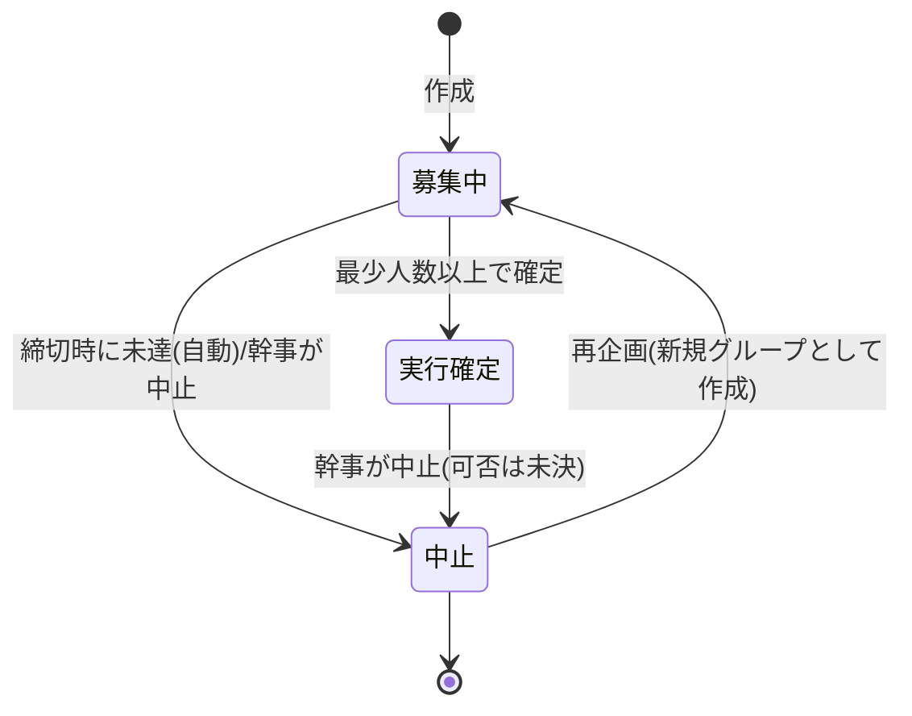

# 04 実行条件・状態遷移・再企画

## 1. 概要と責務 / 対応する柱
- グループの実行条件(最少人数・締切)、実行確定・中止・再企画、グループ状態遷移を一元管理する。柱13 に付随(実行条件は柱番号なし [要確認])。
- **仕様の正は docs/design の該当章(01・02・04・05・07・10・12 章)。** 本書はモジュール構成と実装単位の骨子のみで、条件・状態名・時刻の扱いの詳細は docs/design の記述が確定したらそれに合わせる。以下の状態名・遷移は暫定 [案]。
- 前提(決定済み): 幹事が最少人数と締切を設定、未達は自動中止して再企画。 [決定]

## 2. 既存機能との関係
- 新規。通知(10)、チャット等(05〜08)の「操作可否」を判定する関数を提供する。

## 3. 画面・UI(04 章)
| 画面 | 04 章の項目 | パス案 |
|---|---|---|
| 状態バッジ・締切カウント | グループ詳細/一覧カード | 共通コンポーネント |
| 実行確定・中止の操作(幹事) | docs/design の該当章を参照 | 詳細内 |
| 再企画(中止グループを複製して作り直し) | 同上 | 詳細内 → 01 の作成画面に初期値を渡す |

## 4. データ(05 章)
- Group の追加項目 [案]: 最少人数、締切日時、状態、中止理由、再企画元ID。項目名・型は docs/design/05 を正とする。
- 締切評価の履歴(ステータス変更ログ)を持つか [未決]。

## 5. インターフェース(案)
| 名称 | 入力 | 出力 | 呼び出し元 |
|---|---|---|---|
| `evaluate(group, now)` | 現在時刻 | 新状態(確定/中止/変化なし) | 読み取り時の遅延評価、手動「締切を進める」 |
| `confirm(user, id)` | 幹事 | Group | 幹事操作(自動確定の有無は docs/design 参照) |
| `cancel(user, id, reason)` | - | Group | 幹事/自動 |
| `replan(user, id)` | 中止済み id | 新規 Group(初期値つき) | 幹事 |
| `canAcceptRequests(g)` / `canEdit(g)` / `canChat(g)` | Group | boolean | 03、05〜08 |

## 6. 状態遷移(暫定案。正は docs/design)

- 自動中止は定期実行を持たず、読み取り時の遅延評価 + clock 差し替えのデモ操作で再現する [案]。

## 7. 入力検証・セキュリティ
- 締切は未来日時、日程の開始より前、最少人数は 2 以上かつ上限以下。遷移は 04 の関数のみが行い、他モジュールは状態を直接書き換えない。権限: 確定・中止・再企画は幹事のみ(自動中止は system)。

## 8. エラー処理
| コード | 条件 | 表示 |
|---|---|---|
| unavailable_state | 不正な遷移(確定後に再確定など) | 現在の状態と取れる操作 |
| invalid_input | 締切・最少人数の不整合 | 項目ごと |

## 9. 試験観点(10 章。詳細は docs/design/10 を正とする)
- 最少人数ちょうど/未達、締切の直前/直後、自動中止後の申請不可、再企画の初期値引き継ぎ、中止後の通知。

## 10. 依存するモジュール
- 00(clock)、01、10。

## 11. 未決事項
- 実行条件に関する docs/design の項目(自動確定か幹事確定か、確定後の中止、中止時の申請中・チャット・費用メモ・スタンプの扱い、再企画で引き継ぐ項目)。12 章の番号は docs/design 反映後に対応づける。[要確認]

## 12. 実装メモ(デモ範囲)
- 状態 3〜4 種と遅延評価、「締切を進める」デモ操作(clock.set)、再企画は複製のみ。
