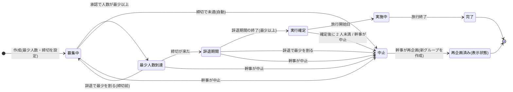

# 04 実行条件・状態遷移・再企画(04-group-lifecycle)

ID 接頭辞は `LCY`(LCY-FN: 関数、LCY-API: API、LCY-T: 試験、LCY-TASK: 実装タスク、LCY-UI: 画面部品、LCY-FILE: ファイル、LCY-REQ: 他モジュールへの要望、LCY-N: 通知、LCY-E: エラー)。凡例([決定]/[案]/[未決]/[要確認]/[推定]/[事実])は [README](README.md) 1 章に従う。

## 1. 概要と責務 / 対応する柱

- 柱18「実行条件と状態管理」。グループの実行条件(最少人数・締切・辞退期間)、実行確定・中止・再企画、グループ状態の遷移を **このモジュールだけが** 更新する(状態の一元管理)。他モジュールは判定関数 `canAcceptRequests` / `canEdit` / `canChat` ほかで「いま何ができるか」を問い合わせるだけで、状態を直接書き換えない。 [案]
- **仕様の正は docs/design**(02「グループの実行条件」、04「グループの状態遷移」、05、07 論点15〜18、10、12 #19〜#26)。本書はその実装単位への展開で、未決の項目は「推奨案 [案]」を置き、切り替え可能なポリシー定数(`policy.ts`、4.3)にまとめる。決定が出たときは定数の変更だけで対応できる構造にする。
- 前提(決定済み): 幹事が最少人数と締切を設定し、締切までに最少人数に達したら実行確定。安心感の確保 4 点(同意・辞退期間・確定時の実人数通知・一覧表示)を採用。未達は自動中止し、再企画・再エントリーで対応する方針。状態遷移を画面と通知に反映する。 [決定]
- 競技ルール適合: localhost 完結、外部依存なし、ダミーデータ。定期実行(cron・タイマー)を持たず、読み取り時の遅延評価とデモ用 clock で再現する。 [案]

### 1.1 01 グループ中核との責務境界

README 3 章の通り **01 は 04 を呼ばない。04 が 01 を呼んで状態を更新する**。

| 事項 | 01 が持つ | 04 が持つ |
|---|---|---|
| Group の保存・取得、メンバー一覧・人数、`isMember`/`isOrganizer` | ○(呼ばれる側) | 呼ぶ |
| Group.lifecycle(実行条件・状態)の **型定義** | 型のみ `import type` で取り込む | ○(`lifecycle/types.ts`) |
| Group.lifecycle の **書き込み** | 受け口 `patchGroupLifecycle` のみ提供 | これを唯一の呼び出し元として更新 |
| 作成時の最少人数・締切の検証と初期値生成 | 受け取って保存するだけ | `validateLifecycleInput` / `buildInitialLifecycle`(純粋関数) |
| メンバーの退会(状態を「退会」にする) | `markMemberLeft`(状態チェックなし) | `withdraw`(権限・状態を判定して呼ぶ) |
| 作成 API の合成 | - | Route Handler(`POST /api/groups`)が 04 の検証 → 01 の `createGroup` の順に呼ぶ(LCY-REQ-01) |

- 04 の純粋関数モジュール(`rules.ts`)は 00 のみに依存し、01 を import しない。01 が型だけを取り込んでもモジュール循環は起きない。
- 01 の `leaveGroup` と 04 の `withdraw` は二重の入口にしない。クライアントの「退会/辞退」ボタンは 04 の `POST /api/groups/:id/withdraw` を呼ぶ(LCY-REQ-02)。

## 2. 既存機能との関係

- 新規。既存 `src/lib/server-store.ts` と `/api/v2` は変更しない(README 2 章)。ストアは 00 の `groups-store.ts` に **コレクション追加**(`groupStatusLogs`、`groupWithdrawals`。LCY-REQ-03)。
- 通知は 10 の `notify` を使う。判定関数は 03、05〜08 が使う。clock は 00 の `clock.now()` / `clock.set()` を使う。

### 2.1 利用ライブラリ・モジュール

新規に追加する外部ライブラリは試験用の vitest のみで、00 が CMN-TASK-12 で devDependency に追加したものを使う(04 は `package.json` を変更しない)。`app/package.json` にあるものはそのバージョンを維持する。ライセンスは `app/package-lock.json` の記載による(vitest を除く)。 [案]

| 種別 | 名前 | 本モジュールでの用途 | ライセンス | バージョン方針 |
|---|---|---|---|---|
| フレームワーク | next | Route Handler(00 の API 共通部を経由)、再企画画面のページ(App Router) | MIT | 16.4.5 を維持 |
| フレームワーク | react / react-dom | UI 部品(LCY-UI-01〜08) | MIT | 19.3.0 を維持 |
| UI | @mantine/core | `Badge`、`Progress`、`Modal`、`Radio`、`Button`、`Alert`、`NumberInput` など | MIT | ^9.7.5 を維持 |
| UI | @mantine/dates | 条件変更ダイアログの締切入力(`DatePickerInput`) | MIT | ^9.7.5 を維持 |
| UI | @tabler/icons-react | 状態バッジ・ライフサイクルパネルのアイコン | MIT | ^3.51.0 を維持 |
| 日付 | dayjs | クライアントでの日付表示の整形(「◯月◯日」)のみ。@mantine/dates の前提でもある | MIT | ^1.11.23 を維持 |
| 言語 | typescript | 型検査 | Apache-2.0 | ^5 を維持 |
| 試験 | vitest | 単体・結合試験(14 章) | MIT [推定] | 最新の安定版を使う(00 の CMN-TASK-12 で追加) |
| Node 標準 | (なし) | 直接は使わない。ID 生成・時刻・ストアは 00 を経由する | - | - |

使わないもの(自前実装または不採用):

| 対象 | 方針 | 理由 |
|---|---|---|
| 状態機械ライブラリ(XState 等) | 使わない。`transitions.ts` の遷移表と純粋関数で実装する | 状態 7 種・遷移 14 件(T1〜T13、T7')は表と関数で扱え、依存とライセンス確認を増やさないため |
| サーバー側の日付演算(dayjs の utc / timezone プラグイン等) | 使わない。`dates.ts`(4.5)で JST 固定の文字列演算を自前実装する | 扱うのは JST 固定の日単位の加算と比較のみで、実行環境のタイムゾーン設定に結果が左右されないようにするため |
| 入力検証ライブラリ(zod 等) | 使わない。00 の `v`(自前)を使う | 00 の方針(00 の 5.10)に合わせるため |
| zustand | 本モジュールでは使わない | 画面は `LifecycleView` を都度取得すれば足り、クライアントに保持する状態がないため |
| 定期実行(node-cron 等) | 使わない | 遅延評価とデモ用 clock で時間経過を再現するため(1 章、5.3) |

自前モジュール(依存先。関数の一覧は 12.1):

| モジュール | 用途 |
|---|---|
| 00 共通基盤 | clock、`AppError`、`newId`、ストア、`currentUser`、API 共通部、検証 `v` |
| 01 グループ中核 | グループの取得、人数・メンバー、`patchGroupLifecycle`、`markMemberLeft`、`createGroup` |
| 03 参加申請・承認 | 申請中の失効(`expirePendingRequests`) |
| 09 安全 | 公開範囲の判定(`canView`)、禁止表現の検査 |
| 10 通知 | `notify` |

## 3. 画面・UI(04 章)

| 画面・部品 | 04 章の項目 | パス・配置 | ID |
|---|---|---|---|
| 状態バッジ(状態名の色分け、「再企画済み」付記) | 状態表の「画面・通知への反映」 | 共通コンポーネント(一覧カード・詳細ヘッダ) | LCY-UI-01 |
| 人数メーター(「あと◯人で実行」「最少 3 / 定員 4 / 現在 2」) | 一覧に最少・定員・現在人数を表示 | 同上 | LCY-UI-02 |
| 締切・辞退期間カウント(「締切まであと 3 日」「辞退できるのは◯月◯日まで」) | 状態表(辞退期間) | 同上 | LCY-UI-03 |
| ライフサイクルパネル(状態説明、取れる操作、中止理由) | グループ詳細(状態を表示) | `/[campaign]/groups/[groupId]` ヘッダ直下 | LCY-UI-04 |
| 辞退ボタン+確認ダイアログ(ペナルティなしを明記) | 辞退期間「辞退の操作を目立たせる」 | パネル内 | LCY-UI-05 |
| 幹事操作(条件変更、中止) | 幹事の権限(07 論点18) | パネル内(幹事のみ表示) | LCY-UI-06 |
| 再企画画面(元の設定を初期値に表示、日程と締切の入力) | 中止 → 再企画 | `/[campaign]/groups/[groupId]/replan`(幹事のみ) | LCY-UI-07 |
| 再エントリー導線(通知から再企画先グループ詳細へ) | 各自が再エントリー | 通知リンク → 新グループ詳細の申請(03)。画面は 03 側 | - |
| デモ日付操作(「日付を進める」「今日の日付」表示) | 12 章 #26 | AppShell の小メニュー(00 が置き場所を提供) | LCY-UI-08 |

「モック」であることは画面上に明示する(04 章 UI 方針)。デモ日付操作は「デモ用」と表示する。

## 4. データ(05 章)

### 4.1 型定義(`app/src/features/groups/lifecycle/types.ts`)

```ts
/** 状態(内部値)。表示名は messages.ts の STATUS_LABEL。 */
export type GroupStatus =
  | 'recruiting'    // 募集中
  | 'reached'       // 最少人数到達(成立見込み)
  | 'withdrawal'    // 辞退期間
  | 'confirmed'     // 実行確定
  | 'in_progress'   // 実施中
  | 'completed'     // 完了
  | 'cancelled';    // 中止
// 「再企画」は状態にしない。cancelled かつ replannedToGroupId != null の「表示状態」(4.4)。

export type CancelReasonCode =
  | 'min_not_reached'          // 締切で最少人数に未達(自動)
  | 'below_min_in_withdrawal'  // 辞退期間中の辞退で最少人数を割った(自動。policy 依存)
  | 'below_floor'              // 確定後の辞退で 2 人未満になった(自動)
  | 'organizer_cancelled'      // 幹事が中止(定型理由は OrganizerCancelReason)
  | 'organizer_left';          // 幹事の退会・不在(policy 依存。デモでは発生しない)

export type OrganizerCancelReason = 'schedule_conflict' | 'safety_concern' | 'weather_or_closure' | 'other';

/** Group.lifecycle。01 の Group にこの形で入れる [案、LCY-REQ-01]。日時は ISO 8601(+09:00)。 */
export interface GroupLifecycle {
  status: GroupStatus;
  minMembers: number;                 // 2 以上、定員以下。幹事を含む人数 [案 #19]
  deadlineAt: string;                 // 締切の「排他的な瞬間」。deadlineDate(含む)の翌日 00:00 JST
  deadlineExtendedCount: number;      // 締切延長の回数(上限 policy.maxDeadlineExtensions)
  withdrawalStartedAt?: string;       // = deadlineAt
  withdrawalEndsAt?: string;          // = deadlineAt + withdrawalDays
  confirmedAt?: string;               // = withdrawalEndsAt(遅延評価では実際の評価時刻でなく有効時刻)
  startedAt?: string;                 // 旅行開始日 00:00 JST
  completedAt?: string;               // 旅行終了日の翌日 00:00 JST
  cancelledAt?: string;
  cancelReason?: CancelReasonCode;
  organizerCancelReason?: OrganizerCancelReason;
  replanOfGroupId?: string;           // 再企画で作ったとき、元グループ
  replannedToGroupId?: string;        // 元グループ側の「再企画済み」の印
  deadlineSoonNoticeSent: boolean;    // 現在の締切に対する「まもなく締切」通知の送信済み
  withdrawalEndingNoticeSent: boolean;
  revision: number;                   // 遷移・条件変更ごとに +1(楽観ロックと通知の重複防止キー)
}

/** 状態遷移の履歴(柱18「状態遷移を明示」の根拠・試験用)。 */
export interface GroupStatusLog {
  id: string;                         // newId('sl')
  groupId: string;
  seq: number;                        // グループ内の連番(1 起点)
  from: GroupStatus | null;           // 作成時は null
  to: GroupStatus;
  event: LifecycleEvent;
  effectiveAt: string;                // その遷移が起きるべき時刻(締切など)
  evaluatedAt: string;                // 実際に評価した時刻(clock.now())
  actor: 'system' | string;           // system または userId
  meta?: Record<string, string | number | boolean>;
}

export type LifecycleEvent =
  | 'created' | 'count_reached' | 'count_lost' | 'deadline_met' | 'deadline_missed'
  | 'withdrawal_ended' | 'withdrawal_lost_min' | 'floor_lost' | 'trip_started' | 'trip_ended'
  | 'organizer_cancelled' | 'organizer_left' | 'replanned';

/** 状態を変えず通知だけを出すイベント(5.2)。 */
export type NoticeEvent = 'deadline_soon' | 'withdrawal_ending';

/** 辞退の記録(05「辞退の記録」)。理由・ペナルティ・評価は持たない [案、07 論点16]。 */
export interface GroupWithdrawal {
  id: string;                         // newId('wd')
  groupId: string;
  userId: string;
  withdrawnAt: string;
  phase: 'recruiting' | 'reached' | 'withdrawal' | 'confirmed'; // 辞退した時点の状態
  countAfter: number;                 // 辞退後の人数
  causedTransition: LifecycleEvent | null;
}

/** 確定通知に載せる集計(個人が特定されない粒度。7.3)。 */
export interface ParticipantSummary {
  count: number;
  ageBands: { label: string; count: number }[] | null; // count < summaryMinCountForBands(4)のときは null(人数のみ)
}

export interface GroupCapabilities {
  canAcceptRequests: boolean;   // 新規申請・承認を受けるか
  canEdit: boolean;             // 旅程・集合場所メモ(05)
  canEditExpenses: boolean;     // 費用メモ(07)
  canChat: boolean;             // チャット投稿(06)
  canReadHistory: boolean;      // チャット・メモの閲覧(メンバー)
  canCollectStamps: boolean;    // スタンプ取得(08)
  canReview: boolean;           // 振り返り(08)
  canWithdraw: boolean;         // 辞退(メンバー、幹事除く)
  canOrganizerCancel: boolean;
  canChangeConditions: boolean;
  canReplan: boolean;
  deniedReason?: Partial<Record<keyof GroupCapabilities, string>>; // 表示用メッセージキー
}

/** GET /api/groups/:id/lifecycle の本体。 */
export interface LifecycleView {
  groupId: string;
  status: GroupStatus;
  displayStatus: GroupStatus | 'replanned';   // 再企画済みは 'replanned'
  statusLabel: string;
  minMembers: number;
  capacity: number;
  currentCount: number;
  isFull: boolean;
  shortage: number;                           // max(0, minMembers - currentCount)
  deadlineDate: string;                       // YYYY-MM-DD(含む)
  deadlineAt: string;
  withdrawalEndsAt: string | null;
  daysToDeadline: number | null;              // 募集中/到達時のみ。0 以上
  cancelReasonLabel: string | null;
  replanOfGroupId: string | null;
  replannedToGroupId: string | null;          // 幹事・元メンバーのみ。それ以外は null(7.4)
  capabilities: GroupCapabilities;            // 現在ユーザー視点
  now: string;                                // clock.now()(デモ表示用)
}

/** 適用した 1 件。通知のみのイベントは to = null(状態は変えない)。 */
export interface TransitionResult { groupId: string; from: GroupStatus | null; to: GroupStatus | null; event: LifecycleEvent | NoticeEvent; effectiveAt: string; }
export interface EvaluationResult { groupId: string; applied: TransitionResult[]; }
```

### 4.2 Group への追加(01 への取り込み方)

`Group.lifecycle: GroupLifecycle` として 1 つのネストにする [案]。01 の骨子は「状態(04)、実行条件(04 参照)」と平坦に書かれているため、ネストにするか平坦にするかは 01 と合わせる [要確認、LCY-REQ-01]。以降 `group.lifecycle.status` のように書く。

前提となる 01 の項目 [要確認]: `Group.capacity`(2〜6)、`Group.tripStartDate` / `tripEndDate`(`YYYY-MM-DD`、確定日程。「日程の幅」で未確定の旅は実行確定できないため、デモでは確定日程を必須とする [案])、`Group.organizerId`、`Group.campaign`。

### 4.3 ポリシー定数(`policy.ts`)。未決を切り替え可能にする

```ts
export const LIFECYCLE_POLICY = {
  minMembersFloor: 2,                         // 1 人は不可 [案 #19]
  defaultMinMembers: (capacity: number) => Math.min(3, capacity), // 案A [案 #19]
  withdrawalDays: 2,                          // 辞退期間の長さ(日)。案A [案 #20]
  belowMinInWithdrawal: 'cancel' as 'cancel' | 'reopen_once', // 辞退期間中に最少未満 [案 #21]
  withdrawAfterConfirmed: 'allow_keep' as 'allow_keep' | 'deny' | 'allow_reevaluate', // [案 #21]
  confirmedFloorMembers: 2,                   // 確定後の辞退でこの人数を下回ったら中止 [案]
  onFullBeforeDeadline: 'wait_deadline' as 'wait_deadline' | 'close_now' | 'organizer_choice', // [案 #24]
  organizerCancelStates: ['recruiting', 'reached', 'withdrawal', 'confirmed'] as GroupStatus[], // [案 #25/論点7]
  organizerLeft: 'cancel_before_confirm' as 'cancel_before_confirm' | 'freeze_until_handover', // [案 #25]
  allowLowerMinOnly: true,                    // 受付開始後は最少人数を下げる変更のみ [案 論点18 案A]
  maxDeadlineExtensions: 1,                   // 締切延長は 1 回まで [案 論点18 案A]
  deadlineSoonHours: 24,                      // 「まもなく締切」通知(追加案)
  withdrawalEndingHours: 24,                  // 「まもなく確定」通知
  summaryMinCountForBands: 4,                 // 年代帯を出す最小人数 [案 論点17]
  replanInvitePolicy: 'members_and_pending' as 'members_only' | 'members_and_pending', // [案 #23]
  maxEvaluateSteps: 16,
} as const;
```

### 4.4 データの持ち方・表示状態

- 状態は **保存値 `lifecycle.status`**(遅延評価で更新)を正とし、人数・日付から毎回導出はしない。ただし人数と締切に由来する遷移は `nextDue`(5.2)で再計算できるため、保存値が古い場合も、次の評価で現在時刻に対応する状態まで順に更新される。
- 「再企画」は状態ではなく **表示状態**: `status === 'cancelled' && replannedToGroupId != null` のとき `displayStatus = 'replanned'`(バッジ「再企画済み」)。05 章「再企画は元グループ側の『再企画済み』の印または状態」の「印」案を採る。04 章の状態遷移図は「再企画」を状態として描いているため、差異は 16 章に記載。
- 中止したグループは削除せず残す(05 章)。再企画で作った新グループは `replanOfGroupId` を持つ。
- 辞退したメンバーは `GroupMember.status = 'left'`(01 の「退会」と同じ値)とし、辞退かどうかは `GroupWithdrawal` の有無で区別する [案]。05 章の「辞退を退会と区別するか」は未決 [未決]。
- 現在人数 = `GroupMember.status = 'active'`(参加中。幹事を含む)の件数。幹事を最少人数に含める [案 #19]。

### 4.5 日時の扱い(`dates.ts`)

- 入力は日付(`YYYY-MM-DD`)、内部は `+09:00` 付き ISO。`deadlineDate` は **その日を含む**締切で、`deadlineAt = (deadlineDate + 1 日) 00:00:00+09:00`(排他)。締切判定は `now >= deadlineAt`。
- `withdrawalEndsAt = deadlineAt + withdrawalDays 日`。`startedAt = tripStartDate 00:00+09:00`、`completedAt = (tripEndDate + 1 日) 00:00+09:00`。
- 検証式: `withdrawalEndsAt <= tripStartAt`(辞退期間が旅行開始前に終わる)。例: 辞退期間 2 日なら `tripStartDate >= deadlineDate + 3 日`。
- JST 固定の文字列演算(dayjs の timezone プラグインに依存しない)。サマータイムなし。関数: `jstDate(date: Date): string`、`endOfDayExclusive(date: string): string`、`addDays(iso: string, n: number): string`。

## 5. インターフェース

すべて `app/src/features/groups/lifecycle/` 配下。サービスは同期関数(インメモリストアで原子性を得る。5.3)。エラーは 00 の `AppError(code, message, status, reason?)`。

### 5.1 公開関数(他モジュールが呼ぶ)

| ID | 署名 | 説明・例外 | 呼び出し元 |
|---|---|---|---|
| LCY-FN-01 | `evaluate(groupId: string, now?: Date): EvaluationResult` | 1 グループの遅延評価。時間経過・人数に由来する遷移を、`now` の時点で適用すべきものがなくなるまで順に適用し、副作用(通知・申請失効)を実行する。冪等。存在しない id は `not_found` を投げる。それ以外の業務エラーは投げない | `evaluateAll`、03/各 API(必要時) |
| LCY-FN-02 | `evaluateAll(now?: Date): EvaluationResult[]` | 非終端状態の全グループを評価。**`/api/groups/**` の全ハンドラの先頭**で呼ぶ(5.2、LCY-REQ-04)。`_reset` は除く | 00 の Route Handler |
| LCY-FN-03 | `canAcceptRequests(g: GroupLike, now?: Date): boolean` | 表 6.1 | 03(`requestJoin` と `approve` の両方) |
| LCY-FN-04 | `canEdit(g: GroupLike): boolean` | 表 6.1 | 05 |
| LCY-FN-05 | `canChat(g: GroupLike): boolean` | 表 6.1 | 06 |
| LCY-FN-06 | `canEditExpenses(g): boolean` / `canCollectStamps(g): boolean` / `canReview(g): boolean` / `canReadHistory(g): boolean` | 表 6.1(追加の判定) | 07 / 08 / 08 / 05・06 |
| LCY-FN-07 | `getCapabilities(g: GroupLike, user: DemoUser, now?: Date): GroupCapabilities` | 状態 + 権限(幹事/メンバー)を含む UI 用の可否一式 | `getLifecycleView`、UI |
| LCY-FN-08 | `onMembershipChanged(groupId: string, now?: Date): EvaluationResult` | メンバー追加後に呼ぶ。到達・喪失・満員を評価(= `evaluate`)。03 が `addMember` の直後に呼ぶ | 03 |
| LCY-FN-09 | `getLifecycleView(user: DemoUser, groupId: string): LifecycleView` | 取得前に `evaluate`。非公開・非メンバーに存在を隠す(`not_found`)。公開グループの非メンバーには capabilities の幹事系を false、`replannedToGroupId` を null | GET API、02 |
| LCY-FN-10 | `withdraw(user: DemoUser, groupId: string, now?: Date): WithdrawResult` | 辞退。例外: `forbidden`(幹事・非メンバー)、`unavailable_state`(辞退できない状態)、`conflict`(すでに辞退済み)。判定の順序は 5.5 の「辞退の処理順」 | POST API |
| LCY-FN-11 | `organizerCancel(user: DemoUser, groupId: string, reason: OrganizerCancelReason): LifecycleView` | 幹事が中止。例外: `forbidden`、`unavailable_state`、`invalid_input` | POST API |
| LCY-FN-12 | `changeConditions(user: DemoUser, groupId: string, patch: { minMembers?: number; deadlineDate?: string }): LifecycleView` | 受付開始後の条件変更(下げる/延長 1 回のみ)。例外: `forbidden`、`unavailable_state`、`invalid_input`、`conflict`(延長上限) | PATCH API |
| LCY-FN-13 | `getReplanDraft(user: DemoUser, groupId: string): ReplanDraft` | 再企画の初期値。例外: `forbidden`、`unavailable_state`(中止でない)、`conflict`(再企画済み) | GET API、UI |
| LCY-FN-14 | `replan(user: DemoUser, groupId: string, input: ReplanInput): { group: Group; invited: number }` | 再企画の作成(元を参照する新グループ + 前回参加者へ案内)。例外は 5.6 | POST API |
| LCY-FN-15 | `validateLifecycleInput(input: LifecycleInput, ctx: { capacity: number; tripStartDate: string; now: Date }): LifecycleInput`(正規化して返す) | 作成・再企画時の検証。失敗は `invalid_input` + `fields` | 作成 Route Handler(LCY-REQ-01) |
| LCY-FN-16 | `buildInitialLifecycle(input: LifecycleInput, now: Date): GroupLifecycle` | 初期値生成(`status: 'recruiting'`、`revision: 1`)。01 の保存後、`recordCreated(groupId)` でログを追加 | 同上 |
| LCY-FN-17 | `recordCreated(groupId: string): void` | `GroupStatusLog`(`created`)を追記し、幹事 1 人で `minMembers` 到達(`capacity`=2 等は不可)なら評価 | 同上 |
| LCY-FN-18 | `onOrganizerLeft(groupId: string): EvaluationResult` | 幹事の退会・不在(5.8)。デモでは 01 が幹事退会を許さないため未使用の受け口 [案 #25] | 01(将来) |
| LCY-FN-19 | `advanceDemoClock(input: { days?: number; to?: string }): { now: string; results: EvaluationResult[] }` | デモ日付を進めて全体を評価(5.4)。`days` と `to` はどちらか一方だけを指定する(両方指定・どちらもなしは `invalid_input`)。後戻りは `invalid_input`(`clock_backwards`) | POST API |

```ts
export type GroupLike = Pick<Group, 'id' | 'organizerId' | 'capacity'> & { lifecycle: GroupLifecycle };
export type TripDates = Pick<Group, 'tripStartDate' | 'tripEndDate'>;           // nextDue が startedAt / completedAt の判定に使う
export interface LifecycleInput { minMembers?: number; deadlineDate: string; }
export interface WithdrawResult { status: GroupStatus; cancelled: boolean; currentCount: number; }
export interface ReplanDraft {
  fromGroupId: string;
  carried: { name: string; campaign: string; region: string; destination: string; capacity: number;
             visibility: 'public' | 'private'; tags: string[]; minMembers: number };   // 引き継ぐ項目
  required: ('tripStartDate' | 'tripEndDate' | 'deadlineDate')[];                     // 入力必須
  originalTrip: { tripStartDate: string; tripEndDate: string; deadlineDate: string }; // 参考表示
  recipientCount: number;                                                            // 案内される前回参加者数(人数のみ)
}
export interface ReplanInput {
  name?: string; destination?: string; minMembers?: number;
  tripStartDate: string; tripEndDate: string; deadlineDate: string;
}
```

`Group` のフィールド名は 01 の確定に合わせる [要確認]。`DemoUser` は 00。

`groupId` を引数に取る関数(LCY-FN-01、08〜14、17、18)は、グループが存在しない場合に `not_found` を投げる。利用者を引数に取る関数(LCY-FN-09〜14)は、非公開グループで利用者がメンバーでない場合も `not_found` を投げる(存在を隠す。7.2)。上表の「説明・例外」欄ではこれを省略している。

### 5.2 遅延評価の中核(純粋関数。`rules.ts`、`transitions.ts`)

| ID | 署名 | 説明 |
|---|---|---|
| LCY-FN-20 | `nextDue(g: GroupLike & TripDates, count: number, now: Date): DueEvent \| null` | 現在の保存状態から見て **最も早い未処理イベント**(`effectiveAt <= now`)を 1 件返す純粋関数。なければ null |
| LCY-FN-21 | `applyDue(groupId: string, due: DueEvent, now: Date, expectedRevision: number): TransitionResult` | 1 イベントを原子的に適用(5.3)。副作用を実行。`expectedRevision` が保存値と異なれば `conflict`(`revision_mismatch`) |
| LCY-FN-22 | `deriveBaseStatus(minMembers: number, count: number): 'recruiting' \| 'reached'` | 締切前の 2 状態の判定(`count >= minMembers` なら reached) |

```ts
export interface DueEvent {
  event: LifecycleEvent | NoticeEvent;
  to: GroupStatus | null;          // null は通知のみ(状態は変えない)
  effectiveAt: string;
  cancelReason?: CancelReasonCode;
}
```

`nextDue` の判定(状態ごと。いずれも `effectiveAt <= now` のものだけ)。

| 現在の状態 | 候補イベント(①があれば①、なければ残りから effectiveAt の早い順に 1 件) |
|---|---|
| recruiting / reached | ① 人数同期(effectiveAt = `now`): `deriveBaseStatus` と保存状態が異なれば `count_reached` / `count_lost` ② `deadline_soon`(effectiveAt = `deadlineAt - deadlineSoonHours`): 未送信で、`deadlineAt - deadlineSoonHours <= now < deadlineAt` のときだけ候補にする ③ 締切: `now >= deadlineAt` で `count >= min` → `deadline_met`(→ withdrawal)、未達 → `deadline_missed`(→ cancelled、`min_not_reached`) |
| withdrawal | ① `withdrawal_ending`(effectiveAt = `withdrawalEndsAt - withdrawalEndingHours`): 未送信で、`withdrawalEndsAt - withdrawalEndingHours <= now < withdrawalEndsAt` のときだけ候補にする ② `now >= withdrawalEndsAt` で `count >= min` → `withdrawal_ended`(→ confirmed)、未達 → `withdrawal_lost_min`(→ cancelled、`below_min_in_withdrawal`。通常は辞退時に即時中止されるため、この分岐は防御用 [デモ範囲外]) |
| confirmed | `now >= startedAt` → `trip_started`(→ in_progress) |
| in_progress | `now >= completedAt` → `trip_ended`(→ completed) |
| completed / cancelled | なし(終端) |

- 締切(または辞退期間の終了)を過ぎてから初めて評価した場合、`deadline_soon`(`withdrawal_ending`)は候補にしない。締切の遷移 T4 / T5(辞退期間の終了の遷移 T6 / T7)の更新で `deadlineSoonNoticeSent`(`withdrawalEndingNoticeSent`)を true にし、通知は送らない。

### 5.3 評価ループ・原子性・冪等性(LCY-FN-01 の実装規約)

```ts
const evaluating = new Set<string>();           // 再入防止(通知処理がグループを読んでも再帰評価しない)
export function evaluate(groupId: string, now: Date = clock.now()): EvaluationResult {
  if (evaluating.has(groupId)) return { groupId, applied: [] };
  evaluating.add(groupId);
  try {
    const applied: TransitionResult[] = [];
    for (let i = 0; i < LIFECYCLE_POLICY.maxEvaluateSteps; i++) {
      const g = getGroupRaw(groupId);                         // 01
      if (!g) throw new AppError('not_found', MSG.groupNotFound, 404);
      const due = nextDue(g, countActiveMembers(groupId), now);
      if (!due) return { groupId, applied };
      applied.push(applyDue(groupId, due, now, g.lifecycle.revision)); // revision 不一致は conflict
    }
    console.error(`[lifecycle] maxEvaluateSteps exceeded: ${groupId}`); // 遷移表の不具合の検出用
    return { groupId, applied };
  } finally { evaluating.delete(groupId); }
}
```

- **評価の抜けの防止**: 遷移は一定間隔の実行(タイマー)ではなく、**保存された時刻(deadlineAt など)と `now` の比較** で判定する。評価が行われない期間があっても、次の評価で `nextDue` が古い時刻のイベントから順に返す。`now` が複数の境界をまたぐ場合(例: 最少人数到達から完了まで)も `effectiveAt` の昇順に 1 件ずつ適用するため、中間状態の通知・ログは欠けない。
- **二重評価の防止**: `applyDue` は同期関数の 1 ブロックで「(a) `revision` が評価開始時と一致するか確認 → (b) `patchGroupLifecycle(groupId, expectedRevision, patch)` で状態更新と `revision + 1` → (c) `GroupStatusLog` 追記 → (d) 通知発行 → (e) 副作用」を行う。Node.js の単一スレッドと同期実行のため、途中に他の評価は割り込めない。適用後は状態が進んでいるため、`nextDue` は同じイベントを再度返さない。`revision` 不一致は同期実行では発生しない。発生した場合は `conflict`(`revision_mismatch`)を投げて評価を中断し、API は 409 を返す [デモ範囲外]。
- **副作用を 1 回だけ実行する**: 通知は遷移ごとに **遷移の成功と同じブロック**で発行する。遷移しない通知(`deadline_soon` / `withdrawal_ending`)は `deadlineSoonNoticeSent` / `withdrawalEndingNoticeSent` を同じブロックで true にする。10 の `notify` が `dedupeKey` を受けられる場合は、`${type}:${groupId}:${revision}:${userId}` を渡して二重化を防ぐ(多重防御。LCY-REQ-05)。締切延長時は 2 つの送信済みフラグを false に戻す。
- **将来の非同期ストア**: SQLite 等を採る場合(00 の未決)は、`applyDue` 全体を 1 トランザクションにし、`revision` を `WHERE` 条件に入れた更新(0 行更新なら再試行)にする。 [案、デモ範囲外]
- **時計の後戻り**: `clock.set` で過去へ戻しても **状態は巻き戻さない**(遅延評価は進める方向のみ)。デモの巻き戻しは `_reset`(seed へ初期化)で行う。`advanceDemoClock` は後戻りを `invalid_input` で拒否する。
- **評価のタイミング(いつ呼ぶか)**: (1) `/api/groups/**` の **全リクエストの先頭**で `evaluateAll(clock.now())`(読み取り・書き込みとも。LCY-REQ-04)。(2) 03 の承認直後に `onMembershipChanged`。(3) `withdraw` / `changeConditions` / `organizerCancel` の内部で対象グループを先に `evaluate`。(4) `advanceDemoClock` の直後に `evaluateAll`。これにより 01・02 は 04 を呼ばずに評価済みの状態を読める。対象は数十件で、非終端状態かつ期限到来のものだけが処理されるため負荷は小さい。 [案]

### 5.4 デモ用 clock との連携

- 00 の `clock.now()` が現在時刻。デモ中は `clock.set(iso)` で任意の日時に差し替える(未設定なら実時刻)。
- 「日付を進める」ボタン(LCY-UI-08)→ `POST /api/groups/_demo/clock`(LCY-API-07)→ `advanceDemoClock`: 新しい時刻を `clock.set` → `evaluateAll` → 結果(適用した遷移の一覧)を返す。UI は結果を要約表示する(「◯◯グループが辞退期間に入りました」)。
- 例(基準: 今日 2026-11-09、締切 2026-11-20、辞退期間 2 日、旅行 12-05〜12-06): 11-21 00:00 に進める → 最少人数到達から辞退期間へ(通知: 辞退期間の開始)。11-22 00:00 → `withdrawal_ending` 通知(23 日 00:00 の 24 時間前)。11-23 00:00 → 実行確定(通知: 実際の人数と概要)。12-05 → 実施中。12-07 → 完了。11-09 から 12-10 まで一度に進めた場合も、4 件の遷移(辞退期間、実行確定、実施中、完了)が時刻順に 1 回ずつ適用され、通知(辞退期間の開始、実行確定)も 1 回ずつ発行される。「まもなく締切」「まもなく確定」は期限を過ぎているため送らない(5.2)。
- 通知の `createdAt` は評価時刻ではなく `effectiveAt` を使う(LCY-REQ-05)。これにより通知一覧が発生時刻の順に並ぶ。
- `NODE_ENV === 'production'` では `_demo/clock` を無効(`not_found`)にする [案、00 7 章と同じ]。

### 5.5 状態機械の定義



遷移表(`transitions.ts` の `TRANSITIONS` 配列と 1 対 1)。

| # | 元状態 | イベント | ガード条件 | 先状態 | 副作用 |
|---|---|---|---|---|---|
| T1 | (なし) | created(作成) | 検証済み(7 章) | recruiting | ログ追記。幹事をメンバーに含む(01) |
| T2 | recruiting | count_reached | 現在人数 >= 最少人数(承認・条件変更・評価で検出) | reached | 通知 lc_min_reached(幹事+全メンバー) |
| T3 | reached | count_lost | 現在人数 < 最少人数(締切前の辞退・条件変更なし) | recruiting | 通知 lc_min_lost(幹事+全メンバー) |
| T4 | recruiting | deadline_missed | `now >= deadlineAt` かつ人数 < 最少 | cancelled(`min_not_reached`) | 申請中を失効(03)、通知 lc_cancelled(メンバー+失効した申請者)、前回参加者への案内の準備(再企画は幹事の操作) |
| T5 | reached | deadline_met | `now >= deadlineAt` かつ人数 >= 最少 | withdrawal | `withdrawalStartedAt` / `withdrawalEndsAt` を設定、申請中を失効(03)、通知 lc_withdrawal_started(全メンバー) |
| T6 | withdrawal | withdrawal_ended | `now >= withdrawalEndsAt` かつ人数 >= 最少 | confirmed | `confirmedAt` を設定、通知 lc_confirmed(全メンバー。`ParticipantSummary` つき) |
| T7 | withdrawal | withdrawal_lost_min | 辞退で人数 < 最少(`belowMinInWithdrawal = 'cancel'`)/ 期限到来時の防御的な判定 [デモ範囲外] | cancelled(`below_min_in_withdrawal`) | 通知 lc_cancelled(残りのメンバー) |
| T7' | withdrawal | withdrawal_lost_min | 同上で `belowMinInWithdrawal = 'reopen_once'` かつ延長 0 回 | recruiting | 締切を `deadlineAt + withdrawalDays` へ 1 回延長、通知 lc_conditions_changed。切替用の分岐であり既定では無効 [デモ範囲外] |
| T8 | confirmed | floor_lost | 確定後の辞退で人数 < `confirmedFloorMembers`(2) | cancelled(`below_floor`) | 通知 lc_cancelled(残りのメンバー) |
| T9 | confirmed | trip_started | `now >= startedAt` | in_progress | ログのみ(通知なし [案]) |
| T10 | in_progress | trip_ended | `now >= completedAt` | completed | ログのみ。08 の振り返りが `canReview` で有効化 |
| T11 | recruiting / reached / withdrawal / confirmed | organizer_cancelled | 実行者が幹事、`organizerCancelStates` に含まれる、理由が定型値 | cancelled(`organizer_cancelled`) | 申請中を失効(03)、通知 lc_cancelled(全メンバー+申請者)。理由は定型表示 |
| T12 | recruiting / reached / withdrawal | organizer_left | `organizerLeft = 'cancel_before_confirm'` | cancelled(`organizer_left`) | 通知 lc_cancelled。確定後は `freeze_until_handover` 扱いで #14 の決定を待つ(状態を変えない)。デモでは発生しない [デモ範囲外] |
| T13 | cancelled | replanned | 実行者が元の幹事、`replannedToGroupId` が未設定 | cancelled(表示のみ「再企画済み」) | 新グループ作成(5.6)、前回参加者へ lc_replan_invited |

- 辞退 → 遷移は `withdraw` が T3 / T7 / T8 を即時適用する(次回の評価を待たない)。時間由来の遷移(T4〜T6、T9、T10)は `evaluate` が適用する。
- 無効な組み合わせ(例: 確定後に再確定、完了後の中止)は `unavailable_state`(現在の状態と取れる操作を返す)。
- **辞退の処理順**(`withdraw`。同期の 1 ブロックで行う): ① `evaluate(groupId)` ② グループが無い、または非公開で実行者が非メンバー → `not_found` ③ 実行者にこのグループの `GroupWithdrawal` があり、参加中でない → `conflict`(`already_withdrawn`) ④ 参加中メンバーでない → `forbidden`(`not_member`) ⑤ 幹事 → `forbidden`(`organizer_cannot_withdraw`) ⑥ 状態が `canWithdraw` の対象外 → `unavailable_state`(`cannot_withdraw`) ⑦ 01 の `markMemberLeft` ⑧ `GroupWithdrawal` を追記 ⑨ 辞退後の人数で T3 / T7 / T8 を判定して適用 ⑩ 通知: 幹事へ LCY-N-07。遷移した場合は LCY-N-10(T3)または LCY-N-05(T7 / T8)、遷移せず phase が withdrawal / confirmed の場合は LCY-N-09。

### 5.6 再企画(`replan.ts`)

1. 検証: 元グループが `cancelled`、実行者が元の幹事、`replannedToGroupId` が未設定、入力検証(7 章)。
2. 新グループを 01 の `createGroup(user, input)` で作成。`lifecycle = buildInitialLifecycle`、`replanOfGroupId = 元 id`。
3. 元グループの `replannedToGroupId` を `patchGroupLifecycle` で設定し、`GroupStatusLog`(`replanned`)を追記。
4. 前回の参加者へ `lc_replan_invited` を通知(宛先は 5.7)。

**データの複製ルール** [案、12 #23 案A+C]

| 項目 | 扱い |
|---|---|
| 名称(`name`)、キャンペーン、地方、行き先、定員、公開設定、タグ、最少人数 | 引き継ぐ(画面で編集可。名称は元のまま) |
| 日程(開始・終了)、締切 | **引き継がず必須入力**(日程の見直し。元と日程が完全に同一なら `invalid_input`) |
| 幹事 | 実行者(元の幹事)を新グループの幹事にする |
| メンバー、参加申請、チャット、費用メモ、スタンプ・振り返り、通報・ブロック | 複製しない(個人情報の持ち越し防止) |
| 旅程・集合場所メモ(05) | 既定では複製しない。05 が `copyPlanDraft(fromGroupId, toGroupId)` を用意するなら呼ぶ(任意、LCY-REQ-06) |
| 招待コード | 新規発行(01) |
| 公式枠フラグ | 引き継がない(11 が管理) |
| 元グループ | 削除せず残す。`replannedToGroupId` を設定。状態は `cancelled` のまま |

**再エントリー** [案]: 自動では参加させない。案内を受けた人が新グループ詳細から通常の参加申請(03)を行い、「最少人数でもOK」の同意を **再度** 取る。優先枠・枠の確保は設けない(案C の優先の度合いの曖昧さを避ける)。申請には `reentryOfGroupId` を付けられるよう 03 に任意項目を要望する(LCY-REQ-07。05 章の「再企画元の参加申請ID」に相当)。

### 5.7 通知の発行トリガー一覧(10 との契約)

10 の `notify(userId, type, groupId, vars, opts?)` を使う(署名は 12.1。`opts` で重複防止キーと発生時刻を渡す)。種類は 05 章の 8 種に加え、追加案 4 種 [案、12 #26 の確定時に整理]。本文はテンプレート + 変数。変数に個人名・チャット本文・連絡先は入れない(10 7 章)。

| ID | type | トリガー(遷移/操作) | 宛先 | 主な vars | 備考 |
|---|---|---|---|---|---|
| LCY-N-01 | `lc_min_reached` | T2 | 幹事+全メンバー | minMembers, count | 05: 最少人数到達 |
| LCY-N-02 | `lc_withdrawal_started` | T5 | 全メンバー(幹事含む) | withdrawalEndsAt, count | 05: 辞退期間の開始。辞退できる・ペナルティなしを本文に |
| LCY-N-03 | `lc_withdrawal_ending` | `withdrawal_ending`(`withdrawalEndsAt` の 24 時間前。評価時に検出) | 全メンバー | withdrawalEndsAt, count | 05: 辞退期間の終了(まもなく確定) |
| LCY-N-04 | `lc_confirmed` | T6 | 全メンバー | count, ageBands(人数が 4 以上のときのみ) | 05: 実行確定。実際の人数と概要(7.3) |
| LCY-N-05 | `lc_cancelled` | T4、T7、T8、T11、T12 | 全メンバー(辞退した人は除く)+ 失効した申請者 | reasonCode(定型)、replanAvailable | 05: 中止。理由は定型表示。再企画の導線 |
| LCY-N-06 | `lc_replan_invited` | T13 | 前回参加者(`replanInvitePolicy`: 中止時の参加中メンバー+失効した申請者。辞退者は除く)。幹事を除く | newGroupId, tripStartDate | 05: 再企画の案内。再エントリーは各自 |
| LCY-N-07 | `lc_withdrawal_received` | `withdraw` 成功 | 幹事 | phase, countAfter, shortage | 05: 辞退の受付(幹事向け)。辞退者名は載せない(幹事はメンバー一覧で確認) |
| LCY-N-08 | `lc_conditions_changed` | `changeConditions` 成功 | 幹事以外の全メンバー+申請中の申請者 | minMembers, deadlineDate | 05: 条件変更 |
| LCY-N-09 | `lc_headcount_changed` | `withdraw` 成功(phase が withdrawal / confirmed のとき) | 辞退者・幹事以外の全メンバー | countAfter | 追加案: 07 論点16「他の参加者には人数の変化のみ」 |
| LCY-N-10 | `lc_min_lost` | T3 | 幹事+全メンバー | shortage | 追加案: 最少人数を下回り募集中へ戻った |
| LCY-N-11 | `lc_deadline_soon` | 締切 24 時間前(`deadline_soon`、未送信時のみ) | 幹事+全メンバー | deadlineDate, shortage | 追加案: 10 骨子の「締切接近」 |
| LCY-N-12 | `lc_capacity_full` | 人数が定員に達した(`onFullBeforeDeadline = 'wait_deadline'`) | 幹事 | capacity | 追加案(任意): 満員の表示を通知にも。省略可 |

通知を出さないもの: T1(作成)、T9(実施中)、T10(完了)。これらはログ(`GroupStatusLog`)のみ記録する。

### 5.8 各 [未決] の選択肢整理と推奨案

**#19 最少人数の初期値・範囲** [未決]

| 案 | メリット | デメリット |
|---|---|---|
| A 範囲 2〜定員、初期値 min(3, 定員)、1 人は不可 | 「3 人以上で実行」の例に沿い、設定の手間が少ない。1 対 1(定員 2、最少 2)も同じ式で扱える | 2 人を想定した旅では毎回変更が必要 |
| B 初期値 = 定員 | 単純。実行時の人数が定員と一致する | 未達が起きやすい。条件を緩めて集めやすくする目的と逆 |
| C 初期値なしの必須入力 | 幹事が条件を意識する | 入力の負担増 |

**推奨 [案]: A。** 最少人数に幹事を含める。#12(1 人募集中)との整合: 作成直後の幹事のみ(人数 1)は「最少人数に未達の募集中」として許容する(最少 2 以上のため 1 人で確定することはない)。

**#20 辞退期間の長さと位置**

| 案 | メリット | デメリット |
|---|---|---|
| A 締切後〜確定前、固定 2 日 | 人数確定後に辞退でき、確定時の人数に近い。04 章の図と一致。実装が単純(`withdrawalStartedAt` = 締切) | 旅行開始まで間が短いと日程が窮屈(検証で 7 章の下限を設ける) |
| B 最少到達から確定まで | 到達を知ってすぐ辞退できる | 到達と辞退が繰り返されると状態が何度も切り替わる(T2/T3 の通知が増える) |
| C 実行日の X 日前を確定日 | 辞退を判断できる期間が長い | 幹事が確定を待つ期間が長い。人数が確定しない |

**推奨 [案]: A、長さは 2 日(定数 `withdrawalDays`)。** 辞退にペナルティなし。理由は問わない・記録しない(07 論点16)。

**#21 辞退で最少を割ったとき・確定後の辞退**

| 案(割ったとき) | メリット | デメリット |
|---|---|---|
| A 締切前は募集中に戻る/辞退期間中は中止 | 遷移が単純。04 章の図と一致 | 辞退期間中の 1 人の辞退で中止(その間は新規申請を受けない) |
| B 常に募集中に戻り締切を 1 回延長 | 中止を避けられる | 日程が延び参加者を待たせる。複雑(T7') |
| C 常に中止 | 予測しやすい | 締切前でも中止になり再企画が増える |

**推奨 [案]: A**(`belowMinInWithdrawal = 'cancel'`。B は `'reopen_once'` で切替可能に分岐だけ残す)。

| 案(確定後の辞退) | メリット | デメリット |
|---|---|---|
| A 可、実行維持(幹事・参加者へ通知) | 辞退しやすい。ペナルティなしの方針と整合 | 実行時の人数が確定時より減ることがある。少人数でも実行 |
| B 不可(通報・個別連絡のみ) | 確定後の人数が変わらない | 参加をやめたい人が辞退できず、安全面で不利 |
| C 可、最少を割ったら再判定(中止) | 公平 | 複雑、再企画が増える |

**推奨 [案]: A に下限を足す。** 確定後の辞退は可。人数は最少人数を割っても実行維持するが、**2 人未満(幹事のみなど)になったら中止**(`below_floor`)。1 人では「同行」が成り立たないため。

**#23 再企画**: 推奨 A+C(5.6)。複製して再募集、前回参加者へ通知のみ(優先枠なし)、再エントリーは各自の操作+同意の再確認。B(持ち越し)は同意の扱いが複雑なため採らない。前回参加者の範囲は「中止時の参加中メンバー+失効した申請者、辞退者は除く」(辞退した人の意思を尊重)。 [案]

**#24 定員到達時**

| 案 | メリット | デメリット |
|---|---|---|
| A 満員で締め切り辞退期間へ | 早く確定できる | 後から参加したい人が入れない。締切前の遷移が増え状態機械が複雑(定員到達 → 締切の前倒し) |
| B 締切まで待つ | 辞退で空いた枠に後から参加できる。状態機械が単純(満員は表示のみ。04 章の「満員は表示」と一致) | 満員でも確定が遅い |
| C 幹事が選ぶ | 柔軟 | 設定項目が増える |

**推奨 [案]: B。** 満員は `isFull` の表示と 03 の `conflict`(満席)で表す。状態の数が増えない。

**#25 幹事の退会・不在と条件変更・恣意的な中止**: 推奨 [案]: 条件変更は 07 論点18 案A(最少人数は下げるのみ、締切延長は 1 回、変更は全員へ通知。ログは `revision` と通知で残す)。幹事の任意中止は、定型理由必須・全員へ通知・理由を表示、確定後も可(状態は `organizerCancelStates`)。幹事退会は 01 のデモでは不可のため `onOrganizerLeft` は受け口のみ(募集中〜辞退期間は中止、確定後は #14 待ちで状態維持)。

## 6. 状態ごとの可否(判定関数の厳密な定義)

### 6.1 可否表(メンバー視点。権限チェックは別途、呼び出し側で `isMember` / `isOrganizer`)

| 関数(返す boolean) | recruiting | reached | withdrawal | confirmed | in_progress | completed | cancelled |
|---|---|---|---|---|---|---|---|
| `canAcceptRequests`(申請・承認) | ○* | ○* | × | × | × | × | × |
| `canEdit`(旅程・集合場所メモ、05) | ○ | ○ | ○ | ○ | ○ | × | × |
| `canEditExpenses`(費用メモ、07) | × | × | × | ○ | ○ | ○ | × |
| `canChat`(チャット投稿、06) | ○ | ○ | ○ | ○ | ○ | × | × |
| `canReadHistory`(閲覧) | ○ | ○ | ○ | ○ | ○ | ○ | ○ |
| `canCollectStamps`(08) | × | × | × | × | ○ | × | × |
| `canReview`(振り返り、08) | × | × | × | × | × | ○ | × |
| `canWithdraw`(辞退。幹事を除くメンバー) | ○ | ○ | ○ | ○ | × | × | × |
| `canOrganizerCancel`(幹事) | ○ | ○ | ○ | ○ | × | × | × |
| `canChangeConditions`(幹事) | ○ | ○ | × | × | × | × | × |
| `canReplan`(元の幹事) | × | × | × | × | × | × | ○** |

- \* `canAcceptRequests` は状態に加え `now < deadlineAt` も条件とする(評価漏れの多重防御)。人数が定員に達している場合の拒否は 03 の `conflict`(04 は満員で false にしない。#24 推奨案 B)。
- \*\* 中止かつ `replannedToGroupId` 未設定のときのみ。
- 下の 4 行(`canWithdraw`、`canOrganizerCancel`、`canChangeConditions`、`canReplan`)は単独の公開関数にしない。`getCapabilities`(LCY-FN-07)が状態の条件(本表)と権限(幹事/メンバー)を組み合わせて算出する。
- 中止後は閲覧のみ(チャット・メモ・費用メモ・スタンプは新規書き込み不可)。完了後はチャットに投稿できない [案。旅行後も続く連絡手段として使われることを避ける]。これらの「中止時・完了時の扱い」は docs/design が未決のため [案]。実行確定後の `canEdit` は 05 が「確定後の編集の履歴を残すか」を決める。

### 6.2 厳密な定義(`rules.ts`)

```ts
const TERMINAL: GroupStatus[] = ['completed', 'cancelled'];
export const canAcceptRequests = (g: GroupLike, now: Date = clock.now()): boolean =>
  (g.lifecycle.status === 'recruiting' || g.lifecycle.status === 'reached') &&
  now.getTime() < Date.parse(g.lifecycle.deadlineAt);
export const canEdit = (g: GroupLike): boolean =>
  ['recruiting', 'reached', 'withdrawal', 'confirmed', 'in_progress'].includes(g.lifecycle.status);
export const canChat = canEdit;                         // 同じ集合。将来の分離に備え別名で公開
export const canEditExpenses = (g: GroupLike): boolean =>
  ['confirmed', 'in_progress', 'completed'].includes(g.lifecycle.status);
export const canReadHistory = (_g: GroupLike): boolean => true;
export const canCollectStamps = (g: GroupLike): boolean => g.lifecycle.status === 'in_progress';
export const canReview = (g: GroupLike): boolean => g.lifecycle.status === 'completed';
```

- 引数は `Group` 全体でなくてもよい(`GroupLike`)。呼び出し側は評価済みの状態を渡す(5.3 の先頭評価)。判定関数は副作用なし・例外なし。
- **判定関数は権限(幹事/メンバー/ブロック)を判定しない。** それは 01 の `isMember` / `isOrganizer` と 09 の役割。判定失敗の表示は `getCapabilities` の `deniedReason`(メッセージキー)を使う。

## 7. 入力検証・セキュリティ

### 7.1 バリデーション規則

| 項目 | 型・範囲 | エラー(`fields` のキー) |
|---|---|---|
| `minMembers`(作成・再企画) | 整数。`2 <= minMembers <= capacity`。省略時 `defaultMinMembers(capacity)`。定員 2 は 2 固定 | `minMembers` |
| `deadlineDate` | `^\d{4}-\d{2}-\d{2}$` かつ実在日。`today <= deadlineDate <= today + 365 日`(`today` は clock の JST 日付)。作成時は必須 | `deadlineDate` |
| 締切と日程 | `withdrawalEndsAt <= tripStartAt`(`tripStartDate >= deadlineDate + 1 + withdrawalDays 日`)。例: 締切 2026-12-02、辞退 2 日、開始 2026-12-05 は可。締切 12-03 は不可。作成・条件変更・再企画で共通 | `deadlineDate` |
| `tripStartDate` / `tripEndDate`(再企画) | 実在日、`start <= end`、期間 30 日以内 [案]、`deadlineDate` との関係は上記。元と同一の組は不可 | `tripStartDate` / `tripEndDate` |
| `changeConditions.minMembers` | 整数。`2 <= new < 現在値`(下げるのみ)。`allowLowerMinOnly` が false なら `<= capacity` | `minMembers` |
| `changeConditions.deadlineDate` | 現在の締切より後。延長回数 < `maxDeadlineExtensions`。締切と日程の関係を満たす。少なくとも 1 項目が必須 | `deadlineDate` |
| `organizerCancel.reason` | 列挙 `OrganizerCancelReason` のいずれか(自由入力なし。禁止表現の問題を避ける) | `reason` |
| `replan.name` | 1〜40 文字(01 の名称規則に従う)。禁止表現の検査(09)を行う | `name` |
| `replan.destination` | 01 の行き先の規則に従う。禁止表現の検査(09)を行う | `destination` |
| `_demo/clock` の `days` / `to` | `days`: 整数 1〜365。`to`: オフセット付き ISO 8601 で `now < to <= now + 365 日`。どちらか一方のみ | `days` / `to`(後戻りは `reason: clock_backwards`) |
| `groupId` | `^[a-z0-9-]{1,40}$`(00) | - |

### 7.2 権限チェック

| 操作 | 権限 |
|---|---|
| 状態の取得 | 公開グループは誰でも(`capabilities` は視点に応じて縮小)、非公開は招待コード保持者/メンバー/幹事 [01・09 の可視性判定を呼ぶ] |
| 辞退 | そのグループの参加中メンバー本人。**幹事は不可**(`forbidden`。幹事は中止を使う) |
| 中止・条件変更 | 幹事のみ |
| 再企画 | 元グループの幹事のみ |
| 自動遷移 | system のみ(外部から呼べる API なし。`evaluate` は HTTP に公開しない。デモ日付は 7.5) |
| 状態履歴 | 幹事のみ [案]。他メンバーには出さない |

権限は毎回サーバー側(`currentUser(req)` から)で判定し、クライアントの申告・状態を信用しない。状態の書き込みは `patchGroupLifecycle`(04 の呼び出しのみ)に限る。非公開グループで実行者が非メンバーの場合は、操作の種類によらず `not_found` を返す(存在を隠す)。公開グループで権限がない場合は `forbidden` を返す。

### 7.3 確定通知の粒度(07 論点17)

`summarizeParticipants(groupId): ParticipantSummary`(`summary.ts`)。人数が `summaryMinCountForBands`(4)未満は人数のみ(`ageBands: null`)。4 人以上は年代帯を 3 区分(例: 10〜20代、30〜40代、50代以上)に丸め、人数 1 の区分は隣の区分に併合する。年代帯が非公開設定のユーザーは区分に含めず人数にのみ数える [案]。性別・名前・辞退者の情報は出さない。

### 7.4 その他

- 再企画先の存在(`replannedToGroupId`)は幹事と元メンバーにのみ返す(非メンバーに内部の関係を出さない)。
- 辞退の記録(`GroupWithdrawal`)は本人と幹事(件数)のみ閲覧。他メンバーには人数の変化のみ(LCY-N-09)。ペナルティ・評価・再申請の制限は設けない。
- 通知・画面に自由入力を埋めない(中止理由は定型)。出力は React の既定エスケープ。

### 7.5 デモ API の保護

`_demo/clock` は `NODE_ENV !== 'production'` のときのみ有効。後戻り不可、1 回の前進は 365 日以内。他のライフサイクル API は実時間に関係なく常に `clock.now()` を使う。

### 7.6 セキュリティ対策の一覧(OWASP Top 10 2021 との対応)

| 観点 | 本モジュールの対策 | 担当 |
|---|---|---|
| アクセス制御・IDOR(A01) | パスの `groupId` ごとに、`currentUser(req)` の利用者がそのグループの幹事・メンバーかをサーバー側で判定する(7.2)。非公開グループの非メンバーには `not_found` を返す。`replannedToGroupId`・状態履歴・辞退記録は権限のある利用者にだけ返す(7.4)。自動遷移を起こす API は公開しない | 04(00 の `isMember` / `isOrganizer`) |
| 入力検証・インジェクション(A03) | 本文は 00 の `v` で型・範囲・列挙を検証し、未知のキーは捨てる。`status`、`revision`、`organizerId`、`replannedToGroupId` などの保存項目は本文から受け取らない(マスアサインメント対策)。ID は `^[a-z0-9-]{1,40}$` で検査する。入力を SQL・ファイルパス・コードの評価に使わない | 04、00 |
| XSS(A03) | 中止理由は列挙値で、自由入力を受け取らない。通知はテンプレートと数値・日付の変数のみで組み立てる。画面は React の既定エスケープで出力し、`dangerouslySetInnerHTML` を使わない | 04、10 |
| CSRF(A01) | 状態を変える操作(LCY-API-02〜04、06、07)は POST / PATCH に限る。00 の API 共通部が `Origin` と `Host` の一致、`Content-Type: application/json` を検査する。Cookie は `SameSite=Lax`。GET でも遅延評価で状態が進むが、結果は時刻と人数だけで決まり、リクエストの内容では変わらない | 00 |
| 認証・セッション(A07) | ログイン不要のため、Cookie `demoUser` で利用者の視点を表す(00)。Cookie は偽装できる(デモの前提。実運用では認証が必要) | 00 |
| セキュリティ設定(A05) | デモ日付 API(LCY-API-07)は本番で無効にする(7.5)。応答に `Cache-Control: no-store`、`X-Content-Type-Options: nosniff` を付ける(00) | 04、00 |
| 機密データの扱い(A04) | 確定通知は人数と年代帯のみ(7.3)。辞退者の名前・理由を通知・画面に出さない。辞退記録に理由・評価を持たない | 04 |
| ログ(A09) | 状態遷移を `GroupStatusLog` に記録する(遷移の根拠・試験用)。`console.error` には requestId と例外のみを出し、本文・個人情報を出さない(00) | 04、00 |

既知の制約: `evaluateAll` が全リクエストで全グループを走査する負荷、応答時間の差によるグループの存在の推測は扱わない(デモ規模のため。デモ範囲外)。

## 8. エラー処理

`error` は 00 のコード、`reason` は 04 の詳細(00 の `toResponse` が `reason` を通す前提。LCY-REQ-08。通らなければ `message` に埋める [要確認])。

本表は 04 が返すエラーに限る。本文形式・送信元のエラー(`unsupported_media_type`、`payload_too_large`、`Origin` 不一致の `forbidden`)と想定外の `internal` は 00 の API 共通部が返す(00 の 8 章)。`unavailable_state` の応答には現在の状態と取れる操作を含める(5.5)。画面はエラー後にライフサイクルパネル(LCY-UI-04)を再取得する。

| ID | コード | reason | 発生条件 | HTTP | 主な API | 画面の表示・挙動 | 試験 |
|---|---|---|---|---|---|---|---|
| LCY-E-01 | invalid_input | -(`fields` に項目ごと) | 7.1 の違反(最少人数、締切、日程、中止理由、名称、行き先) | 400 | 作成、LCY-API-03、04、06 | 入力欄ごとにメッセージを表示し、入力値は保持する | LCY-T-02、03、06、07、40、46、53 |
| LCY-E-02 | invalid_input | `clock_backwards`(後戻りのときのみ) | デモ日付の `days` / `to` が 7.1 の範囲外、または現在以前 | 400 | LCY-API-07 | 「日付は先にのみ進められます」などを表示し、日付は変えない | LCY-T-19、71 |
| LCY-E-03 | forbidden | `not_member` | 公開グループで、参加中メンバーでない利用者が辞退した | 403 | LCY-API-02 | 「参加中のメンバーのみ辞退できます」を表示する。非メンバーには辞退ボタンを表示しない | LCY-T-35 |
| LCY-E-04 | forbidden | `organizer_cannot_withdraw` | 幹事が辞退した | 403 | LCY-API-02 | 「幹事は辞退できません。中止を使ってください」を表示する。幹事には辞退ボタンを表示しない | LCY-T-34 |
| LCY-E-05 | forbidden | `not_organizer` | 幹事以外が中止・条件変更・再企画・状態履歴の取得を行った | 403 | LCY-API-03〜06、09 | 「幹事のみができる操作です」を表示する。幹事以外には幹事操作を表示しない | LCY-T-45、56 |
| LCY-E-06 | not_found | - | グループが存在しない、ID の形式が不正、非公開グループで非メンバー、本番でのデモ API | 404 | 全 API | 「グループが見つかりません」と一覧へ戻るリンクを表示する | LCY-T-65、72 |
| LCY-E-07 | unavailable_state | `not_accepting` / `deadline_passed` | 受付終了後(締切後・辞退期間・確定後・中止後)の申請・承認(03 が 04 の判定で返す) | 409 | 03 の API | 理由と取れる操作(一覧へ、再企画先へ)を表示する | LCY-T-62 |
| LCY-E-08 | unavailable_state | `cannot_withdraw` | 実施中・完了・中止での辞退 | 409 | LCY-API-02 | 現在の状態と取れる操作を表示する | LCY-T-37 |
| LCY-E-09 | unavailable_state | `cannot_change_conditions` | 募集中・最少人数到達以外での条件変更 | 409 | LCY-API-04 | 同上 | LCY-T-44 |
| LCY-E-10 | unavailable_state | `cannot_cancel` | 実施中・完了・中止での中止 | 409 | LCY-API-03 | 同上 | LCY-T-47 |
| LCY-E-11 | unavailable_state | `not_cancelled` | 中止でないグループの再企画・再企画の初期値取得 | 409 | LCY-API-05、06 | 「中止したグループのみ再企画できます」を表示する | LCY-T-55 |
| LCY-E-12 | conflict | `already_withdrawn` | 辞退済みの利用者が再度辞退した | 409 | LCY-API-02 | 「すでに辞退しています」を表示する | LCY-T-36 |
| LCY-E-13 | conflict | `deadline_extension_limit` | 締切の延長が `maxDeadlineExtensions`(1 回)を超える | 409 | LCY-API-04 | 「締切の延長は 1 回までです」を表示する | LCY-T-43 |
| LCY-E-14 | conflict | `already_replanned` | 再企画済みのグループを再度再企画した | 409 | LCY-API-05、06 | 作成済みの新グループへのリンクを表示する | LCY-T-54 |
| LCY-E-15 | conflict | `revision_mismatch` | 更新時に `revision` が一致しない(同期実行では発生しない) [デモ範囲外] | 409 | 全 API | 「画面を再読み込みしてください」を表示する | - |

## 9. 画面コンポーネント構成

すべて `app/src/features/groups/lifecycle/ui/`。データ取得は `src/lib/api.ts` の `useApi`。Mantine のコンポーネントを使う(2.1。Mantine 9 の API は実装時に確認する [要確認、本 worktree に node_modules がない])。

| ID | コンポーネント | props | state・データ取得 |
|---|---|---|---|
| LCY-UI-01 | `StatusBadge` | `{ status: GroupStatus; replanned?: boolean; size?: 'sm' \| 'md' }` | なし(純表示。ラベルと色は `messages.ts` の対応表。色だけに頼らず文字を表示) |
| LCY-UI-02 | `HeadcountMeter` | `{ minMembers: number; capacity: number; currentCount: number }` | なし。「あと◯人で実行」「最少 3 / 定員 4 / 現在 2」「満員」を表示 |
| LCY-UI-03 | `DeadlineCountdown` | `{ view: Pick<LifecycleView, 'status' \| 'deadlineDate' \| 'withdrawalEndsAt' \| 'daysToDeadline' \| 'now'> }` | なし。状態に応じて「締切まであと◯日」/「辞退できるのは◯月◯日まで」/ 非表示 |
| LCY-UI-04 | `LifecyclePanel` | `{ groupId: string }` | `useApi<LifecycleView>(`/api/groups/${groupId}/lifecycle`)`。状態説明(04 章の状態表の文言)、`capabilities` に応じてボタンを出し分け。操作後は再取得 |
| LCY-UI-05 | `WithdrawButton` | `{ groupId: string; phase: GroupStatus; onDone: () => void }` | `confirmOpen`、`pending`。確認ダイアログの文言: 「辞退してもペナルティはありません。理由の入力は不要です」。`phase` が `withdrawal` のときは「辞退期間は◯月◯日(辞退期間の終了)までです」を加える。POST `/withdraw` → `onDone`。エラー時はダイアログを閉じ、応答の `message` を表示する |
| LCY-UI-06 | `OrganizerActions` | `{ groupId: string; view: LifecycleView }` | `ConditionsDialog`(最少人数は `NumberInput` で 2 以上・現在値未満のみ入力可、締切は `DatePickerInput` で現在の締切より後の日付のみ選択可。延長済みなら締切の入力を無効化)、`CancelDialog`(定型理由の `Radio`)。PATCH/POST → 再取得 |
| LCY-UI-07 | `ReplanPage`(`replan/page.tsx`) | route param `groupId` | GET `/replan-draft` で初期値。01 の作成フォーム `GroupForm` を `mode="replan"`、`initial={draft.carried}` で再利用(LCY-REQ-09)。日程・締切は空で必須。「前回の参加者 ◯人に案内します」を表示。送信は POST `/replan` → 新グループ詳細へ遷移 |
| LCY-UI-08 | `DemoClockControl` | `{}` | GET `/_demo/clock`。「日付を進める」(+1日/+3日/締切日まで/日付指定)。POST `/_demo/clock`、適用結果を要約表示。「デモ用」を明示 |
| - | 一覧カード | 02 が `StatusBadge`・`HeadcountMeter`・`DeadlineCountdown` を使う | 02 の一覧 API が `lifecycle` を含める |

文言は `features/groups/lifecycle/messages.ts` に集約(`STATUS_LABEL`、`CANCEL_REASON_LABEL`、通知テンプレート、エラー文言)。恋愛を連想させる語、「相乗り」「マッチング」は使わない。

## 10. API

プレフィックスは `/api/groups`(00 の catch-all `[...path]` に登録。LCY-REQ-04)。成功: 200/201 + JSON、失敗: `{ error, message?, fields?, reason? }`。

| ID | メソッド・パス | 権限 | リクエスト | レスポンス | エラー |
|---|---|---|---|---|---|
| LCY-API-01 | `GET /:id/lifecycle` | 7.2 | なし | `LifecycleView` | not_found |
| LCY-API-02 | `POST /:id/withdraw` | 参加中メンバー本人(幹事不可) | `{}`(理由は受け取らない) | `WithdrawResult` | forbidden、unavailable_state、conflict、not_found |
| LCY-API-03 | `POST /:id/cancel` | 幹事 | `{ reason: OrganizerCancelReason }` | `LifecycleView` | forbidden、unavailable_state、invalid_input、not_found |
| LCY-API-04 | `PATCH /:id/conditions` | 幹事 | `{ minMembers?: number; deadlineDate?: string }`(少なくとも 1 項目) | `LifecycleView` | forbidden、unavailable_state、invalid_input、conflict、not_found |
| LCY-API-05 | `GET /:id/replan-draft` | 元の幹事 | なし | `ReplanDraft` | forbidden、unavailable_state、conflict、not_found |
| LCY-API-06 | `POST /:id/replan` | 元の幹事 | `ReplanInput` | 201 `{ groupId: string; invited: number }`(`replan` の戻り値の `group.id` を `groupId` として返す) | forbidden、unavailable_state、conflict、invalid_input、not_found |
| LCY-API-07 | `POST /_demo/clock` | デモ(本番無効) | `{ days: number }`(1〜365 の整数)または `{ to: string }`(ISO 8601、現在より後)。どちらか一方のみ | `{ now: string; results: EvaluationResult[] }` | invalid_input(`clock_backwards`)、not_found(本番) |
| LCY-API-08 | `GET /_demo/clock` | デモ | なし | `{ now: string; isDemo: boolean }` | - |
| LCY-API-09 | `GET /:id/status-log` | 幹事 | なし | `GroupStatusLog[]` | forbidden、not_found |

作成 API `POST /api/groups` は 01 の所有(LCY-REQ-01)。04 の検証 `validateLifecycleInput` を合成する。`GET /api/groups`(一覧)と `GET /api/groups/:id` は `lifecycle` を含めて返す(02・01)。

## 11. ファイル・ディレクトリ(実装時に作るもの)

| ID | パス | 責務 |
|---|---|---|
| LCY-FILE-01 | `app/src/features/groups/lifecycle/types.ts` | 4.1 の型(01 も `import type` する) |
| LCY-FILE-02 | `.../lifecycle/policy.ts` | `LIFECYCLE_POLICY` |
| LCY-FILE-03 | `.../lifecycle/dates.ts` | JST の日付演算(4.5) |
| LCY-FILE-04 | `.../lifecycle/rules.ts` | 純粋関数: 判定関数、`deriveBaseStatus`、`nextDue`、`validateLifecycleInput`、`buildInitialLifecycle` |
| LCY-FILE-05 | `.../lifecycle/transitions.ts` | `TRANSITIONS` 表、`applyDue`(原子的な適用、ログ、副作用の呼び出し) |
| LCY-FILE-06 | `.../lifecycle/evaluate.ts` | `evaluate` / `evaluateAll` / `advanceDemoClock` / `onMembershipChanged` |
| LCY-FILE-07 | `.../lifecycle/withdraw.ts` | `withdraw` |
| LCY-FILE-08 | `.../lifecycle/conditions.ts` | `changeConditions`、`organizerCancel`、`onOrganizerLeft` |
| LCY-FILE-09 | `.../lifecycle/replan.ts` | `getReplanDraft`、`replan` |
| LCY-FILE-10 | `.../lifecycle/summary.ts` | `summarizeParticipants` |
| LCY-FILE-11 | `.../lifecycle/notify.ts` | 遷移・操作 → 10 の `notify` への対応(5.7 の表)。通知文言の変数組み立て |
| LCY-FILE-12 | `.../lifecycle/view.ts` | `getLifecycleView`、`getCapabilities` |
| LCY-FILE-13 | `.../lifecycle/handlers.ts` | LCY-API-01〜09 のハンドラ(00 のルーターに登録する関数群。薄く: 検証 → 呼び出し → `toResponse`) |
| LCY-FILE-14 | `.../lifecycle/messages.ts` | ラベル・文言・通知テンプレート |
| LCY-FILE-15 | `.../lifecycle/index.ts` | 他モジュール向けの公開(5.1 の関数のみ。内部関数は export しない) |
| LCY-FILE-16 | `.../lifecycle/ui/*.tsx` | LCY-UI-01〜08 |
| LCY-FILE-17 | `app/src/app/[campaign]/groups/[groupId]/replan/page.tsx` | 再企画画面 |
| LCY-FILE-18 | `.../lifecycle/__tests__/*.test.ts` | 14 章の試験(vitest。2.1) |
| LCY-FILE-19 | `app/src/data/group-seed.json`(00 所有)への要望 | 各状態の見本 1 件以上(LCY-REQ-10) |

## 12. 他モジュールとの契約

### 12.1 04 が呼ぶ関数

| 相手 | 関数 | 用途 |
|---|---|---|
| 00 | `clock.now()` / `clock.set(iso)` / `newId(prefix)` / `AppError` / `store()` / `currentUser(req)` | 日時、ID、エラー、ストア |
| 01 | `getGroupRaw(id): Group \| null`(可視性判定なし)、`countActiveMembers(groupId): number`、`listActiveMemberIds(groupId): string[]`、`patchGroupLifecycle(groupId, expectedRevision, patch): GroupLifecycle`(revision 不一致で `conflict`)、`markMemberLeft(groupId, userId, at): GroupMember`、`createGroup(user, input)`、`isMember` / `isOrganizer` | 状態更新、人数、メンバー、再企画 |
| 03 | `expirePendingRequests(groupId, reason: 'deadline' \| 'cancelled'): string[]`(失効した申請者の userId を返す) | 申請中の自動失効 |
| 09 | `canView(user, group)`(公開範囲の判定)、禁止表現フィルタ(再企画の名称) | 可視性、入力検査 |
| 10 | `notify(userId, type, groupId, vars, opts?: { dedupeKey?: string; at?: string })` | 通知 |

### 12.2 04 を呼ぶ側

| 相手 | 呼ぶ関数 | タイミング |
|---|---|---|
| 03 | `canAcceptRequests(g)`(`requestJoin` と `approve`)、`onMembershipChanged(groupId)` | 申請・承認の前、承認(メンバー追加)の直後 |
| 05 | `canEdit(g)`、`canReadHistory(g)` | 旅程・メモの編集・閲覧 |
| 06 | `canChat(g)`、`canReadHistory(g)` | 投稿・閲覧 |
| 07 | `canEditExpenses(g)` | 費用メモの記録 |
| 08 | `canCollectStamps(g)`、`canReview(g)` | スタンプ、振り返り |
| 02 | `LifecycleView` の項目(一覧 API に含める)、`StatusBadge` などの UI | 一覧カード・詳細 |
| 00 | `evaluateAll()`(全リクエストの先頭)、`handlers` の登録 | API の共通処理 |
| 作成 API | `validateLifecycleInput`、`buildInitialLifecycle`、`recordCreated` | グループ作成 |

## 13. 実装タスクの分解

規模: S(半日以内)/ M(1 日程度)/ L(複数日)。前提は先に完了していること。前提列の 2 桁の数字だけの記載は LCY-TASK の番号を表す。他モジュールは「01 の `createGroup`」のように関数名を添えて書く。

| ID | タスク | 規模 | 前提 |
|---|---|---|---|
| LCY-TASK-01 | `types.ts`、`policy.ts`、`messages.ts`(ラベル)を作成 | S | 00 の型 |
| LCY-TASK-02 | `dates.ts`(JST 演算)と単体試験 | S | - |
| LCY-TASK-03 | `rules.ts`: 判定関数(6.2)、`deriveBaseStatus`、`validateLifecycleInput`、`buildInitialLifecycle` | M | 01、02 |
| LCY-TASK-04 | `rules.ts`: `nextDue` と遷移表(5.2・5.5)の純粋関数テスト(全状態の境界) | M | 03 |
| LCY-TASK-05 | 00 へ要望のコレクション(`groupStatusLogs`、`groupWithdrawals`)と clock の確認(LCY-REQ-03) | S | 00 の確定 |
| LCY-TASK-06 | `transitions.ts`: `applyDue`(revision 検査、ログ、副作用フック) | M | 03、04、05、01 の `patchGroupLifecycle` |
| LCY-TASK-07 | `notify.ts` と通知の対応表(5.7)の実装 | M | 06、11、10 の `notify` |
| LCY-TASK-08 | `evaluate.ts`: `evaluate` / `evaluateAll`、全リクエスト先頭への組み込み(LCY-REQ-04) | M | 06、07 |
| LCY-TASK-09 | `withdraw.ts`(状態別の即時遷移 T3/T7/T8、辞退記録、通知) | M | 08、01 の `markMemberLeft` |
| LCY-TASK-10 | `conditions.ts`: `changeConditions`、`organizerCancel`、`onOrganizerLeft` | M | 08 |
| LCY-TASK-11 | `summary.ts`(確定通知の丸め) | S | 01、01 の `listActiveMemberIds` |
| LCY-TASK-12 | `replan.ts` と `getReplanDraft`/`replan`(複製ルール) | M | 08、01 の `createGroup` |
| LCY-TASK-13 | `view.ts`: `getLifecycleView`、`getCapabilities` | S | 03、08 |
| LCY-TASK-14 | `handlers.ts`: LCY-API-01〜09、デモ clock(`advanceDemoClock`) | M | 09、10、13(LCY-API-05・06 は 12 の完了後に追加) |
| LCY-TASK-15 | UI 部品 LCY-UI-01〜03(バッジ、メーター、カウント。02 の一覧が使う) | S | 13 |
| LCY-TASK-16 | UI: `LifecyclePanel`、`WithdrawButton`、`OrganizerActions` | M | 14、15 |
| LCY-TASK-17 | UI: `ReplanPage`(01 の `GroupForm` の再利用) | M | 14、01 のフォーム |
| LCY-TASK-18 | UI: `DemoClockControl`(AppShell への組み込みは 00) | S | 14 |
| LCY-TASK-19 | seed: 各状態の見本グループ(募集中、到達、辞退期間、確定、中止、再企画元/先)の定義を 00 へ依頼し、デモ通しシナリオを確認 | S | 14、00 の seed |
| LCY-TASK-20 | 14 章の試験を実装し全件通す(`LCY-T-xx`)。受け入れ条件の確認 | L | 全て |

実装順の目安: 01〜05、11 → 06〜08(状態機械の完成。ここまでで時間経過のデモが可能) → 09、10、12、13 → 14 → 15〜19 → 20。

## 14. 受け入れ条件・試験項目

共通の前提(特記なければ): 今日(clock)= 2026-11-09 09:00+09:00、定員 4、最少 3、締切日 2026-11-20(`deadlineAt` = 11-21 00:00)、辞退期間 2 日(終了 11-23 00:00)、旅行 12-05〜12-06、幹事 u1。

### 14.1 検証・作成

| ID | 入力 | 期待結果 |
|---|---|---|
| LCY-T-01 | 作成: 定員 4、最少 3、締切 11-20、開始 12-05 | 状態 `recruiting`、`revision` 1、ログ `created` が 1 件、現在人数 1(幹事) |
| LCY-T-02 | 最少人数 1 | `invalid_input`(`minMembers`) |
| LCY-T-03 | 定員 4、最少 5 | `invalid_input`(`minMembers`) |
| LCY-T-04 | 定員 2、最少省略 | 最少 2(1 対 1 でも同じ仕組み) |
| LCY-T-05 | 定員 6、最少省略 | 最少 3(既定) |
| LCY-T-06 | 締切日 2026-11-08(過去) | `invalid_input`(`deadlineDate`) |
| LCY-T-07 | 締切 12-03、開始 12-05(辞退 2 日) | `invalid_input`(`deadlineDate`)。締切 12-02 は成功(境界) |
| LCY-T-08 | 締切日 = 今日(11-09) | 成功(今日の終わりまで) |

### 14.2 遷移・遅延評価

| ID | 入力・操作 | 期待結果 |
|---|---|---|
| LCY-T-10 | 承認で人数 2 → 3 | `reached`、`lc_min_reached` が幹事+全メンバーに各 1 件 |
| LCY-T-11 | 人数 3(reached)で 1 人が締切前に辞退 | `recruiting`、`lc_min_lost` が通知される。辞退記録 `phase: reached`、`countAfter: 2` |
| LCY-T-12 | 人数 2 のまま `clock.set(2026-11-20T23:59:59+09:00)` で評価 | 状態は `recruiting` のまま(締切の直前) |
| LCY-T-13 | 同、`clock.set(2026-11-21T00:00:00+09:00)` | `cancelled`、`cancelReason: min_not_reached`、`lc_cancelled` が全メンバーに各 1 件、申請中の申請が失効(03) |
| LCY-T-14 | 人数 3、`clock.set(2026-11-21T00:00:00+09:00)` | `withdrawal`、`lc_withdrawal_started`、`withdrawalEndsAt` = 11-23 00:00 |
| LCY-T-15 | 人数 3 で 11-22 23:59:59 → 11-23 00:00:00 | 前者は `withdrawal`、後者は `confirmed`、`lc_confirmed`(人数 3、年代帯なし) |
| LCY-T-16 | 人数 3、clock を 12-10 まで一度に進める | `applied` が 4 件(`deadline_met` → `withdrawal_ended` → `trip_started` → `trip_ended`。cancelled なし)で `effectiveAt` が昇順。`lc_withdrawal_started` と `lc_confirmed` が各メンバーに 1 件ずつ。`lc_deadline_soon` と `lc_withdrawal_ending` は送られない。最終状態 `completed` |
| LCY-T-17 | 同じ評価を 2 回連続で実行 | 2 回目の `applied` は空。通知・ログの件数が増えない |
| LCY-T-18 | 同じグループに対し `evaluate` を再入(通知処理中に呼ぶ)で実行 | 再入は空を返す。二重に遷移しない |
| LCY-T-19 | `clock.set` で過去へ(11-10)戻して評価 | 状態は巻き戻らない。`advanceDemoClock({to: 過去})` は `invalid_input`(`clock_backwards`) |
| LCY-T-20 | 締切 24 時間前(11-20 00:00)以降に評価 | `lc_deadline_soon` が 1 件のみ。再評価しても増えない。締切を過ぎてから初めて評価した場合は送られず、締切の遷移と同時に送信済みになる |
| LCY-T-21 | 評価を一度も実行せずに `GET /api/groups/g-x`(締切超過の保存状態) | ハンドラ先頭の `evaluateAll` により、読み取り時点で `cancelled`/`withdrawal` が返る |
| LCY-T-22 | 辞退期間の終了 24 時間前以降に評価 | `lc_withdrawal_ending` が 1 件のみ |

### 14.3 辞退

| ID | 入力・操作 | 期待結果 |
|---|---|---|
| LCY-T-30 | 辞退期間中(人数 3)に 1 人が辞退 | `cancelled`、`below_min_in_withdrawal`、残り 2 人へ `lc_cancelled`、辞退者へは中止通知なし、幹事へ `lc_withdrawal_received` |
| LCY-T-31 | 辞退期間中(人数 4)に 1 人が辞退 | `withdrawal` のまま、人数 3、幹事へ `lc_withdrawal_received`、残りの参加者へ `lc_headcount_changed`(人数のみ。辞退者名なし) |
| LCY-T-32 | 実行確定後(人数 4)に 1 人が辞退 | `confirmed` を維持、人数 3、通知は LCY-T-31 と同様。辞退記録 `phase: confirmed` |
| LCY-T-33 | 実行確定後(人数 3 = 幹事 + 2)に 1 人辞退 → さらに 1 人辞退 | 1 人目は `confirmed` 維持(人数 2)。2 人目で人数 1 → `cancelled`、`below_floor` |
| LCY-T-34 | 幹事が `POST /withdraw` | 403 `forbidden`(`organizer_cannot_withdraw`) |
| LCY-T-35 | 公開グループの非メンバーが辞退 / 非公開グループの非メンバーが辞退 | 前者は 403 `forbidden`(`not_member`)、後者は 404 `not_found` |
| LCY-T-36 | 同じ人が 2 回辞退 | 2 回目は 409 `conflict`(`already_withdrawn`) |
| LCY-T-37 | 実施中・完了・中止の辞退 | 409 `unavailable_state`(`cannot_withdraw`) |
| LCY-T-38 | 辞退の記録に理由・評価の項目がない | `GroupWithdrawal` に該当項目なし。通知・画面にペナルティ表示なし |

### 14.4 条件変更・幹事の中止

| ID | 入力・操作 | 期待結果 |
|---|---|---|
| LCY-T-40 | 最少 3 → 4(上げる) | `invalid_input`(`minMembers`) |
| LCY-T-41 | 最少 3 → 2(人数 2、recruiting) | 成功、即時 `reached`、`lc_conditions_changed` が幹事以外へ、`lc_min_reached` も発行 |
| LCY-T-42 | 締切 11-20 → 11-25 | 成功(延長 1 回)、通知、送信済みフラグが false に戻る |
| LCY-T-43 | 2 回目の延長(11-25 → 11-28) | 409 `conflict`(`deadline_extension_limit`) |
| LCY-T-44 | 辞退期間中の条件変更 | 409 `unavailable_state`(`cannot_change_conditions`) |
| LCY-T-45 | 非幹事の条件変更・中止 | 403 `forbidden` |
| LCY-T-46 | 幹事が `reason: 'schedule_conflict'` で中止(recruiting) | `cancelled`、`organizer_cancelled`、全メンバー+申請者へ `lc_cancelled`(定型理由)。`reason` が列挙外なら `invalid_input` |
| LCY-T-47 | 実施中の中止 | 409 `unavailable_state`(`cannot_cancel`) |

### 14.5 再企画

| ID | 入力・操作 | 期待結果 |
|---|---|---|
| LCY-T-50 | 中止(LCY-T-13 の後)の元グループで、開始 2026-12-19〜12-20、締切 12-10 を指定して再企画 | 新グループ `recruiting`、`replanOfGroupId` = 元、元に `replannedToGroupId`、元は `cancelled` のまま・表示状態「再企画済み」。名称・定員・最少人数・タグ・公開設定は引き継ぎ、メンバー・チャット・申請は引き継がない |
| LCY-T-51 | 再企画の通知宛先(元: 参加中 2 人 + 失効した申請者 1 人 + 辞退者 1 人) | `lc_replan_invited` は参加中 2 人 + 失効 1 人、計 3 件。辞退者・幹事には届かない。`invited: 3` |
| LCY-T-52 | 再エントリー | 自動でメンバーにならない。新グループで 03 の申請を行い、同意が再度必要 |
| LCY-T-53 | 日程が元と同一で再企画 | `invalid_input` |
| LCY-T-54 | 再企画の 2 回目 | 409 `conflict`(`already_replanned`) |
| LCY-T-55 | 中止でない(recruiting)グループの再企画 | 409 `unavailable_state`(`not_cancelled`) |
| LCY-T-56 | 非幹事の再企画 / 再企画の初期値取得 | 403 `forbidden` |
| LCY-T-57 | `replan-draft` | `carried` に日程・締切が含まれない。`required` に 3 項目。`recipientCount` は人数のみで個人情報なし |

### 14.6 判定関数・表示・権限

| ID | 入力・操作 | 期待結果 |
|---|---|---|
| LCY-T-60 | 6.1 の全 7 状態 × 全関数 | 6.1 の表と完全一致(表形式のテストで全セル) |
| LCY-T-61 | `canAcceptRequests`: 状態 `reached`、`now` = 締切の 1 ミリ秒前 / ちょうど | 前者 true、後者 false(状態が未評価でも拒否) |
| LCY-T-62 | 03 が中止後に `requestJoin` | `unavailable_state`、表示に再企画/一覧への導線 |
| LCY-T-63 | 定員に達した(4/4)recruiting/reached で新規申請 | `canAcceptRequests` は true、03 が `conflict`(満席)を返す。状態は変わらず `isFull: true` |
| LCY-T-64 | 定員 2・最少 2 のグループで 2 人に到達 | `reached` → 締切後 `withdrawal` → `confirmed`(1 対 1 でも成立) |
| LCY-T-65 | 非公開グループを非メンバーが `GET /lifecycle` | 404 `not_found`(存在を隠す) |
| LCY-T-66 | 公開グループを非メンバーが取得 | `capabilities` の幹事系・辞退・チャットが false、`replannedToGroupId` が null |
| LCY-T-67 | `GET /status-log` | 幹事のみ。ログは `seq` 昇順、遷移ごとに 1 件、`from/to` の整合 |
| LCY-T-68 | 確定通知の概要: 人数 3 / 人数 5(年代帯の公開 5 人) | 3 人: 人数のみ。5 人: 年代帯の区分(人数 1 の区分は併合)。性別・名前なし |

### 14.7 デモ API

| ID | 入力・操作 | 期待結果 |
|---|---|---|
| LCY-T-70 | `POST /_demo/clock { days: 12 }` | `now` が 12 日進み、全グループが評価され、適用した遷移の一覧が返る |
| LCY-T-71 | `{ days: 0 }` / `{ days: 400 }` / `{ to: '過去' }` | いずれも `invalid_input` |
| LCY-T-72 | 本番(`NODE_ENV=production`)で呼ぶ | 404 `not_found` |
| LCY-T-73 | `_reset` の後 | 状態・ログ・辞退記録が seed に戻り、clock も初期化される |
| LCY-T-74 | デモの通し: 募集中 → 到達 → 日付を進める(締切) → 辞退期間 → 確定 → 実施中 → 完了 | 各段階で `StatusBadge` と通知が更新され、操作の取れる/取れないが 6.1 に従う |

## 15. 未決事項(12 章との対応)

| 12 章 | 内容 | 本書の扱い |
|---|---|---|
| #19 | 最少人数の初期値・範囲 | 推奨 A(5.8)。`defaultMinMembers` で切替 [未決] |
| #20 | 辞退期間の長さ・位置 | 推奨 A、2 日(`withdrawalDays`)[未決] |
| #21 | 辞退で最少を割ったとき、確定後の辞退 | 推奨: 辞退期間中は中止、確定後は可+2 人未満で中止 [未決] |
| #22 | 同意の文言・未同意の扱い | 本書の範囲外(03・09)。**全メンバーが同意済みで人数に含める前提**(案A)。案B/C が採られると到達判定(`countActiveMembers`)の定義が変わる [未決] |
| #23 | 再企画の具体 | 推奨 A+C(5.6)。持ち越し(案B)は採らない [未決] |
| #24 | 定員到達時 | 推奨 B(締切まで待つ)[未決] |
| #25 | 幹事の退会・不在、条件変更・恣意的中止 | 推奨(5.8)。`onOrganizerLeft` は受け口のみ。#14 と一体 [未決] |
| #26 | 通知の種類・日時判定のデモ | 通知 12 種(5.7。追加 4 種は案)、clock 前進方式(5.4)[未決/案] |
| #12 | 1 人で募集中 | 作成直後の幹事 1 人を `recruiting` として許容 [案] |
| 追加 | 中止・完了時のチャット/メモ/費用メモ/スタンプの扱い | 6.1(中止は閲覧のみ、完了後はチャットに投稿できない)[案] |
| 追加 | 実施中・完了の通知要否 | 出さない(バッジのみ)[案] |
| 追加 | テスト実行環境 | vitest(最新の安定版)を使う。00 が CMN-TASK-12 で devDependency と `npm test` を追加し、04 は追加しない(2.1)。ライセンスは 08 章の一覧に載せる [案] |
| 追加 | Next.js 16 のドキュメント確認 | 本 worktree に `app/node_modules` がない。Route Handler のキャッシュ(`GET` が静的化されないこと、`params` の Promise)・`dynamic` の扱いを実装前に `app/node_modules/next/dist/docs/` で確認 [要確認] |

## 16. 設計上の確認事項(docs/design・他モジュールとの不一致・不足)

1. **「再企画」の位置づけ**: docs/design 04 の状態遷移図・表は「再企画」を状態として描く(中止 → 再企画 → 募集中)。05 章は「元グループ側の『再企画済み』の印または状態」。本書は印+表示状態とし(4.4)、新グループは `recruiting` から始まる。図の `再企画 --> 募集中` は「新グループの作成」と読み替えた。04 章の図に反映するかを確認する [要確認]。
2. **04 章の図に無い遷移を追加した**: 募集中・最少人数到達・辞退期間・実行確定から中止(幹事の中止、T11)、実行確定から中止(確定後に 2 人未満、T8)、辞退期間から中止の防御的遷移(T7)。04 章は確定後の中止と幹事の権限を未決としているため、推奨案としての追加(#21・#25)。
3. **骨子の `confirm(user, id)` を廃止**: 02 章の決定は「締切までに最少人数に達したら実行確定」(自動)。幹事による手動確定は設けない。
4. **`evaluate` の引数を `groupId` にした**: 骨子は `evaluate(group, now)`。ストアを更新するため id 渡しにした。
5. **締切接近(10 骨子)、人数の変化、最少割れ、満員の通知**は 05 章の 8 種に無い。追加案 4 種(LCY-N-09〜12)。05 章・12 #26 に反映するかを確認する [要確認]。
6. **05 章の「辞退の記録」の `GroupMember` 状態**: 本書は `left`(退会と共通)+`GroupWithdrawal` で区別した(4.4)。05 章は「辞退」という状態を持つか未決としている。
7. **日付の粒度**: 05 章は「締切(日付)」。本書は日付入力+排他的な `deadlineAt`(翌日 00:00 JST)に変換。旅行日程は確定日程を必須とした(01 の「日程の幅」との関係を 01 に確認)。
8. **柱番号**: 02 章で実行条件は柱18。README 7 章の「13(+実行条件)」は柱18 に更新できる。
9. **00 の `clock` が `now()` / `set()` のみ**: 「後戻り不可」「デモ有効フラグ」「`isDemo`」を本書が `advanceDemoClock` で担う。`clock` に `isDemo()` が要る(LCY-REQ-03)。
10. **デモ用の現在日付の実装**: 05 章の `DemoClock` エンティティは 00 の `clock`(メモリ)で代替する。永続化の要否は 00 の未決(永続化)に依存。

## 17. 他モジュールへの要望(他ファイルは未編集)

| ID | 宛先 | 要望 |
|---|---|---|
| LCY-REQ-01 | 01 | (a) `Group.lifecycle: GroupLifecycle`(`import type` で 04 の型)を保持。平坦な項目にする場合は 04 の型と対応表を合わせる。(b) `createGroup` は **検証済みの** `lifecycle` を受け取って保存するだけにし、04 を呼ばない。作成の Route Handler で `validateLifecycleInput` → `createGroup` → `recordCreated` を合成。(c) `Group.capacity`、`tripStartDate`/`tripEndDate`(確定日程)を提供 |
| LCY-REQ-02 | 01 | `POST …/leave` を 04 の `withdraw` へ委譲。`leaveGroup` はサービス内部の `markMemberLeft(groupId, userId, at)` に分離(状態チェックなし) |
| LCY-REQ-03 | 00 | ストアに `groupStatusLogs`、`groupWithdrawals` を追加。`clock.isDemo()` と `clock.set` の前進のみ許可(または 04 側で検査)。`_reset` でこの 2 つも初期化 |
| LCY-REQ-04 | 00 | `/api/groups/**` の全ハンドラの先頭で `evaluateAll()` を呼ぶ共通フック(`_reset` は除く)。04 のハンドラ(`handlers.ts`)を登録できるルーター方式の確定 |
| LCY-REQ-05 | 10 | `notify(userId, type, groupId, vars, opts?: { dedupeKey?: string; at?: string })`(重複防止キーと発生時刻の指定)。5.7 の 12 種の type とテンプレートの受け入れ。`lc_confirmed` の vars に `ageBands` |
| LCY-REQ-06 | 05 | (任意)`copyPlanDraft(fromGroupId, toGroupId)`。`canEdit` / `canReadHistory` を使用 |
| LCY-REQ-07 | 03 | (a) `expirePendingRequests(groupId, reason)`、申請状態に「失効」を追加(05 章の申請状態は 4 種のため要確認)。(b) `approve` の直後に `onMembershipChanged(groupId)`。(c) `requestJoin`/`approve` の先頭で `canAcceptRequests`。(d) 再エントリーを示す任意項目 `reentryOfGroupId`。(e) 「最少人数でもOK」の同意を必須とする前提(#22 案A)の確認 |
| LCY-REQ-08 | 00 | `AppError` に `reason?: string` を持たせ、`toResponse` で通す |
| LCY-REQ-09 | 01 | 作成フォーム `GroupForm` を `mode`(create/replan)と `initial` で再利用可能にし、送信処理を差し替えられるようにする |
| LCY-REQ-10 | 00 | group-seed.json に各状態(募集中/最少人数到達/辞退期間/実行確定/中止/再企画元と先)の見本。日付は clock 初期値からの相対で定義する(clock の初期値を変えても見本の状態が変わらない) |
| LCY-REQ-11 | 02 | 一覧 API で `lifecycle`(状態、最少・定員・現在人数、締切)を返し、`StatusBadge` 等を使う。中止は一覧で通常非表示(04 章) |
| LCY-REQ-12 | 06・07・08 | 書き込み系の API の先頭で `canChat` / `canEditExpenses` / `canCollectStamps` / `canReview` を呼び、false なら `unavailable_state` |

## 18. 実装メモ(デモ範囲)

- 最小実装: 状態 7 種 + 遅延評価 + 辞退 + 日付を進める + 再企画(複製のみ)+ 通知 8 種。追加通知 4 種(LCY-N-09〜12)、`onOrganizerLeft`、`status-log` API、`reopen_once` の分岐は余力があれば実装する。
- 優先順は LCY-TASK-01〜08(状態機械の核)→ 09、13〜16(辞退とパネル)→ 12、17(再企画)→ 残り。
