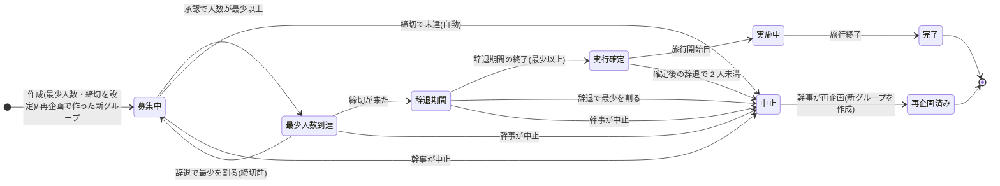

# 04 実行条件・状態遷移・再企画(04-group-lifecycle)

ID 接頭辞は `LCY`(LCY-FN: 関数、LCY-API: API、LCY-T: 試験、LCY-TASK: 実装タスク、LCY-UI: 画面部品、LCY-FILE: ファイル、LCY-REQ: 他モジュールへの要望、LCY-N: 通知、LCY-E: エラー)。凡例([決定]/[案]/[未決]/[要確認]/[推定]/[事実])は [README](README.md) 1 章に従う。[統一] は統一仕様書([_unified-contracts.md](_unified-contracts.md))で決めた事項を表す。

## 1. 概要と責務 / 対応する柱

- 柱18「実行条件と状態管理」。グループの実行条件(最少人数・締切・辞退期間)、実行確定・中止・再企画、グループ状態の遷移を **このモジュールだけが** 更新する(状態の一元管理)。他モジュールは判定関数 `canAcceptRequests` / `canEdit` / `canChat` ほかで「いま何ができるか」を問い合わせるだけで、状態を直接書き換えない。 [案]
- **仕様の正は docs/design**(02「グループの実行条件」、04「グループの状態遷移」、05、07 論点15〜18、10、12 #19〜#26)。モジュール間で共有する名前・署名・パス・値は統一仕様書を正とする(統一仕様書の第 4 章・第 5 章・第 9 章が本モジュールに関わる)。本書はその実装単位への展開で、未決の項目は「推奨案 [案]」を置き、切り替え可能なポリシー定数(`policy.ts`、4.3)にまとめる。決定が出たときは定数の変更だけで対応できる構造にする。
- 前提(決定済み): 幹事が最少人数と締切を設定し、締切までに最少人数に達したら実行確定。安心感の確保 4 点(同意・辞退期間・確定時の実人数通知・一覧表示)を採用。未達は自動中止し、再企画・再エントリーで対応する方針。状態遷移を画面と通知に反映する。 [決定]
- オーナー判断(2026-11-09): 再企画は独立した状態(`replanned`。状態は 8 値)[決定 5]、幹事による中止を設ける [決定 9]、確定後の辞退で 2 人未満になったら中止 [決定 10]、費用メモは実行確定以降 [決定 3]、振り返りは実施中から [決定 16]、通知は必須 12 種と任意 2 種 [決定 1・22]、幹事の中止は実行確定の前まで(募集中・最少人数到達・辞退期間)[決定 29]。実装は主ルートの動作を優先し、統一仕様書 16.2 に当たる試験・タスク・記述には「見送り」の印を付ける(削除はしない)。
- 競技ルール適合: localhost 完結、外部依存なし、ダミーデータ。定期実行(cron・タイマー)を持たず、読み取り時の遅延評価とデモ用 clock で再現する。 [案]

### 1.1 01 グループ中核との責務境界

統一仕様書 4.6・第 8 章の通り **01 は 04 を呼ばない。04 が 01 を呼んで状態を更新する**。

| 事項 | 01 が持つ | 04 が持つ |
|---|---|---|
| Group の保存・取得、メンバー一覧・人数 | ○(`getGroupById`、`countActiveMembers`。`isMember`/`isOrganizer` は 00 の再エクスポート) | 呼ぶ |
| Group.lifecycle(実行条件・状態)の **型定義** | 型のみ `import type` で取り込む | ○(`lifecycle/types.ts`) |
| Group.lifecycle の **書き込み** | 受け口 `applyLifecyclePatch` のみ提供 | これを唯一の呼び出し元として更新 |
| 作成時の最少人数・締切の検証と初期値生成 | 受け取って保存するだけ | `validateLifecycleInput` / `buildInitialLifecycle`(純粋関数) |
| メンバーの退会(状態を「退会」にする) | `markMemberLeft`(状態チェックなし。イベントを発行しない) | `withdraw`(権限・状態を判定して呼び、`Withdrawal` の追加後に `member_left` を発行する。統一仕様書 4.5) |
| 作成 API の合成 | - | 合成層 `features/groups/compose/handlers.ts`(所有 01)の `createGroupHandler` が 04 の検証 → 01 の `createGroup` → 04 の `recordCreated` の順に呼ぶ(統一仕様書 2.1・5.1)。`app/api/groups/route.ts` は再エクスポートだけ |

- 04 の純粋関数モジュール(`rules.ts`)は 00 のみに依存し、01 は `import type` だけで取り込む。01 が型だけを取り込んでもモジュール循環は起きない。
- 利用者がグループから抜ける API は 04 の `POST /api/groups/[groupId]/withdraw` だけとする(01 の `POST …/leave`・`leaveGroup` は廃止。統一仕様書 4.5)。04 が状態に応じて「辞退」(辞退期間まで)か「退会」(実行確定後)を判定する。

## 2. 既存機能との関係

- 新規。既存 `src/lib/server-store.ts` と `/api/v2` は変更しない(README 2 章)。ストアは 00 の `db()`/`Repo<T>`/`tx()` を使い、本モジュールのコレクション `withdrawals`(`Withdrawal`、`wd-NNN`)と `groupStatusLogs`(`GroupStatusLog`、`sl-NNN`)を 00 の `Db` に置く(統一仕様書 3.1・3.2)。
- 通知は 10 の `notify(input: NotifyInput)` を使う。判定関数は 02、03、05〜08 が使う。clock は 00 の `clock.now()` / `clock.nowIso()` / `clock.today()` を使う。状態の変化は 00 の `lib/events.ts` の `emit` で `status_changed` として発行し、03(申請の失効)と 06(システムメッセージ)が購読する。辞退・退会は `withdraw` が `member_left` として発行し、06・07 が購読する(統一仕様書 4.5・4.6)。

### 2.1 利用ライブラリ・モジュール

新規に追加する外部ライブラリは試験用の Vitest のみで、00 が CMN-TASK-12 で devDependency に追加したものを使う(04 は `package.json` を変更しない)。`app/package.json` にあるものはそのバージョンを維持する。ライセンスは `app/package-lock.json` の記載による(Vitest を除く)。 [決定 11]

| 種別 | 名前 | 本モジュールでの用途 | ライセンス | バージョン方針 |
|---|---|---|---|---|
| フレームワーク | next | Route Handler(00 の `route()` を経由)、再企画画面のページ(App Router) | MIT | 16.4.5 を維持 |
| フレームワーク | react / react-dom | UI 部品(LCY-UI-01〜07) | MIT | 19.3.0 を維持 |
| UI | @mantine/core | `Badge`、`Progress`、`Modal`、`Radio`、`Button`、`Alert`、`NumberInput` など | MIT | ^9.7.5 を維持 |
| UI | @mantine/dates | 条件変更ダイアログの締切入力(`DatePickerInput`) | MIT | ^9.7.5 を維持 |
| UI | @tabler/icons-react | 状態バッジ・ライフサイクルパネルのアイコン | MIT | ^3.51.0 を維持 |
| 日付 | dayjs | クライアントでの日付表示の整形(「◯月◯日」)のみ。@mantine/dates の前提でもある | MIT | ^1.11.23 を維持 |
| 言語 | typescript | 型検査 | Apache-2.0 | ^5 を維持 |
| 試験 | vitest | 単体・結合試験(14 章) | MIT [推定] | 最新の安定版を使う(00 の CMN-TASK-12 で追加) |
| Node 標準 | (なし) | 直接は使わない。ID 生成・時刻・ストアは 00 を経由する | - | - |

使わないもの(自前実装または不採用):

| 対象 | 方針 | 理由 |
|---|---|---|
| 状態機械ライブラリ(XState 等) | 使わない。`transitions.ts` の遷移表と純粋関数で実装する | 状態 8 種・遷移 14 件(T1〜T13、T7')は表と関数で扱え、依存とライセンス確認を増やさないため |
| サーバー側の日付演算(dayjs の utc / timezone プラグイン等) | 使わない。`deadlineAt` は 00 の `startOfNextJstDay` で作り、残りの日数の加算は `dates.ts`(4.5)で JST 固定の文字列演算として実装する | 扱うのは JST 固定の日単位の加算と比較のみで、実行環境のタイムゾーン設定に結果が左右されないようにするため |
| 入力検証ライブラリ(zod 等) | 使わない。00 の `v`(自前)を使う | 00 の方針(00 の 5.10)に合わせるため |
| zustand | 本モジュールでは使わない | 画面は `LifecycleView` を都度取得すれば足り、クライアントに保持する状態がないため |
| 定期実行(node-cron 等) | 使わない | 遅延評価とデモ用 clock で時間経過を再現するため(1 章、5.3) |

自前モジュール(依存先。統一仕様書 4.6 の依存の向き「04 → 00、01、09、10」。関数の一覧は 12.1):

| モジュール | 用途 |
|---|---|
| 00 共通基盤 | clock、`startOfNextJstDay`、`LIMITS`、`AppError`、`newId`、`db()`/`tx()`、`requireGroup`、`route()`、検証 `v`、`isMember`/`isOrganizer`、`registerHook`、`emit` |
| 01 グループ中核 | グループの取得、人数、`applyLifecyclePatch`、`markMemberLeft`、`createGroupInternal`、`listAllGroups` |
| 09 安全 | アクセス判定(`assertGroupAccess`)、本人確認(`requireVerified`)、禁止表現の検査(`assertTextAllowed`) |
| 10 通知 | `notify` |

03 は呼ばない(申請の失効は 03 が `status_changed` を購読して行う)。

## 3. 画面・UI(04 章)

| 画面・部品 | 04 章の項目 | パス・配置 | ID |
|---|---|---|---|
| 状態バッジ(状態名の色分け。「再企画済み」も 1 つの状態として表示) | 状態表の「画面・通知への反映」 | 共通コンポーネント(一覧カード・詳細ヘッダ) | LCY-UI-01 |
| 人数メーター(「あと◯人で実行」「最少 3 / 定員 4 / 現在 2」) | 一覧に最少・定員・現在人数を表示 | 同上 | LCY-UI-02 |
| 締切・辞退期間カウント(「締切まであと 3 日」「辞退できるのは◯月◯日まで」) | 状態表(辞退期間) | 同上 | LCY-UI-03 |
| ライフサイクルパネル(状態説明、取れる操作、中止理由) | グループ詳細(状態を表示) | `/[campaign]/groups/[groupId]` ヘッダ直下 | LCY-UI-04 |
| 辞退ボタン+確認ダイアログ(ペナルティなしを明記。確定後は「退会」) | 辞退期間「辞退の操作を目立たせる」 | パネル内 | LCY-UI-05 |
| 幹事操作(条件変更、中止) | 幹事の権限(07 論点18) | パネル内(幹事のみ表示) | LCY-UI-06 |
| 再企画画面(元の設定を初期値に表示、日程と締切の入力) | 中止 → 再企画 | `/[campaign]/groups/[groupId]/replan`(幹事のみ) | LCY-UI-07 |
| 再エントリー導線(通知から再企画先グループ詳細へ) | 各自が再エントリー | 通知リンク → 新グループ詳細の申請(03)。画面は 03 側 | - |
| デモ日付操作(「日付を進める」「今日の日付」表示) | 12 章 #26 | 00 の DemoBar(`POST /api/demo/clock`)。04 は画面を持たない | - |

「モック」であることは画面上に明示する(04 章 UI 方針)。デモ日付操作の「デモ用」表示は 00 の DemoBar が行う。

## 4. データ(05 章)

### 4.1 型定義(`app/src/features/groups/lifecycle/types.ts`)

```ts
import type { Id, DateStr, IsoDateTime } from '@/lib/groups-types';
import type { Group } from '@/features/groups/types';               // 01(型のみ)

/** 状態(内部値)。表示名は statusLabel(status)(messages.ts)。[決定 5/統一 4.1] */
export type GroupStatus =
  | 'recruiting'         // 募集中
  | 'min_reached'        // 最少人数到達(成立見込み)
  | 'withdrawal_period'  // 辞退期間
  | 'confirmed'          // 実行確定
  | 'in_progress'        // 実施中
  | 'completed'          // 完了
  | 'cancelled'          // 中止(再企画されるまで)
  | 'replanned';         // 再企画済み(中止したグループを幹事が再企画した後の元グループ。終端)

export type CancelReasonCode =
  | 'min_not_reached'          // 締切で最少人数に未達(自動)
  | 'below_min_in_withdrawal'  // 辞退期間中の辞退で最少人数を割った(自動。policy 依存)
  | 'below_floor'              // 確定後の辞退で 2 人未満になった(自動)[決定 10]
  | 'organizer_cancelled'      // 幹事が中止(定型理由は OrganizerCancelReason)[決定 9]
  | 'organizer_left';          // 幹事の退会・不在(policy 依存。デモでは発生しない)

export type OrganizerCancelReason = 'schedule_conflict' | 'safety_concern' | 'weather_or_closure' | 'other';

/** 申請を受け付けない理由(03 が unavailable_state の reason に使う)。[統一 4.3] */
export type NotAcceptingReason =
  | 'closed_deadline' | 'closed_withdrawal_period' | 'closed_confirmed' | 'closed_cancelled';

/** Group.lifecycle。01 の Group にこの形で入れる [統一 4.2]。日時は ISO 8601(+09:00)。未設定は null。 */
export interface GroupLifecycle {
  status: GroupStatus;
  minMembers: number;                       // 2 以上、定員以下。幹事を含む人数 [案 #19]
  deadlineDate: DateStr;                    // 正。締切日(その日を含む)
  deadlineAt: IsoDateTime;                  // 派生値。00 の startOfNextJstDay(deadlineDate)(翌日 00:00+09:00。判定に使う)
  deadlineExtendedCount: number;            // 締切延長の回数(上限 policy.maxDeadlineExtensions)
  withdrawalStartedAt: IsoDateTime | null;  // = deadlineAt
  withdrawalEndsAt: IsoDateTime | null;     // = deadlineAt + withdrawalDays
  confirmedAt: IsoDateTime | null;          // = withdrawalEndsAt(遅延評価では実際の評価時刻でなく有効時刻)
  startedAt: IsoDateTime | null;            // 旅行開始日 00:00 JST
  completedAt: IsoDateTime | null;          // 旅行終了日の翌日 00:00 JST
  cancelledAt: IsoDateTime | null;
  cancelReason: CancelReasonCode | null;
  organizerCancelReason: OrganizerCancelReason | null;
  replanOfGroupId: Id | null;               // 再企画で作ったグループの元
  replannedToGroupId: Id | null;            // 再企画した元グループの先
  replannedAt: IsoDateTime | null;
  deadlineSoonNoticeSent: boolean;          // 現在の締切に対する「締切接近」通知の送信済み(deadline_near は見送り。項目は残す)
  withdrawalEndingNoticeSent: boolean;
  revision: number;                         // 遷移・条件変更ごとに +1(01 の applyLifecyclePatch の楽観ロック)
}

/** 状態遷移の履歴(柱18「状態遷移を明示」の根拠・試験用)。コレクション groupStatusLogs。 */
export interface GroupStatusLog {
  id: Id;                                   // newId('sl')
  groupId: Id;
  seq: number;                              // グループ内の連番(1 起点)
  from: GroupStatus | null;                 // 作成時は null(作成では status_changed を発行しない)
  to: GroupStatus;
  event: LifecycleEvent;
  effectiveAt: IsoDateTime;                 // その遷移が起きるべき時刻(締切など)
  evaluatedAt: IsoDateTime;                 // 実際に評価した時刻(clock.nowIso())
  actor: 'system' | Id;                     // system または userId
  meta: Record<string, string | number | boolean> | null;
}

export type LifecycleEvent =
  | 'created' | 'count_reached' | 'count_lost' | 'deadline_met' | 'deadline_missed'
  | 'withdrawal_ended' | 'withdrawal_lost_min' | 'floor_lost' | 'trip_started' | 'trip_ended'
  | 'organizer_cancelled' | 'organizer_left' | 'replanned';

/** 状態を変えず通知だけを出すイベント(5.2)。名前は 10 の通知種別と同じ。 */
export type NoticeEvent = 'deadline_near' | 'withdraw_period_ending';

/** 辞退・退会の時点の状態(canWithdraw が true の状態)。 */
export type WithdrawPhase = 'recruiting' | 'min_reached' | 'withdrawal_period' | 'confirmed';

/** 辞退・退会の記録(05「辞退の記録」)。コレクション withdrawals。理由・ペナルティ・評価は持たない [案、07 論点16]。 */
export interface Withdrawal {
  id: Id;                                   // newId('wd')
  groupId: Id;
  userId: Id;
  withdrawnAt: IsoDateTime;
  phase: WithdrawPhase;                     // confirmed なら「退会」、それ以外は「辞退」と表示する
  countAfter: number;                       // 辞退後の人数
  causedTransition: LifecycleEvent | null;
}

export type CapabilityKey =
  | 'canAcceptRequests' | 'canEdit' | 'canEditExpenses' | 'canChat' | 'canReadHistory'
  | 'canCollectStamps' | 'canReview' | 'canWithdraw' | 'canOrganizerCancel'
  | 'canChangeConditions' | 'canReplan';

/** 状態(6.1)と権限(幹事/メンバー)を組み合わせた、現在ユーザーの可否一式。 */
export type GroupCapabilities = Record<CapabilityKey, boolean> & {
  deniedReason: Partial<Record<CapabilityKey, string>>;   // 表示用メッセージキー。false の項目のみ
};

/** GET /api/groups/[groupId]/lifecycle の本体。 */
export interface LifecycleView {
  groupId: Id;
  status: GroupStatus;
  statusLabel: string;                      // statusLabel(status)
  minMembers: number;
  capacity: number;
  currentCount: number;
  isFull: boolean;
  shortage: number;                         // max(0, minMembers - currentCount)
  deadlineDate: DateStr;                    // 締切日(含む)。画面はこれを表示する
  deadlineAt: IsoDateTime;
  withdrawalEndsAt: IsoDateTime | null;
  daysToDeadline: number | null;            // 募集中/最少人数到達のときのみ。0 以上
  cancelReason: CancelReasonCode | null;
  cancelReasonLabel: string | null;
  organizerCancelReason: OrganizerCancelReason | null; // 幹事の中止で選んだ理由。通知には入れず、画面で表示する [統一 4.3]
  replanOfGroupId: Id | null;
  replannedToGroupId: Id | null;            // 幹事・元メンバーのみ。それ以外は null(7.4)
  capabilities: GroupCapabilities;          // 現在ユーザー視点
  now: IsoDateTime;                         // clock.nowIso()(デモ表示用)
}

/** 適用した 1 件。通知のみのイベントは to = null(状態は変えない)。 */
export interface TransitionResult {
  groupId: Id; from: GroupStatus | null; to: GroupStatus | null;
  event: LifecycleEvent | NoticeEvent; effectiveAt: IsoDateTime;
}
export interface EvaluationResult { groupId: Id; applied: TransitionResult[]; }
```

### 4.2 Group への追加(01 への取り込み方)

`Group.lifecycle: GroupLifecycle` として 1 つのネストにする [統一 4.2]。以降 `group.lifecycle.status` のように書く。01 の作成・設定変更は lifecycle を変更しない(作成時は 04 が作った lifecycle をそのまま保存する。統一仕様書第 8 章)。

本モジュールが読む 01 の項目 [統一 4.2]: `Group.capacity`(2〜6)、`Group.trip.startDate` / `trip.endDate`(`DateStr`、確定日程。「日程の幅」で未確定の旅は実行確定できないため、デモでは確定日程を必須とする [案])、`Group.trip.destination`、`Group.organizerId`、`Group.campaign`、`Group.region`、`Group.visibility`、`Group.tags`、`Group.name`。

### 4.3 ポリシー定数(`policy.ts`)。未決を切り替え可能にする

```ts
export const LIFECYCLE_POLICY = {
  minMembersFloor: LIMITS.MIN_MEMBERS.min,    // 1 人は不可 [案 #19]。値は 00 の LIMITS(統一仕様書 10.3)
  defaultMinMembers: (capacity: number) => Math.min(3, capacity), // 案A [案 #19]
  withdrawalDays: 2,                          // 辞退期間の長さ(日)。案A [案 #20]
  belowMinInWithdrawal: 'cancel' as 'cancel' | 'reopen_once', // 辞退期間中に最少未満 [案 #21]。'reopen_once' は見送り
  withdrawAfterConfirmed: 'allow_keep' as 'allow_keep' | 'deny' | 'allow_reevaluate', // [決定 10]
  confirmedFloorMembers: 2,                   // 確定後の辞退でこの人数を下回ったら中止 [決定 10]
  onFullBeforeDeadline: 'wait_deadline' as 'wait_deadline' | 'close_now' | 'organizer_choice', // [案 #24]
  organizerCancelStates: ['recruiting', 'min_reached', 'withdrawal_period'] as GroupStatus[], // 実行確定の前まで [決定 9・29/統一 4.3・4.4]
  organizerLeft: 'cancel_before_confirm' as 'cancel_before_confirm' | 'freeze_until_handover', // [案 #25]。onOrganizerLeft とともに見送り
  allowLowerMinOnly: true,                    // 受付開始後は最少人数を下げる変更のみ [案 論点18 案A]
  maxDeadlineExtensions: 1,                   // 締切延長は 1 回まで [案 論点18 案A]
  deadlineSoonHours: 24,                      // 「締切接近」通知(任意の通知 deadline_near。見送り)
  withdrawalEndingHours: 24,                  // 「まもなく確定」通知(withdraw_period_ending)
  replanInvitePolicy: 'members_and_pending' as 'members_only' | 'members_and_pending', // [案 #23]
  maxEvaluateSteps: 16,
} as const;
```

### 4.4 データの持ち方・状態の表示

- 状態は **保存値 `lifecycle.status`**(遅延評価で更新)を正とし、人数・日付から毎回導出はしない。ただし人数と締切に由来する遷移は `nextDue`(5.2)で再計算できるため、保存値が古い場合も、次の評価で現在時刻に対応する状態まで順に更新される。
- 「再企画済み」は独立した状態 `replanned` とする [決定 5]。中止(`cancelled`)したグループを元の幹事が再企画すると、元グループは `replanned`(終端)になり、新グループは `recruiting` から始まる(docs/design 04 の状態遷移図と一致)。表示用の派生状態(`cancelled` かつ `replannedToGroupId` あり)は設けない。
- 中止・再企画済みのグループは削除せず残す(05 章)。再企画で作った新グループは `replanOfGroupId`、元グループは `replannedToGroupId` と `replannedAt` を持つ。
- 辞退・退会したメンバーは `GroupMember.status = 'left'`(`MemberStatus = 'active' | 'left'`)とし、辞退か退会かは `Withdrawal.phase` で区別する(`confirmed` は退会、それ以外は辞退)[統一 4.5]。記録は残し、画面の表示名は「元メンバー」とする [決定 18]。
- 現在人数 = `GroupMember.status = 'active'`(参加中。幹事を含む)の件数。幹事を最少人数に含める [案 #19]。

### 4.5 日時の扱い(`dates.ts`)

- 入力は日付(`YYYY-MM-DD`)、内部は `+09:00` 付き ISO。`deadlineDate` は **その日を含む**締切で、保存値の正とする。判定用に `deadlineAt = startOfNextJstDay(deadlineDate)`(00 の関数。翌日 00:00:00+09:00、排他)を同時に保存する [統一 3.7・4.2]。締切判定は `now >= deadlineAt`。
- `withdrawalEndsAt = deadlineAt + withdrawalDays 日`。`startedAt = trip.startDate 00:00+09:00`、`completedAt = (trip.endDate + 1 日) 00:00+09:00`。
- 検証式: `withdrawalEndsAt <= tripStartAt`(辞退期間が旅行開始前に終わる)。例: 辞退期間 2 日なら `trip.startDate >= deadlineDate + 3 日`。
- JST 固定の文字列演算(dayjs の timezone プラグインに依存しない)。サマータイムなし。関数: `jstDate(date: Date): DateStr`、`addDays(iso: IsoDateTime, n: number): IsoDateTime`。翌日 00:00 の算出は 00 の `startOfNextJstDay` を使い、`dates.ts` に同等の関数を作らない。保存する日時は 00 の `clock.nowIso()` と同じ `+09:00` 形式にする(`toISOString()` は使わない)。

## 5. インターフェース

すべて `app/src/features/groups/lifecycle/` 配下。サービスは同期関数で、更新は 00 の `tx` の中で行う(5.3)。エラーは 00 の `AppError(code, message, { reason?, fields?, detail? })`(統一仕様書 3.3)。

### 5.1 公開関数(他モジュールが呼ぶ)

| ID | 署名 | 説明・例外 | 呼び出し元 |
|---|---|---|---|
| LCY-FN-01 | `evaluate(groupId: Id, now?: Date): EvaluationResult` | 1 グループの遅延評価。時間経過・人数に由来する遷移を、`now` の時点で適用すべきものがなくなるまで順に適用し、副作用(通知・イベント発行)を実行する。冪等。グループが無ければ `not_found` を投げる(それ以外の業務エラーは投げない) | `evaluateAll`、`onMembershipChanged`、`changeConditions` |
| LCY-FN-02 | `evaluateAll(now?: Date): EvaluationResult[]` | 評価対象の状態(`recruiting`〜`in_progress`)の全グループを評価。04 が 00 の `beforeRequest` フックと `afterClockChange` フックに登録し、1 リクエストにつき 1 回だけ実行される(5.3)。他モジュールは呼ばない | 00 の `route()`(フック) |
| LCY-FN-03 | `canAcceptRequests(g: GroupLike, now?: Date): boolean` | 表 6.1 | 03(`requestJoin` と `approve` の両方)、02 |
| LCY-FN-04 | `canEdit(g: GroupLike): boolean` | 表 6.1 | 05 |
| LCY-FN-05 | `canChat(g: GroupLike): boolean` | 表 6.1 | 06 |
| LCY-FN-06 | `canEditExpenses(g): boolean` / `canCollectStamps(g): boolean` / `canReview(g): boolean` / `canReadHistory(g): boolean` | 表 6.1(追加の判定) | 07 / 08 / 08 / 05・06 |
| LCY-FN-07 | `canWithdraw(g): boolean` / `canOrganizerCancel(g): boolean` / `canChangeConditions(g): boolean` / `canReplan(g): boolean` | 表 6.1。状態だけを判定する(権限は判定しない) | `getCapabilities`、04 の各操作 |
| LCY-FN-08 | `notAcceptingReason(g: GroupLike, now?: Date): NotAcceptingReason \| null` | 申請を受け付けない理由(6.2)。受け付ける場合は `null` | 03 |
| LCY-FN-09 | `statusLabel(status: GroupStatus): string` | 状態の表示名(10.1 の表)。00・02・05 などの表示はこれだけを使う | 02、05、UI |
| LCY-FN-10 | `getCapabilities(g: GroupLike, user: DemoUser, now?: Date): GroupCapabilities` | 状態 + 権限(幹事/メンバー)を含む UI 用の可否一式 | `getLifecycleView`、UI |
| LCY-FN-11 | `onMembershipChanged(groupId: Id, now?: Date): EvaluationResult` | メンバー追加後に呼ぶ。到達・喪失を評価(= `evaluate`)。状態が変われば `status_changed` を発行する。03 が `addMember` の直後に呼ぶ | 03 |
| LCY-FN-12 | `getLifecycleView(user: DemoUser, groupId: Id): LifecycleView` | 09 の `assertGroupAccess(user.id, groupId, 'view')` で非公開・非メンバー・ブロック関係に存在を隠す(`not_found`)。公開グループの非メンバーには capabilities の幹事系を false、`replannedToGroupId` を null | GET API |
| LCY-FN-13 | `withdraw(user: DemoUser, groupId: Id, now?: Date): WithdrawResult` | 辞退・退会。例外: `forbidden`(幹事・非メンバー)、`unavailable_state`(辞退できない状態)、`conflict`(すでに辞退済み)。判定の順序は 5.5 の「辞退の処理順」 | POST API |
| LCY-FN-14 | `organizerCancel(user: DemoUser, groupId: Id, reason: OrganizerCancelReason): LifecycleView` | 幹事が中止(T11)。中止できるのは `recruiting`・`min_reached`・`withdrawal_period` だけ [決定 29]。理由の選択は必須。例外: `forbidden`、`unavailable_state`(`cannot_cancel`。実行確定以降を含む)、`invalid_input` | POST API |
| LCY-FN-15 | `changeConditions(user: DemoUser, groupId: Id, patch: { minMembers?: number; deadlineDate?: DateStr }): LifecycleView` | 受付開始後の条件変更(下げる/延長 1 回のみ)。変更後に `evaluate` を呼び、状態が変われば `status_changed` を発行する。例外: `forbidden`、`unavailable_state`、`invalid_input`、`conflict`(延長上限) | PATCH API |
| LCY-FN-16 | `getReplanDraft(user: DemoUser, groupId: Id): ReplanDraft` | 再企画の初期値。例外: `forbidden`、`unavailable_state`(中止でない)、`conflict`(再企画済み) | GET API、UI |
| LCY-FN-17 | `replan(user: DemoUser, groupId: Id, input: ReplanInput): ReplanResult` | 再企画の作成(元を参照する新グループ + 前回参加者へ案内。元は `replanned`)。例外は 5.6 | POST API |
| LCY-FN-18 | `validateLifecycleInput(input: LifecycleInput, ctx: { capacity: number; startDate: DateStr; now: Date }): LifecycleInput`(正規化して返す) | 作成・再企画時の検証。失敗は `invalid_input` + `fields` | 合成層 `features/groups/compose/handlers.ts` の `createGroupHandler`(作成 API)、11 の公式枠作成 |
| LCY-FN-19 | `buildInitialLifecycle(input: LifecycleInput, now: Date, opts?: { replanOfGroupId?: Id }): GroupLifecycle` | 初期値生成(`status: 'recruiting'`、`revision: 1`、未設定の日時は `null`)。01 の保存後、`recordCreated(groupId)` でログを追加 | 同上、`replan` |
| LCY-FN-20 | `recordCreated(groupId: Id): void` | `GroupStatusLog`(`created`、`from: null`)を追記し(`status_changed` は発行しない。統一仕様書 4.6)、幹事 1 人で `minMembers` 到達(`minMembers` は 2 以上のため通常は起きない)なら評価 | 同上 |
| LCY-FN-21 | `onOrganizerLeft(groupId: Id): EvaluationResult` | 幹事の退会・不在(5.8)。幹事は `withdraw` で抜けられないため、デモでは未使用の受け口 [案 #25]。見送り(統一仕様書 16.2) | (将来) |
| LCY-FN-22 | `registerLifecycleHooks(): void` | 00 の `registerHook('beforeRequest', 'lifecycle', …)` と `registerHook('afterClockChange', 'lifecycle', …)` で `evaluateAll(clock.now())` を登録する。`features/bootstrap.ts` から 1 回呼ばれる | 00(`bootstrap.ts`) |

```ts
export type GroupLike = Pick<Group, 'id' | 'organizerId' | 'capacity' | 'trip'> & { lifecycle: GroupLifecycle };
export interface LifecycleInput { minMembers?: number; deadlineDate: DateStr; }
export interface WithdrawResult { status: GroupStatus; phase: WithdrawPhase; cancelled: boolean; currentCount: number; }
export interface ReplanDraft {
  fromGroupId: Id;
  carried: { name: string; campaign: string; region: Id; destination: string; capacity: number;
             visibility: 'public' | 'private'; tags: string[]; minMembers: number };   // 引き継ぐ項目
  required: ('startDate' | 'endDate' | 'deadlineDate')[];                            // 入力必須
  originalTrip: { startDate: DateStr; endDate: DateStr; deadlineDate: DateStr };      // 参考表示
  recipientCount: number;                                                            // 案内される前回参加者数(人数のみ)
}
export interface ReplanInput {
  name?: string; destination?: string; minMembers?: number;
  startDate: DateStr; endDate: DateStr; deadlineDate: DateStr;
  ackReview?: boolean;   // 禁止表現の要確認(review)を確認したうえでの再送。スキーマに v.boolean({ optional: true }) で宣言する [統一 6.2]
}
export interface ReplanResult { groupId: Id; invited: number; }   // groupId は新グループ
```

`Group` の項目名は統一仕様書 4.2(01 の `features/groups/types.ts`)に従う。`DemoUser` は 00。

`groupId` を引数に取る関数(LCY-FN-01、11〜17、20、21)は、グループが存在しない場合に `not_found` を投げる。利用者を引数に取る関数(LCY-FN-12〜17)は、09 の `assertGroupAccess` により、非公開グループで利用者がメンバーでない場合やブロック関係にある場合も `not_found` を投げる(存在を隠す。7.2)。上表の「説明・例外」欄ではこれを省略している。

### 5.2 遅延評価の中核(純粋関数。`rules.ts`、`transitions.ts`)

| ID | 署名 | 説明 |
|---|---|---|
| LCY-FN-23 | `nextDue(g: GroupLike, count: number, now: Date): DueEvent \| null` | 現在の保存状態から見て **最も早い未処理イベント**(`effectiveAt <= now`)を 1 件返す純粋関数。なければ null |
| LCY-FN-24 | `applyDue(groupId: Id, due: DueEvent, now: Date, expectedRevision: number): TransitionResult` | 1 イベントを 00 の `tx` の中で原子的に適用(5.3)。副作用を実行。`expectedRevision` が保存値と異なれば 01 の `applyLifecyclePatch` が `conflict`(`version_mismatch`)を投げる |
| LCY-FN-25 | `deriveBaseStatus(minMembers: number, count: number): 'recruiting' \| 'min_reached'` | 締切前の 2 状態の判定(`count >= minMembers` なら `min_reached`) |

```ts
export interface DueEvent {
  event: LifecycleEvent | NoticeEvent;
  to: GroupStatus | null;          // null は通知のみ(状態は変えない)
  effectiveAt: IsoDateTime;
  cancelReason: CancelReasonCode | null;
}
```

`nextDue` の判定(状態ごと。いずれも `effectiveAt <= now` のものだけ)。

| 現在の状態 | 候補イベント(①があれば①、なければ残りから effectiveAt の早い順に 1 件) |
|---|---|
| recruiting / min_reached | ① 人数同期(effectiveAt = `now`): `deriveBaseStatus` と保存状態が異なれば `count_reached` / `count_lost` ② `deadline_near`(effectiveAt = `deadlineAt - deadlineSoonHours`): 未送信で、`deadlineAt - deadlineSoonHours <= now < deadlineAt` のときだけ候補にする(任意の通知。見送り(統一仕様書 16.2)。実装しない場合は候補にしない) ③ 締切: `now >= deadlineAt` で `count >= min` → `deadline_met`(→ withdrawal_period)、未達 → `deadline_missed`(→ cancelled、`min_not_reached`) |
| withdrawal_period | ① `withdraw_period_ending`(effectiveAt = `withdrawalEndsAt - withdrawalEndingHours`): 未送信で、`withdrawalEndsAt - withdrawalEndingHours <= now < withdrawalEndsAt` のときだけ候補にする ② `now >= withdrawalEndsAt` で `count >= min` → `withdrawal_ended`(→ confirmed)、未達 → `withdrawal_lost_min`(→ cancelled、`below_min_in_withdrawal`。通常は辞退時に即時中止されるため、この分岐は防御用 [デモ範囲外・見送り(統一仕様書 16.2)]) |
| confirmed | `now >= startedAt` → `trip_started`(→ in_progress) |
| in_progress | `now >= completedAt` → `trip_ended`(→ completed) |
| completed / cancelled / replanned | なし(時間由来の遷移はない。`cancelled` → `replanned` は幹事の操作のみ) |

- 締切(または辞退期間の終了)を過ぎてから初めて評価した場合、`deadline_near`(`withdraw_period_ending`)は候補にしない。締切の遷移 T4 / T5(辞退期間の終了の遷移 T6 / T7)の更新で `deadlineSoonNoticeSent`(`withdrawalEndingNoticeSent`)を true にし、通知は送らない。

### 5.3 評価ループ・原子性・冪等性(LCY-FN-01 の実装規約)

```ts
const evaluating = new Set<Id>();               // 再入防止(通知・イベント処理がグループを読んでも再帰評価しない)
export function evaluate(groupId: Id, now: Date = clock.now()): EvaluationResult {
  if (evaluating.has(groupId)) return { groupId, applied: [] };
  evaluating.add(groupId);
  try {
    const applied: TransitionResult[] = [];
    for (let i = 0; i < LIFECYCLE_POLICY.maxEvaluateSteps; i++) {
      const g = requireGroup(groupId);                        // 00。無ければ not_found
      const due = nextDue(g, countActiveMembers(groupId), now); // 01
      if (!due) return { groupId, applied };
      applied.push(applyDue(groupId, due, now, g.lifecycle.revision)); // revision 不一致は conflict
    }
    console.error(`[lifecycle] maxEvaluateSteps exceeded: ${groupId}`); // 遷移表の不具合の検出用
    return { groupId, applied };
  } finally { evaluating.delete(groupId); }
}
```

- **評価の抜けの防止**: 遷移は一定間隔の実行(タイマー)ではなく、**保存された時刻(deadlineAt など)と `now` の比較** で判定する。評価が行われない期間があっても、次の評価で `nextDue` が古い時刻のイベントから順に返す。`now` が複数の境界をまたぐ場合(例: 最少人数到達から完了まで)も `effectiveAt` の昇順に 1 件ずつ適用するため、中間状態の通知・ログは欠けない。
- **遷移の共通処理**: 状態を変える処理(`applyDue`(`evaluate`・`onMembershipChanged`・`changeConditions` の後の評価から呼ばれる)、`withdraw`、`organizerCancel`、`replan`)は、00 の `tx` の中で次の順に行う。(a) `revision` が評価開始時と一致するか確認 → (b) 01 の `applyLifecyclePatch(groupId, expectedRevision, patch)` で状態更新と `revision + 1` → (c) `GroupStatusLog` 追記 → (d) 10 の `notify`(5.7) → (e) 00 の `emit({ type: 'status_changed', groupId, from, to, cancelReason, revision, at })`。通知を先に、イベントを後にするのは、中止の通知を申請中の申請者に届けてから 03 が申請を失効させるためである(統一仕様書 5.3)。`emit` の購読側(03、06)は同じ `tx` の中で同期に動く。`status_changed` は状態が変わる遷移だけで発行し、作成(T1)では発行しない(`from` は常に値を持つ。統一仕様書 4.6)。
- **二重評価の防止**: Node.js の単一スレッドと同期実行のため、`tx` の途中に他の評価は割り込めない。適用後は状態が進んでいるため、`nextDue` は同じイベントを再度返さない。`revision` 不一致は同期実行では発生しない。発生した場合は `conflict`(`version_mismatch`)を投げて評価を中断し、API は 409 を返す [デモ範囲外・見送り(統一仕様書 16.2)]。
- **副作用を 1 回だけ実行する**: 通知は遷移ごとに **遷移の成功と同じ `tx`** で発行する。遷移しない通知(`deadline_near` / `withdraw_period_ending`)は `deadlineSoonNoticeSent` / `withdrawalEndingNoticeSent` を同じ `tx` で true にする。多重防御として 10 の `eventKey`(5.7)で同じイベントの通知の二重作成を防ぐ。締切延長時は 2 つの送信済みフラグを false に戻す。
- **将来の非同期ストア**: SQLite 等を採る場合は、遷移の共通処理全体を 1 トランザクションにし、`revision` を `WHERE` 条件に入れた更新(0 行更新なら再試行)にする。 [案、デモ範囲外・見送り(統一仕様書 16.2)]
- **時計の後戻り**: 00 の `clock.set` で過去へ戻すことは 00 が許可する。04 は **状態を巻き戻さない**(遅延評価は進める方向のみ)。デモの巻き戻しは 00 の `POST /api/demo/reset`(seed へ初期化)で行う(既知の制約)。後戻り時の扱いの作り込みと試験(LCY-T-19)は見送り(統一仕様書 16.2)。
- **評価のタイミング(いつ呼ぶか)** [統一 3.5]: (1) 00 の `route()` が、ハンドラの前に `runHooks('beforeRequest')` を呼び、04 が登録した `evaluateAll(clock.now())` が 1 リクエストにつき 1 回実行される(読み取り・書き込みとも。`/api/demo/reset` は `skipHooks` で対象外)。(2) 00 の `POST /api/demo/clock` の後に `runHooks('afterClockChange')` で `evaluateAll`。(3) 03 の承認直後に `onMembershipChanged`、04 の `changeConditions` の変更直後に `evaluate`(人数・条件が変わった時点の再判定。状態が変われば `status_changed` を発行する)。`withdraw` は辞退後の人数で T3 / T7 / T8 を直接適用する。02・03・10 など他モジュールは `evaluateAll` を呼ばず、評価済みの状態を読む。対象は数十件で、評価対象の状態かつ期限到来のものだけが処理されるため負荷は小さい。

### 5.4 デモ用 clock との連携

- 00 の `clock.now()` が現在時刻。デモの日付操作は 00 の `POST /api/demo/clock`(`advanceDays` / `set` / `reset`)と DemoBar で行い、04 はデモ用 API と画面を持たない [統一 7.5]。
- 00 は時計を変えた後に `afterClockChange` フックを実行し、04 が登録した `evaluateAll` が全グループを評価する。応答は 00 の `ClockInfo` で、適用した遷移の一覧は返さない。画面は通知一覧とライフサイクルパネルの再取得で結果を表示する。
- 例(基準: 今日 2026-11-09、締切 2026-11-20、辞退期間 2 日、旅行 12-05〜12-06): 11-21 00:00 に進める → 最少人数到達から辞退期間へ(通知: 辞退期間の開始。申請中の申請者には 03 が `join_expired`)。11-22 00:00 → `withdraw_period_ending` 通知(23 日 00:00 の 24 時間前)。11-23 00:00 → 実行確定(通知: 実際の人数と概要)。12-05 → 実施中。12-07 → 完了。11-09 から 12-10 まで一度に進めた場合も、4 件の遷移(辞退期間、実行確定、実施中、完了)が時刻順に 1 回ずつ適用され、通知(辞退期間の開始、実行確定)も 1 回ずつ発行される。「締切接近」「まもなく確定」は期限を過ぎているため送らない(5.2)。
- 通知の日時は 10 が `clock.nowIso()` で付ける(統一仕様書 9.1)。一度に複数の境界を進めた場合、通知の日時は同じになり、一覧の並びは作成順になる。

### 5.5 状態機械の定義



遷移表(`transitions.ts` の `TRANSITIONS` 配列と 1 対 1)。副作用の通知は 5.7 の LCY-N の ID で示す。状態が変わる遷移(T1 を除く)はすべて、通知の後に `status_changed` を発行する(5.3)。幹事の中止(T11)は実行確定の前まで [決定 29] で、実行確定から中止に移るのは T8(辞退で 2 人未満)だけである。

| # | 元状態 | イベント | ガード条件 | 先状態 | 副作用 |
|---|---|---|---|---|---|
| T1 | (なし) | created(作成) | 検証済み(7 章) | recruiting | ログ追記(`recordCreated`。`from: null`)。幹事をメンバーに含む(01)。`group_created` は 01 が発行する。状態の変化ではないため `status_changed` は発行しない [統一 4.6] |
| T2 | recruiting | count_reached | 現在人数 >= 最少人数(承認・条件変更・評価で検出) | min_reached | 通知 `min_reached`(LCY-N-01) |
| T3 | min_reached | count_lost | 現在人数 < 最少人数(締切前の辞退) | recruiting | 通知しない(状態表示で知らせる。統一仕様書 7.5) |
| T4 | recruiting | deadline_missed | `now >= deadlineAt` かつ人数 < 最少 | cancelled(`min_not_reached`) | 通知 `cancelled`(LCY-N-05。メンバー+申請中の申請者)→ `status_changed` を受けて 03 が申請中を失効 |
| T5 | min_reached | deadline_met | `now >= deadlineAt` かつ人数 >= 最少 | withdrawal_period | `withdrawalStartedAt` / `withdrawalEndsAt` を設定、通知 `withdraw_period_started`(LCY-N-02)→ `status_changed` を受けて 03 が申請中を失効し、申請者へ `join_expired`(LCY-N-09)を送る [決定 22] |
| T6 | withdrawal_period | withdrawal_ended | `now >= withdrawalEndsAt` かつ人数 >= 最少 | confirmed | `confirmedAt` を設定、通知 `confirmed`(LCY-N-04。概要は 10 が 09 から作る) |
| T7 | withdrawal_period | withdrawal_lost_min | 辞退で人数 < 最少(`belowMinInWithdrawal = 'cancel'`)/ 期限到来時の防御的な判定 [デモ範囲外・見送り(統一仕様書 16.2)] | cancelled(`below_min_in_withdrawal`) | 通知 `cancelled`(LCY-N-05。残りのメンバー) |
| T7' | withdrawal_period | withdrawal_lost_min | 同上で `belowMinInWithdrawal = 'reopen_once'` かつ延長 0 回 | recruiting | 締切を `deadlineAt + withdrawalDays` へ 1 回延長、通知 `conditions_changed`(LCY-N-08)。切替用の分岐であり既定では無効(`reopen_once` の分岐) [デモ範囲外・見送り(統一仕様書 16.2)] |
| T8 | confirmed | floor_lost | 確定後の辞退で人数 < `confirmedFloorMembers`(2)[決定 10] | cancelled(`below_floor`) | 通知 `cancelled`(LCY-N-05。残りのメンバー。本文で再企画できることを案内) |
| T9 | confirmed | trip_started | `now >= startedAt` | in_progress | ログのみ(通知なし [案])。08 のスタンプ・振り返りが有効化 |
| T10 | in_progress | trip_ended | `now >= completedAt` | completed | ログのみ(通知なし [案]) |
| T11 | recruiting / min_reached / withdrawal_period | organizer_cancelled | 実行者が幹事、`organizerCancelStates` に含まれる(実行確定以降は不可)、理由(`OrganizerCancelReason`)の選択が必須 [決定 9・29] | cancelled(`organizer_cancelled`) | `organizerCancelReason` を保存。通知 `cancelled`(LCY-N-05。メンバー+申請中の申請者。`params.reason` は `organizer_cancelled` で、幹事が選んだ理由は通知に入れず画面で表示する)→ `status_changed` を受けて 03 が申請中を失効 |
| T12 | recruiting / min_reached / withdrawal_period | organizer_left | `organizerLeft = 'cancel_before_confirm'` | cancelled(`organizer_left`) | 通知 `cancelled`(LCY-N-05)。確定後は `freeze_until_handover` 扱いで #14 の決定を待つ(状態を変えない)。デモでは発生しない(`onOrganizerLeft`) [デモ範囲外・見送り(統一仕様書 16.2)] |
| T13 | cancelled | replanned | 実行者が元の幹事、`replannedToGroupId` が未設定 | replanned | 新グループ作成(5.6)、`replannedToGroupId` / `replannedAt` を設定、前回参加者へ `replan_invited`(LCY-N-06)[決定 5/統一 4.3] |

- 辞退 → 遷移は `withdraw` が T3 / T7 / T8 を即時適用する(次回の評価を待たない)。時間由来の遷移(T4〜T6、T9、T10)は `evaluate` が適用する。
- 中止(T4、T7、T8、T11、T12)では、03 は `join_expired` を送らない(申請者には `cancelled` が届くため)。`join_expired` は T5 で辞退期間に移るときだけ送られる [決定 22]。
- 無効な組み合わせ(例: 確定後に再確定、実行確定以降の幹事の中止)は `unavailable_state`(`detail.state` に現在の状態、`detail.allowedActions` に取れる操作を入れる)。
- **辞退の処理順**(`withdraw`。統一仕様書 4.5 の 6 手順。00 の `tx` の中で行う。時間由来の遷移は `beforeRequest` の評価で済んでいる):
  1. `canWithdraw` と権限の確認。次の順に検査する。(a) 09 の `assertGroupAccess(user.id, groupId, 'view')`(グループが無い、非公開で非メンバー、ブロック関係 → `not_found`) (b) 実行者にこのグループの `Withdrawal` があり、参加中でない → `conflict`(`already_withdrawn`) (c) 参加中メンバーでない → `forbidden`(`not_member`) (d) 幹事 → `forbidden`(`organizer_cannot_withdraw`) (e) `canWithdraw` が false → `unavailable_state`(`cannot_withdraw`)。
  2. 01 の `markMemberLeft(groupId, userId, at)`(メンバー行を `left` にする。01 はイベントを発行しない)。
  3. `Withdrawal` を追加する(`newId('wd')`、`phase` は現在の状態、`countAfter` は辞退後の人数)。
  4. 10 の `notify`: 幹事へ `withdrawal_received`(LCY-N-07、`eventKey` は `wd:<Withdrawal.id>`)。
  5. `emit({ type: 'member_left', groupId, userId, phase, withdrawalId, at })`(`withdrawalId` は手順 3 で採番した値)。06(システムメッセージ)と 07(`onGroupMemberLeft`)が購読する。
  6. 辞退後の人数で T3 / T7 / T8 を判定し、該当すれば遷移の共通処理(5.3。T7 / T8 では `cancelled` の通知を含む)で適用し、`status_changed` を発行する。`Withdrawal.causedTransition` を更新する。

### 5.6 再企画(`replan.ts`)

統一仕様書 5.4 の順に、00 の `tx` の中で行う。

1. 検証: 09 の `assertGroupAccess(user.id, groupId, 'view')`、実行者が元の幹事(違えば `forbidden`、`not_organizer`)、元グループが `replanned` なら `conflict`(`already_replanned`)、`cancelled` 以外なら `unavailable_state`(`not_cancelled`)。09 の `requireVerified(user.id, 'create_group')`、`assertTextAllowed(name, 'group_name', 'name', { ackReview })`・`assertTextAllowed(destination, 'group_destination', 'destination', { ackReview })`、入力検証(7 章)を先に通す。違反は `invalid_input` + `reason: "text_denied"`、要確認で未確認なら `invalid_input` + `reason: "text_review_required"` + `detail.reviewRequired: true`(統一仕様書 6.2)。
2. 新グループを 01 の `createGroupInternal({ ...引き継ぐ項目, organizerId: user.id, lifecycle })` で作成する(本人確認・作成上限の検査は 01 では行わない)。`lifecycle = buildInitialLifecycle(input, now, { replanOfGroupId: 元 id })`。01 が `group_created` を発行する。04 は `recordCreated(新 id)` でログを追加する(新グループの `status_changed` は発行しない)。
3. 元グループを `applyLifecyclePatch` で `replanned` にし(`replannedToGroupId`、`replannedAt`)、`GroupStatusLog`(`replanned`)を追記し、`status_changed`(`cancelled` → `replanned`)を発行する。06 はこれを購読してシステムメッセージ `state_replanned` を作る。
4. 前回の参加者へ `replan_invited` を通知する(宛先は 5.7)。
5. 戻り値は `{ groupId: 新グループの id, invited: 案内した人数 }`。

**データの複製ルール** [案、12 #23 案A+C]

| 項目 | 扱い |
|---|---|
| 名称(`name`)、キャンペーン、地方、行き先(`trip.destination`)、定員、公開設定、タグ、最少人数 | 引き継ぐ(画面で編集可。名称は元のまま)。引き継ぎ項目の細部の作り込みは見送り(統一仕様書 16.2。5.4 の基本の流れを優先する) |
| 日程(`trip.startDate`・`trip.endDate`)、締切 | **引き継がず必須入力**(日程の見直し。元と日程が完全に同一なら `invalid_input`) |
| 幹事 | 実行者(元の幹事)を新グループの幹事にする |
| メンバー、参加申請、チャット、費用メモ、スタンプ・振り返り、通報・ブロック | 複製しない(個人情報の持ち越し防止) |
| 旅程・集合場所メモ(05) | 複製しない(05 は `copyPlanDraft` を作らない。統一仕様書 5.4) |
| 招待コード | 新規発行(01) |
| 公式枠フラグ(`official`) | 引き継がない(`createGroupInternal` に `official` を渡さない。11 が管理) |
| 元グループ | 削除せず残す。状態を `replanned` にし、`replannedToGroupId` を設定 |

**再エントリー** [案]: 自動では参加させない。案内を受けた人が新グループ詳細から通常の参加申請(03)を行い、「最少人数でもOK」の同意を **再度** 取る。優先枠・枠の確保は設けない(案C の優先の度合いの曖昧さを避ける)。申請は `reentryOfGroupId: Id | null`(元グループ)を持つ(03 の項目。統一仕様書 5.4)。

### 5.7 通知の発行トリガー一覧(10 との契約)

10 の `notify(input: NotifyInput)`(`kind`、`groupId`、`eventKey`、`params`、`recipients`)を使う [統一 第 9 章]。本文はテンプレート + `params`(項目名は 10 の `ParamsByKind`)。`params` に個人名・チャット本文・連絡先は入れない(10 7 章)。冪等性は 10 の `eventKey` で保証する(同じ `eventKey` の通知は宛先ごとに 1 件だけ作られる)。

通知の種類は必須 12 種(docs/design 05 章の 8 種 + 参加申請の受付・承認・却下 + `join_expired`)と任意 2 種(`chat_new`、`deadline_near`)[決定 1・22]。本モジュールが発行するのは次の表の LCY-N-01〜08 と、任意の LCY-N-10(見送り(統一仕様書 16.2))である。LCY-N-09 は 04 の遷移(T5)を契機に 03 が発行する。

| ID | kind | トリガー(遷移/操作) | 宛先(`recipients`) | 主な params | `eventKey` | 備考 |
|---|---|---|---|---|---|---|
| LCY-N-01 | `min_reached` | T2 | `groupMembers`(幹事を含む) | minParticipants, count | `reached` | 05: 最少人数到達。必須 |
| LCY-N-02 | `withdraw_period_started` | T5 | `groupMembers` | withdrawUntil(`withdrawalEndsAt`), count | `wp-start` | 05: 辞退期間の開始。辞退できる・ペナルティなしを本文に。必須 |
| LCY-N-03 | `withdraw_period_ending` | `withdraw_period_ending`(`withdrawalEndsAt` の 24 時間前。評価時に検出) | `groupMembers` | count | `wp-end` | 05: 辞退期間の終了(まもなく確定)。必須 |
| LCY-N-04 | `confirmed` | T6 | `groupMembers` | count(`summaryText` は 10 が 09 の `memberSummary`・`formatMemberSummary` から作る) | `confirmed` | 05: 実行確定。実際の人数と概要(7.3)。必須 |
| LCY-N-05 | `cancelled` | T4、T7、T8、T11、T12 | `groupMembers`(辞退した人は含まれない)+ `pendingApplicants`(失効の前に解決する) | reason(`CancelReasonCode`)、minParticipants | `cancelled` | 05: 中止。理由は `CancelReasonCode` の定型表示。幹事の中止(T11)で幹事が選んだ `OrganizerCancelReason` は `params` に入れない(`GET G/lifecycle` の `organizerCancelReason` で画面に表示する。統一仕様書 4.3)。本文の末尾で再企画を案内。必須 |
| LCY-N-06 | `replan_invited` | T13 | `users`(`replanInvitePolicy`: 中止時の参加中メンバー+中止で失効した申請者。辞退者と幹事を除く) | newGroupId | `replan:<newGroupId>` | 05: 再企画の案内。再エントリーは各自。必須 |
| LCY-N-07 | `withdrawal_received` | `withdraw` 成功 | `organizer` | count, minParticipants | `wd:<Withdrawal.id>` | 05: 辞退の受付(幹事向け)。辞退者名は載せない(幹事はメンバー一覧で確認)。必須 |
| LCY-N-08 | `conditions_changed` | `changeConditions` 成功、T7'(見送り) | `groupMembers`(幹事を除く)+ `pendingApplicants` | minParticipants(from/to)、deadline(from/to。`deadlineDate`) | `cond:<変更後の lifecycle.revision>` | 05: 条件変更。必須 |
| LCY-N-09 | `join_expired` | T5 の `status_changed` を 03 が購読し、申請中の申請を失効させたとき | 失効した申請者のみ(`users`) | `groupTitle` のみ(個人を特定できる情報は含めない) | `je:<requestId>` | 発行元は 03 [決定 22/統一 9.1]。04 は発行しない。中止(T4、T7、T8、T11、T12)では送らない。必須 |
| LCY-N-10 | `deadline_near` | 締切 24 時間前(`deadline_near`、未送信時のみ) | `groupMembers` | deadline(`deadlineDate`・`deadlineAt`), count, minParticipants | `dl:<deadlineAt>` | 任意(余力)[決定 1]。見送り(統一仕様書 16.2)。締切が延長されたら別キーで再通知 |

- 通知を出さないもの: T1(作成)、T3(最少人数を割って募集中へ戻る)、T9(実施中)、T10(完了)。これらはログ(`GroupStatusLog`)と `status_changed` のみ(T1 は `status_changed` も発行しない)。辞退後の人数の変化、定員到達も通知しない(画面の人数表示で知らせる)[決定 1]。
- `min_reached` の `eventKey` は 10 の表のとおりグループにつき 1 つのため、T3 の後に再び T2 になっても再通知しない [案]。
- 宛先の解決は 10 が行う。`pendingApplicants` は 10 が `notify` の時点で解決するため、04 は `emit(status_changed)` より前に `notify` を呼ぶ(5.3)。

### 5.8 各 [未決] の選択肢整理と推奨案

**#19 最少人数の初期値・範囲** [未決]

| 案 | メリット | デメリット |
|---|---|---|
| A 範囲 2〜定員、初期値 min(3, 定員)、1 人は不可 | 「3 人以上で実行」の例に沿い、設定の手間が少ない。1 対 1(定員 2、最少 2)も同じ式で扱える | 2 人を想定した旅では毎回変更が必要 |
| B 初期値 = 定員 | 単純。実行時の人数が定員と一致する | 未達が起きやすい。条件を緩めて集めやすくする目的と逆 |
| C 初期値なしの必須入力 | 幹事が条件を意識する | 入力の負担増 |

**推奨 [案]: A。** 最少人数に幹事を含める。#12(1 人募集中)との整合: 作成直後の幹事のみ(人数 1)は「最少人数に未達の募集中」として許容する(最少 2 以上のため 1 人で確定することはない)。

**#20 辞退期間の長さと位置**

| 案 | メリット | デメリット |
|---|---|---|
| A 締切後〜確定前、固定 2 日 | 人数確定後に辞退でき、確定時の人数に近い。04 章の図と一致。実装が単純(`withdrawalStartedAt` = 締切) | 旅行開始まで間が短いと日程が窮屈(検証で 7 章の下限を設ける) |
| B 最少到達から確定まで | 到達を知ってすぐ辞退できる | 到達と辞退が繰り返されると状態が何度も切り替わる(T2/T3 の遷移が増える) |
| C 実行日の X 日前を確定日 | 辞退を判断できる期間が長い | 幹事が確定を待つ期間が長い。人数が確定しない |

**推奨 [案]: A、長さは 2 日(定数 `withdrawalDays`)。** 辞退にペナルティなし。理由は問わない・記録しない(07 論点16)。

**#21 辞退で最少を割ったとき・確定後の辞退**

| 案(割ったとき) | メリット | デメリット |
|---|---|---|
| A 締切前は募集中に戻る/辞退期間中は中止 | 遷移が単純。04 章の図と一致 | 辞退期間中の 1 人の辞退で中止(その間は新規申請を受けない) |
| B 常に募集中に戻り締切を 1 回延長 | 中止を避けられる | 日程が延び参加者を待たせる。複雑(T7') |
| C 常に中止 | 予測しやすい | 締切前でも中止になり再企画が増える |

**推奨 [案]: A**(`belowMinInWithdrawal = 'cancel'`。B は `'reopen_once'` で切替可能に分岐だけ残す。`reopen_once` の分岐は見送り(統一仕様書 16.2))。

| 案(確定後の辞退) | メリット | デメリット |
|---|---|---|
| A 可、実行維持(幹事へ通知) | 辞退しやすい。ペナルティなしの方針と整合 | 実行時の人数が確定時より減ることがある。少人数でも実行 |
| B 不可(通報・個別連絡のみ) | 確定後の人数が変わらない | 参加をやめたい人が辞退できず、安全面で不利 |
| C 可、最少を割ったら再判定(中止) | 公平 | 複雑、再企画が増える |

**[決定 10]: A に下限を足す。** 確定後の辞退(退会)は可。人数は最少人数を割っても実行維持するが、**2 人未満(幹事のみなど)になったら中止**(`below_floor`)。1 人では「同行」が成り立たないため。中止の通知で再企画できることを案内する。

**#23 再企画**: 推奨 A+C(5.6)。複製して再募集、前回参加者へ通知のみ(優先枠なし)、再エントリーは各自の操作+同意の再確認。B(持ち越し)は同意の扱いが複雑なため採らない。前回参加者の範囲は「中止時の参加中メンバー+中止で失効した申請者、辞退者は除く」(辞退した人の意思を尊重)。 [案] 元グループの状態は `replanned` とする [決定 5]。

**#24 定員到達時**

| 案 | メリット | デメリット |
|---|---|---|
| A 満員で締め切り辞退期間へ | 早く確定できる | 後から参加したい人が入れない。締切前の遷移が増え状態機械が複雑(定員到達 → 締切の前倒し) |
| B 締切まで待つ | 辞退で空いた枠に後から参加できる。状態機械が単純(満員は表示のみ。04 章の「満員は表示」と一致) | 満員でも確定が遅い |
| C 幹事が選ぶ | 柔軟 | 設定項目が増える |

**推奨 [案]: B。** 満員は `isFull` の表示と 03 の `conflict`(満席)で表す。状態の数が増えない。

**#25 幹事の退会・不在と条件変更・恣意的な中止**: 推奨 [案]: 条件変更は 07 論点18 案A(最少人数は下げるのみ、締切延長は 1 回、変更は全員へ通知。ログは `revision` と通知で残す)。幹事の中止は [決定 9・29]: 定型理由の選択を必須とし、メンバーと申請中の申請者へ通知し、幹事が選んだ理由は画面で表示する(通知の本文には入れない)。中止できるのは実行確定の前まで(`recruiting`・`min_reached`・`withdrawal_period`。`organizerCancelStates`)。実行確定後の中止は、辞退で 2 人未満になる場合(T8)だけ。幹事退会は `withdraw` で不可のため `onOrganizerLeft` は受け口のみ(募集中〜辞退期間は中止、確定後は #14 待ちで状態維持。見送り(統一仕様書 16.2))。

## 6. 状態ごとの可否(判定関数の厳密な定義)

### 6.1 可否表(メンバー視点。権限チェックは別途、呼び出し側で `isMember` / `isOrganizer`)

統一仕様書 4.4 の表と同じ。関数はすべて 04 が公開し、戻り値は boolean。

| 関数(返す boolean) | recruiting | min_reached | withdrawal_period | confirmed | in_progress | completed | cancelled | replanned |
|---|---|---|---|---|---|---|---|---|
| `canAcceptRequests`(申請・承認) | ○* | ○* | × | × | × | × | × | × |
| `canEdit`(旅程・集合場所メモ、05) | ○ | ○ | ○ | ○ | ○ | × | × | × |
| `canEditExpenses`(費用メモ、07)[決定 3] | × | × | × | ○ | ○ | ○ | × | × |
| `canChat`(チャット投稿、06) | ○ | ○ | ○ | ○ | ○ | × | × | × |
| `canReadHistory`(閲覧) | ○ | ○ | ○ | ○ | ○ | ○ | ○ | ○ |
| `canCollectStamps`(08) | × | × | × | × | ○ | × | × | × |
| `canReview`(振り返り、08)[決定 16] | × | × | × | × | ○ | ○ | × | × |
| `canWithdraw`(辞退・退会。幹事を除くメンバー) | ○ | ○ | ○ | ○ | × | × | × | × |
| `canOrganizerCancel`(幹事)[決定 9・29] | ○ | ○ | ○ | × | × | × | × | × |
| `canChangeConditions`(幹事) | ○ | ○ | × | × | × | × | × | × |
| `canReplan`(元の幹事) | × | × | × | × | × | × | ○** | × |

- \* `canAcceptRequests` は状態に加え `now < deadlineAt` も条件とする(評価漏れの多重防御)。人数が定員に達している場合の拒否は 03 の `conflict`(04 は満員で false にしない。#24 推奨案 B)。
- \*\* `cancelled` かつ `replannedToGroupId` 未設定のとき。再企画すると `replanned` になるため、通常は状態だけで決まる。
- 下の 4 行(`canWithdraw`、`canOrganizerCancel`、`canChangeConditions`、`canReplan`)は状態だけを判定する公開関数(LCY-FN-07)。権限(幹事/メンバー)と組み合わせた結果は `getCapabilities`(LCY-FN-10)が算出する。
- 中止・再企画済みは閲覧のみ(チャット・メモ・費用メモ・スタンプ・振り返りは新規書き込み不可)。完了後はチャットに投稿できない [案。旅行後も続く連絡手段として使われることを避ける]。費用メモは完了後も編集できる [決定 3・23]。振り返りは実施中から書ける [決定 16]。実行確定後の `canEdit` は 05 が「確定後の編集の履歴を残すか」を決める。

### 6.2 厳密な定義(`rules.ts`)

```ts
const EVALUABLE: GroupStatus[] = ['recruiting', 'min_reached', 'withdrawal_period', 'confirmed', 'in_progress']; // evaluateAll の対象
const has = (g: GroupLike, ss: GroupStatus[]): boolean => ss.includes(g.lifecycle.status);

export const canAcceptRequests = (g: GroupLike, now: Date = clock.now()): boolean =>
  has(g, ['recruiting', 'min_reached']) && now.getTime() < Date.parse(g.lifecycle.deadlineAt);
export const canEdit = (g: GroupLike): boolean =>
  has(g, ['recruiting', 'min_reached', 'withdrawal_period', 'confirmed', 'in_progress']);
export const canChat = canEdit;                         // 同じ集合。将来の分離に備え別名で公開
export const canEditExpenses = (g: GroupLike): boolean => has(g, ['confirmed', 'in_progress', 'completed']);
export const canReadHistory = (_g: GroupLike): boolean => true;
export const canCollectStamps = (g: GroupLike): boolean => has(g, ['in_progress']);
export const canReview = (g: GroupLike): boolean => has(g, ['in_progress', 'completed']);
export const canWithdraw = (g: GroupLike): boolean =>
  has(g, ['recruiting', 'min_reached', 'withdrawal_period', 'confirmed']);
export const canOrganizerCancel = (g: GroupLike): boolean => has(g, [...LIFECYCLE_POLICY.organizerCancelStates]);
export const canChangeConditions = (g: GroupLike): boolean => has(g, ['recruiting', 'min_reached']);
export const canReplan = (g: GroupLike): boolean =>
  has(g, ['cancelled']) && g.lifecycle.replannedToGroupId === null;

export const notAcceptingReason = (g: GroupLike, now: Date = clock.now()): NotAcceptingReason | null => {
  if (canAcceptRequests(g, now)) return null;
  switch (g.lifecycle.status) {
    case 'recruiting': case 'min_reached': return 'closed_deadline';   // 締切後で未評価の場合(防御)
    case 'withdrawal_period': return 'closed_withdrawal_period';
    case 'confirmed': case 'in_progress': case 'completed': return 'closed_confirmed';
    case 'cancelled': case 'replanned': return 'closed_cancelled';
  }
};
```

- 引数は `Group` 全体でなくてもよい(`GroupLike`)。呼び出し側は評価済みの状態を渡す(5.3 の `beforeRequest`)。判定関数は副作用なし・例外なし。
- **判定関数は権限(幹事/メンバー/ブロック)を判定しない。** それは 00 の `isMember` / `isOrganizer` と 09 の役割。判定失敗の表示は `getCapabilities` の `deniedReason`(メッセージキー)を使う。

## 7. 入力検証・セキュリティ

### 7.1 バリデーション規則

| 項目 | 型・範囲 | エラー(`fields` のキー) |
|---|---|---|
| `minMembers`(作成・再企画) | 整数。`LIMITS.MIN_MEMBERS.min <= minMembers <= capacity`(`capacity` は `LIMITS.CAPACITY` の範囲。00 の `LIMITS`)。省略時 `defaultMinMembers(capacity)`。定員 2 は 2 固定 | `minMembers` |
| `deadlineDate` | `^\d{4}-\d{2}-\d{2}$` かつ実在日。`today <= deadlineDate <= today + 365 日`(`today` は `clock.today()`)。作成時は必須 | `deadlineDate` |
| 締切と日程 | `withdrawalEndsAt <= tripStartAt`(`startDate >= deadlineDate + 1 + withdrawalDays 日`)。例: 締切 2026-12-02、辞退 2 日、開始 2026-12-05 は可。締切 12-03 は不可。作成・条件変更・再企画で共通 | `deadlineDate` |
| `startDate` / `endDate`(再企画) | 実在日、`start <= end`、期間 30 日以内 [案]、`deadlineDate` との関係は上記。元と同一の組は不可 | `startDate` / `endDate` |
| `changeConditions.minMembers` | 整数。`LIMITS.MIN_MEMBERS.min <= new < 現在値`(下げるのみ)。`allowLowerMinOnly` が false なら `<= capacity` | `minMembers` |
| `changeConditions.deadlineDate` | 現在の締切より後。延長回数 < `maxDeadlineExtensions`。締切と日程の関係を満たす。少なくとも 1 項目が必須 | `deadlineDate` |
| `organizerCancel.reason` | 必須。列挙 `OrganizerCancelReason` のいずれか(自由入力なし。禁止表現の問題を避ける)[決定 9] | `reason` |
| `replan.name` | `LIMITS.GROUP_NAME` の範囲(統一仕様書 10.3)。09 の `assertTextAllowed(name, 'group_name', 'name', { ackReview })` | `name` |
| `replan.destination` | `LIMITS.DESTINATION` の範囲(統一仕様書 10.3)。09 の `assertTextAllowed(destination, 'group_destination', 'destination', { ackReview })` | `destination` |
| `replan.ackReview` | 任意の boolean。本文の最上位に置く。スキーマに `ackReview: v.boolean({ optional: true })` を宣言する(宣言しないと未知キーとして捨てられる。統一仕様書 6.2) | - |
| パスの `groupId` | 00 の `c.id('groupId', 'g')`(`isId`)。形式不正は `not_found` | - |

- 本文の未知のキーは 00 の `v.object` が捨てる。本文の上限は 00 の `route()` の 64KB(統一仕様書 3.4)。上限値は 00 の `LIMITS.<キー>` で参照し、数値を再定義しない(統一仕様書 10.3)。

### 7.2 権限チェック

| 操作 | 権限 |
|---|---|
| 状態の取得 | 09 の `assertGroupAccess(user.id, groupId, 'view')`。公開グループは誰でも(`capabilities` は視点に応じて縮小)、非公開は参加中のメンバー・幹事のみ(参加前の確認は 02 の招待コード入力画面 `/[campaign]/invite` で行う。統一仕様書 7.2) |
| 辞退・退会 | そのグループの参加中メンバー本人。**幹事は不可**(`forbidden`。幹事は中止を使う) |
| 中止・条件変更 | 幹事のみ |
| 再企画 | 元グループの幹事のみ。09 の本人確認(`requireVerified`)を通す |
| 自動遷移 | system のみ(外部から呼べる API なし。`evaluate` は HTTP に公開しない。デモ日付は 00 の `/api/demo/clock`) |
| 状態履歴 | 幹事のみ [案]。他メンバーには出さない(`status-log` API は見送り(統一仕様書 16.2)) |

権限は毎回サーバー側(00 の `route()` が渡す `c.user`)で判定し、クライアントの申告・状態を信用しない。状態の書き込みは 01 の `applyLifecyclePatch`(04 の呼び出しのみ)に限る。非公開グループで実行者が非メンバーの場合は、操作の種類によらず `not_found` を返す(存在を隠す)。公開グループで権限がない場合は `forbidden` を返す。

### 7.3 確定通知の粒度(07 論点17)

確定通知の参加者の概要は 10 が 09 の `memberSummary` と `formatMemberSummary` から作る(統一仕様書 6.3)。4 人未満は年代を出さず人数のみとする(09 の規則)。04 は `count` だけを渡し、年代帯の集計は持たない。性別・名前・辞退者の情報は出さない。

### 7.4 その他

- 再企画先の存在(`replannedToGroupId`)は幹事と元メンバーにのみ返す(非メンバーに内部の関係を出さない)。
- 辞退の記録(`Withdrawal`)は本人と幹事(件数)のみ閲覧。他メンバーには画面の人数の変化のみを示す。ペナルティ・評価・再申請の制限は設けない。
- 通知・画面に自由入力を埋めない(中止理由は定型)。出力は React の既定エスケープ。

### 7.5 デモ API

04 はデモ用 API を持たない。日付の操作と初期化は 00 の `/api/demo/clock`・`/api/demo/reset`(`DEMO_TOOLS=off` で無効)を使う。ライフサイクル API は実時間に関係なく常に `clock.now()` を使う。

### 7.6 セキュリティ対策の一覧(OWASP Top 10 2021 との対応)

| 観点 | 本モジュールの対策 | 担当 |
|---|---|---|
| アクセス制御・IDOR(A01) | パスの `groupId` ごとに、09 の `assertGroupAccess` と 00 の `isMember` / `isOrganizer` で、`c.user` がそのグループの幹事・メンバーかをサーバー側で判定する(7.2)。非公開グループの非メンバーには `not_found` を返す。`replannedToGroupId`・状態履歴・辞退記録は権限のある利用者にだけ返す(7.4)。自動遷移を起こす API は公開しない | 04(00、09) |
| 入力検証・インジェクション(A03) | 本文は 00 の `v` で型・範囲・列挙を検証し、未知のキーは捨てる。`status`、`revision`、`organizerId`、`replannedToGroupId` などの保存項目は本文から受け取らない(マスアサインメント対策)。ID は 00 の `isId` で検査する。入力を SQL・ファイルパス・コードの評価に使わない | 04、00 |
| XSS(A03) | 中止理由は列挙値で、自由入力を受け取らない。通知はテンプレートと数値・日付の変数のみで組み立てる。画面は React の既定エスケープで出力し、`dangerouslySetInnerHTML` を使わない | 04、10 |
| CSRF(A01) | 状態を変える操作(LCY-API-02〜04、06)は POST / PATCH に限る。00 の `route()` が `Origin` と `Host` の一致、`Content-Type: application/json` を検査する(本文のない POST を含む。統一仕様書 2.3)。Cookie は `SameSite=Lax`。GET でも遅延評価で状態が進むが、結果は時刻と人数だけで決まり、リクエストの内容では変わらない | 00 |
| 認証・セッション(A07) | ログイン不要のため、Cookie `demoUser` で利用者の視点を表す(00)。Cookie は偽装できる(デモの前提。実運用では認証が必要) | 00 |
| セキュリティ設定(A05) | デモ日付 API は 00 の `/api/demo/clock` で、`DEMO_TOOLS=off` で無効にできる(7.5)。応答に `Cache-Control: no-store`、`X-Content-Type-Options: nosniff` を付ける(00) | 00 |
| 機密データの扱い(A04) | 確定通知は人数と 09 の規則による概要のみ(7.3)。辞退者の名前・理由を通知・画面に出さない。辞退記録に理由・評価を持たない | 04、10 |
| ログ(A09) | 状態遷移を `GroupStatusLog` に記録する(遷移の根拠・試験用)。`console.error` には requestId と例外のみを出し、本文・個人情報を出さない(00) | 04、00 |

既知の制約: `evaluateAll` が全リクエストで全グループを走査する負荷、応答時間の差によるグループの存在の推測は扱わない(デモ規模のため。デモ範囲外・見送り(統一仕様書 16.2))。時計を過去へ戻しても状態は巻き戻らない(5.3)。

## 8. エラー処理

応答は統一仕様書 3.3 の `{ error, reason?, message, fields?, detail? }`。`error` は 00 のコード、`reason` は 04 の下位コード(最上位の項目)。`unavailable_state` は `detail.state`(現在の状態)と `detail.allowedActions`(取れる操作)を付ける。

本表は 04 が返すエラーに限る。本文形式・送信元のエラー(`unsupported_media_type`、`payload_too_large`、`Origin` 不一致の `forbidden`)と想定外の `internal` は 00 の `route()` が返す(00 の 8 章)。画面はエラー後にライフサイクルパネル(LCY-UI-04)を再取得する。

| ID | コード | reason | 発生条件 | HTTP | 主な API | 画面の表示・挙動 | 試験 |
|---|---|---|---|---|---|---|---|
| LCY-E-01 | invalid_input | -(`fields` に項目ごと)。禁止表現は `text_denied`、確認待ちは `text_review_required`(`detail.reviewRequired: true`)[統一 6.2] | 7.1 の違反(最少人数、締切、日程、中止理由、名称、行き先)、09 の禁止表現 | 400 | 作成、LCY-API-03、04、06 | 入力欄ごとにメッセージを表示し、入力値は保持する。`text_review_required` は確認後に本文の最上位に `ackReview: true` を付けて再送する | LCY-T-02、03、06、07、40、46、53、59 |
| LCY-E-02 | forbidden | `not_member` | 公開グループで、参加中メンバーでない利用者が辞退した | 403 | LCY-API-02 | 「参加中のメンバーのみ辞退できます」を表示する。非メンバーには辞退ボタンを表示しない | LCY-T-35 |
| LCY-E-03 | forbidden | `organizer_cannot_withdraw` | 幹事が辞退した | 403 | LCY-API-02 | 「幹事は辞退できません。中止を使ってください」を表示する。幹事には辞退ボタンを表示しない | LCY-T-34 |
| LCY-E-04 | forbidden | `not_organizer` | 幹事以外が中止・条件変更・再企画・状態履歴の取得(見送り)を行った | 403 | LCY-API-03〜07 | 「幹事のみができる操作です」を表示する。幹事以外には幹事操作を表示しない | LCY-T-45、56 |
| LCY-E-05 | forbidden | `not_verified` / `underage`(09) | 本人確認が済んでいない幹事が再企画した | 403 | LCY-API-06 | 09 の文言(本人確認の案内)を表示する | LCY-T-59 |
| LCY-E-06 | not_found | - | グループが存在しない、ID の形式が不正、非公開グループで非メンバー、ブロック関係 | 404 | 全 API | 「グループが見つかりません」と一覧へ戻るリンクを表示する | LCY-T-65 |
| LCY-E-07 | unavailable_state | `closed_deadline` / `closed_withdrawal_period` / `closed_confirmed` / `closed_cancelled` | 受付終了後(締切後・辞退期間・確定後・中止後・再企画済み)の申請・承認(03 が 04 の `notAcceptingReason` で返す) | 409 | 03 の API | 理由と取れる操作(一覧へ、再企画先へ)を表示する | LCY-T-62、69 |
| LCY-E-08 | unavailable_state | `cannot_withdraw` | 実施中・完了・中止・再企画済みでの辞退 | 409 | LCY-API-02 | 現在の状態と取れる操作を表示する | LCY-T-37 |
| LCY-E-09 | unavailable_state | `cannot_change_conditions` | 募集中・最少人数到達以外での条件変更 | 409 | LCY-API-04 | 同上 | LCY-T-44 |
| LCY-E-10 | unavailable_state | `cannot_cancel` | 実行確定・実施中・完了・中止・再企画済みでの中止 [決定 29] | 409 | LCY-API-03 | 同上 | LCY-T-47 |
| LCY-E-11 | unavailable_state | `not_cancelled` | 中止・再企画済みでないグループの再企画・再企画の初期値取得 | 409 | LCY-API-05、06 | 「中止したグループのみ再企画できます」を表示する | LCY-T-55 |
| LCY-E-12 | conflict | `already_withdrawn` | 辞退済みの利用者が再度辞退した | 409 | LCY-API-02 | 「すでに辞退しています」を表示する | LCY-T-36 |
| LCY-E-13 | conflict | `deadline_extension_limit` | 締切の延長が `maxDeadlineExtensions`(1 回)を超える | 409 | LCY-API-04 | 「締切の延長は 1 回までです」を表示する | LCY-T-43 |
| LCY-E-14 | conflict | `already_replanned` | 再企画済み(`replanned`)のグループを再度再企画した | 409 | LCY-API-05、06 | 作成済みの新グループへのリンクを表示する | LCY-T-54 |
| LCY-E-15 | conflict | `version_mismatch` | 01 の `applyLifecyclePatch` で `revision` が一致しない(同期実行では発生しない) [デモ範囲外・見送り(統一仕様書 16.2)] | 409 | 全 API | 「画面を再読み込みしてください」を表示する | - |

## 9. 画面コンポーネント構成

すべて `app/src/features/groups/lifecycle/ui/`。データ取得は 00 の `lib/groups-api.ts`(`useGroupsApi`、`gpost`、`gpatch`)。Mantine のコンポーネントを使う(2.1。Mantine 9 の API は実装時に確認する [要確認、本 worktree に node_modules がない]。実装着手時に確認する事項で、判断は不要。統一仕様書 14.2)。

| ID | コンポーネント | props | state・データ取得 |
|---|---|---|---|
| LCY-UI-01 | `GroupStatusBadge` | `{ status: GroupStatus; full?: boolean; size?: 'sm' \| 'md' }` | なし。00 の `StatusBadge kind="group"` に `value={status}`、`label={statusLabel(status)}` を渡す薄い部品(`full` は満員の併記、`size` は `StatusBadge` にそのまま渡す)。色の表は 00 に一元化し、04 は持たない [統一 4.1]。8 状態すべてを表示。色だけに頼らず文字を表示 |
| LCY-UI-02 | `HeadcountMeter` | `{ minMembers: number; capacity: number; currentCount: number }` | なし。「あと◯人で実行」「最少 3 / 定員 4 / 現在 2」「満員」を表示 |
| LCY-UI-03 | `DeadlineCountdown` | `{ view: Pick<LifecycleView, 'status' \| 'deadlineDate' \| 'withdrawalEndsAt' \| 'daysToDeadline' \| 'now'> }` | なし。状態に応じて「締切まであと◯日」/「辞退できるのは◯月◯日まで」/ 非表示 |
| LCY-UI-04 | `LifecyclePanel` | `{ groupId: Id }` | `useGroupsApi<LifecycleView>(`/api/groups/${groupId}/lifecycle`)`。状態説明(04 章の状態表の文言)、`capabilities` に応じてボタンを出し分け。中止・再企画済みのときは中止理由(`cancelReasonLabel`)、幹事の中止では幹事が選んだ理由(`ORGANIZER_CANCEL_REASON_LABEL[organizerCancelReason]`)、再企画先へのリンクを表示。操作後は再取得 |
| LCY-UI-05 | `WithdrawButton` | `{ groupId: Id; phase: GroupStatus; onDone: () => void }` | `confirmOpen`、`pending`。確認ダイアログの文言: 「辞退してもペナルティはありません。理由の入力は不要です」。`phase` が `withdrawal_period` のときは「辞退期間は◯月◯日(辞退期間の終了)までです」を加える。`phase` が `confirmed` のときはボタン名を「退会」とし、07 の費用メモに差額が残っていれば表示する(統一仕様書 4.5。取得方法は 12.1)。`gpost` で POST `/withdraw` → `onDone`。エラー時はダイアログを閉じ、応答の `message` を表示する |
| LCY-UI-06 | `OrganizerActions` | `{ groupId: Id; view: LifecycleView }` | `ConditionsDialog`(最少人数は `NumberInput` で `LIMITS.MIN_MEMBERS.min` 以上・現在値未満のみ入力可、締切は `DatePickerInput` で現在の締切より後の日付のみ選択可。延長済みなら締切の入力を無効化)、`CancelDialog`(定型理由の `Radio`。未選択では送信できない。`capabilities.canOrganizerCancel` が true のとき(実行確定の前まで)だけ表示する [決定 29])。`gpatch`/`gpost` → 再取得 |
| LCY-UI-07 | `ReplanPage`(`replan/page.tsx`) | route param `groupId` | GET `/replan-draft` で初期値。01 の作成フォーム `GroupForm` を `mode="replan"`、`initial={draft.carried}` で再利用(LCY-REQ-09)。日程・締切は空で必須。「前回の参加者 ◯人に案内します」を表示。送信は POST `/replan` → 新グループ詳細へ遷移。`text_review_required` のときは確認後に本文の最上位に `ackReview: true` を付けて再送する |
| - | 一覧カード | 02 が `GroupStatusBadge`・`HeadcountMeter`・`DeadlineCountdown` を使う | 02 の一覧 API が `lifecycle` の項目を含める |

文言は `features/groups/lifecycle/messages.ts` に集約(`STATUS_LABEL` と `statusLabel`、`CANCEL_REASON_LABEL`、`ORGANIZER_CANCEL_REASON_LABEL`、エラー文言)。状態の色の表は持たない(00 の `StatusBadge`)。状態と中止理由のラベルは統一仕様書 10.1・10.2 の表のとおり。`ORGANIZER_CANCEL_REASON_LABEL` は次のとおり [案]: `schedule_conflict` = 日程の都合、`safety_concern` = 安全上の懸念、`weather_or_closure` = 天候・休業など、`other` = その他。通知の本文テンプレートは 10 が持つ。恋愛を連想させる語、「相乗り」「マッチング」は使わない。

## 10. API

パスは統一仕様書 2.2 のとおり `/api/groups/[groupId]/…`(以下 `G`)。各 `app/src/app/api/groups/[groupId]/<名前>/route.ts` は `features/groups/lifecycle/handlers.ts` のハンドラ(00 の `route()` で包んだもの)を再エクスポートするだけにする(統一仕様書 2.1)。成功: 200/201 + JSON、失敗: 8 章の `ErrorBody`。変更系(LCY-API-02〜04、06)は本文の有無にかかわらず `Content-Type: application/json` を必須とする(本文のない `POST G/withdraw` を含む。統一仕様書 2.3)。

| ID | メソッド・パス | 権限 | リクエスト | レスポンス | エラー |
|---|---|---|---|---|---|
| LCY-API-01 | `GET G/lifecycle` | 7.2 | なし | `LifecycleView` | not_found |
| LCY-API-02 | `POST G/withdraw` | 参加中メンバー本人(幹事不可) | `{}` または本文なし(理由は受け取らない。`Content-Type: application/json` は必須) | `WithdrawResult` | forbidden、unavailable_state、conflict、not_found |
| LCY-API-03 | `POST G/cancel` | 幹事(実行確定の前まで [決定 29]) | `{ reason: OrganizerCancelReason }`(必須) | `LifecycleView` | forbidden、unavailable_state、invalid_input、not_found |
| LCY-API-04 | `PATCH G/conditions` | 幹事 | `{ minMembers?: number; deadlineDate?: DateStr }`(少なくとも 1 項目) | `LifecycleView` | forbidden、unavailable_state、invalid_input、conflict、not_found |
| LCY-API-05 | `GET G/replan-draft` | 元の幹事 | なし | `ReplanDraft` | forbidden、unavailable_state、conflict、not_found |
| LCY-API-06 | `POST G/replan` | 元の幹事(本人確認済み) | `ReplanInput`(`ackReview?` を含む) | 201 `ReplanResult`(`{ groupId, invited }`。`groupId` は新グループ) | forbidden、unavailable_state、conflict、invalid_input、not_found |
| LCY-API-07 | `GET G/status-log`(見送り(統一仕様書 16.2)) | 幹事 | なし | `GroupStatusLog[]` | forbidden、not_found |

作成 API `POST /api/groups` は合成層 `features/groups/compose/handlers.ts`(所有 01)の `createGroupHandler` が合成する(統一仕様書 2.1・5.1。04 の `validateLifecycleInput` → `buildInitialLifecycle` → 01 の `createGroup` → 04 の `recordCreated`)。`GET /api/groups`(一覧、02)と `GET G`(詳細。合成層の `getGroupDetailHandler`)は `lifecycle` の項目を含めて返す。デモの日付操作は 00 の `/api/demo/clock`。

## 11. ファイル・ディレクトリ(実装時に作るもの)

| ID | パス | 責務 |
|---|---|---|
| LCY-FILE-01 | `app/src/features/groups/lifecycle/types.ts` | 4.1 の型(01 も `import type` する) |
| LCY-FILE-02 | `.../lifecycle/policy.ts` | `LIFECYCLE_POLICY` |
| LCY-FILE-03 | `.../lifecycle/dates.ts` | JST の日付演算(4.5。`deadlineAt` は 00 の `startOfNextJstDay` を使い、自前の `endOfDayExclusive` は作らない) |
| LCY-FILE-04 | `.../lifecycle/rules.ts` | 純粋関数: 判定関数・`notAcceptingReason`(6.2)、`deriveBaseStatus`、`nextDue`、`validateLifecycleInput`、`buildInitialLifecycle` |
| LCY-FILE-05 | `.../lifecycle/transitions.ts` | `TRANSITIONS` 表、`applyDue`、遷移の共通処理(5.3 の a〜e) |
| LCY-FILE-06 | `.../lifecycle/evaluate.ts` | `evaluate` / `evaluateAll` / `onMembershipChanged` |
| LCY-FILE-07 | `.../lifecycle/withdraw.ts` | `withdraw` |
| LCY-FILE-08 | `.../lifecycle/conditions.ts` | `changeConditions`、`organizerCancel`、`onOrganizerLeft`(見送り) |
| LCY-FILE-09 | `.../lifecycle/replan.ts` | `getReplanDraft`、`replan` |
| LCY-FILE-10 | `.../lifecycle/notices.ts` | 遷移・操作 → 10 の `notify` の入力(5.7 の表。`kind`、`eventKey`、`params`、`recipients`)の組み立て |
| LCY-FILE-11 | `.../lifecycle/view.ts` | `getLifecycleView`、`getCapabilities` |
| LCY-FILE-12 | `.../lifecycle/handlers.ts` | LCY-API-01〜07 のハンドラ(00 の `route()` で包む。薄く: 検証 → 呼び出し → 応答。LCY-API-07 は見送り) |
| LCY-FILE-13 | `.../lifecycle/messages.ts` | `STATUS_LABEL`・`statusLabel`、`CANCEL_REASON_LABEL`、`ORGANIZER_CANCEL_REASON_LABEL`、エラー文言(色の表は持たない) |
| LCY-FILE-14 | `.../lifecycle/register.ts` | `registerLifecycleHooks`(`beforeRequest`・`afterClockChange` への `evaluateAll` の登録)。00 の `features/bootstrap.ts` に 1 行追記 |
| LCY-FILE-15 | `.../lifecycle/index.ts` | 他モジュール向けの公開(5.1 の関数と型のみ。内部関数は export しない) |
| LCY-FILE-16 | `.../lifecycle/ui/*.tsx` | LCY-UI-01〜06 |
| LCY-FILE-17 | `app/src/app/[campaign]/groups/[groupId]/replan/page.tsx` | 再企画画面(LCY-UI-07) |
| LCY-FILE-18 | `app/src/app/api/groups/[groupId]/{lifecycle,withdraw,cancel,conditions,replan-draft,replan,status-log}/route.ts` | LCY-API-01〜07 の再エクスポート(各 1 行。`status-log` は見送り) |
| LCY-FILE-19 | `.../lifecycle/__tests__/*.test.ts` | 14 章の試験(Vitest。00 の `resetForTest`・`callRoute`・`fixtures.ts` を使う) |
| LCY-FILE-20 | `app/src/data/group-seed.json`(00 所有)への要望 | 8 状態の見本(`GROUP_BY_STATUS`)と辞退・退会の見本(LCY-REQ-10) |

## 12. 他モジュールとの契約

### 12.1 04 が呼ぶ関数

| 相手 | 関数 | 用途 |
|---|---|---|
| 00 | `clock.now()` / `clock.nowIso()` / `clock.today()`、`startOfNextJstDay(date)`、`LIMITS`、`newId('wd' \| 'sl')`、`AppError`、`db()` / `tx()`、`requireGroup(id)`、`route()` / `c.id` / `c.body` / `c.user`、`v`、`isMember` / `isOrganizer`、`registerHook`、`emit` | 日時、ID、エラー、ストア、API、権限、フック、イベント |
| 01 | `getGroupById(id)`、`listAllGroups()`、`countActiveMembers(groupId)`、`applyLifecyclePatch(groupId, expectedRevision, patch): GroupLifecycle`(revision 不一致で `conflict`、`version_mismatch`)、`markMemberLeft(groupId, userId, at): Readonly<GroupMember>`(イベントを発行しない)、`createGroupInternal(input & { organizerId, lifecycle })` | 状態更新、人数、メンバー、再企画 |
| 09 | `assertGroupAccess(userId, groupId, 'view')`、`requireVerified(userId, 'create_group')`、`assertTextAllowed(text, context, field, { ackReview })` | 可視性、本人確認、禁止表現 |
| 10 | `notify(input: NotifyInput)` | 通知(5.7) |

- 03 の関数は呼ばない。再企画の案内先のうち「中止で失効した申請者」は、`db().joinRequests`(03 の `JoinRequest`。型は `import type`)を読み取り専用で参照して求める(10 の宛先解決と同じ方式。統一仕様書 4.6 の依存表の「型だけの参照・データの読み取り」)。
- 退会確認ダイアログで表示する費用メモの差額は、04 のサーバー関数から 07 を呼ばず、画面が 07 の `GET G/expense-summary` を取得して表示する(04 → 07 の実行時依存を作らないため。統一仕様書 4.5・4.6)。

### 12.2 04 を呼ぶ側・04 の発行するイベント

| 相手 | 呼ぶ関数・購読するイベント | タイミング |
|---|---|---|
| 00 | `registerLifecycleHooks` で登録した `evaluateAll`(`beforeRequest`、`afterClockChange`) | 全 API の前処理、時計の変更後 |
| 01 | 型のみ(`GroupLifecycle`、`GroupStatus`) | - |
| 02 | `GroupStatus`、`statusLabel`、`canAcceptRequests`、`CancelReasonCode`(`cancelKind` の導出)、`GroupStatusBadge` などの UI | 一覧カード・詳細 |
| 03 | `canAcceptRequests(g)`・`notAcceptingReason(g)`(`requestJoin` と `approve`)、`onMembershipChanged(groupId)`。`status_changed` を購読し、申請を失効(T5 では `join_expired` も送る) | 申請・承認の前、承認(メンバー追加)の直後、状態の変化時 |
| 05 | `canEdit(g)`、`canReadHistory(g)`、`statusLabel` | 旅程・メモの編集・閲覧 |
| 06 | `canChat(g)`、`canReadHistory(g)`。`status_changed` と `member_left` を購読し、システムメッセージを作る(`state_replanned` を含む) | 投稿・閲覧、状態の変化時、辞退・退会時 |
| 07 | `canEditExpenses(g)`。`member_left` を購読する(`onGroupMemberLeft`) | 費用メモの記録、辞退・退会時 |
| 08 | `canCollectStamps(g)`、`canReview(g)` | スタンプ、振り返り |
| 10 | `CancelReasonCode`(型) | `cancelled` の本文 |
| 11 | `validateLifecycleInput`、`buildInitialLifecycle`、`recordCreated` | 公式枠の作成 |
| 12 | `lifecycle` の項目(`confirmedAt`、`cancelledAt`、`cancelReason`、`replanOfGroupId`)と状態 `replanned`(再企画率) | 集計 |
| 合成層 `features/groups/compose/handlers.ts`(所有 01) | `validateLifecycleInput`、`buildInitialLifecycle`、`recordCreated` | グループ作成(`createGroupHandler`) |

04 が発行するドメインイベントは `status_changed` と `member_left` である。`status_changed` は状態が変わるすべての遷移(`applyDue`(`evaluate`)、`onMembershipChanged`、`changeConditions` の後の評価、`withdraw`、`organizerCancel`、`replan`)で発行し、作成(T1)では発行しない。`member_left` は `withdraw` が `Withdrawal` の追加後に発行する(5.5 の辞退の処理順の手順 5)。`group_created`・`member_joined` は 01 が発行する(統一仕様書 4.6)。

## 13. 実装タスクの分解

規模: S(半日以内)/ M(1 日程度)/ L(複数日)。前提は先に完了していること。前提列の 2 桁の数字だけの記載は LCY-TASK の番号を表す。他モジュールは「01 の `createGroupInternal`」のように関数名を添えて書く。

| ID | タスク | 規模 | 前提 | 試験 |
|---|---|---|---|---|
| LCY-TASK-01 | `types.ts`、`policy.ts`、`messages.ts`(`statusLabel`、ラベル)を作成 | S | 00 の型、01 の `Group` 型 | LCY-T-69 |
| LCY-TASK-02 | `dates.ts`(JST 演算。`deadlineAt` は 00 の `startOfNextJstDay`)と単体試験 | S | - | LCY-T-07、08 |
| LCY-TASK-03 | `rules.ts`: 判定関数・`notAcceptingReason`(6.2)、`deriveBaseStatus`、`validateLifecycleInput`、`buildInitialLifecycle` | M | 01、02 | LCY-T-01〜08、60、61、63、69 |
| LCY-TASK-04 | `rules.ts`: `nextDue` と遷移表(5.2・5.5)の純粋関数テスト(全状態の境界。`deadline_near` の候補は見送り) | M | 03 | LCY-T-12〜16、20(見送り)、22、64 |
| LCY-TASK-05 | 00 の提供物の確認: コレクション `withdrawals`・`groupStatusLogs`、ID 接頭辞 `wd`・`sl`、`beforeRequest` フックと `skipHooks`、`lib/events.ts`(LCY-REQ-03、04) | S | 00 の確定 | - |
| LCY-TASK-06 | `transitions.ts`: `applyDue` と遷移の共通処理(revision 検査、ログ、通知、`status_changed` の発行。作成では発行しない) | M | 03、04、05、01 の `applyLifecyclePatch` | LCY-T-01、17、18、23、24 |
| LCY-TASK-07 | `notices.ts` と通知の対応表(5.7)の実装(LCY-N-10 は見送り) | M | 06、10 の `notify` | LCY-T-10、13〜16、20(見送り)、22、46、68 |
| LCY-TASK-08 | `evaluate.ts`: `evaluate` / `evaluateAll` / `onMembershipChanged`、`register.ts`(`beforeRequest`・`afterClockChange` への登録) | M | 06、07 | LCY-T-19(見送り)、21、25、70、71、72(見送り) |
| LCY-TASK-09 | `withdraw.ts`(5.5 の辞退の処理順の 6 手順: 確認、`markMemberLeft`、`Withdrawal`、`withdrawal_received`、`member_left` の発行、即時遷移 T3/T7/T8) | M | 08、01 の `markMemberLeft` | LCY-T-11、30〜39 |
| LCY-TASK-10 | `conditions.ts`: `changeConditions`、`organizerCancel`(実行確定の前まで [決定 29])、`onOrganizerLeft`(見送り) | M | 08 | LCY-T-40〜48 |
| LCY-TASK-11 | `replan.ts`: `getReplanDraft`/`replan`(複製ルール、`replanned` への遷移) | M | 08、01 の `createGroupInternal`、09 の `requireVerified`・`assertTextAllowed` | LCY-T-50〜59 |
| LCY-TASK-12 | `view.ts`: `getLifecycleView`(`organizerCancelReason` を含む)、`getCapabilities` | S | 03、08、09 の `assertGroupAccess` | LCY-T-46、65、66、67(見送り) |
| LCY-TASK-13 | `handlers.ts` と `route.ts`(LCY-API-01〜06。LCY-API-07 は見送り) | M | 09、10、11、12 | LCY-T-34〜37、62、65、67(見送り) |
| LCY-TASK-14 | UI 部品 LCY-UI-01〜03(バッジは 00 の `StatusBadge kind="group"` を使う薄い部品、メーター、カウント。02 の一覧が使う) | S | 13、00 の `StatusBadge` | LCY-T-74 |
| LCY-TASK-15 | UI: `LifecyclePanel`、`WithdrawButton`、`OrganizerActions` | M | 13、14 | LCY-T-74 |
| LCY-TASK-16 | UI: `ReplanPage`(01 の `GroupForm` の再利用) | M | 13、01 のフォーム | LCY-T-57 |
| LCY-TASK-17 | seed: `GROUP_BY_STATUS` の 8 状態の見本(再企画済み g-006 と再企画先 g-007、未再企画の中止 g-013 を含む)と、辞退・退会の見本(g-004 の wd-001 `phase: withdrawal_period`、g-011 の wd-002 `phase: confirmed`)を 00 の seed で確認し、デモ通しシナリオを確認 | S | 13、00 の seed | LCY-T-73、74 |
| LCY-TASK-18 | 14 章の試験を実装し全件通す(`LCY-T-xx`。見送りの印の試験を除く)。受け入れ条件の確認 | L | 全て | 全件(見送りを除く) |

実装順の目安: 01〜05 → 06〜08(状態機械の完成。ここまでで時間経過のデモが可能) → 09〜12 → 13 → 14〜17 → 18。

## 14. 受け入れ条件・試験項目

共通の前提(特記なければ): 今日(clock)= 2026-11-09 09:00+09:00、定員 4、最少 3、締切日 2026-11-20(`deadlineAt` = 11-21 00:00)、辞退期間 2 日(終了 11-23 00:00)、旅行 12-05〜12-06。試験は Vitest で、00 の `resetForTest`・`callRoute`・`fixtures.ts` を使う。試験の中で作るグループは 00 の `insertGroup`・`insertMember` で入れ、ID は 900 番台(`g-901` 以降)とする。幹事は本人確認済みの seed 利用者 u-004 とする。seed の状態の見本は `GROUP_BY_STATUS`、それ以外の見本は `PRIVATE_GROUP`(g-008)・`UNVERIFIED_USER`(u-010)・`LEFT_MEMBER_SAMPLE` を使う(統一仕様書 3.7・11.3)。変更系の `callRoute` は `Content-Type: application/json` を付ける。上限値は `LIMITS.<キー>` で参照する。

### 14.1 検証・作成

| ID | 入力 | 期待結果 |
|---|---|---|
| LCY-T-01 | 作成: 定員 4、最少 3、締切 11-20、開始 12-05 | 状態 `recruiting`、`revision` 1、`deadlineDate` 2026-11-20 と `deadlineAt` 11-21 00:00+09:00(`startOfNextJstDay` の値)を保存、未設定の日時は `null`、ログ `created` が 1 件(`from: null`)、現在人数 1(幹事)。`status_changed` は発行されない |
| LCY-T-02 | 最少人数 1 | `invalid_input`(`minMembers`) |
| LCY-T-03 | 定員 4、最少 5 | `invalid_input`(`minMembers`) |
| LCY-T-04 | 定員 2、最少省略 | 最少 2(1 対 1 でも同じ仕組み) |
| LCY-T-05 | 定員 6、最少省略 | 最少 3(既定) |
| LCY-T-06 | 締切日 2026-11-08(過去) | `invalid_input`(`deadlineDate`) |
| LCY-T-07 | 締切 12-03、開始 12-05(辞退 2 日) | `invalid_input`(`deadlineDate`)。締切 12-02 は成功(境界) |
| LCY-T-08 | 締切日 = 今日(11-09) | 成功(今日の終わりまで) |

### 14.2 遷移・遅延評価

| ID | 入力・操作 | 期待結果 |
|---|---|---|
| LCY-T-10 | 承認で人数 2 → 3 | `min_reached`、`min_reached` 通知が幹事+全メンバーに各 1 件 |
| LCY-T-11 | 人数 3(min_reached)で 1 人が締切前に辞退 | `recruiting`、通知は幹事への `withdrawal_received` のみ(T3 の通知なし)。`status_changed`(`min_reached` → `recruiting`)が 1 回。辞退記録 `phase: min_reached`、`countAfter: 2` |
| LCY-T-12 | 人数 2 のまま `clock.set(2026-11-20T23:59:59+09:00)` で評価 | 状態は `recruiting` のまま(締切の直前) |
| LCY-T-13 | 同、`clock.set(2026-11-21T00:00:00+09:00)` | `cancelled`、`cancelReason: min_not_reached`、`cancelled` 通知が全メンバーと申請中の申請者に各 1 件、その後 03 により申請中の申請が `expired`(申請者に `join_expired` は送られない) |
| LCY-T-14 | 人数 3、`clock.set(2026-11-21T00:00:00+09:00)` | `withdrawal_period`、`withdraw_period_started` 通知、`withdrawalEndsAt` = 11-23 00:00 |
| LCY-T-15 | 人数 3 で 11-22 23:59:59 → 11-23 00:00:00 | 前者は `withdrawal_period`、後者は `confirmed`、`confirmed` 通知(`params.count` 3。04 は年代を渡さない) |
| LCY-T-16 | 人数 3、clock を 12-10 まで一度に進める | `applied` が 4 件(`deadline_met` → `withdrawal_ended` → `trip_started` → `trip_ended`。cancelled なし)で `effectiveAt` が昇順。`withdraw_period_started` と `confirmed` が各メンバーに 1 件ずつ。`deadline_near` と `withdraw_period_ending` は送られない。最終状態 `completed` |
| LCY-T-17 | 同じ評価を 2 回連続で実行 | 2 回目の `applied` は空。通知・ログ・`status_changed` の件数が増えない |
| LCY-T-18 | 同じグループに対し `evaluate` を再入(通知・イベント処理中に呼ぶ)で実行 | 再入は空を返す。二重に遷移しない |
| LCY-T-19 | `clock.set` で過去へ(11-10)戻して評価(見送り(統一仕様書 16.2)) | 00 の `set` は成功し、状態は巻き戻らない |
| LCY-T-20 | 締切 24 時間前(11-20 00:00)以降に評価(`deadline_near` を実装する場合。見送り(統一仕様書 16.2)) | `deadline_near` が 1 件のみ。再評価しても増えない。締切を過ぎてから初めて評価した場合は送られず、締切の遷移と同時に送信済みになる |
| LCY-T-21 | 評価を一度も実行せずに `GET /api/groups/g-901/lifecycle`(`insertGroup` で入れた締切超過の保存状態) | `beforeRequest` の `evaluateAll` により、読み取り時点で `cancelled`/`withdrawal_period` が返る |
| LCY-T-22 | 辞退期間の終了 24 時間前以降に評価 | `withdraw_period_ending` が 1 件のみ |
| LCY-T-23 | T4 の処理順(申請中 1 件あり) | `applyLifecyclePatch` → `GroupStatusLog` → `notify(cancelled)` → `emit(status_changed)` の順。`cancelled` の宛先に申請者が含まれ、その後に申請が `expired` になる。`status_changed` の `from`・`to`・`cancelReason`・`revision` が保存値と一致 |
| LCY-T-24 | T5(人数 3、申請中 2 件)で 03 と結合 | 申請 2 件が `expired`(`decidedBy: "system"`)、各申請者に `join_expired` が 1 件ずつ。メンバーには `join_expired` が届かない [決定 22] |
| LCY-T-25 | `evaluateAll` の対象 | `completed`・`cancelled`・`replanned` のグループは評価しない(ログ・`revision` が変わらない) |

### 14.3 辞退

| ID | 入力・操作 | 期待結果 |
|---|---|---|
| LCY-T-30 | 辞退期間中(人数 3)に 1 人が辞退 | `cancelled`、`below_min_in_withdrawal`、残り 2 人へ `cancelled`、辞退者へは中止通知なし、幹事へ `withdrawal_received` |
| LCY-T-31 | 辞退期間中(人数 4)に 1 人が辞退 | `withdrawal_period` のまま、人数 3、幹事へ `withdrawal_received`。他のメンバーへの通知はない(人数は画面で表示) |
| LCY-T-32 | 実行確定後(人数 4)に 1 人が退会 | `confirmed` を維持、人数 3、通知は LCY-T-31 と同様。辞退記録 `phase: confirmed`(画面の表示は「退会」) |
| LCY-T-33 | 実行確定後(人数 3 = 幹事 + 2)に 1 人退会 → さらに 1 人退会 | 1 人目は `confirmed` 維持(人数 2)。2 人目で人数 1 → `cancelled`、`below_floor`、幹事へ `cancelled`(本文に再企画の案内)[決定 10] |
| LCY-T-34 | 幹事が `POST G/withdraw` | 403 `forbidden`(`organizer_cannot_withdraw`) |
| LCY-T-35 | 公開グループの非メンバーが辞退 / 非公開グループの非メンバーが辞退 | 前者は 403 `forbidden`(`not_member`)、後者は 404 `not_found` |
| LCY-T-36 | 同じ人が 2 回辞退 | 2 回目は 409 `conflict`(`already_withdrawn`) |
| LCY-T-37 | 実施中・完了・中止・再企画済みの辞退(`GROUP_BY_STATUS` の g-011・g-010・g-013・g-006 の参加中メンバー) | 409 `unavailable_state`(`cannot_withdraw`、`detail.state` に現在の状態) |
| LCY-T-38 | 辞退の記録に理由・評価の項目がない | `Withdrawal` に該当項目なし。通知・画面にペナルティ表示なし |
| LCY-T-39 | 辞退の記録と連携 | `Withdrawal.id` が `wd-NNN`、`GroupMember.status` が `left`、04 が `member_left` を 1 回発行(`withdrawalId` が `Withdrawal.id`、`phase` が辞退時の状態)、01 の `markMemberLeft` はイベントを発行しない、`withdrawal_received` の `eventKey` が `wd:<Withdrawal.id>`。処理順は `markMemberLeft` → `Withdrawal` の追加 → `withdrawal_received` → `member_left` → (遷移があれば)`status_changed` |

### 14.4 条件変更・幹事の中止

| ID | 入力・操作 | 期待結果 |
|---|---|---|
| LCY-T-40 | 最少 3 → 4(上げる) | `invalid_input`(`minMembers`) |
| LCY-T-41 | 最少 3 → 2(人数 2、recruiting) | 成功、即時 `min_reached`、`conditions_changed` が幹事以外へ、`min_reached` も発行。変更後の評価で `status_changed`(`recruiting` → `min_reached`)が 1 回 |
| LCY-T-42 | 締切 11-20 → 11-25 | 成功(延長 1 回)、`deadlineDate`・`deadlineAt` が更新、通知、送信済みフラグが false に戻る |
| LCY-T-43 | 2 回目の延長(11-25 → 11-28) | 409 `conflict`(`deadline_extension_limit`) |
| LCY-T-44 | 辞退期間中の条件変更 | 409 `unavailable_state`(`cannot_change_conditions`) |
| LCY-T-45 | 非幹事の条件変更・中止 | 403 `forbidden`(`not_organizer`) |
| LCY-T-46 | 幹事が `reason: 'schedule_conflict'` で中止(recruiting、申請中 1 件) | `cancelled`、`organizer_cancelled`、`organizerCancelReason` を保存、全メンバー+申請者へ `cancelled`(`params.reason` は `organizer_cancelled`。`params` に `organizerCancelReason` を含まない)、その後申請が `expired`。`GET G/lifecycle` の `organizerCancelReason` は `schedule_conflict`。`reason` が列挙外・未指定なら `invalid_input`(`reason`) |
| LCY-T-47 | 実行確定・実施中・完了・中止・再企画済みの中止(`GROUP_BY_STATUS` の g-005・g-011・g-010・g-013・g-006 の幹事) | 409 `unavailable_state`(`cannot_cancel`)。状態は変わらない [決定 29] |
| LCY-T-48 | 幹事が `min_reached`・`withdrawal_period` で中止 | いずれも `cancelled`(`organizer_cancelled`)、`status_changed` が 1 回 [決定 9・29] |

### 14.5 再企画

| ID | 入力・操作 | 期待結果 |
|---|---|---|
| LCY-T-50 | 中止(LCY-T-13 の後)の元グループで、開始 2026-12-19〜12-20、締切 12-10 を指定して再企画 | 新グループ `recruiting`、`replanOfGroupId` = 元。元は `replanned`、`replannedToGroupId` = 新、`replannedAt` を設定。名称・定員・最少人数・タグ・公開設定は引き継ぎ、メンバー・チャット・申請・旅程は引き継がない。`official` は false |
| LCY-T-51 | 再企画の通知宛先(元: 参加中 2 人 + 中止で失効した申請者 1 人 + 辞退者 1 人) | `replan_invited` は参加中 2 人 + 失効 1 人、計 3 件。辞退者・幹事には届かない。`invited: 3` |
| LCY-T-52 | 再エントリー | 自動でメンバーにならない。新グループで 03 の申請を行い、同意が再度必要。申請の `reentryOfGroupId` が元グループ |
| LCY-T-53 | 日程が元と同一で再企画 | `invalid_input` |
| LCY-T-54 | 再企画の 2 回目(元が `replanned`) | 409 `conflict`(`already_replanned`) |
| LCY-T-55 | 中止でない(recruiting)グループの再企画 | 409 `unavailable_state`(`not_cancelled`) |
| LCY-T-56 | 非幹事の再企画 / 再企画の初期値取得 | 403 `forbidden`(`not_organizer`) |
| LCY-T-57 | `replan-draft` | `carried` に日程・締切が含まれない。`required` に 3 項目。`recipientCount` は人数のみで個人情報なし |
| LCY-T-58 | 再企画のイベント | 元グループの `status_changed`(`from: cancelled`、`to: replanned`)が 1 回、01 の `group_created`(新グループ)が 1 回、新グループのログ `created` が 1 件、元グループのログ `replanned` が 1 件 |
| LCY-T-59 | 本人確認が済んでいない幹事(`UNVERIFIED_USER` を幹事として `insertGroup` で入れた中止のグループ g-902)の再企画 / 名称に禁止表現 | 前者は 403 `forbidden`(`not_verified`)、後者は 400 `invalid_input`(`reason: "text_denied"`、`fields.name`)。いずれも新グループは作られず、元は `cancelled` のまま |

### 14.6 判定関数・表示・権限

| ID | 入力・操作 | 期待結果 |
|---|---|---|
| LCY-T-60 | 6.1 の全 8 状態 × 全関数 | 6.1 の表(統一仕様書 4.4)と完全一致(表形式のテストで全セル) |
| LCY-T-61 | `canAcceptRequests`: 状態 `min_reached`、`now` = 締切の 1 ミリ秒前 / ちょうど | 前者 true、後者 false(状態が未評価でも拒否) |
| LCY-T-62 | 03 が中止後に `requestJoin`(`GROUP_BY_STATUS.cancelled` = g-013) | `unavailable_state`(`closed_cancelled`)、表示に再企画/一覧への導線 |
| LCY-T-63 | 定員に達した(4/4)recruiting/min_reached で新規申請 | `canAcceptRequests` は true、03 が `conflict`(満席)を返す。状態は変わらず `isFull: true` |
| LCY-T-64 | 定員 2・最少 2 のグループで 2 人に到達 | `min_reached` → 締切後 `withdrawal_period` → `confirmed`(1 対 1 でも成立) |
| LCY-T-65 | 非公開グループ(`PRIVATE_GROUP` = g-008)を非メンバーが `GET G/lifecycle` | 404 `not_found`(存在を隠す) |
| LCY-T-66 | 公開グループを非メンバーが取得 | `capabilities` の幹事系・辞退・チャットが false、`replannedToGroupId` が null |
| LCY-T-67 | `GET G/status-log`(見送り(統一仕様書 16.2)) | 幹事のみ。ログは `seq` 昇順、遷移ごとに 1 件、`from/to` の整合 |
| LCY-T-68 | 確定通知の入力 | 04 が `notify` に渡す `params` は `count` などで、年代帯・`summaryText` を含まない(概要は 10 が 09 から作る) |
| LCY-T-69 | `notAcceptingReason` と `statusLabel`(8 状態) | `recruiting`・`min_reached`(締切前)は `null`、締切後は `closed_deadline`、`withdrawal_period` は `closed_withdrawal_period`、`confirmed`・`in_progress`・`completed` は `closed_confirmed`、`cancelled`・`replanned` は `closed_cancelled`。`statusLabel` は統一仕様書 10.1 の表と一致(`replanned` は「再企画済み」) |

### 14.7 デモ・前処理

| ID | 入力・操作 | 期待結果 |
|---|---|---|
| LCY-T-70 | 00 の `POST /api/demo/clock { action: "advanceDays", days: 12 }` | `afterClockChange` で `evaluateAll` が実行され、締切を過ぎたグループが遷移する。続く `GET G/lifecycle` で新しい状態が返る |
| LCY-T-71 | 任意の API(例 `GET G/lifecycle`)と `POST /api/demo/reset` | 前者はハンドラの前に `evaluateAll` が 1 回だけ実行される。後者(`skipHooks`)では実行されない |
| LCY-T-72 | `registerLifecycleHooks` を 2 回呼ぶ(HMR の再読み込みを想定。見送り(統一仕様書 16.2)) | 同じ key `lifecycle` で上書きされ、1 リクエストあたりの `evaluateAll` は 1 回 |
| LCY-T-73 | `POST /api/demo/reset` の後 | 状態・ログ・辞退記録が seed に戻り、clock も初期化される。`GROUP_BY_STATUS` の 8 グループは評価しても状態が変わらない(g-013 は `cancelled`・`replannedToGroupId: null`、g-006 は `replanned`)。辞退記録 wd-001(g-004、`phase: withdrawal_period`)と wd-002(g-011、`phase: confirmed`)のメンバー行が `left` |
| LCY-T-74 | デモの通し: 募集中 → 最少人数到達 → 日付を進める(締切) → 辞退期間 → 確定 → 実施中 → 完了 | 各段階で `GroupStatusBadge` と通知が更新され、操作の取れる/取れないが 6.1 に従う |

## 15. 未決事項(12 章との対応)

| 12 章 | 内容 | 本書の扱い |
|---|---|---|
| #19 | 最少人数の初期値・範囲 | 推奨 A(5.8)。`defaultMinMembers` で切替 [未決] |
| #20 | 辞退期間の長さ・位置 | 推奨 A、2 日(`withdrawalDays`)[未決] |
| #21 | 辞退で最少を割ったとき、確定後の辞退 | 辞退期間中は中止 [案]。確定後は可+2 人未満で中止 [決定 10] |
| #22 | 同意の文言・未同意の扱い | 本書の範囲外(03・09)。**全メンバーが同意済みで人数に含める前提**(案A)。案B/C が採られると到達判定(`countActiveMembers`)の定義が変わる [未決] |
| #23 | 再企画の具体 | 推奨 A+C(5.6)。持ち越し(案B)は採らない [案]。再企画済みは独立した状態 [決定 5] |
| #24 | 定員到達時 | 推奨 B(締切まで待つ)[未決] |
| #25 | 幹事の退会・不在、条件変更・恣意的中止 | 幹事の中止は理由の選択を必須とし通知する [決定 9]。中止できるのは実行確定の前まで [決定 29]。条件変更は推奨(5.8)。`onOrganizerLeft`(受け口のみ)は見送り。#14 と一体 [未決] |
| #26 | 通知の種類・日時判定のデモ | 通知は必須 12 種・任意 2 種(5.7)[決定 1・22]。日付は 00 の clock を進める方式(5.4)[案] |
| #12 | 1 人で募集中 | 作成直後の幹事 1 人を `recruiting` として許容 [案] |
| 追加 | 中止・完了時のチャット/メモ/費用メモ/スタンプの扱い | 6.1(中止・再企画済みは閲覧のみ、完了後はチャットに投稿できない [案]、費用メモは完了後も編集可 [決定 3・23]、振り返りは実施中から [決定 16]) |
| 追加 | 実施中・完了の通知要否 | 出さない(バッジのみ)[案] |
| 追加 | テスト実行環境 | Vitest(最新の安定版)。00 が CMN-TASK-12 で devDependency と `npm test` を追加し、04 は追加しない(2.1)[決定 11] |
| 追加 | Next.js 16 のドキュメント確認 | 本 worktree に `app/node_modules` がない。Route Handler のキャッシュ(`GET` が静的化されないこと、`params` の Promise)・`dynamic` の扱いを実装前に `app/node_modules/next/dist/docs/` で確認 [要確認]。実装着手時に確認する事項で、判断は不要(統一仕様書 14.2) |

## 16. 設計上の確認事項(docs/design・他モジュールとの不一致・不足)

1. **「再企画」の位置づけ**: docs/design 04 の状態遷移図は「再企画」を状態として描く(中止 → 再企画 → 募集中)。本書は独立した状態 `replanned`(再企画済み)とし [決定 5]、新グループは `recruiting` から始まる。図の `再企画 --> 募集中` は「新グループの作成」と読み替えた。docs/design 04 の図を「中止 → 再企画済み」とし新グループは募集中から始まる形に更新する(統一仕様書第 12 章)。
2. **04 章の図に無い遷移を追加した**: 最少人数到達 → 募集中(T3)、募集中・最少人数到達・辞退期間から中止(幹事の中止、T11。実行確定の前まで)[決定 9・29]、実行確定から中止(確定後に 2 人未満、T8)[決定 10]、辞退期間から中止の防御的遷移(T7)。docs/design 04 の図への反映は統一仕様書第 12 章で扱う。
3. **骨子の `confirm(user, id)` を廃止**: 02 章の決定は「締切までに最少人数に達したら実行確定」(自動)。幹事による手動確定は設けない。
4. **`evaluate` の引数を `groupId` にした**: 骨子は `evaluate(group, now)`。ストアを更新するため id 渡しにした。
5. **通知の種類**: docs/design 05 章の 8 種に、参加申請の受付・承認・却下と `join_expired` を加えた必須 12 種、任意 2 種(`chat_new`、`deadline_near`)[決定 1・22]。05 章の更新は統一仕様書第 12 章で扱う。
6. **05 章の「辞退の記録」の `GroupMember` 状態**: `MemberStatus = 'active' | 'left'` とし、辞退と退会は `Withdrawal.phase` で区別した(4.4)[統一 4.5]。
7. **日付の粒度**: 05 章は「締切(日付)」。本書は `deadlineDate` を正とし、判定用に排他的な `deadlineAt`(翌日 00:00 JST)を同時に保存する [統一 4.2]。旅行日程は確定日程を必須とした(01 の「日程の幅」との関係を 01 に確認)。
8. **柱番号**: 02 章で実行条件は柱18。README 7 章の「13(+実行条件)」は柱18 に更新できる。
9. **00 の `clock`**: デモの日付操作は 00 の `/api/demo/clock` に一本化し、時計の後戻りは 00 が許可する。04 は状態を巻き戻さない(既知の制約)。`clock.isDemo()` の要望は取り下げた。
10. **デモ用の現在日付の実装**: 05 章の `DemoClock` エンティティは 00 の `clock`(メモリ)で代替する。JSON 永続化(00 CMN-TASK-15)は見送り(統一仕様書 16.2)。

## 17. 他モジュールへの要望(他ファイルは未編集)

| ID | 宛先 | 要望 |
|---|---|---|
| LCY-REQ-01 | 01 | (a) `Group.lifecycle: GroupLifecycle`(`import type` で 04 の型)を保持する [統一 4.2]。(b) `createGroup(user, input, lifecycle)` と `createGroupInternal(input & { organizerId, lifecycle })` は受け取った `lifecycle` を保存するだけにし、04 を呼ばない。(c) `applyLifecyclePatch(groupId, expectedRevision, patch): GroupLifecycle`(`revision` 不一致は `conflict`、`version_mismatch`)[統一 7.1]。解消(統一仕様書 2.3・7.1・第 8 章) |
| LCY-REQ-02 | 01 | `markMemberLeft(groupId, userId, at)` を提供し、`member_left` を発行する。`member_left` の `phase`・`withdrawalId` を 01 が得る方法(引数の追加など)を決める。解消(統一仕様書 4.5・4.6): `markMemberLeft` はイベントを発行せず、`member_left` は 04 の `withdraw` が `Withdrawal` の追加後に発行する |
| LCY-REQ-03 | 00 | `Db` に `withdrawals`、`groupStatusLogs` を追加し、ID 接頭辞 `wd`・`sl` を `ID_PREFIXES` に含める。`resetStore` でこの 2 つも初期化 [統一 3.1・3.2] |
| LCY-REQ-04 | 00 | `route()` の前処理フック `beforeRequest`(`registerHook` の名前に追加)と `RouteOptions.skipHooks`(`/api/demo/reset`)、`lib/events.ts` の `emit`/`on` [統一 3.5・4.6] |
| LCY-REQ-05 | 10 | 5.7 の 8 種(+任意の `deadline_near`)のテンプレートと `eventKey`(`cond:<revision>` を含む)。`cancelled` の本文を `CancelReasonCode` の 5 値で用意(`below_floor` は再企画の案内を含める)。`organizer_cancelled` の本文に幹事が選んだ理由(`OrganizerCancelReason`)を含めない(画面で表示する。統一仕様書 4.3)。`join_expired` を必須に加える(`params` は `groupTitle` のみ、`eventKey` は `je:<requestId>`)[決定 22/統一 9.1] |
| LCY-REQ-06 | 05 | `canEdit` / `canReadHistory` を使用する。`copyPlanDraft` は不要(再企画で旅程は引き継がない) |
| LCY-REQ-07 | 03 | (a) `status_changed` を購読し、`to` が `canAcceptRequests` の対象外の状態なら `pending` を `expired`(`decidedBy: "system"`)にする。(b) `to` が `withdrawal_period` のときだけ、失効した申請者へ `join_expired` を送る(中止では送らない)[決定 22]。(c) `approve` の直後に `onMembershipChanged(groupId)`。(d) `requestJoin`/`approve` の先頭で `canAcceptRequests`、理由は `notAcceptingReason`。(e) 申請の `reentryOfGroupId`。(f) 「最少人数でもOK」の同意を必須とする前提(#22 案A)の確認。(a)〜(e) は統一済み(統一仕様書 4.3・4.6・5.3・7.4) |
| LCY-REQ-08 | 06 | `status_changed` と `member_left` を購読してシステムメッセージを作る(`state_replanned` を含む)。04 は 06 を呼ばない |
| LCY-REQ-09 | 01 | 作成フォーム `GroupForm` を `mode`(create/replan)と `initial` で再利用可能にし、送信処理を差し替えられるようにする |
| LCY-REQ-10 | 00 | group-seed.json に 8 状態の見本(`GROUP_BY_STATUS`: 募集中 g-001/最少人数到達 g-003/辞退期間 g-004/実行確定 g-005/実施中 g-011/完了 g-010/中止 g-013/再企画済み g-006。g-006 は `replanned`、`replannedToGroupId: g-007`。g-013 は未再企画の `cancelled`(`min_not_reached`、`replannedToGroupId: null`))と、辞退・退会の見本(g-004 の u-006 は wd-001、`phase: withdrawal_period`。g-011 の u-006 は wd-002、`phase: confirmed`。いずれもメンバー行は `left`)[統一 11.3・11.4]。日付は clock 初期値からの相対で定義する(clock の初期値を変えても見本の状態が変わらない) |
| LCY-REQ-11 | 02 | 一覧・詳細で `GroupStatusBadge` と `statusLabel` を使う。中止・再企画済みは一覧で通常非表示(04 章。統一仕様書 7.3)。`cancelKind` は `CancelReasonCode` から導出する |
| LCY-REQ-12 | 06・07・08 | 書き込み系の API の先頭で `canChat` / `canEditExpenses` / `canCollectStamps` / `canReview` を呼び、false なら `unavailable_state` |

## 18. 実装メモ(デモ範囲)

- 最小実装: 状態 8 種 + 遅延評価(`beforeRequest`)+ 辞退・退会 + 幹事の中止(実行確定の前まで)+ 再企画(複製のみ)+ 04 が発行する必須の通知 8 種。
- 見送り(統一仕様書 16.2): 任意の `deadline_near`(LCY-N-10、LCY-T-20)、`onOrganizerLeft`(T12、LCY-FN-21)、`status-log` API(LCY-API-07、LCY-T-67)、`reopen_once` の分岐(T7')、時計の後戻りの試験(LCY-T-19)、HMR の二重登録の試験(LCY-T-72)、`revision` 不一致の応答(LCY-E-15)。
- 優先順は LCY-TASK-01〜08(状態機械の核)→ 09、12〜15(辞退とパネル)→ 10、11、16(中止・条件変更・再企画)→ 残り。
