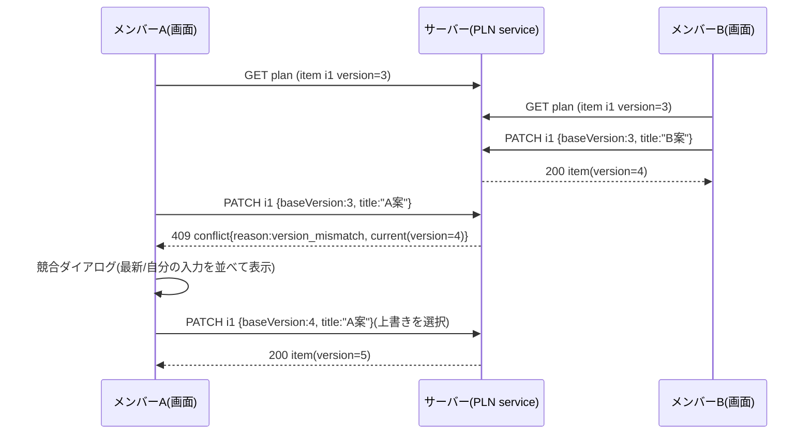

# 05 旅程・集合場所メモ(詳細設計)

ID 接頭辞は `PLN`(PLN-FILE=ファイル、PLN-TYPE=型、PLN-FN=関数、PLN-API=API、PLN-VAL=検証、PLN-ERR=エラー、PLN-UI=画面、PLN-TASK=実装タスク、PLN-T=試験、PLN-A11Y=アクセシビリティ、PLN-Q=未決事項)。凡例は README の「状態の凡例」に従う。本書独自の印として、[デモ範囲外] は「記述は残すが、デモの実装・試験の対象にしない」ことを示す。仕様の正は docs/design(特に 02 柱14、04、05、07、10、12 章)。00 共通基盤は並行で詳細化中のため、確定するまで 00 の骨子の記述(`store()`、`currentUser(req)`、`validate`、`AppError`、`clock.now()`、`newId(prefix)`)を契約とし、不一致は第 16 章に書く。00・01・04・09 の詳細設計が具体化した後の差分は第 16 章 10〜16 にまとめる。

## 1. 概要と責務 / 対応する柱
- 柱14「グループ内の旅程・集合場所メモ」。参加中メンバー全員が閲覧・編集できる、グループ共有の次の 3 つを持つ。 [案、05 章]
  1. 旅程項目(PlanItem): 日付・時刻・場所(既存スポットを参照可)・メモ・並び順を持つ複数件のタイムライン。
  2. 集合場所メモ(MeetingNote): 集合の場所・日時・補足を 1 件。
  3. 日程メモ(ScheduleMemo): 自由記述 1 件(骨子の「日程メモ」。旅程項目に収まらない注意事項用)。
- グループの日程・行き先・人数などの基本項目は 01 が持つ。本モジュールは「自由記述のメモと項目」だけを持ち、グループ本体や状態は書き換えない。
- 状態(募集中〜完了・中止)は 04 が管理する。本モジュールは 04 の `canEdit(group)` を呼んで編集可否を決める。
- 対象外(デモ範囲外): 地図表示、写真添付、経路検索、外部カレンダー連携、旅程のエクスポート、リアルタイム共同編集。通知(10)も出さない [案]。

## 2. 既存機能との関係
- 新規。流用: 既存スポット(`app/src/data/seed.json` の `spots`。`id:number`、`name`、`area`)を旅程項目・集合場所の「場所」として任意に参照する。seed.json は変更しない。
- [事実] 既存スポットには `keyword`(スタンプ取得用の合言葉)が含まれる。**本モジュールの API・画面にはスポットの `id`、`name`、`area` だけを返し、`keyword`・`stampCount`・`description`・`map` は返さない。**
- 既存 `/api/v2`、`server-store.ts`、`api.ts` は変更しない。クライアントは `api.ts` の `api()` が `/api/v2` 固定のため使えない。00 が汎用フェッチを提供するまで本モジュール内 `plan/client.ts` に同形の小関数を持つ(PLN-FILE-11)。
- 地図: 既存画面はスポットに `map:{x,y}`(模式図上の座標)を持つが、旅程には使わない。**[案] 地図は使わず、旅程のスポットは名称・エリアの文字表示とする。** 理由: (a) rule.md の「外部依存なし」の条件を最も少ない実装で満たせる、(b) 模式図の座標は旅程の順序を表すのに向かない、(c) 実装と試験の量が少ない。余力があれば既存の模式図にスポットを重ねる表示を B 優先で検討(未決 PLN-Q-06)。

## 3. 画面・UI(04 章)
| 画面 | 04 章の項目 | パス案 |
|---|---|---|
| 旅程・集合場所メモ(グループ詳細のタブ) | 旅程・集合場所メモ(全員が編集可、柱14) | `/[campaign]/groups/[groupId]?tab=plan` |
- タブ親は 01 の `groups/[groupId]/page.tsx`(ディレクトリ名は README のとおり `[groupId]`。01 骨子は `[id]` 表記、第 16 章参照)。本モジュールは `<PlanTab groupId={...} />` を提供し、01 が `tab=plan` で描画する。
- 画面構成と各コンポーネントの詳細は第 9 章。

## 4. データ(05 章)

### 4.1 エンティティ(PLN-TYPE)
05 章の GroupPlan(groupId、集合場所メモ、日程メモ、更新者、更新日時)を、旅程項目と版番号のため次のとおり拡張する [案。第 16 章で 05 章への反映を要確認]。

```ts
// app/src/features/groups/plan/types.ts   (PLN-FILE-01)
export type PlanItemId = string;          // 例 "pi-a1b2c3"(newId("pi"))。^pi-[a-z0-9]{1,36}$
export type IsoDate = string;             // "YYYY-MM-DD"(日本時間の暦日。タイムゾーンなし)
export type ClockTime = string;           // "HH:mm" 24 時間表記
export type IsoDateTime = string;         // ISO 8601 タイムゾーン付き(clock.now().toISOString())

/** 旅程の 1 項目(Store.plans[groupId].items の要素) */
export interface PlanItem {
  id: PlanItemId;
  groupId: string;
  date: IsoDate;                 // 必須。グループの日程内
  time: ClockTime | null;        // 任意。情報表示用(並びは seq が決める)
  title: string;                 // 必須 1〜60 文字、単一行
  spotId: number | null;         // 任意。seed.spots の id
  note: string;                  // 0〜300 文字(改行可)
  seq: number;                   // 同一 date 内の並び順(1 始まりの連番。reorder/追加/日付変更で採番し直す)
  version: number;               // 楽観的ロック。作成時 1、更新ごとに +1
  createdBy: string;             // DemoUser.id
  createdAt: IsoDateTime;
  updatedBy: string;
  updatedAt: IsoDateTime;
}

/** 集合場所メモ(グループに 1 件) */
export interface MeetingNote {
  text: string;                  // 0〜500 文字(改行可)。例「駅前ロータリー東側の時計台」
  spotId: number | null;         // 任意
  date: IsoDate | null;          // 任意。グループの日程内
  time: ClockTime | null;        // 任意
  version: number;               // 初期 0(未入力)。保存ごとに +1
  updatedBy: string | null;      // 未入力なら null
  updatedAt: IsoDateTime | null;
}

/** 日程メモ(グループに 1 件) */
export interface ScheduleMemo {
  text: string;                  // 0〜2000 文字(改行可)
  version: number;               // 初期 0
  updatedBy: string | null;
  updatedAt: IsoDateTime | null;
}

/** Store.plans[groupId]。groups-store.ts の Store に `plans: Record<string, GroupPlan>` として置く(00 所有) */
export interface GroupPlan {
  groupId: string;
  meeting: MeetingNote;
  scheduleMemo: ScheduleMemo;
  items: PlanItem[];             // 保存順は任意。表示順は sortItems() が (date, seq) で決める
  itemsRevision: number;         // 項目の追加・削除・並び替え・日付変更で +1(並び替えの競合検出用)。初期 0
}
```

```ts
// 画面向け DTO(サーバーで組み立てる。PLN-FILE-04 view.ts)
export interface SpotRef { id: number; name: string; area: string }   // keyword 等は含めない
export interface ActorRef { userId: string; displayName: string; isFormerMember: boolean }
// displayName は 09 の visibleProfile(viewer, target, "member") が返す表示名。退会者は isFormerMember=true(表示は「退会したメンバー」+表示名。#7 未決)

export interface PlanItemView extends Omit<PlanItem, "spotId" | "createdBy" | "updatedBy"> {
  spot: SpotRef | null;
  createdBy: ActorRef;
  updatedBy: ActorRef;
  outOfRange: boolean;           // date が現在のグループ日程外(日程変更後の残存。schedule=null なら false)
}
export interface MeetingNoteView extends Omit<MeetingNote, "spotId" | "updatedBy"> {
  spot: SpotRef | null;
  updatedBy: ActorRef | null;
  outOfRange: boolean;
}
export interface ScheduleMemoView extends Omit<ScheduleMemo, "updatedBy"> { updatedBy: ActorRef | null }

export interface PlanView {
  groupId: string;
  groupStatus: string;               // 04 の状態名(表示は statusLabel(group))
  editable: boolean;                 // canEdit(group) && 参加中メンバー
  readOnlyReason: string | null;     // editable=false のときの表示文(例「中止のため編集できません」)
  schedule: { startDate: IsoDate; endDate: IsoDate } | null;   // 日付入力の許容範囲。null=日程未設定(7.1)
  meeting: MeetingNoteView;
  scheduleMemo: ScheduleMemoView;
  items: PlanItemView[];             // (date, seq) 昇順
  itemsRevision: number;
  spotOptions: SpotRef[];            // スポット選択の候補(seed.spots の id/name/area のみ)
  limits: typeof PLAN_LIMITS;        // クライアントの文字数表示用
  serverTime: IsoDateTime;
}
```

```ts
// 入力 DTO(リクエスト本文。PLN-FILE-01)
export interface UpdateMeetingInput  { baseVersion: number; text: string; spotId?: number | null; date?: IsoDate | null; time?: ClockTime | null }  // PUT は全置換。省略=null
export interface UpdateMemoInput     { baseVersion: number; text: string }
export interface CreatePlanItemInput { date: IsoDate; time?: ClockTime | null; title: string; spotId?: number | null; note?: string }
export interface UpdatePlanItemInput { baseVersion: number; date?: IsoDate; time?: ClockTime | null; title?: string; spotId?: number | null; note?: string }  // PATCH。undefined=変更なし、null=消去
export interface ReorderInput        { date: IsoDate; orderedIds: PlanItemId[]; baseRevision: number }

export const PLAN_LIMITS = {
  titleMax: 60, noteMax: 300, meetingTextMax: 500, memoMax: 2000,
  itemsPerGroupMax: 40, itemsPerDateMax: 15, bodyBytesMax: 16 * 1024,
} as const;
```

### 4.2 保存と初期化
- 保存先は `Store.plans`(00 のインメモリ。再起動・リセットで seed に戻る)。`ensurePlan(groupId)`(PLN-FN-16)が初回アクセス時に空の GroupPlan(全 version=0、itemsRevision=0)を作る。
- デモ用初期データは `group-seed.json` の `plans`(手書き。募集中/実行確定のグループに 3〜5 項目と集合場所、中止グループにも閲覧確認用に 1〜2 項目)。実ユーザー情報・sample-data は使わない。
- 削除は物理削除(項目はストアから除去)。履歴は持たない(第 12 章)。

### 4.3 権限モデル(柱14: メンバー全員が編集)
| 操作 | 条件 |
|---|---|
| 閲覧(getPlan) | 参加中メンバー(幹事を含む)。状態は問わない(中止・完了でも閲覧可) |
| 編集(集合場所・日程メモ・項目の追加/更新/削除/並び替え) | 参加中メンバー **かつ** `canEdit(group)`=true |
| 非メンバー・退会者・参加申請中の人 | 閲覧も編集も不可 |
- 幹事に特別な編集権限はない(幹事も一般メンバーと同じ)。他人が作った項目も全員が更新・削除できる [案、05 章]。削除は「誰が消したか」が残らないため、第 12 章の履歴(任意)と、削除時の確認ダイアログで補う。
- 退会者は退会時点で `isMember`=false になり以後アクセス不可。退会者が作った項目・更新者表示は残す(#7 未決)。

## 5. インターフェース(案)

### 5.1 サービス関数(PLN-FN。`features/groups/plan/service.ts`)
すべて **同期関数**(`await` を挟まない)。Node.js は単一スレッドのため、「版番号の照合 → 書き込み」が 1 関数内で割り込まれず、楽観的ロックの照合とコミットが原子的になる。関数内で `await` を使う実装はこの前提を崩すため禁止する。 [案]

| ID | 署名 | 責務・例外 |
|---|---|---|
| PLN-FN-01 | `getPlan(user: DemoUser, groupId: string): PlanView` | 閲覧。`not_found`(非表示グループ)、`forbidden`(非メンバー) |
| PLN-FN-02 | `updateMeeting(user, groupId, input: UpdateMeetingInput): MeetingNoteView` | 集合場所を全置換。`forbidden`/`not_found`/`unavailable_state`/`invalid_input`/`conflict` |
| PLN-FN-03 | `updateScheduleMemo(user, groupId, input: UpdateMemoInput): ScheduleMemoView` | 日程メモを全置換。例外は PLN-FN-02 と同じ |
| PLN-FN-04 | `listItems(user, groupId): { items: PlanItemView[]; itemsRevision: number }` | 項目だけを取得する(再取得用)。例外は PLN-FN-01 と同じ |
| PLN-FN-05 | `createItem(user, groupId, input: CreatePlanItemInput): PlanItemView` | 同日の末尾に追加し、`itemsRevision` を +1。上限超過は `invalid_input`(fields.items)。その他の例外は PLN-FN-02 と同じ(`conflict` を除く) |
| PLN-FN-06 | `updateItem(user, groupId, itemId: PlanItemId, input: UpdatePlanItemInput): PlanItemView` | 部分更新。`date` を変えたら新しい日の末尾に移し、`itemsRevision` を +1(移動先の日が 15 件なら `invalid_input`(fields.items))。項目なしは `not_found`。その他の例外は PLN-FN-02 と同じ |
| PLN-FN-07 | `deleteItem(user, groupId, itemId: PlanItemId, baseVersion: number): { deleted: true; itemsRevision: number }` | 削除し、その日の `seq` を詰めて `itemsRevision` を +1。項目なしは `not_found`、版不一致は `conflict`。その他の例外は PLN-FN-02 と同じ |
| PLN-FN-08 | `reorderItems(user, groupId, input: ReorderInput): { items: PlanItemView[]; itemsRevision: number }` | 同一日内の並び替え。`baseRevision` の不一致は `conflict`(`current` は `{ items, itemsRevision }`)。その他の例外は PLN-FN-02 と同じ |
| PLN-FN-09 | `sortItems(items: PlanItem[]): PlanItem[]` | (date 昇順, seq 昇順) の純粋関数。`time` では並べ替えない |
| PLN-FN-10 | `buildPlanView(user: DemoUser, group: Group, plan: GroupPlan): PlanView` | DTO 組み立て(view.ts。スポット解決、ActorRef 解決、outOfRange 計算) |
| PLN-FN-11 | `assertCanRead(user, groupId): Group` | `getGroup`→`isMember` を行い Group を返す。`not_found`/`forbidden` |
| PLN-FN-12 | `assertCanEdit(user, groupId): Group` | PLN-FN-11 の後に `canEdit(group)` を確認。false は `unavailable_state` |
| PLN-FN-13 | `parseMeetingInput` / `parseMemoInput` / `parseCreateItemInput` / `parseUpdateItemInput` / `parseReorderInput` | `(raw: unknown, schedule) => 型付き入力`。違反は `AppError("invalid_input", …, 400)`(fields つき)。validation.ts |
| PLN-FN-14 | `normalizeText(raw: string, opts: { multiline: boolean }): string` | 次の順に処理する: ① 改行(`\r\n`、`\r`)を `\n` に統一、② 制御文字(U+0000〜001F、U+007F〜009F。`\n` は残し、`\t` は multiline=true のときだけ残す)・ゼロ幅文字・双方向制御文字(7.2 の範囲)を除去、③ 前後の空白を除去、④ multiline=false で `\n` を含む場合は `invalid_input`(除去せずに拒否)。00 が同等の共通関数を出したらそちらに置換 [案] |
| PLN-FN-15 | `isValidIsoDate(s: string): boolean` / `isValidClockTime(s: string): boolean` / `isWithinSchedule(d: IsoDate, s: {startDate; endDate}): boolean` | 暦日の実在検証(`Date.UTC` で往復一致)と文字列比較による範囲判定 |
| PLN-FN-16 | `ensurePlan(groupId: string): GroupPlan` | `Store.plans[groupId]` を返す。無ければ空の GroupPlan(4.2)を作って保存する。グループの存在確認(PLN-FN-11)の後にだけ呼ぶ |
| PLN-FN-17 | `seedPlans(store: Store): void` | group-seed.json の `plans` を `Store.plans` に投入する(seed.ts。00 の `resetStore` から呼ばれる) |
| PLN-FN-18 | `handlePlanRoute(req: Request, user: DemoUser, segments: string[]): Promise<Response> \| null` | routes.ts。パスの分解、本文の読み取り(16 KiB 上限)、service の呼び出し、ヘッダーの付与、`AppError` の応答への変換。該当しないパスは `null` |

#### 共通の処理順序(書き込み系。PLN-FN-02/03/05〜08)
1. `assertCanRead`(not_found → forbidden)
2. `assertCanEdit`(unavailable_state)
3. `parse*`(形式・長さ・範囲。invalid_input)
4. `checkText`(09。禁止表現。invalid_input。全文字列項目)
5. 参照整合と件数(spotId が seed.spots に存在する: invalid_input、対象の項目が存在する: not_found、件数上限 PLN-VAL-10: invalid_input)
6. 版番号の照合(conflict)
7. 反映(`version`+1、`updatedBy/At`、必要なら `itemsRevision`+1、`seq` 採番)
- 順序の理由: 権限・状態を先に判定し、無権限者に入力検証の内容(情報)を返さない。版番号の照合を最後にすることで、無効な入力で競合エラーを返さない。

### 5.2 API(PLN-API。Route Handler の細部は 00 の catch-all に登録)
共通: ベース `/api/groups/:groupId/plan`。JSON。現在ユーザーは Cookie `demoUser`(00 の `currentUser(req)`)。リクエスト本文は 16 KiB 以下(超過は 413 ではなく 400 `invalid_input` とする [案])。変更系(PUT/PATCH/POST/DELETE)のリクエストには、本文のない DELETE も含めて `Content-Type: application/json` を付ける(7.2 の CSRF 対策)。レスポンスに `Cache-Control: no-store`、`X-Content-Type-Options: nosniff`、`Content-Type: application/json; charset=utf-8`。`PlanItem` 等のフィールドの型は 4.1。`:itemId` は `^pi-[a-z0-9]{1,36}$`、`:groupId` は `^[a-z0-9-]{1,40}$` でなければ `not_found`(404)。パスまたはメソッドが下表に一致しない場合、`handlePlanRoute` は `null` を返し、00 の catch-all の既定の応答に従う。

| ID | メソッド・パス | リクエスト | 成功レスポンス | 主なエラー |
|---|---|---|---|---|
| PLN-API-01 | `GET /api/groups/:groupId/plan` | - | 200 `PlanView` | 404 not_found、403 forbidden |
| PLN-API-02 | `GET /api/groups/:groupId/plan/items` | - | 200 `{ items: PlanItemView[]; itemsRevision }` | 同上 |
| PLN-API-03 | `PUT /api/groups/:groupId/plan/meeting` | `UpdateMeetingInput` | 200 `MeetingNoteView` | 400、403、404、409(conflict / unavailable_state) |
| PLN-API-04 | `PUT /api/groups/:groupId/plan/memo` | `UpdateMemoInput` | 200 `ScheduleMemoView` | 同上 |
| PLN-API-05 | `POST /api/groups/:groupId/plan/items` | `CreatePlanItemInput` | 201 `PlanItemView` | 400、403、404、409(unavailable_state) |
| PLN-API-06 | `PATCH /api/groups/:groupId/plan/items/:itemId` | `UpdatePlanItemInput` | 200 `PlanItemView` | 400、403、404、409(conflict / unavailable_state) |
| PLN-API-07 | `DELETE /api/groups/:groupId/plan/items/:itemId?baseVersion=N` | (本文なし。`baseVersion` はクエリの 10 進整数文字列) | 200 `{ deleted: true, itemsRevision }` | 400(baseVersion 不正)、403、404、409(conflict / unavailable_state) |
| PLN-API-08 | `POST /api/groups/:groupId/plan/items/reorder` | `ReorderInput` | 200 `{ items, itemsRevision }` | 400、403、404、409(conflict / unavailable_state) |

- 状態を変える操作を POST とする README 4.3 の方針に対し、更新は PUT/PATCH/DELETE を使う(REST 的な意味が明確で、冪等性を説明しやすい)。**README 4.3 の「状態を変える操作は POST」との差異は第 16 章に記載。** 00 の catch-all が POST のみに対応する場合は、次のとおり読み替え、サービス関数は変えない [案]: PLN-API-03 → `POST …/plan/meeting`、PLN-API-04 → `POST …/plan/memo`、PLN-API-06 → `POST …/plan/items/:itemId/update`、PLN-API-07 → `POST …/plan/items/:itemId/delete`(本文 `{ baseVersion }`)。
- DELETE に本文を付けない(一部クライアント・プロキシで扱いが不定のため)。`baseVersion` はクエリで渡す。
- 一覧(PLN-API-01)は項目をすべて含む(上限 40 件のためページングなし)。PLN-API-02 は競合後や保存後に項目だけを再取得するための API。
- 追加(PLN-API-05)に版番号は不要。二重送信による重複は、画面で送信中ボタンを無効化して防ぐ(サーバー側の重複排除はしない [案])。
- **競合レスポンス(409 conflict)の形** [案。00 の `toResponse` に `extra` が必要。第 15 章に要望]:

```ts
export interface ConflictBody {
  error: "conflict";
  reason: "version_mismatch";
  message: string;                                   // 例「他のメンバーが先に更新しました」
  current: PlanItemView | MeetingNoteView | ScheduleMemoView | { items: PlanItemView[]; itemsRevision: number };
  // current は競合したリソースの最新の内容(読み取り権限があるため返してよい)
}
```
- `current` の型は API ごとに決まる: PLN-API-03 は `MeetingNoteView`、PLN-API-04 は `ScheduleMemoView`、PLN-API-06・07 は `PlanItemView`、PLN-API-08 は `{ items, itemsRevision }`。
- 項目が他のメンバーに削除済みの PATCH/DELETE は `404 not_found`(message「この項目は削除されました」)。画面は一覧を再取得する。

## 6. 状態遷移・主要シーケンス

### 6.1 状態ごとの編集可否(04 の `canEdit` を呼ぶ)
本モジュール自身は状態を持たない。可否は `canEdit(group)` の結果だけに従い、本モジュール内で状態名を判定しない(04 が変更しても追従するため)。期待する対応は次の表のとおり。04 の詳細設計の可否表(`canEdit` は完了・中止で false、それ以外で true)と一致することを確認した(2026-11-09 時点。04 の確定後に再確認する):

| グループ状態(05 章の状態名) | 閲覧 | 編集 | 根拠 |
|---|---|---|---|
| 募集中、最少人数到達、辞退期間 | 可 | 可 [案] | 成立前から集合場所を相談できる |
| 実行確定、実施中 | 可 | 可 | 直前の変更を共有する用途 |
| 完了 | 可 | 不可 [案] | 記録として固定 |
| 中止 | 可 | 不可 [案] | 中止後は閲覧のみ(再企画で作り直す) |
- `canEdit(group)` は 04 の骨子で引数がグループのみ(ユーザーを取らない)。メンバー判定は 01 の `isMember` を別に呼ぶ。
- 状態が編集中に変わった場合(例: 別の画面で中止)は、保存時に `unavailable_state` が返り、画面は入力内容を残したまま読み取り専用バナーを出す(PLN-UI-09)。
- 「参加者が 1 人になった」場合など人数による制約は設けない。

### 6.2 同時編集の競合対策(楽観的ロック。柱14の同時編集)
- [案] 採用方式: **リソース単位の版番号(楽観的ロック)**。「最後の保存が勝つ」(骨子案)は、メンバー全員が編集できる前提では、後から保存した人が他のメンバーの変更を通知なしに上書きするため採らない。
- 版番号の単位:

| リソース | 版番号 | 競合が起きる操作 |
|---|---|---|
| 集合場所メモ | `meeting.version` | PLN-API-03 |
| 日程メモ | `scheduleMemo.version` | PLN-API-04 |
| 旅程項目(個別) | `item.version` | PLN-API-06、07 |
| 並び順(1 日分) | `plan.itemsRevision`(追加・削除・並び替え・日付変更で +1) | PLN-API-08 |
- 項目の追加(PLN-API-05)は他の項目に影響しないため版不要。ただし追加は `itemsRevision` を進めるため、同時に送られた並び替えは競合(409)になる。画面は最新の項目を再取得し、利用者が並び替えをやり直す。
- 規則: クライアントは直近に取得した版を `baseVersion` として送る。サーバーは現在の版と等しい場合のみ反映し、版を +1 して返す。異なる場合は反映せず 409 とし、`current` に最新を入れる。
- 初期状態(未入力)の `version=0` に対して `baseVersion:0` で保存でき、成功すると `version=1`。



- 競合時の画面の挙動(PLN-UI-08): 入力内容を失わない。最新の内容と自分の入力を並べて見せ、(1)「最新の内容を読み込む(自分の入力は破棄)」(2)「自分の入力で上書きして保存」(`baseVersion` を `current.version` に置き換えて再送)(3)「閉じて編集を続ける」の 3 択。自動マージはしない。並び順の競合(PLN-API-08)は (1) と (3) の 2 択とし、上書きは提供しない(項目の増減で `orderedIds` が無効になるため)。
- 画面は定期ポーリングせず、タブ表示時・ウィンドウのフォーカス復帰時・保存成功時・「再読み込み」操作時に再取得する(PLN-UI-10)。時間差で古い画面を保存すると競合として検出される。

### 6.3 並び順の規則
- 表示順は (date 昇順, seq 昇順)。`time` は表示のみで並びに使わない(時刻が空の項目や、時刻順と相談順がずれる場合に手動で決められるようにするため)。 [案]
- 追加: 同日の最大 seq + 1。日付変更: 新しい日の最大 seq + 1、元の日は seq を詰め直す。削除: その日の seq を詰め直す。
- 並び替えは同一日内のみ(日をまたぐ移動は日付の編集で行う)。`orderedIds` はその日の全項目 ID の順列でなければならない(過不足・重複は `invalid_input`)。

## 7. 入力検証・セキュリティ

### 7.1 検証規則(PLN-VAL)
| ID | 項目 | 規則 |
|---|---|---|
| PLN-VAL-01 | `title` | string、`normalizeText` 後に 1〜60 文字(UTF-16 サロゲートペアは 1 文字。`Array.from(s).length`)、改行不可。必須 |
| PLN-VAL-02 | `note` | string、0〜300 文字、改行可。5 行以内(改行 4 個まで)[案]、超過は `invalid_input`(fields.note)。省略は "" |
| PLN-VAL-03 | `meeting.text` | string、0〜500 文字、改行可 |
| PLN-VAL-04 | `memo.text` | string、0〜2000 文字、改行可 |
| PLN-VAL-05 | `date`(項目) | 必須。`^\d{4}-\d{2}-\d{2}$` かつ暦日として実在。**グループの日程 `startDate <= date <= endDate` に含まれる**(境界日を含む) |
| PLN-VAL-06 | `meeting.date` | 任意(null 可)。形式・範囲は PLN-VAL-05 と同じ |
| PLN-VAL-07 | `time` | 任意(null 可)。`^([01]\d|2[0-3]):[0-5]\d$` |
| PLN-VAL-08 | `spotId` | 任意(null 可)。整数で `seed.spots` に存在する id。存在しない値は `invalid_input`(fields.spotId)。文字列の数字は受け付けない |
| PLN-VAL-09 | `baseVersion` / `baseRevision` | 必須。整数 0〜2147483647。欠落・非整数・文字列は `invalid_input`。DELETE のクエリ `baseVersion` は文字列で届くため、`^\d{1,10}$` に一致するときだけ整数に変換し、同じ範囲を検査する |
| PLN-VAL-10 | 件数 | 1 グループの項目は最大 40 件、同日は最大 15 件。超過は `invalid_input`(fields.items) |
| PLN-VAL-11 | `orderedIds` | 配列(最大 15)、各要素は `^pi-[a-z0-9]{1,36}$`、重複なし、その日の全項目 ID と集合として一致 |
| PLN-VAL-12 | `meeting` の整合 | `date` または `time` を指定した場合は、`text` が空でないか `spotId` が指定されていること(場所のない、日時だけの集合メモを不可にする) |
| PLN-VAL-13 | 未知のフィールド | 無視せず `invalid_input`(fields に項目名)[案]。型の違うフィールド(配列・オブジェクト)も不可 |
| PLN-VAL-14 | 本文サイズ・JSON | 16 KiB 超または JSON 不正は `invalid_input` |
| PLN-VAL-15 | 変更なし PATCH | 全フィールド省略は `invalid_input`(「変更する項目がありません」) |
- 禁止表現(09 の `checkText(text, field)`): `title`、`note`、`meeting.text`、`memo.text` のすべてに適用。field 名は `plan.item.title`、`plan.item.note`、`plan.meeting.text`、`plan.memo.text`。違反は `invalid_input`、`fields[<フィールド名>]=[理由]`。連絡先交換の誘導(URL・メールアドレス・電話番号・ID 交換の誘導)を弾くかは 09 の辞書範囲に依存 [未決 PLN-Q-03]。09 の詳細設計の案は第 16 章 15。`checkText` の戻り値形は 09 の骨子が「OK または禁止語の理由」のため `{ ok: true } | { ok: false; reason: string }` を仮定(第 16 章)。
- 日程範囲の取得: 01 の `getGroupSchedule(group)`(第 15 章の要望)。日程が日付の幅(日程の幅、05 章 Trip)の場合は「最も早い開始〜最も遅い終了」を許容範囲とする [推定]。日程が未設定のグループは日付入力不可とし、画面は「グループの日程が未設定です」と表示して項目追加を無効化する [案]。[デモ範囲外](00・01 の詳細設計では日程が必須のため、通常は発生しない)
- 日程がのちに変更され、既存項目が範囲外になった場合は、項目を消さず `outOfRange=true` で警告表示する(更新時は範囲内への修正を要求)。01 は現時点で日程の変更機能を持たないため、通常は発生しない。[デモ範囲外]

### 7.2 セキュリティ
OWASP Top 10 の代表項目のうち、本モジュールに関係するものの対処を示す。ヘッダーの付与、CSRF の検査、Cookie からの現在ユーザーの解決は 00 の共通部が行い、本モジュールはそれを使う。

- **アクセス制御・IDOR**: すべての API で `currentUser(req)`(Cookie から seed 内のダミーユーザーに解決)→ グループの存在確認 → メンバー判定(01 `isMember`)をサービス層で行う(PLN-FN-11、12)。権限の判定は現在ユーザーだけを根拠にし、本文・クエリの値(`userId` 等)を根拠にしない。パスの `groupId` は対象の指定にだけ使う。`createdBy`・`updatedBy` は常にサーバーが現在ユーザーで設定し、本文に含まれていれば未知フィールドとして 400 にする(PLN-VAL-13、PLN-T-11)。
- **他グループの参照の混入(IDOR)**: `:itemId` はそのグループの `items` 内だけで検索する(別グループの項目 ID でも `not_found`。PLN-T-12)。`ensurePlan` は Group の存在確認後にだけ呼ぶ。
- **入力検証・インジェクション**: 型・長さ・形式・範囲をサーバーで検証する(7.1。クライアントの検証は補助)。SQL を使わないため SQL インジェクションは該当しない。`groupId`/`itemId` はファイルパスに使わない(インメモリ)。
- **XSS 対策(保存時)**: HTML エスケープして保存しない(二重エスケープと表示崩れを防ぐ)。代わりに (a) `normalizeText` で制御文字・ゼロ幅・双方向制御文字(U+202A〜202E、U+2066〜2069、U+200B〜200F、U+FEFF)を除去、(b) 長さ・形式の厳格検証、(c) 入力は文字列のみ受け付け、オブジェクト・配列は拒否。「保存した文字列は常に非信頼のテキストとして扱う」を原則とする。
- **XSS 対策(表示時)**: React の既定エスケープに任せる。`dangerouslySetInnerHTML`、`innerHTML`、`eval`、Markdown/HTML 変換、URL の自動リンク化はいずれも使わない(URL らしき文字列も単なるテキスト)。改行は CSS `white-space: pre-wrap` で表示する(`<br>` を生成する変換をしない)。属性値(`aria-label`、`title`)にも文字列を渡すだけで、URL 属性(`href`/`src`)にはユーザー入力を入れない。JSON 応答は `application/json` + `nosniff`。
- 入力が HTML を含む例(`<script>alert(1)</script>`、``)は、保存・表示とも実行されず文字としてそのまま表示される(試験 PLN-T-31、32)。
- **CSRF**: 現在ユーザーを Cookie `demoUser`(`SameSite=Lax`)で決めるため、00 の共通部の検査(変更系は `Content-Type: application/json` 必須、`Origin` が `Host` と異なれば拒否)をすべての変更系 API に適用する。`client.ts` は PUT/PATCH/POST/DELETE のすべてで `Content-Type: application/json` を付ける(本文のない DELETE を含む)。CORS ヘッダーは付けない。試験は 00 の CMN-T-13 による。
- **認証・セッション(デモ)**: ログインはない。Cookie `demoUser` は利用者が書き換えられる(デモ用の視点切替。00 第 7 章)。本番相当の認証は対象外とし、既知の制約とする。
- **セキュリティ設定**: 応答に `Cache-Control: no-store`、`X-Content-Type-Options: nosniff`、`Content-Type: application/json; charset=utf-8` を付ける(5.2)。外部への通信(地図タイル・外部フォント・外部 API)は行わない(PLN-T-56)。
- **機密データ・情報露出**: 旅程データはグループのメンバーにだけ返す。非メンバーに存在・件数を返さない(非公開グループは `not_found`)。スポットは `keyword` を返さない(2 章)。更新者の表示名は 09 の `visibleProfile` を通して取得し、DemoUser のその他の項目は返さない。
- **ログ**: メモの本文をサーバーログに出さない(出す場合は長さのみ)。
- **過大入力(デモ用の最小の対策)**: 本文 16 KiB、項目 40 件、同日 15 件、ID パターンの制限。
- **既知の制約**: レート制限、大量リクエストによる負荷、応答時間の差などからの推測(タイミング攻撃)への対策は行わない。ZWJ(U+200D)を除去するため、ZWJ で結合した絵文字は分割された状態で保存される。

## 8. エラー処理(PLN-ERR)
エラー本文は 00 の形 `{ error, message, fields? }`(409 conflict は 5.2 の ConflictBody)。`fields` の値は理由の文字列の配列(`Record<string, string[]>`)とする。

| ID | コード(HTTP) | 条件 | 画面の表示と次の行動 |
|---|---|---|---|
| PLN-ERR-01 | `not_found`(404) | 存在しない・非表示のグループ、存在しない項目 | グループ一覧へ戻る導線。項目の場合は「この項目は削除されました」と一覧を再取得 |
| PLN-ERR-02 | `forbidden`(403) | 非メンバー・退会者・申請中 | 「グループのメンバーだけが見られます」+グループ詳細(公開情報)へ |
| PLN-ERR-03 | `unavailable_state`(409) | `canEdit(group)`=false(完了・中止) | 「{状態名}のため編集できません。閲覧のみです」(状態名は `statusLabel(group)`)。中止の場合は再企画の案内を付ける。入力済みの内容は画面に残す(PLN-UI-09) |
| PLN-ERR-04 | `invalid_input`(400) | 長さ超過、日程外の日付、形式不正、件数超過、禁止表現、spotId 不正、未知フィールド、本文サイズ超過、JSON 不正 | 項目ごとに修正案(例「60 文字以内にしてください(現在 72 文字)」「日程(12/5〜12/6)の範囲で選んでください」) |
| PLN-ERR-05 | `conflict`(409, reason=version_mismatch) | 版不一致 | 競合ダイアログ(6.2)。入力は失わない |
| PLN-ERR-06 | `internal`(500) | 想定外 | 「保存できませんでした。もう一度お試しください」+入力を残す |
| PLN-ERR-07 | `network`(クライアント側のみ) | fetch の失敗、JSON でない応答 | 「サーバーに接続できません。起動していることを確認して再試行してください」+入力を残す |
- 00 の共通部が返す `unsupported_media_type`(415)・`forbidden`(Origin 不一致)・`method_not_allowed`(405)は、通常の画面操作では発生しない。表示は 00 第 8 章に従う。
- 表示の文言は `plan/messages.ts` に集約(README 4.4)。メッセージにユーザー入力を埋め込む場合も、プレーンテキストとして描画する。

## 9. 画面・コンポーネント構成(PLN-UI)

### 9.1 ファイル構成(新規のみ。実装時に作る一覧と責務)
```
app/src/features/groups/plan/
  types.ts            PLN-FILE-01  4.1 の型と PLAN_LIMITS
  messages.ts         PLN-FILE-02  日本語の文言(エラー・ラベル・aria 文言)
  validation.ts       PLN-FILE-03  parse*、normalizeText、日付/時刻検証(PLN-FN-13〜15)
  view.ts             PLN-FILE-04  buildPlanView、スポット解決、ActorRef 解決(PLN-FN-10)
  service.ts          PLN-FILE-05  PLN-FN-01〜09、11、12、16(状態を変更する唯一の場所)
  routes.ts           PLN-FILE-06  handlePlanRoute(PLN-FN-18)。パス分解、本文読み取り、service 呼び出し、ヘッダー付与
  seed.ts             PLN-FILE-07  seedPlans(PLN-FN-17)。group-seed.json の plans を Store に投入する(00 の resetStore から呼ばれる)
  __tests__/          PLN-FILE-08  単体・API 試験(第 14 章。ファイル名は *.test.ts)
  client.ts           PLN-FILE-11  fetch ラッパー(planApi。署名は 9.2。ConflictError を投げる)
  ui/
    usePlan.ts                                     PLN-FILE-09  取得・再取得・保存・競合状態を持つフック
    PlanTab.tsx                                    PLN-FILE-10  タブの最上位
    MeetingCard.tsx / MeetingForm.tsx              PLN-FILE-12  集合場所カードと編集フォーム
    ItineraryTimeline.tsx / ItineraryItemRow.tsx   PLN-FILE-13  日付ごとのタイムライン
    ItemFormModal.tsx                              PLN-FILE-14  項目の追加・編集モーダル
    ScheduleMemoCard.tsx                           PLN-FILE-15  日程メモ(表示+編集)
    SpotSelect.tsx                                 PLN-FILE-16  スポット選択(Mantine Select、検索可)
    ConflictDialog.tsx                             PLN-FILE-17  競合時の比較ダイアログ
    ReadOnlyBanner.tsx                             PLN-FILE-18  読み取り専用の案内
    CharCounter.tsx                                PLN-FILE-19  文字数カウンタ
```
- 既存ファイルの変更は不要。登録が必要な箇所は 2 つで、いずれも他モジュールの所有(第 15 章): (a) 00 の catch-all `app/api/groups/[...path]/route.ts` が `handlePlanRoute` を呼ぶ、(b) 01 の詳細ページが `tab=plan` で `<PlanTab>` を描画する。
- UI は Mantine 9(既存。第 11 章)。日付・時刻の入力は `@mantine/dates` を使わず、ネイティブの `<input type="date" min max>` と `<input type="time">` とし、`min`/`max` に `schedule` を渡す(第 11 章)。Next.js 16 のクライアントコンポーネント・`"use client"` の扱いは既存コード(`api.ts` 先頭の `"use client"`)に倣う。キャッシュ関連は実装前に `app/node_modules/next/dist/docs/` を読む [要確認]。

### 9.2 コンポーネントの props・state・データ取得
```ts
// usePlan.ts
export interface UsePlan {
  view: PlanView | null;
  status: "loading" | "ready" | "error";
  errorCode: string | null;
  reload: () => Promise<void>;                       // GET plan。フォーカス復帰・保存後に呼ぶ
  saveMeeting: (input: Omit<UpdateMeetingInput, "baseVersion">) => Promise<SaveResult<MeetingNoteView>>;
  saveMemo: (text: string) => Promise<SaveResult<ScheduleMemoView>>;
  createItem: (input: CreatePlanItemInput) => Promise<SaveResult<PlanItemView>>;
  updateItem: (id: PlanItemId, patch: Omit<UpdatePlanItemInput, "baseVersion">) => Promise<SaveResult<PlanItemView>>;
  deleteItem: (id: PlanItemId) => Promise<SaveResult<{ deleted: true }>>;
  moveItem: (id: PlanItemId, direction: "up" | "down") => Promise<SaveResult<void>>;   // 内部で reorder を組み立て
  resolveConflict: (choice: "reload" | "overwrite" | "dismiss") => Promise<void>;
  conflict: ConflictState | null;
}
export type SaveResult<T> =
  | { ok: true; value: T }
  | { ok: false; kind: "invalid_input"; fields: Record<string, string[]> }
  | { ok: false; kind: "conflict" }            // conflict state に積まれる
  | { ok: false; kind: "unavailable_state" | "not_found" | "forbidden" | "internal" | "network"; message: string };
export interface ConflictState {
  target: { kind: "meeting" } | { kind: "memo" } | { kind: "item"; id: PlanItemId } | { kind: "order"; date: IsoDate };
  mine:                           // 自分の入力(送信しようとした内容。baseVersion/baseRevision は除く)
    | Omit<UpdateMeetingInput, "baseVersion">
    | Omit<UpdateMemoInput, "baseVersion">
    | Omit<UpdatePlanItemInput, "baseVersion">
    | { orderedIds: PlanItemId[] };
  current: ConflictBody["current"];   // サーバーの最新
}
```
`usePlan` は `baseVersion` を自分で保持せず、`view` の該当リソースの `version`(順序は `itemsRevision`)を送る。保存成功時はレスポンスで `view` を部分更新し、`itemsRevision` が変わる操作の後は PLN-API-02 で項目を再取得する。

```ts
// client.ts(PLN-FILE-11)。00 の汎用フェッチが確定したら置き換える(第 16 章 11)
export class PlanApiError extends Error {
  code: string;                                  // ErrorBody.error、または "network"
  status: number;                                // HTTP ステータス。network は 0
  fields?: Record<string, string[]>;
}
export class ConflictError extends PlanApiError {
  current: ConflictBody["current"];
}
export const planApi: {
  get(groupId: string): Promise<PlanView>;                                                                   // PLN-API-01
  listItems(groupId: string): Promise<{ items: PlanItemView[]; itemsRevision: number }>;                     // PLN-API-02
  updateMeeting(groupId: string, input: UpdateMeetingInput): Promise<MeetingNoteView>;                       // PLN-API-03
  updateMemo(groupId: string, input: UpdateMemoInput): Promise<ScheduleMemoView>;                            // PLN-API-04
  createItem(groupId: string, input: CreatePlanItemInput): Promise<PlanItemView>;                            // PLN-API-05
  updateItem(groupId: string, itemId: PlanItemId, input: UpdatePlanItemInput): Promise<PlanItemView>;        // PLN-API-06
  deleteItem(groupId: string, itemId: PlanItemId, baseVersion: number): Promise<{ deleted: true; itemsRevision: number }>; // PLN-API-07
  reorder(groupId: string, input: ReorderInput): Promise<{ items: PlanItemView[]; itemsRevision: number }>;  // PLN-API-08
};
```
- `client.ts` は全リクエストで `cache: "no-store"` を指定し、変更系には `Content-Type: application/json` を付ける(DELETE を含む。7.2)。パスの ID は `encodeURIComponent` を通す。409 で `error: "conflict"` の応答は `ConflictError`、それ以外の失敗は `PlanApiError` として投げる。`usePlan` がこれを `SaveResult` に変換する。

| コンポーネント | props | state | データ取得・挙動 |
|---|---|---|---|
| `PlanTab` | `{ groupId: string }` | `usePlan(groupId)` の結果、`editing`(`null | "meeting" | "memo" | {item:id} | "new-item"`) | 表示時 `reload`、`window` の `focus` と `visibilitychange` で `reload`。`status=loading` はスケルトン(`aria-busy`)、`error` は第 8 章の文言と再試行ボタン。`view.editable=false` なら `ReadOnlyBanner` を出し、すべての編集ボタンを描画しない |
| `MeetingCard` | `{ meeting: MeetingNoteView; editable: boolean; onEdit: () => void }` | なし | 場所テキスト、スポット名(エリア)、日時、更新者・更新日時(「Aさんが 11/9 14:05 に更新」)。未入力なら「集合場所はまだ決まっていません」+(editable なら)「入力する」 |
| `MeetingForm` | `{ initial: MeetingNoteView; schedule: {startDate; endDate}; spotOptions: SpotRef[]; limits; onSubmit(input): Promise<SaveResult<…>>; onCancel }` | 各入力値、`fieldErrors`、`submitting` | 場所メモ(Textarea、500 文字カウンタ)、スポット(SpotSelect)、日付、時刻。送信中は二重送信不可 |
| `ItineraryTimeline` | `{ items: PlanItemView[]; editable: boolean; onEdit(id); onDelete(id); onMove(id, "up"\|"down"); onAdd(date?: IsoDate) }` | なし(`items` を日付でグルーピング) | 日ごとに `<section>`(見出し `<h3>` に `<time>`)を置き、その中に項目の `<ol>` を置く。グループ日程の各日は項目が無くても見出しを表示し、「+ この日に追加」を置く。範囲外の項目は末尾の「日程外」見出しの下に置く(PLN-UI-12) |
| `ItineraryItemRow` | `{ item: PlanItemView; index: number; count: number; editable: boolean; … }` | 削除確認の開閉 | 時刻、タイトル、スポット(名称・エリアの文字)、メモ、更新者。上へ/下へ/編集/削除ボタン(各ボタンに `aria-label` で項目名を含める) |
| `ItemFormModal` | `{ mode: "create" \| "edit"; item?: PlanItemView; defaultDate?: IsoDate; schedule; spotOptions; limits; onSubmit; onClose }` | 入力値、`fieldErrors`、`submitting`、`dirty` | タイトル(60)、日付、時刻、スポット、メモ(300)。閉じる際 `dirty` なら破棄確認 |
| `ScheduleMemoCard` | `{ memo: ScheduleMemoView; editable: boolean; onSave(text) }` | `editing`、`draft` | 表示と編集(2000 文字カウンタ) |
| `SpotSelect` | `{ value: number \| null; onChange(v); options: SpotRef[]; label: string; error?: string }` | なし | 候補は `view.spotOptions`(7 件)。未選択可。自由記述の場所は項目のタイトルやメモに書く。選択後も場所名の文字をタイトルに自動コピーしない |
| `ConflictDialog` | `{ state: ConflictState; onChoose(choice) }` | なし | 「あなたの入力」と「最新の内容(更新者・時刻つき)」を 2 列(スマホは縦積み)で表示。3 択のボタン。`role="alertdialog"` |
| `ReadOnlyBanner` | `{ reason: string }` | なし | `role="status"`。例「このグループは中止になったため、旅程は閲覧のみです」 |

### 9.3 画面の挙動(PLN-UI)
- PLN-UI-01 タブ初期表示: 上から「集合場所カード」「旅程タイムライン」「日程メモ」。モバイルは 1 カラム、広い画面は集合場所カードを上段に固定。
- PLN-UI-02 見出し: 画面上部に「メンバー全員で編集できます」の説明と、`editable=false` のときは理由。モック明示は 01 のタブ親(AppShell)側の表示を使う。
- PLN-UI-03 旅程タイムライン: 日付(曜日つき)ごとにグループ化。項目は時刻(あれば)・タイトル・スポット・メモ・更新者。項目が 0 件なら「まだ旅程がありません」と表示し、`editable=true` のときだけ「予定を追加」ボタンを出す。
- PLN-UI-04 スポット表示: スポットは名称とエリアの文字。地図・座標・画像は出さない。スポットの詳細(既存スポット画面)へのリンクは付けない [案](既存画面のパスが campaign 依存で、参照のみで十分なため)。
- PLN-UI-05 追加・編集フォーム: モーダル。必須はタイトルと日付。エラーは項目の下に表示し、先頭のエラー項目へフォーカスを移す。サーバーの `fields` を同じ表示に流す。
- PLN-UI-06 削除: 確認ダイアログ「『{タイトル}』を削除します。グループの全員から見えなくなります。」。削除成功後に `aria-live` 領域で「削除しました」。
- PLN-UI-07 並び替え: 上へ/下へボタン(同日内)。端では無効化(`aria-disabled`)。ドラッグ操作は実装しない(上へ/下へボタンでキーボード・支援技術からも同じ操作ができ、実装量も少ないため)。
- PLN-UI-08 競合時の再読み込み: 6.2 のとおり `ConflictDialog` を開く。「最新の内容を読み込む」で `reload` し、編集中の入力は破棄(入力を貼り付けられるよう、ダイアログ内の「あなたの入力」はコピー可能なテキストとして表示)。「上書きして保存」は再送が再度競合したら再びダイアログを出す。
- PLN-UI-09 読み取り専用化: 保存時に `unavailable_state` が返ったら `reload` して `editable=false` を反映、編集中の入力は閉じずに残し(フォームは `disabled`)、`ReadOnlyBanner` を表示する。
- PLN-UI-10 再取得: 表示時、フォーカス復帰、保存成功後、「再読み込み」ボタン。ポーリング・WebSocket は使わない。
- PLN-UI-11 退会者・更新者表示: `ActorRef.isFormerMember=true` なら「(退会したメンバー)」を付す。
- PLN-UI-12 日程外項目: `outOfRange=true` の項目に「日程外」の表示を付け、編集で日付を範囲内へ直すよう案内する。[デモ範囲外](7.1。通常は発生しない)

### 9.4 アクセシビリティ(PLN-A11Y)
- PLN-A11Y-01 構造: タイムラインは `<ol>`、日付見出し(`<h3>`)と `aria-labelledby`、日時は `<time dateTime>`。集合場所カードは `<section aria-labelledby>`。見出しの階層はタブ親(`h2`)の下に `h3` を使う。
- PLN-A11Y-02 キーボード: すべての操作(追加・編集・削除・並び替え・ダイアログ)が Tab/Enter/Space/Esc で可能。ドラッグ専用の操作は無い。モーダルはフォーカストラップ+閉じた後に起動元へフォーカスを戻す(Mantine の既定)。
- PLN-A11Y-03 ラベル: フォーム項目は `<label>`、必須は「必須」を文字でも表示、エラーは `aria-invalid` と `aria-describedby`。ボタンの `aria-label` に項目名を含める(「『昼食』を 1 つ上へ」)。アイコンのみのボタンには必ず文字ラベル(視覚非表示可)。
- PLN-A11Y-04 通知: 保存成功・削除・並び替え後の結果は `aria-live="polite"` の領域で読み上げる(「『昼食』を 2 番目に移動しました」)。競合・エラーは `role="alert"`/`alertdialog`。文字数カウンタの読み上げは入力のたびではなく、上限に近いとき(90% 以上)のみ `aria-live` で通知する。
- PLN-A11Y-05 色: 日程外・エラー・読み取り専用を色だけで示さず、アイコンと文字を併記。コントラスト比は AA(4.5:1)以上(Mantine の既定テーマを使い、独自色を足さない)。
- PLN-A11Y-06 スマホ: タップ領域 44px 以上、1 カラム、横スクロールなし。日本語の長い文字列は `overflow-wrap: anywhere` で折り返す。`<html lang="ja">` は既存のレイアウトに従う [要確認]。

## 10. 他モジュールとの契約

### 10.1 呼び出す関数(他モジュール所有。名前は README・各骨子に合わせる)
| 呼ぶ関数 | 所有 | 用途 | 期待する形 |
|---|---|---|---|
| `store()` | 00 | `Store.plans` へのアクセス | `Store` に `plans: Record<string, GroupPlan>` を持つ |
| `currentUser(req)` | 00 | 現在ユーザー | `DemoUser`(`id`、表示名) |
| `AppError(code, message, status)` / `toResponse(e)` | 00 | エラー | `fields` を渡せる。`extra` を渡せると 409 の `current` を返せる(要望) |
| `newId("pi")` | 00 | 項目 ID | `pi-xxxxxx` |
| `clock.now()` | 00 | `createdAt`/`updatedAt` | `Date` |
| `getGroup(user, id)` | 01 | グループ取得(非表示は `not_found`) | `Group`(日程・状態を含む) |
| `isMember(user, group)` | 01 | 参加中メンバー判定 | `boolean`(退会・申請中は false) |
| `getGroupSchedule(group)` | 01(要望) | 日程の許容範囲 | `{ startDate: IsoDate; endDate: IsoDate } \| null` |
| `canEdit(group)` | 04 | 状態による編集可否 | `boolean` |
| `statusLabel(group)` | 04(要望) | 状態の日本語名(エラー文言用) | `string` |
| `checkText(text, field)` | 09 | 禁止表現 | `{ ok: true } \| { ok: false; reason: string }`(仮定) |
| `visibleProfile(viewer, target, "member")` | 09 | 更新者の表示名 | `{ displayName: string; … }` |

### 10.2 本モジュールが提供するもの
| 提供 | 呼び出し元 | 内容 |
|---|---|---|
| `handlePlanRoute(req, user, segments)`(PLN-FN-18) | 00 の catch-all | `segments` が `[groupId, "plan", …]` のときに処理して `Response`、該当しなければ `null` |
| `<PlanTab groupId />` | 01 の詳細ページ | `tab=plan` の中身 |
| `seedPlans(store)`(PLN-FN-17) | 00 の `resetStore` | group-seed.json の plans を投入 |
- 本モジュールは 04 の状態を変更しない。04 の `replan` が旅程を引き継ぐかは未決(PLN-Q-05)で、引き継ぐ場合は 04 が `getPlan`(閲覧)の結果を使うか、後日 `clonePlan` を追加する [案]。最小実装では提供しない。

## 11. 利用ライブラリ・モジュール(外部依存・ライセンス)
新規に追加するライブラリはない。バージョンは `app/package.json` の指定を維持する(表のバージョンとライセンスは、主チェックアウトの `app/node_modules` の各 `package.json` で 2026-11-09 に確認した)。外部リソース(地図タイル、外部フォント、画像、外部 API)は使わない。

### 11.1 ライブラリ(npm)
| 名前 | 用途(本モジュール) | ライセンス | バージョン方針 |
|---|---|---|---|
| next | Route Handler(00 の共通部経由)、App Router のページとクライアントコンポーネント | MIT | 16.4.5 を維持 |
| react / react-dom | 画面コンポーネント、`usePlan` の状態(`useState`/`useEffect`) | MIT | 19.3.0 を維持 |
| @mantine/core | `Modal`、`Select`(SpotSelect)、`TextInput`、`Textarea`、`Button`、`Alert`、`Skeleton`、`Badge` | MIT | ^9.7.5 を維持 |
| @mantine/hooks | `useDisclosure`(モーダル・確認ダイアログの開閉) | MIT | ^9.7.5 を維持 |
| @tabler/icons-react | 日程外・読み取り専用・並び替えボタンのアイコン(文字ラベルと併記。PLN-A11Y-05) | MIT | ^3.51.0 を維持 |
| dayjs | 画面での日付(曜日つき)・更新日時の日本時間表示。サーバーの日付検証には使わない | MIT | ^1.11.23 を維持 |
| vitest(devDependency) | 単体・API 試験(PLN-TASK-14) | MIT | 00 が追加する(00 第 9.1 の案)。追加時は最新の安定版を使う。本モジュールでは追加しない |

- 既存の依存のうち本モジュールで使わないもの: `@mantine/dates`(日付・時刻はネイティブの `<input type="date">`/`<input type="time">` で入力でき、`min`/`max` で日程の範囲を指定できるため)、`zustand`(状態は `usePlan` の中に閉じ、他の画面と共有しないため)。
- 検証ライブラリ(zod 等)は追加しない。00 の方針(自前の検証関数)に合わせる。

### 11.2 Node.js・Web 標準 API
| API | 用途 |
|---|---|
| `Request`/`Response`/`URL`(Web 標準。Next.js の Route Handler) | 本文・クエリ・ヘッダーの処理 |
| `TextEncoder` | 本文のバイト数(16 KiB 上限)の計測 |
| `JSON.parse` | 本文の解析(失敗は `invalid_input`) |
| `Date.UTC` | 暦日の実在検証(PLN-FN-15) |
| `Array.from` | コードポイント単位の文字数の計測(PLN-VAL-01) |
| `fetch`(ブラウザ) | `client.ts` |

Node 固有のモジュール(`fs`、`crypto` 等)は使わない(ID は 00 の `newId`、保存はインメモリ)。

### 11.3 自前モジュール(他モジュール所有)
10.1 の表のとおり。00(`store`、`currentUser`、`AppError`/`toResponse`、`newId`、`clock`)、01(`getGroup`、`isMember`、`getGroupSchedule`)、04(`canEdit`、`statusLabel`)、09(`checkText`、`visibleProfile`)。

### 11.4 本モジュールで自前実装するもの
| 対象 | 理由 |
|---|---|
| 入力検証(`validation.ts`) | 規則(null による消去、未知フィールドの拒否、日程範囲)が本モジュール固有で小さく、00 も検証ライブラリを追加しない方針のため |
| 文字列の正規化(`normalizeText`) | 00 の共通関数が確定するまでの暫定。確定後は置き換える |
| fetch ラッパー(`client.ts`) | 既存 `api.ts` の `api()` が `/api/v2` 固定で使えず、00 の汎用フェッチに PUT が無いため(第 16 章 11) |
| 日付・時刻の検証 | 文字列比較と `Date.UTC` で足り、サーバーのタイムゾーンに依存しないよう dayjs を使わないため |
| 楽観的ロック | 版番号の比較だけで足り、同期関数内で照合と反映を行えば原子的になるため(5.1) |

## 12. 変更履歴(誰がいつ変更したか)の扱い
- **[案] 最小実装では履歴テーブルを持たない。** 各リソースの `updatedBy`/`updatedAt` と `createdBy` のみ(05 章の「更新者・更新日時」と一致)。理由: 05 章のデータ定義が更新者・更新日時のみで、履歴は未決(#7)。デモで示す対象は「競合を検出し、入力を失わない」ことであり、履歴は必須ではない。
- 弱点: 削除と上書きの記録が残らない。誤削除の復元ができない。メンバー全員が編集できる前提では誤削除を復元する手段がないため、**任意(余力)の PLN-TASK-17 で「直近 50 件の変更ログ」を追加できるよう型を用意**しておく。

```ts
// 任意(PLN-TASK-17)。Store.plans[groupId].changeLog に追記(リングバッファ 50 件)
export interface PlanChangeLogEntry {
  at: IsoDateTime;
  by: string;                                  // DemoUser.id
  target: "meeting" | "memo" | "item";
  action: "create" | "update" | "delete" | "reorder";
  itemId?: PlanItemId;
  summary: string;                             // 例「『昼食』のタイトルを変更」。本文は入れず、項目名と項目種別のみ(メモ本文の複製を避ける)
}
// API: GET /api/groups/:groupId/plan/history?limit=20  → 200 { entries: PlanChangeLogEntry[] }(メンバーのみ、閲覧は状態不問)
```
- 退会者の履歴の扱い(残す/匿名化)は #7 未決に従う。

## 13. 実装タスク(PLN-TASK。順序つき)
規模: S=半日未満、M=半日〜1 日、L=1 日超。「前提」の `TASK-nn` は本書の PLN-TASK、「モジュール nn」は他モジュールを指す。前提のないものは並行可。「完了条件」の試験 ID は第 14 章。

- [ ] PLN-TASK-01(S)型・定数: `types.ts`(4.1)、`PLAN_LIMITS`、`messages.ts`(PLN-FILE-01、02)。前提: モジュール 00 の型(`DemoUser`、`AppError`)の確定。完了条件: `npx tsc --noEmit` が通る
- [ ] PLN-TASK-02(M)検証: `validation.ts`(`normalizeText`、日付・時刻、`parse*`、PLN-VAL-01〜15)。前提: TASK-01。完了条件: PLN-T-14〜27、30、34、35 の入力を `parse*` に直接与える単体試験が通る
- [ ] PLN-TASK-03(M)サービス読み取り: `view.ts`、`ensurePlan`、`assertCanRead`、`getPlan`、`listItems`、`sortItems`。前提: モジュール 01(`getGroup`/`isMember`/`getGroupSchedule`)、モジュール 00(store)。完了条件: PLN-T-01、03〜05、07、33、47
- [ ] PLN-TASK-04(M)集合場所・日程メモの更新: `assertCanEdit`、`updateMeeting`、`updateScheduleMemo`(処理順序 5.1)。前提: TASK-02、TASK-03、モジュール 04 の `canEdit`、モジュール 09 の `checkText`。完了条件: PLN-T-09、11、13、19、27、28、37、42、48
- [ ] PLN-TASK-05(M)項目の追加・更新・削除: `createItem`、`updateItem`、`deleteItem`(seq 採番、itemsRevision)。前提: TASK-04。完了条件: PLN-T-02、06、08、10、12、14〜18、20〜25、40、41、43、44、46
- [ ] PLN-TASK-06(S)並び替え: `reorderItems`(PLN-VAL-11)。前提: TASK-05。完了条件: PLN-T-38、39、45
- [ ] PLN-TASK-07(M)ルート: `routes.ts`(パス分解、本文 16 KiB 制限、JSON 解析、ヘッダー、AppError→応答、409 の `current`)と 00 の catch-all への登録。前提: TASK-03〜06(TASK-06 を後回しにする場合は reorder のルートを除く)、モジュール 00 の catch-all。完了条件: PLN-T-26(DELETE のクエリ)、29 と、PLN-T-01〜48 の HTTP 経由の実行
- [ ] PLN-TASK-08(S)デモデータ: group-seed.json の `plans`、`seedPlans`。前提: モジュール 00 の seed 構造。完了条件: リセット後の GET plan で 4.2 の初期データが返る
- [ ] PLN-TASK-09(S)クライアント: `client.ts`(9.2 の `planApi`、`ConflictError`)、`usePlan.ts`(取得・保存・競合状態)。前提: TASK-07。完了条件: `npx tsc --noEmit` と `npm run lint` が通る
- [ ] PLN-TASK-10(M)画面(閲覧): `PlanTab`、`MeetingCard`、`ItineraryTimeline`、`ItineraryItemRow`、`ScheduleMemoCard`(表示)、`ReadOnlyBanner`。前提: TASK-09、モジュール 01 のタブ親。完了条件: PLN-T-49、50
- [ ] PLN-TASK-11(M)画面(編集): `MeetingForm`、`ItemFormModal`、`SpotSelect`、`CharCounter`、メモ編集、削除確認。前提: TASK-10。完了条件: PLN-T-53 の追加・削除の部分、PLN-T-55
- [ ] PLN-TASK-12(M)競合・読み取り専用: `ConflictDialog`、`resolveConflict`、PLN-UI-08〜10。前提: TASK-11。完了条件: PLN-T-51、52
- [ ] PLN-TASK-13(S)並び替え UI・アクセシビリティ: 上へ/下へ、`aria-live`、フォーカス管理、PLN-A11Y 確認。前提: TASK-06、TASK-11。完了条件: PLN-T-53 の並び替えの部分、PLN-T-54
- [ ] PLN-TASK-14(M)単体・API 試験: 第 14 章の PLN-T-01〜48(単体・HTTP)を自動試験として書く。前提: TASK-07、試験ランナー(モジュール 00 の Vitest [案])。完了条件: `npm test` で PLN-T-01〜48 が通る
- [ ] PLN-TASK-15(S)画面・結合試験(手動手順): PLN-T-49〜56。前提: TASK-12(並び替えを含める場合は TASK-13)。完了条件: 手順と結果を記録する
- [ ] PLN-TASK-16(S)静的検査: `dangerouslySetInnerHTML`/`innerHTML` の不在、`/api/groups/.../plan` のレスポンスに `keyword` を含まないことの確認(PLN-T-33、36)。前提: TASK-07、TASK-10
- [ ] PLN-TASK-17(M・任意)変更ログ: 12 章の `changeLog`、API、画面の履歴リスト。前提: TASK-05、TASK-10(余力があるとき)

## 14. 受け入れ条件・試験項目(PLN-T。10 章の試験と対応)
試験の前提データ(group-seed.json 側で合わせる [案]): ダミーユーザー u-01(幹事)、u-02(メンバー)、u-05(どのグループにも非所属)、u-03(退会済み)。グループ g-001(募集中、日程 2026-12-05〜2026-12-06、メンバー u-01・u-02)、g-004(中止、メンバー u-01・u-02)、g-005(完了)、g-006(非公開、メンバー u-01)。スポット id=1〜7(seed)、id=99 は存在しない。表の「入力」は特記なき限り u-02 が g-001 に行う。HTTP は `/api/groups/g-001/plan…`。

### 14.1 権限・状態
| ID | 入力・操作 | 期待結果 |
|---|---|---|
| PLN-T-01 | u-01(幹事)が GET plan | 200。`editable=true` |
| PLN-T-02 | u-02(一般メンバー)が項目を追加 | 201。幹事でなくても編集できる |
| PLN-T-03 | u-05(非メンバー)が GET plan(g-001、公開) | 403 forbidden。本文に項目・メモを含まない |
| PLN-T-04 | u-05 が g-006(非公開)の GET plan | 404 not_found(存在を隠す) |
| PLN-T-05 | u-03(退会済み)が GET plan と PUT meeting | いずれも 403 |
| PLN-T-06 | u-05 が POST items(g-001) | 403。ストアの項目数が変わらない |
| PLN-T-07 | u-02 が g-004(中止)の GET plan | 200、`editable=false`、`readOnlyReason` に「中止」を含む |
| PLN-T-08 | u-02 が g-004 に POST items | 409 `unavailable_state`。項目数不変 |
| PLN-T-09 | g-005(完了)に PUT meeting | 409 `unavailable_state` |
| PLN-T-10 | u-02 が u-01 の作った項目を PATCH・DELETE | 200(他人の項目も編集可)。`updatedBy` が u-02 になる |
| PLN-T-11 | リクエスト本文に `updatedBy: "u-01"` を含めて PUT memo | 400(未知フィールド)。反映されない |
| PLN-T-12 | itemId に別グループの項目 ID、または形式不正の値(`abc`)を指定 | いずれも 404 not_found |
| PLN-T-13 | u-02 が g-001 の plan を取得した後、g-001 を中止にして(04 の操作、または試験でストアの状態を直接変更)から PUT meeting | 409 `unavailable_state`。サーバー側の内容は変更なし |

### 14.2 検証(境界値)
| ID | 入力 | 期待結果 |
|---|---|---|
| PLN-T-14 | title が 60 文字ちょうど | 201 |
| PLN-T-15 | title が 61 文字 | 400、`fields.title` |
| PLN-T-16 | title が空、または空白のみ | 400、`fields.title` |
| PLN-T-17 | title に改行 `"A\nB"` | 400 |
| PLN-T-18 | note 300 文字ちょうど / 301 文字、note 5 行 / 6 行 | 201 / 400、201 / 400 |
| PLN-T-19 | meeting.text 500 / 501 文字、memo.text 2000 / 2001 文字 | 200 / 400、200 / 400 |
| PLN-T-20 | date=2026-12-05(開始日)、2026-12-06(終了日) | いずれも 201 |
| PLN-T-21 | date=2026-12-04、2026-12-07 | 400、`fields.date`(「日程の範囲外」) |
| PLN-T-22 | date="2026-02-30"、"2026-1-5"、"12/05" | 400(暦日として不正) |
| PLN-T-23 | time="09:00"、"23:59" / "24:00"、"9:00"、"09:60" | 201 / 400 |
| PLN-T-24 | spotId=1 / 99 / "1"(文字列) / null | 201 / 400 / 400 / 201 |
| PLN-T-25 | 同日 15 件ある状態で 16 件目を追加 / 全体 40 件で追加 / 15 件ある日へ PATCH で日付を変更 | いずれも 400 `fields.items` |
| PLN-T-26 | baseVersion が欠落、"3"(文字列)、-1、1.5。DELETE のクエリ `baseVersion` が欠落、`abc`、`-1` | いずれも 400 |
| PLN-T-27 | meeting に time="10:00" のみ(text 空、spotId なし) | 400(PLN-VAL-12) |
| PLN-T-28 | 禁止表現を含む title(09 の辞書に載せた語) | 400、`fields.title` に理由。ストアに保存されない |
| PLN-T-29 | 16 KiB 超の本文、不正な JSON | 400 |
| PLN-T-30 | PATCH で全フィールド省略 | 400(変更する項目がない) |

### 14.3 XSS・情報露出
| ID | 入力・操作 | 期待結果 |
|---|---|---|
| PLN-T-31 | title=`<script>alert(1)</script>`、note=`` を保存し画面表示 | 保存は成功(そのままの文字列で保存)。画面で文字として表示され、スクリプトが実行されない(ダイアログが出ない) |
| PLN-T-32 | memo に `https://example.com` と `javascript:alert(1)` | 文字としてのみ表示。リンク(`<a>`)にならない。09 が連絡先誘導を弾く設定の場合は 400 |
| PLN-T-33 | PlanView の JSON を検査 | `spotOptions`・`spot` に `keyword`、`stampCount`、`description`、`map` が無い |
| PLN-T-34 | title に制御文字・ゼロ幅文字(`"A\u0000​B"`)・双方向制御文字 | 保存後は `"AB"`(除去されて保存。長さは除去後で数える) |
| PLN-T-35 | Unicode: 絵文字(サロゲートペア。ZWJ を含まないもの)60 個 / 61 個を title に | 201(文字数は 60)/ 400 |
| PLN-T-36 | ソース検査 | `plan/` 配下に `dangerouslySetInnerHTML`、`innerHTML`、`eval` が存在しない |

### 14.4 機能・競合
| ID | 入力・操作 | 期待結果 |
|---|---|---|
| PLN-T-37 | 集合場所を未入力の状態で GET plan、`baseVersion:0` で PUT meeting `{text:"駅前", spotId:1, date:"2026-12-05", time:"09:00"}` | 初回 `meeting.version=0` → 200 で `version=1`、`updatedBy=u-02`、`updatedAt` が clock の時刻 |
| PLN-T-38 | 追加を 3 件(同日)→ 並びが追加順(seq 1,2,3)。`orderedIds` を逆順で reorder | 200。取得すると逆順。`itemsRevision` が +1 |
| PLN-T-39 | reorder の `orderedIds` に項目が 1 つ足りない、重複、他日の ID | 400 |
| PLN-T-40 | A と B が同じ項目(version=3)を取得し、B が保存(→4)後に A が `baseVersion:3` で PATCH | A は 409 `conflict`、`reason=version_mismatch`、`current.version=4`、`current.title` が B の値。サーバーの値は B のまま |
| PLN-T-41 | 競合後、A が `baseVersion:4` で再送 | 200、`version=5` |
| PLN-T-42 | 同じ集合場所メモ(version=1)を 2 人が同時に PUT(`baseVersion:1`) | 一方 200(version=2)、他方 409(current はその値)。両方 200 にならない |
| PLN-T-43 | A が PATCH 中に B が項目を削除 → A が PATCH | 404 not_found(「削除されました」) |
| PLN-T-44 | 古い version で DELETE | 409 conflict。削除されない |
| PLN-T-45 | 追加直後に別メンバーが並び替え(旧 `baseRevision`) | 409 conflict。`current.items` が最新 |
| PLN-T-46 | 項目の日付を 12/05→12/06 に変更 | 新しい日の末尾に移り、元の日の seq が詰まる。`itemsRevision` +1 |
| PLN-T-47 | 1 件も無い状態の GET plan | `items=[]`、`itemsRevision=0`、`meeting.version=0` |
| PLN-T-48 | clock.now を差し替えて保存 | `updatedAt` が差し替えた時刻になる |

### 14.5 画面・アクセシビリティ(手動)
| ID | 手順 | 期待結果 |
|---|---|---|
| PLN-T-49 | u-02 で g-001 のタブを開く | 集合場所カード、タイムライン(12/5・12/6 の見出し)、日程メモが出る。「モック」表示は 01 のタブ親側 |
| PLN-T-50 | 中止グループ g-004 を開く | 読み取り専用バナー。追加・編集・削除・並び替えのボタンが無い |
| PLN-T-51 | 2 つのブラウザタブ(u-01 と u-02)で同じ項目を編集し、後から保存 | 競合ダイアログが出て、自分の入力と最新の内容が見える。3 択が機能する。入力が消えない |
| PLN-T-52 | 保存中に中止へ遷移した後で保存 | 入力が残ったまま読み取り専用バナー |
| PLN-T-53 | キーボードのみで項目を追加・並び替え・削除できる | 可能。フォーカスがモーダルから戻る |
| PLN-T-54 | スクリーンリーダー相当の確認(ブラウザのアクセシビリティツリー) | 日付見出し、`<ol>`、並び替え結果の通知、エラーの関連づけが取れる |
| PLN-T-55 | スマホ幅(幅 360px) | 横スクロールなし、タップ領域 44px 以上、長い文字が折り返す |
| PLN-T-56 | 外部通信の確認(ネットワークタブ) | localhost 以外へのリクエストが無い(地図タイル・外部フォントなし) |

受け入れ条件(要約): PLN-T-01〜48 が通ること(並び替えを実装しない場合は PLN-T-38、39、45 を除く)、PLN-T-49〜56 を手動で確認すること、`npm run lint` と `npm run build` が通ること、既存ファイルを変更していないこと。

## 15. 他モジュールへの要望
| 宛先 | 要望 |
|---|---|
| 00 | (1) `Store` に `plans: Record<string, GroupPlan>`(型は本書 4.1)。`resetStore` から `seedPlans` を呼ぶ。(2) `AppError` に任意の `extra`(409 conflict の `current` 用)を持てるようにする。(3) catch-all `app/api/groups/[...path]/route.ts` が `handlePlanRoute(req, user, segments)` を `groupId/plan/…` で呼ぶ。PUT/PATCH/DELETE メソッドをエクスポートする(骨子は POST 中心)。(4) `/api/groups` 用の汎用フェッチ(`api.ts` の `api()` は `/api/v2` 固定)。(5) 文字列正規化の共通関数(制御文字・ゼロ幅・双方向制御文字の除去)があれば PLN-FN-14 を置換。(6) `unavailable_state` と `conflict` の HTTP ステータスを 409 とするか確認 |
| 01 | (1) `getGroupSchedule(group): { startDate; endDate } | null`。(2) `getGroup(user, id)` が非表示グループで `not_found`。(3) `isMember(user, group)` が参加中のみ true。(4) 詳細ページが `?tab=plan` で `<PlanTab groupId>` を描画 |
| 04 | (1) `canEdit(group)` の意味を第 6.1 の表と一致させる(完了・中止で false、それ以外 true)。メモ編集用に別名(例 `canEditPlan`)が望ましければ指定してほしい。(2) `statusLabel(group)`(状態の日本語名)。(3) `replan` で旅程を引き継ぐか |
| 09 | (1) `checkText` の戻り値形の確定、`field` 名の登録(`plan.item.title` 等)。(2) 連絡先らしき文字列(URL・メール・電話)を弾くか。(3) `visibleProfile(viewer, target, "member")` で更新者の表示名のみが得られること |
| 10 | 旅程・集合場所の更新通知は出さない前提。必要なら種類の追加を依頼 [案] |

## 16. 設計上の確認事項(docs/design・他骨子との不一致・不足)
1. **05 章の GroupPlan との差**: 05 章は「集合場所メモ、日程メモ、更新者、更新日時(全員が編集可)」の 1 エンティティ。本書は 旅程項目(PlanItem)と版番号を追加した。柱14 の名称が「旅程・集合場所メモ」で、旅程項目(日付・時刻・場所・並び順)をタスクの要求としたため。05 章への反映(エンティティの追加)を要確認。
2. **README 4.3「状態を変える操作は POST」**: 本書は PUT/PATCH/DELETE を使う。README 方針との差。00 の catch-all の対応メソッドを確認。POST のみに寄せる読み替えは 5.2 に記載。
3. **骨子の「最後の保存が勝つ」** を、楽観的ロックに変更した(骨子の第 4 章は [案]。docs/design にこの記述は無い)。
4. **ディレクトリ名**: README は `[groupId]`、01 骨子は `[id]`。本書は README に従う。
5. **`canEdit(group)`**: 04 骨子はユーザーを取らない boolean。中止・完了での挙動は 04 と docs/design の確定待ち。
6. **日程の持ち方**: docs/design 05 章は Trip(日程の幅)、01 骨子は Group に日程を統合 [案]。本書は 01 の `getGroupSchedule` で抽象化。
7. **スポットの campaign**: seed.json のスポットはキャンペーン(slug)への紐づけを持たない(単一キャンペーン)。複数キャンペーンになった場合、スポット候補の絞り込み条件を 01 の campaign から導く必要がある [要確認]。
8. **禁止表現の適用範囲**: docs/design 07 章は「メモ」への柱8 適用を [案] とする。本書は全文字列項目に適用。連絡先らしき文字列の扱いは 09 の辞書範囲 [未決]。
9. **Next.js 16 のドキュメント未確認**: 本 worktree には `app/node_modules` が無い。依存のバージョンとライセンスは主チェックアウトの `app/node_modules` で確認した(第 11 章)。Route Handler・クライアントコンポーネントの細部は、実装前に `app/node_modules/next/dist/docs/` を読む [要確認]。Mantine 9 の DatePicker は使わない(第 11 章)。

以下 10〜16 は、並行で具体化した他モジュールの詳細設計(2026-11-09 時点)との差分。本書は直さず記録し、各モジュールの確定後に合わせる。

10. **00 のストアと型**: 00 の詳細設計は `Store.plans: GroupPlan[]`(Repo 方式。`GroupPlan = { id, groupId, meetingPlace, scheduleMemo, updatedBy, updatedAt }`)で、読み書きに `db()`/`tx()` を使う。本書は `Store.plans: Record<string, GroupPlan>` と 4.1 の拡張型を前提とする。00 の型を本書 4.1 に合わせるか、本書が Repo 方式(`id = groupId` の 1 件)に合わせるかを 00 と調整する。書き込みを 00 の `tx()` 内で行えば、5.1 の同期・原子性の前提は満たせる。
11. **ルーティングとクライアント**: 00 は catch-all ではなく、リソースごとの `route.ts` と共通ラッパー `route()` を採る案。この場合、本書の `handlePlanRoute`(PLN-FN-18)は `app/api/groups/[groupId]/plan/...` の各 `route.ts` から service を呼ぶ形に置き換わる。00 のクライアント `groups-api.ts` は `gapi`/`gpost`/`gpatch`/`gdelete` を持つが PUT 用が無い(PLN-API-03、04 に影響)。また 00 のラッパーは本文のない POST だけを Content-Type 検査の例外としており、本文のない DELETE(PLN-API-07)の扱いが未記載(本書は 7.2 で Content-Type を常に付ける)。
12. **エラーの形**: 00 の `AppError` は `(code, message, opts?: { fields, detail })` で、ステータスはコードから決まる。`fields` は `Record<string, string>`(本書は `string[]`)。409 の `current` は 00 の `detail` に入れられる(本書 5.2・第 15 章の `extra` の要望は `detail.current` で代替できる)。本文の上限は 00 が 64KB・413 `payload_too_large`、本書は 16 KiB・400 `invalid_input`。
13. **検証の方針**: 00 の `v` は未知のキーを捨て、`null` を受け付けない(省略のみ許可)。本書は未知フィールドを 400 にし(PLN-VAL-13)、`null` を「消去」に使う(`UpdatePlanItemInput`、`UpdateMeetingInput`)。00 の `sanitizeText` は NFC 正規化を含み、本書の `normalizeText` は含まない。
14. **ID と日時**: 00 の ID 形式は `^(u|g|…)-\d{3,8}$` で、接頭辞 `pi` は未登録。本書の `^pi-[a-z0-9]{1,36}$` と `:groupId` の `^[a-z0-9-]{1,40}$` は 00 の `isId` に合わせる必要がある。保存日時は 00 が `clock.nowIso()`(`+09:00`)で、本書 4.1 の `clock.now().toISOString()`(UTC の `Z`)と異なる。試験データの ID(本書 `u-01`、00 `u-001`)も合わせる。
15. **09 の禁止表現とアクセス判定**: 09 の詳細設計は `checkText(text, context)`(文脈 `plan_note`)と `assertTextAllowed(text, context, field, { ackReview })` を提供し、判定に `review`(警告し、利用者が確認すれば通す)がある。`plan_note` 文脈ではメール・電話を拒否、URL・SNS ID を review とする案。本書の入力 DTO には review の確認フラグが無い。PLN-Q-03 の判断材料とし、09 の確定後に入力 DTO と PLN-T-32 を見直す。また 09 は、すべてのグループ系 API の先頭で `assertGroupAccess(userId, groupId, "member")` を呼ぶ規則(SAF-RULE-40)を持ち、本書の `assertCanRead`(01 の `getGroup` + `isMember`)と役割が重なる。
16. **01・04 の関数**: 01 の `getGroup(user, id)` は `GroupDetailView` を返し、公開グループの非メンバーには `forbidden` を投げる(本書は `Group` を返す前提)。01 は日程を Group の `trip`(値オブジェクト)に埋め込む案で、`getGroupSchedule` の提供は記載されていない。04 は状態の表示名を `STATUS_LABEL`(messages.ts)で持ち、`statusLabel(group)` 関数は記載されていない。04 は再企画時に任意で `copyPlanDraft(fromGroupId, toGroupId)` を本モジュールに要望している(本書 10.2 は `clonePlan` と記載。PLN-Q-05)。

## 17. 未決事項
- PLN-Q-01 メンバー全員が他人の項目を削除できてよいか(05 章は全員編集の案)。幹事のみ削除可、作成者のみ削除可の案もある。 [未決]
- PLN-Q-02 完了・中止後の閲覧・編集(完了後は旅の記録として追記を許すか)。04 と docs/design の確定待ち。
- PLN-Q-03 連絡先らしき文字列(URL・メール・電話)をメモで許すか(09)。09 の詳細設計の案は第 16 章 15。
- PLN-Q-04 退会者が作った項目・更新者表示の扱い(#7)。残す、匿名化する。
- PLN-Q-05 再企画(04)で旅程を引き継ぐか。引き継ぐ場合の日付の扱い。04 は任意の `copyPlanDraft` を要望している(第 16 章 16)。
- PLN-Q-06 既存の模式図(`map` 座標)にスポットを重ねる地図表示を行うか([案] 行わない)。
- PLN-Q-07 変更履歴(PLN-TASK-17)を実装するか。
- PLN-Q-08 日程が日付の幅(日程の幅)の場合の許容範囲の定義。
- PLN-Q-09 試験ランナー。app には試験フレームワークが無い。00 の詳細設計は Vitest を案としており、本書もこれに従う(第 11 章)。00 の確定で閉じる。
- docs/design 12 章の関連: #7(退会者の履歴)、#1(デモの形。旅程の位置づけは同行成立中心なら成立後の共有、集合型イベント中心なら公式枠の集合情報)。

## 18. 実装メモ(デモ範囲)
- 最小実装(優先度 A): PLN-TASK-01〜05、07〜12、14〜16(閲覧、集合場所・日程メモの保存、項目の追加・更新・削除、競合ダイアログ、読み取り専用表示と、それらの試験)。並び替え(PLN-TASK-06、13)と変更ログ(PLN-TASK-17)は余力で実装する。履歴と地図は持たない。スポットの選択は任意入力とする。
- デモ手順の例: ブラウザタブを 2 つ開き(デモユーザー切替)、同じ項目を編集して競合ダイアログを見せる → 「中止」にしたグループで読み取り専用バナーを見せる(04 のデモ操作と連動)。
- 画面には「モック」と、集合場所は連絡先を書かない旨の注意を表示する [案]。
