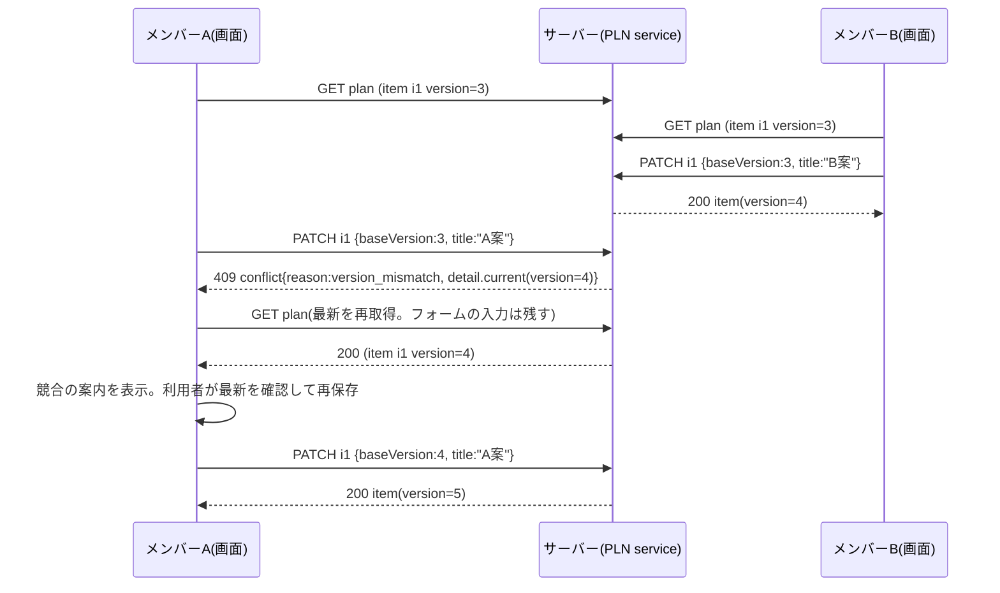

# 05 旅程・集合場所メモ(詳細設計)

ID 接頭辞は `PLN`(PLN-FILE=ファイル、PLN-TYPE=型、PLN-FN=関数、PLN-API=API、PLN-VAL=検証、PLN-ERR=エラー、PLN-UI=画面、PLN-TASK=実装タスク、PLN-T=試験、PLN-A11Y=アクセシビリティ、PLN-Q=未決事項)。凡例は README の「状態の凡例」に従う。本書独自の印として、[デモ範囲外] は「記述は残すが、デモの実装・試験の対象にしない」ことを示す。「見送り(契約書 16.2)」は、統一仕様 第 16 章の見送りの範囲に当たる記述・タスク・試験の印で、記述は残し、主ルートの実装・自動試験・受け入れ条件の対象にしない(本書の「契約書」は統一仕様と同じ文書を指す)。仕様の正は docs/design(特に 02 柱14、04、05、07、10、12 章)。モジュール間で共有する名前・署名・パス・値・状態値は [統一仕様](_unified-contracts.md)(以下「統一仕様」)を正とし、本書は 2026-11-09 に統一仕様へ合わせて改訂し、統一仕様 第 17 章(17.0 の C-1〜C-8、17.6)の追補修正を反映した。統一仕様の反映状況と残る差分は第 16 章に書く。

## 1. 概要と責務 / 対応する柱
- 柱14「グループ内の旅程・集合場所メモ」。参加中メンバー全員が閲覧・編集できる、グループ共有の次の 3 つを持つ。 [案、05 章]
  1. 旅程項目(PlanItem): 日付・時刻・場所(既存スポットを参照可)・メモ・並び順を持つ複数件のタイムライン。
  2. 集合場所メモ(MeetingNote): 集合の場所・日時・補足を 1 件。
  3. 日程メモ(ScheduleMemo): 自由記述 1 件(骨子の「日程メモ」。旅程項目に収まらない注意事項用)。
- グループの日程・行き先・人数などの基本項目は 01 が持つ。本モジュールは「自由記述のメモと項目」だけを持ち、グループ本体や状態は書き換えない。
- 状態(`GroupStatus` の 8 値)は 04 が管理する。本モジュールは 04 の `canEdit(g)` と `canReadHistory(g)` を呼んで可否を決める(統一仕様 4.4)。
- 対象外(デモ範囲外): 地図表示、写真添付、経路検索、外部カレンダー連携、旅程のエクスポート、リアルタイム共同編集。通知(10)も出さない(統一仕様 第 9 章の種類に旅程の通知は無い)。旅程項目の通報も対象外(通報の対象はメッセージ・グループ・ユーザーのみ [決定 28]。統一仕様 6.3)。

## 2. 既存機能との関係
- 新規。流用: 既存スポット(`app/src/data/seed.json` の `spots`。`id:number`、`name`、`area`)を旅程項目・集合場所の「場所」として任意に参照する。seed.json は変更しない。
- [事実] 既存スポットには `keyword`(スタンプ取得用の合言葉)が含まれる。**本モジュールの API・画面にはスポットの `id`、`name`、`area` だけを返し、`keyword`・`stampCount`・`description`・`map` は返さない。**
- 既存 `/api/v2`、`server-store.ts`、`api.ts` は変更しない。クライアントは 00 の `lib/groups-api.ts`(`gapi`、`gpost`、`gput`、`gpatch`、`gdelete`、`ApiError`)を使う。本モジュール専用のフェッチ関数・エラークラスは作らず、`client.ts` には 00 の関数を呼ぶ薄い関数だけを置く(統一仕様 3.5。PLN-FILE-11)。
- 地図: 既存画面はスポットに `map:{x,y}`(模式図上の座標)を持つが、旅程には使わない。**[案] 地図は使わず、旅程のスポットは名称・エリアの文字表示とする。** 理由: (a) rule.md の「外部依存なし」の条件を最も少ない実装で満たせる、(b) 模式図の座標は旅程の順序を表すのに向かない、(c) 実装と試験の量が少ない。余力があれば既存の模式図にスポットを重ねる表示を B 優先で検討(未決 PLN-Q-06)。

## 3. 画面・UI(04 章)
| 画面 | 04 章の項目 | パス案 |
|---|---|---|
| 旅程・集合場所メモ(グループ詳細のタブ) | 旅程・集合場所メモ(全員が編集可、柱14) | `/[campaign]/groups/[groupId]?tab=plan` |
- タブ親は 01 の `app/[campaign]/groups/[groupId]/page.tsx`(動的セグメント名は統一仕様 2.1 のとおり `[groupId]`)。本モジュールは `<PlanTab groupId={...} />` を提供し、01 が `tab=plan` で描画する。
- 画面構成と各コンポーネントの詳細は第 9 章。

## 4. データ(05 章)

### 4.1 エンティティ(PLN-TYPE)
05 章の GroupPlan(groupId、集合場所メモ、日程メモ、更新者、更新日時)を、旅程項目と版番号のため次のとおり拡張する。docs/design 05 章への反映(PlanItem と版番号)は統一仕様 第 12 章で更新対象になっている。基本型(`Id`、`DateStr`、`IsoDateTime`)は 00 の `lib/groups-types.ts` から import する(統一仕様 3.1)。

```ts
// app/src/features/groups/plan/types.ts   (PLN-FILE-01)
import type { Id, DateStr, IsoDateTime } from "@/lib/groups-types";   // DateStr は "YYYY-MM-DD"、IsoDateTime は "+09:00" 付き
import type { GroupStatus } from "@/features/groups/lifecycle/types"; // 04 所有

export type PlanItemId = Id;              // "pi-001"(00 の newId("pi")。形式は 00 の isId("pi", v))
export type ClockTime = string;           // "HH:mm" 24 時間表記

/** 旅程の 1 項目(GroupPlan.items の要素) */
export interface PlanItem {
  id: PlanItemId;
  groupId: Id;
  date: DateStr;                 // 必須。グループの日程(group.trip)内
  time: ClockTime | null;        // 任意。情報表示用(並びは seq が決める)
  title: string;                 // 必須。LIMITS.PLAN_ITEM_TITLE、単一行
  spotId: number | null;         // 任意。seed.spots の id
  note: string;                  // LIMITS.PLAN_ITEM_NOTE(改行可)
  seq: number;                   // 同一 date 内の並び順(1 始まりの連番。並び替え・追加・日付変更で採番し直す)
  version: number;               // 楽観的ロック。作成時 1、更新ごとに +1
  createdBy: Id;                 // DemoUser.id
  createdAt: IsoDateTime;        // clock.nowIso()
  updatedBy: Id;
  updatedAt: IsoDateTime;
}

/** 集合場所メモ(グループに 1 件) */
export interface MeetingNote {
  text: string;                  // LIMITS.MEETING(改行可)。例「駅前ロータリー東側の時計台」
  spotId: number | null;         // 任意
  date: DateStr | null;          // 任意。グループの日程内
  time: ClockTime | null;        // 任意
  version: number;               // 初期 0(未入力)。保存ごとに +1
  updatedBy: Id | null;          // 未入力なら null
  updatedAt: IsoDateTime | null;
}

/** 日程メモ(グループに 1 件) */
export interface ScheduleMemo {
  text: string;                  // LIMITS.SCHEDULE_MEMO(改行可)
  version: number;               // 初期 0
  updatedBy: Id | null;
  updatedAt: IsoDateTime | null;
}

/** 00 の Db の plans: Repo<GroupPlan>(id = groupId の 1 対 1 資源。統一仕様 3.1、3.2) */
export interface GroupPlan {
  id: Id;                        // = groupId(採番しない)
  groupId: Id;                   // id と同じ値
  meeting: MeetingNote;
  scheduleMemo: ScheduleMemo;
  items: PlanItem[];             // 保存順は任意。表示順は sortItems() が (date, seq) で決める
  itemsRevision: number;         // 項目の追加・削除・並び替え・日付変更で +1(並び替えの競合検出用)。初期 0
}
```

```ts
// 画面向け DTO(サーバーで組み立てる。PLN-FILE-04 view.ts)
export interface SpotRef { id: number; name: string; area: string }   // keyword 等は含めない
export interface ActorRef { userId: Id; displayName: string; isFormerMember: boolean }
// 参加中メンバーの displayName は 09 の visibleProfile(viewer, userId, { kind: "member", groupId }) の表示名。
// 退会・辞退したメンバー(00 の isMember が false)は displayName="元メンバー"、isFormerMember=true(統一仕様 10.6 [決定 18])

export interface PlanItemView extends Omit<PlanItem, "spotId" | "createdBy" | "updatedBy"> {
  spot: SpotRef | null;
  createdBy: ActorRef;
  updatedBy: ActorRef;
  outOfRange: boolean;           // date が現在のグループ日程外(日程変更後の残存)
}
export interface MeetingNoteView extends Omit<MeetingNote, "spotId" | "updatedBy"> {
  spot: SpotRef | null;
  updatedBy: ActorRef | null;
  outOfRange: boolean;
}
export interface ScheduleMemoView extends Omit<ScheduleMemo, "updatedBy"> { updatedBy: ActorRef | null }

export interface PlanView {
  groupId: Id;
  groupStatus: GroupStatus;          // 04 の 8 値(表示は 04 の statusLabel(status))
  editable: boolean;                 // canEdit(group) && 参加中メンバー
  readOnlyReason: string | null;     // editable=false のときの表示文(例「中止のため編集できません」)
  schedule: { startDate: DateStr; endDate: DateStr };   // 日付入力の許容範囲。group.trip.startDate/endDate(01 で必須)
  meeting: MeetingNoteView;
  scheduleMemo: ScheduleMemoView;
  items: PlanItemView[];             // (date, seq) 昇順
  itemsRevision: number;
  spotOptions: SpotRef[];            // スポット選択の候補(seed.spots の id/name/area のみ)
  limits: typeof PLAN_LIMITS;        // クライアントの文字数表示用
  serverTime: IsoDateTime;           // clock.nowIso()
}

/** 409 conflict(reason="version_mismatch")の detail.current の型。API ごとに決まる(5.2) */
export type PlanConflictCurrent =
  | PlanItemView | MeetingNoteView | ScheduleMemoView | { items: PlanItemView[]; itemsRevision: number };
```

```ts
// 入力 DTO(リクエスト本文。PLN-FILE-01。検証は PLN-FN-13 のスキーマ)
// ackReview: 09 の禁止表現の判定が review のとき、利用者が確認して再送する印(統一仕様 6.2)
export interface UpdateMeetingInput  { baseVersion: number; text?: string; spotId?: number | null; date?: DateStr | null; time?: ClockTime | null; ackReview?: boolean }  // PUT は全置換。省略時は text が ""、spotId・date・time が null(統一仕様 3.4)
export interface UpdateMemoInput     { baseVersion: number; text?: string; ackReview?: boolean }   // PUT は全置換。省略時は text が ""
export interface CreatePlanItemInput { date: DateStr; time?: ClockTime | null; title: string; spotId?: number | null; note?: string; ackReview?: boolean }
export interface UpdatePlanItemInput { baseVersion: number; date?: DateStr; time?: ClockTime | null; title?: string; spotId?: number | null; note?: string; ackReview?: boolean }  // PATCH。undefined=変更なし、null=消去
export interface ReorderInput        { date: DateStr; orderedIds: PlanItemId[]; baseRevision: number }

// 上限は 00 の LIMITS(app/src/lib/limits.ts)を唯一の定義とし、値を再定義しない(統一仕様 3.4、10.3)。
// PLAN_LIMITS は PlanView.limits で画面に渡すための参照の束で、数値を直書きしない
import { LIMITS } from "@/lib/limits";
export const PLAN_LIMITS = {
  titleMax: LIMITS.PLAN_ITEM_TITLE.max,
  noteMax: LIMITS.PLAN_ITEM_NOTE.max,
  noteLinesMax: LIMITS.PLAN_ITEM_NOTE.maxLines,
  meetingTextMax: LIMITS.MEETING.max,
  memoMax: LIMITS.SCHEDULE_MEMO.max,
  itemsPerGroupMax: LIMITS.PLAN_ITEMS.maxItems,
  itemsPerDateMax: LIMITS.PLAN_ITEMS.maxPerDate,
} as const;
```
- 使う `LIMITS` のキーと値(統一仕様 10.3): `PLAN_ITEM_TITLE` `{ min: 1, max: 60 }`、`PLAN_ITEM_NOTE` `{ min: 0, max: 300, maxLines: 5 }`、`MEETING` `{ min: 0, max: 500 }`、`SCHEDULE_MEMO` `{ min: 0, max: 2000 }`、`PLAN_ITEMS` `{ maxItems: 40, maxPerDate: 15 }`。本書の数値はこの値の説明で、実装はキーを参照する。

### 4.2 保存と初期化
- 保存先は 00 の `db().plans`(`Repo<GroupPlan>`、id = groupId。インメモリで、再起動・リセットで seed に戻る)。読み書きは 00 の `db()`/`tx()` だけを使う(統一仕様 3.1)。
- GroupPlan が無いグループの閲覧は、保存せずに空の GroupPlan(`emptyPlan(groupId)`。全 version=0、itemsRevision=0)を返す。書き込み時は `tx` の中で `ensurePlan`(PLN-FN-16)が空の GroupPlan を `insert` してから更新する(GET でストアを書き換えない)。
- デモ用初期データは 00 の `group-seed.json` の `plans` に置き、00 の seed 読み込みで投入される(統一仕様 11.4。本モジュールは断片の内容を提供し、投入関数は持たない)。内容(手書き): g-005(実行確定)と g-011(実施中)に 3〜5 項目と集合場所、g-006(再企画済み)に閲覧確認用の 1〜2 項目。項目 ID は `pi-001` からの連番、日付は各グループの `trip` の範囲内、`createdBy`/`updatedBy` は各グループの参加中メンバー。実ユーザー情報・sample-data は使わない。
- 削除は物理削除(項目は GroupPlan.items から除去)。履歴は持たない(第 12 章)。

### 4.3 権限モデル(柱14: メンバー全員が編集)
| 操作 | 条件 |
|---|---|
| 閲覧(getPlan) | 参加中メンバー(幹事を含む)。09 の `assertGroupAccess(user.id, groupId, "member")` を通り、04 の `canReadHistory(g)` が true(全状態で true。中止・完了・再企画済みでも閲覧可) |
| 編集(集合場所・日程メモ・項目の追加/更新/削除/並び替え) | 参加中メンバー **かつ** 04 の `canEdit(g)`=true |
| 非メンバー・退会者・参加申請中の人 | 閲覧も編集も不可。公開グループは `forbidden`、非公開グループ・ブロック関係のあるグループは `not_found`(09 の判定表 10.4) |
- 幹事に特別な編集権限はない(幹事も一般メンバーと同じ)。他人が作った項目も全員が更新・削除できる [案、05 章]。削除は「誰が消したか」が残らないため、第 12 章の履歴(任意。見送り(契約書 16.2))と、削除時の確認ダイアログで補う。
- 退会者は退会時点で 00 の `isMember`=false になり以後アクセス不可。退会者が作った項目・更新者の記録は残し、表示名を「元メンバー」とする(統一仕様 10.6 [決定 18])。

## 5. インターフェース(案)

### 5.1 サービス関数(PLN-FN。`features/groups/plan/service.ts` ほか)
service はすべて **同期関数**(`await` を挟まない)とし、書き込みは 00 の `tx(fn)` の中で行う。Node.js は単一スレッドのため、「版番号の照合 → 書き込み」が `tx` 内で割り込まれず、楽観的ロックの照合とコミットが原子的になる。例外が出れば `tx` が開始前の状態に戻す。関数内で `await` を使う実装はこの前提を崩すため禁止する(00 R-ALL-1)。引数 `user` は 00 の `Readonly<DemoUser>`(Route Handler では `c.user`)。

| ID | 署名 | 責務・例外 |
|---|---|---|
| PLN-FN-01 | `getPlan(user: Readonly<DemoUser>, groupId: Id): PlanView` | 閲覧。`not_found`(非公開・不在・ブロック関係)、`forbidden`(公開グループの非メンバー) |
| PLN-FN-02 | `updateMeeting(user, groupId, input: UpdateMeetingInput): MeetingNoteView` | 集合場所を全置換。`forbidden`/`not_found`/`unavailable_state`/`invalid_input`/`conflict` |
| PLN-FN-03 | `updateScheduleMemo(user, groupId, input: UpdateMemoInput): ScheduleMemoView` | 日程メモを全置換。例外は PLN-FN-02 と同じ |
| PLN-FN-04 | `listItems(user, groupId): { items: PlanItemView[]; itemsRevision: number }` | 項目だけを取得する(再取得用)。例外は PLN-FN-01 と同じ |
| PLN-FN-05 | `createItem(user, groupId, input: CreatePlanItemInput): PlanItemView` | 同日の末尾に追加し、`itemsRevision` を +1。上限超過は `invalid_input`(`fields.items`)。その他の例外は PLN-FN-02 と同じ(`conflict` を除く) |
| PLN-FN-06 | `updateItem(user, groupId, itemId: PlanItemId, input: UpdatePlanItemInput): PlanItemView` | 部分更新。`date` を変えたら新しい日の末尾に移し、`itemsRevision` を +1(移動先の日が `LIMITS.PLAN_ITEMS.maxPerDate` 件なら `invalid_input`(`fields.items`))。項目なしは `not_found`。その他の例外は PLN-FN-02 と同じ |
| PLN-FN-07 | `deleteItem(user, groupId, itemId: PlanItemId, baseVersion: number): { itemsRevision: number }` | 削除し、その日の `seq` を詰めて `itemsRevision` を +1。項目なしは `not_found`、版不一致は `conflict`(`reason: "version_mismatch"`)。その他の例外は PLN-FN-02 と同じ |
| PLN-FN-08 | `reorderItems(user, groupId, input: ReorderInput): { items: PlanItemView[]; itemsRevision: number }` | 同一日内の並び替え。`baseRevision`(`itemsRevision` と照合)の不一致は `conflict` + `reason: "version_mismatch"`(`detail.current` は `{ items, itemsRevision }`。統一仕様 2.3)。その他の例外は PLN-FN-02 と同じ |
| PLN-FN-09 | `sortItems(items: readonly PlanItem[]): PlanItem[]` | (date 昇順, seq 昇順) の純粋関数。`time` では並べ替えない |
| PLN-FN-10 | `buildPlanView(user: Readonly<DemoUser>, group: GroupRecord, plan: Readonly<GroupPlan>): PlanView` | DTO 組み立て(view.ts。スポット解決、ActorRef 解決、outOfRange 計算) |
| PLN-FN-11 | `assertCanRead(user, groupId): GroupRecord` | 09 の `assertGroupAccess(user.id, groupId, "member")` を呼び、04 の `canReadHistory(g)` を確認して GroupRecord を返す。`not_found`/`forbidden` |
| PLN-FN-12 | `assertCanEdit(user, groupId): GroupRecord` | PLN-FN-11 の後に 04 の `canEdit(g)` を確認。false は `unavailable_state`(`detail.state` に `g.lifecycle.status`) |
| PLN-FN-13 | `MeetingBody` / `MemoBody` / `CreateItemBody` / `UpdateItemBody` / `OrderBody` / `DeleteQuery` | validation.ts。00 の `v` で組んだスキーマ(7.1)。`null` を受け付ける項目は 00 の `v.nullable(schema)` を使う(統一仕様 3.4、3.7。本モジュールで `nullable` を自前で作らない)。禁止表現を検査する本文のスキーマ(`MeetingBody`・`MemoBody`・`CreateItemBody`・`UpdateItemBody`)は `ackReview: v.boolean({ optional: true })` を宣言する(未知キーとして捨てられないようにする。統一仕様 6.2)。違反は 00 の `parse` が `invalid_input`(`fields`)にする |
| PLN-FN-14 | `assertPlanTextsAllowed(input: { title?: string; note?: string; text?: string }, kind: "item" \| "meeting" \| "memo", ackReview?: boolean): void` | 09 の `assertTextAllowed(text, context, field, { ackReview })` を項目ごとに呼ぶ(7.1)。違反は `invalid_input`(`fields[field]`)、review は `detail.reviewRequired: true` |
| PLN-FN-15 | `isWithinSchedule(d: DateStr, trip: { startDate: DateStr; endDate: DateStr }): boolean` / `countLines(s: string): number` | 文字列比較による日程範囲の判定と、改行数による行数の計測。暦日の実在は 00 の `v.date()` が検査する |
| PLN-FN-16 | `ensurePlan(db: Db, groupId: Id): Readonly<GroupPlan>` / `emptyPlan(groupId: Id): GroupPlan` | `ensurePlan` は `tx` の中でだけ呼び、`db.plans.get(groupId)` が無ければ `emptyPlan` を `insert` して返す。グループのアクセス判定(PLN-FN-11)の後にだけ呼ぶ |
| PLN-FN-17 | `getPlanHandler`、`getItemsHandler`、`putMeetingHandler`、`putMemoHandler`、`postItemHandler`、`patchItemHandler`、`deleteItemHandler`、`putOrderHandler` | handlers.ts。00 の `route()` で包んだ Route Handler。パスの ID は `c.id("groupId", "g")`・`c.id("itemId", "pi")`、本文は `c.body(スキーマ)`、クエリは `c.query(DeleteQuery)`(strict。未知のキーは `invalid_input`。統一仕様 3.7)で読み、service を呼ぶ。応答は `ok`/`created`(00) |

#### 共通の処理順序(書き込み系。PLN-FN-02/03/05〜08)
1. `assertCanRead`(not_found → forbidden)
2. `assertCanEdit`(unavailable_state)
3. 本文のスキーマ検証(形式・長さ・未知キーの除去。invalid_input)
4. `assertPlanTextsAllowed`(09。禁止表現。invalid_input。全文字列項目)
5. 参照整合・範囲・件数(spotId が seed.spots に存在する: invalid_input、日付が日程内: invalid_input、PLN-VAL-12: invalid_input、対象の項目が存在する: not_found、件数上限 PLN-VAL-10: invalid_input)
6. 版番号の照合(conflict)
7. 反映(`version`+1、`updatedBy`、`updatedAt`=`clock.nowIso()`、必要なら `itemsRevision`+1、`seq` 採番)
- 順序の理由: 権限・状態を先に判定し、無権限者に入力検証の内容(情報)を返さない。版番号の照合を最後にすることで、無効な入力で競合エラーを返さない。
- ハンドラでの実現: 本文の読み取り(`c.body`)は非同期のため、ハンドラは `c.id` → `assertCanEdit`(1・2 の事前判定)→ `c.body(スキーマ)`(3)→ service の順に呼ぶ。service は `tx` の中で 1・2 を再度行ってから 4〜7 を行う(`c.body` の待ち時間に状態が変わった場合も検出する)。

```ts
// app/src/features/groups/plan/handlers.ts(抜粋)
export const putMeetingHandler = route<{ groupId: string }>(async (c) => {
  const groupId = await c.id("groupId", "g");
  assertCanEdit(c.user, groupId);                 // 1・2 を本文の検証より先に行う
  const input = await c.body(MeetingBody);        // 3
  return ok(updateMeeting(c.user, groupId, input)); // service は同期。tx 内で 1・2・4〜7
});
```

### 5.2 API(PLN-API。Route Handler はリソースごとの `route.ts`)
共通: `G` は `/api/groups/[groupId]`。各 `app/src/app/api/groups/[groupId]/plan/.../route.ts` は handlers.ts のハンドラを再エクスポートするだけにする(統一仕様 2.1)。JSON。現在ユーザー、Origin・Content-Type の検査、本文の上限(64KB、超過は 413 `payload_too_large`)、応答ヘッダー(`Cache-Control: no-store`、`X-Content-Type-Options: nosniff`、`Content-Type: application/json; charset=utf-8`)は 00 の `route()` が扱う。パスの `groupId`・`itemId` は 00 の `c.id`(`isId("g")`・`isId("pi")`)で検査し、形式不正は `not_found`(404)。`PlanItem` 等のフィールドの型は 4.1。下表に無いメソッドは `route.ts` が export しないため Next.js が 405 を返す(00 第 5.4)。

```ts
// app/src/app/api/groups/[groupId]/plan/items/[itemId]/route.ts(PLN-FILE-07 の例)
export { patchItemHandler as PATCH, deleteItemHandler as DELETE } from "@/features/groups/plan/handlers";
```

| ID | メソッド・パス | リクエスト | 成功レスポンス | 主なエラー |
|---|---|---|---|---|
| PLN-API-01 | `GET G/plan` | - | 200 `PlanView` | 404 not_found、403 forbidden |
| PLN-API-02 | `GET G/plan/items` | - | 200 `{ items: PlanItemView[]; itemsRevision }` | 同上 |
| PLN-API-03 | `PUT G/plan/meeting` | `UpdateMeetingInput` | 200 `MeetingNoteView` | 400、403、404、409(conflict / unavailable_state) |
| PLN-API-04 | `PUT G/plan/memo` | `UpdateMemoInput` | 200 `ScheduleMemoView` | 同上 |
| PLN-API-05 | `POST G/plan/items` | `CreatePlanItemInput` | 201 `PlanItemView` | 400、403、404、409(unavailable_state) |
| PLN-API-06 | `PATCH G/plan/items/[itemId]` | `UpdatePlanItemInput` | 200 `PlanItemView` | 400、403、404、409(conflict / unavailable_state) |
| PLN-API-07 | `DELETE G/plan/items/[itemId]?baseVersion=N` | (本文なし。`baseVersion` はクエリの 10 進整数文字列。本文がなくても `Content-Type: application/json` は必須。統一仕様 2.3) | 200 `{ itemsRevision }` | 400(baseVersion 不正)、403、404、409(conflict / unavailable_state) |
| PLN-API-08 | `PUT G/plan/order` | `ReorderInput` | 200 `{ items, itemsRevision }` | 400、403、404、409(conflict / unavailable_state) |

- `route.ts` の配置: `plan/route.ts`(GET)、`plan/meeting/route.ts`(PUT)、`plan/memo/route.ts`(PUT)、`plan/items/route.ts`(GET・POST)、`plan/items/[itemId]/route.ts`(PATCH・DELETE)、`plan/order/route.ts`(PUT)。`plan/items` の子は `[itemId]` だけにし、静的セグメントと動的セグメントを同じ階層に置かない(統一仕様 2.1 R-2。並び替えを `plan/items/reorder` に置かないのはこのため)。
- メソッドは統一仕様 2.3 に従う(全置換は PUT、部分更新は PATCH、削除は DELETE)。
- 表のエラーに加え、変更系はすべて 00 の入口検査による 403(Origin 不一致)・413・415 を返しうる。
- DELETE に本文を付けない(一部クライアント・プロキシで扱いが不定のため)。`baseVersion` はクエリで渡す。削除の応答は、並び替えの競合検出に使う `itemsRevision` を返すため 204 ではなく 200 とする(統一仕様 2.3)。
- 一覧(PLN-API-01)は項目をすべて含む(上限 `LIMITS.PLAN_ITEMS.maxItems` 件のためページングなし)。PLN-API-02 は競合後や保存後に項目だけを再取得するための API。
- 追加(PLN-API-05)に版番号は不要。二重送信による重複は、画面で送信中ボタンを無効化して防ぐ(サーバー側の重複排除はしない [案])。
- **競合レスポンス(409 conflict)の形**: 00 の `ErrorBody`(統一仕様 3.3)に従い、最新の内容を `detail.current` に入れる。

```ts
// 例: PLN-API-06 の競合
{
  "error": "conflict",
  "reason": "version_mismatch",
  "message": "他のメンバーが先に更新しました",
  "detail": { "current": { /* PlanItemView(最新) */ } }
}
// サーバー側: throw new AppError("conflict", messages.conflict, { reason: "version_mismatch", detail: { current } })
```
- `detail.current` の型(`PlanConflictCurrent`)は API ごとに決まる: PLN-API-03 は `MeetingNoteView`、PLN-API-04 は `ScheduleMemoView`、PLN-API-06・07 は `PlanItemView`、PLN-API-08 は `{ items, itemsRevision }`。競合したリソースの最新の内容で、読み取り権限があるため返してよい。
- 項目が他のメンバーに削除済みの PATCH/DELETE は `404 not_found`(message「この項目は削除されました」)。画面は一覧を再取得する。

## 6. 状態遷移・主要シーケンス

### 6.1 状態ごとの編集可否(04 の `canEdit` を呼ぶ)
本モジュール自身は状態を持たない。可否は 04 の `canEdit(g)`・`canReadHistory(g)` の結果だけに従い、本モジュール内で状態名を判定しない(04 が変更しても追従するため)。期待する対応は統一仕様 4.4 の可否表のとおり。

| グループ状態(`GroupStatus`) | 閲覧 | 編集 | 根拠 |
|---|---|---|---|
| 募集中、最少人数到達、辞退期間(`recruiting`、`min_reached`、`withdrawal_period`) | 可 | 可 | 成立前から集合場所を相談できる |
| 実行確定、実施中(`confirmed`、`in_progress`) | 可 | 可 | 直前の変更を共有する用途 |
| 完了(`completed`) | 可 | 不可 | 記録として固定 |
| 中止(`cancelled`) | 可 | 不可 | 中止後は閲覧のみ(再企画で作り直す。旅程は引き継がない。統一仕様 5.4) |
| 再企画済み(`replanned`) | 可 | 不可 | 中止後に再企画された元グループ。閲覧のみ |
- `canEdit(g)`・`canReadHistory(g)` の引数は 04 の `GroupLike`(`lifecycle` を含む)で、ユーザーを取らない。メンバー判定は 09 の `assertGroupAccess` が行う。
- 状態の評価(締切・辞退期間の遷移)は 00 の `route()` の `beforeRequest` フックで 04 の `evaluateAll` が済ませるため、本モジュールは評価関数を呼ばない(統一仕様 3.5)。
- 状態が編集中に変わった場合(例: 別の画面で中止)は、保存時に `unavailable_state` が返り、画面は入力内容を残したまま読み取り専用バナーを出す(PLN-UI-09)。
- 「参加者が 1 人になった」場合など人数による制約は設けない。

### 6.2 同時編集の競合対策(楽観的ロック。柱14の同時編集)
- [案] 採用方式: **リソース単位の版番号(楽観的ロック)**。「最後の保存が勝つ」(骨子案)は、メンバー全員が編集できる前提では、後から保存した人が他のメンバーの変更を通知なしに上書きするため採らない。版番号の名前と競合応答の形は統一仕様 2.3 に従う(`version`・入力 `baseVersion`、並び順だけは `itemsRevision`・入力 `baseRevision`)。
- 版番号の単位:

| リソース | 版番号 | 競合が起きる操作 |
|---|---|---|
| 集合場所メモ | `meeting.version` | PLN-API-03 |
| 日程メモ | `scheduleMemo.version` | PLN-API-04 |
| 旅程項目(個別) | `item.version` | PLN-API-06、07 |
| 並び順(1 日分) | `plan.itemsRevision`(追加・削除・並び替え・日付変更で +1) | PLN-API-08 |
- 項目の追加(PLN-API-05)は他の項目に影響しないため版不要。ただし追加は `itemsRevision` を進めるため、同時に送られた並び替えは競合(409)になる。画面は最新の項目を再取得し、利用者が並び替えをやり直す。
- 規則: クライアントは直近に取得した版を `baseVersion` として送る。サーバーは現在の版と等しい場合のみ反映し、版を +1 して返す。異なる場合は反映せず 409 `conflict`(`reason: "version_mismatch"`)とし、`detail.current` に最新を入れる。
- 初期状態(未入力)の `version=0` に対して `baseVersion:0` で保存でき、成功すると `version=1`。



- 競合時の画面の挙動(PLN-UI-08。主ルート): 入力内容を失わない。409 を受けたら、画面は最新の内容を再取得し(PLN-API-01。並び順の競合は PLN-API-02)、フォームは開いたまま入力を残して「他のメンバーが先に更新しました。最新の内容を確認して、もう一度保存してください」と表示する。再保存では再取得後の版を `baseVersion` に使う。並び順の競合(PLN-API-08)は項目を再取得し、利用者が並び替えをやり直す。自動マージはしない。
- 見送り(契約書 16.2): 最新の内容と自分の入力を並べて見せる差分表示と、(1)「最新の内容を読み込む(自分の入力は破棄)」(2)「自分の入力で上書きして保存」(`baseVersion` を `detail.current.version` に置き換えて再送)(3)「閉じて編集を続ける」の 3 択(`ConflictDialog`)。並び順の競合は (1) と (3) の 2 択とし、上書きは提供しない(項目の増減で `orderedIds` が無効になるため)。
- 画面は定期ポーリングせず、タブ表示時・ウィンドウのフォーカス復帰時・保存成功時・「再読み込み」操作時に再取得する(PLN-UI-10)。時間差で古い画面を保存すると競合として検出される。

### 6.3 並び順の規則
- 表示順は (date 昇順, seq 昇順)。`time` は表示のみで並びに使わない(時刻が空の項目や、時刻順と相談順がずれる場合に手動で決められるようにするため)。 [案]
- 追加: 同日の最大 seq + 1。日付変更: 新しい日の最大 seq + 1、元の日は seq を詰め直す。削除: その日の seq を詰め直す。
- 並び替えは同一日内のみ(日をまたぐ移動は日付の編集で行う)。`orderedIds` はその日の全項目 ID の順列でなければならない(過不足・重複は `invalid_input`)。

## 7. 入力検証・セキュリティ

### 7.1 検証規則(PLN-VAL)
検証は 00 の `v` で組んだスキーマ(PLN-FN-13)で行う。文字列は 00 の `v.string` が `sanitizeText`(NFC 正規化、改行の統一、制御文字・ゼロ幅文字・双方向制御文字の除去、前後の空白の除去。00 第 5.10)を通してから長さを数える(コードポイント単位。絵文字 1 字)。本モジュールは独自の正規化関数を持たない(統一仕様 3.4)。上限値は 00 の `LIMITS`(統一仕様 10.3)のキーで参照し、数値を直書きしない(表の括弧内の数値は値の説明)。

| ID | 項目 | 規則 |
|---|---|---|
| PLN-VAL-01 | `title` | `v.string({ min: LIMITS.PLAN_ITEM_TITLE.min, max: LIMITS.PLAN_ITEM_TITLE.max })`(1〜60)。改行不可(`\n` を含めば `invalid_input`)。必須 |
| PLN-VAL-02 | `note` | `v.string({ max: LIMITS.PLAN_ITEM_NOTE.max, multiline: true, optional: true, default: "" })`(300)。`LIMITS.PLAN_ITEM_NOTE.maxLines` 行以内(5 行。改行 4 個まで。`countLines`)、超過は `invalid_input`(`fields.note`) |
| PLN-VAL-03 | `meeting.text` | `v.string({ max: LIMITS.MEETING.max, multiline: true, optional: true, default: "" })`(500) |
| PLN-VAL-04 | `memo.text` | `v.string({ max: LIMITS.SCHEDULE_MEMO.max, multiline: true, optional: true, default: "" })`(2000) |
| PLN-VAL-05 | `date`(項目) | 必須。`v.date()`(`YYYY-MM-DD` かつ暦日として実在)。**グループの日程 `group.trip.startDate <= date <= group.trip.endDate` に含まれる**(境界日を含む。service の処理順序 5 で `isWithinSchedule`) |
| PLN-VAL-06 | `meeting.date` | 任意(null 可。`v.nullable(v.date({ optional: true }))`)。範囲は PLN-VAL-05 と同じ |
| PLN-VAL-07 | `time` | 任意(null 可)。`v.nullable(v.string({ pattern: /^([01]\d\|2[0-3]):[0-5]\d$/, optional: true }))` |
| PLN-VAL-08 | `spotId` | 任意(null 可)。`v.nullable(v.int({ min: 1, optional: true }))` で、`seed.spots` に存在する id。存在しない値は `invalid_input`(`fields.spotId`)。文字列の数字は受け付けない(`coerce` なし) |
| PLN-VAL-09 | `baseVersion` / `baseRevision` | 必須。`v.int({ min: 0, max: 2147483647 })`。欠落・非整数・文字列は `invalid_input`。DELETE のクエリ `baseVersion` は `c.query(v.object({ baseVersion: v.int({ min: 0, max: 2147483647, coerce: true }) }))` で整数に変換し、同じ範囲を検査する |
| PLN-VAL-10 | 件数 | 1 グループの項目は `LIMITS.PLAN_ITEMS.maxItems`(40 件)まで、同日は `LIMITS.PLAN_ITEMS.maxPerDate`(15 件)まで。超過は `invalid_input`(`fields.items`。統一仕様 10.3 により 05 はこの扱いのまま) |
| PLN-VAL-11 | `orderedIds` | `v.array(v.id("pi"), { max: LIMITS.PLAN_ITEMS.maxPerDate, unique: true })`(本文の ID の形式不正は `invalid_input`。統一仕様 3.2)。その日の全項目 ID と集合として一致 |
| PLN-VAL-12 | `meeting` の整合 | `date` または `time` を指定した場合は、`text` が空でないか `spotId` が指定されていること(場所のない、日時だけの集合メモを不可にする) |
| PLN-VAL-13 | 未知のフィールド | 捨てる(00 の `v.object`。統一仕様 3.4)。`createdBy`・`updatedBy`・`version`・`groupId` などを本文に含めても反映しない |
| PLN-VAL-14 | 本文サイズ・JSON | 64KB 超は 00 の `route()` が 413 `payload_too_large`。JSON 不正は 00 の `c.body` が `invalid_input` |
| PLN-VAL-15 | 変更なし PATCH | 検証後に変更する項目が 1 つも無い場合(未知のキーだけ、または `ackReview` だけの本文を含む)は `invalid_input`(「変更する項目がありません」) |
| PLN-VAL-16 | `ackReview` | 任意。`v.boolean({ optional: true })`。禁止表現を検査する 4 つの本文スキーマ(PLN-FN-13)に宣言する(統一仕様 6.2)。09 の review 判定を利用者が確認したときだけ `true` を送る |
- 禁止表現(09 の `assertTextAllowed(text, context, field, { ackReview })`。統一仕様 6.2): `title` は文脈 `plan_item_title`・欄 `title`、`note` は `plan_note`・`note`、`meeting.text` と `memo.text` は `plan_note`・`text`。deny は `invalid_input` と `fields[欄名]`(理由の文字列)、review は加えて `detail.reviewRequired: true` を返し、利用者が確認して `ackReview: true` で再送すると通す。09 の文脈表(09 §8.5)では、`plan_note` はメール・電話を deny、URL・SNS ID と連絡先交換の誘導を review とする。画面のライブ警告には 09 の `checkText(text, context)` を使う。
- 日程範囲: 01 の `group.trip.startDate`/`endDate` を直接読む(取得用の関数は設けない)。`trip` の日付は 01 で必須のため、日程が未設定の場合は考えない。
- 日程がのちに変更され、既存項目が範囲外になった場合は、項目を消さず `outOfRange=true` で警告表示する(更新時は範囲内への修正を要求)。01 は現時点で日程の変更機能を持たないため、通常は発生しない。[デモ範囲外・見送り(契約書 16.2)]

### 7.2 セキュリティ
OWASP Top 10 の代表項目のうち、本モジュールに関係するものの対処を示す。ヘッダーの付与、CSRF の検査、本文の上限、Cookie からの現在ユーザーの解決は 00 の `route()` が行い、グループへのアクセス判定は 09 が行う。本モジュールはそれを使う。

- **アクセス制御・IDOR**: すべての API で、00 の `route()` が Cookie から解決した `c.user` を使い、09 の `assertGroupAccess(user.id, groupId, "member")`(グループの存在・非公開の隠蔽・ブロック関係・メンバー判定)をサービス層で行う(PLN-FN-11、12)。権限の判定は現在ユーザーだけを根拠にし、本文・クエリの値(`userId` 等)を根拠にしない。パスの `groupId` は対象の指定にだけ使う。`createdBy`・`updatedBy` は常にサーバーが現在ユーザーで設定し、本文に含まれていても未知フィールドとして捨てる(PLN-VAL-13、PLN-T-11)。
- **他グループの参照の混入(IDOR)**: `[itemId]` はそのグループの GroupPlan の `items` 内だけで検索し、09 の `assertInGroup(item, groupId)` で所属を確かめる(別グループの項目 ID でも `not_found`。PLN-T-12)。`ensurePlan` はアクセス判定の後にだけ呼ぶ。
- **入力検証・インジェクション**: 型・長さ・形式・範囲をサーバーで検証する(7.1。クライアントの検証は補助)。未知のキーは捨てる(マスアサインメント防止)。SQL を使わないため SQL インジェクションは該当しない。`groupId`/`itemId` はファイルパスに使わない(インメモリ)。
- **XSS 対策(保存時)**: HTML エスケープして保存しない(二重エスケープと表示崩れを防ぐ)。代わりに (a) 00 の `sanitizeText` で制御文字・ゼロ幅文字・双方向制御文字(U+202A〜202E、U+2066〜2069、U+200B〜200F、U+FEFF)を除去、(b) 長さ・形式の厳格検証、(c) 入力は文字列のみ受け付け、オブジェクト・配列は拒否。「保存した文字列は常に非信頼のテキストとして扱う」を原則とする。
- **XSS 対策(表示時)**: React の既定エスケープに任せる。`dangerouslySetInnerHTML`、`innerHTML`、`eval`、Markdown/HTML 変換、URL の自動リンク化はいずれも使わない(URL らしき文字列も単なるテキスト)。改行は CSS `white-space: pre-wrap` で表示する(`<br>` を生成する変換をしない)。属性値(`aria-label`、`title`)にも文字列を渡すだけで、URL 属性(`href`/`src`)にはユーザー入力を入れない。JSON 応答は `application/json` + `nosniff`。
- 入力が HTML を含む例(`<script>alert(1)</script>`、``)は、保存・表示とも実行されず文字としてそのまま表示される(試験 PLN-T-31、32)。
- **CSRF**: 現在ユーザーを Cookie `demoUser`(`SameSite=Lax`)で決めるため、00 の `route()` の入口検査(変更系は `Content-Type: application/json` 必須、`Origin` が `Host` と異なれば拒否)をすべての変更系 API に適用する。00 の `gput`/`gpatch`/`gpost`/`gdelete` は本文の有無にかかわらず `Content-Type: application/json` を付ける(本文のない DELETE を含む)。CORS ヘッダーは付けない。試験は 00 の CMN-T-13 による。
- **認証・セッション(デモ)**: ログインはない。Cookie `demoUser` は利用者が書き換えられる(デモ用の視点切替。00 第 7 章)。本番相当の認証は対象外とし、既知の制約とする。
- **セキュリティ設定**: API の応答ヘッダーは 00 の `route()` が付ける(5.2)。画面には `next.config.ts` の `X-Frame-Options: DENY`、`X-Content-Type-Options: nosniff`、`Referrer-Policy: no-referrer` が付く(統一仕様 11.2 [決定 2]。CSP は設けない)。外部への通信(地図タイル・外部フォント・外部 API)は行わない(PLN-T-56)。
- **機密データ・情報露出**: 旅程データはグループのメンバーにだけ返す。非メンバーに存在・件数を返さない(非公開グループは `not_found`)。スポットは `keyword` を返さない(2 章)。更新者の表示名は 09 の `visibleProfile` を通して取得し、DemoUser のその他の項目は返さない。
- **ログ**: メモの本文をサーバーログに出さない(出す場合は長さのみ)。想定外の例外のログは 00 の `route()` が ID とコードだけを出す。
- **過大入力(デモ用の最小の対策)**: 本文 64KB(00)、項目数 `LIMITS.PLAN_ITEMS`(40 件・同日 15 件)、ID 形式の制限(00 の `isId`)。
- **通報**: 旅程項目は通報の対象にしない(通報の対象はメッセージ・グループ・ユーザーのみ [決定 28]。統一仕様 6.3)。旅程の記述に問題がある場合は、09 の導線(メンバー一覧・グループ詳細など)からグループまたは利用者を対象に通報する。以前の版にあった項目の通報の導線と試験 PLN-T-57 は削除した。
- **既知の制約**: レート制限(本モジュールは 09 の `checkRate` を使わない)、大量リクエストによる負荷、応答時間の差などからの推測(タイミング攻撃)への対策は行わない(見送り(契約書 16.2)。既知の制約として記載)。00 の `sanitizeText` が ZWJ(U+200D)を除去するため、ZWJ で結合した絵文字は分割された状態で保存される。

## 8. エラー処理(PLN-ERR)
エラー本文は 00 の `ErrorBody`(`{ error, reason?, message, fields?, detail? }`。統一仕様 3.3)。`fields` の値は理由の文字列 1 つ(`Record<string, string>`)。409 conflict は `reason: "version_mismatch"` と `detail.current`(5.2)。

| ID | コード(HTTP) | 条件 | 画面の表示と次の行動 |
|---|---|---|---|
| PLN-ERR-01 | `not_found`(404) | 存在しない・非公開・ブロック関係のグループ、存在しない項目、パスの ID の形式不正 | グループ一覧へ戻る導線。項目の場合は「この項目は削除されました」と一覧を再取得 |
| PLN-ERR-02 | `forbidden`(403) | 公開グループの非メンバー・退会者・申請中 | 「グループのメンバーだけが見られます」+グループ詳細(公開情報)へ |
| PLN-ERR-03 | `unavailable_state`(409) | `canEdit(g)`=false(完了・中止・再企画済み)。`detail.state` に状態 | 「{状態名}のため編集できません。閲覧のみです」(状態名は 04 の `statusLabel(status)`)。中止の場合は再企画の案内を付ける。入力済みの内容は画面に残す(PLN-UI-09) |
| PLN-ERR-04 | `invalid_input`(400) | 長さ超過、日程外の日付、形式不正、件数超過、禁止表現、spotId 不正、JSON 不正、本文・クエリの ID の形式不正 | 項目ごとに `fields` の文言を表示する(例「60 文字以内にしてください」「日程(12/5〜12/6)の範囲で選んでください」)。「(現在 72 文字)」のような現在値を含む細かい文言は見送り(契約書 16.2)。`detail.reviewRequired: true` のときは 09 の表示に従い、「このまま保存する」で `ackReview: true` を付けて再送する |
| PLN-ERR-05 | `conflict`(409、`reason: "version_mismatch"`) | 版不一致。`detail.current` に最新 | 「他のメンバーが先に更新しました」と表示し、最新を再取得する。入力は失わない(6.2。比較ダイアログは見送り(契約書 16.2)) |
| PLN-ERR-06 | `internal`(500) | 想定外 | 「保存できませんでした。もう一度お試しください」+入力を残す |
| PLN-ERR-07 | `network`(クライアント側のみ) | fetch の失敗、JSON でない応答(00 の `gapi` が `ApiError` の `code:"network"` にする) | 「サーバーに接続できません。起動していることを確認して再試行してください」+入力を残す |
- 00 の `route()` が返す `payload_too_large`(413)・`unsupported_media_type`(415)・`forbidden`(Origin 不一致)と、Next.js が返す 405 は、通常の画面操作では発生しない。表示は 00 第 8 章に従う。
- 表示の文言は `plan/messages.ts` に集約(README 4.4)。メッセージにユーザー入力を埋め込む場合も、プレーンテキストとして描画する。

## 9. 画面・コンポーネント構成(PLN-UI)

### 9.1 ファイル構成(新規のみ。実装時に作る一覧と責務)
```
app/src/features/groups/plan/
  types.ts            PLN-FILE-01  4.1 の型と PLAN_LIMITS
  messages.ts         PLN-FILE-02  日本語の文言(エラー・ラベル・aria 文言)
  validation.ts       PLN-FILE-03  本文・クエリのスキーマ(00 の v.nullable を使う)、isWithinSchedule、countLines(PLN-FN-13、15)
  view.ts             PLN-FILE-04  buildPlanView、スポット解決、ActorRef 解決(PLN-FN-10)
  service.ts          PLN-FILE-05  PLN-FN-01〜09、11、12、14、16(状態を変更する唯一の場所)
  handlers.ts         PLN-FILE-06  route() で包んだハンドラ(PLN-FN-17)
  __tests__/          PLN-FILE-08  単体・API 試験(第 14 章。ファイル名は *.test.ts。Vitest)
  client.ts           PLN-FILE-11  00 の gapi/gput/gpost/gpatch/gdelete を呼ぶ薄い関数(9.2)
  ui/
    usePlan.ts                                     PLN-FILE-09  取得・再取得・保存・競合状態を持つフック
    PlanTab.tsx                                    PLN-FILE-10  タブの最上位
    MeetingCard.tsx / MeetingForm.tsx              PLN-FILE-12  集合場所カードと編集フォーム
    ItineraryTimeline.tsx / ItineraryItemRow.tsx   PLN-FILE-13  日付ごとのタイムライン
    ItemFormModal.tsx                              PLN-FILE-14  項目の追加・編集モーダル
    ScheduleMemoCard.tsx                           PLN-FILE-15  日程メモ(表示+編集)
    SpotSelect.tsx                                 PLN-FILE-16  スポット選択(Mantine Select、検索可)
    ConflictDialog.tsx                             PLN-FILE-17  競合時の比較ダイアログ(見送り(契約書 16.2))
    ReadOnlyBanner.tsx                             PLN-FILE-18  読み取り専用の案内
    CharCounter.tsx                                PLN-FILE-19  文字数カウンタ
app/src/app/api/groups/[groupId]/plan/
  route.ts、meeting/route.ts、memo/route.ts、items/route.ts、items/[itemId]/route.ts、order/route.ts
                      PLN-FILE-07  handlers.ts の再エクスポートだけを書く(5.2)
```
- 既存ファイルの変更は不要。他モジュールの所有箇所で必要なものは次の 2 つ(第 15 章): (a) 00 の `group-seed.json` に `plans` の断片を統合する(4.2)、(b) 01 の詳細ページが `tab=plan` で `<PlanTab>` を描画する。
- UI は Mantine 9(既存。第 11 章)。日付・時刻の入力は `@mantine/dates` を使わず、ネイティブの `<input type="date" min max>` と `<input type="time">` とし、`min`/`max` に `schedule` を渡す(第 11 章)。Next.js 16 のクライアントコンポーネント・`"use client"` の扱いは既存コード(`api.ts` 先頭の `"use client"`)に倣う。キャッシュ関連は実装前に `app/node_modules/next/dist/docs/` を読む [要確認](実装着手時に確認する事項。判断は不要。契約書 14.2)。

### 9.2 コンポーネントの props・state・データ取得
```ts
// usePlan.ts
export interface UsePlan {
  view: PlanView | null;
  status: "loading" | "ready" | "error";
  errorCode: string | null;
  reload: () => Promise<void>;                       // GET plan。フォーカス復帰・保存後に呼ぶ
  saveMeeting: (input: Omit<UpdateMeetingInput, "baseVersion">) => Promise<SaveResult<MeetingNoteView>>;
  saveMemo: (text: string, ackReview?: boolean) => Promise<SaveResult<ScheduleMemoView>>;
  createItem: (input: CreatePlanItemInput) => Promise<SaveResult<PlanItemView>>;
  updateItem: (id: PlanItemId, patch: Omit<UpdatePlanItemInput, "baseVersion">) => Promise<SaveResult<PlanItemView>>;
  deleteItem: (id: PlanItemId) => Promise<SaveResult<{ itemsRevision: number }>>;
  moveItem: (id: PlanItemId, direction: "up" | "down") => Promise<SaveResult<void>>;   // 内部で並び替えの入力を組み立てる
  // 次の 2 つは見送り(契約書 16.2)。比較ダイアログの 3 択に使う。主ルートでは作らない
  resolveConflict?: (choice: "reload" | "overwrite" | "dismiss") => Promise<void>;
  conflict?: ConflictState | null;
}
export type SaveResult<T> =
  | { ok: true; value: T }
  | { ok: false; kind: "invalid_input"; fields: Record<string, string>; reviewRequired: boolean }  // reviewRequired は detail.reviewRequired
  | { ok: false; kind: "conflict"; message: string }  // usePlan が最新を再取得済み。フォームは入力を残して message を表示
  | { ok: false; kind: "unavailable_state" | "not_found" | "forbidden" | "internal" | "network"; message: string };
/** 見送り(契約書 16.2)。比較ダイアログ(ConflictDialog)用 */
export interface ConflictState {
  target: { kind: "meeting" } | { kind: "memo" } | { kind: "item"; id: PlanItemId } | { kind: "order"; date: DateStr };
  mine:                           // 自分の入力(送信しようとした内容。baseVersion/baseRevision は除く)
    | Omit<UpdateMeetingInput, "baseVersion">
    | Omit<UpdateMemoInput, "baseVersion">
    | Omit<UpdatePlanItemInput, "baseVersion">
    | { orderedIds: PlanItemId[] };
  current: PlanConflictCurrent;   // サーバーの最新(ApiError.detail.current)
}
```
`usePlan` は `baseVersion` を自分で保持せず、`view` の該当リソースの `version`(順序は `itemsRevision`)を送る。保存成功時はレスポンスで `view` を部分更新し、`itemsRevision` が変わる操作の後は PLN-API-02 で項目を再取得する。409 `conflict`(`reason: "version_mismatch"`)を受けたら `reload`(並び順の競合は PLN-API-02)で最新を取得してから `{ kind: "conflict" }` を返す。フォームは入力を残す。

```ts
// client.ts(PLN-FILE-11)。00 の lib/groups-api.ts の関数を呼ぶだけの薄い関数
import { gapi, gpost, gput, gpatch, gdelete, ApiError } from "@/lib/groups-api";
const base = (groupId: Id) => `/api/groups/${encodeURIComponent(groupId)}/plan`;

export const fetchPlan        = (groupId: Id) => gapi<PlanView>(base(groupId));                                                   // PLN-API-01
export const fetchPlanItems   = (groupId: Id) => gapi<{ items: PlanItemView[]; itemsRevision: number }>(`${base(groupId)}/items`);   // PLN-API-02
export const putMeeting       = (groupId: Id, input: UpdateMeetingInput) => gput<MeetingNoteView>(`${base(groupId)}/meeting`, input); // PLN-API-03
export const putMemo          = (groupId: Id, input: UpdateMemoInput) => gput<ScheduleMemoView>(`${base(groupId)}/memo`, input);      // PLN-API-04
export const postItem         = (groupId: Id, input: CreatePlanItemInput) => gpost<PlanItemView>(`${base(groupId)}/items`, input);    // PLN-API-05
export const patchItem        = (groupId: Id, itemId: PlanItemId, input: UpdatePlanItemInput) =>
  gpatch<PlanItemView>(`${base(groupId)}/items/${encodeURIComponent(itemId)}`, input);                                              // PLN-API-06
export const deleteItem       = (groupId: Id, itemId: PlanItemId, baseVersion: number) =>
  gdelete<{ itemsRevision: number }>(`${base(groupId)}/items/${encodeURIComponent(itemId)}?${new URLSearchParams({ baseVersion: String(baseVersion) })}`); // PLN-API-07
export const putOrder         = (groupId: Id, input: ReorderInput) =>
  gput<{ items: PlanItemView[]; itemsRevision: number }>(`${base(groupId)}/order`, input);                                         // PLN-API-08

/** 409 conflict(reason="version_mismatch")なら detail.current を返す。それ以外は null。見送り(契約書 16.2)(比較ダイアログ用) */
export function conflictCurrent(e: unknown): PlanConflictCurrent | null;
```
- キャッシュの無効化(`cache: "no-store"`)、`Content-Type: application/json` の付与(DELETE を含む)、エラー応答の `ApiError`(`code`、`reason`、`fields`、`detail`)への変換は 00 の関数が行う(統一仕様 3.5)。`usePlan` は `ApiError` を `SaveResult` に変換する(`code:"conflict"` かつ `reason:"version_mismatch"` は最新を再取得して `kind: "conflict"` にする。`conflictCurrent` で `ConflictState` に積む処理は見送り(契約書 16.2))。

| コンポーネント | props | state | データ取得・挙動 |
|---|---|---|---|
| `PlanTab` | `{ groupId: string }` | `usePlan(groupId)` の結果、`editing`(`null | "meeting" | "memo" | {item:id} | "new-item"`) | 表示時 `reload`、`window` の `focus` と `visibilitychange` で `reload`。`status=loading` はスケルトン(`aria-busy`)、`error` は第 8 章の文言と再試行ボタン。`view.editable=false` なら `ReadOnlyBanner` を出し、すべての編集ボタンを描画しない |
| `MeetingCard` | `{ meeting: MeetingNoteView; editable: boolean; onEdit: () => void }` | なし | 場所テキスト、スポット名(エリア)、日時、更新者・更新日時(「Aさんが 11/9 14:05 に更新」)。未入力なら「集合場所はまだ決まっていません」+(editable なら)「入力する」 |
| `MeetingForm` | `{ initial: MeetingNoteView; schedule: {startDate; endDate}; spotOptions: SpotRef[]; limits; onSubmit(input): Promise<SaveResult<…>>; onCancel }` | 各入力値、`fieldErrors`、`submitting`、`reviewPending` | 場所メモ(Textarea、500 文字カウンタ)、スポット(SpotSelect)、日付、時刻。送信中は二重送信不可。409 `conflict` では入力を残したまま競合の案内を表示する。`reviewRequired` の応答では 09 の表示に従って確認を求め、「このまま保存する」で `ackReview: true` を付けて再送 |
| `ItineraryTimeline` | `{ items: PlanItemView[]; editable: boolean; onEdit(id); onDelete(id); onMove(id, "up"\|"down"); onAdd(date?: DateStr) }` | なし(`items` を日付でグルーピング) | 日ごとに `<section>`(見出し `<h3>` に `<time>`)を置き、その中に項目の `<ol>` を置く。グループ日程の各日は項目が無くても見出しを表示し、「+ この日に追加」を置く。範囲外の項目は末尾の「日程外」見出しの下に置く(PLN-UI-12) |
| `ItineraryItemRow` | `{ item: PlanItemView; index: number; count: number; editable: boolean; … }` | 削除確認の開閉 | 時刻、タイトル、スポット(名称・エリアの文字)、メモ、更新者。上へ/下へ/編集/削除ボタン(各ボタンに `aria-label` で項目名を含める)。旅程項目には通報の導線を置かない(通報の対象はメッセージ・グループ・ユーザーのみ [決定 28]。統一仕様 6.3) |
| `ItemFormModal` | `{ mode: "create" \| "edit"; item?: PlanItemView; defaultDate?: DateStr; schedule; spotOptions; limits; onSubmit; onClose }` | 入力値、`fieldErrors`、`submitting`、`dirty`、`reviewPending` | タイトル(60)、日付、時刻、スポット、メモ(300)。閉じる際 `dirty` なら破棄確認。review の扱いは `MeetingForm` と同じ |
| `ScheduleMemoCard` | `{ memo: ScheduleMemoView; editable: boolean; onSave(text, ackReview?) }` | `editing`、`draft` | 表示と編集(2000 文字カウンタ) |
| `SpotSelect` | `{ value: number \| null; onChange(v); options: SpotRef[]; label: string; error?: string }` | なし | 候補は `view.spotOptions`(7 件)。未選択可。自由記述の場所は項目のタイトルやメモに書く。選択後も場所名の文字をタイトルに自動コピーしない |
| `ConflictDialog` | `{ state: ConflictState; onChoose(choice) }` | なし | 見送り(契約書 16.2)。「あなたの入力」と「最新の内容(更新者・時刻つき)」を 2 列(スマホは縦積み)で表示。3 択のボタン。`role="alertdialog"` |
| `ReadOnlyBanner` | `{ reason: string }` | なし | `role="status"`。例「このグループは中止になったため、旅程は閲覧のみです」 |

### 9.3 画面の挙動(PLN-UI)
- PLN-UI-01 タブ初期表示: 上から「集合場所カード」「旅程タイムライン」「日程メモ」。モバイルは 1 カラム、広い画面は集合場所カードを上段に固定。
- PLN-UI-02 見出し: 画面上部に「メンバー全員で編集できます」の説明と、`editable=false` のときは理由。モック明示は 01 のタブ親(AppShell)側の表示を使う。
- PLN-UI-03 旅程タイムライン: 日付(曜日つき)ごとにグループ化。項目は時刻(あれば)・タイトル・スポット・メモ・更新者。項目が 0 件なら「まだ旅程がありません」と表示し、`editable=true` のときだけ「予定を追加」ボタンを出す。
- PLN-UI-04 スポット表示: スポットは名称とエリアの文字。地図・座標・画像は出さない。スポットの詳細(既存スポット画面)へのリンクは付けない [案](既存画面のパスが campaign 依存で、参照のみで十分なため)。
- PLN-UI-05 追加・編集フォーム: モーダル。必須はタイトルと日付。エラーは項目の下に表示し、先頭のエラー項目へフォーカスを移す。サーバーの `fields` を同じ表示に流す。
- PLN-UI-06 削除: 確認ダイアログ「『{タイトル}』を削除します。グループの全員から見えなくなります。」。削除成功後に `aria-live` 領域で「削除しました」。
- PLN-UI-07 並び替え: 上へ/下へボタン(同日内)。端では無効化(`aria-disabled`)。ドラッグ操作は実装しない(上へ/下へボタンでキーボード・支援技術からも同じ操作ができ、実装量も少ないため)。
- PLN-UI-08 競合時の再取得: 6.2 の主ルートのとおり、409 を受けたら最新を再取得し、フォームは閉じずに入力を残して競合の案内(`role="alert"`)を表示する。利用者は最新の内容を確認して再保存する。見送り(契約書 16.2): `ConflictDialog` による比較表示と 3 択(「最新の内容を読み込む」で `reload` して編集中の入力を破棄。入力を貼り付けられるよう、ダイアログ内の「あなたの入力」はコピー可能なテキストとして表示。「上書きして保存」の再送が再度競合したら再びダイアログを出す)。
- PLN-UI-09 読み取り専用化: 保存時に `unavailable_state` が返ったら `reload` して `editable=false` を反映、編集中の入力は閉じずに残し(フォームは `disabled`)、`ReadOnlyBanner` を表示する。
- PLN-UI-10 再取得: 表示時、フォーカス復帰、保存成功後、「再読み込み」ボタン。ポーリング・WebSocket は使わない。
- PLN-UI-11 退会者・更新者表示: `ActorRef.isFormerMember=true` の作成者・更新者は表示名を「元メンバー」とする(統一仕様 10.6)。
- PLN-UI-12 日程外項目: `outOfRange=true` の項目に「日程外」の表示を付け、編集で日付を範囲内へ直すよう案内する。[デモ範囲外・見送り(契約書 16.2)](7.1。通常は発生しない)

### 9.4 アクセシビリティ(PLN-A11Y)
- PLN-A11Y-01 構造: タイムラインは `<ol>`、日付見出し(`<h3>`)と `aria-labelledby`、日時は `<time dateTime>`。集合場所カードは `<section aria-labelledby>`。見出しの階層はタブ親(`h2`)の下に `h3` を使う。
- PLN-A11Y-02 キーボード: すべての操作(追加・編集・削除・並び替え・ダイアログ)が Tab/Enter/Space/Esc で可能。ドラッグ専用の操作は無い。モーダルはフォーカストラップ+閉じた後に起動元へフォーカスを戻す(Mantine の既定)。
- PLN-A11Y-03 ラベル: フォーム項目は `<label>`、必須は「必須」を文字でも表示、エラーは `aria-invalid` と `aria-describedby`。ボタンの `aria-label` に項目名を含める(「『昼食』を 1 つ上へ」)。アイコンのみのボタンには必ず文字ラベル(視覚非表示可)。
- PLN-A11Y-04 通知: 保存成功・削除・並び替え後の結果は `aria-live="polite"` の領域で読み上げる(「『昼食』を 2 番目に移動しました」)。競合・エラーは `role="alert"`/`alertdialog`。文字数カウンタの読み上げは入力のたびではなく、上限に近いとき(90% 以上)のみ `aria-live` で通知する。
- PLN-A11Y-05 色: 日程外・エラー・読み取り専用を色だけで示さず、アイコンと文字を併記。コントラスト比は AA(4.5:1)以上(Mantine の既定テーマを使い、独自色を足さない)。
- PLN-A11Y-06 スマホ: タップ領域 44px 以上、1 カラム、横スクロールなし。日本語の長い文字列は `overflow-wrap: anywhere` で折り返す。`<html lang="ja">` は既存のレイアウトに従う [要確認](実装着手時に確認する事項。判断は不要。契約書 14.2)。

## 10. 他モジュールとの契約

### 10.1 呼び出す関数(他モジュール所有。名前・署名は統一仕様に合わせる)
実行時に import するのは 00、04、09 だけ(統一仕様 4.6 の依存の向き)。01 の `Group`・04 の `GroupStatus`/`GroupLike` は `import type` で参照する。

| 呼ぶ関数 | 所有 | 用途 | 期待する形 |
|---|---|---|---|
| `db()` / `tx(fn)` / `Repo<GroupPlan>` | 00 | `plans` の読み書き | `db().plans`。書き込みは `tx` 内(同期) |
| `route()`、`ok`、`created`、`c.id`、`c.body`、`c.query`、`c.user` | 00 | Route Handler | 統一仕様 2.1、00 第 5.5 |
| `v`、`parse`、`Schema` | 00 | 本文・クエリの検証(`sanitizeText` を含む) | 00 第 5.10 |
| `AppError(code, message, { reason, fields, detail })` | 00 | エラー | 統一仕様 3.3 |
| `newId("pi")` / `isId("pi", v)` | 00 | 項目 ID | `pi-001` 形式(統一仕様 3.2) |
| `clock.nowIso()` | 00 | `createdAt`/`updatedAt`、`serverTime` | `+09:00` 付き ISO 8601 |
| `isMember(user, group)` | 00 | 作成者・更新者が参加中か(元メンバーの判定) | `boolean` |
| `LIMITS` | 00 | 文字数の上限 | 統一仕様 10.3 |
| `gapi`、`gpost`、`gput`、`gpatch`、`gdelete`、`ApiError` | 00 | クライアント | `ApiError` に `reason`・`detail` |
| `canEdit(g)`、`canReadHistory(g)` | 04 | 状態による可否 | `boolean`(統一仕様 4.4) |
| `statusLabel(status: GroupStatus)` | 04 | 状態の日本語名(読み取り専用の理由・エラー文言) | `string`(統一仕様 10.1 のラベル) |
| `assertGroupAccess(userId, groupId, "member")` | 09 | グループの取得と権限判定 | `GroupRecord`(統一仕様 4.2 の `Group` の項目名。`trip`、`lifecycle` を含む) |
| `assertInGroup(item, groupId)` | 09 | 項目の所属確認 | 他グループの項目は `not_found` |
| `assertTextAllowed(text, context, field, { ackReview })` | 09 | 禁止表現 | 文脈 `plan_item_title`・`plan_note`(統一仕様 6.2) |
| `checkText(text, context)` | 09 | 画面のライブ警告 | `TextCheckResult` |
| `visibleProfile(viewer, targetId, { kind: "member", groupId })` | 09 | 更新者の表示名 | `PublicProfile`(`displayName`) |
| `GroupStatusBadge({ status, full?, size? })` | 04 | 任意。タブで状態を表示する場合のバッジ(色は 00 の `StatusBadge` が決める) | 統一仕様 4.1 |

- 09 の通報(`ReportDialog`、`POST /api/reports`)は呼ばない。旅程項目(`plan_item`)は通報の対象にしない [決定 28](統一仕様 6.3)。以前の版にあった項目の通報の導線(`ItineraryItemRow` の操作メニュー)と試験 PLN-T-57 は削除した。

### 10.2 本モジュールが提供するもの
| 提供 | 呼び出し元 | 内容 |
|---|---|---|
| `getPlanHandler` ほか(PLN-FN-17) | `app/api/groups/[groupId]/plan/**/route.ts` の再エクスポート | 5.2 の API |
| `<PlanTab groupId />` | 01 の詳細ページ | `tab=plan` の中身 |
| `plans` の seed 断片 | 00 の `group-seed.json` | 4.2 の初期データ |
- 本モジュールは 04 の状態を変更しない。04 の再企画で旅程は引き継がず、旅程を複製する関数(`copyPlanDraft` など)は作らない(統一仕様 5.4)。

## 11. 利用ライブラリ・モジュール(外部依存・ライセンス)
新規に追加するライブラリはない。バージョンは `app/package.json` の指定を維持する(表のバージョンとライセンスは、主チェックアウトの `app/node_modules` の各 `package.json` で 2026-11-09 に確認した)。外部リソース(地図タイル、外部フォント、画像、外部 API)は使わない。

### 11.1 ライブラリ(npm)
| 名前 | 用途(本モジュール) | ライセンス | バージョン方針 |
|---|---|---|---|
| next | Route Handler(00 の `route()` 経由)、App Router のページとクライアントコンポーネント | MIT | 16.4.5 を維持 |
| react / react-dom | 画面コンポーネント、`usePlan` の状態(`useState`/`useEffect`) | MIT | 19.3.0 を維持 |
| @mantine/core | `Modal`、`Select`(SpotSelect)、`TextInput`、`Textarea`、`Button`、`Alert`、`Skeleton`、`Badge` | MIT | ^9.7.5 を維持 |
| @mantine/hooks | `useDisclosure`(モーダル・確認ダイアログの開閉) | MIT | ^9.7.5 を維持 |
| @tabler/icons-react | 日程外・読み取り専用・並び替えボタンのアイコン(文字ラベルと併記。PLN-A11Y-05) | MIT | ^3.51.0 を維持 |
| dayjs | 画面での日付(曜日つき)・更新日時の日本時間表示。サーバーの日付検証には使わない | MIT | ^1.11.23 を維持 |
| vitest(devDependency) | 単体・API 試験(PLN-TASK-14) | MIT | 00 が追加する(統一仕様 11.3 [決定 11])。追加時は最新の安定版を使う。本モジュールでは追加しない |

- 既存の依存のうち本モジュールで使わないもの: `@mantine/dates`(日付・時刻はネイティブの `<input type="date">`/`<input type="time">` で入力でき、`min`/`max` で日程の範囲を指定できるため)、`zustand`(状態は `usePlan` の中に閉じ、他の画面と共有しないため)。
- 検証ライブラリ(zod 等)は追加しない。00 の `v`(自前の検証)を使う(統一仕様 11.1)。

### 11.2 Node.js・Web 標準 API
| API | 用途 |
|---|---|
| `Request`/`Response`/`URL`(Web 標準。Next.js の Route Handler) | 00 の `route()` が扱う。本モジュールは `c` を通して使う |
| `URLSearchParams` | `client.ts` の DELETE のクエリ組み立て |
| `fetch`(ブラウザ) | 00 の `gapi` などが使う |

Node 固有のモジュール(`fs`、`crypto` 等)は使わない(ID は 00 の `newId`、保存はインメモリ)。本文のバイト数の計測、JSON の解析、暦日の検証、文字数の計測は 00 の `route()`・`v` が行う。

### 11.3 自前モジュール(他モジュール所有)
10.1 の表のとおり。00(`db`/`tx`、`route`/`ok`/`created`、`v`、`AppError`、`newId`/`isId`、`clock`、`isMember`、`LIMITS`、`gapi` ほか)、04(`canEdit`、`canReadHistory`、`statusLabel`、任意で `GroupStatusBadge`)、09(`assertGroupAccess`、`assertInGroup`、`assertTextAllowed`、`checkText`、`visibleProfile`)。

### 11.4 本モジュールで自前実装するもの
| 対象 | 理由 |
|---|---|
| 本文のスキーマ(`validation.ts`) | null による消去と日程範囲の規則が本モジュール固有で小さい。null の受け付けは 00 の `v.nullable` を使い、自前の `nullable` は作らない(統一仕様 3.4、3.7) |
| 日程範囲・行数の判定 | 文字列比較と改行数で足り、サーバーのタイムゾーンに依存しないよう dayjs を使わないため |
| 楽観的ロック | 版番号の比較だけで足り、同期関数を `tx` 内で実行すれば照合と反映が原子的になるため(5.1) |

## 12. 変更履歴(誰がいつ変更したか)の扱い
- 見送り(契約書 16.2)(余力の機能): 本章の変更ログ(PLN-TASK-17、PLN-Q-07)は主ルートの実装・試験の対象にしない。
- **[案] 最小実装では履歴を持たない。** 各リソースの `updatedBy`/`updatedAt` と `createdBy` のみ(05 章の「更新者・更新日時」と一致)。理由: 05 章のデータ定義が更新者・更新日時のみで、デモで示す対象は「競合を検出し、入力を失わない」ことであり、履歴は必須ではない。
- 弱点: 削除と上書きの記録が残らない。誤削除の復元ができない。メンバー全員が編集できる前提では誤削除を復元する手段がないため、**任意(余力)の PLN-TASK-17 で「直近 50 件の変更ログ」を追加できるよう型を用意**しておく。

```ts
// 任意(PLN-TASK-17)。GroupPlan.changeLog に追記(リングバッファ 50 件)
export interface PlanChangeLogEntry {
  at: IsoDateTime;                             // clock.nowIso()
  by: Id;                                      // DemoUser.id
  target: "meeting" | "memo" | "item";
  action: "create" | "update" | "delete" | "reorder";
  itemId?: PlanItemId;
  summary: string;                             // 例「『昼食』のタイトルを変更」。本文は入れず、項目名と項目種別のみ(メモ本文の複製を避ける)
}
// API: GET /api/groups/[groupId]/plan/history?limit=20  → 200 { entries: PlanChangeLogEntry[] }(メンバーのみ、閲覧は状態不問)
```
- 退会者の履歴は残し、表示名を「元メンバー」とする(統一仕様 10.6 [決定 18])。

## 13. 実装タスク(PLN-TASK。順序つき)
規模: S=半日未満、M=半日〜1 日、L=1 日超。「前提」の `TASK-nn` は本書の PLN-TASK、「モジュール nn」は他モジュールを指す。前提のないものは並行可。「完了条件」の試験 ID は第 14 章。

- [ ] PLN-TASK-01(S)型・定数: `types.ts`(4.1)、`PLAN_LIMITS`、`messages.ts`(PLN-FILE-01、02)。前提: モジュール 00 の基本型・`LIMITS`、モジュール 04 の `GroupStatus`。完了条件: `npx tsc --noEmit` が通る
- [ ] PLN-TASK-02(M)検証: `validation.ts`(本文・クエリのスキーマ、00 の `v.nullable` の利用、`ackReview` の宣言、`isWithinSchedule`、`countLines`、PLN-VAL-01〜16)。前提: TASK-01、モジュール 00 の `v`(`v.nullable` を含む)・`LIMITS`。完了条件: PLN-T-14〜19、22〜24、26、30、34、35 の入力をスキーマに直接与える単体試験が通る(22・23・26・34・35 は代表の入力のみ。代表以外は見送り(契約書 16.2))
- [ ] PLN-TASK-03(M)サービス読み取り: `view.ts`、`emptyPlan`、`assertCanRead`、`getPlan`、`listItems`、`sortItems`。前提: モジュール 00(`db`、`isMember`)、モジュール 09(`assertGroupAccess`、`visibleProfile`)、モジュール 04(`canReadHistory`、`statusLabel`)。完了条件: PLN-T-01、03〜05、07、33、47
- [ ] PLN-TASK-04(M)集合場所・日程メモの更新: `assertCanEdit`、`ensurePlan`、`assertPlanTextsAllowed`、`updateMeeting`、`updateScheduleMemo`(処理順序 5.1)。前提: TASK-02、TASK-03、モジュール 04 の `canEdit`、モジュール 09 の `assertTextAllowed`。完了条件: PLN-T-09、11、13、19、27、28、32(サーバー側)、37、48(PLN-T-42 は見送り(契約書 16.2))
- [ ] PLN-TASK-05(M)項目の追加・更新・削除: `createItem`、`updateItem`、`deleteItem`(seq 採番、itemsRevision、`assertInGroup`)。前提: TASK-04。完了条件: PLN-T-02、06、08、10、12、14〜18、20〜25、40、41、43、44、46
- [ ] PLN-TASK-06(S)並び替え: `reorderItems`(PLN-VAL-11)。前提: TASK-05。完了条件: PLN-T-38、39、45
- [ ] PLN-TASK-07(M)ハンドラと route.ts: `handlers.ts`(`route()` で包んだ 8 つのハンドラ、`c.id`・`c.body`・`c.query`)と `app/api/groups/[groupId]/plan/**/route.ts`(再エクスポート。PLN-FILE-07)。前提: TASK-03〜06(TASK-06 を後回しにする場合は `plan/order` を除く)、モジュール 00 の `route()`。完了条件: PLN-T-12(パスの ID の形式不正)、26(DELETE のクエリ)、29 と、PLN-T-01〜48(見送りの試験・入力を除く)の HTTP 経由(00 の `callRoute`)の実行
- [ ] PLN-TASK-08(S)デモデータ: `plans` の seed 断片を作り、00 の `group-seed.json` への統合を 00 に渡す(4.2)。前提: モジュール 00 の seed 構造。完了条件: リセット後の GET plan(g-005、g-011、g-006)で 4.2 の初期データが返る
- [ ] PLN-TASK-09(S)クライアント: `client.ts`(9.2 の薄い関数、`conflictCurrent`)、`usePlan.ts`(取得・保存・競合状態・review の再送)。前提: TASK-07、モジュール 00 の `gput`・`ApiError.reason`。完了条件: `npx tsc --noEmit` と `npm run lint` が通る
- [ ] PLN-TASK-10(M)画面(閲覧): `PlanTab`、`MeetingCard`、`ItineraryTimeline`、`ItineraryItemRow`、`ScheduleMemoCard`(表示)、`ReadOnlyBanner`。前提: TASK-09、モジュール 01 のタブ親。完了条件: PLN-T-49、50
- [ ] PLN-TASK-11(M)画面(編集): `MeetingForm`、`ItemFormModal`、`SpotSelect`、`CharCounter`、メモ編集、削除確認、review の確認表示。前提: TASK-10。完了条件: PLN-T-53 の追加・削除の部分、PLN-T-55。旅程項目の通報の導線は作らない([決定 28]。PLN-T-57 は削除)
- [ ] PLN-TASK-12(M)競合・読み取り専用: 409 の後の最新の再取得・入力の保持・競合の案内(PLN-UI-08 の主ルート)、PLN-UI-09、10。`ConflictDialog`・`resolveConflict`(差分表示・3 択)は見送り(契約書 16.2)。前提: TASK-11。完了条件: PLN-T-51(主ルートの部分)、52
- [ ] PLN-TASK-13(S)並び替え UI・アクセシビリティ: 上へ/下へ、`aria-live`、フォーカス管理、PLN-A11Y 確認。前提: TASK-06、TASK-11。完了条件: PLN-T-53 の並び替えの部分、PLN-T-54
- [ ] PLN-TASK-14(M)単体・API 試験: 第 14 章の PLN-T-01〜48(単体・HTTP)を Vitest の自動試験として書く(00 の `resetForTest`、`callRoute`、`asUser`、`insertGroup`、`insertMember`、`fixtures.ts` の `GROUP_BY_STATUS`・`PRIVATE_GROUP`)。前提: TASK-07、モジュール 00 の試験基盤(CMN-TASK-12)。完了条件: `npm test` で PLN-T-01〜48(見送りの試験・入力を除く)が通る
- [ ] PLN-TASK-15(S)画面・結合試験(手動手順): PLN-T-49〜56(PLN-T-57 は削除)。前提: TASK-12(並び替えを含める場合は TASK-13)。完了条件: 手順と結果を記録する
- [ ] PLN-TASK-16(S)静的検査: `dangerouslySetInnerHTML`/`innerHTML` の不在、`/api/groups/[groupId]/plan` のレスポンスに `keyword` を含まないことの確認(PLN-T-33、36)。前提: TASK-07、TASK-10
- [ ] PLN-TASK-17(M・任意)見送り(契約書 16.2)。変更ログ: 12 章の `changeLog`、API、画面の履歴リスト。前提: TASK-05、TASK-10(余力があるとき)

## 14. 受け入れ条件・試験項目(PLN-T。10 章の試験と対応)
試験の前提データは 00 の seed(統一仕様 11.4 の修正後)を使い、試験コードでは 00 の `fixtures.ts` の定数(`GROUP_BY_STATUS`、`PRIVATE_GROUP` など。統一仕様 11.3)で ID を参照する(ID の直書きをしない)。試験の中だけで作るデータは 00 の `insertGroup`・`insertMember` を使い、ID は 900 番台(`g-901` など)とする(統一仕様 3.2、3.7)。見送り(契約書 16.2)の試験・入力は表に残し、自動試験と受け入れ条件の対象にしない。各試験の前に `resetForTest()`(時計は `demoNow` = 2026-11-09T09:00:00+09:00 で固定)。
- ユーザー: u-001(g-001 の幹事、g-010 の幹事)、u-002(g-001 のメンバー)、u-003(g-001 の非メンバー)、u-004(g-001 に申請中。g-006 の幹事)、u-005(非公開グループ g-008 の幹事)。
- グループ: g-001(`GROUP_BY_STATUS.recruiting`。募集中、日程 2026-12-05〜2026-12-06、メンバー u-001・u-002、旅程なし)、g-005(`GROUP_BY_STATUS.confirmed`。実行確定、旅程あり)、g-006(`GROUP_BY_STATUS.replanned`。再企画済み、旅程あり)、g-008(`PRIVATE_GROUP`。非公開)、g-010(`GROUP_BY_STATUS.completed`。完了)、g-013(`GROUP_BY_STATUS.cancelled`。中止、メンバー u-007(幹事)・u-002)。
- スポット id=1〜7(seed)、id=99 は存在しない。
- 表の「入力」は特記なき限り u-002 が g-001 に行う。HTTP は `/api/groups/g-001/plan…`。

### 14.1 権限・状態
| ID | 入力・操作 | 期待結果 |
|---|---|---|
| PLN-T-01 | u-001(幹事)が GET plan | 200。`editable=true` |
| PLN-T-02 | u-002(一般メンバー)が項目を追加 | 201。幹事でなくても編集できる |
| PLN-T-03 | u-003(非メンバー)と u-004(申請中)が GET plan(g-001、公開) | いずれも 403 forbidden。本文に項目・メモを含まない |
| PLN-T-04 | u-002 が g-008(非公開)の GET plan | 404 not_found(存在を隠す) |
| PLN-T-05 | u-003 を g-001 に `insertMember` で加えて項目を 1 件作らせた後、04 の `withdraw` で辞退させ、u-003 が GET plan と PUT meeting を行う。続いて u-002 が GET plan | u-003 はいずれも 403。u-002 の取得結果で、u-003 が作った項目は残り、`createdBy.displayName="元メンバー"`、`isFormerMember=true` |
| PLN-T-06 | u-003 が POST items(g-001) | 403。ストアの項目数が変わらない |
| PLN-T-07 | u-004 が g-006(再企画済み)の GET plan | 200、`editable=false`、`groupStatus="replanned"`、`readOnlyReason` に「再企画済み」を含む |
| PLN-T-08 | u-004 が g-006 に POST items | 409 `unavailable_state`、`detail.state="replanned"`。項目数不変 |
| PLN-T-09 | u-001 が g-010(完了)に PUT meeting | 409 `unavailable_state` |
| PLN-T-10 | u-002 が u-001 の作った項目を PATCH・DELETE | 200(他人の項目も編集可)。PATCH 後の `updatedBy` が u-002 になる |
| PLN-T-11 | リクエスト本文に `updatedBy: "u-001"` を含めて PUT memo | 200。`updatedBy` は u-002(未知のキーは捨てられ、反映されない) |
| PLN-T-12 | itemId に別グループ(g-005)の項目 ID、または形式不正の値(`abc`)を指定して PATCH | いずれも 404 not_found |
| PLN-T-13 | u-002 が g-013(`GROUP_BY_STATUS.cancelled`)の GET plan と PUT meeting | GET は 200 で `editable=false`、`readOnlyReason` に「中止」を含む。PUT は 409 `unavailable_state`、`detail.state="cancelled"`。サーバー側の内容は変更なし |

### 14.2 検証(境界値)
| ID | 入力 | 期待結果 |
|---|---|---|
| PLN-T-14 | title が 60 文字ちょうど | 201 |
| PLN-T-15 | title が 61 文字 | 400、`fields.title` |
| PLN-T-16 | title が空、または空白のみ | 400、`fields.title` |
| PLN-T-17 | title に改行 `"A\nB"` | 400 |
| PLN-T-18 | note 300 文字ちょうど / 301 文字、note 5 行 / 6 行 | 201 / 400、201 / 400 |
| PLN-T-19 | meeting.text 500 / 501 文字、memo.text 2000 / 2001 文字 | 200 / 400、200 / 400 |
| PLN-T-20 | date=2026-12-05(開始日)、2026-12-06(終了日) | いずれも 201 |
| PLN-T-21 | date=2026-12-04、2026-12-07 | 400、`fields.date`(「日程の範囲外」) |
| PLN-T-22 | date="2026-02-30"(代表)。"2026-1-5"、"12/05" は見送り(契約書 16.2) | 400(暦日として不正) |
| PLN-T-23 | time="09:00" / "24:00"(代表)。"23:59"、"9:00"、"09:60" は見送り(契約書 16.2) | 201 / 400 |
| PLN-T-24 | spotId=1 / 99 / "1"(文字列) / null | 201 / 400 / 400 / 201 |
| PLN-T-25 | 同日 15 件ある状態で 16 件目を追加 / 全体 40 件で追加 / 15 件ある日へ PATCH で日付を変更 | いずれも 400 `fields.items` |
| PLN-T-26 | baseVersion が欠落、DELETE のクエリ `baseVersion` が欠落(代表)。"3"(文字列)、-1、1.5、クエリの `abc`・`-1` は見送り(契約書 16.2) | いずれも 400 |
| PLN-T-27 | meeting に time="10:00" のみ(text 空、spotId なし) | 400(PLN-VAL-12) |
| PLN-T-28 | 禁止表現(09 の辞書で deny の語)を含む title | 400、`fields.title` に理由。ストアに保存されない |
| PLN-T-29 | 64KB 超の本文、不正な JSON | 413 `payload_too_large`、400 `invalid_input` |
| PLN-T-30 | PATCH で全フィールド省略、または未知のキーだけの本文 | 400(変更する項目がない) |

### 14.3 XSS・情報露出
| ID | 入力・操作 | 期待結果 |
|---|---|---|
| PLN-T-31 | title=`<script>alert(1)</script>`、note=`` を保存し画面表示 | 保存は成功(そのままの文字列で保存)。画面で文字として表示され、スクリプトが実行されない(ダイアログが出ない) |
| PLN-T-32 | memo に `https://example.com` を含めて PUT(`ackReview` なし → `ackReview: true` で再送)し、画面表示 | 1 回目は 400、`fields.text`、`detail.reviewRequired=true`(09 の `plan_note` で URL は review)。再送は 200。画面では文字としてのみ表示し、リンク(`<a>`)にならない |
| PLN-T-33 | PlanView の JSON を検査 | `spotOptions`・`spot` に `keyword`、`stampCount`、`description`、`map` が無い |
| PLN-T-34 | title に制御文字・ゼロ幅文字(`"A\u0000​B"`)・双方向制御文字。代表は制御文字(`\u0000`)とし、ゼロ幅文字・双方向制御文字の網羅は見送り(契約書 16.2) | 保存後は `"AB"`(00 の `sanitizeText` で除去されて保存。長さは除去後で数える) |
| PLN-T-35 | Unicode: 絵文字(サロゲートペア。ZWJ を含まないもの)60 個 / 61 個を title に(代表は 60 個。61 個は見送り(契約書 16.2)) | 201(文字数は 60)/ 400 |
| PLN-T-36 | ソース検査 | `plan/` 配下に `dangerouslySetInnerHTML`、`innerHTML`、`eval` が存在しない |

### 14.4 機能・競合
| ID | 入力・操作 | 期待結果 |
|---|---|---|
| PLN-T-37 | 集合場所を未入力の状態で GET plan、`baseVersion:0` で PUT meeting `{text:"駅前", spotId:1, date:"2026-12-05", time:"09:00"}` | 初回 `meeting.version=0` → 200 で `version=1`、`updatedBy=u-002`、`updatedAt` が `clock.nowIso()` の時刻(`+09:00`) |
| PLN-T-38 | 追加を 3 件(同日)→ 並びが追加順(seq 1,2,3)。`orderedIds` を逆順にして PUT order | 200。取得すると逆順。`itemsRevision` が +1 |
| PLN-T-39 | PUT order の `orderedIds` に項目が 1 つ足りない、重複、他日の ID、形式不正の ID | 400 |
| PLN-T-40 | A と B が同じ項目(version=3)を取得し、B が保存(→4)後に A が `baseVersion:3` で PATCH | A は 409 `conflict`、`reason=version_mismatch`、`detail.current.version=4`、`detail.current.title` が B の値。サーバーの値は B のまま |
| PLN-T-41 | 競合後、A が `baseVersion:4` で再送 | 200、`version=5` |
| PLN-T-42 | 見送り(契約書 16.2)。同じ集合場所メモ(version=1)を 2 人が同時に PUT(`baseVersion:1`) | 一方 200(version=2)、他方 409(`detail.current` はその値)。両方 200 にならない |
| PLN-T-43 | A が PATCH 中に B が項目を削除 → A が PATCH | 404 not_found(「削除されました」) |
| PLN-T-44 | 古い version で DELETE | 409 `conflict`、`reason=version_mismatch`。削除されない。正しい version の DELETE は 200 `{ itemsRevision }` |
| PLN-T-45 | 追加直後に別メンバーが並び替え(旧 `baseRevision`) | 409 `conflict`、`reason=version_mismatch`。`detail.current.items` が最新 |
| PLN-T-46 | 項目の日付を 12/05→12/06 に変更 | 新しい日の末尾に移り、元の日の seq が詰まる。`itemsRevision` +1 |
| PLN-T-47 | 1 件も無い状態(g-001)の GET plan | `items=[]`、`itemsRevision=0`、`meeting.version=0`。ストアの `plans` に g-001 の行が作られない |
| PLN-T-48 | `clock.freeze` で時刻を差し替えて保存 | `updatedAt` が差し替えた時刻(`+09:00`)になる |

### 14.5 画面・アクセシビリティ(手動)
| ID | 手順 | 期待結果 |
|---|---|---|
| PLN-T-49 | u-002 で g-001 のタブを開く | 集合場所カード、タイムライン(12/5・12/6 の見出し)、日程メモが出る。「モック」表示は 01 のタブ親側 |
| PLN-T-50 | 再企画済みのグループ g-006 を u-004 で開く | 読み取り専用バナー。追加・編集・削除・並び替えのボタンが無い |
| PLN-T-51 | 2 つのブラウザタブ(u-001 と u-002)で同じ項目を編集し、後から保存 | 競合の案内が出て、最新の内容が再取得される。フォームの入力が消えず、もう一度保存すると成功する。比較ダイアログと 3 択の確認は見送り(契約書 16.2) |
| PLN-T-52 | 保存中に中止へ遷移した後で保存 | 入力が残ったまま読み取り専用バナー |
| PLN-T-53 | キーボードのみで項目を追加・並び替え・削除できる | 可能。フォーカスがモーダルから戻る |
| PLN-T-54 | スクリーンリーダー相当の確認(ブラウザのアクセシビリティツリー) | 日付見出し、`<ol>`、並び替え結果の通知、エラーの関連づけが取れる |
| PLN-T-55 | スマホ幅(幅 360px) | 横スクロールなし、タップ領域 44px 以上、長い文字が折り返す |
| PLN-T-56 | 外部通信の確認(ネットワークタブ) | localhost 以外へのリクエストが無い(地図タイル・外部フォントなし) |
| PLN-T-57 | (削除。通報の対象はメッセージ・グループ・ユーザーのみ [決定 28]。旅程項目の通報の導線を置かないため、この試験は無い。統一仕様 6.3) | - |

受け入れ条件(要約): PLN-T-01〜48 のうち見送り(契約書 16.2)を除くもの(PLN-T-42 と、PLN-T-22・23・26・34・35 の代表以外の入力を除く)が通ること(並び替えを実装しない場合は PLN-T-38、39、45 も除く)、PLN-T-49〜56 を手動で確認すること(PLN-T-51 は主ルートの部分)、`npm run lint` と `npm run build` が通ること、既存ファイルを変更していないこと。

## 15. 他モジュールへの要望
統一仕様で確定した事項(ストアのコレクション、ID 接頭辞 `pi`、エラー形式、`gput`、`canEdit` などの可否、`statusLabel(status)`、`plan_item_title` の文脈)は要望から外した。旅程項目(`plan_item`)は通報の対象にしないことが確定した([決定 28]。統一仕様 6.3)。残る要望は次のとおり。

| 宛先 | 要望 |
|---|---|
| 00 | (1) `LIMITS` に旅程の 4 項目(項目名 1〜60、項目メモ 0〜300、集合場所 0〜500、日程メモ 0〜2000)を置く。キー名(本書 4.1 の `PLAN_ITEM_TITLE` などは仮の名前)を確定してほしい。→ 解消(契約書 10.3): キーは `PLAN_ITEM_TITLE`・`PLAN_ITEM_NOTE`・`MEETING`・`SCHEDULE_MEMO`・`PLAN_ITEMS` で確定し、4.1 の `PLAN_LIMITS` と 7.1 に反映した。(2) `group-seed.json` に本書 4.2 の `plans` 断片を統合する。(3) `v` に null を許す指定が無いため、本モジュールは `Schema` を満たす `nullable` を自前で置く。00 が共通の手段を用意する場合はそれに置き換える。→ 解消(契約書 3.4、3.7): 00 の `v.nullable` を使い、自前の `nullable` は削除した。(4) 試験用の `insertGroup` で状態 `cancelled` のグループを作れること → 解消(契約書 11.3): 中止の見本 g-013(`GROUP_BY_STATUS.cancelled`)を使う |
| 01 | (1) 詳細ページが `?tab=plan` で `<PlanTab groupId>` を描画する |
| 09 | (1) `visibleProfile(viewer, targetId, { kind: "member", groupId })` で、同じグループの参加中メンバーの表示名が得られること。ブロック関係にある参加中メンバー同士で `not_found` を投げる場合の更新者の表示(本書は表示名を出さず「メンバー」と表示する [案])を確認したい。→ 見送り(契約書 16.2): ブロック関係による更新者の表示の出し分けは作り込まず、「メンバー」表示の案のまま実装し、試験しない。(2) `ReportDialog` を `targetType: "plan_item"` で開けること → 不採用 [決定 28](通報の対象はメッセージ・グループ・ユーザーのみ。統一仕様 6.3。項目の通報の導線と PLN-T-57 は削除した) |
| 10 | 旅程・集合場所の更新通知は出さない(統一仕様 第 9 章の種類に無い) |

## 16. 設計上の確認事項(docs/design・他モジュールとの差)
統一仕様(2026-11-09)で解決した事項:
1. **05 章の GroupPlan との差**: 本書は旅程項目(PlanItem)と版番号を追加した。docs/design 05 章の更新は統一仕様 第 12 章の対象。
2. **HTTP メソッド**: PUT/PATCH/DELETE を使う(統一仕様 2.3)。POST だけのときの読み替え(`…/update`、`…/delete`)は削除した。
3. **ルーティング**: リソースごとの `route.ts` と 00 の `route()`(統一仕様 2.1)。ハンドラの登録・パスの分解を行う関数は作らない。並び替えは `PUT G/plan/order`。
4. **動的セグメント名**: `[groupId]`、`[itemId]`(統一仕様 2.1)。
5. **ストア**: 00 の `db().plans`(`Repo<GroupPlan>`、id = groupId)と `tx`(統一仕様 3.1)。型は本書 4.1 を正とし、00 の `meetingPlace`・`scheduleMemo` の形は廃止(統一仕様 7.6)。
6. **ID と日時**: `newId("pi")`、`isId`(統一仕様 3.2)。保存日時は `clock.nowIso()`(`+09:00`。統一仕様 3.4)。試験データの ID は 00 の seed と `fixtures.ts`。
7. **エラーと入力**: `fields` は文字列 1 つ、競合の最新は `detail.current`、本文の上限は 64KB・413、未知のキーは捨てる、正規化は 00 の `sanitizeText`(統一仕様 3.3、3.4)。
8. **アクセス判定・禁止表現・プロフィール**: 09 の `assertGroupAccess`、`assertInGroup`、`assertTextAllowed`(`plan_item_title`、`plan_note`)、`visibleProfile(…, { kind: "member", groupId })`(統一仕様 6.1〜6.3)。01 の `getGroup` は呼ばない。
9. **日程**: 01 の `group.trip.startDate`/`endDate` を読む(取得関数は設けない)。
10. **状態と可否**: `GroupStatus` 8 値、`canEdit`・`canReadHistory`、`statusLabel(status)`(統一仕様 4.1、4.4)。
11. **再企画**: 旅程は引き継がない(統一仕様 5.4)。
12. **退会者の表示**: 「元メンバー」(統一仕様 10.6 [決定 18])。
13. **試験基盤**: Vitest(統一仕様 11.3 [決定 11])。

残る確認事項:
14. **骨子の「最後の保存が勝つ」** を、楽観的ロックに変更した(骨子の第 4 章は [案]。docs/design にこの記述は無い)。
15. **スポットの campaign**: seed.json のスポットはキャンペーン(slug)への紐づけを持たない(単一キャンペーン)。複数キャンペーンになった場合、スポット候補の絞り込み条件を `group.campaign` から導く必要がある [要確認]。
16. **禁止表現の適用範囲**: docs/design 07 章は「メモ」への柱8 適用を [案] とする。本書は全文字列項目に適用する。
17. **Next.js 16 のドキュメント未確認**: 本 worktree には `app/node_modules` が無い。依存のバージョンとライセンスは主チェックアウトの `app/node_modules` で確認した(第 11 章)。Route Handler・クライアントコンポーネントの細部は、実装前に `app/node_modules/next/dist/docs/` を読む [要確認]。Mantine 9 の DatePicker は使わない(第 11 章)。[要確認] の項目は実装着手時に確認する事項(判断は不要。契約書 14.2)。
18. **null の扱い**: 00 の JSON 規約は「`null` は値なし、省略は指定なし(PATCH)」で本書と同じだが、00 の `v` は `null` を受け付けない。→ 解消(契約書 3.4、3.7): 00 に `v.nullable` が追加されるため、それを使う。自前の `nullable` は削除した(第 15 章 00 (3))。

## 17. 未決事項
- PLN-Q-01 メンバー全員が他人の項目を削除できてよいか(05 章は全員編集の案)。幹事のみ削除可、作成者のみ削除可の案もある。 [未決]
- PLN-Q-02 完了・中止後の閲覧・編集。統一仕様 4.4 により、完了・中止・再企画済みは閲覧のみ(編集不可)で確定。[閉]
- PLN-Q-03 連絡先らしき文字列(URL・メール・電話)をメモで許すか。09 の `plan_note` の判定(メール・電話は deny、URL・SNS ID は review)に従う。[閉]
- PLN-Q-04 退会者が作った項目・更新者表示の扱い。記録を残し「元メンバー」と表示する(統一仕様 10.6 [決定 18])。[閉]
- PLN-Q-05 再企画(04)で旅程を引き継ぐか。引き継がない(統一仕様 5.4)。[閉]
- PLN-Q-06 既存の模式図(`map` 座標)にスポットを重ねる地図表示を行うか([案] 行わない)。地図表示は見送り(契約書 16.2)。
- PLN-Q-07 変更履歴(PLN-TASK-17)を実装するか。見送り(契約書 16.2)(余力の機能)。
- PLN-Q-08 日程が日付の幅(日程の幅)の場合の許容範囲の定義。01 の `trip.startDate`〜`trip.endDate` を許容範囲とする(`trip.dateNote` の幅は含めない)。[閉]
- PLN-Q-09 試験ランナー。Vitest(統一仕様 11.3 [決定 11])。[閉]
- docs/design 12 章の関連: #1(デモの形。旅程の位置づけは同行成立中心なら成立後の共有、集合型イベント中心なら公式枠の集合情報)。

## 18. 実装メモ(デモ範囲)
- 最小実装(優先度 A): PLN-TASK-01〜05、07〜12、14〜16(閲覧、集合場所・日程メモの保存、項目の追加・更新・削除、競合時の最新の再取得と入力の保持(409 `version_mismatch`)、読み取り専用表示と、それらの試験)。並び替え(PLN-TASK-06、13)は余力で実装する。変更ログ(PLN-TASK-17)と、競合の比較ダイアログ・3 択は見送り(契約書 16.2)。履歴と地図は持たない。スポットの選択は任意入力とする。
- デモ手順の例: ブラウザタブを 2 つ開き(デモユーザー切替)、同じ項目を編集し、後から保存した側に競合の案内が出て入力が残ること、再保存で反映されることを見せる → 中止または再企画済みのグループで読み取り専用バナーを見せる(04 のデモ操作と連動)。
- 画面には「モック」と、集合場所は連絡先を書かない旨の注意を表示する [案]。
