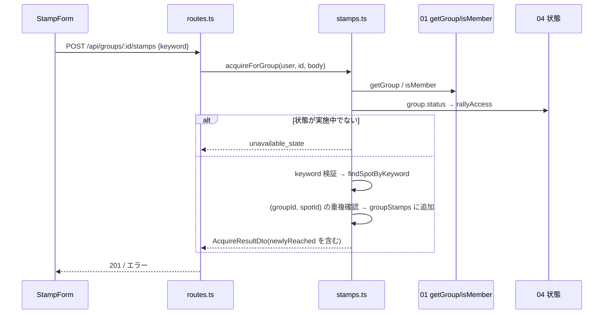

# 08 グループ・スタンプラリー

> 状態の凡例は [README](README.md) に従う([事実]/[推定]/[決定]/[案]/[未決]/[要確認])。ID 接頭辞は `RLY`(RLY-API / RLY-FN / RLY-T / RLY-TASK / RLY-ERR / RLY-REQ / RLY-Q)。「デモ範囲外」と記した項目は、デモでは実装・試験しなくてよい。
> 仕様の正は docs/design。00 共通基盤は並行して詳細化中のため、確定するまで 00 の骨子(`store()`、`currentUser(req)`、`validate`、`AppError`、`clock.now()`、`newId(prefix)`)を契約とみなし、不一致は第 11 章に書く。

## 1. 概要と責務 / 対応する柱

- 柱9「同行ラリー(グループ単位のスタンプ・振り返り)」。グループ(旅行プラン)の参加メンバーが合言葉でスポットのスタンプを押し、グループとしての進捗(スポット別の取得状況、達成率、特典の到達)を見られるようにする。旅行が完了したあとは、振り返り(メモ・アンケート・写真のダミー投稿)をグループ内で残す。
- 責務(本モジュールが持つ): グループ専用のスタンプ記録、進捗・特典の集計(派生)、振り返りのデータと画面、自治体集計(12)へ渡す個人を特定しない集計値。
- 責務外: グループの状態遷移(04)、メンバー判定(01)、通知の生成(10)、禁止表現の判定(09)、個人のスタンプ・特典(既存 `/api/v2`)。
- 対象ユーザー: グループの参加中メンバー(幹事を含む。権限は全員対等 [案])。非メンバー・退会者は操作不可。

## 2. 既存機能との関係

### 2.1 既存機能の仕様(app/ の読み取り結果) [事実]

| 項目 | 既存の仕様 |
|---|---|
| スポット | `seed.json` の `spots`(7 件)。項目: `id:number`、`stampName`、`name`、`area`、`description`、`map{x,y}`、`hue`、`keyword`(合言葉。秘密)、`stampCount`。`GET /api/v2/spots` は `keyword` を除き `acquired` を付けて返す |
| スタンプ | `server-store.ts` の `Stamp = { spotId:number; at:string }`(`at` は `YYYY-MM-DD HH:mm:ss`、タイムゾーン無し)。`State = { lap, stamps, rewards, inquiries }`。ユーザーごとの区別が無く、デモ全体で 1 人分の状態を持つ |
| 取得 | `acquire(keyword)`: 合言葉を trim・小文字化して `spots[].keyword` と比較。不一致は `invalid_code`、取得済みは `already_acquired`。取得後、`stamps.length >= requiredStamps` の特典を自動付与 |
| API | `POST /api/v2/user/stamps` `{keyword}`。`keyword` が文字列で長さ 1〜64 でなければ 400 `invalid_code`、`already_acquired` は 409、不一致は 400。`GET /api/v2/user/stamps`、`/user/rewards`、`/user/activities`、`POST /api/v2/user/reset`(周回を進める) |
| 特典 | `seed.json` の `rewards`(3 件): 必要スタンプ 3 / 5 / 7 個。`prize` は景品名(ダミー) |
| 画面 | `/[campaign]/qr`(合言葉入力。メッセージは `invalid_code` / `already_acquired` のみ定義)、`/[campaign]/spots`、`/[campaign]/spots/detail?id=`、`/[campaign]/rewards`、`/[campaign]/rewards/detail`、`/[campaign]/pointHistory`。詳細画面は動的セグメントではなく `?id=` を使う |
| 取得方法 | 本番は QR・バーコード・キーワード・GPS。ローカル版は合言葉入力のみ(カメラ・GPS 不使用)[事実、qr/page.tsx のコメント] |
| 写真投稿・アンケート | app/ に実装なし(`/api/v2` に `questionnaires` も写真もない。`seed.json` にもデータなし)。本番サイトの仕様は docs/ideas の解析にあるのみ [事実] |
| クライアント | `src/lib/api.ts` の `api` / `post` / `useApi` は `/api/v2` 固定の接頭辞。エラーは `body.error` を `code` として読む |
| 設定 | `next.config.ts` に `cacheComponents: true`、`partialPrefetching: true`。`app/node_modules` が無く Next.js ドキュメントは未確認 [要確認]。画面は既存どおり `"use client"` + `Suspense` で書き、Route Handler の `params` は Promise(既存コードに合わせる) |

### 2.2 流用/拡張/新規の境界 [案]

| 区分 | 内容 | 方針 |
|---|---|---|
| 流用(読み取りのみ) | `seed.json` の `spots`、`rewards`、`campaign` | `features/groups/rally/catalog.ts` 経由で参照。`keyword` は照合関数の内部だけで使い、DTO に載せない |
| 流用(規則のみ) | `acquire` の合言葉判定(trim・大文字小文字無視)、エラーコード `invalid_code` / `already_acquired`、特典の「必要スタンプ数に達したら獲得」 | 既存のコードは呼ばず、同じ規則を本モジュールで別に実装する。`acquire` を呼ぶと個人の共有状態(単一ユーザー)を書き換えるため |
| 変更しない | `/api/v2/**`、`server-store.ts`、`api.ts`、既存ページ、`seed.json` | 編集しない。個人のスタンプ・特典は従来どおり `/[campaign]/qr` で押す |
| 新規 | グループ専用スタンプ記録、進捗集計、特典到達の派生、振り返り(メモ・アンケート・写真ダミー)、API `/api/groups/:id/{rally,stamps,review...}`、画面 | `features/groups/rally/` とグループ配下の画面。ストアは `groups-store.ts`(00)に項目を追加 |
| 既存画面へのリンク | スポット詳細(`/[campaign]/spots/detail?id=`)、特典詳細(`/[campaign]/rewards/detail?id=`)、個人スタンプ(`/[campaign]/qr`) | 進捗・振り返りの各スポット/特典から遷移。新規実装なし |
| 前提の訂正 | 骨子の「写真・アンケートは既存画面へのリンク」 | 既存画面が無いため不可。振り返り内に最小の新規実装(第 3 章の画面、4.1 の型)を置く |

### 2.3 実装時に作るファイル(すべて新規。既存は変更しない) [案]

| パス | 責務 |
|---|---|
| `app/src/features/groups/rally/types.ts` | エンティティ・DTO・列挙型(4.1) |
| `app/src/features/groups/rally/messages.ts` | 画面文言・エラー文言 |
| `app/src/features/groups/rally/catalog.ts` | seed のスポット・特典の読み取り、`findSpotByKeyword`、公開用スポット DTO(keyword を除く)。サーバー側専用(7.4) |
| `app/src/features/groups/rally/access.ts` | `rallyAccess(status)`: 状態ごとの可否表(第 6 章)、`loadRallyContext`: 全サービス関数の共通前処理(RLY-FN-13) |
| `app/src/features/groups/rally/stamps.ts` | `acquireForGroup`、`groupProgress`、`deriveRewards`(特典到達の導出) |
| `app/src/features/groups/rally/review.ts` | `getReview`、`saveMemo`、`saveSurvey`、`addPhotoPost`、`removePhotoPost` |
| `app/src/features/groups/rally/aggregate.ts` | `rallyAggregate`(12 向け。個人を特定しない集計) |
| `app/src/features/groups/rally/validate.ts` | 本モジュールの入力検証(第 7 章) |
| `app/src/features/groups/rally/routes.ts` | `handleRally(req, segments, ctx)`: 本モジュールの HTTP 処理(薄い層)。00 のキャッチオール `api/groups/[...path]/route.ts` から呼ばれる [要確認 00] |
| `app/src/features/groups/rally/seed.ts` | 初期データ `initialRallyState()`(試験・デモ用。実ユーザー情報なし) |
| `app/src/features/groups/rally/client.ts` | `rallyApi`: 本モジュールの API を呼ぶ薄い関数群。00 の共通クライアント(`/api/groups` 用)の上に作る。共通版が無い場合は `fetch` で実装する |
| `app/src/features/groups/rally/components/` | `RallyTab.tsx`、`RallySummary.tsx`、`StampForm.tsx`、`SpotProgressList.tsx`、`RewardProgress.tsx`、`MemberContribution.tsx`、`ReviewMemoSection.tsx`、`ReviewSurveySection.tsx`、`ReviewPhotoSection.tsx`、`ReviewSummary.tsx` |
| `app/src/app/[campaign]/groups/[groupId]/review/page.tsx` | 振り返りページ(動的セグメント名は README 4.1 の `[groupId]` に合わせる。第 11 章の確認事項) |

ラリータブ(`?tab=rally`)は 01 のグループ詳細 `[groupId]/page.tsx` が `RallyTab` を差し込む(01 の画面ファイルは 01 の担当。本モジュールはコンポーネントを提供する)。

### 2.4 利用ライブラリ・モジュール

新規に追加する npm パッケージはない(試験ツールは 00 が追加するものを共用する)。バージョンの「維持」は `app/package.json` の現行指定を変えないことを指す。ライセンスは `app/package-lock.json` の記載による [事実]。

| 区分 | 名前 | 用途 | ライセンス | バージョン方針 |
|---|---|---|---|---|
| フレームワーク | Next.js(`next`) | App Router の画面(`review/page.tsx`)、Route Handler、`next/link`、`next/navigation`(`useSearchParams` でタブ・`useParams` で ID を取得) | MIT | 16.4.5 を維持 |
| UI ライブラリ | React / React DOM | コンポーネント、`useState` / `useEffect` / `Suspense` | MIT | 19.3.0 を維持 |
| UI ライブラリ | Mantine(`@mantine/core`) | `Progress`、`Alert`、`TextInput`、`Textarea`、`Button`、`Radio.Group`、`Card`、`Badge`、`Select`(写真のスポット選択) | MIT | ^9.7.5 を維持 |
| アイコン | Tabler Icons(`@tabler/icons-react`) | 取得済み/未取得、特典到達のアイコン(文言と併用。3.3) | MIT | ^3.51.0 を維持 |
| 日時表示 | dayjs | 取得日時・投稿日時の表示整形(クライアント側のみ)。JST 表示に dayjs 同梱の `utc` / `timezone` プラグインを使う | MIT | ^1.11.23 を維持 |
| 試験(devDependency) | Vitest | サービス関数・API の自動試験(第 9 章)。00 が導入し、08 は追加しない | MIT | 00 が追加する版(最新の安定版)に従う |
| 言語・静的検査 | TypeScript、ESLint(`eslint-config-next`) | 型検査(`npx tsc --noEmit`)、`npm run lint` | Apache-2.0 / MIT | 現行を維持 |
| Node 標準・Web 標準 | `structuredClone`、`Intl`(数値整形)、`fetch` | 初期データの複製、達成率の表示、クライアントの API 呼び出し(00 の `gapi` 経由) | (Node.js / ブラウザ組み込み) | Node.js は 09 章(セットアップ)の指定に従う |
| 自前モジュール(00) | `lib/groups-store.ts`、`lib/errors.ts`、`lib/validation.ts`、`lib/clock.ts`、`lib/ids.ts`、`lib/current-user.ts`、`lib/api-route.ts`、`lib/groups-api.ts` | 保存、エラー、入力検証、時刻、ID 採番、現在ユーザー、Route Handler の共通処理、クライアント | (本リポジトリ) | 00 の確定版に合わせる(5.3) |
| 自前モジュール(他) | 01 グループ中核、04 状態判定、09 安全、10 通知(任意) | メンバー判定・グループ取得、状態による可否、禁止表現・表示名・ブロック、特典到達の通知 | (本リポジトリ) | 各モジュールの確定版に合わせる(5.3) |
| データ(読み取りのみ) | `app/src/data/seed.json` | スポット・特典・キャンペーン | (本リポジトリ。架空データ) | 変更しない |

使わないもの(自前実装または不要とする理由):

| 対象 | 判断 | 理由 |
|---|---|---|
| 合言葉の照合 | 自前実装(`catalog.ts`) | 既存 `acquire` を呼ぶと単一ユーザーの個人状態を書き換えるため、同じ規則を別に実装する(2.2) |
| 入力検証ライブラリ(zod 等) | 使わない | 00 の自前検証 `v` で足り、依存とライセンス確認を増やさない(00 の方針) |
| 状態管理(`zustand`) | 使わない | 画面の状態はコンポーネント内の `useState` と再取得で足りる |
| QR 読み取り・位置情報・画像アップロード | 使わない | デモは合言葉入力のみで、写真は実ファイルを扱わない(7.3) |
| ダミー写真の画像 | 自前実装(CSS グラデーション) | `spots[].hue` から描くため画像ファイル・画像処理ライブラリが不要 |
| グラフ描画ライブラリ | 使わない | 進捗は Mantine の `Progress` と数値の文言で表示できる |
| `server-only` パッケージ | 使わない | 依存を増やさず、`catalog.ts` をクライアントから import しない規約とビルド成果物の検査(RLY-T-48)で代える |

## 3. 画面・UI(04 章)

### 3.1 画面

| 画面 | 04 章の項目 | パス | 備考 |
|---|---|---|---|
| グループのスタンプ(タブ) | 同行ラリー(グループ単位) | `/[campaign]/groups/[groupId]?tab=rally` | 進捗、スポット別の取得者、特典、合言葉の入力 |
| 振り返り | 振り返り | `/[campaign]/groups/[groupId]/review` | 完了後のみ閲覧・投稿できる(第 6 章)。それ以外の状態では案内文のみを表示する |

### 3.2 コンポーネント構成

データ取得はすべてクライアント側(既存の流儀)。`RallyTab` が 1 回取得し、子へ props で渡す。

| コンポーネント | props | state | データ取得 |
|---|---|---|---|
| `RallyTab` | `campaign: string; groupId: string` | `data: RallyProgressDto \| null`、`loading`、`error` | `GET /api/groups/:id/rally`。取得後 `reload` を子へ渡す |
| `RallySummary` | `progress: Pick<RallyProgressDto,'totalSpots'\|'acquiredCount'\|'achievementRate'\|'status'>` | なし | なし |
| `StampForm` | `groupId: string; canStamp: boolean; reason: RallyUnavailableReason \| null; onAcquired: (r: AcquireResultDto) => void`(`reason` には `access.stampReason` を渡す) | `code`、`busy`、`ok: AcquireResultDto \| null`、`err: string \| null` | `POST /api/groups/:id/stamps`。`canStamp=false` なら入力欄を無効化し理由を表示。成功時は `onAcquired` で親が `reload` する |
| `SpotProgressList` | `campaign: string; spots: RallySpotDto[]; readOnly?: boolean` | なし | なし |
| `RewardProgress` | `campaign: string; rewards: RallyRewardDto[]; acquiredCount: number` | なし | なし |
| `MemberContribution` | `rows: MemberContributionDto[]` | なし | なし |
| `ReviewPage`(`review/page.tsx`) | (URL から `campaign`、`groupId`) | `data: ReviewDto \| null`、`loading`、`error` | `GET /api/groups/:id/review`。409 `unavailable_state` を受けたら、エラー表示ではなく `reason` に対応する案内文(RLY-ERR-03)とグループ詳細へのリンクを表示する |
| `ReviewSummary` | `review: Pick<ReviewDto,'groupName'\|'period'\|'progress'>` | なし | なし(`SpotProgressList` を `readOnly` で再利用) |
| `ReviewMemoSection` | `groupId; memos: ReviewMemoDto[]; canWrite: boolean; onSaved: () => void` | `body`、`busy`、`err` | `POST /api/groups/:id/review/memo` |
| `ReviewSurveySection` | `groupId; mySurvey: SurveyAnswerDto \| null; surveyAnswered: number; memberCount: number; canWrite: boolean; onSaved: () => void` | `satisfaction`、`planClarity`、`wantAgain` | `POST /api/groups/:id/review/survey` |
| `ReviewPhotoSection` | `groupId; photos: PhotoPostDto[]; spots: RallySpotDto[]; canWrite: boolean; onChanged: () => void` | `spotId`、`caption`、`busy` | `POST …/review/photos`、`POST …/review/photos/:photoId/delete` |

- スポット行(`SpotProgressList` の 1 行)には、スポット名、エリア、取得状況(バッジ+文言)、取得者の表示名と日時、スポット詳細(既存)へのリンクを出す。
- 状態に応じた表示: `canStamp=false` のとき、理由(RLY-ERR-03 の文言)を `Alert`(情報)で示し、取得済みの進捗は閲覧できる。
- 「モック」の明示: 合言葉入力欄の近くに「デモ用: 合言葉入力のみ(位置・QR は使いません)」、写真欄に「デモ用: 実際の写真は保存されません」を表示(04 章 UI 方針)。
- ローディングは「読み込み中…」、失敗は `role="alert"` のメッセージと「再読み込み」ボタン(06 章)。
- スマホ幅: 1 カラム、タップ領域 44px 以上。タブ内の並びは「進捗サマリー → 合言葉入力 → スポット一覧 → 特典 → メンバー別」。

### 3.3 アクセシビリティ [案]

- 進捗バーは `role="progressbar"`(`aria-valuenow`/`aria-valuemin`/`aria-valuemax`)と、テキスト「7 スポット中 3 スポット(43%)」を併記する。色だけで取得/未取得を区別せず、アイコンと文言(「取得済み」「未取得」)を併用する。
- 合言葉入力は `label` を付け、結果は `role="status"`(成功)/`role="alert"`(失敗)で読み上げる(既存 `qr/page.tsx` と同じ)。送信中はボタンを無効化し `loading` を示す。
- スポット一覧は `ul`/`li`。取得者・日時は `time` 要素(`dateTime` 付き)。アンケートの 5 段階は `fieldset`+`legend`+ラジオ(キーボード操作可、矢印キー)。
- ダミー写真のグラデーション画像は `role="img"` と `aria-label`(キャプション、無ければ「スポット名のイメージ」)。見出しは h2 → h3 の順を守る。フォーカスリングを消さない。
- 禁止表現などで入力が拒否されたときは、該当欄に `error` を関連づけ(`aria-describedby`)、フォーカスを移す。

## 4. データ(05 章)

### 4.1 型定義(`features/groups/rally/types.ts`) [案]

```ts
import type { GroupStatus } from "@/features/groups/lifecycle/types"; // 04 の状態型。名称・パスは [要確認]

/** 取得方法。デモは合言葉のみ。QR・位置照合を追加する場合は union に値を足す */
export type StampMethod = "keyword";

/** グループ専用のスタンプ記録。(groupId, spotId) で一意。Store.groupStamps に保存 */
export interface GroupStamp {
  id: string;            // newId("gs")
  groupId: string;
  spotId: number;        // seed.json spots[].id
  acquiredBy: string;    // 取得操作をしたメンバーの userId
  method: StampMethod;
  at: string;            // ISO 8601(タイムゾーン付き)。clock.now() から生成
}

/** 振り返りメモ。(groupId, userId) で 1 件(上書き)。Store.rallyMemos */
export interface ReviewMemo {
  groupId: string;
  userId: string;
  body: string;          // 1〜500 文字
  updatedAt: string;
}

export type WantAgain = "yes" | "maybe" | "no";

/** 振り返りアンケート。(groupId, userId) で 1 件(上書き)。Store.rallySurveys */
export interface SurveyAnswer {
  groupId: string;
  userId: string;
  satisfaction: 1 | 2 | 3 | 4 | 5;   // 旅全体の満足度
  planClarity: 1 | 2 | 3 | 4 | 5;    // 旅程・集合のわかりやすさ
  wantAgain: WantAgain;              // また旅行したいか(グループ全体について)
  answeredAt: string;
}

/** 写真投稿(ダミー)。実ファイルは保存しない。Store.rallyPhotos */
export interface PhotoPost {
  id: string;            // newId("ph")
  groupId: string;
  userId: string;
  spotId: number | null; // 添えるスポット(画像は spots[].hue のグラデーションで描く)
  caption: string;       // 0〜80 文字
  createdAt: string;
}

/** 状態による制約の理由(画面の案内文 RLY-ERR-03 に対応) */
export type RallyUnavailableReason = "recruiting" | "not_started" | "finished" | "cancelled" | "not_completed";

export interface RallyAccess {
  canView: boolean;          // ラリータブの閲覧(メンバーは全状態で true)
  canStamp: boolean;         // スタンプを押せる
  canReviewRead: boolean;    // 振り返りの閲覧
  canReviewWrite: boolean;   // 振り返りの投稿・更新・削除
  stampReason: RallyUnavailableReason | null;   // canStamp=false の理由。true なら null
  reviewReason: RallyUnavailableReason | null;  // canReviewWrite=false の理由。true なら null
}

/** catalog.ts が返すスポット(seed.json spots[] から keyword・stampCount を除いたもの。サーバー側でのみ使う) */
export interface SpotCatalogItem {
  id: number; name: string; stampName: string; area: string; description: string;
  map: { x: number; y: number }; hue: number;
}

// ---- DTO(API の応答。userId・合言葉は含めない) ----
export interface MemberRefDto { displayName: string; isMe: boolean }   // 退会者は displayName="元メンバー"

export interface RallySpotDto {
  spotId: number; name: string; stampName: string; area: string; description: string;
  map: { x: number; y: number }; hue: number;
  acquired: boolean;
  acquiredBy: MemberRefDto | null;
  acquiredAt: string | null;
}

export interface RallyRewardDto {
  rewardId: number; name: string; prize: string; requiredStamps: number;
  reached: boolean; reachedAt: string | null;   // reachedAt は必要数に達した記録の at
}

export interface MemberContributionDto extends MemberRefDto { count: number }

export interface RallyProgressDto {
  groupId: string;
  campaign: string;
  status: GroupStatus;
  access: RallyAccess;
  totalSpots: number;
  acquiredCount: number;
  achievementRate: number;          // 0〜100 の整数(四捨五入)
  spots: RallySpotDto[];            // seed の並び順
  rewards: RallyRewardDto[];
  members: MemberContributionDto[]; // 現メンバー全員(0 件も含む)の取得件数。退会者の記録があれば、退会者全員分を合算した「元メンバー」の 1 行を末尾に加える
}

export interface AcquireResultDto {
  spot: Pick<RallySpotDto, "spotId" | "name" | "stampName">;
  acquiredCount: number;
  achievementRate: number;
  newlyReached: RallyRewardDto[];   // 今回の取得で到達した特典(なければ空)
}

export interface ReviewMemoDto { author: MemberRefDto; body: string; updatedAt: string }
export interface SurveyAnswerDto { satisfaction: number; planClarity: number; wantAgain: WantAgain; answeredAt: string }
export interface PhotoPostDto { id: string; author: MemberRefDto; spotId: number | null; hue: number; caption: string; createdAt: string; mine: boolean }

export interface ReviewDto {
  groupId: string;
  groupName: string;                       // 01 の Group から [要確認: 項目名]
  period: { start: string; end: string };  // 旅行日程。01 の Group から [要確認: 項目名]
  access: RallyAccess;
  progress: Pick<RallyProgressDto, "totalSpots" | "acquiredCount" | "achievementRate" | "spots" | "rewards">;
  memos: ReviewMemoDto[];                  // ブロック関係のメンバーの分は除く(09)。updatedAt 降順
  mySurvey: SurveyAnswerDto | null;
  surveyAnswered: number;                  // 回答済み人数(平均は出さない。7.3 参照)
  memberCount: number;                     // 現メンバー数
  photos: PhotoPostDto[];                  // ブロック関係のメンバーの分は除く(09)。createdAt 降順
}

// ---- 12 向け(個人・グループを特定しない) ----
export interface RallyAggregateFilter { campaign: string; from?: string; to?: string } // 日付 YYYY-MM-DD(取得日 at の日付で絞る)
export interface RallyAggregate {
  groupsWithStamps: number | null;                         // 1 件以上取得したグループ数
  stampTotal: number | null;
  perSpot: { spotId: number; spotName: string; count: number | null }[];
  rewardReach: { rewardId: number; name: string; groups: number | null }[]; // 特典に到達したグループ数
  survey: { responses: number | null; avgSatisfaction: number | null; wantAgain: { yes: number | null; maybe: number | null; no: number | null } };
  minCell: number;                                         // 適用した下限。これ未満のセルは null
}
```

- [決定済みとの整合] `GroupStamp` の項目は 05 章「グループ単位のスタンプ集計」(グループID、スポットID、取得メンバー、取得日時)に対応。05 章に無い `ReviewMemo` / `SurveyAnswer` / `PhotoPost` は新規で、05 章への追加を第 11 章で要望する。
- 達成数・達成率・特典到達は保存せず、`GroupStamp` から都度導出する(骨子の方針を踏襲)。
- 日時は ISO 8601(`clock.now().toISOString()`)。既存の `YYYY-MM-DD HH:mm:ss` 形式とは異なるが、既存の `at` はグループ側に持ち込まない。

### 4.2 ストアへの追加 [案、00 への要望]

`Store`(00 の `groups-store.ts`)に次を追加してもらう。`resetStore()` で `initialRallyState()`(`rally/seed.ts`)を呼ぶ。

```ts
interface Store {
  // …00 の既存項目…
  groupStamps: GroupStamp[];
  rallyMemos: ReviewMemo[];
  rallySurveys: SurveyAnswer[];
  rallyPhotos: PhotoPost[];
}
```

一意性は関数側で保証する: `groupStamps` は `(groupId, spotId)`、`rallyMemos` と `rallySurveys` は `(groupId, userId)`。Node は単一スレッドで、チェックと追加の間に `await` を挟まなければ競合しない(RLY-FN-02 の実装上の注意)。

### 4.3 個人のスタンプとグループの記録の関係(骨子の [未決]) 

| 案 | 内容 | メリット | デメリット |
|---|---|---|---|
| A 個人のスタンプを集計 | メンバー各自の個人スタンプを合算してグループの進捗とする | 二重入力が無い。本番の個人ラリーと一貫 | 既存ストアは単一ユーザーで、メンバー別の個人スタンプが存在しない。既存 API を変更しないと実現できない。旅行期間外やグループ外で取得した個人のスタンプが混ざる |
| B グループ専用の記録(推奨) | `GroupStamp` を別に持つ。個人のスタンプは変更しない | 既存を変更しない。グループの旅行期間・状態に限定できる。重複判定がグループ単位で単純 | 同じ合言葉を個人でも押す場合は 2 回入力になる(個人ラリーとは別物と画面で明示) |
| C 両方 | グループ取得時に個人にも付与 | 一回の入力で両方に反映 | 既存 `acquire` を呼ぶと共有の単一状態を書き換える。付与の失敗時の整合や重複(個人で既に取得済み)の扱いが複雑 |

- [案] B を採る。理由は 2.1 の事実(既存は単一ユーザー・単一状態)による。個人との連携(C)は、既存を変更できることが決まったときの拡張として残す(`GroupStamp.method` の拡張や、取得時フックの追加で対応可能)。最終判断はオーナー [未決]。
- 個人の特典履歴(`state.rewards`)には書き込まない。グループの特典到達は 4.4 の派生値で表示し、「個人の特典獲得とは別」と画面に書く。

### 4.4 取得の定義・重複防止・集計

**取得の定義(デモ)**
- 取得方法は合言葉入力のみ(QR・位置照合は行わない。`StampMethod` の拡張余地のみ)。合言葉の判定は既存と同じ規則: trim したうえで大文字小文字を区別せず `spots[].keyword` と一致。
- 操作できる人は、そのグループの参加中メンバー。取得できる期間は、グループの状態が実施中のとき(第 6 章)。旅行日程の日付判定は 04 の状態遷移に含まれるため、本モジュールでは日付を再判定しない。
- 1 つの記録は「そのメンバーが現地で押して、グループとして訪問した」を意味する。メンバー全員の個別押印は求めない(1 人が押せばそのスポットはグループとして取得済み。取得者の表示名を記録として見せる)[案]。全員の訪問を必須にする案は、押印の手間と退会者の扱いが増えるため不採用。

**重複防止**
- グループ内で同一スポットは 1 回のみ(`(groupId, spotId)` で一意)。2 人目が同じ合言葉を入力した場合は `already_acquired`(409)とし、既存の取得者と日時をエラー本文の `acquired` に含める(5.2。メンバー内の情報)。
- 個人スタンプとの重複は存在しない(別記録)。

**進捗・特典の集計(派生)**
- `acquiredCount = count(groupStamps where groupId)`。`totalSpots = catalog.spots.length`(7)。`achievementRate = totalSpots === 0 ? 0 : Math.round(acquiredCount * 100 / totalSpots)`。
- スポット別: `spots[]` の各スポットに取得有無・取得者・日時を付ける。メンバー別: 現メンバーごとの取得数(0 も表示)。退会者の記録は残し、表示名は「元メンバー」に置換して取得数の合計に含める [案。07 章の「退会後のスタンプ集計の扱い」は未決]。
- 特典: `seed.rewards` の `requiredStamps` を閾値に、`acquiredCount >= requiredStamps` で到達。`reachedAt` は、取得記録を `at` 昇順に並べた `requiredStamps` 番目の `at`。特典はグループとして 1 つ到達する(個人に配る数の管理はしない。景品の受け渡しは対象外)。付与の単位(個人かグループか)の最終判断は [未決]。

**スポットの母集団**: スポットは `seed.json` の単一キャンペーン(`campaign.slug = "nttw-demo"`)のもの。グループの `campaign` が seed のキャンペーンと異なる場合、`spots` は空配列・`totalSpots = 0` として扱い、画面は「このキャンペーンのスタンプはありません」を表示する [案。複数キャンペーン対応は競技外。この分岐はデモ範囲外(seed のグループはすべて単一キャンペーン)]。

### 4.5 デモ用の初期データ(`rally/seed.ts`) [案]

実ユーザー情報は使わない。グループ・メンバー ID は 00 の `group-seed.json` と整合させる(以下の ID は仮。[要確認 00])。

| グループ(仮 ID) | 状態 | 初期データ |
|---|---|---|
| `g-rally-on` | 実施中 | メンバー 2〜3 人、取得 2 スポット(特典①の必要数 3 の 1 つ前)。デモで合言葉を入力し、特典①の到達を見せる操作に使う |
| `g-rally-done` | 完了 | 取得 5 スポット(特典②到達)、メモ 1〜2 件、アンケート回答 1〜2 件(未回答のメンバーを 1 人以上残す)、写真ダミー 2 件 |
| `g-rally-plan` | 実行確定 | 取得 0。「押せない(旅行前)」の確認用 |
| `g-rally-stop` | 中止 | 取得 0。「押せない(中止)」の確認用 |

## 5. インターフェース(案)

### 5.1 サービス関数(`features/groups/rally/*.ts`。UI・HTTP に依存しない)

`user` は `DemoUser`(00)。例外は `AppError(code, message, status)`(00)。

| ID | シグネチャ | 説明 | 例外 |
|---|---|---|---|
| RLY-FN-01 | `rallyAccess(status: GroupStatus): RallyAccess` | 状態から可否を返す純粋関数(第 6 章の表) | なし |
| RLY-FN-02 | `acquireForGroup(user: DemoUser, groupId: string, input: { keyword: unknown }): AcquireResultDto` | 合言葉でグループのスタンプを取得。副作用: `groupStamps` に追加 | `not_found`、`forbidden`、`unavailable_state`、`invalid_code`、`already_acquired` |
| RLY-FN-03 | `groupProgress(user: DemoUser, groupId: string): RallyProgressDto` | スポット別・メンバー別・特典・達成率 | `not_found`、`forbidden` |
| RLY-FN-04 | `getReview(user: DemoUser, groupId: string): ReviewDto` | 振り返りのまとめ。`canReviewRead=false` の状態では `unavailable_state` | `not_found`、`forbidden`、`unavailable_state` |
| RLY-FN-05 | `saveMemo(user: DemoUser, groupId: string, input: { body: unknown }): ReviewMemoDto` | 自分のメモを作成/更新。`canReviewWrite=false` なら `unavailable_state` | `not_found`、`forbidden`、`unavailable_state`、`invalid_input`(禁止表現を含む) |
| RLY-FN-06 | `saveSurvey(user: DemoUser, groupId: string, input: { satisfaction: unknown; planClarity: unknown; wantAgain: unknown }): SurveyAnswerDto` | 自分の回答を作成/更新。状態の条件は RLY-FN-05 と同じ | `not_found`、`forbidden`、`unavailable_state`、`invalid_input` |
| RLY-FN-07 | `addPhotoPost(user: DemoUser, groupId: string, input: { spotId: unknown; caption: unknown }): PhotoPostDto` | ダミー写真の投稿(実ファイルなし)。上限: 1 人 3 件、グループ 12 件。状態の条件は RLY-FN-05 と同じ | `not_found`、`forbidden`、`unavailable_state`、`invalid_input`、`conflict`(上限) |
| RLY-FN-08 | `removePhotoPost(user: DemoUser, groupId: string, photoId: string): void` | 自分の投稿のみ削除。`photoId` が無い、または別グループの投稿なら `not_found`。他人の投稿なら `forbidden` | `not_found`、`forbidden`、`unavailable_state` |
| RLY-FN-09 | `rallyAggregate(filter: RallyAggregateFilter, opts: { minCell: number }): RallyAggregate` | 12 向け。個人・グループ ID を含めず、`minCell` 未満のセルは `null` | `invalid_input`(日付形式) |
| RLY-FN-10 | `findSpotByKeyword(keyword: string): SpotCatalogItem \| undefined` | `catalog.ts`。trim・小文字化して照合。戻り値に `keyword` を含めない | なし |
| RLY-FN-11 | `deriveRewards(stamps: GroupStamp[]): RallyRewardDto[]` | 特典到達の導出(純粋関数) | なし |
| RLY-FN-12 | `initialRallyState(): { groupStamps: GroupStamp[]; rallyMemos: ReviewMemo[]; rallySurveys: SurveyAnswer[]; rallyPhotos: PhotoPost[] }` | 初期データ。`resetStore()` から呼ばれる | なし |
| RLY-FN-13 | `loadRallyContext(user: DemoUser, groupId: string): { group: Group; access: RallyAccess }` | `access.ts`。RLY-FN-02〜08 の共通前処理(下記)。`Group` は 01 の型 | `not_found`、`forbidden` |

共通の前処理(RLY-FN-13。RLY-FN-02〜08 が最初に呼ぶ): ① `groupId` を `^[a-z0-9-]{1,40}$` で検証し、不正なら `not_found` → ② `getGroup`(01)でグループを取得し、無ければ `not_found` → ③ `isMember(user, group)`(01)が偽なら、公開グループは `forbidden`、非公開グループは `not_found`(存在を隠す。00 の方針) → ④ `rallyAccess(group.status)` で `access` を求めて返す。状態による拒否(`unavailable_state`)は各関数が `access` を見て行う。

`acquireForGroup` の処理順(RLY-FN-02):



順序の理由: メンバー判定 → 状態判定 → 合言葉検証の順にし、非メンバーや取得不可の状態では、応答から合言葉の正否を判別できないようにする。このため `routes.ts` は本文を JSON として読むだけで項目の検証をせず、検証はサービス関数がこの順序で行う(JSON として読めない本文だけは `routes.ts` が `invalid_input` にする)。

### 5.2 API(Route Handler。`/api/groups` 名前空間)

共通: JSON。成功は 200/201、失敗は次の形(00 の形式に `state`/`reason`/`acquired` を足す要望。RLY-REQ-03)。現在ユーザーは Cookie `demoUser`(00)から解決し、クライアントの申告(本文の `userId` 等)を使わない。

```ts
interface RallyErrorBody {
  error: string;                       // 00 の ErrorCode、または invalid_code / already_acquired
  message?: string;                    // 利用者向け文言(第 8 章)
  fields?: Record<string, string>;     // invalid_input の項目別メッセージ
  state?: GroupStatus;                 // unavailable_state のときの現在の状態
  reason?: RallyUnavailableReason;     // unavailable_state のときの理由
  acquired?: { by: MemberRefDto; at: string }; // already_acquired のときの既存の取得者と日時
}
```

| ID | メソッド・パス | リクエスト | 成功 | エラー |
|---|---|---|---|---|
| RLY-API-01 | `GET /api/groups/:id/rally` | なし | 200 `RallyProgressDto` | 403 `forbidden`、404 `not_found` |
| RLY-API-02 | `POST /api/groups/:id/stamps` | `{ keyword: string }` | 201 `AcquireResultDto` | 400 `invalid_code`、403、404、409 `already_acquired`、409 `unavailable_state` |
| RLY-API-03 | `GET /api/groups/:id/review` | なし | 200 `ReviewDto` | 403、404、409 `unavailable_state` |
| RLY-API-04 | `POST /api/groups/:id/review/memo` | `{ body: string }` | 200 `ReviewMemoDto` | 400 `invalid_input`、403、404、409 `unavailable_state` |
| RLY-API-05 | `POST /api/groups/:id/review/survey` | `{ satisfaction: 1..5, planClarity: 1..5, wantAgain: "yes"\|"maybe"\|"no" }` | 200 `SurveyAnswerDto` | 400 `invalid_input`、403、404、409 `unavailable_state` |
| RLY-API-06 | `POST /api/groups/:id/review/photos` | `{ spotId: number \| null, caption: string }` | 201 `PhotoPostDto` | 400 `invalid_input`、403、404、409 `conflict`(上限)/`unavailable_state` |
| RLY-API-07 | `POST /api/groups/:id/review/photos/:photoId/delete` | なし | 200 `{ ok: true }` | 403(他人の投稿)、404(グループ・投稿が無い、別グループの投稿)、409 `unavailable_state` |

- 状態を変える操作は POST に統一し、GET は副作用を持たない(README 4.3。CSRF 対策は 7.4)。`GET /api/groups/stats` は 12 の担当で、内部で `rallyAggregate` を呼ぶ(HTTP は 08 が公開しない)。
- 合言葉は応答・一覧に含めない(既存方針を踏襲)。応答に `userId` を含めない(表示名と `isMe` のみ)。
- `GET …/rally` の状態は `canStamp` などの `access` で返す(画面は判定を再実装しない)。

### 5.3 他モジュールとの契約(呼ぶ/呼ばれる)

| 方向 | モジュール | 名称(README・各骨子の名前) | 用途 |
|---|---|---|---|
| 呼ぶ | 00 | `store()`、`currentUser(req)`、`validate(schema, input)`、`AppError` / `toResponse`、`clock.now()`、`newId(prefix)` | 保存、現在ユーザー、検証、エラー、時刻、ID |
| 呼ぶ | 01 | `getGroup(user, id)`、`isMember(user, group)` | グループ取得・メンバー判定。`group.status`、`group.campaign`、`group.name`、日程 [項目名は 01 確定待ち] |
| 呼ぶ | 04 | `group.status`(状態)と、状態名の型 `GroupStatus` | 第 6 章の判定。要望: `canStamp(g)`・`canReview(g)` の提供(提供されれば `rallyAccess` の判定部分を置き換える) |
| 呼ぶ | 09 | `checkText(text, field)`、`visibleProfile(viewer, target, context)`、`isBlocked(a, b)` | メモ・キャプションの禁止表現検査、表示名、ブロック関係のメンバーの投稿を除外 |
| 呼ぶ | 10(任意・B) | `notify(userId, type, groupId, vars)` | 特典到達の通知(種別 `rally_reward` の追加が必要。デモでは省略可) |
| 呼ばれる | 01 | `RallyTab`(コンポーネント) | グループ詳細のタブ内に表示 |
| 呼ばれる | 12 | `rallyAggregate(filter, { minCell })` | 自治体集計のスタンプ取得数・訪問スポット・特典到達・アンケート |
| 呼ばれる | 00 | `initialRallyState()` | リセット時の初期データ |

## 6. 状態との関係

本モジュールに独自の状態遷移はない。グループの状態(04)で操作可否が決まる。状態名は docs/design 04 章の語を用い、コード上のリテラルは 04 の `GroupStatus` に合わせる [要確認]。

| グループの状態 | ラリー閲覧 | スタンプ取得 | 振り返り閲覧 | 振り返り投稿 | `stampReason` | `reviewReason` |
|---|---|---|---|---|---|---|
| 募集中 / 最少人数到達 / 辞退期間 | 可(進捗 0、案内) | 不可 | 不可 | 不可 | `recruiting` | `not_completed` |
| 実行確定 | 可 | 不可(旅行開始前) | 不可 | 不可 | `not_started` | `not_completed` |
| 実施中 | 可 | 可 | 不可 | 不可 | `null` | `not_completed` |
| 完了 | 可(閲覧のみ) | 不可 | 可 | 可 | `finished` | `null` |
| 中止 | 可(記録があれば閲覧のみ) | 不可 | 不可 | 不可 | `cancelled` | `cancelled` |

- 「ラリー閲覧」は全状態で可のため `canView` は常に `true`(メンバーであることは RLY-FN-13 で確認済み)。`canReviewRead` と `canReviewWrite` はこの表では同じ値になる。将来、閲覧だけを許す状態を作る場合に備えて分けておく。

- 根拠: 04 章の状態表「実施中: スタンプラリー(柱9)を使う」「完了: 振り返り(柱9)へ」。それ以外の可否(募集中のラリー閲覧、中止後の閲覧可否、実施中の振り返り投稿)は [案]。実施中に振り返りを書けるようにするかは [未決](案: 書けない。旅行が終わってから)。
- 04 が `canStamp(g)` / `canReview(g)` を提供する場合は、それを呼ぶ。提供までは `rallyAccess(status)` の表をこのモジュール内に持つ(本モジュールは状態を読むだけで、書き換えない)。
- 状態評価の遅延(04 の `evaluate(group, now)` は読み取り時に呼ばれる)ため、`getGroup` が評価後の状態を返す前提 [要確認 01/04]。返さない場合は取得前に `evaluate` を呼ぶ。
- 実行確定 → 中止(未決 #21・#25)で中止になった場合、実施中に取得済みの記録は削除せず閲覧のみとする [案]。
- 退会: 退会者は操作不可(`isMember` が偽)。記録は残し、表示名を「元メンバー」とする [案、未決(07 章)]。

## 7. 入力検証・セキュリティ・権限

### 7.1 入力検証

| 項目 | 型 | 規則 | 違反時 |
|---|---|---|---|
| `groupId`、`photoId` | string | `^[a-z0-9-]{1,40}$` | `not_found`(形式不正も存在しないとみなす) |
| 合言葉 `keyword` | string | 文字列、trim 後 1〜64 文字、制御文字(`\u0000-\u001f`、`\u007f`)を含まない。照合は trim・小文字化(既存と同じ) | `invalid_code`(400。既存 UI の文言に合わせる) |
| メモ `body` | string | trim 後 1〜500 文字。改行可(連続 5 つ以上の改行を 4 つにまとめる処理はデモ範囲外)。制御文字(改行・タブ以外)は除去。禁止表現は `checkText(body, "rally.memo")` | `invalid_input`(`fields.body`) |
| `satisfaction`、`planClarity` | number | 整数 1〜5(文字列は不可) | `invalid_input`(`fields.<名>`) |
| `wantAgain` | string | `"yes" \| "maybe" \| "no"` | `invalid_input` |
| 写真 `spotId` | number \| null | null、または catalog に存在する整数 | `invalid_input` |
| 写真 `caption` | string | 0〜80 文字(空可)。制御文字除去。`checkText(caption, "rally.photoCaption")` | `invalid_input` |
| リクエスト本体 | JSON | オブジェクトであること。未知の項目は無視 | `invalid_input` |
| 集計の `from`/`to` | string | `YYYY-MM-DD`、`from <= to` | `invalid_input` |

- 検証はサーバー側で必ず行う(クライアントの `maxLength` は補助)。メモの本文は React の既定エスケープで描画し、`dangerouslySetInnerHTML` は使わない。ユーザー入力をファイルパスや正規表現に使わない。
- 合言葉の総当たり対策は 7.5 に記す。

### 7.2 権限

| 操作 | 参加中メンバー | 幹事 | 非メンバー(公開) | 非メンバー(非公開) | 退会者 |
|---|---|---|---|---|---|
| ラリー閲覧、スタンプ取得、振り返りの閲覧・投稿 | 可(状態の範囲内) | 可(メンバーと同じ) | `forbidden` | `not_found` | `forbidden`/`not_found` |
| 他人のメモ・回答の編集、他人の写真の削除 | 不可(`forbidden`) | 不可 [案。幹事の権限拡張は 01 の未決 #13 が決まるまで設けない] | - | - | - |

### 7.3 情報漏洩・個人の特定の防止

- 合言葉(`spots[].keyword`)は、DTO の組み立てを明示的な項目指定(許可リスト方式。`{...spot}` のスプレッドは使わない)で行い、応答に含めない。試験で応答 JSON に `keyword` の値が現れないことを検査する(RLY-T-21)。
- 応答にユーザー ID を含めない(`MemberRefDto` は表示名と `isMe`)。表示名は 09 の `visibleProfile` を通す。
- 写真: 実ファイルのアップロード・保存・外部送信を行わない(肖像・位置情報・Exif の問題を避けるため)。投稿はスポットのイメージ(グラデーション)とキャプションのみ。キャプションに氏名・連絡先を書かせない注意書きを表示し、禁止表現・連絡先誘導は `checkText` で拒否する [案]。実際の写真投稿を採る場合は、顔写真の同意と Exif 除去が必要で別途設計 [未決]。
- アンケートの平均値はグループ内には出さない(2〜3 人のグループでは他者の回答が逆算できるため)。自分の回答と回答済み人数のみ表示。集計値は 12 の最小セル規則を適用して外へ出す。
- メモは参加中メンバーにのみ見える。自治体集計へはメモ本文・写真・キャプションを渡さない。

### 7.4 セキュリティ対策(OWASP Top 10 の該当項目)

| 観点 | 本モジュールでの対処 | 確認する試験 |
|---|---|---|
| アクセス制御・IDOR | 全サービス関数の先頭で RLY-FN-13 によりメンバー判定を行う。対象ユーザーは常に Cookie から解決した `user` で、本文・クエリの `userId`・`acquiredBy` は読まない(未知の項目は捨てる)。写真の削除は「パスの `groupId` に属する投稿か」(違えば `not_found`)と「投稿者が本人か」(違えば `forbidden`)の両方を確認する。メモ・回答は `(groupId, user.id)` の 1 件だけを更新するため、他人の記録を指定する手段を持たない | RLY-T-07、08、30、34、45、47 |
| 入力検証・インジェクション | 7.1 の規則でサーバー側検証を行う。SQL・シェル・ファイルパスを使わない。合言葉は文字列の等価比較で照合し、正規表現を組み立てない | RLY-T-04〜06、24〜28 |
| XSS | メモ・キャプション・表示名は React の既定エスケープでテキストとして描画する(改行は CSS `white-space: pre-wrap` で表示)。`dangerouslySetInnerHTML` を使わない。URL を自動リンクにしない。ダミー写真は `hue` の数値から CSS を組み立て、ユーザー入力を `style` に入れない | RLY-T-49 |
| CSRF | 00 の Route Handler 共通処理に従う(Cookie の `SameSite=Lax`、変更系は `Content-Type: application/json` 必須、`Origin` と `Host` の不一致を拒否)。状態を変える操作は POST のみで、GET に副作用を持たせない | RLY-T-46 |
| 認証・セッション(デモ) | ログイン不要のため、現在ユーザーは Cookie `demoUser` によるモック(00)。画面に「モック」と表示する。Cookie の偽装で他人として操作できる点は 7.5 の既知の制約とする | - |
| セキュリティ設定 | 応答ヘッダ(`Cache-Control: no-store`、`X-Content-Type-Options: nosniff`)は 00 の共通処理で付ける。`catalog.ts`(合言葉を含む `seed.json` を読む)はサーバー側の service・Route Handler からのみ import し、クライアントコンポーネントは `types.ts` の型と API 応答だけを使う。合言葉がクライアントの JS に含まれないことをビルド成果物で確認する | RLY-T-48 |
| 機密データの扱い | 合言葉・ユーザー ID を応答に含めない(7.3)。個人のアンケート回答は本人にだけ返す。12 へは個人・グループを特定しない集計値だけを渡す | RLY-T-21、33、37 |
| ログ | エラー時のログは 00 の共通処理が `requestId` と例外だけを出す。本モジュールは合言葉の入力値、メモ本文、キャプションをログに出さない(`console.log` で本文を出力しない) | - |

### 7.5 既知の制約(デモでは対処しない)

- 合言葉の総当たり: 失敗回数の制限は行わない。デモでは合言葉を画面に掲示しているため [案]。実運用では同一ユーザー・グループ単位の回数制限(HTTP 429 相当)が必要。
- デモユーザーの Cookie は偽装できる。実運用では認証が必要(00 の方針)。
- 12 の集計の条件(期間)を変えた差分から少数のセルを推定する攻撃への対処は、12 の秘匿処理に委ねる。
- 極端な件数の投稿によるメモリ使用量の増加は、写真の件数上限(1 人 3 件、グループ 12 件)とメモ・回答の 1 人 1 件の上書きで抑えるにとどめる。

## 8. エラー処理

分類は 06 章(入力・状態・データ・通信相当・想定外)に対応する。表示文言は [案] で、`messages.ts` に置く。

| ID | コード | HTTP | 発生条件 | 画面での表示(文言案) | 画面の挙動・次の行動 |
|---|---|---|---|---|---|
| RLY-ERR-01 | `invalid_code` | 400 | 合言葉が不一致、空、65 文字以上、文字列でない、制御文字を含む | 「合言葉が正しくありません。もう一度確認してください。」(既存文言を流用) | 入力欄の下に `role="alert"` で表示し、入力値を残して再入力できるようにする |
| RLY-ERR-02 | `already_acquired` | 409 | このグループで同じスポットが取得済み(同時送信で後になった側を含む) | 「このスポットはすでにグループで取得済みです(○○さん、○月○日)。」(`acquired` の値で埋める) | 入力欄を空にし、進捗を再取得する |
| RLY-ERR-03 | `unavailable_state` | 409 | スタンプ: 状態が実施中でない。振り返り: 状態が完了でない(`state`・`reason` を付与) | `recruiting`: 「参加者の募集中です。旅行が始まるとスタンプを押せます。」/`not_started`: 「旅行が始まるとスタンプを押せます。」/`finished`: 「旅行は終了しました。スタンプは押せません。」/`cancelled`: 「このグループは中止されました。」/`not_completed`: 「旅行が完了すると振り返りを書けます。」 | `Alert`(情報)で表示し、入力欄を無効にする。進捗の閲覧は続けられる。振り返りページではグループ詳細へのリンクを出す |
| RLY-ERR-04 | `forbidden` | 403 | 公開グループの非メンバー・退会者の操作、他人の写真の削除 | 非メンバー: 「このグループのメンバーだけが使えます。」/他人の写真: 「自分の投稿だけを削除できます。」 | 非メンバーにはグループ詳細(参加前の表示)へのリンクを出す |
| RLY-ERR-05 | `not_found` | 404 | グループが無い、非公開グループで非メンバー、ID の形式不正 | 「グループが見つかりません。」 | グループ一覧へのリンクを出す |
| RLY-ERR-06 | `invalid_input` | 400 | メモ・キャプション・アンケート・写真のスポットの検証失敗(禁止表現を含む)、本文が JSON として読めない | 項目ごとの理由(`fields`。禁止表現は 09 の文言) | 該当欄に `aria-describedby` でエラーを関連づけ、最初の欄へフォーカスを移す。入力値は残す |
| RLY-ERR-07 | `conflict` | 409 | 写真の上限(1 人 3 件、グループ 12 件)を超える | 「写真は 1 人 3 枚まで、グループ全体で 12 枚までです。」 | 投稿ボタンを無効にし、自分の投稿の削除ボタンを示す |
| RLY-ERR-08 | `internal` | 500 | 想定外の例外 | 「エラーが発生しました。再読み込みするか、デモを初期化してください。」 | 「再読み込み」ボタンを出す |
| RLY-ERR-09 | `not_found` | 404 | 削除対象の写真が無い、または別グループの写真 | 「投稿が見つかりません。画面を再読み込みしてください。」 | 振り返りを再取得する |
| RLY-ERR-10 | `network`(クライアント側) | - | API に接続できない、応答が JSON でない | 「サーバーに接続できません。起動していることを確認して再試行してください。」 | 「再読み込み」ボタンを出す |

- `invalid_code` と `already_acquired` は 00 の標準コード(`invalid_input` 等)にない既存コード。画面側が既存 `MESSAGES` と同じキーを使えるようにするため、モジュール固有コードとして維持する [案、00 へ許容の要望 RLY-REQ-03]。
- 00 の共通処理が返すエラー(415 `unsupported_media_type`、413 `payload_too_large`、`Origin` 不一致の 403)は通常の画面操作では発生しないため、本モジュールでは個別の文言を持たず 00 の共通表示に従う。
- 判定の優先順位: 本文の JSON 解析(`invalid_input`)→ `not_found` → `forbidden` → `unavailable_state` → 項目の検証(`invalid_input`)→ `invalid_code` → `already_acquired` / `conflict`。

## 9. 試験観点(10 章)

試験はサービス関数(HTTP 不要)と HTTP(Route Handler の呼び出し、または `curl`)の両方で行う。自動試験のツールは 00 が導入する Vitest を使い、試験ファイルは `features/groups/rally/*.test.ts` に置く(実行は `app/` で `npm test`)[案。10 章「自動テストの有無」は未決のため、00 の決定に従う]。9.1〜9.4 と 9.6 の RLY-T-45〜47、49 は自動、9.5 と RLY-T-48 は手動で確認する。以下のユーザー ID・グループ ID は 4.5 の仮データ(`u-m1`、`u-m2` = メンバー、`u-x` = 非メンバー)。

### 9.1 スタンプ取得(RLY-T-01〜)

| ID | 事前状態 | 操作・入力 | 期待結果 |
|---|---|---|---|
| RLY-T-01 | `g-rally-on`(実施中)、未取得スポット S1 | `u-m1` が S1 の合言葉で取得 | 201。`acquiredCount` が 1 増え、`spots[S1].acquired=true`、`acquiredBy.displayName` が `u-m1` の表示名、`isMe=true` |
| RLY-T-02 | 同上、S1 取得済み | `u-m2` が S1 の合言葉 | 409 `already_acquired`。`groupStamps` の件数が増えない |
| RLY-T-03 | `g-rally-on` | 未取得スポットの合言葉を大文字に変え、前後に空白を付けた値 | 201(既存と同じ照合) |
| RLY-T-04 | `g-rally-on` | 誤った合言葉 `zzz` | 400 `invalid_code`。記録が増えない |
| RLY-T-05 | `g-rally-on` | 空文字 / 空白のみ / 65 文字 / 数値型 / 欠落 | すべて 400 `invalid_code` |
| RLY-T-06 | `g-rally-on` | 制御文字を含む合言葉 | 400 `invalid_code` |
| RLY-T-07 | `g-rally-on`、非メンバー `u-x` | 正しい合言葉で取得 | 403 `forbidden`(公開グループ)。記録が増えない |
| RLY-T-08 | 非公開グループ、非メンバー | 取得 | 404 `not_found` |
| RLY-T-09 | `g-rally-plan`(実行確定) | 正しい合言葉 | 409 `unavailable_state`、`reason=not_started` |
| RLY-T-10 | 募集中のグループ | 同上 | 409、`reason=recruiting` |
| RLY-T-11 | `g-rally-done`(完了) | 同上 | 409、`reason=finished` |
| RLY-T-12 | `g-rally-stop`(中止) | 同上 | 409、`reason=cancelled` |
| RLY-T-13 | (a) `g-rally-on` に非メンバー `u-x`、(b) `g-rally-plan` にメンバー | 誤った合言葉 | (a) 403 `forbidden`、(b) 409 `unavailable_state`。どちらも `invalid_code` を返さない(合言葉の正否が応答から分からない) |
| RLY-T-14 | 実施中、未取得 | 同じ合言葉を同時に 2 リクエスト(`Promise.all`) | 一方が 201、他方が 409。件数は 1 |
| RLY-T-15 | 既存の個人スタンプの状態を記録 | グループ取得を 3 件行う | `GET /api/v2/user/stamps`、`/user/rewards` の応答が取得前と同一(個人の記録が変わらない) |
| RLY-T-16 | `g-rally-on` 取得 2 件 | 3 件目を取得(特典①の必要数 3) | `newlyReached` に特典①。`GET …/rally` の `rewards[0].reached=true`、`reachedAt` が 3 件目の `at` |
| RLY-T-17 | 取得 4 件 | 5 件目 | `newlyReached` に特典②のみ(特典①は再掲しない) |
| RLY-T-18 | 取得 6 件 | 7 件目 | `achievementRate=100`、特典③到達 |

### 9.2 進捗・集計・機密

| ID | 事前状態 | 操作・入力 | 期待結果 |
|---|---|---|---|
| RLY-T-19 | 取得 3 件(7 スポット) | `GET …/rally` | `totalSpots=7`、`acquiredCount=3`、`achievementRate=43` |
| RLY-T-20 | 取得 0 件 | 同上 | `achievementRate=0`、`spots` 全て `acquired=false`、`members` の件数が 0 のメンバーも含む |
| RLY-T-21 | 任意 | 全 API の応答 JSON を文字列化 | 合言葉(`seed.json` の `keyword` の値)・`userId` を含まない |
| RLY-T-22 | メンバー退会後 | `GET …/rally` | 退会者の取得記録は残り、取得者表示が「元メンバー」。`members` の末尾に「元メンバー」の行がある。合計は変わらない |
| RLY-T-23 | グループの campaign が seed と異なる(デモ範囲外) | `GET …/rally` | `totalSpots=0`、`spots=[]`、エラーにならない |

### 9.3 振り返り

| ID | 事前状態 | 操作・入力 | 期待結果 |
|---|---|---|---|
| RLY-T-24 | `g-rally-done` | `u-m1` がメモ 500 文字 | 200。再送すると上書き(件数は 1 のまま)。501 文字は 400 `fields.body` |
| RLY-T-25 | `g-rally-done` | メモに禁止表現(09 の辞書語) | 400 `invalid_input`、データに保存されない |
| RLY-T-26 | `g-rally-done` | アンケート `satisfaction=0`/`6`/`3.5`/`"3"` | すべて 400。`1`〜`5` の整数は 200 |
| RLY-T-27 | `g-rally-done` | `wantAgain="x"` | 400。`yes`/`maybe`/`no` は 200 |
| RLY-T-28 | `g-rally-done` | 写真(spot あり、キャプション 80 文字) | 201。81 文字は 400。存在しない `spotId` は 400 |
| RLY-T-29 | 写真 3 件投稿済みの `u-m1` | 4 件目 | 409 `conflict` |
| RLY-T-30 | `u-m1` の写真 | `u-m2` が削除 | 403。`u-m1` 本人は 200 |
| RLY-T-31 | `g-rally-on`(実施中) | メモ・アンケート・写真・`GET …/review` | 409 `unavailable_state`、`reason=not_completed` |
| RLY-T-32 | `g-rally-done`、`u-m1` と `u-m2` がブロック関係(09) | `u-m1` が `GET …/review` | `u-m2` のメモ・写真が含まれない |
| RLY-T-33 | 回答 1 人 / メンバー 3 人 | `GET …/review` | `surveyAnswered=1`、`memberCount=3`。応答に平均値のフィールドがない |
| RLY-T-34 | `g-rally-done`(公開)、非メンバー `u-x` | 振り返り API(RLY-API-03〜07)すべて | 403 `forbidden` |

### 9.4 自治体集計への受け渡し(12 向け)

| ID | 事前状態 | 操作・入力 | 期待結果 |
|---|---|---|---|
| RLY-T-35 | グループ A: 3 件、B: 2 件、C: 0 件 | `rallyAggregate({campaign}, {minCell:1})` | `groupsWithStamps=2`、`stampTotal=5`、`perSpot` の合計が 5 |
| RLY-T-36 | 同上 | `minCell:3` | `groupsWithStamps=null`(2 < 3)、`stampTotal=5` は閾値以上なので数値。下限未満のセルは `null`、`minCell=3` が付く (閾値の対象セルは 12 と確認。[未決]) |
| RLY-T-37 | 任意 | 戻り値を文字列化 | `groupId`、`userId`、メモ本文、キャプション、表示名を含まない |
| RLY-T-38 | 期間 `from=2026-11-10` | 取得日がそれ以前の記録 | 集計に含まれない。`from > to` は `invalid_input` |

### 9.5 画面・アクセシビリティ(手動確認)

| ID | 確認内容 | 期待結果 |
|---|---|---|
| RLY-T-39 | スマホ幅(幅 360px)でラリータブ | 横スクロールなし、タップ領域 44px 以上 |
| RLY-T-40 | キーボードのみで合言葉入力→送信→結果の読み上げ | フォーカス順が自然、結果が `role="status"`/`alert` で通知される |
| RLY-T-41 | 進捗バーの代替テキスト | 「7 スポット中 3 スポット(43%)」が読み上げられる。色だけに依存しない |
| RLY-T-42 | 取得不可の状態(実行確定・完了・中止) | 入力欄が無効、理由の文言が表示される。進捗は閲覧できる |
| RLY-T-43 | 画面・応答に「相乗り」「マッチング」・恋愛を連想させる語がない | 文言・seed に存在しない(09 の静的検査に含める) |
| RLY-T-44 | 「モック」表示 | 合言葉欄、写真欄にデモ用の注記がある |

### 9.6 セキュリティ(7.4)

| ID | 事前状態 | 操作・入力 | 期待結果 |
|---|---|---|---|
| RLY-T-45 | `g-rally-done` の `u-m1` が別グループの写真の `photoId` を知っている | `POST /api/groups/g-rally-done/review/photos/<別グループの photoId>/delete` | 404 `not_found`。別グループの写真は削除されない |
| RLY-T-46 | `g-rally-on` | (a) `Content-Type: text/plain` で `POST …/stamps`、(b) `Origin: http://example.com` を付けて `POST …/stamps` | (a) 415 `unsupported_media_type`、(b) 403 `forbidden`(00 の共通処理)。記録が増えない |
| RLY-T-47 | `g-rally-on`、Cookie は `u-m1` | 本文に `{ keyword, userId: "u-m2", acquiredBy: "u-m2", groupId: "g-other" }` を付けて取得 | 201。記録の取得者は `u-m1`、グループはパスの `g-rally-on`。本文の余分な項目は無視される |
| RLY-T-48 | `npm run build` 後(手動) | `.next/static` 配下のファイルを seed の合言葉の値で検索 | 一致しない(合言葉がクライアントの JS に含まれない) |
| RLY-T-49 | `g-rally-done` | メモに `<script>alert(1)</script>`、`` を保存し、振り返りを表示 | 保存は 200(文字列のまま)。画面では文字列として表示され、スクリプトは実行されない |

## 10. 依存するモジュール

- 00(ストア・検証・エラー・時刻・ID)、01(グループ・メンバー判定)、04(グループ状態)、09(禁止表現・表示名・ブロック)。10(通知、任意)。
- 12 が本モジュールの `rallyAggregate` を呼ぶ(README の依存図では 12 → 01、03 のみのため、12 → 08 の追加を要望する。RLY-REQ-08)。
- 既存のスポット・特典データ(`seed.json`、読み取りのみ)。

## 11. 未決事項・要望・確認事項

### 11.1 未決事項

| # | 内容 | 本書の暫定案 |
|---|---|---|
| RLY-Q1 | 個人のスタンプとグループの記録の関係(4.3) | B: グループ専用の記録 |
| RLY-Q2 | 特典の付与単位(個人かグループか) | グループとして 1 つ到達を表示。個人の特典履歴は変更しない |
| RLY-Q3 | 全員の訪問を必須にするか(1 人の押印で取得済みか) | 1 人の押印で足りる |
| RLY-Q4 | 写真の扱い(ダミー/実アップロード) | ダミー(実ファイルなし)。実運用は同意・Exif 除去が必要 |
| RLY-Q5 | 振り返りの書ける時期(完了後のみか、実施中も可か) | 完了後のみ |
| RLY-Q6 | 退会者のスタンプ記録・メモ・写真の扱い(07 章) | 残して「元メンバー」表示 |
| RLY-Q7 | 12 の最小セルの値と対象 | 既定 3 [案] |
| RLY-Q8 | アンケート項目の確定(柱11 の指標、E-4 との関係) | 3 項目(満足度、旅程のわかりやすさ、また旅行したいか) |
| RLY-Q9 | 複数キャンペーン時のスポットの扱い | seed の単一キャンペーンのみ |
| RLY-Q10 | テスト基盤の有無(10 章) | 00 が導入する Vitest を使う(第 9 章)。10 章の決定が異なる場合はそれに合わせる |
| RLY-Q11 | 実運用での合言葉の総当たり対策(7.5) | デモでは行わない。実運用では回数制限(HTTP 429 相当)を設ける |

### 11.2 他モジュールへの要望(本書は他ファイルを編集しない)

| # | 宛先 | 要望 |
|---|---|---|
| RLY-REQ-01 | 00 | `Store` に `groupStamps`、`rallyMemos`、`rallySurveys`、`rallyPhotos` を追加し、`resetStore()` で `initialRallyState()` を呼ぶ |
| RLY-REQ-02 | 00 | `api/groups/[...path]/route.ts` から `handleRally(req, segments, ctx)`(`/:id/rally`、`/:id/stamps`、`/:id/review/**`)へ振り分ける形にする。`/api/v2` 固定の `lib/api.ts` とは別に、`/api/groups` 用の共通クライアント(`groupsApi`/`useGroupsApi`)を提供する(無ければ `rally/client.ts` を使う) |
| RLY-REQ-03 | 00 | エラー応答に `state`/`reason`/`acquired`(5.2 の `RallyErrorBody`)を載せられるようにする。モジュール固有コード `invalid_code`/`already_acquired` を許容する(`AppError.code` を文字列で受ける) |
| RLY-REQ-04 | 01 | `getGroup` が状態評価済みの `status`、`campaign`、名称、旅行日程を返すこと。項目名を教えてほしい。`isMember` が退会者を偽にすること。ラリー用に `RallyTab` を `?tab=rally` で差し込む |
| RLY-REQ-05 | 04 | `canStamp(g)` と `canReview(g)`(第 6 章の表)の提供。`GroupStatus` の型とリテラルの確定 |
| RLY-REQ-06 | 09 | `checkText` の `field` に `rally.memo`、`rally.photoCaption` を追加。通報の対象種別にメモ・写真を加える(B) |
| RLY-REQ-07 | 10 | (任意)通知種別 `rally_reward`(特典到達)の追加。本文は定型文+特典名のみ |
| RLY-REQ-08 | 12 | `rallyAggregate` を使うこと、最小セル `minCell` の値と対象を 08 と揃えること。README の依存図に 12 → 08 を追加 |
| RLY-REQ-09 | docs/design 05 | `ReviewMemo`、`SurveyAnswer`、`PhotoPost` のエンティティを追加(`GroupStamp` は既存の記述どおり) |

### 11.3 設計上の確認事項(docs/design・他骨子との不一致や不足。本書は修正しない)

1. 骨子(旧 08 章 2・12)は「写真投稿・アンケートは既存画面へ遷移」としていたが、app/ に写真投稿・アンケートの画面・API は無い。振り返り内に最小の新規実装を置いたため、README「既存機能の流用との境界」の表(写真投稿・アンケートは流用)と食い違う。
2. 動的セグメント名: README 4.1 は `[groupId]`、01 の骨子は `groups/[id]`。Next.js は同じ階層で名前が違うとビルドエラーになるため統一が必要(本書は `[groupId]`)。
3. 04 の骨子の状態は 募集中/実行確定/中止 の 3 種(暫定)、docs/design 04 は 7 状態(募集中、最少人数到達、辞退期間、実行確定、実施中、完了、中止)。本書は docs/design を正として第 6 章を作成。04 の状態型が確定したらリテラルを合わせる。
4. docs/design 04 の「実施中=スタンプラリーを使う」を取得可の条件としたが、「実行確定のうち旅行開始日前」の扱い(スポットに近い日に押してよいか)は未記載。
5. 05 章のスタンプ集計は「取得メンバー」と書かれ、1 スポット 1 記録か、メンバー別記録かが読み取れない。本書は 1 スポット 1 記録(取得者 1 人)とした。
6. 02 章は柱11 の指標に「参加・成立・再訪」を挙げるが、スタンプ取得数・特典到達・アンケートが指標に含まれるかは未決。12 の骨子は「スタンプ取得数」を含めている。
7. 既存の個人スタンプはユーザー別でなく単一状態のため、「デモユーザー切替」(00)で視点を変えても個人記録は共通になる。02 章の「既存機能の流用」と合わせて、デモの注記が必要。
8. `app/AGENTS.md` により Next.js 16.4.5 の Route Handler・キャッシュ(`cacheComponents: true`)の仕様を確認する必要があるが、`app/node_modules` が無く未確認 [要確認]。本書の画面は既存と同じ `"use client"` + `Suspense` の形に従う前提。
9. 既存の `at`(`YYYY-MM-DD HH:mm:ss`、タイムゾーン無し)と README の「ISO 8601 タイムゾーン付き」が異なる。本書はグループ側のみ ISO 8601 とし、既存は変更しない。

### 11.4 他モジュールの詳細設計との差分(2026-11-09 時点。本書は契約を変えず記録のみ)

冒頭の注記どおり、本書は 00 の骨子の名称を契約として書いている。並行して詳細化された他モジュールの現行案とは次の差があり、各モジュールの確定後に本書の該当箇所(括弧内)を合わせる。

1. 00 の Route Handler はキャッチオール 1 本ではなく、リソースごとの `route.ts` と共通ラッパー `route()` を使う案になっている。`handleRally` による振り分け(2.3、RLY-REQ-02、RLY-TASK-09)は、`api/groups/[groupId]/rally/route.ts` 等の個別ファイルに置き換わる見込み。
2. 00 のストアは `store()` ではなく `db()`(Repo 群)と `tx(fn)`、検証は `validate` ではなく `parse` / `v`、保存する日時は `clock.nowIso()`(`+09:00` 付き)。クライアントは `lib/groups-api.ts` の `gapi` / `gpost` / `useGroupsApi`(RLY-REQ-02 の `groupsApi` に相当)。(5.3、2.3)
3. 00 の `Store` には `groupStamps` が既にあるが、`GroupStamp` の項目は `{ id, groupId, spotId, userId, at }` で、本書の `acquiredBy`・`method` と異なる。`rallyMemos`・`rallySurveys`・`rallyPhotos` は無い。ID 接頭辞の登録(`ids.ts`)に `ph` が無く、ID 形式 `^(u|g|…|gs|…)-\d{3,8}$` は本書の `^[a-z0-9-]{1,40}$` より狭い。4.5 の仮 ID(`g-rally-on`、`u-m1` 等)は 00 の形式(`g-001`、`u-001`)に合わない。(4.1、4.2、4.5、7.1、RLY-REQ-01)
4. 00 の `ErrorCode` に `invalid_code` / `already_acquired` が無い。`AppError` の引数は `(code, message, opts{ fields, detail })` で、状態などの補足は `detail` に入れる方式(本書は本文の最上位に `state` / `reason` / `acquired`)。(5.2、第 8 章、RLY-REQ-03)
5. 01 の `getGroup(user, id)` は権限を適用した `GroupDetailView` を返す。生のグループは `getGroupById(id)`、メンバー判定は `isMember` / `requireMember(user, group)`(00 の `authz.ts` を再エクスポート)。グループの項目は `name`、`campaignId`、`trip.startDate` / `trip.endDate` で、本書の `group.campaign`、`period` と名称が異なる。(RLY-FN-13、4.1 `ReviewDto`、RLY-REQ-04)
6. 状態名のリテラルが 00(`minReached`、`withdrawalPeriod`、`inProgress`)、01(`min_reached`、`withdrawal_period`)、04(`reached`、`withdrawal`、`in_progress`)で一致していない。本書は 04 の `GroupStatus` を import する。(4.1、第 6 章)
7. 04 は `canStamp(g)` ではなく `canCollectStamps(g)` と `canReview(g)` を提供する案(LCY-FN-06)。可否は第 6 章の表と一致する。04 は書き込み系 API の先頭でこれらを呼ぶよう 08 に求めている(LCY-REQ-12)。また `evaluateAll` を `/api/groups/**` の全ハンドラの先頭で呼ぶ案のため、第 6 章の「`getGroup` が評価後の状態を返す前提 [要確認]」はこの方式で満たされる見込み。(5.3、第 6 章、RLY-REQ-05)
8. 09 の禁止表現検査は `checkText(text, context)`(結果を返す)と `assertTextAllowed(text, context, field)`(例外を投げる)で、`TextContext` はスネークケースの列挙(`chat_message` 等)に rally 用の値が無い。`visibleProfile` の引数は `(viewer, targetId, ctx)` で、ブロック関係では `not_found` を投げる(ブロック関係の取得者の表示名の扱いが本書に無い)。少数セルの秘匿 `suppressSmallCell` は `null` ではなく文字列 `"少数"` を返す。09 は「写真投稿(既存機能の再利用)でファイルを保存する場合」の規則を持つが、本書は実ファイルを扱わない。(7.1、7.3、RLY-FN-09、RLY-REQ-06)
9. 10 の通知は `notify(userId, type, groupId, vars)` ではなく `notify(input: NotifyInput)`(`kind`、`eventKey` 等)。(5.3、RLY-REQ-07)
10. 12 は `rallyAggregate` を呼ばず、`groupStamps` をアダプタで直接読む案(MUN-TASK-07)で、取得日時の項目名を `acquiredAt` とするよう求めている(MUN-REQ-08。本書は `at`)。アンケートの集計は 12 の指標に無い。少数セルは閾値 `minCellCount` と補完秘匿で扱う。(4.1、RLY-FN-09、RLY-REQ-08)

## 12. 実装タスク(順序つき。規模 S/M/L、前提タスク)

| ID | タスク | 規模 | 前提 |
|---|---|---|---|
| RLY-TASK-01 | `types.ts`、`messages.ts` を作る(4.1、第 8 章の文言) | S | 00 の型(`DemoUser`、`AppError`)、04 の `GroupStatus` の暫定定義 |
| RLY-TASK-02 | `catalog.ts`: seed のスポット・特典の読み取り、`findSpotByKeyword`(RLY-FN-10)、keyword を除いた公開 DTO | S | TASK-01 |
| RLY-TASK-03 | `access.ts`: `rallyAccess`(RLY-FN-01)と単体試験(状態 7 種)、`loadRallyContext`(RLY-FN-13) | S | TASK-01、01 の `getGroup`/`isMember` |
| RLY-TASK-04 | `validate.ts`: 7.1 の検証(合言葉・メモ・アンケート・写真・日付) | S | TASK-01、00 の `validate` |
| RLY-TASK-05 | ストア項目の追加依頼(RLY-REQ-01)と `seed.ts`(RLY-FN-12、4.5) | M | 00 のストア、TASK-01 |
| RLY-TASK-06 | `stamps.ts`: `acquireForGroup`、`groupProgress`、`deriveRewards`(RLY-FN-02・03・11) | M | TASK-02〜05 |
| RLY-TASK-07 | `review.ts`: `getReview`、`saveMemo`、`saveSurvey`、`addPhotoPost`、`removePhotoPost`(RLY-FN-04〜08)。09 の `checkText`・`isBlocked` 連携 | M | TASK-06、09 |
| RLY-TASK-08 | `aggregate.ts`: `rallyAggregate`(RLY-FN-09)。最小セルの適用 | S | TASK-06 |
| RLY-TASK-09 | `routes.ts`: `handleRally` と 00 のキャッチオールへの接続(RLY-API-01〜07) | M | TASK-06〜07、00 の Route Handler |
| RLY-TASK-10 | サービス層・API の自動試験(RLY-T-01〜38、45〜47、49)。Vitest(00 が導入)で書き、`npm test` が通ること | L | TASK-06〜09、00 の試験基盤 |
| RLY-TASK-11 | `client.ts` と `RallyTab`、`RallySummary`、`StampForm`、`SpotProgressList`、`RewardProgress`、`MemberContribution`(3.2) | M | TASK-09、01 のタブ枠 |
| RLY-TASK-12 | 振り返りページとコンポーネント(`ReviewSummary`、メモ・アンケート・写真のセクション) | M | TASK-09、TASK-11 |
| RLY-TASK-13 | アクセシビリティ・スマホ幅・文言の確認(RLY-T-39〜44)、ビルド成果物に合言葉が無いことの確認(RLY-T-48) | S | TASK-11、12 |
| RLY-TASK-14 | (任意・B)特典到達の通知(RLY-REQ-07)、通報の導線(RLY-REQ-06) | S | 09、10 の実装 |

デモ範囲の最小(優先度 A): TASK-01〜06、09、11(ラリータブ: 合言葉入力→グループ集計の表示)。振り返り(TASK-07、12)はメモとアンケートを先に実装し、写真ダミーは余力があれば実装する。TASK-08(12 向け)は 12 の実装と同時に行う。

完了条件(全タスク共通): `app/` で `npx tsc --noEmit`、`npm run lint`、`npm test`、`npm run build` が成功すること。
