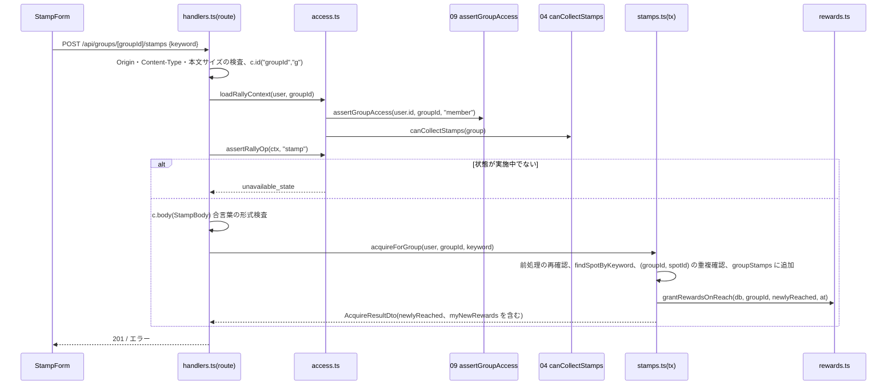

# 08 グループ・スタンプラリー

> 状態の凡例は [README](README.md) に従う([事実]/[推定]/[決定]/[案]/[未決]/[要確認])。ID 接頭辞は `RLY`(RLY-API / RLY-FN / RLY-T / RLY-TASK / RLY-ERR / RLY-REQ / RLY-Q)。「デモ範囲外」と記した項目は、デモでは実装・試験しなくてよい。「見送り(契約 16.2)」と記した項目は、主ルート(契約 16.1)の動作を優先して作り込みを後回しにする項目で、削除せずに残す(扱いはデモ範囲外と同じ。試験は実行しない)。
> 仕様の正は docs/design。モジュール間で共有する名前・署名・パス・値・状態値は [統一仕様書](_unified-contracts.md)(以下「契約」)を正とし、本書の節番号のあとに契約の節番号を併記する(例: 契約 7.8)。

## 1. 概要と責務 / 対応する柱

- 柱9「同行ラリー(グループ単位のスタンプ・振り返り)」。グループ(旅行プラン)の参加メンバーが合言葉でスポットのスタンプを押し、グループとしての進捗(スポット別の取得状況、達成率、特典の到達)を見られるようにする。グループの取得数が特典の必要数に達したときは、その時点のメンバー全員に個人の特典を付与する [決定 13]。旅行の実施中と完了後は、振り返り(メモ・アンケート・写真のダミー投稿)をグループ内で残す [決定 16]。
- 責務(本モジュールが持つ): グループ専用のスタンプ記録、進捗・特典到達の集計(派生)、個人特典の付与記録、振り返りのデータと画面。
- 責務外: グループの状態遷移と状態ごとの可否の判定(04)、グループの取得とアクセス判定・禁止表現の判定・表示名・ブロック(09)、メンバー判定の部品(00 `authz.ts`)、自治体向け集計(12。`groupStamps` を直接読む。契約 7.8)、個人のスタンプ・特典の既存機能(`/api/v2`)。通知は送らない(契約 9.1)。
- 対象ユーザー: グループの参加中メンバー(幹事を含む。権限は全員対等 [案])。非メンバー・退会者は操作不可。

## 2. 既存機能との関係

### 2.1 既存機能の仕様(app/ の読み取り結果) [事実]

| 項目 | 既存の仕様 |
|---|---|
| スポット | `seed.json` の `spots`(7 件)。項目: `id:number`、`stampName`、`name`、`area`、`description`、`map{x,y}`、`hue`、`keyword`(合言葉。秘密)、`stampCount`。`GET /api/v2/spots` は `keyword` を除き `acquired` を付けて返す |
| スタンプ | `server-store.ts` の `Stamp = { spotId:number; at:string }`(`at` は `YYYY-MM-DD HH:mm:ss`、タイムゾーン無し)。`State = { lap, stamps, rewards, inquiries }`。ユーザーごとの区別が無く、デモ全体で 1 人分の状態を持つ |
| 取得 | `acquire(keyword)`: 合言葉を trim・小文字化して `spots[].keyword` と比較。不一致は `invalid_code`、取得済みは `already_acquired`。取得後、`stamps.length >= requiredStamps` の特典を自動付与 |
| API | `POST /api/v2/user/stamps` `{keyword}`。`keyword` が文字列で長さ 1〜64 でなければ 400 `invalid_code`、`already_acquired` は 409、不一致は 400。`GET /api/v2/user/stamps`、`/user/rewards`、`/user/activities`、`POST /api/v2/user/reset`(周回を進める) |
| 特典 | `seed.json` の `rewards`(3 件): 必要スタンプ 3 / 5 / 7 個。`prize` は景品名(ダミー) |
| 画面 | `/[campaign]/qr`(合言葉入力。メッセージは `invalid_code` / `already_acquired` のみ定義)、`/[campaign]/spots`、`/[campaign]/spots/detail?id=`、`/[campaign]/rewards`、`/[campaign]/rewards/detail`、`/[campaign]/pointHistory`。詳細画面は動的セグメントではなく `?id=` を使う |
| 取得方法 | 本番は QR・バーコード・キーワード・GPS。ローカル版は合言葉入力のみ(カメラ・GPS 不使用)[事実、qr/page.tsx のコメント] |
| 写真投稿・アンケート | app/ に実装なし(`/api/v2` に `questionnaires` も写真もない。`seed.json` にもデータなし)。本番サイトの仕様は docs/ideas の解析にあるのみ [事実] |
| クライアント | `src/lib/api.ts` の `api` / `post` / `useApi` は `/api/v2` 固定の接頭辞。エラーは `body.error` を `code` として読む |
| 設定 | `next.config.ts` に `cacheComponents: true`、`partialPrefetching: true`。Next.js 16 の Route Handler と `cacheComponents` の挙動は [要確認](実装着手時に確認する事項。判断は不要。契約 14.2)。画面は既存どおり `"use client"` + `Suspense` で書き、Route Handler の `params` は Promise(既存コードに合わせる) |

### 2.2 流用/拡張/新規の境界 [案]

| 区分 | 内容 | 方針 |
|---|---|---|
| 流用(読み取りのみ) | `seed.json` の `spots`、`rewards`、`campaign` | `features/groups/rally/catalog.ts` 経由で参照。`keyword` は照合関数の内部だけで使い、DTO に載せない |
| 流用(規則のみ) | `acquire` の合言葉判定(trim・大文字小文字無視)、画面文言のキー `invalid_code` / `already_acquired`、特典の「必要スタンプ数に達したら獲得」 | 既存のコードは呼ばず、同じ規則を本モジュールで別に実装する。`acquire` を呼ぶと個人の共有状態(単一ユーザー)を書き換えるため。エラーの形は契約 3.3(`reason` に `invalid_code` / `already_acquired`) |
| 変更しない | `/api/v2/**`、`server-store.ts`、`api.ts`、既存ページ、`seed.json` | 編集しない。個人のスタンプ・特典の既存機能は従来どおり `/[campaign]/qr` で押す。本モジュールの個人特典(4.6)は既存の特典機能と連動させない [決定 13・21] |
| 新規 | グループ専用スタンプ記録、進捗集計、特典到達の派生、個人特典の付与記録、振り返り(メモ・アンケート・写真ダミー)、API `/api/groups/[groupId]/{rally,stamps,review…}`、画面 | `features/groups/rally/` とグループ配下の画面。コレクションは 00 の `Db` に追加(4.2) |
| 既存画面へのリンク | スポット詳細(`/[campaign]/spots/detail?id=`)、特典詳細(`/[campaign]/rewards/detail?id=`)、個人スタンプ(`/[campaign]/qr`) | 進捗・振り返りの各スポット/グループの特典から遷移。新規実装なし。個人特典の一覧(4.6)からは既存の特典ページへリンクしない(既存ページは単一ユーザーの獲得状態を表示するため) |
| 前提の訂正 | 骨子の「写真・アンケートは既存画面へのリンク」 | 既存画面が無いため不可。振り返り内に最小の新規実装(第 3 章の画面、4.1 の型)を置く |

### 2.3 実装時に作るファイル(すべて新規。既存は変更しない) [案]

ルーティングはリソースごとの `route.ts` とし、`route.ts` は `handlers.ts` の再エクスポートだけを書く(契約 2.1)。モジュール固有の API クライアントは作らず、画面は 00 の `lib/groups-api.ts`(`gapi`、`gpost`、`gput`、`gdelete`、`useGroupsApi`)を直接使う(契約 3.5)。

| パス | 責務 |
|---|---|
| `app/src/features/groups/rally/types.ts` | エンティティ・DTO・列挙型(4.1) |
| `app/src/features/groups/rally/messages.ts` | 画面文言・エラー文言・アンケートの設問と尺度の文言(4.7、第 8 章) |
| `app/src/features/groups/rally/catalog.ts` | seed のスポット・特典の読み取り、`findSpotByKeyword`、公開用スポット DTO(keyword を除く)。サーバー側専用(7.4) |
| `app/src/features/groups/rally/access.ts` | `rallyAccess`: 状態ごとの可否(第 6 章。04 の判定関数を呼ぶ)、`loadRallyContext`・`assertRallyOp`: 全サービス関数の共通前処理(RLY-FN-13・14) |
| `app/src/features/groups/rally/stamps.ts` | `acquireForGroup`、`groupProgress`、`deriveRewards`(特典到達の導出) |
| `app/src/features/groups/rally/rewards.ts` | `grantRewardsOnReach`(個人特典の付与)、`listMyRewards`(4.6) |
| `app/src/features/groups/rally/review.ts` | `getReview`、`saveMemo`、`saveSurvey`、`addPhotoPost`、`removePhotoPost` |
| `app/src/features/groups/rally/validate.ts` | 本モジュールの入力スキーマ(00 の `v` と、合言葉用の自前 `Schema`。第 7 章) |
| `app/src/features/groups/rally/handlers.ts` | 00 の `route()` で包んだハンドラ(RLY-API-01〜07) |
| `app/src/app/api/groups/[groupId]/rally/route.ts` | `GET`(RLY-API-01) |
| `app/src/app/api/groups/[groupId]/stamps/route.ts` | `POST`(RLY-API-02) |
| `app/src/app/api/groups/[groupId]/review/route.ts` | `GET`(RLY-API-03) |
| `app/src/app/api/groups/[groupId]/review/memo/route.ts` | `PUT`(RLY-API-04) |
| `app/src/app/api/groups/[groupId]/review/survey/route.ts` | `PUT`(RLY-API-05) |
| `app/src/app/api/groups/[groupId]/review/photos/route.ts` | `POST`(RLY-API-06) |
| `app/src/app/api/groups/[groupId]/review/photos/[photoId]/route.ts` | `DELETE`(RLY-API-07) |
| `app/src/features/groups/rally/components/` | `RallyTab.tsx`、`RallySummary.tsx`、`StampForm.tsx`、`SpotProgressList.tsx`、`RewardProgress.tsx`、`MyRewardList.tsx`、`MemberContribution.tsx`、`ReviewMemoSection.tsx`、`ReviewSurveySection.tsx`、`ReviewPhotoSection.tsx`、`ReviewSummary.tsx` |
| `app/src/app/[campaign]/groups/[groupId]/review/page.tsx` | 振り返りページ |
| `app/src/features/groups/rally/*.test.ts` | 自動試験(第 9 章) |

- 同じ階層に静的セグメントと動的セグメントを並べない(契約 2.1 R-2)。`[groupId]` の下は `rally`、`stamps`、`review` の静的セグメントだけ、`review/photos` の下は `[photoId]` だけにした。
- 初期データは 00 の `group-seed.json` に統合する(契約 11.4)。本モジュールはその断片の内容(4.5)を定め、`seed.ts` は作らない。
- ラリータブ(`?tab=rally`)は 01 のグループ詳細 `[groupId]/page.tsx` が `RallyTab` を差し込む(01 の画面ファイルは 01 の担当。本モジュールはコンポーネントを提供する)。

### 2.4 利用ライブラリ・モジュール

新規に追加する npm パッケージはない(試験ツールは 00 が追加する Vitest を共用する。契約 11.1)。バージョンの「維持」は `app/package.json` の現行指定を変えないことを指す。ライセンスは `app/package-lock.json` の記載による [事実]。

| 区分 | 名前 | 用途 | ライセンス | バージョン方針 |
|---|---|---|---|---|
| フレームワーク | Next.js(`next`) | App Router の画面(`review/page.tsx`)、Route Handler、`next/link`、`next/navigation`(`useSearchParams` でタブ・`useParams` で ID を取得) | MIT | 16.4.5 を維持 |
| UI ライブラリ | React / React DOM | コンポーネント、`useState` / `useEffect` / `Suspense` | MIT | 19.3.0 を維持 |
| UI ライブラリ | Mantine(`@mantine/core`) | `Progress`、`Alert`、`TextInput`、`Textarea`、`Button`、`Radio.Group`、`Card`、`Badge`、`Select`(写真のスポット選択) | MIT | ^9.7.5 を維持 |
| アイコン | Tabler Icons(`@tabler/icons-react`) | 取得済み/未取得、特典到達のアイコン(文言と併用。3.3) | MIT | ^3.51.0 を維持 |
| 日時表示 | dayjs | 取得日時・投稿日時・付与日時の表示整形(クライアント側のみ)。JST 表示に dayjs 同梱の `utc` / `timezone` プラグインを使う | MIT | ^1.11.23 を維持 |
| 試験(devDependency) | Vitest | サービス関数・API の自動試験(第 9 章)。00 が導入し、08 は追加しない | MIT | 00 が追加する版(最新の安定版)に従う |
| 言語・静的検査 | TypeScript、ESLint(`eslint-config-next`) | 型検査(`npx tsc --noEmit`)、`npm run lint` | Apache-2.0 / MIT | 現行を維持 |
| Node 標準・Web 標準 | `structuredClone`、`Intl`(数値整形)、`fetch` | 達成率の表示、クライアントの API 呼び出し(00 の `gapi` 経由) | (Node.js / ブラウザ組み込み) | Node.js は 09 章(セットアップ)の指定に従う |
| 自前モジュール(00) | `lib/groups-store.ts`(`db()`・`tx()`)、`lib/errors.ts`(`AppError`)、`lib/validation.ts`(`v`・`v.nullable`・`Schema`)、`lib/limits.ts`(`LIMITS`)、`lib/clock.ts`(`clock.nowIso()`)、`lib/ids.ts`(`newId`)、`lib/authz.ts`(`isMember`・`activeMembers`)、`lib/api-route.ts`(`route()`)、`lib/groups-api.ts`(クライアント)、`lib/groups-types.ts`(`Id`・`IsoDateTime`) | 保存、エラー、入力検証、上限値、時刻、ID 採番、メンバー判定、Route Handler の共通処理、クライアント、基本型 | (本リポジトリ) | 00 の確定版に合わせる |
| 自前モジュール(他) | 04 状態判定、09 安全、01 の型(`import type` のみ) | 状態による可否(`canCollectStamps`・`canReview`)、グループの取得とアクセス判定・禁止表現・表示名・ブロック、`Group` の型 | (本リポジトリ) | 契約 4.6 の依存の向き(08 → 00、04、09)に従う |
| データ(読み取りのみ) | `app/src/data/seed.json` | スポット・特典・キャンペーン | (本リポジトリ。架空データ) | 変更しない |

使わないもの(自前実装または不要とする理由):

| 対象 | 判断 | 理由 |
|---|---|---|
| 合言葉の照合 | 自前実装(`catalog.ts`) | 既存 `acquire` を呼ぶと単一ユーザーの個人状態を書き換えるため、同じ規則を別に実装する(2.2) |
| 入力検証ライブラリ(zod 等) | 使わない | 00 の自前検証 `v` で足り、依存とライセンス確認を増やさない(契約 11.1) |
| 状態管理(`zustand`) | 使わない | 画面の状態はコンポーネント内の `useState` と再取得で足りる |
| QR 読み取り・位置情報・画像アップロード | 使わない | デモは合言葉入力のみで、写真は実ファイルを扱わない(7.3) |
| ダミー写真の画像 | 自前実装(CSS グラデーション) | `spots[].hue` から描くため画像ファイル・画像処理ライブラリが不要 |
| グラフ描画ライブラリ | 使わない | 進捗は Mantine の `Progress` と数値の文言で表示できる |
| `server-only` パッケージ | 使わない | 依存を増やさず、`catalog.ts` をクライアントから import しない規約とビルド成果物の検査(RLY-T-57)で代える |

## 3. 画面・UI(04 章)

### 3.1 画面

| 画面 | 04 章の項目 | パス | 備考 |
|---|---|---|---|
| グループのスタンプ(タブ) | 同行ラリー(グループ単位) | `/[campaign]/groups/[groupId]?tab=rally` | 進捗、スポット別の取得者、グループの特典、あなたが受け取った特典、合言葉の入力。振り返りを書ける状態では振り返りページへのリンクを出す |
| 振り返り | 振り返り | `/[campaign]/groups/[groupId]/review` | 実施中と完了で閲覧・投稿できる(第 6 章)。それ以外の状態では案内文のみを表示する。あなたが受け取った特典も表示する |

### 3.2 コンポーネント構成

データ取得はすべてクライアント側(既存の流儀)。`RallyTab` が 1 回取得し、子へ props で渡す。API の呼び出しは 00 の `useGroupsApi`・`gpost`・`gput`・`gdelete` を使う。エラーは `ApiError` の `code`・`reason`・`detail` で分岐する。

| コンポーネント | props | state | データ取得 |
|---|---|---|---|
| `RallyTab` | `campaign: string; groupId: string` | `useGroupsApi` の `data: RallyProgressDto \| null`、`loading`、`error` | `GET /api/groups/[groupId]/rally`。取得後 `reload` を子へ渡す |
| `RallySummary` | `progress: Pick<RallyProgressDto,'totalSpots'\|'acquiredCount'\|'achievementRate'\|'status'>` | なし | なし |
| `StampForm` | `groupId: string; canCollectStamps: boolean; reason: RallyUnavailableReason \| null; onAcquired: (r: AcquireResultDto) => void`(`reason` には `access.stampReason` を渡す) | `code`、`busy`、`ok: AcquireResultDto \| null`、`err: string \| null` | `POST /api/groups/[groupId]/stamps`。`canCollectStamps=false` なら入力欄を無効化し理由を表示。成功時は取得したスポットと、今回受け取った特典(`myNewRewards`)を表示し、`onAcquired` で親が `reload` する |
| `SpotProgressList` | `campaign: string; spots: RallySpotDto[]; readOnly?: boolean` | なし | なし |
| `RewardProgress` | `campaign: string; rewards: RallyRewardDto[]; acquiredCount: number` | なし | なし |
| `MyRewardList` | `rewards: MyRewardDto[]` | なし | なし。見出し「あなたが受け取った特典」。注記「グループの取得数が必要数に達すると、その時点のメンバー全員に付与されます(押印に同行していないメンバーを含む)」「デモ用の記録です。既存の特典ページには反映されません」を常に表示する。0 件なら「まだありません」 |
| `MemberContribution` | `rows: MemberContributionDto[]` | なし | なし |
| `ReviewPage`(`review/page.tsx`) | (URL から `campaign`、`groupId`) | `data: ReviewDto \| null`、`loading`、`error` | `GET /api/groups/[groupId]/review`。409 `unavailable_state` を受けたら、エラー表示ではなく `reason` に対応する案内文(RLY-ERR-03)とグループ詳細へのリンクを表示する |
| `ReviewSummary` | `review: Pick<ReviewDto,'groupName'\|'period'\|'status'\|'progress'\|'myRewards'>` | なし | なし(`SpotProgressList` を `readOnly` で、`MyRewardList` をそのまま再利用) |
| `ReviewMemoSection` | `groupId; memos: ReviewMemoDto[]; canWrite: boolean; onSaved: () => void` | `body`、`busy`、`err`、`reviewPending: boolean` | `PUT /api/groups/[groupId]/review/memo`。入力中は 09 `checkText(body, "rally_memo")` でライブ警告。`detail.reviewRequired` を受けたら確認を表示し、了承後に `ackReview: true` を付けて再送する |
| `ReviewSurveySection` | `groupId; mySurvey: SurveyAnswerDto \| null; surveyAnswered: number; memberCount: number; status: GroupStatus; canWrite: boolean; onSaved: () => void` | `satisfaction`、`planClarity`、`wantAgain`、`localInteraction`、`localExploration` | `PUT /api/groups/[groupId]/review/survey`。5 項目すべてを選ぶまで送信ボタンを無効にする。`status=completed` かつ `mySurvey=null` のとき「アンケートが未回答です」を表示する |
| `ReviewPhotoSection` | `groupId; photos: PhotoPostDto[]; spots: RallySpotDto[]; canWrite: boolean; onChanged: () => void` | `spotId`、`caption`、`busy`、`reviewPending` | `POST …/review/photos`、`DELETE …/review/photos/[photoId]`。キャプションのライブ警告は `checkText(caption, "rally_photo_caption")` |

- スポット行(`SpotProgressList` の 1 行)には、スポット名、エリア、取得状況(バッジ+文言)、取得者の表示名と日時、スポット詳細(既存)へのリンクを出す。
- 状態に応じた表示: `canCollectStamps=false` のとき、理由(RLY-ERR-03 の文言)を `Alert`(情報)で示し、取得済みの進捗は閲覧できる。
- 「モック」の明示: 合言葉入力欄の近くに「デモ用: 合言葉入力のみ(位置・QR は使いません)」、写真欄に「デモ用: 実際の写真は保存されません」を表示(04 章 UI 方針)。
- ローディングは「読み込み中…」、失敗は `role="alert"` のメッセージと「再読み込み」ボタン(06 章)。
- スマホ幅: 1 カラム、タップ領域 44px 以上。タブ内の並びは「進捗サマリー → 合言葉入力 → スポット一覧 → グループの特典 → あなたが受け取った特典 → メンバー別 → 振り返りへのリンク」。
- 振り返りページの並びは「概要(グループ名・日程・状態)→ スポット一覧(閲覧のみ)→ あなたが受け取った特典 → メモ → アンケート → 写真」。実施中は見出しの下に「旅行中も書けます。完了後も編集できます」を表示する。

### 3.3 アクセシビリティ [案]

- 進捗バーは `role="progressbar"`(`aria-valuenow`/`aria-valuemin`/`aria-valuemax`)と、テキスト「7 スポット中 3 スポット(43%)」を併記する。色だけで取得/未取得を区別せず、アイコンと文言(「取得済み」「未取得」)を併用する。
- 合言葉入力は `label` を付け、結果は `role="status"`(成功)/`role="alert"`(失敗)で読み上げる(既存 `qr/page.tsx` と同じ)。送信中はボタンを無効化し `loading` を示す。
- スポット一覧・特典一覧は `ul`/`li`。取得者・日時は `time` 要素(`dateTime` 付き)。アンケートの各設問は `fieldset`+`legend`(設問文)+ラジオ(各選択肢に 4.7 の尺度の文言を付ける。キーボード操作可、矢印キー)。
- ダミー写真のグラデーション画像は `role="img"` と `aria-label`(キャプション、無ければ「スポット名のイメージ」)。見出しは h2 → h3 の順を守る。フォーカスリングを消さない。
- 禁止表現などで入力が拒否されたときは、該当欄に `error` を関連づけ(`aria-describedby`)、フォーカスを移す。

## 4. データ(05 章)

### 4.1 型定義(`features/groups/rally/types.ts`) [案]

```ts
import type { Id, IsoDateTime } from "@/lib/groups-types";
import type { GroupStatus } from "@/features/groups/lifecycle/types"; // 04 の状態型(8 値。契約 4.1)

/** 取得方法。デモは合言葉のみ。QR・位置照合を追加する場合は union に値を足す */
export type StampMethod = "keyword";

/** グループ専用のスタンプ記録。(groupId, spotId) で一意。db().groupStamps(契約 7.8) */
export interface GroupStamp {
  id: Id;                // newId("gs")
  groupId: Id;
  spotId: number;        // seed.json spots[].id
  acquiredBy: Id;        // 取得操作をしたメンバーの userId
  method: StampMethod;
  at: IsoDateTime;       // clock.nowIso()(+09:00)。12 はこの項目を読む
}

/** 個人特典の付与記録。(userId, rewardId) で一意。db().rallyRewardGrants(契約 7.8) */
export interface RallyRewardGrant {
  id: Id;                // newId("rg")
  userId: Id;
  rewardId: number;      // seed.json rewards[].id
  groupId: Id;           // 付与のもとになったグループ
  at: IsoDateTime;       // 付与日時(必要数に達した取得記録の at と同じ値)
}

/** 振り返りメモ。(groupId, userId) で 1 件(上書き)。db().rallyMemos */
export interface ReviewMemo {
  id: Id;                // newId("rm")
  groupId: Id;
  userId: Id;
  body: string;          // LIMITS.RALLY_MEMO(契約 10.3)
  updatedAt: IsoDateTime;
}

export type WantAgain = "yes" | "maybe" | "no";
export type Scale5 = 1 | 2 | 3 | 4 | 5;

/** 振り返りアンケート(5 項目)。(groupId, userId) で 1 件(上書き)。db().rallySurveys。設問の文言と尺度は 4.7 */
export interface SurveyAnswer {
  id: Id;                       // newId("rs")
  groupId: Id;
  userId: Id;
  satisfaction: Scale5;         // 旅全体の満足度
  planClarity: Scale5;          // 旅程・集合のわかりやすさ
  wantAgain: WantAgain;         // また旅行したいか
  localInteraction: Scale5;     // 地元の人との交流があったか
  localExploration: Scale5;     // 滞在中にいろいろな場所を回れたか
  answeredAt: IsoDateTime;      // 最後に保存した日時
}

/** 写真投稿(ダミー)。実ファイルは保存しない。db().rallyPhotos */
export interface PhotoPost {
  id: Id;                // newId("ph")
  groupId: Id;
  userId: Id;
  spotId: number | null; // 添えるスポット(画像は spots[].hue のグラデーションで描く)。入力で省略したら null
  caption: string;       // LIMITS.PHOTO_CAPTION(契約 10.3)
  createdAt: IsoDateTime;
}

/** 状態による制約の理由(エラーの reason と画面の案内文 RLY-ERR-03 に対応) */
export type RallyUnavailableReason = "recruiting" | "not_started" | "finished" | "cancelled" | "replanned";

export interface RallyAccess {
  canView: boolean;          // ラリータブの閲覧(メンバーは全状態で true)
  canCollectStamps: boolean; // スタンプを押せる(04 canCollectStamps)
  canReviewRead: boolean;    // 振り返りの閲覧(04 canReview)
  canReviewWrite: boolean;   // 振り返りの投稿・更新・削除(04 canReview)
  stampReason: RallyUnavailableReason | null;   // canCollectStamps=false の理由。true なら null
  reviewReason: RallyUnavailableReason | null;  // canReviewWrite=false の理由。true なら null
}

/** catalog.ts が返すスポット(seed.json spots[] から keyword・stampCount を除いたもの。サーバー側でのみ使う) */
export interface SpotCatalogItem {
  id: number; name: string; stampName: string; area: string; description: string;
  map: { x: number; y: number }; hue: number;
}

// ---- DTO(API の応答。userId・合言葉は含めない) ----
export interface MemberRefDto { displayName: string; isMe: boolean }   // 退会者は displayName="元メンバー"(契約 10.6)

export interface RallySpotDto {
  spotId: number; name: string; stampName: string; area: string; description: string;
  map: { x: number; y: number }; hue: number;
  acquired: boolean;
  acquiredBy: MemberRefDto | null;
  acquiredAt: IsoDateTime | null;   // GroupStamp.at の値
}

export interface RallyRewardDto {
  rewardId: number; name: string; prize: string; requiredStamps: number;
  reached: boolean; reachedAt: IsoDateTime | null;   // reachedAt は必要数に達した記録の at
}

/** 自分に付与された個人特典(4.6)。本人の分だけを返す */
export interface MyRewardDto {
  rewardId: number; name: string; prize: string; requiredStamps: number;
  grantedAt: IsoDateTime;
  groupName: string;          // 付与のもとになったグループの名前(本人がメンバーだったグループ)
  fromThisGroup: boolean;     // 表示中のグループの達成で付与されたか
}

export interface MemberContributionDto extends MemberRefDto { count: number }

export interface RallyProgressDto {
  groupId: Id;
  campaign: string;
  status: GroupStatus;
  access: RallyAccess;
  totalSpots: number;
  acquiredCount: number;
  achievementRate: number;          // 0〜100 の整数(四捨五入)
  spots: RallySpotDto[];            // seed の並び順
  rewards: RallyRewardDto[];        // グループとしての到達
  myRewards: MyRewardDto[];         // 自分が受け取った特典(全グループ分。grantedAt 昇順)
  members: MemberContributionDto[]; // 現メンバー全員(0 件も含む)の取得件数。退会者の記録があれば、退会者全員分を合算した「元メンバー」の 1 行を末尾に加える
}

export interface AcquireResultDto {
  spot: Pick<RallySpotDto, "spotId" | "name" | "stampName">;
  acquiredCount: number;
  achievementRate: number;
  newlyReached: RallyRewardDto[];   // 今回の取得でグループが到達した特典(なければ空)
  myNewRewards: MyRewardDto[];      // 今回の取得で自分に付与された特典(別グループで受け取り済みの特典は含まない)
}

export interface ReviewMemoDto { id: Id; author: MemberRefDto; body: string; updatedAt: IsoDateTime; mine: boolean }
export interface SurveyAnswerDto {
  satisfaction: Scale5; planClarity: Scale5; wantAgain: WantAgain;
  localInteraction: Scale5; localExploration: Scale5; answeredAt: IsoDateTime;
}
export interface PhotoPostDto { id: Id; author: MemberRefDto; spotId: number | null; hue: number; caption: string; createdAt: IsoDateTime; mine: boolean }

export interface ReviewDto {
  groupId: Id;
  groupName: string;                       // Group.name
  period: { start: string; end: string };  // Group.trip.startDate / trip.endDate(DateStr)
  status: GroupStatus;
  access: RallyAccess;
  progress: Pick<RallyProgressDto, "totalSpots" | "acquiredCount" | "achievementRate" | "spots" | "rewards">;
  myRewards: MyRewardDto[];
  memos: ReviewMemoDto[];                  // updatedAt 降順。ブロック関係のメンバーの分は除く(09。現行の案のまま実装し、試験は見送り。7.3)
  mySurvey: SurveyAnswerDto | null;
  surveyAnswered: number;                  // 回答済み人数(平均は出さない。7.3 参照)
  memberCount: number;                     // 現メンバー数
  photos: PhotoPostDto[];                  // createdAt 降順。ブロック関係のメンバーの分は除く(09。現行の案のまま実装し、試験は見送り。7.3)
}
```

- [決定済みとの整合] `GroupStamp` の項目は契約 7.8 の `{ id, groupId, spotId, acquiredBy, method, at }`。05 章「グループ単位のスタンプ集計」(グループID、スポットID、取得メンバー、取得日時)に対応する。`ReviewMemo` / `SurveyAnswer` / `PhotoPost` / `RallyRewardGrant` は新規で、docs/design 05 章への追加は契約第 12 章で扱う。
- 達成数・達成率・特典到達は保存せず、`GroupStamp` から都度導出する。個人特典は付与の事実を記録として保存する(4.6)。
- 日時は 00 の `clock.nowIso()`(`+09:00` 付き ISO 8601)。既存の `YYYY-MM-DD HH:mm:ss` 形式とは異なるが、既存の `at` はグループ側に持ち込まない。
- 型の所在: エンティティの型は本ファイルに置き、00 の `lib/groups-types.ts` は再エクスポートする(契約 3.1)。

### 4.2 コレクション(00 の `Db`) [決定(名前)/案(一意性の保証)]

00 の `Db` に次の `Repo` を置く(契約 3.1)。ID は `newId(prefix)` で採番する(契約 3.2。接頭辞 `gs`、`rm`、`rs`、`ph`、`rg` は 00 の `ID_PREFIXES` に含まれる)。

| コレクション | 型 | ID | 一意性 |
|---|---|---|---|
| `groupStamps` | `GroupStamp` | `gs-NNN` | `(groupId, spotId)` |
| `rallyMemos` | `ReviewMemo` | `rm-NNN` | `(groupId, userId)` |
| `rallySurveys` | `SurveyAnswer` | `rs-NNN` | `(groupId, userId)` |
| `rallyPhotos` | `PhotoPost` | `ph-NNN` | なし(件数上限は 7.1) |
| `rallyRewardGrants` | `RallyRewardGrant` | `rg-NNN` | `(userId, rewardId)` |

- 一意性は関数側で保証する。確認と追加は 00 の `tx(db => …)` の中で同期的に行う(`tx` 内で `await` しない。Node は単一スレッドのため、他の要求が割り込まない)。
- 書き込みは `tx` の中だけで行う。スタンプの追加と個人特典の付与は同じ `tx` で行い、途中で例外が出たときはどちらも残らない(00 の巻き戻し)。
- 記録の削除 API は写真だけ。スタンプ・個人特典・メモ・アンケートは削除しない(デモの初期化 `POST /api/demo/reset` で seed に戻る)。

### 4.3 個人のスタンプとグループの記録の関係 [決定 6]

| 案 | 内容 | メリット | デメリット |
|---|---|---|---|
| A 個人のスタンプを集計 | メンバー各自の個人スタンプを合算してグループの進捗とする | 二重入力が無い。本番の個人ラリーと一貫 | 既存ストアは単一ユーザーで、メンバー別の個人スタンプが存在しない。既存 API を変更しないと実現できない。旅行期間外やグループ外で取得した個人のスタンプが混ざる |
| B グループ専用の記録(採用) | `GroupStamp` を別に持つ。個人のスタンプは変更しない | 既存を変更しない。グループの旅行期間・状態に限定できる。重複判定がグループ単位で単純 | 同じ合言葉を個人でも押す場合は 2 回入力になる(個人ラリーとは別物と画面で明示) |
| C 両方 | グループ取得時に既存の個人スタンプにも付与 | 一回の入力で両方に反映 | 既存 `acquire` を呼ぶと共有の単一状態を書き換える。付与の失敗時の整合や重複(個人で既に取得済み)の扱いが複雑 |

- B を採る [決定 6]。既存のスタンプ・特典の状態(`server-store.ts` の `stamps`・`rewards`)には書き込まない。
- 個人の特典は、既存の特典履歴ではなく本モジュールの `rallyRewardGrants` に記録する [決定 13・21]。既存の特典機能(`/api/v2`、単一ユーザー)とは連動させないため、デモユーザーを切り替えても状態が混ざらない(4.6)。

### 4.4 取得の定義・重複防止・集計

**取得の定義(デモ)**
- 取得方法は合言葉入力のみ(QR・位置照合は行わない。`StampMethod` の拡張余地のみ)。合言葉の判定は既存と同じ規則: trim したうえで大文字小文字を区別せず `spots[].keyword` と一致。
- 操作できる人は、そのグループの参加中メンバー。取得できる期間は、グループの状態が実施中のとき(04 `canCollectStamps`。第 6 章)。旅行日程の日付判定は 04 の状態遷移に含まれるため、本モジュールでは日付を再判定しない。
- 1 つの記録は「そのメンバーが現地で押して、グループとして訪問した」を意味する。メンバー全員の個別押印は求めない(1 人が押せばそのスポットはグループとして取得済み。取得者の表示名を記録として見せる)[決定 14]。

**重複防止**
- グループ内で同一スポットは 1 回のみ(`(groupId, spotId)` で一意)。2 人目が同じ合言葉を入力した場合は `conflict` + `reason: "already_acquired"`(409)とし、既存の取得者と日時を `detail.acquired` に含める(5.2。メンバー内の情報)。
- 個人スタンプとの重複は存在しない(別記録)。

**進捗・特典到達の集計(派生)**
- `acquiredCount = db().groupStamps.count(s => s.groupId === groupId)`。`totalSpots = catalog.spots.length`(7)。`achievementRate = totalSpots === 0 ? 0 : Math.round(acquiredCount * 100 / totalSpots)`。
- スポット別: `spots[]` の各スポットに取得有無・取得者・日時を付ける。メンバー別: 現メンバーごとの取得数(0 も表示)。退会者の記録は残し、表示名は「元メンバー」に置換して取得数の合計に含める [決定 18]。
- グループの特典到達: `seed.rewards` の `requiredStamps` を閾値に、`acquiredCount >= requiredStamps` で到達。`reachedAt` は、取得記録を `at` 昇順に並べた `requiredStamps` 番目の `at`。スタンプは削除しないため、ある特典への到達はグループごとに 1 回だけ起こる。
- 個人特典の付与は 4.6。景品の受け渡しは対象外(景品名はダミー)。

**スポットの母集団**: スポットは `seed.json` の単一キャンペーン(`campaign.slug = "nttw-demo"`)のもの。グループの `campaign` が seed のキャンペーンと異なる場合、`spots` は空配列・`totalSpots = 0` として扱い、画面は「このキャンペーンのスタンプはありません」を表示する [既定。RLY-Q9。この分岐はデモ範囲外・見送り(契約 16.2。seed のグループはすべて単一キャンペーン)]。

### 4.5 デモ用の初期データ(00 の `group-seed.json` に統合) [案]

実ユーザー情報は使わない。グループ・ユーザーは 00 の seed(`fixtures.ts` の `GROUP_BY_STATUS` と見本の定数。契約 11.3)のものを使い、本モジュールは次の断片の内容を 00 に渡す(ID は統合時に 00 の採番規則 `<接頭辞>-NNN` で付ける。契約 11.4)。

| グループ | 状態 | 初期データ |
|---|---|---|
| `GROUP_BY_STATUS.in_progress`(`g-011`) | 実施中 | 取得 2 スポット(特典①の必要数 3 の 1 つ前)。取得者は参加中メンバーの 2 人に分ける。個人特典なし。元メンバーの見本 `LEFT_MEMBER_SAMPLE`(u-006。実行確定のときに退会。契約 11.4)は実施中より前に退会しているため、取得記録・付与記録を持たせない。デモで合言葉を入力し、特典①の到達と全員への付与を見せる操作に使う |
| `GROUP_BY_STATUS.completed`(`g-010`) | 完了 | 取得 5 スポット(特典①②到達)。メンバー全員に特典①②の `rallyRewardGrants`(`at` は 3 件目・5 件目の取得記録の `at`)。メモ 1〜2 件、アンケート回答 1〜2 件(5 項目すべて。未回答のメンバーを 1 人以上残す)、写真ダミー 2 件 |
| `GROUP_BY_STATUS.confirmed`(`g-005`) | 実行確定 | 取得 0。「押せない(旅行前)」の確認用 |
| `GROUP_BY_STATUS.replanned`(`g-006`) | 再企画済み(契約 11.4) | 取得 0。「押せない(再企画済み)」の確認用 |
| `GROUP_BY_STATUS.cancelled`(`g-013`) | 中止(未再企画。契約 11.4) | 取得 0。「押せない(中止)」の確認用 |

- 付与記録は取得記録と矛盾させない(到達していない特典の付与記録、メンバーでない利用者への付与記録を置かない)。00 の seed 検証で確認できるよう、本モジュールは検証関数 `checkRallySeed(seed): string[]`(問題の一覧を返す)を `rewards.ts` に置く [案]。

### 4.6 個人特典の付与 [決定 13・21/案(細部)]

| 観点 | 設計 |
|---|---|
| 記録先 | `rallyRewardGrants`(4.2)。既存の `server-store.ts` の `rewards`、`/api/v2/user/rewards` には書き込まず、読みもしない。既存の特典ページ(`/[campaign]/rewards`)には表示されない |
| 付与のタイミング | 達成時に 1 度だけ。`acquireForGroup` が取得記録を追加した同じ `tx` の中で、追加前と追加後の `deriveRewards` を比べ、今回到達した特典(`newlyReached`)ごとに `grantRewardsOnReach` を呼ぶ。スタンプは削除しないため、同じグループで同じ特典の到達が再び起きることはない |
| 付与の対象 | 到達した時点の参加中メンバー全員(`activeMembers(groupId)`。押印した人、押印に同行しなかった人、幹事を含む)[決定 13・14] |
| 重複防止 | `(userId, rewardId)` で一意。同じ利用者が別のグループですでに同じ特典を受け取っている場合は付与しない(付与記録を作らず、エラーにもしない)。付与の有無はグループの到達表示(`rewards`)には影響しない |
| 退会者 | 到達の時点で退会している人には付与しない。到達後に退会した場合も付与記録は取り消さない。なお 04 の規則(契約 4.5)では実施中以降は退会できないため、通常の操作では「到達後の退会」は起きない |
| 後から参加した人 | 実施中は申請を受け付けない(04 `canAcceptRequests`)ため、到達後に参加する人はいない。仮に参加しても過去の到達分は付与しない |
| 同行しなかったメンバー | 1 人の押印で全員に付与される。画面(`MyRewardList`)に「グループの取得数が必要数に達すると、その時点のメンバー全員に付与されます(押印に同行していないメンバーを含む)」を常に表示する |
| 付与日時 | `at` は必要数に達した取得記録の `at`(= その取得の時刻) |
| 表示 | `GET G/rally` の `myRewards` と `GET G/review` の `myRewards`(本人の分だけ。全グループ分を `grantedAt` 昇順)、取得の応答の `myNewRewards`。他のメンバーの付与記録は返さない(付与の対象はメンバー全員のため、人数・名前を出す必要がない) |
| デモユーザーの切り替え | 付与記録は `userId` ごとのため、Cookie `demoUser` を切り替えるとその利用者の分だけが表示される |
| 通知 | 送らない(`rally_reward` は作らない。契約 9.1) |
| 12 への受け渡し | 行わない(12 の指標に特典の付与数は無い) |

```ts
// rewards.ts(tx の中から呼ぶ。db は tx の引数)
export function grantRewardsOnReach(db: Db, groupId: Id, reached: RallyRewardDto[], at: IsoDateTime): RallyRewardGrant[];
export function listMyRewards(userId: Id, currentGroupId: Id): MyRewardDto[];
```

### 4.7 アンケートの設問と尺度 [決定 19・25]

5 項目すべてを必須とする(一部だけの保存はしない)。文言は `messages.ts` の `SURVEY_QUESTIONS` に置く。

| キー | 設問(画面の文言) | 尺度(値: 表示) | 12 の指標との対応(契約 7.12。余力) |
|---|---|---|---|
| `satisfaction` | 今回の旅行全体の満足度を選んでください。 | 1: 不満 / 2: やや不満 / 3: どちらともいえない / 4: やや満足 / 5: 満足 | 「平均満足度」 |
| `planClarity` | 旅程や集合場所の情報はわかりやすかったですか。 | 1: わかりにくかった / 2: ややわかりにくかった / 3: どちらともいえない / 4: ややわかりやすかった / 5: わかりやすかった | 対象外(アプリの旅程機能の評価のため。自治体の判断材料にしない)[案] |
| `wantAgain` | この地域にまた旅行したいと思いますか。 | `yes`: はい / `maybe`: どちらともいえない / `no`: いいえ | 「再訪意向の割合」(`yes` の割合)。行動の指標 MUN-M-11(再訪率)と並べて示す |
| `localInteraction` | 旅行先で地元の人と交流する機会はありましたか。 | 1: まったくなかった / 2: あまりなかった / 3: どちらともいえない / 4: ややあった / 5: 十分にあった | 「地元との交流の平均」 |
| `localExploration` | 滞在中に、いろいろな場所を回ることができましたか。 | 1: ほとんど回れなかった / 2: あまり回れなかった / 3: どちらともいえない / 4: やや回れた / 5: 十分に回れた | 「滞在中の回遊の平均」。スタンプの指標 MUN-M-09 と並べて示す |

- 回答できる期間は振り返りと同じ(実施中と完了。第 6 章)。実施中に回答した内容は、完了後も上書きできる。
- 完了時点で未入力の項目の扱い: 未回答のメンバーの回答は作らない(補完・既定値の代入をしない)。メモも同様。完了後も書けるため、締め切りは設けない。画面は完了後に未回答の本人へ「アンケートが未回答です」を表示する。
- 12 の集計の規則(契約 7.12。12 の余力の範囲。RLY-REQ-08): 対象は状態が `completed` のグループの回答だけとし、期間は `lifecycle.completedAt` で絞る(実施中の回答は暫定のため数えない)。集計時点の最新の回答を使い、未回答は分母に入れない。回答数が K=5 未満のセルは 12 の `toCountCell`・`toRateCell` で少数として扱う(契約 10.5)。回答数(分母)を併記する。
- グループ内では平均値を出さない(7.3)。

## 5. インターフェース(案)

### 5.1 サービス関数(`features/groups/rally/*.ts`。UI・HTTP に依存しない)

`user` は 00 の `DemoUser`。例外は 00 の `AppError(code, message, { reason?, fields?, detail? })`(契約 3.3)。サービス関数は同期関数とし、書き込みは 00 の `tx` の中で行う。

| ID | シグネチャ | 説明 | 例外(`code` / `reason`) |
|---|---|---|---|
| RLY-FN-01 | `rallyAccess(g: GroupLike): RallyAccess` | 04 の `canCollectStamps(g)`・`canReview(g)` と状態から理由を求める純粋関数(第 6 章の表) | なし |
| RLY-FN-02 | `acquireForGroup(user: DemoUser, groupId: Id, keyword: string): AcquireResultDto` | 合言葉でグループのスタンプを取得。`tx` の中で RLY-FN-13・14 を再確認し、照合 → 重複確認 → 追加 → 個人特典の付与(RLY-FN-11)を行う。`keyword` は RLY-API-02 のスキーマで検査済みの値 | `not_found`、`forbidden`、`unavailable_state`、`invalid_input`/`invalid_code`、`conflict`/`already_acquired` |
| RLY-FN-03 | `groupProgress(user: DemoUser, groupId: Id): RallyProgressDto` | スポット別・メンバー別・グループの特典・自分の特典・達成率 | `not_found`、`forbidden` |
| RLY-FN-04 | `getReview(user: DemoUser, groupId: Id): ReviewDto` | 振り返りのまとめ。`canReviewRead=false` の状態では `unavailable_state` | `not_found`、`forbidden`、`unavailable_state` |
| RLY-FN-05 | `saveMemo(user: DemoUser, groupId: Id, input: { body: string; ackReview?: boolean }): ReviewMemoDto` | 自分のメモを作成/上書き。`canReviewWrite=false` なら `unavailable_state`。09 `assertTextAllowed(body, "rally_memo", "body", { ackReview })` | `not_found`、`forbidden`、`unavailable_state`、`invalid_input`(禁止表現を含む) |
| RLY-FN-06 | `saveSurvey(user: DemoUser, groupId: Id, input: SurveyInput): SurveyAnswerDto` | 自分の回答(5 項目)を作成/上書き。`SurveyInput` は `SurveyAnswer` の 5 項目。状態の条件は RLY-FN-05 と同じ | `not_found`、`forbidden`、`unavailable_state` |
| RLY-FN-07 | `addPhotoPost(user: DemoUser, groupId: Id, input: { spotId?: number \| null; caption: string; ackReview?: boolean }): PhotoPostDto` | ダミー写真の投稿(実ファイルなし)。`spotId` の省略と `null` はどちらもスポットなし。上限: 1 人 `LIMITS.PHOTOS.maxPerUser` 件、グループ `LIMITS.PHOTOS.maxItems` 件(契約 10.3)。09 `assertTextAllowed(caption, "rally_photo_caption", "caption", { ackReview })`(空文字は検査しない)。状態の条件は RLY-FN-05 と同じ | `not_found`、`forbidden`、`unavailable_state`、`invalid_input`、`conflict`/`limit_exceeded` |
| RLY-FN-08 | `removePhotoPost(user: DemoUser, groupId: Id, photoId: Id): void` | 自分の投稿のみ削除。投稿が無い、または別グループの投稿なら `not_found`(09 `assertInGroup`)。他人の投稿なら `forbidden` | `not_found`、`forbidden`、`unavailable_state` |
| RLY-FN-09 | `findSpotByKeyword(keyword: string): SpotCatalogItem \| undefined` | `catalog.ts`。trim・小文字化して照合。戻り値に `keyword` を含めない | なし |
| RLY-FN-10 | `deriveRewards(stamps: readonly GroupStamp[]): RallyRewardDto[]` | グループの特典到達の導出(純粋関数) | なし |
| RLY-FN-11 | `grantRewardsOnReach(db: Db, groupId: Id, reached: RallyRewardDto[], at: IsoDateTime): RallyRewardGrant[]` | `rewards.ts`。到達した特典を、その時点の参加中メンバー全員に付与する(4.6)。`(userId, rewardId)` が既にあれば飛ばす。作った記録を返す。`tx` の中からだけ呼ぶ | なし |
| RLY-FN-12 | `listMyRewards(userId: Id, currentGroupId: Id): MyRewardDto[]` | `rewards.ts`。本人の付与記録を `grantedAt` 昇順で返す | なし |
| RLY-FN-13 | `loadRallyContext(user: DemoUser, groupId: Id): { group: GroupRecord; access: RallyAccess }` | `access.ts`。RLY-FN-02〜08 と各ハンドラの共通前処理(下記)。`GroupRecord` は 09 の型(契約 4.2 の `Group` を読む) | `not_found`、`forbidden` |
| RLY-FN-14 | `assertRallyOp(ctx: { group: GroupRecord; access: RallyAccess }, op: "stamp" \| "review"): void` | `access.ts`。`op` に対応する可否が偽なら `unavailable_state` + `reason`(`stampReason` / `reviewReason`)+ `detail.state` | `unavailable_state` |

共通の前処理(RLY-FN-13): ① パスの `groupId` はハンドラが 00 の `c.id("groupId", "g")` で検証済み(形式不正は `not_found`)→ ② 09 `assertGroupAccess(user.id, groupId, "member")` でグループを取得する(不在・非公開の非メンバー・ブロック関係は `not_found`、公開グループの非メンバーは `forbidden`。退会者は非メンバーと同じ扱い)→ ③ `rallyAccess(group)` で `access` を求めて返す。状態による拒否は RLY-FN-14 で行う。グループの状態は 00 の `route()` の `beforeRequest` フックで評価済み(契約 3.5)のため、本モジュールは `evaluateAll` を呼ばない。

ハンドラの処理順(RLY-API-02 の例):



順序の理由: アクセス判定 → 状態判定 → 合言葉の検査の順にし、非メンバーや取得不可の状態では、応答から合言葉の正否を判別できないようにする。このため RLY-API-02 のハンドラは本文を読む前に RLY-FN-13・14 を呼ぶ。他のハンドラも同じ順(アクセス → 状態 → 本文)にそろえる。サービス関数は `tx` の中で RLY-FN-13・14 を再度呼ぶ(本文の読み取りの `await` をはさむため。同期の再確認で追加の費用は小さい)。

### 5.2 API(Route Handler。契約 2.2)

共通: JSON。`G` は `/api/groups/[groupId]`。ハンドラは 00 の `route()` で包む(Origin・Content-Type・本文 64KB の検査、現在ユーザーの解決、例外の変換)。現在ユーザーは Cookie `demoUser`(00)から解決し、クライアントの申告(本文の `userId` 等)を使わない。エラーの形は 00 の `ErrorBody`(`{ error, reason?, message, fields?, detail? }`。契約 3.3)で、本モジュールが使う `reason` と `detail` は次のとおり。

| `error` | `reason` | `detail` |
|---|---|---|
| `invalid_input` | `invalid_code`(合言葉の形式不正・不一致)。他の検証失敗は `reason` なし | 禁止表現の review 判定で未確認のとき `reviewRequired: true`(09) |
| `conflict` | `already_acquired` | `acquired: { by: MemberRefDto; at: IsoDateTime }` |
| `conflict` | `limit_exceeded`(写真の件数上限) | なし |
| `unavailable_state` | `RallyUnavailableReason` の値 | `state: GroupStatus` |

| ID | メソッド・パス | リクエスト | 成功 | エラー |
|---|---|---|---|---|
| RLY-API-01 | `GET G/rally` | なし | 200 `RallyProgressDto` | 403 `forbidden`、404 `not_found` |
| RLY-API-02 | `POST G/stamps` | `{ keyword: string }` | 201 `AcquireResultDto` | 400 `invalid_input`(`invalid_code`)、403、404、409 `conflict`(`already_acquired`)、409 `unavailable_state` |
| RLY-API-03 | `GET G/review` | なし | 200 `ReviewDto` | 403、404、409 `unavailable_state` |
| RLY-API-04 | `PUT G/review/memo` | `{ body: string; ackReview?: boolean }` | 200 `ReviewMemoDto` | 400 `invalid_input`、403、404、409 `unavailable_state` |
| RLY-API-05 | `PUT G/review/survey` | `{ satisfaction: 1..5, planClarity: 1..5, wantAgain: "yes"\|"maybe"\|"no", localInteraction: 1..5, localExploration: 1..5 }` | 200 `SurveyAnswerDto` | 400 `invalid_input`、403、404、409 `unavailable_state` |
| RLY-API-06 | `POST G/review/photos` | `{ spotId?: number \| null; caption?: string; ackReview?: boolean }` | 201 `PhotoPostDto` | 400 `invalid_input`、403、404、409 `conflict`(`limit_exceeded`)/`unavailable_state` |
| RLY-API-07 | `DELETE G/review/photos/[photoId]` | 本文なし。`Content-Type: application/json` は必須(契約 2.3) | 204(本文なし) | 403(他人の投稿)、404(グループ・投稿が無い、別グループの投稿、`photoId` の形式不正)、409 `unavailable_state` |

- メソッドは契約 2.3 に従う: 取得は GET、作成は POST(201)、メモ・アンケートは 1 人 1 件の全置換のため PUT(上書き。初回も 200)、削除は DELETE(204)。GET は副作用を持たない。変更系(POST・PUT・DELETE)は、本文の有無にかかわらず `Content-Type: application/json` を必須とする(本文なしの DELETE を含む。違反は 00 の `route()` が 415。契約 2.3)。
- 合言葉は応答・一覧に含めない(既存方針を踏襲)。応答に `userId` を含めない(表示名と `isMe`/`mine` のみ)。
- `GET G/rally` の状態は `access` で返す(画面は判定を再実装しない)。
- 自治体向けの HTTP は本モジュールでは公開しない(12 の `GET /api/stats` が `groupStamps` を直接読む)。

### 5.3 他モジュールとの契約(呼ぶ/呼ばれる)

依存の向きは契約 4.6(08 → 00、04、09)。

| 方向 | モジュール | 名称 | 用途 |
|---|---|---|---|
| 呼ぶ | 00 | `db()`、`tx(fn)`、`newId(prefix)`、`clock.nowIso()`、`AppError`、`v`・`v.nullable`・`Schema`、`LIMITS`、`route()`・`ok`・`created`・`noContent`、`isMember`・`activeMembers`(`authz.ts`)、クライアントの `gapi`・`gpost`・`gput`・`gdelete`・`useGroupsApi`・`ApiError` | 保存、ID、時刻、エラー、検証、上限値、Route Handler、メンバー判定、画面の API 呼び出し |
| 呼ぶ | 04 | `canCollectStamps(g: GroupLike): boolean`、`canReview(g: GroupLike): boolean`、型 `GroupStatus`・`GroupLike`、`statusLabel(status)` | 第 6 章の判定、状態の表示名 |
| 呼ぶ | 09 | `assertGroupAccess(userId, groupId, "member")`、`assertInGroup(item, groupId)`、`assertTextAllowed(text, context, field, { ackReview })`(`rally_memo`・`rally_photo_caption`)、`checkText(text, context)`(画面のライブ警告)、`visibleProfile(viewer, targetId, { kind: "member", groupId })`、`isBlocked(a, b)` | グループ取得とアクセス判定、資源の所属確認、禁止表現、表示名、ブロック関係のメンバーの投稿の除外(試験は見送り。契約 16.2)。通報の導線は置かない(通報の対象はメッセージ・グループ・ユーザーのみ [決定 28]。契約 6.3) |
| 型のみ | 01 | `import type { Group }` | `GroupRecord` の項目(`name`、`campaign`、`trip.startDate`・`trip.endDate`、`lifecycle.status`) |
| 呼ばれる | 01 | `RallyTab`(コンポーネント) | グループ詳細のタブ内に表示 |
| 読まれる | 12 | `db().groupStamps`(`GroupStamp.at`)、`db().rallySurveys`(アンケートの指標。完了グループの回答のみ、余力。4.7、契約 7.12) | 自治体集計の MUN-M-09 ほか。08 は集計関数を提供しない(契約 7.8) |
| 読まれる | 00 | seed 断片(4.5) | `group-seed.json` への統合 |

## 6. 状態との関係

本モジュールに独自の状態遷移はない。グループの状態(04 の `GroupStatus`、8 値。契約 4.1)で操作可否が決まり、判定は 04 の `canCollectStamps`・`canReview` を使う(契約 4.4)。

| `lifecycle.status` | 表示名 | ラリー閲覧 | スタンプ取得(`canCollectStamps`) | 振り返り閲覧・投稿(`canReview`) | `stampReason` | `reviewReason` |
|---|---|---|---|---|---|---|
| `recruiting` | 募集中 | 可(進捗 0、案内) | 不可 | 不可 | `recruiting` | `not_started` |
| `min_reached` | 最少人数到達 | 可 | 不可 | 不可 | `recruiting` | `not_started` |
| `withdrawal_period` | 辞退期間 | 可 | 不可 | 不可 | `recruiting` | `not_started` |
| `confirmed` | 実行確定 | 可 | 不可(旅行開始前) | 不可 | `not_started` | `not_started` |
| `in_progress` | 実施中 | 可 | 可 | 可 | `null` | `null` |
| `completed` | 完了 | 可(閲覧のみ) | 不可 | 可 | `finished` | `null` |
| `cancelled` | 中止 | 可(記録があれば閲覧のみ) | 不可 | 不可 | `cancelled` | `cancelled` |
| `replanned` | 再企画済み | 可(記録があれば閲覧のみ) | 不可 | 不可 | `replanned` | `replanned` |

- 「ラリー閲覧」は全状態で可のため `canView` は常に `true`(メンバーであることは RLY-FN-13 で確認済み)。`canReviewRead` と `canReviewWrite` はどちらも `canReview(g)` の値で、この表では同じ値になる。将来、閲覧だけを許す状態を作る場合に備えて分けておく。
- 振り返りは実施中から書ける [決定 16]。完了後も書ける(締め切りなし)。完了時点で未入力の項目の扱いは 4.7。
- 根拠: 04 章の状態表「実施中: スタンプラリー(柱9)を使う」「完了: 振り返り(柱9)へ」と契約 4.4。募集中のラリー閲覧、中止後の閲覧可否は [案]。
- 中止に至る遷移(契約 4.3)は `in_progress` より前の状態からだけ起こる(実施中は幹事の中止・辞退ができない)。このため中止・再企画済みのグループには通常スタンプの記録が無い。記録がある場合(seed・試験で入れた場合)は削除せず閲覧のみとする。
- 退会: 退会者は操作不可(`assertGroupAccess` で非メンバーと同じ扱い)。記録は残し、表示名を「元メンバー」とする [決定 18、契約 10.6]。04 の規則では実施中以降は退会できないため、ラリーと振り返りの記録に退会者が現れるのは退会の規則が変わった場合だけである。試験はデータを直接入れて確認する(RLY-T-23)。

## 7. 入力検証・セキュリティ・権限

### 7.1 入力検証

検証は 00 の `c.body(schema)` / `c.id(name, prefix)` と `v` で行う。未知の項目は捨てる。文字列は 00 の `sanitizeText` を通してから長さを数える(合言葉を除く)。上限値は 00 の `LIMITS`(契約 10.3)で参照し、数値を直書きしない。

| 項目 | 型 | 規則 | 違反時 |
|---|---|---|---|
| パスの `groupId`、`photoId` | string | `c.id("groupId", "g")`、`c.id("photoId", "ph")`(00 の `isId`) | `not_found`(形式不正も存在しないとみなす。契約 3.2) |
| 合言葉 `keyword` | string | 自前の `Schema`(`validate.ts` の `keywordSchema`): 文字列であること、制御文字(`\u0000-\u001f`、`\u007f`)を含まないこと(`sanitizeText` で除去せず拒否する)、trim 後 1〜64 文字。照合は trim・小文字化(既存と同じ) | `invalid_input` + `reason: "invalid_code"`(400。`fields.keyword`。不一致と同じ文言) |
| メモ `body` | string | `v.string({ min: LIMITS.RALLY_MEMO.min, max: LIMITS.RALLY_MEMO.max, multiline: true })`。改行可(連続 5 つ以上の改行を 4 つにまとめる処理はデモ範囲外・見送り。契約 16.2)。禁止表現は 09 `assertTextAllowed(body, "rally_memo", "body", { ackReview })` | `invalid_input`(`fields.body`。review 判定は `detail.reviewRequired`) |
| `ackReview` | boolean | `v.boolean({ optional: true })`。禁止表現を検査するメモ・写真の本文スキーマに必ず宣言する(宣言しないと未知キーとして捨てられる。契約 6.2) | `invalid_input` |
| `satisfaction`、`planClarity`、`localInteraction`、`localExploration` | number | `v.int({ min: 1, max: 5 })`(文字列は不可。必須) | `invalid_input`(`fields.<名>`) |
| `wantAgain` | string | `v.enum(["yes", "maybe", "no"])`(必須) | `invalid_input`(`fields.wantAgain`) |
| 写真 `spotId` | number | `v.nullable(v.int({ optional: true }))`(契約 3.4・7.8)。省略と `null` はどちらもスポットなし(保存値・応答は `null`)。数値の指定時は catalog に存在する ID | `invalid_input`(`fields.spotId`) |
| 写真 `caption` | string | `v.string({ min: LIMITS.PHOTO_CAPTION.min, max: LIMITS.PHOTO_CAPTION.max, optional: true, default: "" })`(1 行。改行は `invalid_input`)。空でなければ 09 `assertTextAllowed(caption, "rally_photo_caption", "caption", { ackReview })` | `invalid_input`(`fields.caption`) |
| リクエスト本体 | JSON | オブジェクトであること。64KB 以下(00 の `route()`) | `invalid_input`、413 `payload_too_large` |

- 検証はサーバー側で必ず行う(クライアントの `maxLength` は補助)。メモの本文は React の既定エスケープで描画し、`dangerouslySetInnerHTML` は使わない。ユーザー入力をファイルパスや正規表現に使わない。
- 合言葉の総当たり対策は 7.5 に記す。

### 7.2 権限

| 操作 | 参加中メンバー | 幹事 | 非メンバー(公開) | 非メンバー(非公開) | 退会者 |
|---|---|---|---|---|---|
| ラリー閲覧、スタンプ取得、振り返りの閲覧・投稿 | 可(状態の範囲内) | 可(メンバーと同じ) | `forbidden` | `not_found` | `forbidden`/`not_found`(公開範囲による) |
| 他人のメモ・回答の編集、他人の写真の削除 | 不可(`forbidden`) | 不可 [案。幹事の権限拡張は 01 の未決 #13 が決まるまで設けない] | - | - | - |
| 個人特典の閲覧 | 自分の分のみ | 自分の分のみ | - | - | - |

### 7.3 情報漏洩・個人の特定の防止

- 合言葉(`spots[].keyword`)は、DTO の組み立てを明示的な項目指定(許可リスト方式。`{...spot}` のスプレッドは使わない)で行い、応答に含めない。試験で応答 JSON に `keyword` の値が現れないことを検査する(RLY-T-22)。
- 応答にユーザー ID を含めない(`MemberRefDto` は表示名と `isMe`)。表示名は 09 の `visibleProfile(viewer, targetId, { kind: "member", groupId })` を通す。退会者は「元メンバー」とする。ブロック関係で `visibleProfile` が `not_found` を投げる取得者は、取得記録を残したうえで表示名を「メンバー」とする [案]。この処理は現行の案のまま実装し、作り込みと試験は見送る(契約 16.2)。
- 写真: 実ファイルのアップロード・保存・外部送信を行わない(肖像・位置情報・Exif の問題を避けるため)[決定 15]。投稿はスポットのイメージ(グラデーション)とキャプションのみ。キャプションに氏名・連絡先を書かせない注意書きを表示し、禁止表現・連絡先誘導は 09 の `assertTextAllowed` で拒否する。
- アンケートの平均値はグループ内には出さない(2〜6 人のグループでは他者の回答が逆算できるため)。自分の回答と回答済み人数のみ表示。12 で集計する場合は K=5 の規則を適用する(4.7、契約 10.5)。
- 個人特典の付与記録は本人の分だけを返す。
- メモ・写真は参加中メンバーにのみ見える。メモ・写真のうちブロック関係(09 `isBlocked`。双方向)のメンバーの分は表示から除く(現行の案のまま実装し、除外の向きの作り込みと試験は見送る。契約 16.2)。自治体集計へはメモ本文・写真・キャプションを渡さない。

### 7.4 セキュリティ対策(OWASP Top 10 の該当項目)

| 観点 | 本モジュールでの対処 | 確認する試験 |
|---|---|---|
| アクセス制御・IDOR | 全サービス関数と各ハンドラの先頭で RLY-FN-13 によりアクセス判定を行う。対象ユーザーは常に Cookie から解決した `user` で、本文・クエリの `userId`・`acquiredBy` は読まない(未知の項目は捨てる)。写真の削除は「パスの `groupId` に属する投稿か」(09 `assertInGroup`。違えば `not_found`)と「投稿者が本人か」(違えば `forbidden`)の両方を確認する。メモ・回答は `(groupId, user.id)` の 1 件だけを更新するため、他人の記録を指定する手段を持たない。個人特典は `user.id` の分だけを返す | RLY-T-07、08、29、39、43、54、56 |
| 入力検証・インジェクション | 7.1 の規則でサーバー側検証を行う。SQL・シェル・ファイルパスを使わない。合言葉は文字列の等価比較で照合し、正規表現を組み立てない | RLY-T-04〜06、31、33〜37、59(05・06・34・59 と 36・37 の一部は見送り) |
| XSS | メモ・キャプション・表示名は React の既定エスケープでテキストとして描画する(改行は CSS `white-space: pre-wrap` で表示)。`dangerouslySetInnerHTML` を使わない。URL を自動リンクにしない。ダミー写真は `hue` の数値から CSS を組み立て、ユーザー入力を `style` に入れない | RLY-T-58 |
| CSRF | 00 の `route()` に従う(Cookie の `SameSite=Lax`、変更系(POST・PUT・DELETE。本文なしの DELETE を含む)は `Content-Type: application/json` 必須、`Origin` と `Host` の不一致を拒否)。GET に副作用を持たせない | RLY-T-55 |
| 認証・セッション(デモ) | ログイン不要のため、現在ユーザーは Cookie `demoUser` によるモック(00)。画面に「モック」と表示する。Cookie の偽装で他人として操作できる点は 7.5 の既知の制約とする | - |
| セキュリティ設定 | API の応答ヘッダ(`Cache-Control: no-store`、`X-Content-Type-Options: nosniff`)は 00 の `route()` で、画面の `X-Frame-Options`・`Referrer-Policy` は `next.config.ts` で付ける(契約 11.2)。`catalog.ts`(合言葉を含む `seed.json` を読む)はサーバー側のサービス関数・ハンドラからのみ import し、クライアントコンポーネントは `types.ts` の型と API 応答だけを使う。合言葉がクライアントの JS に含まれないことをビルド成果物で確認する | RLY-T-57 |
| 機密データの扱い | 合言葉・ユーザー ID を応答に含めない(7.3)。個人のアンケート回答と個人特典は本人にだけ返す | RLY-T-22、29、42 |
| ログ | エラー時のログは 00 の `route()` が `requestId` と例外だけを出す。本モジュールは合言葉の入力値、メモ本文、キャプションをログに出さない(`console.log` で本文を出力しない) | - |

### 7.5 既知の制約(デモでは対処しない)

- 合言葉の総当たり: 失敗回数の制限は行わない。デモでは合言葉を画面に掲示しているため [既定。RLY-Q11]。実運用では同一ユーザー・グループ単位の回数制限(HTTP 429 `rate_limited` 相当)が必要。
- デモユーザーの Cookie は偽装できる。実運用では認証が必要(00 の方針)。
- 1 人の押印でメンバー全員に個人特典が付与されるため、現地に行っていないメンバーも特典を受け取る [決定 13・14]。実運用で景品を渡す場合は、受け取り時の確認方法を別途決める必要がある。
- 12 の集計の条件(期間)を変えた差分から少数のセルを推定する攻撃への対処は、12 の秘匿処理に委ねる。
- 極端な件数の投稿によるメモリ使用量の増加は、写真の件数上限(`LIMITS.PHOTOS.maxPerUser`・`LIMITS.PHOTOS.maxItems`)とメモ・回答の 1 人 1 件の上書きで抑えるにとどめる。

## 8. エラー処理

分類は 06 章(入力・状態・データ・通信相当・想定外)に対応する。表示文言は [案] で、`messages.ts` に置き、`error` と `reason` の組で引く。

| ID | `error` / `reason` | HTTP | 発生条件 | 画面での表示(文言案) | 画面の挙動・次の行動 |
|---|---|---|---|---|---|
| RLY-ERR-01 | `invalid_input` / `invalid_code` | 400 | 合言葉が不一致、空、65 文字以上、文字列でない、制御文字を含む | 「合言葉が正しくありません。もう一度確認してください。」(既存文言を流用) | 入力欄の下に `role="alert"` で表示し、入力値を残して再入力できるようにする |
| RLY-ERR-02 | `conflict` / `already_acquired` | 409 | このグループで同じスポットが取得済み(同時送信で後になった側を含む) | 「このスポットはすでにグループで取得済みです(○○さん、○月○日)。」(`detail.acquired` の値で埋める) | 入力欄を空にし、進捗を再取得する |
| RLY-ERR-03 | `unavailable_state` / `RallyUnavailableReason` | 409 | スタンプ: 状態が実施中でない。振り返り: 状態が実施中・完了でない(`detail.state` を付与) | スタンプ: `recruiting`「参加者の募集中です。旅行が始まるとスタンプを押せます。」/`not_started`「旅行が始まるとスタンプを押せます。」/`finished`「旅行は終了しました。スタンプは押せません。」/`cancelled`「このグループは中止されました。」/`replanned`「このグループは中止され、再企画されました。」。振り返り: `not_started`「旅行が始まると振り返りを書けます。」/`cancelled`・`replanned` はスタンプと同じ文言 | `Alert`(情報)で表示し、入力欄を無効にする。進捗の閲覧は続けられる。振り返りページではグループ詳細へのリンクを出す |
| RLY-ERR-04 | `forbidden` | 403 | 公開グループの非メンバー・退会者の操作、他人の写真の削除 | 非メンバー: 「このグループのメンバーだけが使えます。」/他人の写真: 「自分の投稿だけを削除できます。」 | 非メンバーにはグループ詳細(参加前の表示)へのリンクを出す |
| RLY-ERR-05 | `not_found` | 404 | グループが無い、非公開グループで非メンバー、ブロック関係、ID の形式不正 | 「グループが見つかりません。」 | グループ一覧へのリンクを出す |
| RLY-ERR-06 | `invalid_input`(`reason` なし) | 400 | メモ・キャプション・アンケート・写真のスポットの検証失敗(禁止表現を含む)、本文が JSON として読めない | 項目ごとの理由(`fields`。禁止表現は 09 の文言)。`detail.reviewRequired` のときは「この表現で投稿してよいか確認してください」と確認ボタン | 該当欄に `aria-describedby` でエラーを関連づけ、最初の欄へフォーカスを移す。入力値は残す。確認後は `ackReview: true` で再送する |
| RLY-ERR-07 | `conflict` / `limit_exceeded` | 409 | 写真の上限(1 人 `LIMITS.PHOTOS.maxPerUser` 件、グループ `LIMITS.PHOTOS.maxItems` 件)を超える | 「写真は 1 人 {maxPerUser} 枚まで、グループ全体で {maxItems} 枚までです。」(数値は `LIMITS.PHOTOS` から埋める) | 投稿ボタンを無効にし、自分の投稿の削除ボタンを示す |
| RLY-ERR-08 | `internal` | 500 | 想定外の例外 | 「エラーが発生しました。再読み込みするか、デモを初期化してください。」 | 「再読み込み」ボタンを出す |
| RLY-ERR-09 | `not_found` | 404 | 削除対象の写真が無い、別グループの写真、`photoId` の形式不正 | 「投稿が見つかりません。画面を再読み込みしてください。」 | 振り返りを再取得する |
| RLY-ERR-10 | `network`(クライアント側。00 の `ApiError`) | - | API に接続できない、応答が JSON でない | 「サーバーに接続できません。起動していることを確認して再試行してください。」 | 「再読み込み」ボタンを出す |

- モジュール固有のエラーコードは作らない。既存 `/api/v2` の `invalid_code`・`already_acquired` は、本モジュールでは `reason` の値として返す(契約 3.3)。画面は `ApiError.reason` で文言を引く。
- 00 の `route()` が返すエラー(415 `unsupported_media_type`、413 `payload_too_large`、`Origin` 不一致の 403)は通常の画面操作では発生しないため、本モジュールでは個別の文言を持たず 00 の共通表示に従う。
- 判定の優先順位: `route()` の入口検査(403 `Origin`・415・413)→ パスの ID 形式(`not_found`)→ アクセス判定(`not_found` → `forbidden`)→ 状態(`unavailable_state`)→ 本文の JSON 解析・項目の検証(`invalid_input`。合言葉は `invalid_code`)→ 禁止表現(`invalid_input`)→ 写真の存在・所属(`not_found`)→ 写真の投稿者(`forbidden`)→ 合言葉の照合(`invalid_code`)→ `already_acquired` / `limit_exceeded`。

## 9. 試験観点(10 章)

試験はサービス関数(HTTP 不要)と HTTP(00 の `callRoute` でハンドラを呼ぶ)の両方で行う。ツールは 00 が導入する Vitest(契約 11.3)、試験ファイルは `features/groups/rally/*.test.ts`(実行は `app/` で `npm test`)。前提データは 00 の `resetForTest`・`fixtures.ts`(`GROUP_BY_STATUS` と契約 11.3 の見本)を使い、ID を直書きしない。試験の中で作るデータは 00 の `insertGroup`・`insertMember`・`insertBlock` で入れ、ID は 900 番台(`g-901`、`u-901` など)とする(契約 3.2・3.7・11.3)。「見送り」と記した試験(契約 16.2)は実行しない。9.1〜9.5 と 9.7(RLY-T-57 を除く)は自動、9.6 と RLY-T-57 は手動で確認する。

記号: `ON` = `GROUP_BY_STATUS.in_progress`(g-011、実施中)、`DONE` = `GROUP_BY_STATUS.completed`(g-010、完了)、`PLAN` = `GROUP_BY_STATUS.confirmed`(g-005、実行確定)、`REP` = `GROUP_BY_STATUS.replanned`(g-006、再企画済み)、`STOP` = `GROUP_BY_STATUS.cancelled`(g-013、中止)、`PRIV` = `PRIVATE_GROUP`(g-008)、`L` = `LEFT_MEMBER_SAMPLE`(g-011 の u-006。実行確定のときに退会した元メンバー)。`M1`・`M2`・`M3` = 対象グループの参加中メンバー(3 人に満たない場合は `insertMember` で 900 番台の利用者を加える)、`X` = 非メンバー、`S1`〜`S7` = seed のスポット。

### 9.1 スタンプ取得(RLY-T-01〜)

| ID | 事前状態 | 操作・入力 | 期待結果 |
|---|---|---|---|
| RLY-T-01 | `ON`、未取得スポット S3 | `M1` が S3 の合言葉で取得 | 201。`acquiredCount` が 1 増え、`spots[S3].acquired=true`、`acquiredBy.displayName` が `M1` の表示名、`isMe=true`。記録の ID が `gs-` で始まり、`at` が `+09:00` 付き |
| RLY-T-02 | 同上、S3 取得済み | `M2` が S3 の合言葉 | 409 `conflict`、`reason=already_acquired`、`detail.acquired.by.displayName` が `M1` の表示名。`groupStamps` の件数が増えない |
| RLY-T-03 | `ON` | 未取得スポットの合言葉を大文字に変え、前後に空白を付けた値 | 201(既存と同じ照合) |
| RLY-T-04 | `ON` | 誤った合言葉 `zzz` | 400 `invalid_input`、`reason=invalid_code`。記録が増えない |
| RLY-T-05(見送り。契約 16.2) | `ON` | 空文字 / 空白のみ / 65 文字 / 数値型 / 欠落 | すべて 400 `invalid_input`、`reason=invalid_code` |
| RLY-T-06(見送り。契約 16.2) | `ON` | 制御文字を含む合言葉(正しい合言葉の途中に `\u0007`) | 400 `invalid_input`、`reason=invalid_code`(除去して照合しない) |
| RLY-T-07 | `ON`(公開)、非メンバー `X` | 正しい合言葉で取得 | 403 `forbidden`。記録が増えない |
| RLY-T-08 | `PRIV`、非メンバー `X` | 取得 | 404 `not_found` |
| RLY-T-09 | `PLAN` | 正しい合言葉 | 409 `unavailable_state`、`reason=not_started`、`detail.state=confirmed` |
| RLY-T-10 | `GROUP_BY_STATUS.recruiting` | 同上 | 409、`reason=recruiting` |
| RLY-T-11 | `DONE` | 同上 | 409、`reason=finished` |
| RLY-T-12 | `STOP` | 同上 | 409、`reason=cancelled` |
| RLY-T-13 | `REP` | 同上 | 409、`reason=replanned`、`detail.state=replanned` |
| RLY-T-14 | (a) `ON` に非メンバー `X`、(b) `PLAN` にメンバー | 誤った合言葉 | (a) 403 `forbidden`、(b) 409 `unavailable_state`。どちらも `reason=invalid_code` を返さない(合言葉の正否が応答から分からない) |
| RLY-T-15(見送り。契約 16.2) | `ON`、未取得 | 同じ合言葉を同時に 2 リクエスト(`Promise.all`) | 一方が 201、他方が 409 `already_acquired`。件数は 1 |
| RLY-T-16 | 既存の個人スタンプ・特典の状態を記録 | グループ取得を 3 件行う(個人特典の付与を含む) | `GET /api/v2/user/stamps`、`/user/rewards` の応答が取得前と同一(既存の個人の記録が変わらない) |
| RLY-T-17 | `ON` 取得 2 件 | 3 件目を取得(特典①の必要数 3) | `newlyReached` に特典①。`GET G/rally` の `rewards[0].reached=true`、`reachedAt` が 3 件目の `at` |
| RLY-T-18 | 取得 4 件 | 5 件目 | `newlyReached` に特典②のみ(特典①は再掲しない) |
| RLY-T-19 | 取得 6 件 | 7 件目 | `achievementRate=100`、特典③到達 |

### 9.2 進捗・機密

| ID | 事前状態 | 操作・入力 | 期待結果 |
|---|---|---|---|
| RLY-T-20 | 取得 3 件(7 スポット) | `GET G/rally` | `totalSpots=7`、`acquiredCount=3`、`achievementRate=43` |
| RLY-T-21 | 取得 0 件 | 同上 | `achievementRate=0`、`spots` 全て `acquired=false`、`members` の件数が 0 のメンバーも含む |
| RLY-T-22 | 任意 | 全 API の応答 JSON を文字列化 | 合言葉(`seed.json` の `keyword` の値)・`userId` を含まない |
| RLY-T-23 | `ON` に、`L`(`LEFT_MEMBER_SAMPLE`。`MemberStatus=left`)の取得記録を直接入れる | `GET G/rally` | 取得者表示が「元メンバー」。`members` の末尾に「元メンバー」の行がある。合計は記録の件数と一致 |
| RLY-T-24(デモ範囲外・見送り。契約 16.2) | グループの campaign が seed と異なる | `GET G/rally` | `totalSpots=0`、`spots=[]`、エラーにならない |

### 9.3 個人特典(4.6)

| ID | 事前状態 | 操作・入力 | 期待結果 |
|---|---|---|---|
| RLY-T-25 | `ON`(メンバー `M1`〜`M3`)、取得 2 件 | `M1` が 3 件目を取得 | `rallyRewardGrants` に特典①の記録が 3 件(`M1`・`M2`・`M3`。押印していない `M2`・`M3` を含む)。ID は `rg-`、`at` は 3 件目の取得記録の `at`、`groupId` は `ON`。`M1` の応答の `myNewRewards` に特典① |
| RLY-T-26 | 同上。`X` は非メンバー、`L` は `LEFT_MEMBER_SAMPLE`(退会済み) | 3 件目を取得 | `X`・`L` の付与記録は作られない |
| RLY-T-27 | `M2` が別グループで特典①を受け取り済み | `ON` で 3 件目を取得 | `M2` の特典①の記録は増えない(`(userId, rewardId)` で 1 件)。`M1`・`M3` には付与される。`ON` の `rewards[0].reached=true` は変わらない。`M2` が `GET G/rally` を呼ぶと `myRewards` の特典①は `fromThisGroup=false` |
| RLY-T-28 | 特典①到達後(取得 3 件) | 4 件目の取得、取得済みスポットの再送(409)、誤った合言葉(400) | いずれも特典①の付与記録の件数が変わらない |
| RLY-T-29 | 特典①到達後。`M2` は別グループでも特典を受け取り済み | Cookie を `M1`、`M2` の順に切り替えて `GET G/rally` | それぞれ自分の付与記録だけが `myRewards` に出る(`M1` と `M2` で内容が異なる)。他人の付与記録・`userId` は応答に含まれない |
| RLY-T-30 | `DONE`(seed で特典①②付与済み) | `M1` が `GET G/review` | `myRewards` に特典①②(`fromThisGroup=true`、`grantedAt` 昇順) |

### 9.4 振り返り

| ID | 事前状態 | 操作・入力 | 期待結果 |
|---|---|---|---|
| RLY-T-31 | `DONE` | `M1` が `PUT G/review/memo` で `LIMITS.RALLY_MEMO.max` 文字 | 200。再送すると上書き(件数は 1 のまま、ID は同じ `rm-`)。`LIMITS.RALLY_MEMO.max` + 1 文字は 400 `fields.body` |
| RLY-T-32 | `ON`(実施中) | メモ・アンケート・写真の保存、`GET G/review` | すべて成功(200/201)。`access.canReviewWrite=true`、`reviewReason=null` |
| RLY-T-33 | `DONE` | メモに禁止表現(09 の辞書の block 語) / review 語 | block 語: 400 `invalid_input`(`fields.body`)、保存されない。review 語: 400 で `detail.reviewRequired=true`、`ackReview: true` を付けた再送は 200 |
| RLY-T-34(見送り。契約 16.2) | `DONE` | アンケートの 4 つの数値項目それぞれに `0`/`6`/`3.5`/`"3"` | すべて 400(`fields.<項目名>`)。`1`〜`5` の整数は 200 |
| RLY-T-35 | `DONE` | `wantAgain="x"` | 400(`fields.wantAgain`)。`yes`/`maybe`/`no` は 200 |
| RLY-T-36 | `DONE` | 5 項目のうち 1 項目を欠いた本文(項目ごとに 5 通り) / 5 項目すべて | 欠けた場合は 400(`fields.<欠けた項目>`)、保存されない(項目ごとの 5 通りの網羅は見送り。契約 16.2)。5 項目すべては 200 で、応答と `rallySurveys` に 5 項目が入る(ID は `rs-`) |
| RLY-T-37 | `DONE` | 写真(spot あり、キャプション `LIMITS.PHOTO_CAPTION.max` 文字) / `max` + 1 文字 / 存在しない `spotId` / `spotId` 省略 / `spotId: null` | 201 / 400 / 400 / 201(`spotId=null`)/ 201(`spotId=null`)。`max` + 1 文字と存在しない `spotId` の確認は見送り(契約 16.2) |
| RLY-T-38 | 写真を `LIMITS.PHOTOS.maxPerUser` 件投稿済みの `M1` | 次の 1 件 | 409 `conflict`、`reason=limit_exceeded` |
| RLY-T-39 | `M1` の写真 | `M2` が `DELETE` | 403。`M1` 本人は 204、以後の `GET G/review` に含まれない |
| RLY-T-40 | `PLAN` / `GROUP_BY_STATUS.recruiting` / `STOP` / `REP` | メモ・アンケート・写真・`GET G/review` | 409 `unavailable_state`、`reason` はそれぞれ `not_started` / `not_started` / `cancelled` / `replanned` |
| RLY-T-41(見送り。契約 16.2) | `DONE`、`M1` と `M2` がブロック関係(09) | `M1` が `GET G/review` | `M2` のメモ・写真が含まれない(現行の案のまま実装し、試験しない) |
| RLY-T-42 | 回答 1 人 / メンバー 3 人 | `GET G/review` | `surveyAnswered=1`、`memberCount=3`。応答に平均値の項目がない。他人の回答の値が含まれない |
| RLY-T-43 | `DONE`(公開)、非メンバー `X` | 振り返り API(RLY-API-03〜07)すべて | 403 `forbidden` |
| RLY-T-44 | `ON` で `M1` だけがアンケートに回答し、その後 `DONE` に遷移(00 の時計を進める) | `M1` が回答を変更、`M2` が `GET G/review` | `M1` の変更は 200(`answeredAt` が更新、件数は 1)。`M2` の `mySurvey` は `null` のまま(回答を補完しない) |

### 9.5 12 への受け渡し(データの形)

| ID | 事前状態 | 操作・入力 | 期待結果 |
|---|---|---|---|
| RLY-T-45 | 任意の取得後 | `db().groupStamps` の記録を確認 | 項目が `id`、`groupId`、`spotId`、`acquiredBy`、`method`、`at` の 6 つだけ(`acquiredAt` を持たない)。`at` は `+09:00` 付き |
| RLY-T-46 | アンケート回答後 | `db().rallySurveys` の記録を確認 | 5 項目と `id`・`groupId`・`userId`・`answeredAt` だけを持ち、自由記述の項目を持たない |

### 9.6 画面・アクセシビリティ(手動確認)

| ID | 確認内容 | 期待結果 |
|---|---|---|
| RLY-T-47 | スマホ幅(幅 360px)でラリータブと振り返りページ | 横スクロールなし、タップ領域 44px 以上 |
| RLY-T-48 | キーボードのみで合言葉入力→送信→結果の読み上げ、アンケート 5 項目の選択 | フォーカス順が自然、結果が `role="status"`/`alert` で通知される。各設問が `fieldset`+`legend` で読み上げられる |
| RLY-T-49 | 進捗バーの代替テキスト | 「7 スポット中 3 スポット(43%)」が読み上げられる。色だけに依存しない |
| RLY-T-50 | 取得不可の状態(実行確定・完了・中止・再企画済み)と、振り返り不可の状態(実行確定・中止・再企画済み) | 入力欄が無効、理由の文言(RLY-ERR-03)が表示される。進捗は閲覧できる |
| RLY-T-51 | 画面・応答に「相乗り」「マッチング」・恋愛を連想させる語がない | 文言・seed に存在しない(09 の静的検査に含める) |
| RLY-T-52 | 「モック」表示 | 合言葉欄、写真欄にデモ用の注記がある |
| RLY-T-53 | 個人特典とアンケートの表示 | `MyRewardList` に「押印に同行していないメンバーを含む」付与の注記と「既存の特典ページには反映されません」の注記がある。アンケートの設問と尺度の文言が 4.7 と一致する。完了後の未回答者に「アンケートが未回答です」が出る |

### 9.7 セキュリティ(7.4)

| ID | 事前状態 | 操作・入力 | 期待結果 |
|---|---|---|---|
| RLY-T-54 | `DONE` の `M1` が別グループの写真の `photoId` を知っている | `DELETE /api/groups/<DONE>/review/photos/<別グループの photoId>` | 404 `not_found`。別グループの写真は削除されない |
| RLY-T-55 | `ON` | (a) `Content-Type: text/plain` で `POST G/stamps`、(b) `Origin: http://example.com` を付けて `POST G/stamps` | (a) 415 `unsupported_media_type`、(b) 403 `forbidden`(00 の `route()`)。記録が増えない |
| RLY-T-56 | `ON`、Cookie は `M1` | 本文に `{ keyword, userId: <M2>, acquiredBy: <M2>, groupId: <別グループ> }` を付けて取得 | 201。記録の取得者は `M1`、グループはパスの `ON`。本文の余分な項目は無視される |
| RLY-T-57 | `npm run build` 後(手動) | `.next/static` 配下のファイルを seed の合言葉の値で検索 | 一致しない(合言葉がクライアントの JS に含まれない) |
| RLY-T-58 | `DONE` | メモに `<script>alert(1)</script>`、`` を保存し、振り返りを表示 | 保存は 200(文字列のまま)。画面では文字列として表示され、スクリプトは実行されない |
| RLY-T-59(見送り。契約 16.2) | 任意 | パスの ID の形式不正(`/api/groups/abc/rally`、`DELETE G/review/photos/abc`、`DELETE G/review/photos/rm-001`) | すべて 404 `not_found` |

## 10. 依存するモジュール

- 00(ストア・検証・エラー・時刻・ID・`route()`・メンバー判定・クライアント・試験基盤)、04(`canCollectStamps`・`canReview`・`GroupStatus`)、09(`assertGroupAccess`・`assertInGroup`・`assertTextAllowed`・`checkText`・`visibleProfile`・`isBlocked`)。通報の導線は置かない [決定 28]。01 は型の参照のみ(契約 4.6)。10 は使わない。
- 12 が本モジュールのコレクション(`groupStamps`、`rallySurveys`。アンケートの指標は完了グループの回答のみで余力。契約 7.12)を読む。08 は集計関数を提供しない。
- 既存のスポット・特典データ(`seed.json`、読み取りのみ)。

## 11. 判断済み事項・要望・確認事項

### 11.1 判断済み事項(旧未決事項)

| # | 内容 | 判断 |
|---|---|---|
| RLY-Q1 | 個人のスタンプとグループの記録の関係(4.3) | B: グループ専用の記録 [決定 6] |
| RLY-Q2 | 特典の付与単位 | グループの到達に加え、到達時点のメンバー全員に個人特典を付与する。記録は `rallyRewardGrants`、既存の特典機能とは連動させない [決定 13・21]。設計は 4.6 |
| RLY-Q3 | 全員の訪問を必須にするか | 1 人の押印でグループとして取得済み [決定 14] |
| RLY-Q4 | 写真の扱い | ダミー投稿(実ファイルなし)[決定 15]。実運用で実際の写真を扱う場合は同意・Exif 除去が必要 |
| RLY-Q5 | 振り返りの書ける時期 | 実施中から書ける。完了後も書ける [決定 16]。第 6 章、4.7 |
| RLY-Q6 | 退会者のスタンプ記録・メモ・写真の扱い | 残して「元メンバー」と表示 [決定 18] |
| RLY-Q7 | 集計の最小セル | K=5(12 の規則)[決定 17]。08 は集計関数を持たない |
| RLY-Q8 | アンケート項目 | 5 項目(満足度、旅程のわかりやすさ、また旅行したいか、地元との交流、滞在中の回遊)[決定 19]。文言と尺度は 4.7 |
| RLY-Q9 | 複数キャンペーン時のスポットの扱い | seed の単一キャンペーンのみ [既定] |
| RLY-Q10 | テスト基盤 | Vitest [決定 11] |
| RLY-Q11 | 実運用での合言葉の総当たり対策(7.5) | デモでは行わない。実運用では回数制限(HTTP 429 相当)を設ける [既定] |

### 11.2 他モジュールへの要望(本書は他ファイルを編集しない)

| # | 宛先 | 要望 | 状況 |
|---|---|---|---|
| RLY-REQ-01 | 00 | `Db` に `groupStamps`、`rallyMemos`、`rallySurveys`、`rallyPhotos`、`rallyRewardGrants` を置き、`ID_PREFIXES` に `gs`、`rm`、`rs`、`ph`、`rg` を含める。`GroupStamp` の項目は 4.1(`acquiredBy`・`method` を含む) | 契約 3.1・3.2・7.8 で確定 |
| RLY-REQ-02 | 00 | `LIMITS` に振り返りメモ(1〜500 字)と写真の説明(0〜80 字)の定数を置く。名前は `RALLY_MEMO`・`RALLY_PHOTO_CAPTION` を提案 | 解消(契約 10.3): `RALLY_MEMO`・`PHOTO_CAPTION`・`PHOTOS`(`maxPerUser`・`maxItems`)で確定。`RALLY_PHOTO_CAPTION` は不採用 |
| RLY-REQ-03 | 00 | seed の断片(4.5)を `group-seed.json` に統合し、付与記録と取得記録の整合を `checkRallySeed` で検査する | 契約 11.4 |
| RLY-REQ-04 | 01 | グループ詳細の `?tab=rally` に `RallyTab` を差し込む | 未確認 |
| RLY-REQ-05 | 04 | `canCollectStamps(g)` と `canReview(g)`(`in_progress` と `completed` で true)を公開する | 契約 4.4 で確定 |
| RLY-REQ-06 | 09 | `TextContext` に `rally_memo`・`rally_photo_caption` を追加する。メモ・写真を通報の対象に加える要望は取り下げた | 解消(契約 6.2・6.3): `TextContext` は確定、`ReportTargetType` への追加は不採用 [決定 28] |
| RLY-REQ-07 | 12 | `GroupStamp.at` を読む(`acquiredAt` は使わない) | 契約 7.8・7.12 で確定 |
| RLY-REQ-08 | 12 | アンケートの指標(平均満足度、再訪意向の割合、地元との交流の平均、滞在中の回遊の平均)を追加する。集計の規則は 4.7(完了したグループの回答だけ、`completedAt` で期間を絞る、未回答は分母に入れない、K=5) | 解消(契約 7.12): 12 が扱う(完了グループの回答のみ、余力) |

### 11.3 設計上の確認事項(docs/design・他モジュールとの不一致や不足。本書は修正しない)

1. docs/design 04 の「実施中=スタンプラリーを使う」を取得可の条件としたが、「実行確定のうち旅行開始日前」の扱い(スポットに近い日に押してよいか)は未記載。
2. docs/design 02 章は柱11 の指標に「参加・成立・再訪」を挙げ、アンケートの指標を含めていない。解消(契約 7.12): 12 の指標にアンケートを加える(完了グループの回答のみ、余力)。
3. 既存の個人スタンプはユーザー別でなく単一状態のため、「デモユーザー切替」(00)で視点を変えても既存の個人記録は共通になる。本モジュールの個人特典(4.6)は利用者ごとに分かれるため、画面で両者が別物であることを示す(`MyRewardList` の注記)。
4. 契約 4.5 により実施中以降は退会できないため、ラリー・振り返りで「元メンバー」が表示される場面は通常の操作では起きない(第 6 章)。退会の規則が変わった場合に備えて表示の規則だけを持つ。契約 11.4 の seed では g-011 に元メンバー u-006(実行確定のときに退会)を置くが、実施中より前の退会のため、ラリー・振り返りの記録は持たない。
5. 00 の `v` は `null` を受け付けないため、写真の `spotId` は「省略 = スポットなし」とした(7.1)。応答の `spotId` は `null` を返す。解消(契約 3.4・7.8): 00 に `v.nullable` を追加したため、`spotId: null` も受け付ける(7.1、RLY-T-37)。
6. ブロック関係の取得者の表示名(7.3)と、振り返りのメモ・写真の除外の向き(双方向)は契約に記載がなく、本書の案とした。解消(契約 16.2): 現行の案のまま実装し、作り込みと試験は見送る。

## 12. 実装タスク(順序つき。規模 S/M/L、前提タスク)

| ID | タスク | 規模 | 前提 | 完了の確認 |
|---|---|---|---|---|
| RLY-TASK-01 | `types.ts`、`messages.ts` を作る(4.1、4.7 の設問と尺度、第 8 章の文言) | S | 00 の基本型、04 の `GroupStatus` | `npx tsc --noEmit` |
| RLY-TASK-02 | `catalog.ts`: seed のスポット・特典の読み取り、`findSpotByKeyword`(RLY-FN-09)、keyword を除いた公開 DTO | S | TASK-01 | RLY-T-03、22 |
| RLY-TASK-03 | `access.ts`: `rallyAccess`(RLY-FN-01。04 の判定関数を呼ぶ)と単体試験(8 状態)、`loadRallyContext`・`assertRallyOp`(RLY-FN-13・14) | S | TASK-01、04 の `canCollectStamps`・`canReview`、09 の `assertGroupAccess` | 第 6 章の表の 8 行、RLY-T-07〜14 |
| RLY-TASK-04 | `validate.ts`: 7.1 のスキーマ(`keywordSchema`、メモ、アンケート 5 項目、写真) | S | TASK-01、00 の `v`・`LIMITS` | RLY-T-04、35〜37(見送りの部分を除く) |
| RLY-TASK-05 | 00 への seed 断片の提供(4.5)と `checkRallySeed`、コレクションの確認(RLY-REQ-01〜03) | M | 00 のストア・seed、TASK-01 | seed 検証が通る |
| RLY-TASK-06 | `stamps.ts`: `acquireForGroup`、`groupProgress`、`deriveRewards`(RLY-FN-02・03・10) | M | TASK-02〜05 | RLY-T-01〜24、45(見送りの 05・06・15・24 を除く) |
| RLY-TASK-07 | `rewards.ts`: `grantRewardsOnReach`、`listMyRewards`(RLY-FN-11・12)。`acquireForGroup` の `tx` からの呼び出し | S | TASK-06 | RLY-T-16、25〜30 |
| RLY-TASK-08 | `review.ts`: `getReview`、`saveMemo`、`saveSurvey`、`addPhotoPost`、`removePhotoPost`(RLY-FN-04〜08)。09 の `assertTextAllowed`・`visibleProfile`・`isBlocked`・`assertInGroup` 連携 | M | TASK-06、07、09 | RLY-T-31〜44、46(見送りの 34・41 と 36・37 の一部を除く) |
| RLY-TASK-09 | `handlers.ts` と `route.ts` 7 本(RLY-API-01〜07。2.3 の表) | M | TASK-06〜08、00 の `route()` | RLY-T-54〜56(59 は見送り) |
| RLY-TASK-10 | サービス層・API の自動試験(RLY-T-01〜46、54〜56、58。見送りの試験(05、06、15、24、34、41、59 と 36・37 の一部)は書かない)。Vitest で書き、`npm test` が通ること | L | TASK-06〜09、00 の試験基盤 | `npm test` |
| RLY-TASK-11 | `RallyTab`、`RallySummary`、`StampForm`、`SpotProgressList`、`RewardProgress`、`MyRewardList`、`MemberContribution`(3.2)。API は 00 のクライアントで呼ぶ | M | TASK-09、01 のタブ枠 | 画面で取得→特典付与の表示 |
| RLY-TASK-12 | 振り返りページとコンポーネント(`ReviewSummary`、メモ・アンケート 5 項目・写真のセクション) | M | TASK-09、TASK-11 | 画面で実施中・完了の投稿 |
| RLY-TASK-13 | アクセシビリティ・スマホ幅・文言の確認(RLY-T-47〜53)、ビルド成果物に合言葉が無いことの確認(RLY-T-57) | S | TASK-11、12 | 手動確認の記録 |
| RLY-TASK-14 | 廃止 [決定 28]。メモ・写真には通報の導線を置かない(通報の対象はメッセージ・グループ・ユーザーのみ。契約 6.3) | - | - | - |

デモ範囲の最小(優先度 A): TASK-01〜07、09、11(ラリータブ: 合言葉入力→グループ集計と個人特典の表示)。振り返り(TASK-08、12)はメモとアンケートを先に実装し、写真ダミーは余力があれば実装する。「見送り」と記した試験・処理(契約 16.2)は、主ルートの実装と試験が通った後に扱う。

完了条件(全タスク共通): `app/` で `npx tsc --noEmit`、`npm run lint`、`npm test`、`npm run build` が成功すること。
