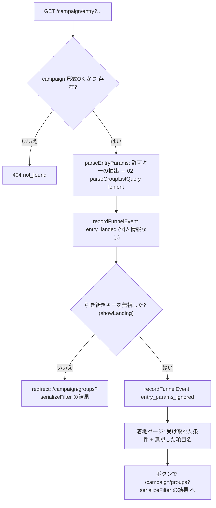

# 11 入口B・公式枠

状態の凡例は [README](README.md) に従う。加えて [統一] は、統一仕様書(以下「契約書」。[_unified-contracts.md](_unified-contracts.md))で決めたモジュール間の契約を表す。本書と契約書が食い違う場合は契約書を正とする。ID 接頭辞は `ENT`(API=ENT-API、関数=ENT-FN、型=ENT-TYPE、エラー=ENT-ERR、試験=ENT-T、タスク=ENT-TASK)。ストアの ID 接頭辞(`fe` など。§4.5)とは別のものである。「(デモ範囲外)」を付けた項目は、デモでは実装を任意とし、試験も必須としない。「見送り(契約書 16.2)」を付けた項目は、主ルートを優先するため作り込みを後回しにするもの(削除はしない。扱いはデモ範囲外と同じ)。既存の「デモ範囲外」の印には「見送り」を併記した(契約書 17.0 の C-3)。

## 1. 概要と責務 / 対応する柱

### 1.1 責務
- 入口B: 外部リンク(自治体の公式観光サイト・広報等)の「地方・日程・人数」を、02 グループ一覧の絞り込み条件(`GroupListFilter`)の初期値として引き継いで一覧に着地させる。柱10。 [案、docs/design 04 章。実装方式も案]
- 公式枠: 自治体のおすすめプランを、グループ一覧に載る「公式のグループ」(`Group.official`)として表す。別画面は作らない。柱12。 [統一、契約書 4.2]
- 地元の同行枠・集合型イベント: 地元の担い手が出す枠も、同じ一覧に並ぶグループとして表す。柱12。 [案、02 章]
- 集客導線の計測: 入口別の流入を、個人を特定しない件数として記録する。集計の画面・API は 12 が持ち、11 は記録と集計関数(`aggregateFunnel`)の提供に限る。 [決定 24、契約書 2.2・7.12]
- 競技環境で入口B を再現するためのダミー外部リンク集ページ。 [統一、契約書 2.2]
- 優先度は B。デモの形(12 #1)で位置づけが変わる(§1.2)。 [未決]

### 1.2 デモの形(12 #1)との関係(決めない。両対応の構造)
| デモの形 | 本モジュールの見せ方 | 追加で要るもの |
|---|---|---|
| 同行成立中心 | 入口B で条件が一覧に入り、通常グループが並ぶ。公式枠は 1〜2 件の「おすすめ」として混在 | なし(seed の公式枠 1〜2 件のみ) |
| 集合型イベント中心 | 公式枠・同行枠・イベントを一覧の中心に置く。日程固定のグループとして並び、参加者は参加申請でグループ化 | seed の追加(固定日程のイベント 3〜5 件)、`kind` の表示 |

- 両方に対応する構造: 公式枠も地元の枠もイベントも、すべて 01 の Group 1 件と 11 の付帯情報(Listing)の組で表す。デモの形は seed の内容と一覧の初期表示(公式枠のみ初期ON など)だけで切り替わり、型・API・画面は変えない。 [案]

## 2. 既存機能との関係
- 新規。既存の `/api/v2` モック、`server-store.ts` は変更しない。
- 流用: seed の campaign(slug の検証)。地方の選択肢は 02 の `listRegions`(`Region`、ID は `r-<slug>`。契約書 3.2、7.3)から取る。地方 ID と自治体の担当地方は契約書 7.12 の seed の値で確定している(§4.3)。既存の seed.json の spots の area(7 種)と user.region(「水琴地方」)の単位の不一致は、本書の設計に影響しないため §13 の 3 に記録するだけとする。
- 外部依存なし。計測タグ・解析 SaaS・外部リンクの実接続は使わない。計測は自前の件数記録のみ(§4.4)。 [決定: rule.md の外部依存なし]
- app/ の現状(読み取り): ルーティングは `src/app/[campaign]/…`、`[campaign]/layout.tsx` は `generateStaticParams` で `nttw-demo` のみ静的生成し、子を `<Suspense>` で包む。`next.config.ts` は `cacheComponents: true`、`partialPrefetching: true`。 [事実]
- Next.js の仕様: 本 worktree には `app/node_modules` が無い。メインのチェックアウトの `app/node_modules/next/dist/docs/`(next 16.4.5、読み取りのみ)で次を確認した [事実]。(1) page の `searchParams` は `Promise<{ [key: string]: string | string[] | undefined }>`。(2) Route Handler の `params` は Promise。(3) `redirect()` は通常 307 を返すが、ストリーミング中は meta タグによるクライアント側の遷移になる。(4) `cacheComponents` 有効時は route segment config の `dynamic = "force-dynamic"` を削除する(リクエスト時の API を使う処理は既定でリクエスト時に実行される)。(5) `_` で始まるフォルダはルーティングの対象外(契約書 2.1 R-1)。キャッシュ・プリフェッチの詳細は実装前に該当ガイドを読む(AGENTS.md 1、ENT-TASK-01)。

### 2.1 利用ライブラリ・モジュール
新規に追加するライブラリはない。外部サービス・CDN・計測 SaaS は使わない(rule.md の外部依存なし)。

| 名前 | 種別 | 用途(本モジュール) | ライセンス | バージョン方針 |
|---|---|---|---|---|
| Next.js(`next`) | フレームワーク | App Router のページ(`/[campaign]/entry`、`/[campaign]/external-links`)、`redirect()`/`notFound()`(`next/navigation`)、Route Handler(リソースごとの `route.ts`) | MIT | app/package.json の 16.4.5 を維持 |
| React(`react`/`react-dom`) | ライブラリ | 画面部品(§3.3)。出力のエスケープは React の既定に任せる | MIT | 19.3.0 を維持 |
| Mantine(`@mantine/core`) | UI ライブラリ | `Badge`、`Alert`、`List`、`Button component="a"` | MIT | ^9.7.5 を維持 |
| Tabler Icons(`@tabler/icons-react`) | アイコン | 公式バッジ・同行枠バッジのアイコン(`aria-hidden`。文字と併用) | MIT | ^3.51.0 を維持 |
| Vitest | テスト(devDependency) | 単体・結合試験(§9)。00 が追加する(CMN-TASK-12)[決定 11] | MIT | 00 が追加する版を使う(新規追加時は最新の安定版) |
| WHATWG `URL`/`URLSearchParams`(Node 標準のグローバル) | Node 標準 | 入口B のクエリの抽出、リンク集のパス組み立て(手連結しない)、生成パスの検査 | (Node.js 同梱) | 実行環境の Node.js に従う |
| 00 共通基盤(`lib/errors.ts`、`lib/validation.ts`、`lib/datetime.ts`、`lib/clock.ts`、`lib/ids.ts`、`lib/groups-store.ts`、`lib/current-user.ts`、`lib/api-route.ts`、`components/groups/common/*`) | 自前モジュール | `AppError`、本文の検証 `v`、日付の検査と加算、現在日、`isId`/`isSlugId`/`newId`、`db()`/`tx()`、現在ユーザー、`route()`、`ErrorNotice`/`MockBadge` | (自前) | 00 の版に従う。関数名は §10.1 |
| 01・02・04・09 の公開関数 | 自前モジュール | Group 生成、絞り込み条件の解釈・直列化と地方の選択肢、lifecycle の初期値、本人確認・禁止表現(§10.1) | (自前) | 各モジュールの版に従う |

使わないもの(理由):
- dayjs: 00 の方針でクライアント表示専用(00 §10)。日付の検証・加算は 00 の `lib/datetime.ts`(依存なし)を使う。
- zod などの検証ライブラリ: 00 の自前の検証 `v` に合わせる(00 §5.10、契約書 11.1)。
- `qs` などのクエリ解析ライブラリ: 入口B の許可キーは 8 個(§7.1)で、`URLSearchParams` で足りる。値の検証は 02 の `parseGroupListQuery` に委ねる。
- Zustand・`@mantine/dates`: 入口B・公式枠はクライアント state と日付入力部品を持たない。
- 計測タグ・解析 SaaS: 外部依存なし。件数の記録は自前(§4.4)。

## 3. 画面・UI(04 章)

| 画面 | 04 章の項目 | パス | コンポーネント |
|---|---|---|---|
| 入口B 着地(解釈・遷移) | 外部リンクからの着地 | `/[campaign]/entry`(§3.1。契約書 2.2) | `EntryPage`(server) |
| 公式枠の表示(一覧カード・詳細) | グループ一覧、グループ詳細(参加前) | 02 の画面内(`/[campaign]/groups`、`/[campaign]/groups/[groupId]`) | `OfficialBadge`、`OfficialNotice`、`HostBadge` |
| ダミー外部リンク集 | (競技用の再現手段) | `/[campaign]/external-links` | `ExternalLinksPage` |
| 同行枠・イベント一覧(閲覧のみ) | 同行枠の登録、集合型イベントの申込 | (作らない) | 実装しない [案]。公式枠・同行枠・イベントは 02 の一覧に並ぶ。申込は 03 の参加申請を使う。登録画面も実装しない |

- `app/[campaign]/` 直下には静的セグメント(`entry`、`external-links`)だけを置き、動的セグメントと並べない(契約書 2.1 R-2)。
- 着地ページ(§3.1 の 5)は docs/design 04 章の画面一覧に無い。docs/design の更新が必要(契約書 第 12 章、§13)。

### 3.1 入口B 着地(`/[campaign]/entry`)の振る舞い
1. パスの `campaign` を検証(§7.2)。不正なら `notFound()` で 404 ページを表示(ENT-ERR-03)。
2. `searchParams` を await し、`resolveEntry`(ENT-FN-02)で解釈する。解釈は `parseEntryParams`(ENT-FN-01)が許可キーを取り出し、02 の `parseGroupListQuery(params, "lenient", ctx)` に委ねる(§7.1。`ctx` は 02 の `QueryContext`。契約書 7.3)。
3. 流入イベント `entry_landed` を記録する(§4.4)。`showLanding === true` のときは `entry_params_ignored` も 1 件記録する。
4. `showLanding === false`: `redirect(groupsPath)` で `/[campaign]/groups?<serializeFilter の結果>` へ遷移する。
5. `showLanding === true`: 遷移せず着地ページを表示する。「受け取れた条件」と「受け取れなかった項目(項目名と理由。値は表示しない)」を示し、ボタン「この条件で一覧を見る」(= `groupsPath` へのリンク)と「条件を変えて探す」(= 条件なしの `/[campaign]/groups`)を置く。 [決定 7]
6. クエリが全て空または不正でも一覧(条件なし)に進める。エラー画面にしない。

- `showLanding` の判定 [決定 7、契約書 7.11]: `ignored` に引き継ぎキー(`region`/`dateFrom`/`dateTo`/`vacancy`/`official`)または `_query`(長さ超過)が 1 件以上あるとき `true`。`src` の不正と未知キー(`_unknown`)だけのときは `false` とし、そのまま一覧へ遷移する(外部リンクに付く計測用のキーで着地ページを出さないため)。無視した項目が無いときは着地ページを出さない。
- 遷移の方式 [事実。実際の挙動は実装着手時に確認する事項(判断は不要。契約書 14.2)]: `redirect()` は通常 307 を返すが、`[campaign]/layout.tsx` が子を `<Suspense>` で包むため、ストリーミング中の meta タグによるクライアント側の遷移になる可能性がある(§2)。どちらでも遷移先は `groupsPath` だけで、試験は最終 URL で判定する(ENT-T-01)。HTTP 307 が必須になった場合は、遷移の判定を Route Handler(`app/[campaign]/entry/route.ts`)に移し、着地ページを別の静的パスにする [案]。
- 一覧側の条件表示: 02 が `parseGroupListQuery(searchParams, "lenient", ctx)` で絞り込みパネルに初期値として反映する。「外部リンクから引き継いだ条件」の注記を出すかは 02 の判断(`src` は引き継がない。§4.4)。 [案]
- 副作用(イベント記録)を GET で行うため、アプリ内から `entry` へリンクする場合は `prefetch={false}` とする(リンク集は `<a href>` のためプリフェッチされない)。`cacheComponents` 有効時は `export const dynamic = "force-dynamic"` を使わない(§2)。`searchParams` を await した後に記録するため、記録はリクエスト時に実行される。プリフェッチ時に page の本体が実行されないことは、実装着手時に確認する事項(判断は不要。契約書 14.2。ENT-TASK-01)。

```ts
// app/[campaign]/entry/page.tsx(server component)
export default async function EntryPage(props: {
  params: Promise<{ campaign: string }>;
  searchParams: Promise<RawQuery>;
}): Promise<React.ReactNode>;   // resolveEntry が not_found を投げたら notFound()。showLanding=false なら redirect(groupsPath)
```



### 3.2 ダミー外部リンク集(`/[campaign]/external-links`)
- 目的: 競技環境には外部サイトが無いため、「自治体の観光サイトや広報に置かれたリンク」をローカルの 1 ページで再現する。入口B の試験・デモ操作の起点。 [統一、契約書 2.2(画面のパス `/[campaign]/external-links` で確定)]
- 内容: ヘッダーに「これは外部サイトの再現用ダミーです(モック)」と明示。`ENTRY_LINK_FIXTURES`(§4.3)の各項目を、リンク文言・流入元・条件の説明つきで一覧にし、`<a href>`(通常のリンク。クライアント遷移を使わず、本物の外部リンクに近い挙動)で `/[campaign]/entry?…` へ遷移する。
- 「異常値の例」節(開発・試験用): 未知の地方、不正日付、未知キー、`next=https://example.invalid` 等のサンプルリンクを並べ、無視されること・外部へ遷移しないことを手動で確認できる。`/[campaign]/external-links?abnormal=1` のときだけ表示し(`showAbnormal`)、通常のナビゲーションからはリンクしない [案]。
- リンクの href はコード内の固定値のみ。ユーザー入力から生成しない。

### 3.3 コンポーネント構成(props / state / データ取得)
```ts
// features/official/components/OfficialBadge.tsx
export interface OfficialBadgeProps {
  info: OfficialBadgeView;           // 02 の GroupSummary.badge / 詳細の badge から受ける
  size?: "sm" | "md";
}
// 状態なし。「自治体公式」テキスト + 主催名。色だけに頼らない(§3.4)。

// features/official/components/OfficialNotice.tsx
export interface OfficialNoticeProps { variant: "card" | "detail" }
// 詳細では OFFICIAL_DISCLAIMER を表示(§5.3)。カードでは省略。状態なし。

// features/official/components/HostBadge.tsx
export interface HostBadgeProps { info: HostBadgeView }   // 「地元の方の同行枠」。公式バッジとは別の見た目・文言

// features/entry/components/EntryLanding.tsx   (着地ページ本体。server component。props のみで描画)
export interface EntryLandingProps {
  campaign: string;
  accepted: AcceptedConditionView[];   // describeFilter(ENT-FN-13)の結果。値は検証済みのものだけ
  ignored: IgnoredParam[];             // 表示は ENTRY_KEY_LABEL・ENTRY_IGNORED_REASON_LABEL(features/entry/messages.ts)で項目名と理由に変換
  groupsPath: string;                  // サーバーで組み立て済みの固定形式パス
}
export type HandoffKey = "region" | "dateFrom" | "dateTo" | "vacancy" | "official";   // 02 の GroupListFilter のキー名と一致
export interface AcceptedConditionView {
  key: HandoffKey;
  label: string;                       // 項目名。例「地方」
  value: string;                       // 表示値。地方は Region.name、日付は YYYY-MM-DD、空き人数は「2人以上」、公式は「自治体公式のみ」
}
// features/entry/components/FocusHeading.tsx("use client")。h1 に tabIndex={-1} を付け、マウント時に focus() する(§3.4)

// features/entry/components/ExternalLinkList.tsx
export interface ExternalLinkListProps { links: EntryLinkFixture[]; campaign: string; showAbnormal: boolean }
```
- データ取得: `EntryPage` は server component で `resolveEntry` を直接呼ぶ(HTTP を挟まない)。公式バッジ情報は 02 が `getOfficialBadges`(ENT-FN-07)を一覧・詳細の組み立て時に呼び、`GroupSummary.badge: OfficialBadgeView | null` に載せる(契約書 7.3)。公式バッジを個別に取得する API は設けない。
- クライアント state は持たない(入口B 側)。

### 3.4 アクセシビリティ
- バッジは「自治体公式」の文字とアイコン(`aria-hidden`)で表す。色だけで区別しない。コントラスト比 4.5:1 以上。カードのバッジに `aria-label="自治体公式の企画。主催: ○○"`(主催名は seed のダミー名)。
- 着地ページ: `h1`「外部リンクから引き継いだ条件」。無視した項目の一覧は `role="status"` `aria-live="polite"`。ボタンは `<a>` または Mantine `Button component="a"` で、キーボードで到達・実行できる。ページ表示時にフォーカスを `h1` へ移す(`FocusHeading`、§3.3)。
- リンク集: 各リンクの文言は単独で意味が通る(「○○町の観光サイトからの例」)。「ダミー」表示はテキストで示し、色のみにしない。
- 同行枠・イベントの日時は `<time dateTime>`、満席などの状態は文字で併記(02/04 の共通状態バッジに従う)。

## 4. データ(05 章)

### 4.1 エンティティ
公式枠は別エンティティにしない。Group の公式フラグ(`Group.official: boolean`)を一覧の絞り込み・表示の根拠とし、主催自治体・種別などの付帯情報は 11 の `Listing` に持つ。 [統一、契約書 4.2(01 の `officialHost` は削除し、主催者名は Listing から表示)。理由: 02 章が「公式枠フラグ付きのグループ」と定めている / 一覧・詳細・申請・状態遷移を通常グループと共通にできる / 付帯情報だけを分離することで 01 の Group を肥大化させない]。別エンティティ案(公式プランを Group とは別のテーブルにし、参加時に Group を生成する)は、承認方式を変えたい場合のみ検討 [未決 #18]。

```ts
// features/official/types.ts
import type { Id, IsoDateTime } from "@/lib/groups-types";

/** 自治体(ダミー)。実在の自治体名は使わない。ID は mun-<slug>(seed のみ。00 の isSlugId("mun", v))。 */
export interface Municipality {
  id: string;
  campaign: string;
  displayName: string;      // 例「星凪町 観光課(ダミー)」 1〜30 文字
  regionIds: Id[];          // 担当地方(Region.id。r-<slug>)。12 が集計範囲に使う
}

/** 地元の担い手(ダミー)。ID は host-<slug>(seed のみ。00 の isSlugId("host", v))。 */
export interface LocalHost {
  id: string;
  campaign: string;
  displayName: string;      // 1〜20 文字。実在の個人名は使わない
  intro: string;            // 0〜80 文字
}
// 担当者は DemoUser.municipalityId / DemoUser.hostId から引く(契約書 3.6、7.11)。Municipality・LocalHost 側に利用者の ID は持たない。

export type ListingKind =
  | "official_plan"     // 自治体のおすすめプラン(公式)
  | "gathering_event"   // 集合型イベント(日程固定。主催は自治体=公式、または地元の担い手)
  | "host_slot";        // 地元の同行枠(担い手が案内できる日時の枠)

export type SponsorRef =
  | { type: "municipality"; id: string }   // Municipality.id
  | { type: "host"; id: string };          // LocalHost.id

export type ApprovalMode = "organizer";   // 通常と同じ(幹事=主催者が承認)。"auto"(自動承認)は 03 の対応待ちの [未決]。型は将来 | "auto" を追加

/** Group 1 件に 1 件付く付帯情報。保存先: db().listings(id = Group.id。1 対 1 の資源のため親の ID を使う。契約書 3.2) */
export interface Listing {
  id: Id;                       // = Group.id(g-NNN)
  kind: ListingKind;
  sponsor: SponsorRef;
  summary: string;              // 文字数は LIMITS.OFFICIAL_SUMMARY(契約書 10.3)。禁止表現(09 の official_summary)の対象
  highlights: string[];         // 件数は LIMITS.OFFICIAL_HIGHLIGHT.maxItems、各要素の文字数は LIMITS.OFFICIAL_HIGHLIGHT の min〜max。禁止表現(09 の official_highlight)の対象
  approvalMode: ApprovalMode;
  createdAt: IsoDateTime;       // clock.nowIso()
}
```

Group との整合ルール(不変条件。`assertListingInvariants` で検査 = ENT-FN-12):
- `Group.official === true` ⇔ 対応する Listing があり `sponsor.type === "municipality"`。
- `host_slot` と、主催が host の `gathering_event` は `Group.official === false`。
- Listing の `id` は存在する Group を指す。Group が中止(`cancelled`)・再企画済み(`replanned`)になっても Listing は残す(履歴・集計のため)。
- Group の幹事(`organizerId`)= 主催者の担当ユーザー(`role: "municipal"` かつ `municipalityId === sponsor.id`、または `role: "host"` かつ `hostId === sponsor.id` の DemoUser)。
- `Group.visibility === "public"`。

```ts
// 表示用 DTO(02 の GroupSummary.badge・詳細に載せる)
export interface OfficialBadgeView {
  kind: ListingKind;
  official: boolean;                  // = Group.official
  sponsorName: string;                // Municipality.displayName または LocalHost.displayName(ダミー)
  badgeLabel: "自治体公式" | "地元の方の同行枠" | "地元の方のイベント";
  summary: string;
  highlights: string[];
}
export type HostBadgeView = OfficialBadgeView & { official: false };
```
- 05 章の Host / HostSlot / イベントとの対応: `LocalHost` = Host、`Listing.kind = "host_slot"` = HostSlot(定員・日時は Group の `capacity`・`trip`)、`gathering_event` = イベント。 [案]

### 4.2 日程・人数・状態の持ち方
- 日時・定員・最少人数・締切・状態は Group 側(01 の `trip`・`capacity`、04 の `lifecycle`)が持ち、11 は持たない。集合型イベントは「日程固定のグループ」: 主催者が `trip.startDate`〜`trip.endDate` を 1 日または短い範囲で固定し、一覧の日程絞り込みの対象になる。
- 状態は 04 の `GroupStatus`(snake_case の 8 値: `recruiting`、`min_reached`、`withdrawal_period`、`confirmed`、`in_progress`、`completed`、`cancelled`、`replanned`)に従う。11 は独自の状態を持たない。
- 申込 = 03 の参加申請(承認は主催者)。「単純な申込か、グループ化か」(§11)は、デモでは「参加申請 → 承認 → メンバー」(グループ化)として同じ流れを使う [案]。人数上限は `capacity` の 2〜6 に従う。定員 7 人以上のイベントは扱えない [未決、05 章の人数範囲との関係]。

### 4.3 seed(00 の `group-seed.json` に統合。契約書 11.4)
- 11 の付帯情報(`municipalities`、`hosts`、`listings`)は 00 の `group-seed.json` に置く。11 専用の seed ファイルは作らない。公式枠・同行枠・イベントの Group 本体(`official` 付き)も同じファイルに置く。11 は内容を 00 に依頼し(§10.3 の要望 1)、`assertListingInvariants` で整合を検査する。
- 内容(自治体・担い手・担当地方・本人確認は [統一、契約書 7.12・11.4]。Listing の件数は [案]):
  - Municipality 2 件: `mun-demo-a`(担当者 `u-009`。`regionIds` = `r-nijiho`、`r-hoshinagi`、`r-suzukaze`)、`mun-demo-b`(担当者 `u-011`。`regionIds` = `r-mizukoto`)。2 件の担当地方は重ならない(12 の権限試験で使う)。
  - LocalHost 1 件: `host-demo-a`(担当者 `u-012`、`role: "host"`)。
  - 担当者 `u-009`・`u-011`・`u-012` は本人確認済み(§5.4 の 2)。
  - Listing: official_plan 2 件(00 の seed の g-002、g-005。幹事 `u-009`、主催 `mun-demo-a`)、host_slot 1 件、gathering_event 1 件(幹事 `u-012`、主催 `host-demo-a`)。集合型イベント中心の形では gathering_event を 3〜5 件に増やす。
- ダミー外部リンク `ENTRY_LINK_FIXTURES`(コード内定数 `features/entry/fixtures.ts`):

```ts
export interface EntryLinkFixture {
  id: string;                       // /^[a-z0-9-]{1,30}$/(画面内のキー。ストアの ID ではない)
  label: string;                    // 例「星凪町の観光サイト: 冬の高原プラン」
  source: EntrySource;
  params: Record<string, string>;   // buildEntryUrl に渡す(コード内の固定値)
  abnormal?: boolean;               // 異常値サンプル
}
// 正常例: { region:"r-mizukoto", dateFrom:"2026-12-05", dateTo:"2026-12-07", vacancy:"2", src:"muni-site" }(r-mizukoto は mun-demo-b の担当地方。契約書 7.12)
// 公式のみ: { region:"r-mizukoto", official:"1", src:"muni-pr" }
// 別名の例: { from:"2026-12-05", to:"2026-12-07", src:"sns" }(02 の lenient が dateFrom/dateTo として受ける)
// 異常例: { region:"<script>", dateFrom:"2026-13-40", next:"https://example.invalid", src:"zzz" }
```

### 4.4 流入計測(柱10→柱11 の入力)
- 個人を特定しない: ユーザー ID、Cookie 値、IP、User-Agent、リファラ、時刻は記録しない。日付は日単位(`clock.today()`。JST の `YYYY-MM-DD`)。`src` は列挙値のみ。
- 外部の計測タグ・SaaS は使わない。記録先は Store(`db().funnelEvents`)のメモリ。再起動・リセットで消える。上限 1,000 件、超えたら古い順に破棄する [案](デモ範囲外。見送り(契約書 16.2))。
- `type`・`channel`・`source` は次の固定の列挙値だけを受け付ける [決定 20、契約書 7.11]。列挙外の値を含む記録は保存しない(§5.1 ENT-FN-05、§5.2 ENT-API-02)。

```ts
// features/entry/types.ts

/** 外部リンクの流入元(src の値)。 */
export const ENTRY_SOURCES = [
  "muni-site",      // 自治体の公式観光サイト
  "muni-pr",        // 自治体の広報
  "sns",
  "search",
  "travel-media",
  "transport",
  "other",
] as const;
export type EntrySource = (typeof ENTRY_SOURCES)[number];

/** 記録する source の値。none=src なし(入口A を含む)、unknown=src が ENTRY_SOURCES 以外 */
export const SOURCE_LABELS = [...ENTRY_SOURCES, "none", "unknown"] as const;
export type SourceLabel = (typeof SOURCE_LABELS)[number];

/** A=一覧を直接開いた(入口A)、B=外部リンク経由(入口B) */
export const CHANNELS = ["A", "B"] as const;
export type Channel = (typeof CHANNELS)[number];

export const FUNNEL_EVENT_TYPES = [
  "entry_landed",          // 入口B に着地(11 が記録)
  "entry_params_ignored",  // 着地時に引き継ぎキーを無視した(11。showLanding=true のとき)
  "list_viewed",           // 一覧表示(02 が記録。任意)
  "official_viewed",       // 公式枠・同行枠・イベントの詳細表示(02 が記録。任意)
  "official_requested",    // 公式枠・同行枠・イベントへの参加申請(03 が記録。任意)
] as const;
export type FunnelEventType = (typeof FUNNEL_EVENT_TYPES)[number];

/** ENT-API-02 が受け付ける type [決定 20、契約書 7.11] */
export const CLIENT_EVENT_TYPES = ["list_viewed", "official_viewed"] as const;

/** 保存先: db().funnelEvents。ID は newId("fe")(fe-NNN) */
export interface FunnelEvent {
  id: Id;
  type: FunnelEventType;
  day: DateStr;                // clock.today()
  campaign: string;
  channel: Channel;
  source: SourceLabel;
  region: Id | null;           // 検証済みの地方 ID(entry_landed のみ。それ以外は null)
  listingKind: ListingKind | null;   // official_* のみ。サーバーが Listing から求める
  groupId: Id | null;          // official_* のみ(公開グループの ID。個人ではない)
}

export interface FunnelEventInput {   // recordFunnelEvent の入力。id・day・listingKind はサーバーが付ける
  type: FunnelEventType;
  campaign: string;
  channel: Channel;
  source: SourceLabel;
  region?: Id;
  groupId?: Id;
}
```

`type` ごとの組み合わせ(`FUNNEL_RULES`。これに合わない入力は保存しない):

| type | channel | source | region | groupId |
|---|---|---|---|---|
| `entry_landed` | `B` | `SOURCE_LABELS` のいずれか | 任意(検証済みの地方 ID) | なし |
| `entry_params_ignored` | `B` | `SOURCE_LABELS` のいずれか | なし | なし |
| `list_viewed` | `A` | `none` | なし | なし |
| `official_viewed` | `A` | `none` | なし | 必須(Listing があり公開のグループ) |
| `official_requested` | `A` | `none` | なし | 必須(同上) |

```ts
export interface FunnelQuery { campaign: string; fromDay?: DateStr; toDay?: DateStr }
// 省略時 [決定 12、契約書 7.11]: toDay = clock.today()、fromDay = toDay の月を含む直近 3 か月(暦月)の最初の日。
// 例: today = 2026-11-09 のとき fromDay = 2026-09-01、toDay = 2026-11-09。
// 検証: isDateStr、fromDay <= toDay、幅 366 日以内。違反は invalid_input [案]
// 地方の条件は持たない。12 の MUN-M-08 はキャンペーン全体の件数とする(契約書 7.12)
export interface FunnelAggregate {
  campaign: string; fromDay: DateStr; toDay: DateStr;
  landedBySource: Record<SourceLabel, number>;
  landedByRegion: Record<string, number>;   // キーは Region.id。region が null の着地は数えない
  ignoredCount: number;
  listViewedByChannel: Record<Channel, number>;
  officialViewed: number;
  officialRequested: number;
  byListingKind: Record<ListingKind, { viewed: number; requested: number }>;
}
```
- 12 との関係 [統一、契約書 7.12]: 12 の MUN-M-08(入口別の流入)は `aggregateFunnel` の結果を使い、区分は `source`(`landedBySource`)とする。12 の旧案の `EntryEvent`・`EntryChannel`・`entryEvents` は作らない。旧区分との対応は次のとおり。

| 12 の旧区分 | 本書での扱い |
|---|---|
| `external` | `channel: "B"` の `entry_landed`。内訳は `source` |
| `direct` | `channel: "A"` の `list_viewed`(02 が記録する場合のみ) |
| `official` | `official_viewed`(02 が記録する場合のみ) |
| `invite` | 記録しない(招待コードの入口は計測の対象外) |

- 集計の期間の既定(直近 3 か月、暦月)は `aggregateFunnel` と 12 の集計に適用される。期間の指定・権限の確認・少数セルの丸め(K=5)は 12 が行う。11 は生の件数を返す。個人に結びつく情報は記録時点で保持しない。
- 限界 [案]: `src` を一覧・詳細・申請へ引き継がないため、「着地 → 申請」の個別の転換率は出せない。流入別の着地件数と、全体の申請件数を並べて見せる。引き継ぐ場合は `src` を一覧クエリに載せる(列挙値のみ)が、02/03 の変更を伴うので [未決]。

### 4.5 Store 拡張(00 の `Db` に追加。契約書 3.1)
```ts
interface Db {
  // …00 の既存コレクション
  municipalities: Repo<Municipality>;   // mun-<slug>(seed のみ)
  hosts: Repo<LocalHost>;               // host-<slug>(seed のみ)
  listings: Repo<Listing>;              // id = Group.id
  funnelEvents: Repo<FunnelEvent>;      // fe-NNN(newId("fe"))
}
```
- アクセスは 00 の `db()`/`tx()` だけを使う。書き込み(Listing の追加、計測の追記・上限超過分の削除)は `tx` の中で行う。

## 5. インターフェース

### 5.1 関数(ENT-FN)
| ID | シグネチャ | 責務 / 例外 | 呼び出し元 |
|---|---|---|---|
| ENT-FN-01 | `parseEntryParams(query: RawQuery, ctx: QueryContext): ParsedEntry` | 許可キーの抽出、重複・長さの検査、`src` の解釈を行い、引き継ぎキーの検証(地方の存在確認を含む)は 02 の `parseGroupListQuery(params, "lenient", ctx)` に委ねる(§7.1。契約書 7.3)。02 の `ignored` を `IgnoredParam` に変換する。例外を投げない | ENT-FN-02 |
| ENT-FN-02 | `resolveEntry(campaign: string, query: RawQuery): EntryResolution` | campaign 検証、`ctx`(02 の `QueryContext`。02 の `listRegions(campaign)`・`getCampaign`・00 の `clock.today()` から作る。契約書 7.3)の用意、解釈、`groupsPath` と `showLanding`(§3.1)の算出。記録はしない。`AppError("not_found")`(campaign 不正) | 着地ページ、ENT-API-01 |
| ENT-FN-03 | `buildGroupsPath(campaign: string, filter: GroupListFilter): string` | `/${campaign}/groups` に 02 の `serializeFilter(filter)` の結果を付けた相対パスを生成し、§7.2 の検査を行う | ENT-FN-02 |
| ENT-FN-04 | `buildEntryUrl(campaign: string, params: Record<string,string>): string` | `/${campaign}/entry?…` を生成(リンク集用)。外部 URL は生成しない | リンク集、試験 |
| ENT-FN-05 | `recordFunnelEvent(input: FunnelEventInput): void` | 列挙値と `FUNNEL_RULES`(§4.4)で検証し、`newId("fe")`・`day`・`listingKind` を付けて追記。検証に失敗した入力は例外を投げずに破棄する(計測の失敗で本処理を止めないため) | 11、02・03(任意) |
| ENT-FN-06 | `aggregateFunnel(q: FunnelQuery): FunnelAggregate` | 件数集計。期間の既定は §4.4。`AppError("invalid_input")`(期間不正)。権限の確認はしない(呼び出し側の 12 が行う) | 12、試験 |
| ENT-FN-07 | `getOfficialBadges(groupIds: Id[]): Record<Id, OfficialBadgeView>` | Listing のある Group の表示情報(無ければキーなし) | 02 |
| ENT-FN-08 | `createOfficialSlot(user: DemoUser, input: OfficialSlotInput): Group` | 自治体ロールのみ。`resolveSponsor(user, "municipality")` の id と `input.municipalityId` が一致しなければ `forbidden`(他の自治体の名義で作らせない)。手順は §5.4 | ENT-API-03 |
| ENT-FN-09 | `createHostSlot(user: DemoUser, input: HostSlotInput): Group` | 地元ロールのみ。`input.hostId` の一致確認と例外は ENT-FN-08 と同じ。`official: false` で作る | ENT-API-04(デモ範囲外。見送り(契約書 16.2)) |
| ENT-FN-10 | `getListing(groupId: Id): Readonly<Listing> \| undefined` | 付帯情報の取得 | 11(ENT-FN-05、ENT-API-02) |
| ENT-FN-11 | `resolveSponsor(user: DemoUser, type: SponsorRef["type"]): Readonly<Municipality> \| Readonly<LocalHost>` | type=municipality は `user.role === "municipal"` かつ `db().municipalities.get(user.municipalityId)` があればそれを返す。type=host は `user.role === "host"` かつ `db().hosts.get(user.hostId)`。それ以外は `AppError("forbidden")` [統一、契約書 7.11] | ENT-FN-08/09 |
| ENT-FN-12 | `assertListingInvariants(): string[]` | §4.1 の不変条件違反の一覧(試験・seed 検証用) | 試験 |
| ENT-FN-13 | `describeFilter(filter: GroupListFilter, regions: Region[]): AcceptedConditionView[]` | 着地ページの「受け取れた条件」の表示値を作る純粋関数(§3.3)。引き継ぎキーのうち値があるものだけを返す | 着地ページ |
| ENT-FN-14 | `getMunicipality(id: string): Readonly<Municipality> \| undefined` | 自治体の取得(担当地方 `regionIds` を含む)。11 の内部と試験だけで使う。12 は使わず `db().municipalities` を直接読む(契約書 7.12) | 11、試験 |

```ts
import type { GroupListFilter, Region } from "@/features/groups/discovery/types";   // 型は 02 の定義
import type { QueryContext, IgnoredReason } from "@/features/groups/discovery/query";   // 02 が公開(契約書 7.3)

export type RawQuery = Record<string, string | string[] | undefined>;   // Next の searchParams を await した値

// ctx は 02 の QueryContext = { campaigns, defaultCampaign, regions, today }(契約書 7.3)。11 は独自の文脈型を作らない

/** 11 の無視理由。02 の IgnoredReason("unknown_key" | "invalid_value")とは別名にする(契約書 7.3) */
export type EntryIgnoredReason =
  | "too_long"        // 11: 値またはクエリ全体の長さ超過
  | "duplicate"       // 11: 同一キーの重複
  | "unknown_value"   // 11: src が ENTRY_SOURCES 以外
  | "invalid_value";  // 02 から写す(存在しない地方 ID、過去の日付、形式不正、範囲外、前後関係の不整合)
// 02 の "unknown_key" は IgnoredParam にせず、_unknown の件数に加える
export interface IgnoredParam {
  key: HandoffKey | "src" | "_unknown" | "_query";   // _unknown は未知キーの件数のみ(名前を出さない)。_query はクエリ全体の長さ超過
  reason: EntryIgnoredReason;
  count?: number;                  // _unknown のときの未知キーの数
}
export interface ParsedEntry {
  filter: GroupListFilter;         // 02 の parseGroupListQuery の結果(campaign を設定済み。引き継ぎキー以外は 02 の既定値)
  source: SourceLabel;
  ignored: IgnoredParam[];
}
export interface EntryResolution extends ParsedEntry {
  campaign: string;
  groupsPath: string;              // buildGroupsPath の結果
  showLanding: boolean;            // §3.1 の判定。false なら一覧へ遷移
}

/** 本文は { group, summary, highlights } の入れ子(契約書 7.11)。municipalityId・kind は 11 固有の項目として最上位に置く */
export interface OfficialSlotInput {
  municipalityId: string;
  kind: "official_plan" | "gathering_event";
  group: Omit<CreateGroupInput, "visibility"> & LifecycleInput;   // 01 の入力型と 04 の入力型(minMembers・deadlineDate)を同じ階層に置く。visibility は "public" 固定
  summary: string;
  highlights: string[];
  ackReview?: boolean;                           // 禁止表現の要確認に同意して再送するとき true(契約書 6.2)
}
export interface HostSlotInput {
  hostId: string;
  kind: "host_slot" | "gathering_event";
  group: Omit<CreateGroupInput, "visibility"> & LifecycleInput;
  summary: string;
  highlights: string[];
  ackReview?: boolean;
}

/** ENT-API-03/04 の成功レスポンス。内部の Group をそのまま返さない(00 の方針) */
export interface SlotCreated { groupId: Id; listing: Listing; badge: OfficialBadgeView }
```
- 一般の `createGroup`(01)と `POST /api/groups`(合成層 `features/groups/compose/handlers.ts`。所有 01)は `official` を入力に持たない。本文に含めても 00 の `v.object` が捨てる(契約書 3.4)。公式フラグは `createOfficialSlot`(自治体ロールの API)と seed からしか立たない。
- `OfficialSlotInput`/`HostSlotInput` の検証: `summary` は `LIMITS.OFFICIAL_SUMMARY`、`highlights` は `LIMITS.OFFICIAL_HIGHLIGHT`(件数は `maxItems`、各要素の文字数は `min`〜`max`。契約書 10.3)、`kind` は列挙値、`group` の 01 の項目は 01 のスキーマ、`group.minMembers`・`group.deadlineDate` は 04 の `validateLifecycleInput` に従う。本文のスキーマには `ackReview: v.boolean({ optional: true })` を宣言する(宣言しないと 00 の `v.object` が捨てるため。契約書 6.2)。`group.campaign` は主催者の `campaign` と一致すること、自治体主催のときは `group.region` が `Municipality.regionIds` に含まれること [案]。違反は `invalid_input`(`fields`)。
- `fields` のキー [統一、契約書 7.11]: 本文の項目パスに合わせる。01・04 の検証関数が返す `fields` のキーに 11 が接頭辞 `group.` を付ける(`group.name`、`group.trip.destination`、`group.minMembers`、`group.deadlineDate` など)。11 の項目は `summary`、`highlights.N`。

### 5.2 API(ENT-API)
共通: JSON。エラーは 00 の `ErrorBody`(`{ error, reason?, message, fields?, detail? }`。契約書 3.3)。現在ユーザーは Cookie `demoUser`(00 の `route()` が `c.user` に解決)。Route Handler はリソースごとの `route.ts` とし、ハンドラは `features/entry/handlers.ts`・`features/official/handlers.ts` に 00 の `route()` で包んで置き、`route.ts` は再エクスポートだけを書く(契約書 2.1)。`route()` が変更系(POST)の CSRF 対策(Origin 検査、`Content-Type: application/json` 必須)、本文 64KB の上限、`Cache-Control: no-store`、`X-Content-Type-Options: nosniff` を共通で適用する。エラーの詳細は §8。

| ID | メソッド・パス | リクエスト | 成功レスポンス | エラー |
|---|---|---|---|---|
| ENT-API-01 | `GET /api/entry/resolve` | クエリ: `campaign`(必須)+ 入口B の各パラメータ(§7.1)。`campaign` は解釈前に取り除く(未知キーに数えない)。クエリは `c.query`(strict)を使わず `c.url.searchParams` を §7.1 の手順で解釈する(契約書 3.4 の lenient の例外)。副作用なし(イベント記録しない) | 200 `EntryResolution` | 404 `not_found`(campaign 不正・欠落)。パラメータ不正は 200(`ignored` に入る) |
| ENT-API-02 | `POST /api/entry/events` | body: `{ type, campaign, channel, source, groupId? }`。1 リクエスト 1 件。`type` は `CLIENT_EVENT_TYPES`(`list_viewed`/`official_viewed`)のみ、`channel`・`source` は列挙値のみで、組み合わせは `FUNNEL_RULES` に従う [決定 20] | 204 | 400 `invalid_input`(列挙外の値、組み合わせ違反、`groupId` が Listing のある公開グループでない)、413 `payload_too_large`、415 `unsupported_media_type`、403 `forbidden`(Origin 不一致) |
| ENT-API-03 | `POST /api/official` | body: `OfficialSlotInput`。自治体ロールのみ | 201 `SlotCreated` | 403 `forbidden`(ロール不一致、他の自治体の `municipalityId`、本人確認未了 `reason: "not_verified"`/`"underage"`)、400 `invalid_input`(`fields`。キーは `group.name` などの項目パス。禁止表現は `reason: "text_denied"`、要確認で未同意は `reason: "text_review_required"` + `detail.reviewRequired: true`) |
| ENT-API-04 | `POST /api/hosts/slots` | body: `HostSlotInput`。地元ロールのみ | 201 `SlotCreated` | 403 `forbidden`(ロール不一致、他の担い手の `hostId`、本人確認未了)、400 `invalid_input` |

| パス | `route.ts` | ハンドラ |
|---|---|---|
| `/api/entry/resolve` | `app/api/entry/resolve/route.ts` | `export { resolveEntryHandler as GET } from "@/features/entry/handlers"` |
| `/api/entry/events` | `app/api/entry/events/route.ts` | `export { postEntryEventHandler as POST } from "@/features/entry/handlers"` |
| `/api/official` | `app/api/official/route.ts` | `export { postOfficialSlotHandler as POST } from "@/features/official/handlers"` |
| `/api/hosts/slots` | `app/api/hosts/slots/route.ts` | `export { postHostSlotHandler as POST } from "@/features/official/handlers"`(デモ範囲外。見送り(契約書 16.2)) |

- ENT-API-03/04 は試験と運用確認のための経路。デモ画面は作らない(§12)。ENT-API-02 は 02/03 がサーバー内から `recordFunnelEvent` を呼ぶ場合は不要で、クライアントから記録する必要が出た場合のみ使う [案]。
- 廃止した API [統一、契約書 2.2]: 公式枠の一覧 `GET /api/official`(02 の `GET /api/groups?official=1` で代替)、公式バッジの個別取得 `GET /api/official/[groupId]`(02 の一覧・詳細の `badge` で代替)、流入集計 `GET /api/entry/stats`(12 の `GET /api/stats` に統合。オーナー判断 24)。

### 5.3 表示文言の定数(`features/official/messages.ts`)
```ts
export const OFFICIAL_BADGE_LABEL = "自治体公式";
export const HOST_BADGE_LABEL = "地元の方の同行枠";
export const EVENT_BADGE_LABEL = "地元の方のイベント";
export const OFFICIAL_DISCLAIMER =
  "自治体公式の企画ですが、旅の安全や内容を保証するものではありません。集合場所・持ち物・費用は参加前にご自身でご確認ください。";
export const DEMO_SPONSOR_NOTE = "主催者名はデモ用の仮の名前です(モック)。";
```
- 「公式でも安全は保証されない」ことを詳細ページに必ず出す(07 章論点 12)。文言の確定は [未決 #18]。
- 入口B の文言は `features/entry/messages.ts` に置く: `ENTRY_KEY_LABEL: Record<IgnoredParam["key"], string>`(例: `region`→「地方」、`vacancy`→「空き人数」、`_unknown`→「その他の項目」、`_query`→「条件全体」)、`ENTRY_IGNORED_REASON_LABEL: Record<EntryIgnoredReason, string>`(例: `invalid_value`→「受け付けられない値です」、`unknown_value`→「該当する選択肢がありません」)、着地ページの見出し・ボタン文言。

### 5.4 公式枠・同行枠の作成手順(ENT-FN-08/09)[統一、契約書 5.1・7.11]
1. `resolveSponsor(user, "municipality")`(同行枠は `"host"`)で主催者を求め、`input.municipalityId`(`input.hostId`)と一致しなければ `forbidden`。
2. 09 `requireVerified(user.id, "create_group")` [統一、契約書 7.11](一般のグループ作成と同じ条件。`createGroupInternal` は本人確認を行わないため 11 が呼ぶ。seed の u-009・u-011・u-012 は確認済み。契約書 11.4)。
3. 本文を検証し(§5.1 の規則、01 のスキーマ)、09 `assertTextAllowed(text, context, field, { ackReview })` を項目ごとに通す: 01 の項目(`group_name`、`group_destination`、`group_date_note`、`group_tag`、`group_description`。field は `group.name`、`group.trip.destination`、`group.trip.dateNote`、`group.tags.N`、`group.description`)、`summary`(`official_summary`)、`highlights.N`(`official_highlight`)。
4. 04 `validateLifecycleInput(input.group, ctx)` → `buildInitialLifecycle(…, clock.now())`。返った `fields` のキーには `group.` を付ける(§5.1)。
5. 00 の `tx` の中で、01 `createGroupInternal({ ...input.group の 01 の項目, visibility: "public", official: true, organizerId: user.id, lifecycle })`(同行枠は `official: false`)と `db().listings.insert(...)` を一括して行う。`createGroupInternal` が `group_created` を発行する。
6. 04 `recordCreated(groupId)`。
7. ハンドラは `SlotCreated`(Group の ID、Listing、`OfficialBadgeView`)を 201 で返す。

- 01 の作成上限(幹事として進行中 5 件)は `createGroupInternal` では検査されない。自治体・担い手の作成件数に上限は設けない [統一、契約書 7.11](デモでは seed と試験の範囲でしか作られないため)。

## 6. 状態遷移・主要シーケンス
- 入口B は状態を持たない(§3.1 のフローのみ)。公式枠・同行枠・イベントの状態は 04 の `GroupStatus`(8 値)の遷移に従う(11 は独自の状態を持たない)。主催者(自治体・担い手の担当ユーザー = 幹事)による取り下げは 04 の幹事の中止(`POST /api/groups/[groupId]/cancel`、`organizerCancel`)を使い、11 は関数を呼ばない。 [案]
- 入口B の結果:

| 条件 | 結果 |
|---|---|
| 引き継ぎキーがすべて有効(`src` 不正・未知キーだけを無視した場合を含む) | 一覧へ遷移(`serializeFilter` の結果。307 またはクライアント側の遷移、§3.1) |
| 引き継ぎキーの一部または全部を無視、または長さ超過(`showLanding === true`) | 着地ページ(受け取れた条件と無視した項目)。「この条件で一覧を見る」で一覧へ |
| パラメータなし | `/[campaign]/groups` へ遷移(条件なし) |
| campaign 不正 | 404 |

## 7. 入力検証・セキュリティ

### 7.1 入口B のクエリ仕様(許可キーのみ。それ以外は無視)
引き継ぎキーの名前は 02 の `GroupListFilter` と一致させ、値の検証(地方の存在確認を含む)は 02 の `parseGroupListQuery(params, "lenient", ctx)` に委ねる(11 は独自の値の検証を持たない)[統一、契約書 7.3・7.11]。

| キー | 意味 | 検証(02 の DSC-API-01 のクエリ規則) | 02 への対応キー |
|---|---|---|---|
| `region` | 地方 | Region の ID(`r-<slug>`)で、`ctx.regions` に存在すること(02 が判定。契約書 7.3) | `region` |
| `dateFrom`(別名 `from`) | 日程の開始 | `YYYY-MM-DD` の実在日付。02 の範囲・幅の規則。`ctx.today` より前は無視(`invalid_value`。契約書 7.3) | `dateFrom` |
| `dateTo`(別名 `to`) | 日程の終了 | 同上。`dateFrom <= dateTo` | `dateTo` |
| `vacancy` | 必要な空き人数(自分を含む希望人数) | 整数 1〜5 | `vacancy` |
| `official` | 公式枠のみ | 値は `1`(契約書 7.3) | `official` |
| `src` | 流入元 | `ENTRY_SOURCES` に含まれること(11 が判定) | (一覧へは渡さない) |

処理の順序(ENT-FN-01):
1. 全値の合計長が 512 文字を超えるクエリは、全て無視する(ignored は `_query`/`too_long` の 1 件)。(デモ範囲外。見送り(契約書 16.2))
2. キーは上の表(別名を含む 7 個)と `src` との完全一致で判定する。受け取ったキー名をオブジェクトのプロパティ名として代入しない(`__proto__` 等によるプロトタイプ汚染を防ぐ)。それ以外のキーは値を見ず `_unknown` の件数だけを数える。
3. 同一キーの重複(`string[]`)は先頭のみ採用し、`duplicate` を ignored に追加する。個別値が 100 文字超なら当該キーを無視する(`too_long`)。
4. `src`: `ENTRY_SOURCES` に含まれればその値、無ければ `unknown`(ignored に `src`/`unknown_value`)、無ければ `none`。絞り込みには関係しない。
5. 引き継ぎキーだけを入れた `URLSearchParams` を `parseGroupListQuery(params, "lenient", ctx)` に渡す。結果の `filter.campaign` にパスの campaign を設定する。地方の存在確認は 02 が `ctx.regions` で行うため、11 は地方を照合しない(契約書 7.3)。
6. 02 の `ignored`(`{ key, reason }`。`reason` は 02 の `IgnoredReason` = `unknown_key`・`invalid_value`)を `IgnoredParam` に変換する。キーの別名 `from`/`to` は `dateFrom`/`dateTo` に読み替える。`invalid_value` はそのまま `invalid_value` とし、`unknown_key` は `_unknown` の件数に加える [統一、契約書 7.3]。

共通規則:
- 前後空白除去・NFC 正規化・制御文字の扱いは 02 の規則に従う。
- 正規表現はすべて先頭・末尾固定で、入れ子の繰り返しを使わない。
- 未知キーの値・キー名を画面・ログ・応答に出さない。
- 旧案のキー `people` は受け付けない(未知キーとして数える)。過去日付を今日に丸める旧案の規則は、02 の検証に委ねたため設けない(過去の日付は 02 の lenient が `invalid_value` として無視する。契約書 7.3)。

### 7.2 オープンリダイレクト・XSS・その他
- **オープンリダイレクト**: 遷移先は `buildGroupsPath` が作る `/${campaign}/groups?…` のみ。クエリ中の URL(`next`、`redirect`、`url`、`returnTo` 等)は未知キーとして無視し、遷移先に使わない。`campaign` はパスセグメントとして `^[a-z0-9-]{1,40}$` を満たし、かつ seed の campaign slug と一致すること。一致しなければ 404。生成パスの先頭が `/` で 2 文字目が `/` でないこと、`\` や `:` を含まないことを検査し、違反時は `Error`(00 の `route()` または着地ページで `internal`)とする(パス生成の誤りに備えた二重の検査)。
- **XSS**: 入力値を HTML に出さない(未知キー・不正値は表示しない。表示するのは検証済みの地方名と日付、人数のみ)。React の既定エスケープに任せ `dangerouslySetInnerHTML` は使わない。クエリは `URLSearchParams`(02 の `serializeFilter`)で組み立てる(文字列の手連結をしない)。リンクの `href` はコード内で組み立てた相対パスのみで、`javascript:` 等のスキームを含まない。
- **CSRF**: 変更系の ENT-API-02/03/04 は 00 の `route()` の検査(Origin と Host の一致、`Content-Type: application/json` 必須、Cookie の `SameSite=Lax`)に従う(00 §7)。着地ページ(GET)はイベントを記録するが、記録は件数のみで利用者の状態を変えないため、CSRF 対策の対象外とする。
- **アクセス制御・IDOR**: 自治体ロール・地元ロールは 00 の `DemoUser.role` と `municipalityId`/`hostId` から判定する(`resolveSponsor`。クライアントの申告は信用しない)。ENT-API-03/04 は本文の `municipalityId`/`hostId` が現在ユーザーのものと一致しなければ 403。集計の権限は 12 が確認する。
- **公式バッジのなりすまし防止**: `Group.official` と Listing は、`createOfficialSlot`(自治体ロール検証済み)と seed からのみ作られる。一般の `createGroup` は `official`・`kind` を入力に持たない。「公式」「自治体」は禁止表現の警告語にしない [決定 30、契約書 6.2]。公式であることは `Group.official` と Listing に基づくバッジだけで示し、グループ名などの文字列では判定しない。`OfficialNotice` により公式でも安全が保証されないことを明示する。
- **計測の改ざん防止**: `type`・`channel`・`source` は列挙値のみ受け付け、`FUNNEL_RULES` に合わない組み合わせは保存しない [決定 20]。ENT-API-02 は `groupId` が Listing のある公開グループの場合だけ受理し、`listingKind` はサーバーが Listing から求める。
- **集計の匿名性**: §4.4。
- **機密データ・ログ**: 計測にはユーザー ID・Cookie・IP・UA・リファラを含めない(§4.4)。クエリの値・未知キー名・リクエスト本文をログに出さない。エラーのログは 00 の `route()` の `requestId` と例外のみ(00 §7)。
- **セキュリティ設定**: API の応答ヘッダは 00 の `route()` が付ける(`Cache-Control: no-store`、`X-Content-Type-Options: nosniff`)。画面を含む全応答のヘッダ(X-Frame-Options、X-Content-Type-Options、Referrer-Policy)は 00 が `next.config.ts` に設定する(契約書 11.2)。CORS ヘッダは付けない。
- **外部依存なし**: 外部スクリプト・画像・フォント・計測タグ・外部 URL へのリンクを置かない。リンク集の href は同一オリジンの相対パスのみ。

### 7.3 既知の制約(デモでは対処しない)
- `demoUser` Cookie は利用者が書き換えられるため、自治体ロール・地元ロールも偽装できる(ログイン不要のモック。00 §7)。
- 着地ページの再読み込みや ENT-API-02 の連続送信で件数を水増しできる。
- 集計の差分による推定(少数セルの丸めは 12 が担当)、応答時間差による推定、大量アクセスによる負荷は考慮しない(見送り(契約書 16.2))。

## 8. エラー処理
エラーコードと HTTP ステータスの対応は 00 §5.4 と契約書 3.3 に従う。画面の表示は 00 の `ErrorNotice` を使う(着地ページの 404 は Next.js の `notFound()`)。

| ID | コード | HTTP | 発生条件 | 画面での表示・挙動 |
|---|---|---|---|---|
| ENT-ERR-01 | (エラーにしない) | 200 / 遷移 | 入口B の個別パラメータ不正、未知キー、`src` 不正 | 該当項目を無視する。引き継ぎキーを無視した場合は着地ページに項目名と理由を表示し、「この条件で一覧を見る」「条件を変えて探す」を出す。それ以外は一覧へ遷移(§3.1) |
| ENT-ERR-02 | invalid_input | 400 | ENT-API-02/03/04 の本文の検証失敗(型、長さ、列挙、組み合わせ、禁止表現 `reason: "text_denied"`/`"text_review_required"`。契約書 6.2)、`aggregateFunnel` の期間不正(12 経由) | `fields` の項目ごとのメッセージを入力欄に表示(画面がある場合。キーは `group.name` などの項目パス。ENT-API-02 は画面に出さない) |
| ENT-ERR-03 | not_found | 404 | 着地ページ・ENT-API-01 の `campaign` 不正(形式違反、未登録 slug) | 着地ページは Next.js の 404 ページ(トップへのリンク)。API は `ErrorNotice` で「見つかりませんでした」と一覧へ戻る導線 |
| ENT-ERR-04 | forbidden | 403 | ENT-API-03/04 のロール不一致、他の自治体・担い手の ID を指定、本人確認未了(`reason: "not_verified"`/`"underage"`。09)、別オリジンからの変更系リクエスト(00 の `route()`) | 「自治体の担当者のみができる操作です」等の説明と戻る導線 |
| ENT-ERR-05 | payload_too_large | 413 | 変更系の本文が 64KB 超(00 の `route()`。モジュール独自の上限は設けない) | 画面からは通常発生しない。`ErrorNotice` の既定表示 |
| ENT-ERR-06 | unsupported_media_type | 415 | 変更系で `Content-Type` が `application/json` でない(00 の `route()`) | 画面からは通常発生しない。「画面を再読み込みしてやり直してください」 |
| ENT-ERR-07 | conflict / unavailable_state | 409 | 11 は独自の状態を持たないため、11 の API からは返さない。公式枠への参加申請の定員超過・状態不正は 03/04 が返す(ENT-T-31) | 03/04 の表示に従う |
| ENT-ERR-08 | internal | 500 | `buildGroupsPath` の生成パス検査の違反(§7.2)、想定外の例外 | 「問題が発生しました」と再読み込み・デモ初期化の案内(00 §8) |
| ENT-ERR-09 | (空結果) | 200 | 引き継いだ条件で候補ゼロ | 02 の「条件を広げる提案」へ(入口B 固有の処理なし) |

- `recordFunnelEvent` の検証失敗は呼び出し元へ例外を返さず、イベントを破棄する(ENT-FN-05)。

## 9. 試験観点(10 章)
試験は Vitest で行う(00 の `vitest.config.ts`、`npm test`)。関数は直接呼び出し、API は 00 の `callRoute` で Route Handler を呼ぶ。前提データは 00 の `resetForTest` と `fixtures.ts`(今日は 2026-11-09。公式枠の見本は `OFFICIAL_GROUPS` = g-002(募集中)・g-005(実行確定)、確認済みの旅行者は u-004。契約書 11.3・11.4)。地方 ID `r-mizukoto` は mun-demo-b の担当地方(契約書 7.12)。試験の中で作るデータの ID は 900 番台(契約書 3.2・11.3)。「見送り(契約書 16.2)」の試験は必須としない。

| ID | 入力 | 期待結果 |
|---|---|---|
| ENT-T-01 | `/nttw-demo/entry?region=r-mizukoto&dateFrom=2026-12-05&dateTo=2026-12-07&vacancy=2&src=muni-site` | `/nttw-demo/groups?<serializeFilter の結果>`(`region=r-mizukoto`、`dateFrom=2026-12-05`、`dateTo=2026-12-07`、`vacancy=2`。並び順は 02 に従う)へ遷移(HTTP 307 またはクライアント側の遷移。最終 URL で判定、§3.1)。一覧の絞り込みパネルに同値が初期表示 |
| ENT-T-02 | `?official=1` | 一覧が公式枠のみ(`official` が真)で開く |
| ENT-T-03 | クエリなし | `/nttw-demo/groups`(条件なし)へ遷移、エラーなし |
| ENT-T-04 | `region=r-nowhere`(未知の地方) | 着地ページ。ignored に region/invalid_value。「この条件で一覧を見る」で条件なしの一覧 |
| ENT-T-05 | `region=<script>alert(1)</script>` | 実行されない。値は画面に出ない。ignored に region/invalid_value。着地ページ |
| ENT-T-06 | `dateFrom=2026-13-40&dateTo=2026-12-07` | ignored に dateFrom/invalid_value。着地ページ。`dateTo` の扱いは 02 の lenient の規則に従う |
| ENT-T-07 | `dateFrom=2026-12-07&dateTo=2026-12-05` | ignored に日程のキー(invalid_value)。着地ページ |
| ENT-T-08 | `from=2026-12-05&to=2026-12-07`(別名) | `dateFrom`・`dateTo` として受け取り、遷移先は `dateFrom=…&dateTo=…`。着地ページを出さない |
| ENT-T-09 | `people=2`(旧案のキー) | `_unknown` 件数 1。着地ページを出さず条件なしの一覧へ遷移 |
| ENT-T-10 | `vacancy=0`、`vacancy=6`、`vacancy=abc`、`vacancy=1.5`(見送り(契約書 16.2)。境界値) | いずれも ignored に vacancy/invalid_value。着地ページ |
| ENT-T-11 | `vacancy=2&vacancy=3`(見送り(契約書 16.2)。重複) | 2 を採用、ignored に vacancy/duplicate。着地ページ |
| ENT-T-12 | `next=https://example.invalid&redirect=//evil.example&url=http://x` | 着地ページを出さず `/nttw-demo/groups` へ遷移。Location ヘッダ(または meta タグの遷移先)に外部ホストが含まれない。`_unknown` 件数 3 |
| ENT-T-13 | campaign に `%2F%2Fevil.example`、`..`、`a b` | 404。リダイレクトしない |
| ENT-T-14 | 合計 600 文字のクエリ(デモ範囲外。見送り(契約書 16.2)) | 全て無視(`_query`/too_long)。着地ページの「この条件で一覧を見る」は条件なしの一覧 |
| ENT-T-15 | `src=zzz` | 着地ページを出さず条件なしの一覧へ遷移。計測は `source: "unknown"` |
| ENT-T-16 | 一般ユーザー(`role: "traveler"`。u-004)で `POST /api/official` | 403 `forbidden`。Group・Listing は作られない |
| ENT-T-17 | 一般の `POST /api/groups` に `official:true` を付与 | `official` は捨てられ、作成された Group は `official === false`(契約書 3.4) |
| ENT-T-18 | seed の公式枠(`OFFICIAL_GROUPS`)の一覧カード | 「自治体公式」テキスト+主催名(ダミー)。詳細に `OFFICIAL_DISCLAIMER` |
| ENT-T-19 | 一般ユーザー(u-004)が名前に「自治体公式」を含むグループを `POST /api/groups` で作成 | 警告・拒否されずに保存される(「公式」「自治体」は警告語にしない [決定 30、契約書 6.2])。作成された Group は `official === false` で、一覧・詳細に公式バッジは出ない(`badge === null`) |
| ENT-T-20 | 地元の同行枠 | `HostBadge`(公式バッジとは別文言)。`official === false` |
| ENT-T-21 | `assertListingInvariants()` を seed に実行 | 空配列(Group.official と Listing の整合) |
| ENT-T-22 | `/nttw-demo/entry?…&src=muni-site` を 3 回開く → `aggregateFunnel({ campaign: "nttw-demo" })` と `db().funnelEvents.list()` | `landedBySource["muni-site"]` が +3。記録の項目は `id`(fe-NNN)、`type`、`day`、`campaign`、`channel`、`source`、`region`、`listingKind`、`groupId` だけで、ユーザー ID・IP・UA・時刻が無い |
| ENT-T-23 | `recordFunnelEvent` に `source:"zzz"` / `type:"foo"` / `channel:"C"` / `type:"list_viewed", channel:"B"` | いずれも記録されない。例外なし |
| ENT-T-24 | イベント 1,001 件記録(デモ範囲外。見送り(契約書 16.2)) | 保持は 1,000 件、古い順に破棄 |
| ENT-T-25 | リセット(00 の `resetForTest()`、または `POST /api/demo/reset`) | `funnelEvents` が空、Listing が seed に戻る |
| ENT-T-26 | リンク集 `/nttw-demo/external-links` | 「ダミー」表示あり。全リンクが同一オリジンの相対パス。異常例リンクを開いても外部へ遷移しない |
| ENT-T-27 | ネットワーク遮断環境 | 入口B・リンク集・公式枠表示が全て動作(外部リクエストなし。DevTools の Network で外部 0 件) |
| ENT-T-28 | キーボードのみ(Tab/Enter) | リンク集 → 着地 →「一覧を見る」まで操作でき、着地時にフォーカスが h1 にある |
| ENT-T-29 | スクリーンリーダー/テキスト | バッジが色だけでなく文字で判別でき、ignored 一覧が読み上げられる |
| ENT-T-30 | 禁止語の静的検査 | 本モジュールの文言・seed に「相乗り」「マッチング」や恋愛を連想させる語が無い |
| ENT-T-31 | 公式枠 g-002(募集中)に u-004 が参加申請 → 幹事 u-009 が承認 | 03 の通常フロー通りメンバーに追加。定員(`capacity`)を超える承認は `conflict` |
| ENT-T-32 | 募集中の公式枠 g-002 を幹事(`u-009`)が 04 の `POST /api/groups/[groupId]/cancel` で中止(実行確定の g-005 は幹事が中止できない。契約書 4.3) | 一覧の状態が `cancelled`(中止)。Listing は残り、`assertListingInvariants()` は空配列 |
| ENT-T-33 | `u-009`(`mun-demo-a`)が `municipalityId: "mun-demo-b"` で `POST /api/official` / `u-011`(`mun-demo-b`)が `mun-demo-a` で同じ操作 | どちらも 403 `forbidden`。Group・Listing は作られない |
| ENT-T-34 | `POST /api/entry/events` を `Content-Type: text/plain` で送信 / 別オリジンの `Origin` で送信(見送り(契約書 16.2)。00 の `route()` の共通試験で確認する) | 415 `unsupported_media_type` / 403 `forbidden` |
| ENT-T-35 | `POST /api/entry/events` に `type:"entry_landed"` / `channel:"C"` / `source:"zzz"` / `type:"list_viewed", channel:"B"` の本文 | いずれも 400 `invalid_input`。記録されない |
| ENT-T-36 | `POST /api/entry/events` に `{ type:"list_viewed", campaign:"nttw-demo", channel:"A", source:"none" }` | 204。`aggregateFunnel` の `listViewedByChannel.A` が +1 |
| ENT-T-37 | `aggregateFunnel` の期間(今日 2026-11-09) | 既定は `fromDay=2026-09-01`、`toDay=2026-11-09`。`day=2026-08-31` の記録は数えず、`2026-09-01` の記録は数える。`fromDay=2026-11-10&toDay=2026-11-01`、幅 367 日はどちらも `invalid_input` |
| ENT-T-38 | ENT-T-05・12 の着地ページ・遷移先の HTML とサーバーログ | 未知キーの名前・値、不正値が含まれない |
| ENT-T-39 | `showLanding` の判定(単体) | ignored が `src` と `_unknown` だけ → false。引き継ぎキーを 1 件以上含む → true。`_query` → true。ignored なし → false |
| ENT-T-40 | `POST /api/entry/events` に `type:"official_viewed"` で、Listing の無い公開グループの `groupId`(g-001)/ 存在しない `groupId`(g-999) | どちらも 400 `invalid_input`。記録されない |
| ENT-T-41 | `u-009`(本人確認済み)が自分の `municipalityId` で正しい本文(`{ municipalityId, kind, group, summary, highlights }`)の `POST /api/official` | 201 `SlotCreated`。Group は `official === true`、`visibility === "public"`、幹事 `u-009`、状態 `recruiting`。Listing が同じ ID で追加され、`assertListingInvariants()` は空配列 |
| ENT-T-42 | `POST /api/official` の `summary` に 09 の禁止表現(deny)/ `group.name` が空 | 400 `invalid_input`。前者は `reason: "text_denied"`・`fields.summary`、後者は `fields["group.name"]`。Group・Listing は作られない(`tx` の巻き戻し) |
| ENT-T-43 | `u-012`(`host-demo-a`)が自分の `hostId` で `POST /api/hosts/slots`(デモ範囲外。見送り(契約書 16.2)) | 201。Group は `official === false`、Listing の `sponsor.type === "host"` |

## 10. 他モジュールとの契約

### 10.1 本モジュールが依存する(呼ぶ)関数
依存の向きは契約書 4.6 のとおり(11 → 00、01、02、04、09)。

| 相手 | 関数 | 用途 |
|---|---|---|
| 00 | `route()`(`c.user`、`c.body`、`c.url`)、`v`/`parse`、`LIMITS`(`OFFICIAL_SUMMARY`・`OFFICIAL_HIGHLIGHT`)、`AppError`、`clock.today()`、`clock.nowIso()`、`clock.now()`、`db()`、`tx()`、`newId("fe")`、`isId`、`isSlugId`、`isDateStr`、`addDays` | 共通 |
| 00 | `Db` への 4 コレクションの追加(§4.5)、`group-seed.json` への 11 の seed の統合、`DemoUser` の `role`・`municipalityId`・`hostId` | 契約書 3.1・3.6・11.4 で確定(§10.3 の要望 1) |
| 01 | `createGroupInternal(input: CreateGroupInput & { official?: boolean; organizerId: Id; lifecycle: GroupLifecycle })`、`getGroupById(id)`、型 `CreateGroupInput`・`Group` | 公式枠・同行枠の Group 生成、`official_viewed` の対象確認 |
| 02 | `parseGroupListQuery(params, "lenient", ctx)`、`serializeFilter(filter)`、型 `QueryContext`・`IgnoredReason`(`features/groups/discovery/query.ts`)、`listRegions(campaign)`・`getCampaign(slug)`(`discovery/regions.ts`)、型 `GroupListFilter`・`Region` | 入口B の解釈、遷移先の生成、`ctx` の用意、地方の選択肢 |
| 04 | `validateLifecycleInput`、`buildInitialLifecycle`、`recordCreated`、型 `LifecycleInput`・`GroupStatus` | 公式枠・同行枠の lifecycle の初期値 |
| 09 | `requireVerified(userId, "create_group")`、`assertTextAllowed(text, context, field, { ackReview })`(`official_summary`、`official_highlight`、01 の項目の context) | 本人確認、要約・見どころ・グループ項目の禁止表現 |

### 10.2 本モジュールが提供する(呼ばれる)関数
| 相手 | 関数 | 用途 |
|---|---|---|
| 02 | `getOfficialBadges(groupIds)` | 一覧・詳細の `badge`(`OfficialBadgeView`)。公式枠の絞り込みは 02 が `Group.official` で行う |
| 12 | `aggregateFunnel(q)`、`ENTRY_SOURCES`、型 `FunnelEvent`・`FunnelAggregate`・`SourceLabel`・`Municipality` | MUN-M-08(入口別の流入)。自治体と担当地方は 12 が `db().municipalities` を直接読む(`getMunicipality` は使わない。契約書 7.12) |
| 02、03(任意) | `recordFunnelEvent(input)` | 計測(§4.4)。デモ範囲では任意(契約書 7.11) |

### 10.3 他モジュールへの要望
1. **00**: `Db` に `municipalities`/`hosts`/`listings`/`funnelEvents` を追加し、`ID_PREFIXES` に `fe`、`isSlugId` を置く(契約書 3.1・3.2)。`group-seed.json` に §4.3 の seed(自治体 2 件と担当者 `u-009`・`u-011`、地元の担い手 `host-demo-a` と担当者 `u-012`、Listing、公式枠・同行枠・イベントの Group)を載せる。`u-009`・`u-011`・`u-012` を本人確認済みにする。`LIMITS` に公式枠の要約・見どころを追加する。→ 解消(契約書 3.1・3.2・11.4。本人確認は 7.11 で採用、上限は 10.3 の `OFFICIAL_SUMMARY`・`OFFICIAL_HIGHLIGHT`)。
2. **01**: `createGroupInternal` を契約書 7.1 の署名で公開する。一般の `createGroup` と `POST /api/groups` は `official` を受け付けない(本文の `official` は捨てる)。→ 解消(契約書 7.1、3.4)。
3. **02**: `GroupSummary.badge` と詳細に `getOfficialBadges` の結果を載せ、詳細に `OfficialNotice` を表示する。`parseGroupListQuery` の lenient が返す `ignored.reason` の値を列挙して公開する(§7.1 の 6)。→ 解消(契約書 7.3。`unknown_key`・`invalid_value` の 2 値を `IgnoredReason` として公開)。`parseGroupListQuery` が地方マスタを参照しない純粋関数の場合、地方の存在確認の扱いを明記する。→ 解消(契約書 7.3。`ctx.regions` で 02 が確認する)。公式枠を上位固定しない(公平性。並び順は 02 の判断 [案])。一覧・詳細で `recordFunnelEvent`(`list_viewed`/`official_viewed`)を呼ぶのは任意。
4. **03**: 申請作成時に `recordFunnelEvent({ type: "official_requested", … })` を呼ぶのは任意(Listing があるグループのみ)。自動承認(`approvalMode: "auto"`)を将来入れる余地を残す [未決]。
5. **09**: `TextContext` に `official_summary`・`official_highlight` を追加する(契約書 6.2)。「公式」「自治体」を一般ユーザー入力で警告する語として辞書に追加するかは 09 の辞書の作業で扱う。→ 解消(契約書 6.2。追加しない [決定 30])。
6. **12**: MUN-M-08 は `aggregateFunnel` の `landedBySource` を使う(§4.4 の対応表)。期間の既定は直近 3 か月(暦月)。自治体と担当地方は `getMunicipality` の `regionIds` を使う。少数セルの丸め(K=5)は 12 が行う。→ 解消(契約書 7.12。自治体と担当地方は 12 が `db().municipalities` から直接読む。`getMunicipality` は 11 の内部・試験用)。

## 11. 未決事項
- #1 デモの形(§1.2 の両対応)。
- #18 公式枠の位置づけ: 公式フラグ+Listing は契約書 4.2 で採用済み。残る論点は、公式バッジの付与者(自治体ロールのみ、ダミー)、信頼性表示の文言、なりすまし対策の水準。
- 入口B の競技での再現方法(ダミー外部リンク集ページの採否)。→ 解消(契約書 2.2。`/[campaign]/external-links` を置く)。
- 集合型イベントの申込と参加申請の関係(単純な申込か、グループ化か)。本書は参加申請を使う案。定員 6 人超のイベントの扱い。
- 公式枠・同行枠の承認方式(主催者承認のみか、自動承認を許すか)。
- `src` を一覧以降に引き継ぐか(転換率の計測可否と匿名性のトレードオフ)。
- 「地方」の単位と地区との対応(seed の spots.area と user.region が不一致)。
- 公式枠への「安全を保証しない」文言の確定(07 章論点 12、#18)。
- 公式枠・同行枠の作成で本人確認を求めるか(§5.4 の 2)。→ 解消(契約書 7.11。求める(`create_group`)。作成上限は検査しない)。

## 12. 実装メモ(デモ範囲)と実装タスク

### 12.1 デモ範囲 [案]
- 実装: 入口B 着地(`/[campaign]/entry`)、クエリ→一覧の初期値、ダミー外部リンク集、公式バッジ・注意書き、公式枠 2 件+地元同行枠 1 件の seed 表示、`recordFunnelEvent` と `aggregateFunnel`(12 の MUN-M-08 が使う)。
- 実装しない: ホスト・自治体の登録画面(ENT-API-03/04 は試験用の API のみ。ENT-API-04 は時間があれば)、同行枠・イベントの専用一覧、自動承認、`src` の引き継ぎ。
- 集合型イベント中心に決まった場合の追加: seed にイベントの Group を 3〜5 件、一覧の初期条件を公式・イベント寄りにするのみ(型・API の変更なし)。

### 12.2 作成するファイル(新規のみ)
```
app/src/
  app/[campaign]/entry/page.tsx                 ENT-FN-02 を呼び redirect か EntryLanding を描画(server)
  app/[campaign]/external-links/page.tsx        ダミー外部リンク集
  app/api/entry/resolve/route.ts                ENT-API-01(再エクスポートのみ)
  app/api/entry/events/route.ts                 ENT-API-02(再エクスポートのみ)
  app/api/official/route.ts                     ENT-API-03(再エクスポートのみ)
  app/api/hosts/slots/route.ts                  ENT-API-04(再エクスポートのみ。デモ範囲外。見送り(契約書 16.2))
  features/entry/
    types.ts            ENTRY_SOURCES、SOURCE_LABELS、CHANNELS、FUNNEL_EVENT_TYPES、FUNNEL_RULES、FunnelEvent、IgnoredParam 等(§4.4、§5.1)
    parse.ts            parseEntryParams、resolveEntry、buildGroupsPath、buildEntryUrl、describeFilter、02 の無視理由の変換
    funnel.ts           recordFunnelEvent、aggregateFunnel
    handlers.ts         resolveEntryHandler、postEntryEventHandler(00 の route() で包む)
    fixtures.ts         ENTRY_LINK_FIXTURES
    messages.ts         着地・無視理由の文言(ENTRY_KEY_LABEL、ENTRY_IGNORED_REASON_LABEL)
    parse.test.ts  funnel.test.ts  handlers.test.ts
    components/EntryLanding.tsx  ExternalLinkList.tsx  FocusHeading.tsx
  features/official/
    types.ts            Municipality、LocalHost、Listing、OfficialBadgeView(§4.1)
    service.ts          getOfficialBadges、getListing、getMunicipality(11 内部・試験用)、createOfficialSlot、createHostSlot、resolveSponsor、assertListingInvariants
    handlers.ts         postOfficialSlotHandler、postHostSlotHandler(00 の route() で包む)
    messages.ts         §5.3
    service.test.ts  handlers.test.ts
    components/OfficialBadge.tsx  OfficialNotice.tsx  HostBadge.tsx
```
- seed は 00 の `group-seed.json` に統合する(§4.3)。11 専用の seed ファイルは作らない。

### 12.3 実装タスク(ENT-TASK)
規模は S(半日以下)/M(1 日前後)/L(2 日以上)。前提は他モジュールのタスクを含む。「見送り(契約書 16.2)」と書いた部分は主ルートの完了後に行う。

| ID | タスク | 規模 | 前提 |
|---|---|---|---|
| ENT-TASK-01 | Next.js 16 ドキュメント確認(§2 で確認済みの項目を除く。プリフェッチ時の page の実行有無、`<Suspense>` 内の `redirect()` の挙動を dev で確認)。実装着手時に確認する事項(判断は不要。契約書 14.2)で、§3.1 の確認項目を解消 | S | なし |
| ENT-TASK-02 | 型と列挙値の定義(`features/entry/types.ts`、`features/official/types.ts`、`messages.ts`) | S | 00 の型、02 の `GroupListFilter`・`Region` |
| ENT-TASK-03 | `parseEntryParams`(許可キーの抽出、`parseGroupListQuery(params, "lenient", ctx)` への委譲、02 の無視理由の変換)と単体試験(ENT-T-04〜09、15、39。ENT-T-10、11、14 は見送り(契約書 16.2)) | M | TASK-02、02 の `discovery/query.ts`(DSC-TASK-04) |
| ENT-TASK-04 | `buildGroupsPath`/`buildEntryUrl`/`resolveEntry`/`describeFilter`(campaign 検証、`showLanding` の判定、`serializeFilter` による生成、生成パスの検査。ENT-T-12、13) | S | TASK-03 |
| ENT-TASK-05 | `funnel.ts`(列挙値と `FUNNEL_RULES` の検証、記録、集計、期間の既定、リセット連動。ENT-T-22、23、25、37。上限 1,000 と ENT-T-24 は見送り(契約書 16.2)) | M | 00 の Store 拡張(要望 1) |
| ENT-TASK-06 | seed 断片(Municipality・LocalHost・Listing。担当地方は契約書 7.12 の値)を 00 に渡し、`assertListingInvariants`・`getMunicipality`(11 内部・試験用)を実装(ENT-T-21) | S | 00 の seed、01 の `Group.official` |
| ENT-TASK-07 | `service.ts` の `getOfficialBadges`/`getListing` | S | TASK-06 |
| ENT-TASK-08 | `createOfficialSlot`/`createHostSlot`/`resolveSponsor`(§5.4 の手順。本文の入れ子と `fields` の `group.` 接頭辞、`ackReview` の宣言を含む。ENT-T-16、17、20、33、41、42。`createHostSlot` と ENT-T-43 は見送り(契約書 16.2)) | M | 01 の `createGroupInternal`、04 の `validateLifecycleInput`・`buildInitialLifecycle`・`recordCreated`、09 の `requireVerified`・`assertTextAllowed`、00 の role |
| ENT-TASK-09 | `handlers.ts` と `route.ts`(ENT-API-01〜04。00 の `route()` を使う。ENT-T-35、36、40。ENT-T-34 と ENT-API-04 は見送り(契約書 16.2)) | M | TASK-04、05、07、08 |
| ENT-TASK-10 | `OfficialBadge`/`OfficialNotice`/`HostBadge`(アクセシビリティ。ENT-T-18、20、29) | S | TASK-02 |
| ENT-TASK-11 | 着地ページ `/[campaign]/entry` と `EntryLanding`・`FocusHeading`(ENT-T-01〜03、28、38) | M | TASK-04、05、10 |
| ENT-TASK-12 | ダミー外部リンク集(ENT-T-26) | S | TASK-04 |
| ENT-TASK-13 | 02/03/09 側の結合(一覧の初期値反映、バッジ表示、計測呼び出し(任意)、「公式」「自治体」を警告語にしないことの確認 [決定 30]。ENT-T-01、02、19、31) | M | 02、03 の該当タスク、TASK-07、10 |
| ENT-TASK-14 | 通し試験と外部依存なしの確認(ENT-T-27、30、32) | S | 上記すべて |

実装順の目安(ENT-TASK の番号): 01 → 02 → 03 → 04 → 05 → 06 → 07 → 08 → 09 →(10、12)→ 11 → 13 → 14。

## 13. 設計上の確認事項(docs/design・他モジュールとの不一致/不足。本書では直さない)
1. docs/design 04 章は入口B を「一覧に着地」とのみ記す。無視した項目があるときだけ出す着地ページ(`/[campaign]/entry`)[決定 7] と、ダミー外部リンク集(`/[campaign]/external-links`)を画面一覧に追加する必要がある(契約書 第 12 章)。
2. docs/design 05 章に Listing・Municipality・LocalHost・FunnelEvent を追加する必要がある(契約書 第 12 章)。05 章は「公式枠フラグ」と書くのみで主催自治体の持ち先が未定だった。本書は Listing に分離した。
3. 地方の単位: seed.json の `spots.area`(7 種)と `user.region`(水琴地方)が一致しない。docs/design 05 章の「地方」の定義が必要。
4. 05 章は人数上限 2〜6。集合型イベントで 7 人以上を想定する場合は範囲の見直しが必要。
5. 骨子 11 の入口B のキー(`from`/`to`/`people`)は、契約書 7.11 により 02 の `GroupListFilter` のキー名に改めた。`from`/`to` は 02 の lenient が別名として受けるため互換が残るが、`people` は受け付けない。過去日付の丸めも 02 の検証に委ねたため廃止した。
6. 02 の現行版は `parseGroupListQuery(params, mode)` に地方マスタを渡さないが、lenient で「既知でない地方 ID を無視」と書く。契約書 7.3 は `discovery/query.ts` を「ストアに触れない」純粋関数とするため、地方の存在確認の所在が決まっていない。→ 解消(契約書 7.3。`parseGroupListQuery(params, mode, ctx)` の `ctx.regions` で 02 が確認する。11 側の照合(旧 §7.1 の 7)は削除した)。
7. 02 の lenient の `ignored.reason` は文字列で、値の一覧が無い。11 の無視理由への対応表が作れない(§7.1 の 6)。→ 解消(契約書 7.3。02 の `IgnoredReason` は `unknown_key`・`invalid_value`。11 の型は `EntryIgnoredReason` に改名し、`bad_format`・`out_of_range`・`inconsistent` は削除した)。
8. 柱10 の計測要件(入口別の流入)は docs/design 02 章に具体の記載がない [推定]。12 の指標定義(05 章 集計)と合わせる必要がある。
9. docs/design 07 章論点 12 は「公式の表示は自治体担当者の操作でのみ付く」。本書は「自治体ロールの API と seed のみ」と読み替えた(ログインなしのため)。
10. 契約書で解消した項目(本書に反映済み): ルーティング方式(リソースごとの `route.ts`)、Store のアクセサ(`db()`)とリセット(`/api/demo/reset`)、`Group.official`、`UserRole` の `host`、地方 ID(`r-<slug>`)、公式枠の作成(`createGroupInternal`)、絞り込みキー(`official`)と `GroupSummary.badge`、取り下げ(04 の幹事の中止)、12 の `EntryEvent` の廃止。
11. 契約書の第 2 回の更新(第 17 章 17.12)で解消した項目(本書に反映済み): 公式枠・同行枠の作成の本人確認と作成上限なし(7.11)、公式枠の要約・見どころの上限 `LIMITS.OFFICIAL_SUMMARY`・`OFFICIAL_HIGHLIGHT`(10.3)、作成本文の入れ子と `fields` の `group.` 接頭辞(7.11)、「公式」「自治体」を警告語にしない(6.2、決定 30)、`QueryContext` と地方の存在確認の所在(7.3)、無視理由 `EntryIgnoredReason`(7.3)、`official=1`(7.3)、12 が `db().municipalities` を読むこと(7.12)、担当地方の確定値(7.12)、ダミー外部リンク集のパス(2.2)、`createGroupInternal` の署名(7.1)。

## 14. 未確認事項
- 本 worktree には `app/node_modules` が無い。Next.js の仕様はメインのチェックアウトの `next/dist/docs/`(16.4.5)で一部を確認した(§2)。プリフェッチと `<Suspense>` 内の `redirect()` の実際の挙動は未確認(ENT-TASK-01)。
- 02 の `serializeFilter` が `campaign` を出力するか(ENT-T-01、02 の期待値に影響)。`official` の真の表記は `1` で確定(契約書 7.3)。
- 01 の `CreateGroupInput` と 04 の `LifecycleInput` の分担 → 解消(契約書 7.11。本文の `group` に同じ階層で入れる。§5.1)。
- 本書には、Next.js の仕様のうち実装着手時に確認する事項(判断は不要。契約書 14.2)として、プリフェッチと `<Suspense>` 内の `redirect()` の挙動が残る(ENT-TASK-01)。
- Mermaid 図(§3.1)は mermaid-cli で構文検証済み(契約書への対応で `entry_params_ignored` の分岐を加えた後に再検証)。
