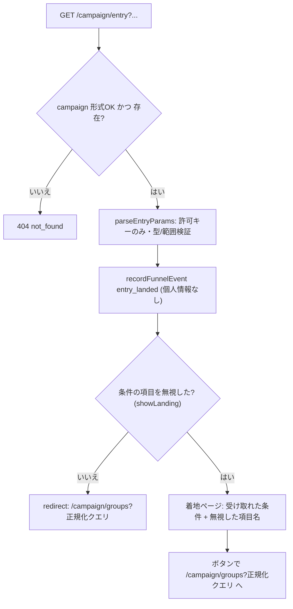

# 11 入口B・公式枠

状態の凡例は [README](README.md) に従う。ID 接頭辞は `ENT`(API=ENT-API、関数=ENT-FN、型=ENT-TYPE、エラー=ENT-ERR、試験=ENT-T、タスク=ENT-TASK)。「(デモ範囲外)」を付けた項目は、デモでは実装を任意とし、試験も必須としない。

## 1. 概要と責務 / 対応する柱

### 1.1 責務
- 入口B: 外部リンク(自治体の公式観光サイト・広報等)の「地方・日程・人数」を、02 グループ一覧の絞り込み条件の初期値として引き継いで一覧に着地させる。柱10。 [案、docs/design 04 章。実装方式も案]
- 公式枠: 自治体のおすすめプランを、グループ一覧に載る「公式のグループ」(Group の公式枠フラグ)として表す。別画面は作らない。柱12。 [案、02 章]
- 地元の同行枠・集合型イベント: 地元の担い手が出す枠も、同じ一覧に並ぶグループとして表す。柱12。 [案、02 章]
- 集客導線の計測: 入口別の流入を、個人を特定しない件数として記録し、12 自治体集計へ渡す。 [案]
- 競技環境で入口B を再現するためのダミー外部リンク集ページ。 [案]
- 優先度は B。デモの形(12 #1)で位置づけが変わる(§1.2)。 [未決]

### 1.2 デモの形(12 #1)との関係(決めない。両対応の構造)
| デモの形 | 本モジュールの見せ方 | 追加で要るもの |
|---|---|---|
| 同行成立中心 | 入口B で条件が一覧に入り、通常グループが並ぶ。公式枠は 1〜2 件の「おすすめ」として混在 | なし(seed の公式枠 1〜2 件のみ) |
| 集合型イベント中心 | 公式枠・同行枠・イベントを一覧の中心に置く。日程固定のグループとして並び、参加者は参加申請でグループ化 | seed の追加(固定日程のイベント 3〜5 件)、`kind` の表示 |

- 両方に対応する構造: 公式枠も地元の枠もイベントも、すべて 01 の Group 1 件と 11 の付帯情報(Listing)の組で表す。デモの形は seed の内容と一覧の初期表示(公式枠のみ初期ON など)だけで切り替わり、型・API・画面は変えない。 [案]

## 2. 既存機能との関係
- 新規。既存の `/api/v2` モック、`server-store.ts` は変更しない。
- 流用: `seed.json` の campaign(slug の検証)。地方の選択肢は 02 の `listRegions`(§10.3 の要望 3)から取る。 [要確認] 現 seed.json は spots の area が 7 種(鈴風高原 など)、user.region が「水琴地方」で、「地方」の単位が揃っていない。地方 ID の体系は 02/00 の決定に従う。
- 外部依存なし。計測タグ・解析 SaaS・外部リンクの実接続は使わない。計測は自前の件数記録のみ(§4.4)。 [決定: rule.md の外部依存なし]
- app/ の現状(読み取り): ルーティングは `src/app/[campaign]/…`、`[campaign]/layout.tsx` は `generateStaticParams` で `nttw-demo` のみ静的生成し、子を `<Suspense>` で包む。`next.config.ts` は `cacheComponents: true`、`partialPrefetching: true`。 [事実]
- Next.js の仕様: 本 worktree には `app/node_modules` が無い。メインのチェックアウトの `app/node_modules/next/dist/docs/`(next 16.4.5、読み取りのみ)で次を確認した [事実]。(1) page の `searchParams` は `Promise<{ [key: string]: string | string[] | undefined }>`。(2) Route Handler の `params` は Promise。(3) `redirect()` は通常 307 を返すが、ストリーミング中は meta タグによるクライアント側の遷移になる。(4) `cacheComponents` 有効時は route segment config の `dynamic = "force-dynamic"` を削除する(リクエスト時の API を使う処理は既定でリクエスト時に実行される)。キャッシュ・プリフェッチの詳細は実装前に該当ガイドを読む(AGENTS.md 1、ENT-TASK-01)。

### 2.1 利用ライブラリ・モジュール
新規に追加するライブラリはない。外部サービス・CDN・計測 SaaS は使わない(rule.md の外部依存なし)。

| 名前 | 種別 | 用途(本モジュール) | ライセンス | バージョン方針 |
|---|---|---|---|---|
| Next.js(`next`) | フレームワーク | App Router のページ(`/[campaign]/entry`、`/[campaign]/external-links`)、`redirect()`/`notFound()`(`next/navigation`)、Route Handler | MIT | app/package.json の 16.4.5 を維持 |
| React(`react`/`react-dom`) | ライブラリ | 画面部品(§3.3)。出力のエスケープは React の既定に任せる | MIT | 19.3.0 を維持 |
| Mantine(`@mantine/core`) | UI ライブラリ | `Badge`、`Alert`、`List`、`Button component="a"` | MIT | ^9.7.5 を維持 |
| Tabler Icons(`@tabler/icons-react`) | アイコン | 公式バッジ・同行枠バッジのアイコン(`aria-hidden`。文字と併用) | MIT | ^3.51.0 を維持 |
| Vitest | テスト(devDependency) | 単体・結合試験(§9)。00 が追加する(CMN-TASK-12) | MIT | 00 が追加する版を使う(新規追加時は最新の安定版) |
| WHATWG `URL`/`URLSearchParams`(Node 標準のグローバル) | Node 標準 | 遷移先パス・リンクのクエリ組み立て(手連結しない)、生成パスの検査 | (Node.js 同梱) | 実行環境の Node.js に従う |
| `String.prototype.normalize`(ECMAScript 標準) | 言語標準 | クエリ値の NFC 正規化(§7.1) | (同上) | 同上 |
| 00 共通基盤(`lib/errors.ts`、`lib/validation.ts`、`lib/datetime.ts`、`lib/clock.ts`、`lib/groups-store.ts`、`lib/current-user.ts`、`lib/api-route.ts`、`lib/groups-api.ts`、`components/groups/common/*`) | 自前モジュール | エラー型、本文・クエリの検証、日付の検査と加算、現在日、ストア、現在ユーザー、Route Handler の共通処理、クライアント取得、`ErrorNotice`/`MockBadge` | (自前) | 00 の版に従う。関数名は §10.1 |
| 01・02・03・04・09 の公開関数 | 自前モジュール | Group 生成、地方の選択肢と一覧、申請、取り下げ、禁止表現(§10.1) | (自前) | 各モジュールの版に従う |

使わないもの(理由):
- dayjs: 00 の方針でクライアント表示専用(00 §10)。日付の検証・加算は 00 の `lib/datetime.ts`(依存なし)を使う。
- zod などの検証ライブラリ: 00 の自前の検証 `v` に合わせる(00 §5.10)。
- `qs` などのクエリ解析ライブラリ: 許可キーは 6 個で、`URLSearchParams` で足りる。
- Zustand・`@mantine/dates`: 入口B・公式枠はクライアント state と日付入力部品を持たない。
- 計測タグ・解析 SaaS: 外部依存なし。件数の記録は自前(§4.4)。

## 3. 画面・UI(04 章)

| 画面 | 04 章の項目 | パス | コンポーネント |
|---|---|---|---|
| 入口B 着地(解釈・遷移) | 外部リンクからの着地 | `/[campaign]/entry`(§3.1) | `EntryPage`(server) |
| 公式枠の表示(一覧カード・詳細) | グループ一覧、グループ詳細(参加前) | 02 の画面内 | `OfficialBadge`、`OfficialNotice`、`HostBadge` |
| ダミー外部リンク集 | (競技用の再現手段) | `/[campaign]/external-links` | `ExternalLinksPage` |
| 同行枠・イベント一覧(閲覧のみ) | 同行枠の登録、集合型イベントの申込 | `/[campaign]/hosts` | 実装しない [案]。申込は 03 の参加申請を使う。登録画面も実装しない |

### 3.1 入口B 着地(`/[campaign]/entry`)の振る舞い
1. パスの `campaign` を検証(§7.2)。不正なら `notFound()` で 404 ページを表示(ENT-ERR-03)。
2. `searchParams` を await し、`resolveEntry` 内の `parseEntryParams` で解釈。
3. 流入イベント `entry_landed` を記録(§4.4)。条件の項目を無視した場合は `entry_params_ignored` も 1 件記録する。
4. `showLanding === false`(条件の項目を 1 件も無視していない): `redirect(groupsPath)` で `/[campaign]/groups?<正規化クエリ>` へ遷移する。
5. `showLanding === true`: 遷移せず着地ページを表示する。「受け取れた条件」と「受け取れなかった項目(項目名と理由。値は表示しない)」を示し、ボタン「この条件で一覧を見る」(= `groupsPath` へのリンク)と「条件を変えて探す」(= 条件なしの `/[campaign]/groups`)を置く。 [案]
6. クエリが全て空または不正でも一覧(条件なし)に進める。エラー画面にしない。

- `showLanding` の判定 [案]: `ignored` に条件のキー(`region`/`from`/`to`/`people`/`official`)または `_query`(長さ超過)が 1 件以上あるとき `true`。`src` の不正と未知キー(`_unknown`)だけのときは `false` とし、そのまま一覧へ遷移する(外部リンクに付く計測用のキーで着地ページを出さないため)。
- 遷移の方式 [事実/要確認]: `redirect()` は通常 307 を返すが、`[campaign]/layout.tsx` が子を `<Suspense>` で包むため、ストリーミング中の meta タグによるクライアント側の遷移になる可能性がある(§2)。どちらでも遷移先は `groupsPath` だけで、試験は最終 URL で判定する(ENT-T-01)。HTTP 307 が必須になった場合は、遷移の判定を Route Handler(`app/[campaign]/entry/route.ts`)に移し、着地ページを別パスにする [案]。
- 一覧側の条件表示: 02 が絞り込みパネルに初期値として反映し、「外部リンクから引き継いだ条件」の注記を出すかは 02 の判断(`src` は引き継がない。§4.4)。 [案]
- 副作用(イベント記録)を GET で行うため、アプリ内から `entry` へリンクする場合は `prefetch={false}` とする(リンク集は `<a href>` のためプリフェッチされない)。`cacheComponents` 有効時は `export const dynamic = "force-dynamic"` を使わない(§2)。`searchParams` を await した後に記録するため、記録はリクエスト時に実行される。 [要確認 プリフェッチ時に page の本体が実行されないこと]

```ts
// app/[campaign]/entry/page.tsx(server component)
export default async function EntryPage(props: {
  params: Promise<{ campaign: string }>;
  searchParams: Promise<RawQuery>;
}): Promise<React.ReactNode>;   // resolveEntry が not_found を投げたら notFound()。showLanding=false なら redirect(groupsPath)
```



### 3.2 ダミー外部リンク集(`/[campaign]/external-links`)
- 目的: 競技環境には外部サイトが無いため、「自治体の観光サイトや広報に置かれたリンク」をローカルの 1 ページで再現する。入口B の試験・デモ操作の起点。 [案、要確認: オーナー承認]
- 内容: ヘッダーに「これは外部サイトの再現用ダミーです(モック)」と明示。`ENTRY_LINK_FIXTURES`(§4.3)の各項目を、リンク文言・流入元・条件の説明つきで一覧にし、`<a href>`(通常のリンク。クライアント遷移を使わず、本物の外部リンクに近い挙動)で `/[campaign]/entry?…` へ遷移する。
- 「異常値の例」節(開発・試験用): 未知の地方、不正日付、未知キー、`next=https://example.invalid` 等のサンプルリンクを並べ、無視されること・外部へ遷移しないことを手動で確認できる。`/[campaign]/external-links?abnormal=1` のときだけ表示し(`showAbnormal`)、通常のナビゲーションからはリンクしない [案]。
- リンクの href はコード内の固定値のみ。ユーザー入力から生成しない。

### 3.3 コンポーネント構成(props / state / データ取得)
```ts
// features/official/components/OfficialBadge.tsx
export interface OfficialBadgeProps {
  info: OfficialBadgeView;           // 02 の GroupSummary / 詳細から受ける
  size?: "sm" | "md";
}
// 状態なし。「自治体公式」テキスト + 主催名。色だけに頼らない(§3.4)。

// features/official/components/OfficialNotice.tsx
export interface OfficialNoticeProps { variant: "card" | "detail" }
// 詳細では OFFICIAL_DISCLAIMER を表示(§5.3)。カードでは省略。状態なし。

// features/official/components/HostBadge.tsx
export interface HostBadgeProps { info: HostBadgeView }   // 「地元の方の同行枠」。公式バッジとは別の見た目・文言

// features/entry/components/EntryLanding.tsx   (着地ページ本体。server component。props のみで描画)
export interface EntryLandingProps {
  campaign: string;
  accepted: AcceptedConditionView[];   // describeFilter(ENT-FN-14)の結果。値は検証済みのものだけ
  ignored: IgnoredParam[];             // 表示は ENTRY_KEY_LABEL・IGNORED_REASON_LABEL(features/entry/messages.ts)で項目名と理由に変換
  groupsPath: string;                  // サーバーで組み立て済みの固定形式パス
}
export interface AcceptedConditionView {
  key: "region" | "from" | "to" | "people" | "official";
  label: string;                       // 項目名。例「地方」
  value: string;                       // 表示値。地方は RegionOption.label、日付は YYYY-MM-DD、人数は「2人」、公式は「自治体公式のみ」
}
// features/entry/components/FocusHeading.tsx("use client")。h1 に tabIndex={-1} を付け、マウント時に focus() する(§3.4)

// features/entry/components/ExternalLinkList.tsx
export interface ExternalLinkListProps { links: EntryLinkFixture[]; campaign: string; showAbnormal: boolean }
```
- データ取得: `EntryPage` は server component で `resolveEntry` を直接呼ぶ(HTTP を挟まない)。公式バッジ情報は 02 が `getOfficialBadges`(ENT-FN-07)を一覧組み立て時に呼んで GroupSummary に載せる。クライアントから個別取得が要る場合のみ `GET /api/official/:groupId`(00 の `useGroupsApi`)。
- クライアント state は持たない(入口B 側)。

### 3.4 アクセシビリティ
- バッジは「自治体公式」の文字とアイコン(`aria-hidden`)で表す。色だけで区別しない。コントラスト比 4.5:1 以上。カードのバッジに `aria-label="自治体公式の企画。主催: ○○"`(主催名は seed のダミー名)。
- 着地ページ: `h1`「外部リンクから引き継いだ条件」。無視した項目の一覧は `role="status"` `aria-live="polite"`。ボタンは `<a>` または Mantine `Button component="a"` で、キーボードで到達・実行できる。ページ表示時にフォーカスを `h1` へ移す(`FocusHeading`、§3.3)。
- リンク集: 各リンクの文言は単独で意味が通る(「○○町の観光サイトからの例」)。「ダミー」表示はテキストで示し、色のみにしない。
- 同行枠・イベントの日時は `<time dateTime>`、満席などの状態は文字で併記(02/04 の共通状態バッジに従う)。

## 4. データ(05 章)

### 4.1 エンティティ
公式枠は別エンティティにしない。Group の公式枠フラグ(01: `Group.official: boolean`)を一覧の絞り込み・表示の根拠とし、主催自治体・種別などの付帯情報は 11 の `Listing` に持つ。 [案、12 #18 は未決。理由: 02 章が「公式枠フラグ付きのグループ」と定めている / 一覧・詳細・申請・状態遷移を通常グループと共通にできる / 付帯情報だけを分離することで 01 の Group を肥大化させない]。別エンティティ案(公式プランを Group とは別のテーブルにし、参加時に Group を生成する)は、承認方式を変えたい場合のみ検討 [未決]。

```ts
// features/official/types.ts

export type MunicipalityId = string;   // /^mun-[a-z0-9-]{1,30}$/
export type HostId = string;           // /^host-[a-z0-9-]{1,30}$/
export type GroupId = string;          // 01/00 の定義に従う

/** 自治体(ダミー)。実在の自治体名は使わない。 */
export interface Municipality {
  id: MunicipalityId;
  campaign: string;
  displayName: string;      // 例「星凪町 観光課(ダミー)」 1〜30 文字
  demoUserId: string;       // 自治体ロールのダミーユーザー(00 の DemoUser.id)
}

/** 地元の担い手(ダミー)。 */
export interface LocalHost {
  id: HostId;
  campaign: string;
  displayName: string;      // 1〜20 文字。実在の個人名は使わない
  intro: string;            // 0〜80 文字
  demoUserId: string;       // 地元ロールのダミーユーザー
}

export type ListingKind =
  | "official_plan"     // 自治体のおすすめプラン(公式)
  | "gathering_event"   // 集合型イベント(日程固定。主催は自治体=公式、または地元の担い手)
  | "host_slot";        // 地元の同行枠(担い手が案内できる日時の枠)

export type SponsorRef =
  | { type: "municipality"; id: MunicipalityId }
  | { type: "host"; id: HostId };

export type ApprovalMode = "organizer";   // 通常と同じ(幹事=主催者が承認)。"auto"(自動承認)は 03 の対応待ちの [未決]。型は将来 | "auto" を追加

/** Group 1 件に 1 件付く付帯情報。保存先: Store の listings(groupId が主キー) */
export interface Listing {
  groupId: GroupId;
  kind: ListingKind;
  sponsor: SponsorRef;
  summary: string;              // 0〜200 文字。禁止表現チェック(09)対象
  highlights: string[];         // 0〜5 件、各 1〜40 文字
  approvalMode: ApprovalMode;
  createdAt: string;            // ISO 8601
}
```

Group との整合ルール(不変条件。`assertListingInvariants` で検査 = ENT-FN-13):
- `Group.official === true` ⇔ 対応する Listing があり `sponsor.type === "municipality"`。
- `host_slot` と、主催が host の `gathering_event` は `Group.official === false`。
- Listing の `groupId` は存在する Group を指す。Group が中止になっても Listing は残す(履歴・集計のため)。
- Group の幹事 = 主催者のダミーユーザー(自治体ロール/地元ロール)。

```ts
// 表示用 DTO(02 の GroupSummary・詳細に載せる)
export interface OfficialBadgeView {
  kind: ListingKind;
  official: boolean;                  // = Group.official
  sponsorName: string;                // 自治体名 or 担い手名(ダミー)
  badgeLabel: "自治体公式" | "地元の方の同行枠" | "地元の方のイベント";
  summary: string;
  highlights: string[];
}
export type HostBadgeView = OfficialBadgeView & { official: false };
```
- 05 章の Host / HostSlot / イベントとの対応: `LocalHost` = Host、`Listing.kind = "host_slot"` = HostSlot(定員・日時は Group の人数上限・日程)、`gathering_event` = イベント。 [案]

### 4.2 日程・人数・状態の持ち方
- 日時・定員・最少人数・締切・状態は Group 側(01/04)が持ち、11 は持たない。集合型イベントは「日程固定のグループ」: `dateFrom == dateTo` または短い範囲を主催者が固定し、一覧の日程絞り込みの対象になる。
- 申込 = 03 の参加申請(承認は主催者)。「単純な申込か、グループ化か」(§11)は、デモでは「参加申請 → 承認 → メンバー」(グループ化)として同じ流れを使う [案]。人数上限は 01 の 2〜6 に従う。定員 7 人以上のイベントは扱えない [未決、05 章の人数範囲との関係]。

### 4.3 seed(11 が追加。`app/src/data/official-seed.json` [案])
- 他モジュールの `group-seed.json` は編集しないため、11 の付帯情報は別ファイルにする。Group 本体(公式枠・同行枠・イベントの Group)は 00 の `group-seed.json` に置く(00 への依頼。§10.3 の要望 1)。
- 内容: Municipality 1〜2 件、LocalHost 1〜2 件、Listing(official_plan 1〜2、host_slot 1、gathering_event 1。集合型イベント中心の形では gathering_event を 3〜5 に増やす)。
- ダミー外部リンク `ENTRY_LINK_FIXTURES`(コード内定数 `features/entry/fixtures.ts`):

```ts
export interface EntryLinkFixture {
  id: string;                       // /^[a-z0-9-]{1,30}$/
  label: string;                    // 例「星凪町の観光サイト: 冬の高原プラン」
  source: EntrySource;
  params: Record<string, string>;   // buildEntryUrl に渡す(コード内の固定値)
  abnormal?: boolean;               // 異常値サンプル
}
// 正常例: { region:"suzukaze", from:"2026-12-05", to:"2026-12-07", people:"2", src:"muni-site" }(地方 ID は仮。§2 [要確認])
// 公式のみ: { region:"suzukaze", official:"1", src:"muni-pr" }
// 異常例: { region:"<script>", from:"2026-13-40", next:"https://example.invalid", src:"zzz" }
```

### 4.4 流入計測(柱10→柱11 の入力)
- 個人を特定しない: ユーザー ID、Cookie 値、IP、User-Agent、リファラ、タイムスタンプの秒以下は記録しない。日付は日単位(JST の `YYYY-MM-DD`)。`src` は許可リストの ID のみ。
- 外部の計測タグ・SaaS は使わない。記録先は Store のメモリ。再起動・リセットで消える。上限 1,000 件、超えたら古い順に破棄する [案](デモ範囲外)。
- 記録する項目の決め方 [案]: `entry_landed`/`entry_params_ignored` は `channel: "B"`、`source` は §7.1 の `src` の解釈結果。02/03 が記録する `list_viewed` は `channel: "A"`、`source: "none"`。`official_viewed`/`official_requested` は入口を引き継がないため `channel: "A"`、`source: "none"` 固定(限界は下記)。

```ts
export const ENTRY_SOURCES = [
  "muni-site",      // 自治体の公式観光サイト
  "muni-pr",        // 自治体の広報
  "sns",
  "search",
  "travel-media",
  "transport",
  "other",
] as const;
export type EntrySource = (typeof ENTRY_SOURCES)[number];
export type SourceLabel = EntrySource | "none" | "unknown";  // none=src なし、unknown=許可リスト外

export type Channel = "A" | "B";   // A=一覧を直接開いた(02 が記録)、B=外部リンク経由

export type FunnelEventType =
  | "entry_landed"          // 入口B に着地(11 が記録)
  | "entry_params_ignored"  // 着地時に条件の項目を無視した(11。showLanding=true のとき)
  | "list_viewed"           // 一覧表示(02 が記録。channel=A のみ必須、B は entry_landed で代替)
  | "official_viewed"       // 公式枠・同行枠・イベントの詳細表示(02 が記録)
  | "official_requested";   // 公式枠・同行枠・イベントへの参加申請(03 が記録)

export interface FunnelEvent {
  type: FunnelEventType;
  day: string;                 // YYYY-MM-DD(JST)
  campaign: string;
  channel: Channel;
  source: SourceLabel;
  region?: string;             // 検証済みの地方 ID(entry_landed のみ)
  listingKind?: ListingKind;   // official_* のみ
  groupId?: GroupId;           // official_* のみ(公開グループの ID。個人ではない)
}

export interface FunnelEventInput extends Omit<FunnelEvent, "day"> {}

export interface FunnelQuery { campaign: string; fromDay?: string; toDay?: string }   // 省略時 toDay=clock.today()、fromDay=toDay の 29 日前。fromDay<=toDay、幅 366 日以内 [案]
export interface FunnelAggregate {
  campaign: string; fromDay: string; toDay: string;
  landedBySource: Record<SourceLabel, number>;
  landedByRegion: Record<string, number>;
  ignoredCount: number;
  listViewedByChannel: Record<Channel, number>;
  officialViewed: number;
  officialRequested: number;
  byListingKind: Record<ListingKind, { viewed: number; requested: number }>;
}
```
- 12 が少数セルの丸め(「少数」表示)を行う。11 は生の件数を返す。個人に結びつく情報は記録時点で保持しない。
- 限界 [案]: `src` を一覧・詳細・申請へ引き継がないため、「着地 → 申請」の個別の転換率は出せない。流入別の着地件数と、全体の申請件数を並べて見せる。引き継ぐ場合は `src` を一覧クエリに載せる(許可リスト値のみ)が、02/03 の変更を伴うので [未決]。

### 4.5 Store 拡張(00 に追加を依頼。§10.3 の要望 1)
```ts
interface StoreExt {
  municipalities: Municipality[];
  hosts: LocalHost[];
  listings: Listing[];
  funnelEvents: FunnelEvent[];
}
```

## 5. インターフェース

### 5.1 関数(ENT-FN)
| ID | シグネチャ | 責務 / 例外 | 呼び出し元 |
|---|---|---|---|
| ENT-FN-01 | `parseEntryParams(query: RawQuery, ctx: EntryParseContext): ParsedEntry` | 純粋関数。許可キーのみ検証し、不正は無視。例外を投げない | ENT-FN-02 |
| ENT-FN-02 | `resolveEntry(campaign: string, query: RawQuery): EntryResolution` | campaign 検証、`ctx`(02 の `listRegions`、`clock.today()`)の用意、解釈、`groupsPath` と `showLanding`(§3.1)の算出。記録はしない。`AppError("not_found")`(campaign 不正) | 着地ページ、ENT-API-01 |
| ENT-FN-03 | `buildGroupsPath(campaign: string, filter: EntryFilter): string` | 固定形式の相対パス `/${campaign}/groups?…` を生成 | ENT-FN-02 |
| ENT-FN-04 | `buildEntryUrl(campaign: string, params: Record<string,string>): string` | `/${campaign}/entry?…` を生成(リンク集用)。外部 URL は生成しない | リンク集、試験 |
| ENT-FN-05 | `recordFunnelEvent(input: FunnelEventInput): void` | 検証して追記。検証に失敗した入力は例外を投げずに破棄する(計測の失敗で本処理を止めないため)。許可リスト外の `source` は `unknown` に置き換えて記録 | 11、02、03 |
| ENT-FN-06 | `aggregateFunnel(q: FunnelQuery): FunnelAggregate` | 件数集計。`AppError("invalid_input")`(期間不正) | 12、ENT-API-07 |
| ENT-FN-07 | `getOfficialBadges(groupIds: GroupId[]): Record<GroupId, OfficialBadgeView>` | Listing のある Group の表示情報(無ければキーなし) | 02 |
| ENT-FN-08 | `listOfficialGroupIds(campaign: string, kinds?: ListingKind[]): GroupId[]` | 02 の `officialOnly` 絞り込み用 | 02 |
| ENT-FN-09 | `createOfficialSlot(user: DemoUser, input: OfficialSlotInput): Group` | 自治体ロールのみ。`resolveSponsor(user, "municipality")` の結果の id と `input.municipalityId` が一致しなければ `forbidden`(他の自治体の名義で作らせない)。検証失敗・禁止表現(09)は `invalid_input`。内部で 01 の `createGroup` と `markOfficial` を呼び、Listing を追加する(00 の `tx` 内で一括) | ENT-API-05、seed 検証 |
| ENT-FN-10 | `createHostSlot(user: DemoUser, input: HostSlotInput): Group` | 地元ロールのみ。`input.hostId` の一致確認と例外は ENT-FN-09 と同じ | ENT-API-06(デモは未実装 [案]) |
| ENT-FN-11 | `getListing(groupId: GroupId): Listing \| undefined` | 付帯情報の取得 | 02、04 |
| ENT-FN-12 | `resolveSponsor(user: DemoUser, type: SponsorRef["type"]): Municipality \| LocalHost` | `user.role` が `municipal`(type=municipality)または `host`(type=host)で、かつ `demoUserId === user.id` の Municipality/LocalHost があれば返す。無ければ `AppError("forbidden")`。00 の `requireRole`(CMN-FN-47)と名前が重なるため別名にした | ENT-FN-09/10 |
| ENT-FN-13 | `assertListingInvariants(): string[]` | §4.1 の不変条件違反の一覧(試験・seed 検証用) | 試験 |
| ENT-FN-14 | `describeFilter(filter: EntryFilter, regions: RegionOption[]): AcceptedConditionView[]` | 着地ページの「受け取れた条件」の表示値を作る純粋関数(§3.3) | 着地ページ |

```ts
export type RawQuery = Record<string, string | string[] | undefined>;   // Next の searchParams を await した値

export interface RegionOption { id: string; label: string }
export interface EntryParseContext {
  regions: RegionOption[];     // 02 の listRegions(campaign)
  today: string;               // clock.now() の JST 日付 YYYY-MM-DD
}

export interface EntryFilter {      // 02 の listGroups の filter に対応する部分集合
  region?: string;
  dateFrom?: string;               // YYYY-MM-DD
  dateTo?: string;
  vacancy?: number;                // 1〜5(必要な空き人数)
  officialOnly?: boolean;
}

export type IgnoredReason = "unknown_value" | "bad_format" | "out_of_range" | "inconsistent" | "too_long" | "duplicate";
export interface IgnoredParam {
  key: "region" | "from" | "to" | "people" | "official" | "src" | "_unknown" | "_query";   // _unknown は未知キーの件数のみ(名前を出さない)。_query はクエリ全体の長さ超過
  reason: IgnoredReason;
  count?: number;                  // _unknown のときの未知キーの数
}
export interface ParsedEntry { filter: EntryFilter; source: SourceLabel; ignored: IgnoredParam[] }
export interface EntryResolution extends ParsedEntry {
  campaign: string;
  groupsPath: string;              // buildGroupsPath の結果
  showLanding: boolean;            // §3.1 の判定。false なら一覧へ遷移
}

export interface OfficialSlotInput {
  municipalityId: MunicipalityId;
  kind: "official_plan" | "gathering_event";
  group: Omit<CreateGroupInput, "visibility">;   // 01 の入力型(名称は [要確認])。visibility は "public" 固定
  summary: string;
  highlights: string[];
}
export interface HostSlotInput {
  hostId: HostId;
  kind: "host_slot" | "gathering_event";
  group: Omit<CreateGroupInput, "visibility">;
  summary: string;
  highlights: string[];
}

/** ENT-API-05/06 の成功レスポンス。00 の方針により内部の Group をそのまま返さない */
export interface SlotCreated { groupId: GroupId; listing: Listing; badge: OfficialBadgeView }
```
- `createOfficialSlot` は `official` を入力として受けない。公式フラグは 01 の内部関数 `markOfficial(groupId)`(§10.3 の要望 2。一般の `createGroup` の入力には `official` を持たせない)でのみ立てる。
- `OfficialSlotInput`/`HostSlotInput` の検証: `summary` は 0〜200 文字、`highlights` は 0〜5 件・各 1〜40 文字(§4.1)、`kind` は列挙値、`group` は 01 の検証に従う。`summary`・`highlights` は 09 の `checkText` を通す。

### 5.2 API(ENT-API)
共通: JSON、エラーは `{ error, message?, fields? }`(README 4.3)。現在ユーザーは Cookie `demoUser`(00 の `currentUser(req)`)。名前空間は `/api/entry/*`、`/api/official/*`、`/api/hosts/*`(`/api/groups/*` とは重ならない)。Route Handler は 00 の共通ラッパー(00 §5.5)を通し、変更系(POST)の CSRF 対策(Origin 検査、`Content-Type: application/json` 必須)と `Cache-Control: no-store`、`X-Content-Type-Options: nosniff` を共通で適用する。エラーの詳細は §8。

| ID | メソッド・パス | リクエスト | 成功レスポンス | エラー |
|---|---|---|---|---|
| ENT-API-01 | `GET /api/entry/resolve` | クエリ: `campaign`(必須)+ 入口B の各パラメータ(§7.1)。`campaign` は解釈前に取り除く(未知キーに数えない)。副作用なし(イベント記録しない) | 200 `EntryResolution` | 404 `not_found`(campaign 不正・欠落)。パラメータ不正は 200(`ignored` に入る) |
| ENT-API-02 | `POST /api/entry/events` | body: `FunnelEventInput`。1 リクエスト 1 件、本文 1KB 以下。受け付ける `type` は `list_viewed`/`official_viewed` のみ [案] | 204 | 400 `invalid_input`、413 `payload_too_large`、415 `unsupported_media_type` |
| ENT-API-03 | `GET /api/official` | クエリ: `campaign`、`kind`(任意、`ListingKind` の列挙) | 200 `{ items: GroupSummary[] }`。02 の `listGroups` の結果を `listOfficialGroupIds(campaign, kind)` の ID で絞って返す(同行枠は `official=false` のため、02 の公式枠の絞り込みは使わない)。公式枠・同行枠・イベントの一覧用 | 400 `invalid_input`(`kind` 不正) |
| ENT-API-04 | `GET /api/official/:groupId` | パス: `groupId`(ID 形式検証) | 200 `OfficialBadgeView` | 404 `not_found`(ID 形式不正、Listing なし、または 02 の公開範囲で見えない Group。存在を隠す) |
| ENT-API-05 | `POST /api/official` | body: `OfficialSlotInput`。自治体ロールのみ | 201 `SlotCreated` | 403 `forbidden`(ロール不一致、他の自治体の `municipalityId`)、400 `invalid_input`(`fields`) |
| ENT-API-06 | `POST /api/hosts/slots` | body: `HostSlotInput`。地元ロールのみ | 201 `SlotCreated` | 403 `forbidden`(ロール不一致、他の担い手の `hostId`)、400 `invalid_input` |
| ENT-API-07 | `GET /api/entry/stats` | クエリ: `campaign`、`fromDay`、`toDay`(§4.4 の `FunnelQuery`)。自治体ロールのみ | 200 `FunnelAggregate` | 403 `forbidden`、400 `invalid_input`(日付形式、`fromDay > toDay`、幅超過) |

- ENT-API-05/06 は試験と seed 生成の経路。デモ画面は作らない(§12)。ENT-API-02 は 02/03 がサーバー内から `recordFunnelEvent` を呼ぶ場合は不要で、クライアントから記録する必要が出た場合のみ使う [案]。
- ENT-API-07 は 12 がサーバー内で `aggregateFunnel` を直接呼ぶ場合は不要。HTTP 経路は試験・将来の分離用。

### 5.3 表示文言の定数(`features/official/messages.ts`)
```ts
export const OFFICIAL_BADGE_LABEL = "自治体公式";
export const HOST_BADGE_LABEL = "地元の方の同行枠";
export const EVENT_BADGE_LABEL = "地元の方のイベント";
export const OFFICIAL_DISCLAIMER =
  "自治体公式の企画ですが、旅の安全や内容を保証するものではありません。集合場所・持ち物・費用は参加前にご自身でご確認ください。";
export const DEMO_SPONSOR_NOTE = "主催者名はデモ用の仮の名前です(モック)。";
```
- 「公式でも安全は保証されない」ことを詳細ページに必ず出す(07 章論点 12)。文言の確定は [未決 #18]。
- 入口B の文言は `features/entry/messages.ts` に置く: `ENTRY_KEY_LABEL: Record<IgnoredParam["key"], string>`(例: `region`→「地方」、`_unknown`→「その他の項目」、`_query`→「条件全体」)、`IGNORED_REASON_LABEL: Record<IgnoredReason, string>`(例: `unknown_value`→「該当する選択肢がありません」)、着地ページの見出し・ボタン文言。

## 6. 状態遷移・主要シーケンス
- 入口B は状態を持たない(§3.1 のフローのみ)。公式枠・同行枠・イベントの状態は 04 の Group の状態遷移に従う(11 は独自の状態を持たない)。取り下げは 04 の `cancel(user, id, reason)`(主催者 = 自治体/担い手が実行)。 [案]
- 入口B の結果:

| 条件 | 結果 |
|---|---|
| 条件の項目がすべて有効(`src` 不正・未知キーだけを無視した場合を含む) | 一覧へ遷移(正規化クエリ。307 またはクライアント側の遷移、§3.1) |
| 条件の項目の一部または全部を無視(`showLanding === true`) | 着地ページ(受け取れた条件と無視した項目)。「この条件で一覧を見る」で正規化クエリの一覧へ |
| パラメータなし | `/[campaign]/groups` へ遷移(条件なし) |
| campaign 不正 | 404 |

## 7. 入力検証・セキュリティ

### 7.1 入口B のクエリ仕様(許可キーのみ。それ以外は無視)
| キー | 意味 | 型・形式 | 範囲・長さ | 不正時 | 02 への対応キー |
|---|---|---|---|---|---|
| `region` | 地方 | 文字列(地方 ID)。`^[a-z0-9-]{1,30}$` | `ctx.regions` の id に存在すること | 無視(`bad_format`/`unknown_value`) | `region` |
| `from` | 日程の開始 | `YYYY-MM-DD`(実在する日付。00 の `isDateStr`) | `today` 〜 `today + 2年`。`from` が過去なら `today` に丸める [案] | 無視(`bad_format`/`out_of_range`) | `dateFrom` |
| `to` | 日程の終了 | 同上 | `from` 以後、`from` から 366 日以内(`from` 無しなら `today` 起点) | 無視(`bad_format`/`inconsistent`/`out_of_range`) | `dateTo` |
| `people` | 必要な空き人数(自分を含む希望人数) | 整数文字列 `^[0-9]{1,2}$` | 1〜5 | 無視(形式違反は `bad_format`、範囲外は `out_of_range`) | `vacancy` |
| `official` | 公式枠のみ | `"1"` のみ有効 | - | 無視(`bad_format`) | `officialOnly` |
| `src` | 流入元 | `^[a-z0-9-]{1,24}$` | `ENTRY_SOURCES` に含まれる | `unknown` として計測し、ignored に `src`/`unknown_value`(または `bad_format`)を追加。着地ページは出さない(§3.1)。絞り込みには関係しない | (一覧へは渡さない) |

共通規則:
- `from` と `to` は組で検証する。片方が無効なら、無効な側はその理由で、もう片方は `inconsistent` で、両方とも無視する。`from` のみ有効なら `dateFrom` のみ、`to` のみ有効なら `dateTo` のみ渡す。
- 同一キーの重複(`string[]`)は先頭のみ採用し、`duplicate` を ignored に追加。
- 全値の合計長が 512 文字を超えるクエリは、全て無視(ignored は `_query`/`too_long` の 1 件)。個別値が 100 文字超なら当該キーを無視(`too_long`)。(デモ範囲外)
- 前後空白除去・NFC 正規化の後で検証。制御文字を含む値は `bad_format`。
- クエリのキーは許可キーとの完全一致で判定し、受け取ったキー名をオブジェクトのプロパティ名として代入しない(`__proto__` 等によるプロトタイプ汚染を防ぐ)。正規表現はすべて先頭・末尾固定で、入れ子の繰り返しを使わない。
- 未知キーは値を見ず `_unknown` の件数のみ記録。値・キー名を画面・ログ・応答に出さない。
- 02 の `listGroups` の条件名・型と食い違う場合は 02 を正とし、`EntryFilter` → 02 クエリの変換を ENT-FN-03 に集約する(02 の名称は [要確認])。

### 7.2 オープンリダイレクト・XSS・その他
- **オープンリダイレクト**: 遷移先は `buildGroupsPath` が作る `/${campaign}/groups?…` のみ。クエリ中の URL(`next`、`redirect`、`url`、`returnTo` 等)は未知キーとして無視し、遷移先に使わない。`campaign` はパスセグメントとして `^[a-z0-9-]{1,40}$` を満たし、かつ seed の campaign slug と一致すること。一致しなければ 404。生成パスの先頭が `/` で 2 文字目が `/` でないこと、`\` や `:` を含まないことを検査し、違反時は `Error`(00 のラッパーで `internal`)とする(パス生成の誤りに備えた二重の検査)。
- **XSS**: 入力値を HTML に出さない(未知キー・不正値は表示しない。表示するのは検証済みの地方ラベルと日付、人数のみ)。React の既定エスケープに任せ `dangerouslySetInnerHTML` は使わない。クエリは `URLSearchParams` で組み立てる(文字列の手連結をしない)。リンクの `href` はコード内で組み立てた相対パスのみで、`javascript:` 等のスキームを含まない。
- **CSRF**: 変更系の ENT-API-02/05/06 は 00 のラッパーの検査(Origin と Host の一致、`Content-Type: application/json` 必須、Cookie の `SameSite=Lax`)に従う(00 §7)。着地ページ(GET)はイベントを記録するが、記録は件数のみで利用者の状態を変えないため、CSRF 対策の対象外とする。
- **アクセス制御・IDOR**: 自治体ロール/地元ロールは 00 の DemoUser のロールと、Municipality/LocalHost の `demoUserId` から判定する(`resolveSponsor`。クライアントの申告は信用しない)。ENT-API-05/06 は本文の `municipalityId`/`hostId` が現在ユーザーのものと一致しなければ 403。ENT-API-04 は ID 形式不正・非公開・Listing なしを区別せず 404 にする。ENT-API-07 は自治体ロールのみ。
- **公式バッジのなりすまし防止**: `Group.official` と Listing は、`createOfficialSlot`(自治体ロール検証済み)と seed からのみ作られる。一般の `createGroup` は `official`・`kind` を入力に持たない。名称・要約に「公式」「自治体」を含む語を一般ユーザーが付けた場合の扱いは 09 の `checkText`(辞書に「公式」を警告語として追加、§10.3 の要望 5)[案]。`OfficialNotice` により公式でも安全が保証されないことを明示する。
- **集計の匿名性**: §4.4。`ENT-API-02` は許可リスト外の `source` を `unknown` に置き換え、`groupId` は公開 Listing のあるものだけ受理する。
- **機密データ・ログ**: 計測にはユーザー ID・Cookie・IP・UA・リファラを含めない(§4.4)。クエリの値・未知キー名・リクエスト本文をログに出さない。エラーのログは 00 のラッパーの `requestId` と例外のみ(00 §7)。
- **セキュリティ設定**: API の応答ヘッダは 00 のラッパーが付ける(`Cache-Control: no-store`、`X-Content-Type-Options: nosniff`)。CORS ヘッダは付けない。
- **外部依存なし**: 外部スクリプト・画像・フォント・計測タグ・外部 URL へのリンクを置かない。リンク集の href は同一オリジンの相対パスのみ。

### 7.3 既知の制約(デモでは対処しない)
- `demoUser` Cookie は利用者が書き換えられるため、自治体ロール・地元ロールも偽装できる(ログイン不要のモック。00 §7)。
- 着地ページの再読み込みや ENT-API-02 の連続送信で件数を水増しできる。
- 集計の差分による推定(少数セルの丸めは 12 が担当)、応答時間差による推定、大量アクセスによる負荷は考慮しない。

## 8. エラー処理
エラーコードと HTTP ステータスの対応は 00 §5.4 に従う。画面の表示は 00 の `ErrorNotice` を使う(着地ページの 404 は Next.js の `notFound()`)。

| ID | コード | HTTP | 発生条件 | 画面での表示・挙動 |
|---|---|---|---|---|
| ENT-ERR-01 | (エラーにしない) | 200 / 遷移 | 入口B の個別パラメータ不正、未知キー、`src` 不正 | 該当項目を無視する。条件の項目を無視した場合は着地ページに項目名と理由を表示し、「この条件で一覧を見る」「条件を変えて探す」を出す。それ以外は一覧へ遷移(§3.1) |
| ENT-ERR-02 | invalid_input | 400 | ENT-API-02/05/06 の本文の検証失敗(型、長さ、列挙、禁止表現)、ENT-API-03 の `kind` 不正、ENT-API-07 の期間不正 | `fields` の項目ごとのメッセージを入力欄に表示(画面がある場合。ENT-API-02 は画面に出さない) |
| ENT-ERR-03 | not_found | 404 | 着地ページ・ENT-API-01 の `campaign` 不正(形式違反、未登録 slug)。ENT-API-04 の ID 形式不正・Listing なし・非公開 | 着地ページは Next.js の 404 ページ(トップへのリンク)。API は `ErrorNotice` で「見つかりませんでした」と一覧へ戻る導線 |
| ENT-ERR-04 | forbidden | 403 | ENT-API-05/06/07 のロール不一致、ENT-API-05/06 で他の自治体・担い手の ID を指定、別オリジンからの変更系リクエスト(00 のラッパー) | 「自治体の担当者のみができる操作です」等の説明と戻る導線 |
| ENT-ERR-05 | payload_too_large | 413 | ENT-API-02 の本文が 1KB 超、ENT-API-05/06 の本文が 64KB 超 | 画面からは通常発生しない。`ErrorNotice` の既定表示 |
| ENT-ERR-06 | unsupported_media_type | 415 | 変更系で `Content-Type` が `application/json` でない(00 のラッパー) | 画面からは通常発生しない。「画面を再読み込みしてやり直してください」 |
| ENT-ERR-07 | conflict / unavailable_state | 409 | 11 は独自の状態を持たないため、11 の API からは返さない。公式枠への参加申請の定員超過・状態不正は 03/04 が返す(ENT-T-31) | 03/04 の表示に従う |
| ENT-ERR-08 | internal | 500 | `buildGroupsPath` の生成パス検査の違反(§7.2)、想定外の例外 | 「問題が発生しました」と再読み込み・デモ初期化の案内(00 §8) |
| ENT-ERR-09 | (空結果) | 200 | 引き継いだ条件で候補ゼロ | 02 の「条件を広げる提案」へ(入口B 固有の処理なし) |

- `recordFunnelEvent` の検証失敗は呼び出し元へ例外を返さず、イベントを破棄する(ENT-FN-05)。

## 9. 試験観点(10 章)

| ID | 入力 | 期待結果 |
|---|---|---|
| ENT-T-01 | `/nttw-demo/entry?region=suzukaze&from=2026-12-05&to=2026-12-07&people=2&src=muni-site`(地方 ID は仮) | `/nttw-demo/groups?region=suzukaze&dateFrom=2026-12-05&dateTo=2026-12-07&vacancy=2` へ遷移(HTTP 307 またはクライアント側の遷移。最終 URL で判定、§3.1)。一覧の絞り込みパネルに同値が初期表示 |
| ENT-T-02 | `?official=1` | 一覧が公式枠のみ(`officialOnly`)で開く |
| ENT-T-03 | クエリなし | `/nttw-demo/groups`(条件なし)へ遷移、エラーなし |
| ENT-T-04 | `region=nowhere`(未知の地方) | 着地ページ。ignored に region/unknown_value。「この条件で一覧を見る」で条件なしの一覧 |
| ENT-T-05 | `region=<script>alert(1)</script>` | 実行されない。値は画面に出ない。ignored に region/bad_format |
| ENT-T-06 | `from=2026-13-40&to=2026-12-07` | 両方無視(`from` は bad_format、`to` は inconsistent)。着地ページ |
| ENT-T-07 | `from=2026-12-07&to=2026-12-05` | 両方無視(inconsistent) |
| ENT-T-08 | `to=2026-12-05` のみ(今日 2026-11-09) | `dateTo` のみ渡る(`from` 無しは `today` 起点で検証) |
| ENT-T-09 | `from=2020-01-01&to=2020-01-03`(過去) | `from` は `today` に丸め、`to` が `from` より前なので `inconsistent` で両方無視 [丸め規則の確認] |
| ENT-T-10 | `people=0`、`people=6`、`people=abc`、`people=1.5` | いずれも無視(`out_of_range`/`bad_format`) |
| ENT-T-11 | `people=2&people=3` | 2 を採用、`duplicate` を ignored に追加 |
| ENT-T-12 | `next=https://example.invalid&redirect=//evil.example&url=http://x` | 着地ページを出さず `/nttw-demo/groups` へ遷移。Location ヘッダ(または meta タグの遷移先)に外部ホストが含まれない。`_unknown` 件数 3 |
| ENT-T-13 | campaign に `%2F%2Fevil.example`、`..`、`a b` | 404。リダイレクトしない |
| ENT-T-14 | 合計 600 文字のクエリ(デモ範囲外) | 全て無視(`_query`/too_long)。着地ページの「この条件で一覧を見る」は条件なしの一覧 |
| ENT-T-15 | `src=zzz` | 着地ページを出さず条件なしの一覧へ遷移。計測は `source: "unknown"` |
| ENT-T-16 | 公式ユーザー以外(一般ユーザー)で `POST /api/official` | 403 `forbidden` |
| ENT-T-17 | 一般の `POST /api/groups` に `official:true` を付与 | 400 または無視され `Group.official === false`(01 の仕様に合わせる) |
| ENT-T-18 | seed の公式枠の一覧カード | 「自治体公式」テキスト+主催名(ダミー)。詳細に `OFFICIAL_DISCLAIMER` |
| ENT-T-19 | 一般ユーザーが作ったグループ名に「自治体公式」 | 09 の `checkText` で警告または拒否(§10.3 の要望 5 の採否に従う) |
| ENT-T-20 | 地元の同行枠 | `HostBadge`(公式バッジとは別文言)。`official === false` |
| ENT-T-21 | `assertListingInvariants()` を seed に実行 | 空配列(Group.official と Listing の整合) |
| ENT-T-22 | `/nttw-demo/entry?...` を 3 回開く → `aggregateFunnel` | `landedBySource` の該当が +3。応答にユーザー ID・IP・UA・時刻(秒)が無い |
| ENT-T-23 | `recordFunnelEvent` に `source:"zzz"` | `unknown` に丸めて記録。例外なし |
| ENT-T-24 | イベント 1,001 件記録(デモ範囲外) | 保持は 1,000 件、古い順に破棄 |
| ENT-T-25 | リセット(00 の `resetStore()`。リセット API 経由) | funnelEvents が空、Listing が seed に戻る |
| ENT-T-26 | リンク集 `/nttw-demo/external-links` | 「ダミー」表示あり。全リンクが同一オリジンの相対パス。異常例リンクを開いても外部へ遷移しない |
| ENT-T-27 | ネットワーク遮断環境 | 入口B・リンク集・公式枠表示が全て動作(外部リクエストなし。DevTools の Network で外部 0 件) |
| ENT-T-28 | キーボードのみ(Tab/Enter) | リンク集 → 着地 →「一覧を見る」まで操作でき、着地時にフォーカスが h1 にある |
| ENT-T-29 | スクリーンリーダー/テキスト | バッジが色だけでなく文字で判別でき、ignored 一覧が読み上げられる |
| ENT-T-30 | 禁止語の静的検査 | 本モジュールの文言・seed に「相乗り」「マッチング」や恋愛を連想させる語が無い |
| ENT-T-31 | 公式枠(`kind: gathering_event`)に参加申請 → 承認 | 03 の通常フロー通りメンバーに追加。上限 6 を超える申請は `conflict` |
| ENT-T-32 | 公式枠を主催者が 04 の `cancel` で取り下げ | 一覧の状態が中止。Listing は残り、集計に残る |
| ENT-T-33 | 自治体ロール A のユーザーが自治体 B の `municipalityId` で `POST /api/official` | 403 `forbidden`。Group・Listing は作られない |
| ENT-T-34 | `POST /api/entry/events` を `Content-Type: text/plain` で送信 / 別オリジンの `Origin` で送信 | 415 `unsupported_media_type` / 403 `forbidden` |
| ENT-T-35 | `POST /api/entry/events` に 1KB 超の本文 / `type:"entry_landed"` の本文 | 413 `payload_too_large` / 400 `invalid_input`。どちらも記録されない |
| ENT-T-36 | `GET /api/official/<形式不正の ID>`、`GET /api/official/<Listing の無い公開グループの ID>` | どちらも 404 `not_found`(区別しない) |
| ENT-T-37 | 一般ユーザーで `GET /api/entry/stats` / 自治体ユーザーで `fromDay=2026-11-10&toDay=2026-11-01` | 403 `forbidden` / 400 `invalid_input` |
| ENT-T-38 | ENT-T-05・12 の着地ページ・遷移先の HTML とサーバーログ | 未知キーの名前・値、不正値が含まれない |

## 10. 他モジュールとの契約

### 10.1 本モジュールが依存する(呼ぶ)関数
| 相手 | 関数 | 用途 |
|---|---|---|
| 00 | `currentUser(req)`、`validate`、`AppError`、`clock.now()`、`newId` | 共通 |
| 00 | `store()` に `StoreExt`(§4.5)の追加、`resetStore()` で復元、リセットフック | **要望**: Store 拡張と `official-seed.json` の読み込み、リセット連動 |
| 00 | `DemoUser` に `role: "traveler" \| "municipal" \| "host"`(と `municipalityId`/`hostId`) | **要望**: 自治体・地元ロールのダミーユーザー |
| 01 | `createGroup(user, input)`、`getGroup`、`isOrganizer` | 公式・同行枠の Group 生成 |
| 02 | `listRegions(campaign): RegionOption[]`、`listGroups(user, filter, page)` | 地方の選択肢、公式枠一覧 |
| 04 | `cancel(user, id, reason)` | 取り下げ |
| 09 | `checkText(text, field)` | 要約・ハイライトの禁止表現 |

### 10.2 本モジュールが提供する(呼ばれる)関数
| 相手 | 関数 | 用途 |
|---|---|---|
| 02 | `parseEntryParams`/`resolveEntry`(入口B の解釈)、`getOfficialBadges`、`listOfficialGroupIds` | 一覧の公式バッジ・officialOnly |
| 02、03 | `recordFunnelEvent` | 計測(§4.4) |
| 12 | `aggregateFunnel(q)` | 流入別の集計(12 の「集客導線」指標) |
| 04 | `getListing(groupId)` | 取り下げ可否などの種別判定が必要な場合 |

### 10.3 他モジュールへの要望
1. **00**: Store に `municipalities`/`hosts`/`listings`/`funnelEvents` を追加し、`official-seed.json` を読む。リセットで復元。`DemoUser.role` の追加。`group-seed.json` に公式枠・同行枠・イベントの Group(`official` 付き)を載せる(幹事 = 自治体/地元ロールのダミーユーザー)。
2. **01**: `Group.official: boolean` を持つ。一般の `createGroup` は `official` を入力に取らない/拒否。内部関数 `markOfficial(groupId: GroupId): Group` を 11 のみが呼べるように公開。公式枠の幹事は退会・解散不可(解散案内を出す)の扱いを検討。`CreateGroupInput` の型名の確定。
3. **02**: `listRegions(campaign): RegionOption[]` の公開。`listGroups` の絞り込みキー名(`region`/`dateFrom`/`dateTo`/`vacancy`/`officialOnly`)の確定と、クエリ文字列を初期値として受ける。GroupSummary に `badge?: OfficialBadgeView` を載せ、`getOfficialBadges` を呼ぶ。一覧・詳細で `recordFunnelEvent`(`list_viewed`/`official_viewed`)を呼ぶ。詳細に `OfficialNotice` を表示。公式枠を上位固定しない(公平性。並び順は 02 の判断 [案])。
4. **03**: 申請作成時に `recordFunnelEvent({type:"official_requested", ...})` を呼ぶ(Listing があるグループのみ)。自動承認(`approvalMode:"auto"`)を将来入れる余地を残す [未決]。
5. **09**: 「公式」「自治体」を一般ユーザー入力で警告/禁止する語として辞書に追加。
6. **12**: 「集客導線」指標で `aggregateFunnel` を使う。少数セルの丸めは 12 が行う。

## 11. 未決事項
- #1 デモの形(§1.2 の両対応)。
- #18 公式枠の位置づけ: 公式枠フラグ+Listing で足りるか(別エンティティ案との比較)、公式バッジの付与者(自治体ロールのみ、ダミー)、信頼性表示の文言、なりすまし対策の水準。
- 入口B の競技での再現方法(ダミー外部リンク集ページの採否)。[要確認: オーナー承認]
- 集合型イベントの申込と参加申請の関係(単純な申込か、グループ化か)。本書は参加申請を使う案。定員 6 人超のイベントの扱い。
- 公式枠・同行枠の承認方式(主催者承認のみか、自動承認を許すか)。
- `src` を一覧以降に引き継ぐか(転換率の計測可否と匿名性のトレードオフ)。
- 「地方」の単位と ID 体系(seed の spots.area と user.region が不一致)。
- 過去日付の丸め規則(`from` を `today` に丸めるか、無視するか)。
- 公式枠への「安全を保証しない」文言の確定(07 章論点 12、#18)。

## 12. 実装メモ(デモ範囲)と実装タスク

### 12.1 デモ範囲 [案]
- 実装: 入口B 着地(`/[campaign]/entry`)、クエリ→一覧の初期値、ダミー外部リンク集、公式バッジ・注意書き、公式枠 1〜2 件+地元同行枠 1 件の seed 表示、`recordFunnelEvent` と簡易集計(12 の 1 指標)。
- 実装しない: ホスト・自治体の登録画面(ENT-API-05/06 は試験用の API のみ、時間があれば)、`/[campaign]/hosts`、自動承認、`src` の引き継ぎ。
- 集合型イベント中心に決まった場合の追加: seed にイベントの Group を 3〜5 件、一覧の初期条件を公式・イベント寄りにするのみ(型・API の変更なし)。

### 12.2 作成するファイル(新規のみ)
```
app/src/
  app/[campaign]/entry/page.tsx                 ENT-FN-02 を呼び redirect か EntryLanding を描画(server)
  app/[campaign]/external-links/page.tsx        ダミー外部リンク集
  app/api/entry/[...path]/route.ts              ENT-API-01/02/07(検証して service を呼ぶだけにする)
  app/api/official/[...path]/route.ts           ENT-API-03/04/05
  app/api/hosts/[...path]/route.ts              ENT-API-06(任意)
  features/entry/
    types.ts            EntryFilter、IgnoredParam、FunnelEvent 等(§4.4、§5.1)
    parse.ts            parseEntryParams、resolveEntry、buildGroupsPath、buildEntryUrl、describeFilter
    funnel.ts           recordFunnelEvent、aggregateFunnel
    fixtures.ts         ENTRY_LINK_FIXTURES
    messages.ts         着地・無視理由の文言(ENTRY_KEY_LABEL、IGNORED_REASON_LABEL)
    components/EntryLanding.tsx  ExternalLinkList.tsx  FocusHeading.tsx
  features/official/
    types.ts            Municipality、LocalHost、Listing、OfficialBadgeView(§4.1)
    service.ts          getOfficialBadges、listOfficialGroupIds、getListing、createOfficialSlot、createHostSlot、resolveSponsor、assertListingInvariants
    messages.ts         §5.3
    components/OfficialBadge.tsx  OfficialNotice.tsx  HostBadge.tsx
  data/official-seed.json
```

### 12.3 実装タスク(ENT-TASK)
規模は S(半日以下)/M(1 日前後)/L(2 日以上)。前提は他モジュールのタスクを含む。

| ID | タスク | 規模 | 前提 |
|---|---|---|---|
| ENT-TASK-01 | Next.js 16 ドキュメント確認(§2 で確認済みの項目を除く。プリフェッチ時の page の実行有無、`<Suspense>` 内の `redirect()` の挙動を dev で確認)。§3.1 の [要確認] を解消 | S | なし |
| ENT-TASK-02 | 型定義(`features/entry/types.ts`、`features/official/types.ts`、`messages.ts`) | S | 00 の型 |
| ENT-TASK-03 | `parseEntryParams` と単体試験(ENT-T-04〜11、14、15) | M | TASK-02、02 の `listRegions` の署名 |
| ENT-TASK-04 | `buildGroupsPath`/`buildEntryUrl`/`resolveEntry`/`describeFilter`(campaign 検証、`showLanding` の判定、生成パスの検査。ENT-T-12、13) | S | TASK-03 |
| ENT-TASK-05 | `funnel.ts`(記録・集計・上限 1,000・リセット連動。ENT-T-22〜25) | M | 00 の Store 拡張(要望 1) |
| ENT-TASK-06 | `official-seed.json` と Store 読み込み、`assertListingInvariants`(ENT-T-21) | S | 00 の seed、01 の Group.official |
| ENT-TASK-07 | `service.ts` の `getOfficialBadges`/`listOfficialGroupIds`/`getListing` | S | TASK-06 |
| ENT-TASK-08 | `createOfficialSlot`/`createHostSlot`/`resolveSponsor`(`markOfficial` 呼び出し。ENT-T-16、17、20、33) | M | 01 の `createGroup`/`markOfficial`、00 の role |
| ENT-TASK-09 | Route Handler(ENT-API-01〜07。00 のラッパーを使う。ENT-T-34〜37) | M | TASK-04、05、07、08 |
| ENT-TASK-10 | `OfficialBadge`/`OfficialNotice`/`HostBadge`(アクセシビリティ。ENT-T-18、20、29) | S | TASK-02 |
| ENT-TASK-11 | 着地ページ `/[campaign]/entry` と `EntryLanding`・`FocusHeading`(ENT-T-01〜03、28、38) | M | TASK-04、05、10 |
| ENT-TASK-12 | ダミー外部リンク集(ENT-T-26) | S | TASK-04 |
| ENT-TASK-13 | 02/03/09 側の結合(一覧の初期値反映、バッジ表示、計測呼び出し、禁止表現。ENT-T-01、02、19、31) | M | 02、03 の該当タスク、TASK-07、10 |
| ENT-TASK-14 | 通し試験と外部依存なしの確認(ENT-T-27、30、32) | S | 上記すべて |

実装順の目安(ENT-TASK の番号): 01 → 02 → 03 → 04 → 05 → 06 → 07 → 08 → 09 →(10、12)→ 11 → 13 → 14。

## 13. 設計上の確認事項(docs/design・他モジュールとの不一致/不足。本書では直さない)
1. 骨子 11 の入口B パス(`/[campaign]/groups?region=…&from=…&to=…`)は、02 の絞り込み条件名(`dateFrom`/`dateTo`/`vacancy`/`officialOnly`)と異なる。本書は着地専用パス `/[campaign]/entry` を設け、`buildGroupsPath` で 02 の名前に変換する案にした。02 側のキー名確定待ち。
2. docs/design 04 章は入口B を「一覧に着地」とのみ記す。着地専用ページの追加(無視した項目の通知のため)は design の記述を超える案。承認が要る。
3. 地方の単位: seed.json の `spots.area`(7 種)と `user.region`(水琴地方)が一致しない。docs/design 05 章の「地方」の定義が必要。
4. 05 章は人数上限 2〜6。集合型イベントで 7 人以上を想定する場合は範囲の見直しが必要。
5. 00 の骨子では DemoUser にロール(自治体・地元)が無い。12 章の「自治体ロール(Cookie の擬似ロール)」と合わせた定義が 00 に必要。
6. README の `features/` 構成に `features/entry/` が無い(本書で追加)。`app/api/` の `entry`、`official`、`hosts` の名前空間も追加になる。
7. 05 章は「公式枠フラグ」と書くのみで主催自治体の持ち先が未定(#18)。本書は Listing に分離した。
8. 柱10 の計測要件(入口別の流入)は docs/design 02 章に具体の記載がない [推定]。12 の指標定義(05 章 集計)と合わせる必要がある。
9. docs/design 07 章論点 12 は「公式の表示は自治体担当者の操作でのみ付く」。本書は「ロール検証済みの API と seed のみ」と読み替えた(ログインなしのため)。
10. 00 の詳細設計(並行で改訂中)との名称差: `store()`→`db()`、`validate`→`parse`、リセット API は `/api/demo/reset`(骨子の `/api/groups/_reset` ではない)、Route Handler はキャッチオール `[...path]` ではなくリソースごとの `route.ts`、`Group.official` は 00 では `isOfficial`、`UserRole` に `host` が無い、地方は日本語名の `Region`。本書の §10・§12.2 は骨子の名称のまま。
11. 01 の詳細設計は公式枠を `createGroupInternal`(`official`/`officialHost` を指定可)で作る方式で、本書の `markOfficial` と異なる。ENT-T-17 の期待(一般 API の `official`)は 01 では `invalid_input`(未知プロパティ)。
12. 02 の詳細設計: 絞り込みキーは `official`(本書は `officialOnly`)、地方 ID は `^r-[a-z0-9]{1,30}$`、`parseEntryParams` は 02 の `parseGroupListQuery(…, "lenient")` に委譲し遷移先は `serializeFilter` で作る方針、GroupSummary の公式表示は `official: { orgName } | null`(本書は `badge?: OfficialBadgeView`)。
13. 04 の詳細設計の取り下げ関数は `organizerCancel(user, groupId, reason)`(本書 §6・§10.1 は `cancel`)。
14. 12 の詳細設計は入口の記録を `EntryEvent { at, campaign, region, channel: "direct" | "external" | "official" | "invite" }` と `recordEntry(channel, region)` で要望しており、本書の `FunnelEvent`/`recordFunnelEvent`/`Channel = "A" | "B"` と形が異なる。

## 14. 未確認事項
- 本 worktree には `app/node_modules` が無い。Next.js の仕様はメインのチェックアウトの `next/dist/docs/`(16.4.5)で一部を確認した(§2)。プリフェッチと `<Suspense>` 内の `redirect()` の実際の挙動は未確認(ENT-TASK-01)。
- 00・02 の詳細化は並行中のため、骨子の記述を契約として扱った(関数名・キー名は §10、§13 の通り)。
- Mermaid 図(§3.1)は mermaid-cli で構文検証済み(レビューで分岐の文言を変更した後に再検証)。
