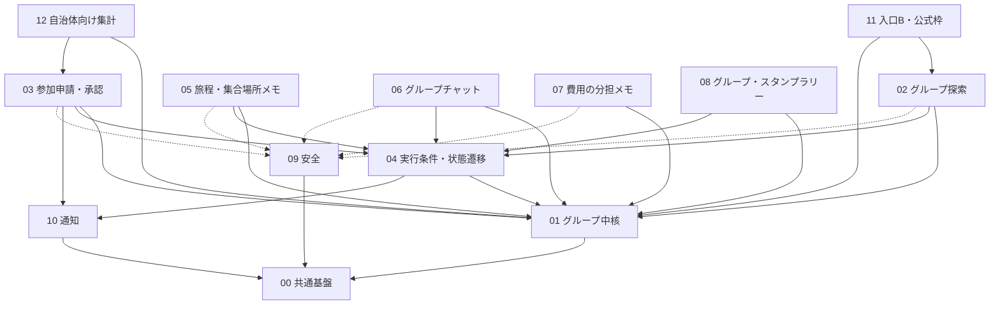

# 追加機能 詳細設計書(docs/feature)

## 1. 目的と読み方

- 追加機能(グループ旅行・グループ一覧・安全・周辺機能)を、実装の単位(モジュール)に分けて詳細設計するための骨子集。本文は骨子の粒度で、分からないことは [未決] とする。
- docs/design(設計書15項目、全体設計)との関係: docs/design が「何を作るか・全体方針」、docs/feature が「モジュールごとにどう作るか」。**矛盾した場合は docs/design を正とする。** 特に「グループの実行条件(最少人数・締切・実行確定・中止・再企画・状態遷移)」は docs/design の該当章(01・02・04・05・07・10・12 章)を正とし、本書では参照にとどめる。
- 読む順: 本 README(方針・一覧・依存) → `00-common-foundation.md` → 関心のあるモジュール。
- 用語は docs/design に従う(同行、グループ、幹事、参加申請、実行確定、中止、再企画)。「相乗り」「マッチング」や恋愛を連想させる語は使わない。
- 競技ルールの原本は rule/rule.md。localhost 完結、外部 API/DB/クラウド依存なし、ダミーデータ、ログイン不要(本人確認等はモック)、OSS はライセンス確認。

### 状態の凡例
[事実] 確認済みの事実 / [推定] 根拠ありの推測 / [決定] オーナー決定済み / [案] 提案(未承認) / [未決] 判断待ち / [要確認] 調べれば分かる未確認事項

## 2. モジュール一覧

柱番号は docs/design/02 章。優先度はデモ優先順位(output.md 4.3: 一覧→旅程→候補→希望・承諾)との対応で、S=デモ必須、A=デモで見せたい、B=余力で実装/画面モック。デモの形(12章 #1)が未決のため暫定 [案]。

| # | モジュール | ファイル | 責務(1行) | 柱 | 優先度 |
|---|---|---|---|---|---|
| 00 | 共通基盤 | 00-common-foundation.md | データストア、seed/ダミーユーザー、検証、エラー、日時、API 共通部 | (全体) | S |
| 01 | グループ中核 | 01-group-core.md | グループの作成・設定・公開/非公開・招待コード・メンバー・幹事・旅程入力 | 2、13 | S |
| 02 | グループ探索 | 02-group-discovery.md | グループ一覧、検索・絞り込み、参加前の詳細、キャンペーン・地方選択 | 1、3、17 | S |
| 03 | 参加申請・承認 | 03-join-flow.md | 参加申請、幹事の承認/却下、取り下げ、成立時のメンバー追加 | 4、13 | S |
| 04 | 実行条件・状態遷移 | 04-group-lifecycle.md | 最少人数・締切、実行確定・中止・再企画、グループ状態遷移の一元管理 | 13(+実行条件) | S |
| 05 | 旅程・集合場所メモ | 05-group-plan.md | 参加者が編集できる旅程・集合場所・日程メモ | 14 | A |
| 06 | グループチャット | 06-group-chat.md | ローカルのモックチャット(定型文/自由入力は未決) | 15 | A |
| 07 | 費用の分担メモ | 07-expense-notes.md | 費用メモの記録(送金なし)、割り勘計算は未決 | 16 | B |
| 08 | グループ・スタンプラリー | 08-group-rally.md | 既存スタンプ・スポットをグループ単位に集計、振り返り | 9 | A |
| 09 | 安全 | 09-safety.md | 公開範囲、通報・ブロック、禁止表現、本人確認・18歳確認(モック) | 5〜8 | S(禁止表現・公開範囲)/A |
| 10 | 通知 | 10-notifications.md | グループ関連イベントの通知(既存通知の拡張) | (4、13 を支える) | A |
| 11 | 入口B・公式枠 | 11-entry-and-official.md | 外部リンクの条件引き継ぎ、公式枠・地元の同行枠 | 10、12 | B |
| 12 | 自治体向け集計 | 12-municipal-stats.md | 個人を特定しない集計画面 | 11 | B |

モジュールは 13 個(00 を含む)。細分化しすぎないよう、ライフサイクル(04)は状態遷移の一元管理に限定し、各機能(05〜08)はグループ状態を問い合わせるだけにした。 [案]

### 既存機能の流用との境界

| 既存機能 | 扱い | 担当モジュール |
|---|---|---|
| スタンプ、スポット、特典 | 流用(個人のスタンプ取得ロジックは変更しない。グループ集計は上乗せ) | 08 |
| 写真投稿、アンケート | 流用(振り返りでの再利用) | 08 |
| 通知(`/api/v2/notifications`) | 拡張(グループ通知を追加。既存モックは維持) | 10 |
| 既存 `/api/v2` モック、`server-store.ts` | 変更しない。新機能は別名前空間と別ストアで追加 [案] | 00 |

## 3. 依存関係



読み方: 実線は「呼び出す/参照する」、点線は「安全機能(公開範囲・ブロック・禁止表現)による制御」。循環を避けるため、01 は 04 を呼ばず、04 が 01 の状態フィールドを更新する関数を使う。 [案]

## 4. 全体の設計方針 [案]

### 4.1 app/ の既存構成に合わせる
- [事実] app/ は Next.js 16.4.5(App Router)、React 19、Mantine 9、Zustand、dayjs。dev/build は `--webpack`。ルーティングは `src/app/[campaign]/...`、既存モック API は `src/app/api/v2/[...path]/route.ts` の 1 本のキャッチオール、状態は `src/lib/server-store.ts`(globalThis のインメモリ、再起動で seed.json に戻る)、クライアントは `src/lib/api.ts`(`api` / `post` / `useApi`)。
- [要確認] 本 worktree では `app/node_modules` が無く、`app/node_modules/next/dist/docs/` を確認できていない。Route Handler の署名(`params` が Promise)は既存コードから読み取れるが、キャッシュ・Server Action の扱いは実装前に該当ガイドを読む(AGENTS.md 1)。

ディレクトリ案(新規のみ。既存ファイルは変更しない):

```
app/src/
  app/[campaign]/groups/          一覧・詳細・作成・申請(page.tsx、[groupId]/page.tsx 等)
  app/api/groups/[...path]/       グループ系 Route Handler(薄く。検証して service を呼ぶ)
  features/groups/                サービス層(純粋関数中心。UI/HTTP に依存しない)
    core/ discovery/ join/ lifecycle/ plan/ chat/ expense/ rally/
  features/safety/  features/notify/  features/official/  features/stats/
  lib/groups-store.ts             グループ系のインメモリストア(server-store.ts と同方式、別ファイル)
  lib/validation.ts  lib/errors.ts  lib/clock.ts
  data/group-seed.json            グループ系ダミーデータ(手書き。実ユーザー情報なし)
```

### 4.2 データの持ち方
- [決定] ダミーデータのみ、外部 DB なし。[案] 既存 seed.json(キャンペーン、スポット、特典、ユーザー1人)は変更せず読み取る。グループ・ダミーユーザー(6〜10人)・申請・チャット等は別ファイル `group-seed.json` に手書きで置く(sample-data は使わない。ユーザー情報を含むため)。
- [案] 実行時状態は globalThis のインメモリ(既存方式)。再起動で初期化されるため、デモの再現性が高い。リセット API を持つ。
- [未決] ローカル永続化(JSON ファイル書き出し/SQLite)の要否。docs/design 03・05 章 の DB 有無と同じ論点。SQLite を採る場合は OSS ライセンス確認(08 章)が要る。
- [案] 現在ユーザーはログイン不要のため「デモユーザー切替」(Cookie `demoUser`)で表す。幹事/申請者/他メンバーの視点を 1 画面で切り替えて試験できる。画面に「モック」と明示する。

### 4.3 API の形
- [案] Route Handler(`app/api/groups/...`)を採用。理由: 既存の `src/lib/api.ts`(fetch ベース)と揃う、サーバー側ストアを共有できる、試験で HTTP から叩ける。Server Action は採らない(Next.js 16 の仕様を未確認のため)。[要確認]
- 形式: JSON。成功は `200/201` + 本体、失敗は `{ error: "<code>", message?, fields? }`(既存 `api.ts` が `body.error` を `code` として読むのに合わせる)。
- 状態を変える操作は POST(例: `POST /api/groups/:id/join-requests`、`POST /api/groups/:id/join-requests/:rid/approve`)。権限は「現在ユーザー」を Cookie から取り、サービス層で判定する(クライアントの申告を信用しない)。

### 4.4 共通の検証・エラー・日時・i18n
- 検証: サーバー側で必ず行う(クライアント検証は補助)。文字種・長さ・列挙値・ID 形式。数値は整数範囲。ID は `^[a-z0-9-]{1,40}$` 等で制限し、ファイルパスやクエリに直結させない(パストラバーサル対策)。SQL を使わないため SQLi は該当しないが、将来 SQLite を採る場合はプレースホルダ必須 [案]。出力は React の既定エスケープに任せ、`dangerouslySetInnerHTML` は使わない。
- エラー: コード体系 `invalid_input` / `forbidden` / `not_found` / `conflict`(状態不整合・定員超過・重複申請)/ `unavailable_state`(実行確定済み・中止済み等)/ `blocked`。画面には原因と次の行動を表示(rule.md 9.1、docs/design 06 章)。
- 日時: 保存は ISO 8601(タイムゾーン付き)、表示は dayjs で日本時間。**現在時刻は `lib/clock.ts` 経由**で取得し、試験・デモで締切超過を再現できるよう差し替え可能にする。 [案]
- i18n: デモは日本語のみ [案]。文言は `features/*/messages.ts` に集約し、後から差し替え可能にする。既存の多言語(3言語)対応の要否は [未決](docs/design 02 章)。
- 禁止表現・公開範囲は 09 のフィルタ関数を全入力(グループ名、メモ、チャット、費用項目)で通す。

## 5. 各モジュール設計書の共通テンプレート

雛形は [_template.md](_template.md)。章立て:
1. 概要と責務 / 対応する柱・ユーザーストーリー
2. 既存機能との関係(流用/拡張/新規)
3. 画面・UI(docs/design/04 との対応)
4. データ(エンティティ、項目、保存先。docs/design/05 との対応)
5. インターフェース(公開する関数/API、入力・出力、呼び出し元。署名は案)
6. 状態遷移・主要シーケンス(必要なモジュールのみ)
7. 入力検証・セキュリティ
8. エラー処理
9. 試験観点(docs/design/10 との対応)
10. 依存するモジュール
11. 未決事項(docs/design/12 の番号と対応)
12. 実装メモ(デモ範囲の最小実装案)

## 6. 横断の未決事項(要約)
デモの形(12章 #1)、DB/永続化の有無、既存システムとの関係(#4)、柱17件の確定(#5)、Next.js 16 ドキュメントの確認、既存多言語対応の要否。各モジュールの未決は各ファイル第11章に記載。

## 7. docs/design との差異メモ
- docs/design の柱数は 17。実行条件(最少人数・締切・実行確定・中止・再企画)は柱番号を持たない見込みのため、04 を「13(+実行条件)」とした。 [要確認] 並行作業の docs/design 反映後に柱番号を合わせる。
