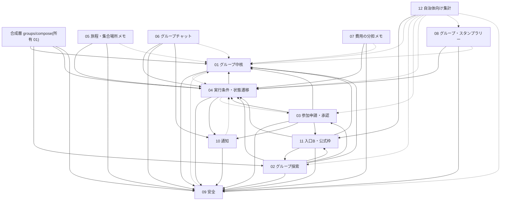

# 追加機能 詳細設計書(docs/feature)

## 1. 目的と読み方

- 追加機能(グループ旅行・グループ一覧・安全・周辺機能・観光事業オーナー向け機能)を、実装の単位(モジュール)に分けて詳細設計する。分からないことは [未決] とする。
- **モジュール間の契約は統一仕様書 [_unified-contracts.md](_unified-contracts.md)(以下「契約書」)が正。** モジュール間で共有する名前・型・署名・API のパス・値・エラー・依存の向きについて、契約書と各モジュールの記述が食い違う場合は契約書を正とし、各モジュールを契約書に合わせて改訂する(契約書の第 13 章・第 17 章)。モジュール内部の設計は各モジュールに残す。
- docs/design(設計書15項目、全体設計)との関係: docs/design が「何を作るか・全体方針」、docs/feature が「モジュールごとにどう作るか」。docs/design と契約書が食い違う場合は docs/design を正とする。ただし契約書の第 12 章で求めた docs/design の更新は 2026-11-09 に反映済みで、その内容は両者で一致する。グループの実行条件(最少人数・締切・実行確定・中止・再企画・状態遷移)は docs/design の 01・02・04・05・07・10・12 章を正とする。
- 読む順: 本 README(一覧・依存・方針) → 契約書 → `00-common-foundation.md` → 関心のあるモジュール。
- 用語は docs/design に従う(同行、グループ、幹事、参加申請、実行確定、中止、再企画)。「相乗り」「マッチング」や恋愛を連想させる語は使わない。
- 競技ルールの原本は rule/rule.md。localhost 完結、外部 API/DB/クラウド依存なし、ダミーデータ、ログイン不要(本人確認等はモック)、OSS はライセンス確認。
- オーナー判断は `.work/review.md`(論点 1〜34)に記録され、契約書と docs/design/12 章に反映されている。各設計書で [決定 N] と書くものは、この論点番号を指す。

### 状態の凡例
[事実] 確認済みの事実 / [推定] 根拠ありの推測 / [決定] オーナー決定済み / [案] 提案(未承認) / [未決] 判断待ち / [要確認] 調べれば分かる未確認事項。契約書ではこれに加えて [統一](モジュール間で 1 つに決めた案)を使う。

## 2. モジュール一覧

柱番号は docs/design/02 章。優先度は S=デモ必須、A=デモで見せたい、B=余力で実装/画面モック。優先度にかかわらず、主ルート(第 6 章)に含まれる部分を先に作る。 [案]

| # | モジュール | ファイル | 責務(1行) | 柱 | 優先度 |
|---|---|---|---|---|---|
| 00 | 共通基盤 | 00-common-foundation.md | ストア、ID、検証、エラー、時計、`route()`、ドメインイベント、seed とデモユーザー、試験基盤 | (全体) | S |
| 01 | グループ中核 | 01-group-core.md | グループの作成・設定・公開/非公開・招待コード・メンバー・幹事・旅程入力。合成層(作成・詳細)を所有 | 2、13 | S |
| 02 | グループ探索 | 02-group-discovery.md | グループ一覧、検索・絞り込み、参加前の詳細、地方、招待コードからのプレビュー | 1、3、17 | S |
| 03 | 参加申請・承認 | 03-join-flow.md | 参加申請、幹事の承認/却下、取り下げ、失効、再エントリー | 4、13 | S |
| 04 | 実行条件・状態遷移 | 04-group-lifecycle.md | 最少人数・締切、辞退・退会、実行確定・中止・再企画、8 状態の遷移と状態ごとの可否 | 18 | S |
| 05 | 旅程・集合場所メモ | 05-group-plan.md | 参加者が編集できる旅程・集合場所・日程メモ | 14 | A |
| 06 | グループチャット | 06-group-chat.md | ローカルのモックチャット(定型文と自由入力)、システムメッセージ | 15 | A |
| 07 | 費用の分担メモ | 07-expense-notes.md | 費用メモの記録(送金なし)、分担のまとめ。実行確定以降に使える | 16 | B |
| 08 | グループ・スタンプラリー | 08-group-rally.md | グループ専用のスタンプ記録、振り返り(メモ・アンケート 5 項目・ダミー写真)、個人特典の付与記録 | 9 | A |
| 09 | 安全 | 09-safety.md | 公開範囲、通報・ブロック、禁止表現、本人確認・18歳確認(モック)、レート制限 | 5〜8 | S(禁止表現・公開範囲)/A |
| 10 | 通知 | 10-notifications.md | グループ関連の通知(必須 12 種、任意 2 種)。既存の通知とは別に持つ | 18(4、13 を支える) | A |
| 11 | 入口B・公式枠 | 11-entry-and-official.md | 外部リンクの条件引き継ぎと着地ページ、ダミー外部リンク集、流入の計測、公式枠・地元の同行枠 | 10、12 | B |
| 12 | 自治体向け集計 | 12-municipal-stats.md | 個人を特定しない集計画面(K=5) | 11 | B |
| 13 | 観光事業オーナー向け需要見込みと提案 | 13-tourism-owner-insight.md | 過去の集計と未来の旅行日程から需要見込みを示し、ルールベースで提案する | 未定 | 作成中 |

- モジュールは 14 個(00 を含む)。13 は別作業で作成中で、依存の向き・API・ロールの値(`UserRole` への観光事業オーナーの追加)は 13 の設計書と契約書の更新で決める。 [決定(機能の追加、判断 31〜34)/未決(契約)]
- 合成層 `features/groups/compose`(所有 01): グループの作成 `POST /api/groups` と詳細 `GET /api/groups/[groupId]` のハンドラを置く。01・02・04・09 を import し、どのモジュールからも import されない(契約書 2.1・5.1・5.5)。
- ライフサイクル(04)は状態遷移の一元管理に限定し、各機能(05〜08)は 04 の可否関数(契約書 4.4)でグループの状態を問い合わせるだけにした。 [案]

### 既存機能の流用との境界

| 既存機能 | 扱い | 担当モジュール |
|---|---|---|
| スタンプ、スポット | 流用(スポットの情報を読む。既存の個人スタンプは変更しない)。グループのスタンプはグループ専用の記録 `groupStamps` に持つ [決定 6] | 08 |
| 特典 | 既存の特典機能(`/api/v2`)とは連動させない。グループの達成による個人特典は新しいストア `rallyRewardGrants` に記録する [決定 13・21] | 08 |
| 写真投稿、アンケート | **流用しない。** `app/` に実装が無いため、振り返りのダミー写真とアンケート(5 項目)を 08 で新規に作る [事実(app/ に実装なし)/決定 15・19・25] | 08 |
| 通知(`/api/v2/notifications`、`news` 画面) | 変更しない。グループの通知は 10 が別のストア・API・画面で持つ(契約書 9.2) | 10 |
| 既存 `/api/v2` モック、`server-store.ts` | 変更しない。新機能は別の名前空間と別のストアで追加する | 00 |
| `next.config.ts` | セキュリティヘッダー 3 種を追加する(既存の設定は残す)[決定 2] | 00 |

## 3. 依存関係

契約書 4.6 の依存の向き(実行時の import)を図にした。全モジュールが 00 を import するため、00 への矢印は省略した。



読み方: 実線は実行時の import(関数の呼び出し)、点線は型だけの参照(`import type`)と、00 の `db()` によるデータの読み取り。全モジュール → 00 の矢印は省略。

- 循環を避ける仕組み: 01 は 02・04 を実行時に import しない(作成と詳細の合成は合成層)。02 → 11 と 11 → 02 は、11 が import する 02 のファイルを `discovery/query.ts`・`discovery/regions.ts`(ストアと 11 に依存しない)に限ることで循環しない。03 → 11 は、11 が 03 を import しないため循環しない。 [案、契約書 4.6]
- ドメインイベント(00 の `lib/events.ts`。同期・同じ `tx` の中で実行): 発行側は購読側を import しない。

| イベント | 発行 | 購読 |
|---|---|---|
| `group_created` | 01 | 06(システムメッセージ) |
| `member_joined` | 01(承認によるメンバー追加のみ) | 06 |
| `member_left` | 04(辞退・退会) | 06、07 |
| `status_changed` | 04(状態が変わるすべての遷移) | 06(システムメッセージ)、03(申請の失効と `join_expired`) |

- 画面からの API 利用は import の依存に数えない(例: 04 の退会確認ダイアログは 07 の `GET G/expense-summary` を取得する)。
- 13(観光事業オーナー向け)の依存は図に含めていない(作成中)。 [未決]

## 4. 全体の設計方針

### 4.1 app/ の既存構成
- [事実] app/ は Next.js 16.4.5(App Router)、React 19.3.0、Mantine 9、Zustand、dayjs。dev/build は `--webpack`。ルーティングは `src/app/[campaign]/...`、既存モック API は `src/app/api/v2/[...path]/route.ts` の 1 本のキャッチオール、状態は `src/lib/server-store.ts`(globalThis のインメモリ、再起動で seed.json に戻る)、クライアントは `src/lib/api.ts`(`api` / `post` / `useApi`)。
- [事実] 本 worktree には `app/node_modules` が無い。主チェックアウト(`C:\Users\Jisui_share006\work\app`)には `node_modules/next/dist/docs/` がある。Next.js・Mantine の仕様の確認は実装の着手時に行う(判断は不要。契約書 14.2)。

### 4.2 ルーティング [統一、契約書 2.1・2.2]
- Route Handler はリソースごとの `route.ts`。キャッチオール `[...path]`、ハンドラ登録表、ディスパッチャは作らない。
- 各モジュールは `features/<m>/handlers.ts` に 00 の `route()` で包んだハンドラを置き、`app/api/.../route.ts` は再エクスポートだけを書く。
- 複数モジュールを合成するハンドラ(作成・詳細)は合成層 `features/groups/compose/handlers.ts` に置く。
- 動的セグメント名はグループが `[groupId]`、子資源は `[requestId]`、`[itemId]`、`[messageId]`、`[expenseId]`、`[photoId]`、`[userId]`。`[id]` は使わない。
- R-1: `_` で始まるフォルダを作らない(Next.js でルーティングの対象外になる)。デモ用の API は `/api/demo/*`。
- R-2: 本機能で新設するフォルダでは、同じ階層に静的セグメントと動的セグメントを並べない。
- API と画面のパスの一覧は契約書 2.2。画面は `/[campaign]/groups`、`/[campaign]/groups/[groupId]`、`/[campaign]/new-group`、`/[campaign]/invite`、`/[campaign]/notifications`、`/[campaign]/entry`、`/[campaign]/external-links`、`/[campaign]/admin/stats` ほか。

### 4.3 HTTP メソッドと応答 [統一、契約書 2.3・3.3]
- 取得は GET、作成は POST(201)、全置換は PUT、部分更新は PATCH、削除は DELETE(204)。状態遷移の操作は POST の動詞サブパス(`approve`、`withdraw`、`cancel` など)。
- 変更系は本文の有無にかかわらず `Content-Type: application/json` を必須とする(CSRF 対策)。
- 楽観ロックは `version`(入力は `baseVersion`)、不一致は `conflict` + `reason: "version_mismatch"`。
- 一覧は `Page<T>`(`limit`・`offset`)。時系列の追記型(チャット、通知)は `CursorPage<T>`。並び順は `?sort=<キー>:<asc|desc>`。
- エラーの応答は `{ error, reason?, message, fields?, detail? }`。`message` は利用者向けの日本語で、原因と次の行動を書く(rule.md 9.1、docs/design 06 章)。
- 権限は「現在ユーザー」を Cookie から取り、サービス層で判定する。本文の `userId` を権限に使わない。

### 4.4 共通基盤の公開インターフェース
- 00 が公開するもの(`db()`/`Repo`/`tx()`、`newId`/`isId`/`isSlugId`、`AppError`、検証 DSL `v`、`sanitizeText`、`LIMITS`、`clock`、`route()`、`beforeRequest` フック、`emit`/`on`、`parsePage`/`parseSort`、`formatJst`、`CursorPage<T>`、試験用の `callRoute`・`fixtures.ts` ほか)の一覧と署名は、契約書の第 3 章(3.1〜3.7)を正とし、実装の詳細は `00-common-foundation.md`。
- 各モジュールは同じ役割の関数を自前で作らない(契約書 3.7)。
- 04 の状態の可否関数(契約書 4.4)、09 のアクセス判定・禁止表現・プロフィール(契約書 6 章)、10 の `notify`(契約書 9 章)も、モジュール間の契約として契約書に定める。

### 4.5 データの持ち方
- [決定] ダミーデータのみ、外部 DB なし。
- [案] 既存 seed.json(キャンペーン、スポット、特典、ユーザー)は変更せず読み取る。追加機能のデータは `app/src/data/group-seed.json` に手書きで置く(sample-data は使わない。ユーザー情報を含むため)。全コレクションの一覧は契約書 3.1。
- [案] 実行時状態は globalThis のインメモリ。再起動で初期化され、`/api/demo/reset` で初期状態に戻す。JSON ファイルへの書き出しは見送り(契約書 16.2)。
- [決定 34] 現在ユーザーはログイン不要のため、デモバーでユーザーを切り替えて表す(Cookie)。画面に「モック」と明示する。
- [決定 33] 観光事業オーナー向けの集計済みデータと未来日の旅行日程のダミーデータは `app/scripts/build-seed.mjs` の拡張で生成する。個人レコードは持ち込まない(詳細は 13)。

### 4.6 共通の検証・日時・i18n
- 検証はサーバー側で必ず行う(クライアント検証は補助)。00 の `v` と `LIMITS` を使い、モジュールごとに上限値を再定義しない(契約書 3.4・10.3)。ID は `isId`/`isSlugId` で検証し、個別の正規表現を書かない。
- 出力は React の既定エスケープに任せ、`dangerouslySetInnerHTML` は使わない。
- 禁止表現は保存する入力を 09 の `assertTextAllowed` に通す(契約書 6.2)。
- 日時: 保存は `clock.nowIso()`(`+09:00`)、表示は 00 の `formatJst`。現在時刻は `clock` 経由で取得し、デモ・試験では `/api/demo/clock` で進める。
- i18n: デモは日本語のみ [案]。文言は `features/*/messages.ts` に集約する。既存の多言語(3言語)対応の要否は [未決](docs/design 02 章)。

## 5. ディレクトリ構成

新規のみ。既存ファイルは `next.config.ts` のヘッダー追加を除いて変更しない。詳細は `00-common-foundation.md` と各モジュールの「ファイル構成」。 [案]

```
app/
  vitest.config.ts                      試験の設定(00)
  next.config.ts                        (既存)セキュリティヘッダーを追加(00)
  src/
    data/group-seed.json                追加機能のダミーデータ(手書き。各モジュールの断片を 00 が統合)
    lib/                                共通基盤(00): groups-store、ids、errors、validation、limits、clock、
                                        current-user、authz、api-route、query、hooks、events、datetime、groups-api
    features/
      bootstrap.ts                      フック・イベント購読の登録(1 モジュール 1 行)
      groups/
        types.ts  core/                 01 グループ中核
        compose/                        合成層(作成・詳細。所有 01)
        discovery/                      02 グループ探索(query.ts、regions.ts は 11 からも使う)
        join/                           03 参加申請・承認
        lifecycle/                      04 実行条件・状態遷移
        plan/                           05 旅程・集合場所メモ
        chat/                           06 グループチャット
        expense/                        07 費用の分担メモ
        rally/                          08 グループ・スタンプラリー
      safety/                           09 安全
      notify/                           10 通知
      entry/                            11 入口B(着地、計測)
      official/                         11 公式枠・地元の同行枠
      stats/                            12 自治体向け集計
    app/
      api/                              Route Handler(各モジュールの handlers.ts の再エクスポートのみ)
        demo/  groups/  invites/  regions/  me/  users/  reports/  entry/  official/  hosts/  stats/
      [campaign]/                       画面
        groups/  new-group/  invite/  notifications/  entry/  external-links/  admin/  mypage/
    components/groups/common/           共通の画面部品(00)
    test/                               setup.ts、helpers.ts、fixtures.ts(00)
```

- 13(観光事業オーナー向け)のフォルダは 13 の設計書で定める。 [未決]

## 6. 実装優先度

オーナー指示(`.work/review.md` 第 12 章)により、主ルートの動作を優先し、エッジケースの作り込みは見送ってよい。範囲は契約書の第 16 章。 [決定(方針)/案(範囲)]

### 6.1 優先する主ルート(契約書 16.1)
1. グループ作成 → 一覧・検索 → 参加申請 → 幹事の承認 → 最少人数到達 → 締切 → 辞退期間 → 実行確定 → 実施(旅程メモ・チャット・費用メモ・スタンプ・振り返り) → 完了 → 自治体向け集計。
2. 中止 → 再企画の基本の流れ(再企画の作成、`replan_invited`、再エントリーの申請)。
3. 必須 12 種の通知。
4. 安全の基本: 公開範囲(非公開・年代帯の公開設定・メンバー概要)、禁止表現(deny と review)、通報(3 種)・ブロック(一覧・申請・チャットの効果)、本人確認(モック)、00 の `route()` の入口検査、セキュリティヘッダー。
5. 招待コード(コード入力 → プレビュー → 申請)。

### 6.2 実装の順序(依存の下位から)[案]
00 → 09 → 01 → 10 → 04 → 02 の `discovery/query.ts`・`regions.ts` と 11 の公式枠バッジ取得 → 03 → 02 → 合成層 → 05〜08 → 12 → 11 の残り → 13。各モジュールの中では、主ルートに含まれるタスクを先に作る(例: 07 は優先度 B だが、費用メモの追加・一覧・合計は主ルートの「実施」に含まれる)。

### 6.3 見送ってよいもの(契約書 16.2)
同時操作の競合ダイアログ、レート制限の画面表示、不正値の網羅的な試験、ブロック関係の細かい表示、通信失敗時の細かい表示、再企画の細部、差分・推測への対策、時計の後戻り・永続化、余力の機能(`chat_new`・`deadline_near` の通知、`read-all`、`status-log` API、地図、変更履歴)、性能・網羅試験、方針の切替。各モジュールは該当する試験・タスク・記述に「見送り(契約書 16.2)」と印を付け、削除しない。

## 7. 各モジュール設計書の共通テンプレート

雛形は [_template.md](_template.md)。新しく作る設計書(13 など)はこの章立てに従う。既存の 00〜12 は章番号がモジュールごとに異なるが、同じ項目を含む。

1. 概要と責務 / 対応する柱・ユーザーストーリー
2. 既存機能との関係(流用/拡張/新規)
3. 画面・UI(docs/design/04 との対応、パス)
4. データ(エンティティ、項目、保存先。docs/design/05 と契約書 3.1 との対応)
5. ファイル構成と責務
6. インターフェース(公開する関数・API の入力・出力・呼び出し元。署名は契約書に合わせる)
7. 状態遷移・権限・主要シーケンス(必要なモジュールのみ)
8. 入力検証・セキュリティ(OWASP の対応表を含む)
9. エラー処理(コード、条件、HTTP ステータス、画面での表示)
10. 試験項目(docs/design/10 との対応。Vitest)
11. 実装タスク(順序、優先度、主ルートか見送りか)
12. 依存するモジュール・利用ライブラリ
13. 他モジュールとの契約(契約書の該当節)
14. 未決事項(docs/design/12 の番号と対応)
15. 設計上の確認事項(docs/design・契約書・他モジュールとの差異)
16. 実装メモ(デモ範囲の最小実装案)

## 8. 横断の未決事項(要約)
デモの形(docs/design 12 章 #1)、既存システムとの関係(#4)、柱 18 件の確定(#5)、既存 seed.json の個人情報の扱い(#27)、観光事業オーナー向け機能の柱番号(#28)、既存多言語対応の要否。Next.js 16・Mantine 9 の仕様の確認は実装の着手時に行う(契約書 14.2)。各モジュールの未決は各ファイルの「未決事項」の章に記載。

## 9. docs/design との差異メモ
- 柱番号: docs/design の柱は 18 件。実行条件と状態管理は柱 18 で、04 の柱は 18 とした(前回の「13(+実行条件)」から改めた)。
- 契約書の第 12 章で求めた docs/design の更新(通知 12 種、ディレクトリ構成とルーティング方式、Vitest、状態遷移図の 8 状態、追加画面、データ、年代帯・K=5・ブロックの方向・通報の対象・招待の方式・CSP なし、OSS 一覧、確定した判断)は 2026-11-09 に反映した。
- 観光事業オーナー向け機能の柱番号は docs/design で未定。13 の作成後に合わせる。 [未決]
