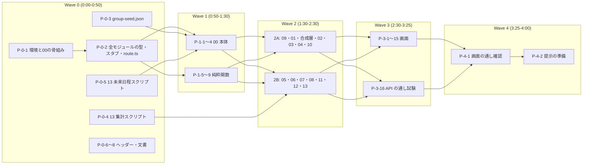

# 実装計画(docs/plan)

## 1. 目的と前提

- 追加機能(docs/feature 00〜13)を、残り約 4 時間で「動作するモック」としてお客様に提示できる状態にする(AGENTS.md §0)。
- 仕様の正は契約書 `docs/feature/_unified-contracts.md`。次に各モジュールの設計書 `docs/feature/NN-*.md`。設計書どうしの食い違いは契約書に合わせて実装し、`followups.md` に記録する。
- 主ルート(契約書 16.1)を先に動かす: グループ作成 → 一覧 → 参加申請 → 承認 → 状態遷移(確定・中止)→ 実施(旅程・チャット・費用・スタンプラリー・振り返り)→ 完了 → 自治体・観光事業オーナーの画面。安全は基本(公開範囲、禁止表現、通報・ブロックの最小実装)。見送りの範囲(契約書 第 16 章)は `tasks.md` 末尾の「余力」に置く。
- ファイル: `tasks.md`(タスクのチェックリスト)、`briefs.md`(ブリーフの雛形と共通の注意)、`followups.md`(不具合・食い違いの記録)。

## 2. 運用ルール(AGENTS.md の要点)

- 1 タスク = 1 サブエージェント = 1 ブランチ `agent/<タスク名>`。`isolation: "worktree"`、バックグラウンドで起動する。
- 同じ波で並行するタスクは、変更するファイルが重ならない(`tasks.md` の「対象」で確認する)。
- worktree ごとに `app/` で `npm ci` を実行する(`node_modules` は共有されない)。
- コミットはオーナーの指示があるときだけ。`git add .`・`-A` は使わない。`git push` はしない。マージ・リベース・worktree の削除は、オーナーの承認後に窓口が行う(承認依頼は波ごとにまとめる)。
- `.env*`、`Password.txt.txt` は読まない。`sample-data/` は P-0-4 だけが、スクリプト経由で必要な列だけを扱う(行の内容を出力・転記しない)。
- 不具合・エッジケース・見た目の修正は直さず `followups.md` に追記する。主ルートが止まる不具合だけ、その場で直す。

### チェックボックスの凡例

- `[ ]` 未着手 / `[*]` 完了(マージ済み)。
- タスク ID は `P-<波>-<連番>`。規模は S(〜30 分)、M(30〜60 分)。L は置かない。

## 3. 並行化の取り決め(計画上の決定。仕様ではない)

- **スケルトン方式**: Wave 0 の P-0-1・P-0-2 が、全モジュールの型(`types.ts`)、契約書で他モジュールから呼ばれる公開関数・画面部品の署名スタブ(本体は `throw new Error("not implemented")`、画面部品は空の表示)、全 API の `route.ts`(契約書 2.2 の再エクスポート)と `handlers.ts` のスタブ、`features/bootstrap.ts` と各モジュールの `register.ts` の空スタブを置く。以降のタスクは自分の所有ファイルのスタブを本体に置き換えるだけにし、`route.ts`・`bootstrap.ts` は触らない。
- 同じ波の他タスクが作る関数は、試験では `vi.mock` で代替する(スタブは例外を投げるため)。モジュール間の結合は P-3-16(API の通し)と P-4-1(画面の通し)で確認する。
- 画面のページファイル(`app/src/app/[campaign]/**/page.tsx`)は、`tasks.md` で指定した画面タスクだけが作る。

## 4. 波の構成とタイムボックス

| 波 | 時間 | 目的 | タスク数 | 並行/直列 | 波の完了条件(全マージ後、`app/` で) |
|---|---|---|---|---|---|
| Wave 0 | 0:00〜0:50 | 環境・型・スタブ(P-0-1 → P-0-2 は直列)、seed・ビルド時スクリプト・文書の小タスク(並行) | 8 | 主経路は直列、他は並行 | `npm test`(0 件でも成功)、`npx tsc --noEmit`、`npm run build` |
| Wave 1 | 0:50〜1:30 | 00 共通基盤の本体、依存の少ない純粋関数(09 禁止表現、07 計算、12・13 の集計) | 9 | 並行 | `npm test`、`npm run build`。`npm run dev` で DemoBar とロール切替が動く |
| Wave 2 | 1:30〜2:30 | 全モジュールのサービス層+API(2A: 主ルート 14、2B: 実施中の機能・集計 11) | 25 | 並行(2A を先に起動、空きが出たら 2B) | `npm test`、`npm run build` |
| Wave 3 | 2:30〜3:25 | 全画面(モックの HTML を Mantine に置き換える)と API の通し試験 | 16 | 並行 | `npm test`、`npm run build`。主要画面が開ける |
| Wave 4 | 3:25〜4:00 | 画面の通し確認、主ルート停止の修正、提示の準備(最後の 30 分) | 2 | 並行 | 主ルートをブラウザで通せる |

- 本線のタスクは 60。余力のタスクは `tasks.md` 末尾。
- 同時に起動する最大数は Wave 2 の 25(現在のセッションの上限 20 を超えるため、2A の 14 を先に起動し、2B は完了したものから入れ替えで起動する。上限 40 のセッションでは 25 を同時に起動する)。
- 波の中で完了したタスクから順にマージし、次の波のタスクは、前提のタスクがマージされた時点で起動してよい(前提は `tasks.md` の「前提」)。

## 5. 依存関係図

## 6. マージの単位と基準

- タスクは「単独の機能テストが通る」「ビルドが通る」でマージする。レビューは最小限(AGENTS.md §0)。
- 標準のゲート(`app/` で実行):
  - **G-T(対象)**: `npm test -- <対象のディレクトリ>` が成功する(Vitest。対象に試験が無いタスクは省略)。
  - **G-B**: `npx tsc --noEmit`、`npm run lint`、`npm run build` が成功する。
- 境界値・異常系の網羅は求めない。各タスクは主ルートの正常系と、代表的な拒否 1 件程度を試験する。
- 失敗した試験を残してマージしない。主ルートに関係しない失敗は、試験を `it.skip` にして FollowUp に記録してよい。

## 7. 窓口の起動手順

1. 波の開始時に、`tasks.md` のその波の `[ ]` のタスクを、前提がマージ済みのものから全て同時に起動する。
   - パラメータ: `isolation: "worktree"`、バックグラウンド、ブランチ名は各タスクの「ブランチ」。
   - プロンプト: `briefs.md` の雛形に、`tasks.md` のタスクのブロックを差し込む。
2. 完了通知を受けたら、報告(変更ファイル、実行コマンドと結果、FollowUp)を確認し、ゲートが通っていれば「マージ待ち」に積む。FollowUp は `followups.md` に転記する。
3. 波ごとにまとめてオーナーにマージの承認を取り、承認後にマージする。マージしたタスクを `[*]` にする。
4. 前提がそろったタスクから次の波を起動する。Wave 2 は 2A を先に、2B を空きの出た順に起動する。
5. タイムボックスを超えそうな波は、主ルートに関係しないタスク(2B の後半、Wave 3 の 09・10・11 の画面)を余力に回す。
