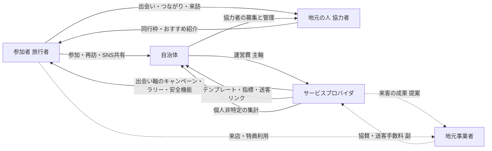

# 登場人物をまたぐ価値の流れ

凡例: 実線=docsに記載、点線=本書の提案・仮説。

## 表: 誰が何を提供し、何を得るか

| 登場人物 | 提供するもの | 得るもの | 出典/区分 |
|---|---|---|---|
| 参加者(旅行者) | 参加、旅程・プロフィール(公開範囲は自分で選択)、再訪、SNS共有・写真投稿 | 出会い・つながり、共通の話題(ラリー)、旅の記録、積み上がる特典 | ideas.md(事実) |
| 地元の人(協力者) | 同行枠、地元のおすすめ・紹介スポット | 地域を知ってもらう機会、顔の見える再訪、負担の自己決定 | ideas.md(事実) |
| 自治体 | 運営費(主軸)、協力者の募集・管理、広報での送客 | 関係人口を生む場として選ばれる動機、個人非特定の指標、送客リンク、参加者の声 | ideas.md 7.6(事実) |
| サービスプロバイダ | キャンペーン基盤、安全・信頼の運用、集計・指標 | 運営費、協賛・送客手数料(副)、横展開による拡張 | ideas.md 7.6(事実/見立て) |
| 地元事業者 | 協賛・送客手数料(副の収益源)、スポット・特典の提供 | 来客、成果レポート | 手数料は ideas.md、得るものは本書の提案 |

## 価値のループ(再訪の仕組み)

1. 自治体がキャンペーンを組む(運営費)
2. 参加者が出会いを求めて参加
3. 地元の人・他の参加者と出会い、記録が積み上がる
4. 再訪・SNS共有で次の参加者を呼ぶ
5. 指標(参加・再訪・成立)が自治体に返り、次の運営費の根拠になる

(ideas.md 2章の「人と結びつく」「積み上がる」を、提供側の収益と接続した整理。ループ全体の効果は仮説で未検証。)
